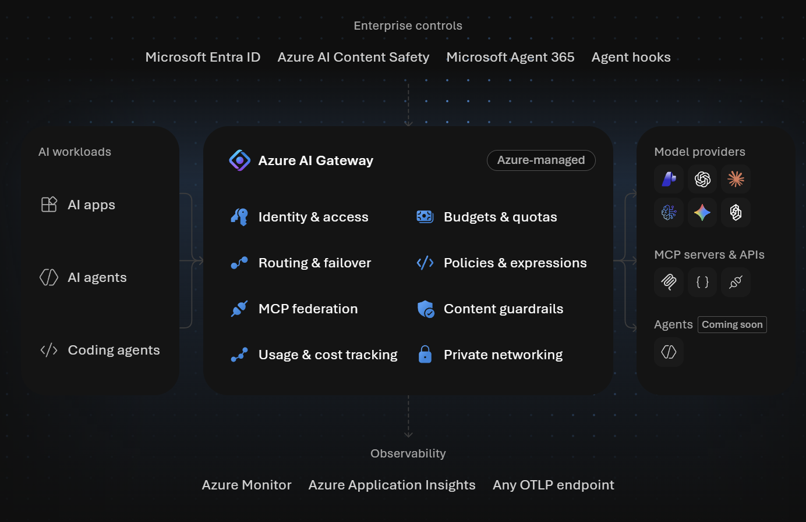

# Azure AI Gateway

**Secure, observe, and control AI apps and agents from one place. Build and deploy with confidence.**

**https://ai.gateway.azure.com**




## Developer and coding-agent tools


Use the coding-agent plugin to discover models and Model Context Protocol (MCP) tools and integrate them into
your app, or use the Azure CLI to manage a gateway.

- [Coding-agent plugin](#coding-agent-plugin): discover and integrate models and MCP tools; create, manage,
  and migrate gateways.
- [Azure CLI](#azure-cli): create and manage gateways from the command line.
- [Migration tool](tools/migrate-apim/README.md): inventory and migrate AI workloads from API Management.
- [Labs](labs/README.md) and [samples](samples/README.md): learn and build with AI Gateway.

For service concepts and configuration, see the [AI Gateway documentation](https://aka.ms/aigateway/docs).

## Coding-agent plugin

Install the plugin in Claude Code or GitHub Copilot CLI to use its skills and
`/aigateway:*` commands.

**Claude Code / GitHub Copilot CLI**

```
/plugin marketplace add Azure/aigateway
/plugin install aigateway@azure
```

| Skill | Use it to |
| ----- | --------- |
| [`use-ai-gateway`](skills/use-ai-gateway/SKILL.md) | Integrate: discover a gateway's models and MCP tools and connect them to your app. |
| [`manage-ai-gateway`](skills/manage-ai-gateway/SKILL.md) | Configure and administer: providers, models, aliases, MCP sources, policies, keys, identities, networking, and telemetry. |
| [`migrate-apim`](skills/migrate-apim/SKILL.md) | Migrate model APIs, MCP servers, and A2A agents from API Management. |
| [`feedback-ai-gateway`](skills/feedback-ai-gateway/SKILL.md) | Package an agent session into a local feedback ZIP. |

| Command | What it does |
| ------- | ------------ |
| `/aigateway:discover [gateway details]` | Find model aliases and MCP servers (read-only). |
| `/aigateway:build [gateway details] [use case]` | Connect models and tools to your app. |
| `/aigateway:create <gateway> <resource-group> <region>` | Create a gateway. |
| `/aigateway:manage <gateway> <resource-group>` | Configure and operate a gateway. |
| `/aigateway:migrate <apim-name> <resource-group>` | Plan and run a migration from API Management. |
| `/aigateway:feedback` | Package an agent session into a local ZIP. |

For example, provide a gateway resource ID to discover its assets, then describe what you want to build:

```
/aigateway:discover /subscriptions/<sub>/resourceGroups/<rg>/providers/Microsoft.ApiManagement/aigateways/<gateway>
/aigateway:build /subscriptions/<sub>/resourceGroups/<rg>/providers/Microsoft.ApiManagement/aigateways/<gateway> summarize support tickets
```

You can also provide published connection details instead of a resource ID.

## Azure CLI

`az aigateway` (alias `az aig`) is a published extension for creating and managing gateways. It is in public
preview and requires [Azure CLI](https://learn.microsoft.com/cli/azure/install-azure-cli) 2.75.0 or later.

```bash
curl -fsSL https://aka.ms/aigateway-cli-install -o install.sh
sh install.sh
az aigateway version
```

```powershell
Invoke-WebRequest https://aka.ms/aigateway-cli-install-ps -OutFile install.ps1
./install.ps1
az aigateway version
```

The installers verify the wheel's SHA-256. See the [installation guide](cli/README.md) and
[command reference](cli/command-reference.md).

## Support and contributing

Found a bug or have a feature request for the CLI, skills, or labs?
[Open an issue](https://github.com/Azure/aigateway/issues) or send a pull request with a fix or improvement.

- Questions and bugs: [SUPPORT.md](SUPPORT.md). Report vulnerabilities through [SECURITY.md](SECURITY.md).
- Contributions require a [Contributor License Agreement](https://cla.opensource.microsoft.com). Lab authors
  read [AUTHORING.md](labs/AUTHORING.md); coding agents read [AGENTS.md](AGENTS.md).
- This project follows the [Microsoft Open Source Code of Conduct](CODE_OF_CONDUCT.md).

## Trademarks

This project may contain trademarks or logos for projects, products, or services. Authorized use of Microsoft
trademarks or logos is subject to and must follow
[Microsoft's Trademark & Brand Guidelines](https://www.microsoft.com/legal/intellectualproperty/trademarks/usage/general).
Use of Microsoft trademarks or logos in modified versions of this project must not cause confusion or imply
Microsoft sponsorship. Any use of third-party trademarks or logos are subject to those third-party's policies.
