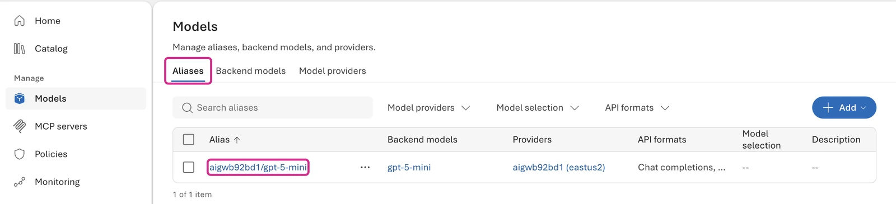
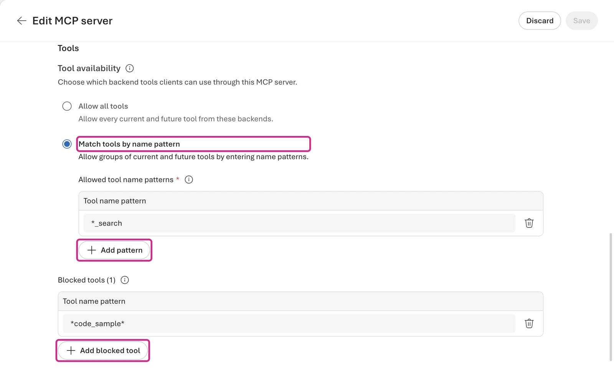
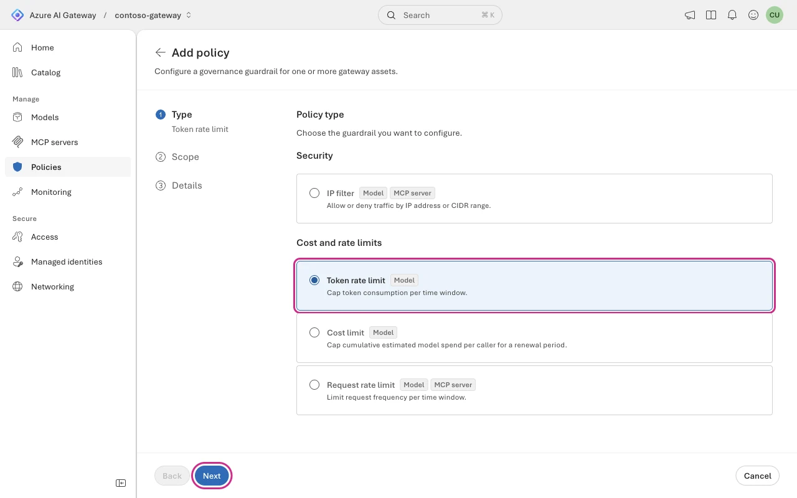
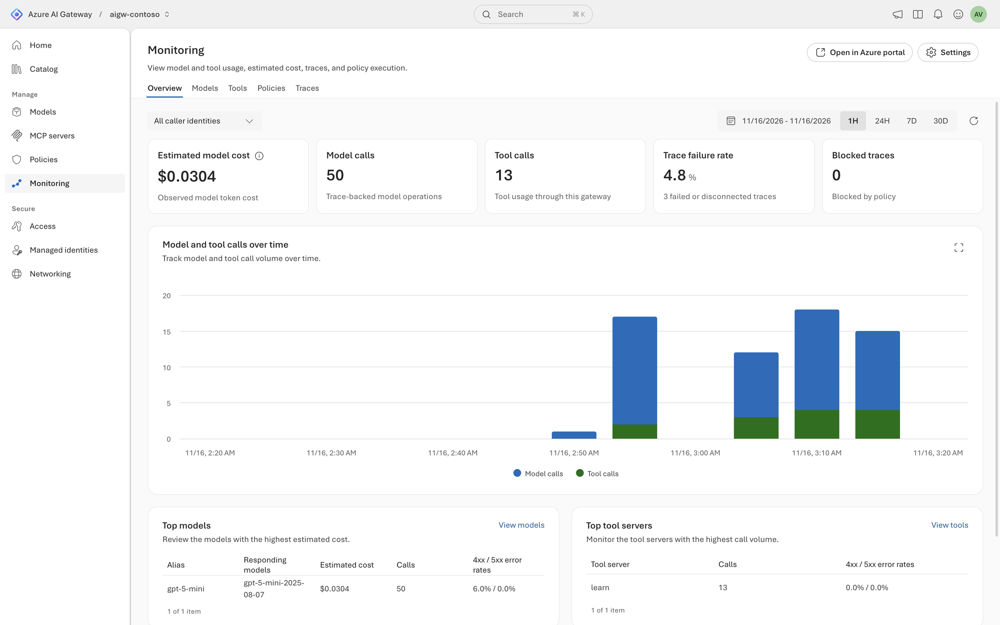

<!--
title: How Azure AI Gateway works
summary: A 20-minute visual tour of Azure AI Gateway. Follow one request through the gateway, meet models, aliases, MCP servers, policies, and identities, and pick the learning path that fits your role.
category: foundations
level: Beginner
duration: 20
tracks: [portal]
order: 0
illustration: diagrams/architecture.svg
tags: [concepts, architecture, overview, aliases, routing, failover, MCP, policies, Agent hooks, OpenTelemetry]
objectives:
  - Describe what Azure AI Gateway does and where it sits between your apps, agents, models, and tools
  - Follow a request through authentication, policies, alias routing, the backend, and telemetry
  - Explain the difference between a backend model, an alias, and an MCP server
  - Pick the routing option an alias needs, from priorities and weights to backend conditions, auto model selection, session affinity, and failover
  - Predict which policies apply to a request and which status code a blocked request returns
  - Choose the learning path that matches your role
-->
<!-- gh:begin nav: generated by "npm run sync" from the metadata, do not edit -->
[AI Gateway labs](../README.md) › [Foundations](../README.md#foundations) › Lab 00
<!-- gh:end -->

# How Azure AI Gateway works

<!-- gh:begin intro: generated by "npm run sync" from the metadata, do not edit -->
> A 20-minute visual tour of Azure AI Gateway. Follow one request through the gateway, meet models, aliases, MCP servers, policies, and identities, and pick the learning path that fits your role.

| ⏱️ Time | 📶 Level | 🧭 Tracks | ✅ Before you start |
| :-- | :-- | :-- | :-- |
| 20 min | Beginner | Portal | Nothing, start here |

**You'll learn to**

- Describe what Azure AI Gateway does and where it sits between your apps, agents, models, and tools
- Follow a request through authentication, policies, alias routing, the backend, and telemetry
- Explain the difference between a backend model, an alias, and an MCP server
- Pick the routing option an alias needs, from priorities and weights to backend conditions, auto model selection, session affinity, and failover
- Predict which policies apply to a request and which status code a blocked request returns
- Choose the learning path that matches your role

**Follow along:** 🌐 [Interactive version](https://azure.github.io/aigateway/labs/00-how-ai-gateway-works/) with your own values filled in · 🎬 [Video walkthrough](https://azure.github.io/aigateway/labs/00-how-ai-gateway-works/#video-walkthrough)

**On this page:** [Before you begin](#before-you-begin) · [How it works](#how-it-works) · [Follow one request](#follow-one-request) · [Models and aliases](#models-and-aliases) · [MCP servers and tools](#mcp-servers-and-tools) · [Policies and scopes](#policies-and-scopes) · [Identities on both sides](#identities-on-both-sides) · [Observability](#observability) · [Take a portal tour](#take-a-portal-tour) · [Verify](#verify) · [Clean up](#clean-up) · [Next steps](#next-steps)
<!-- gh:end -->

Every team that ships generative AI hits the same questions. Which models may we call, and with which keys?
Who spent the tokens? How do we stop one agent from starving everyone else, or from calling a tool it should
never touch? **Azure AI Gateway**, a managed gateway for AI traffic, answers them in one place: apps and agents
call one gateway, and the gateway decides who gets in, which model or tool answers, what each call may cost, and
what gets recorded.

<!-- video: media/walkthrough.mp4 | Narrated walkthrough: how Azure AI Gateway works (3 min) -->
<!-- gh:begin video: generated by "npm run sync" from the metadata, do not edit -->
[")](https://azure.github.io/aigateway/labs/00-how-ai-gateway-works/#video-walkthrough)

🎬 [Play with captions on the labs site](https://azure.github.io/aigateway/labs/00-how-ai-gateway-works/#video-walkthrough) · ⬇️ [Download MP4](media/walkthrough.mp4) · 📝 [Captions](media/walkthrough.vtt)
<!-- gh:end -->

> [!NOTE]
> Azure AI Gateway is generally available since November 18, 2026, and runs in a growing list of regions: run the
> command in [Find the available regions](../SETUP.md#find-the-available-regions) to list them. For the
> gateway's pricing, see the [AI Gateway documentation](https://ai.gateway.azure.com/docs). Connected services, such
> as Microsoft Foundry inference and Application Insights, are billed normally.

## Before you begin

This lab is a guided reading. You don't need to deploy anything.

- If you already have a gateway, open the [AI Gateway portal](https://ai.gateway.azure.com) in another tab and
  follow the portal tour at the end.
- If you don't have one yet, read on. You create your first gateway in
  [Provision your first AI gateway](../01-provision-gateway/README.md).

## How it works

The gateway sits on the path of every model call and every tool call. It has two faces:

- **Data plane**: the runtime endpoints your code calls, at `<gateway-url>`.
- **Control plane**: the product portal at [ai.gateway.azure.com](https://ai.gateway.azure.com) and the Azure
  Resource Manager API for the `Microsoft.ApiManagement/aigateways` resource type, which you call with the
  `az aigateway` Azure CLI extension, Bicep, or any REST client.

Azure AI Gateway is a dedicated product for AI traffic, built on the Azure API Management gateway foundation. It
shares the `Microsoft.ApiManagement` resource provider with API Management service but has its own resource type, so
you can keep business APIs in API Management and send model and tool traffic through the gateway.

| Building block | What it is | Example |
|---|---|---|
| **Gateway** | An Azure AI Gateway resource (`Microsoft.ApiManagement/aigateways`) in your subscription | `<gateway-url>` |
| **Backend model** | A model at a provider: a chat, embedding, or decision model, such as a Foundry deployment or an Anthropic model | `gpt-5-mini` at Microsoft Foundry |
| **Alias** | The stable, gateway-wide name clients send in the `model` field. Its routing settings pick a backend model for each request | `chat` |
| **MCP server** | One governed MCP endpoint that federates tools from one or more sources | `/default/toolservers/<server-name>/mcp` |
| **Policy** | A rule on the gateway or on one asset: limits, budgets, safety, filters, and Agent hooks | Token rate limit, Cost limit |
| **Access** | How callers authenticate: API keys or Microsoft Entra ID roles | `Authorization: Bearer` with a key or an Entra token |
| **Managed identity** | How the gateway authenticates to backends | Foundry User role on the Foundry account |
| **Monitoring** | OpenTelemetry metrics, logs, and traces for every call | Application Insights or any OTLP endpoint |

Model calls use protocols developers already know. The OpenAI-compatible base URL is
`https://<gateway-host>/default/models/openai/v1` (append `/responses`, `/chat/completions`, or `/embeddings`),
Anthropic Messages lives at `/default/models/anthropic/v1/messages`, and Jev decision models answer TypeSafe System
One requests at `/default/models/typesafe/v1/systemone`. The gateway passes requests through without translating
between formats, so call each model on an interface it advertises. See
[Model API formats and providers](https://ai.gateway.azure.com/docs/models/api-formats-and-providers).

## Follow one request

Press **Play** to send a request through the gateway. Then switch scenarios to see where each policy stops a
request and which status code the caller gets back.

<!-- widget: request-lifecycle -->
<!-- gh:begin widget: generated by "npm run sync" from the metadata, do not edit -->
> 🎛️ **Interactive:** try the request lifecycle explorer in the [web version of this lab](https://azure.github.io/aigateway/labs/00-how-ai-gateway-works/).
<!-- gh:end -->

Three rules explain almost every response you'll see in these labs:

1. **Policies run before the backend.** If any applicable policy blocks a request, the gateway answers right away
   and never calls the backend. The one exception is an Agent hooks policy that checks a tool's result: it runs
   after the tool and can withhold the result, but it can't undo the tool's work.
2. **Each block has a predictable status.** `401` for missing or invalid credentials, `403` for IP filters and
   cost limits (`LlmCostQuotaExceeded`), `429` with `Retry-After` for token and request rate limits, and `400` for
   content safety.
3. **Everything is recorded.** Allowed and blocked calls both show up in **Monitoring**, along with the policies
   that affected them.

A backend error is different from a policy block. When the serving backend fails, for example with `429` or a
`5xx`, the alias's failover rules can retry it or switch to another backend before the caller sees the error.

## Models and aliases

A **backend model** is what a provider serves. An **alias** is what your clients call. Microsoft Foundry imports
create an alias for each model by default, and you can add more. Because clients only know the alias, you can move
it to a newer or cheaper model without a code change, and the alias keeps its own policies.

<!-- widget: alias-retarget -->
<!-- gh:begin widget: generated by "npm run sync" from the metadata, do not edit -->
> 🎛️ **Interactive:** try the alias retargeting demo in the [web version of this lab](https://azure.github.io/aigateway/labs/00-how-ai-gateway-works/).
<!-- gh:end -->

You can put models from Microsoft Foundry, Azure OpenAI, OpenAI, Anthropic, Amazon Bedrock, Google Vertex AI, and
custom OpenAI-compatible endpoints behind aliases. You try it in
[Route models from several providers behind aliases](../03-multi-provider-aliases/README.md). Besides chat models,
an alias can publish embedding models for search and retrieval, which you try in
[lab 26](../26-embeddings/README.md), or TypeSafe Jev decision models that return structured yes/no probabilities,
choices, and rubric scores, which you try in [lab 31](../31-jev-decisions/README.md). An alias can't mix chat,
embedding, and decision models: all its backends must share an API endpoint.

### Routing options

An alias can point to several backend models. Its routing settings decide which one serves each request:

| Routing option | What it does | Try it |
|---|---|---|
| **Priorities and weights** | Prefers the available backends with the lowest priority number, and spreads requests across them by weight | [Lab 22](../22-model-routing/README.md) |
| **Backend conditions** | Limits which requests a backend can receive, with a CEL expression over the request, such as a header | [Lab 27](../27-conditional-routing/README.md) |
| **Auto model selection** | Uses Model Router to choose a smaller or larger model for each prompt, for your quality and cost objective. It's still emerging: see the [November 6, 2026 release](https://ai.gateway.azure.com/docs/releases#release-2026-11-06) | [Lab 28](../28-auto-model-selection/README.md) |
| **Session affinity** | Sends requests with the same session key, read by a CEL expression, to the same backend when possible, so a conversation can reuse the provider's prompt cache | [Session affinity](https://ai.gateway.azure.com/docs/models/session-affinity) |
| **Failover and retry** | Retries a failed backend or switches to the next eligible one, and can exclude a failing backend for a while | [Lab 29](../29-model-failover/README.md) |

Clients keep calling the same alias while you change any of these settings. See
[Models and routing](https://ai.gateway.azure.com/docs/models) and
[Routing order](https://ai.gateway.azure.com/docs/models/routing-order) for how the settings combine.

## MCP servers and tools

Agents need tools as much as models. An **MCP server** on the gateway gives agents one endpoint and one credential
for tools from remote MCP servers, OpenAPI specifications, Foundry Toolbox, and MCP servers you import from Azure,
such as the connector tools of a Connector Namespace. Tool names are namespaced per source, and
**tool availability** decides which tools clients can see and call.

## Policies and scopes

You add a policy at **gateway scope**, where it applies to every compatible asset including assets you add later,
or to **individual assets**: a backend model, an alias, or an MCP server. Pick an asset below to see every policy
that applies to it.

<!-- widget: policy-layers -->
<!-- gh:begin widget: generated by "npm run sync" from the metadata, do not edit -->
> 🎛️ **Interactive:** try the policy layers explorer in the [web version of this lab](https://azure.github.io/aigateway/labs/00-how-ai-gateway-works/).
<!-- gh:end -->

| Policy | Applies to | When it blocks |
|---|---|---|
| **Token rate limit** | Models and aliases | `429` with `Retry-After` |
| **Request rate limit** | Models, aliases, and MCP servers | `429` with `Retry-After` |
| **Cost limit** | Models and aliases | `403` `LlmCostQuotaExceeded` |
| **Content safety** | Models, aliases, and MCP servers | `400` |
| **IP filter** | Models, aliases, and MCP servers | `403` |
| **Agent 365 tool threat protection** | MCP servers | Denies the tool call |
| **Agent hooks** | MCP servers | Your decision service denies the tool call before it runs, or withholds its result after it runs |

At gateway scope, the policy type decides which assets are relevant. A gateway-scope cost limit, for example,
tracks one budget across all models. An asset policy adds a control: it doesn't replace a policy the asset inherits
from the gateway.

Agent hooks send the tool call's context to an external decision service that you run, and enforce its `allow` or
`deny` verdict, for example to refuse refunds above a limit. They're still emerging: see the
[November 6, 2026 release](https://ai.gateway.azure.com/docs/releases#release-2026-11-06) and
[Agent hooks](https://ai.gateway.azure.com/docs/policies/agent-hooks), then try them in
[lab 30](../30-agent-hooks/README.md).

## Identities on both sides

The gateway separates **who is calling** from **how the gateway reaches the backend**. Callers use an API key or a
Microsoft Entra token with one of the AI Gateway data-plane roles. The gateway uses its own managed identity, or a
provider key it stores, to call backends. Callers never see backend credentials.

Managing the gateway is a third, separate permission. **AI Gateway Developer** can view the configuration of
aliases and MCP servers, **AI Gateway Contributor** can manage model providers, aliases, MCP servers, routing,
limits, and policies, and **Contributor** on the gateway resource can also change gateway settings, networking,
identities, and API keys. None of these roles can call models or tools: that
takes a data-plane role. See [Control-plane access](https://ai.gateway.azure.com/docs/security/control-plane-access).

## Observability

The gateway emits OpenTelemetry metrics, logs, and traces for model calls, embeddings, decisions, tool calls,
routing, and policy decisions. Traces also mark model-stream and MCP operation failures as errors, even when the
HTTP response was `200`. Send them to Application Insights to light up the built-in **Monitoring** dashboard, or
to any OTLP endpoint.

## Take a portal tour

If you have a gateway, walk through the portal now. Otherwise, use the screenshots and come back after
[lab 01](../01-provision-gateway/README.md).

<!-- steps -->

### Open your gateway

Go to [ai.gateway.azure.com](https://ai.gateway.azure.com) and sign in. Use the gateway switcher in the top bar to
pick a gateway. The left rail lists **Home** and **Catalog**, then **Models**, **MCP servers**, **Policies**, and
**Monitoring** under **Manage**, and **Access**, **Managed identities**, and **Networking** under **Secure**. Press
<kbd>Ctrl</kbd>+<kbd>K</kbd>, or <kbd>⌘</kbd>+<kbd>K</kbd> on macOS, to open the command palette from anywhere.

### Browse models and aliases

Select **Models**. It opens on **Aliases**, which lists each alias with its backend models, providers, API formats,
and model selection. The **Backend models** tab lists each backend model with its aliases and provider.

### Look at an MCP server

Select **MCP servers** and open a server. The tool availability settings decide which tools clients can see.

### Start a policy

Select **Policies** › **Add policy**. The wizard asks for a **Type**, then a **Scope** (**Gateway** or
**Individual assets**), then the **Details**. Select **Cancel** to leave without saving.

### Open Monitoring

Select **Monitoring**. When Application Insights is connected, the **Overview**, **Models**, **Tools**,
**Policies**, and **Traces** tabs show live traffic.

<!-- /steps -->

## Verify

Check your understanding before you move on.

An app sends <code>"model": "chat"</code>. What must <code>chat</code> be?

A callable **alias** on the gateway. The `model` field must exactly match an alias, not a provider deployment name.

A caller exceeds a token rate limit. Is the backend called?

No. The gateway answers `429 Too Many Requests` with `Retry-After` and never forwards the request.

An alias has two backends, and the first one returns <code>503</code>. Does the caller see the error?

Only if no failover rule on the alias matches the failure. A matching rule can retry the same backend, switch to the
other backend, and exclude the failing one for a while. Without a matching rule, the gateway returns the `503`.

You add an IP filter at gateway scope, then add a new model next week. Is the new model protected?

Yes. Gateway-scope policies apply to every compatible asset, including assets you add later.

Which credential does the gateway use to call a Microsoft Foundry model?

Its own managed identity, which needs the **Foundry User** role on the Foundry account. The caller's key or token
is never forwarded.

> **Checkpoint**
> You can explain the request lifecycle, the difference between a backend model and an alias, and where gateway
> and asset policies apply.

## Clean up

Nothing to clean up. This lab doesn't create resources.

## Next steps

Short on time? The [5-minute quick start](../quickstart/README.md) creates a gateway with a Foundry model in the
portal or Azure Cloud Shell and makes your first call. Then pick the path that fits your role. Each path is a sequence of labs, and your
progress is saved in this browser.

| Path | Start with | You'll learn to |
|---|---|---|
| **30-minute essentials** | [Provision a gateway](../01-provision-gateway/README.md) | Create a gateway, call a model, and add MCP tools |
| **Platform engineer** | [Provision a gateway](../01-provision-gateway/README.md) | Build a governed, multi-provider gateway with code |
| **App & agent developer** | [First model call](../02-first-model-call/README.md) | Call models and tools from SDKs, agents, and hosted agents |
| **Security & compliance** | [API keys](../10-api-keys/README.md) | Control access, content, tools, and threats |
| **FinOps & operations** | [Token limits](../06-token-limits/README.md) | Cap tokens, set budgets, and charge back usage |

- Docs: [AI Gateway documentation](https://ai.gateway.azure.com/docs)
- Microsoft Learn: [What is Azure AI Gateway?](https://learn.microsoft.com/azure/ai-gateway/overview) and
  [Azure AI Gateway and Azure API Management service](https://learn.microsoft.com/azure/ai-gateway/compare-api-management-service)

<!-- gh:begin footer: generated by "npm run sync" from the metadata, do not edit -->

🛟 **Hit an error?** [Troubleshooting](../TROUBLESHOOTING.md#lab-00-how-ai-gateway-works) lists the errors of this lab, the steps where they happen, and their fixes.

---

| ⬅️ Previous | 🏠 | Next ➡️ |
| :-- | :-: | --: |
| [⚡ · Quick start](../quickstart/README.md) | [All labs](../README.md) | [01 · Provision a gateway](../01-provision-gateway/README.md) |

Learning paths: [30-minute essentials](../README.md#learning-paths) (1 of 4)
<!-- gh:end -->
