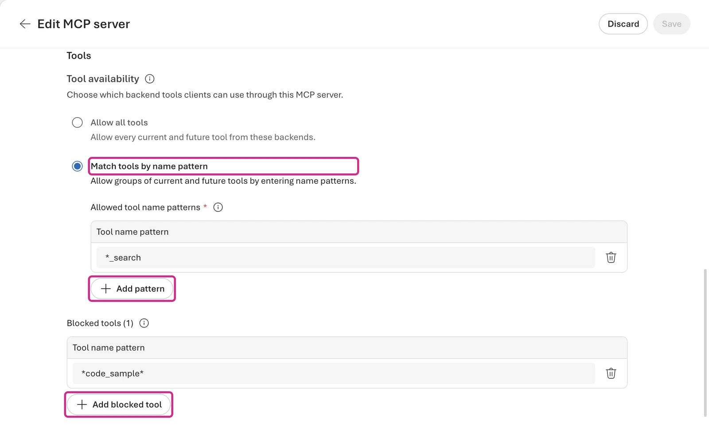

<!--
title: Control which tools agents can call
summary: Publish only approved MCP tools with name patterns, block risky tools, take a whole MCP server offline, and cap tool traffic per caller with a request rate limit.
category: tools
level: Intermediate
duration: 20
tracks: [portal, cli, iac, terraform]
order: 5
illustration: diagrams/mcp-federation.svg
tags: [MCP, tools, allow list, blocked tools, glob patterns, requestRateLimit, "429", Retry-After, Terraform]
objectives:
  - Choose between allowing all tools and matching tools by exact name or wildcard pattern, in the portal, with the Azure CLI, with Bicep and azd, or with Terraform
  - Block specific tools with patterns that take precedence over the allow list
  - Take a whole MCP server offline without deleting it
  - Add a request rate limit to an MCP server in the portal, with the Azure CLI, with Bicep and azd, or with Terraform, and trigger a 429
prereqs:
  - 04-federate-mcp-tools
-->
<!-- gh:begin nav: generated by "npm run sync" from the metadata, do not edit -->
[AI Gateway labs](../README.md) › [MCP & tools](../README.md#mcp--tools) › Lab 05
<!-- gh:end -->

# Control which tools agents can call

<!-- gh:begin intro: generated by "npm run sync" from the metadata, do not edit -->
> Publish only approved MCP tools with name patterns, block risky tools, take a whole MCP server offline, and cap tool traffic per caller with a request rate limit.

| ⏱️ Time | 📶 Level | 🧭 Tracks | ✅ Before you start |
| :-- | :-- | :-- | :-- |
| 20 min | Intermediate | Portal · Azure CLI · Bicep + azd · Terraform | [04 · Federate MCP tools](../04-federate-mcp-tools/README.md) |

**You'll learn to**

- Choose between allowing all tools and matching tools by exact name or wildcard pattern, in the portal, with the Azure CLI, with Bicep and azd, or with Terraform
- Block specific tools with patterns that take precedence over the allow list
- Take a whole MCP server offline without deleting it
- Add a request rate limit to an MCP server in the portal, with the Azure CLI, with Bicep and azd, or with Terraform, and trigger a 429

**Follow along:** 🌐 [Interactive version](https://azure.github.io/aigateway/labs/05-mcp-tool-controls/) with your own values filled in · 📁 [Lab files](infra/)

**On this page:** [Before you begin](#before-you-begin) · [How it works](#how-it-works) · [Publish only approved tools](#publish-only-approved-tools) · [Take the whole server offline](#take-the-whole-server-offline) · [Rate-limit the MCP server](#rate-limit-the-mcp-server) · [Verify](#verify) · [Go further](#go-further) · [Clean up](#clean-up) · [Next steps](#next-steps)
<!-- gh:end -->

The `learn` MCP server that you federated now publishes every tool from two backends. Your security team has
two requests: agents should **search** documentation but not fetch arbitrary pages, and the code sample tool
stays off until its review is done. Operations adds a third: a looping agent must not flood the backends. In
this lab you publish only the approved tools, block one explicitly, and give each caller a request budget.


<!-- widget: tool-patterns {"tools":["learn_microsoft_docs_search","learn_microsoft_code_sample_search","learn_microsoft_docs_fetch","docs_microsoft_docs_search","docs_microsoft_code_sample_search","docs_microsoft_docs_fetch"],"allow":["*_search"],"block":["*code_sample*"]} -->
<!-- gh:begin widget: generated by "npm run sync" from the metadata, do not edit -->
> 🎛️ **Interactive:** try the tool patterns explorer in the [web version of this lab](https://azure.github.io/aigateway/labs/05-mcp-tool-controls/).
<!-- gh:end -->

## Before you begin

<!-- setup: tools sign-in extension clone -->
<!-- gh:begin setup: generated by "npm run sync" from the metadata, do not edit -->
🧰 **One-time setup** from the [Setup guide](../SETUP.md), if you haven't done it yet:
[Choose where to run commands](../SETUP.md#choose-where-to-run-commands) ·
[Sign in to Azure](../SETUP.md#sign-in-to-azure) ·
[Install the `aigateway` extension](../SETUP.md#install-the-aigateway-extension) ·
[Clone the labs repo](../SETUP.md#clone-the-labs-repo)
<!-- gh:end -->

> [!TIP]
> On the **Bicep + azd** and **Terraform** tracks, `azd up` or `terraform apply` creates its own gateway, the `learn`
> MCP server with its tool controls and request rate limit, and a key, so you can skip this section. You need only
> the one-time setup above.

- Complete [Federate MCP tools behind one endpoint](../04-federate-mcp-tools/README.md). You need the `learn`
  MCP server with its `learn` and `docs` backends, and a runtime API key from **Access** › **API keys**.
- Permission to change the gateway, for example **Contributor** on the resource group.
- Run the scripts and samples from the lab's folder, `~/aigateway/labs/05-mcp-tool-controls`.

Set these variables once. Every track and the **Verify** section reuse them.

<details open><summary>Bash</summary> <!-- gh -->

```bash title="Bash"
# Name the resource group and the gateway that hold the learn MCP server from lab 04
export RG="<resource-group>"
export GATEWAY="<gateway>"
echo "📝 Gateway $GATEWAY in $RG"

# Read the gateway's runtime URL, which every MCP endpoint starts with
export AI_GATEWAY_URL="https://$(az aigateway show -g "$RG" -n "$GATEWAY" --query properties.frontend.defaultHostname -o tsv)"
echo "🌐 Runtime URL: $AI_GATEWAY_URL"

# Paste the runtime key that you created in Access › API keys, without showing it
# Don't commit the key or write it to a file
printf "AI Gateway API key: " && read -rs AI_GATEWAY_API_KEY && export AI_GATEWAY_API_KEY && echo
echo "🔑 Key: in AI_GATEWAY_API_KEY (${#AI_GATEWAY_API_KEY} characters, not shown)"
```
</details> <!-- gh -->

<details><summary>PowerShell</summary> <!-- gh -->

```powershell title="PowerShell"
# Name the resource group and the gateway that hold the learn MCP server from lab 04
$RG         = "<resource-group>"
$GATEWAY    = "<gateway>"
Write-Host "📝 Gateway $GATEWAY in $RG"

# Read the gateway's runtime URL, which every MCP endpoint starts with
$env:AI_GATEWAY_URL = "https://$(az aigateway show -g $RG -n $GATEWAY --query properties.frontend.defaultHostname -o tsv)"
Write-Host "🌐 Runtime URL: $env:AI_GATEWAY_URL"

# Paste the runtime key that you created in Access › API keys, without showing it
# Don't commit the key or write it to a file
$env:AI_GATEWAY_API_KEY = Read-Host "AI Gateway API key" -MaskInput
Write-Host "🔑 Key: in AI_GATEWAY_API_KEY ($($env:AI_GATEWAY_API_KEY.Length) characters, not shown)"
```
</details> <!-- gh -->

## How it works

An MCP server has three layers of tool control. The gateway applies all of them before it calls a backend.

| Control | Where | Effect |
|---|---|---|
| **Tool availability** | **Edit** › **Tools** | **Allow all tools** publishes every tool, including tools that backends add later. **Match tools by name pattern** publishes only the tools that match an entry under **Allowed tool name patterns**. Tools that don't match aren't listed and can't be called. |
| **Blocked tools** | **Edit** › **Tools** | Names or patterns that the gateway refuses to run. Blocked entries take precedence over the allow list. Blocked tools remain visible to clients, but a call returns `isError: true` and tells the agent not to retry. |
| **MCP server access** | **Edit** › **Basic info** | **Active** or **Blocked**. Blocked MCP servers can't be reached by clients, whatever their tool rules say, and keep their tool settings. |
| **Request rate limit** policy | The server's **Policies** tab | A number of **Calls** per **Renewal period** for each counter. Over the limit, the gateway answers `429` with `Retry-After`. |

Patterns use `*` for any number of characters and `?` for exactly one. They match the final tool names that the
gateway publishes, including the namespace prefix of each backend, such as `learn_`. This lab uses `*_search` to
allow both search tools and `*code_sample*` to block the code sample tool. Both patterns start with `*`, so they
cover every backend of the server. For one backend only, start the pattern with its namespace, as in `learn_*`.

> [!NOTE]
> The tool controls are the MCP server's `allowList`, `blockList`, and `accessState` properties. The `aigateway`
> extension sets the first two with `--allow-list` and `--block-list`, but has no option for server access yet, so
> the Azure CLI track in [Take the whole server offline](#take-the-whole-server-offline) sets `accessState` with
> `az rest`. In a template, the preview name `blocked` is ignored without an error, so check the server after you
> deploy.

## Publish only approved tools

Pick one track. Each publishes the same catalog on the `learn` server: the tools that match `*_search`, with
`*code_sample*` blocked. Make sure the patterns cover every tool that your agents legitimately need before you
save. Tools that don't match are no longer listed or callable.

<!-- track: portal | Portal -->
<details open><summary><b>🖥️ Portal</b></summary> <!-- gh -->

### Open the Tools section

Open the [AI Gateway portal](https://ai.gateway.azure.com) and select your gateway. Select **MCP servers**,
open `Microsoft Learn` (the `learn` server), and select **Edit**. The editor is one page: scroll past
**Basic info** and **Backends** to **Tools**.

### Allow the search tools by pattern

Under **Tool availability**, select **Match tools by name pattern**. Under **Allowed tool name patterns**, enter
`*_search` in the **Tool name pattern** row. To allow more patterns, select **Add pattern** for each one.

### Block the code sample tool

Under **Blocked tools**, select **Add blocked tool** and enter `*code_sample*` in the new **Tool name pattern**
row.



### Save the server

Select **Save**. Under **Tools**, the details page shows **Allowed tools (1)** with `*_search` and
**Blocked tools (1)** with `*code_sample*`.

</details> <!-- gh -->
<!-- track: cli | Azure CLI -->
<details><summary><b>⌨️ Azure CLI</b></summary> <!-- gh -->

### Set the tool controls

`az aigateway mcp update` changes only the properties that you pass, so the backends, versions, and policies stay
as they are. `--allow-list` sets the allowed tool name patterns, and `--block-list` the blocked ones.

<details open><summary>Bash</summary> <!-- gh -->

```bash title="Bash"
# Publish only the tools that match *_search, block the code sample tools, and show the tool controls
az aigateway mcp update -g "$RG" --gateway-name "$GATEWAY" -n learn \
  --allow-list "*_search" --block-list "*code_sample*" \
  --query "properties.{allowList:allowList,blockList:blockList}" &&
  echo "🔧 learn publishes the *_search tools and blocks *code_sample*"
```
</details> <!-- gh -->

<details><summary>PowerShell</summary> <!-- gh -->

```powershell title="PowerShell"
# Publish only the tools that match *_search, block the code sample tools, and show the tool controls
az aigateway mcp update -g $RG --gateway-name $GATEWAY -n learn `
  --allow-list "*_search" --block-list "*code_sample*" `
  --query "properties.{allowList:allowList,blockList:blockList}"
if ($?) { Write-Host "🔧 learn publishes the *_search tools and blocks *code_sample*" }
```
</details> <!-- gh -->

For several patterns, pass a JSON array, such as `--allow-list '["*_search","*_fetch"]'`. `--allow-list null`
clears the allow list, so the server publishes every tool, while `--allow-list "[]"` publishes none.
`--block-list null` clears the blocked tools. `--blocked` is another name for `--block-list`.

> **Checkpoint**
> The command prints `"allowList": ["*_search"]` and `"blockList": ["*code_sample*"]`.

The runtime picks up the change within about 15 seconds, so wait a moment before you check the catalog.

</details> <!-- gh -->
<!-- track: iac | Bicep + azd -->
<details><summary><b>🏗️ Bicep + azd</b></summary> <!-- gh -->

**What you need:** only the one-time setup from **Before you begin**. This track doesn't use your gateway or `learn`
server from lab 04: `azd up` creates a new gateway with its own `learn` server, so it works on its own.

### Review the templates

`infra/main.bicep` creates the resource group `rg-<environment name>` and calls lab 01's
[gateway.bicep](../01-provision-gateway/infra/gateway.bicep) for a gateway with no model. Then it calls
`infra/controlled-tool-server.bicep` with the tool controls, which azd fills from environment values:

| Parameter | azd environment value | Default |
|---|---|---|
| `allowedTools` | `MCP_ALLOWED_TOOLS` | `["*_search"]` |
| `blockedTools` | `MCP_BLOCKED_TOOLS` | `["*code_sample*"]` |
| `serverAccess` | `MCP_SERVER_ACCESS` | `active` |
| `callsPerPeriod` | `REQUEST_RATE_LIMIT` | `5` |
| `periodSeconds` | `REQUEST_RATE_LIMIT_PERIOD` | `30` |
| `counterKey` | `REQUEST_RATE_LIMIT_COUNTER_KEY` | `["identity"]` |

<!-- include: infra/main.bicep -->
<!-- gh:begin include: generated by "npm run sync" from the metadata, do not edit -->
📄 [`infra/main.bicep`](infra/main.bicep)

<details><summary>Show all 86 lines</summary>

```bicep
// Lab 05 with azd: "azd up" creates the resource group rg-<environment name>, a gateway with lab 01's template, then
// the learn MCP server with its tool controls and request rate limit, and the runtime API key app-first-call.
// The runtime API key is never an output.
targetScope = 'subscription'

@description('azd environment name. The resource group is rg-<environmentName>.')
@minLength(1)
@maxLength(60)
param environmentName string

@description('Region for every resource. Pick one where AI Gateway is available. List them with az provider show --namespace Microsoft.ApiManagement (Setup guide, Find the available regions).')
@metadata({ azd: { type: 'location' } })
param location string

@description('Tool names or patterns to publish. azd reads it from MCP_ALLOWED_TOOLS.')
param allowedTools array = [
  '*_search'
]

@description('Tool names or patterns that the gateway refuses to run. azd reads it from MCP_BLOCKED_TOOLS.')
param blockedTools array = [
  '*code_sample*'
]

@description('MCP server access: active or blocked. azd reads it from MCP_SERVER_ACCESS.')
@allowed([
  'active'
  'blocked'
])
param serverAccess string = 'active'

@description('Calls per period for each counter, or 0 for no limit. azd reads it from REQUEST_RATE_LIMIT.')
@minValue(0)
param callsPerPeriod int = 5

@description('Renewal period in seconds, from 1 to 300. azd reads it from REQUEST_RATE_LIMIT_PERIOD.')
@minValue(1)
@maxValue(300)
param periodSeconds int = 30

@description('Counter dimensions, such as ["identity"]. azd reads it from REQUEST_RATE_LIMIT_COUNTER_KEY.')
param counterKey array = [
  'identity'
]

var suffix = take(uniqueString(subscription().id, environmentName, location), 6)
var tags = { 'azd-env-name': environmentName }

resource rg 'Microsoft.Resources/resourceGroups@2024-03-01' = {
  name: 'rg-${environmentName}'
  location: location
  tags: tags
}

// Lab 01's template: the gateway, with no model.
module gateway '../../01-provision-gateway/infra/gateway.bicep' = {
  name: 'aigw-gateway'
  scope: rg
  params: {
    gatewayName: 'aigw-${suffix}'
    location: location
    tags: tags
  }
}

module toolServer 'controlled-tool-server.bicep' = {
  name: 'aigw-controlled-tool-server'
  scope: rg
  params: {
    gatewayName: gateway.outputs.gatewayName
    serverName: 'learn'
    allowedTools: allowedTools
    blockedTools: blockedTools
    serverAccess: serverAccess
    callsPerPeriod: callsPerPeriod
    periodSeconds: periodSeconds
    counterKey: counterKey
    apiKeyName: 'app-first-call'
  }
}

output AZURE_RESOURCE_GROUP string = rg.name
output AI_GATEWAY_NAME string = gateway.outputs.gatewayName
output AI_GATEWAY_ID string = gateway.outputs.gatewayId
output AI_GATEWAY_URL string = gateway.outputs.gatewayUrl
output MCP_ENDPOINT string = toolServer.outputs.mcpEndpoint
```

</details>
<!-- gh:end -->

`infra/controlled-tool-server.bicep` declares the `learn` server of lab 04, with its `learn` and `docs` backends,
plus the tool controls: `allowList` is **Tool availability** (`["*"]` is **Allow all tools**), `blockList` is
**Blocked tools**, and `accessState` is **MCP server access**. Each backend's `mode` is `failClosed` when it's
required and `failOpen` when it's optional. Its `policies` array holds the request rate limit of
[Rate-limit the MCP server](#rate-limit-the-mcp-server), with `count` calls per `period`. The template turns the
seconds into an ISO 8601 duration, such as `PT30S`. It also creates the `app-first-call` key.

<!-- include: infra/controlled-tool-server.bicep -->
<!-- gh:begin include: generated by "npm run sync" from the metadata, do not edit -->
📄 [`infra/controlled-tool-server.bicep`](infra/controlled-tool-server.bicep)

<details><summary>Show all 115 lines</summary>

```bicep
// Declares the learn MCP server of lab 04, with its learn and docs backends, plus lab 05's tool controls: the tools
// it publishes (allowList), the tools it refuses to run (blockList), whether clients can reach it (accessState), and a
// request rate limit for each caller. It also creates a runtime API key for the MCP clients. The key is never an output.
// A deployment sends a PUT, which replaces the whole MCP server, so keep this template as its only source of truth.

@description('Name of the existing AI Gateway (Microsoft.ApiManagement/aigateways).')
param gatewayName string

@description('MCP server name. It becomes part of the endpoint URL and cannot be changed after creation.')
param serverName string = 'learn'

@description('Tool names or patterns to publish. * matches any number of characters and ? exactly one. ["*"] publishes every tool.')
param allowedTools array = [
  '*_search'
]

@description('Tool names or patterns that the gateway refuses to run. They take precedence over allowedTools.')
param blockedTools array = [
  '*code_sample*'
]

@description('MCP server access: active, or blocked to stop all client traffic without deleting the server.')
@allowed([
  'active'
  'blocked'
])
param serverAccess string = 'active'

@description('Calls that each counter allows per period. 0 removes the request rate limit.')
@minValue(0)
param callsPerPeriod int = 5

@description('Renewal period in seconds, from 1 to 300. The portal offers 30, 60, 120, and 300.')
@minValue(1)
@maxValue(300)
param periodSeconds int = 30

@description('What gets its own counter: ["identity"], ["ipAddress"], both, or [] for one counter that all callers share.')
param counterKey array = [
  'identity'
]

@description('Runtime API key to create for the MCP clients.')
param apiKeyName string = 'app-first-call'

var learnUrl = 'https://learn.microsoft.com/api/mcp'

var rateLimit = {
  type: 'requestRateLimit'
  count: callsPerPeriod
  period: 'PT${periodSeconds}S'
  counterKey: counterKey
}

#disable-next-line BCP081
resource gateway 'Microsoft.ApiManagement/aigateways@2026-11-01' existing = {
  name: gatewayName
}

#disable-next-line BCP081
resource workspace 'Microsoft.ApiManagement/aigateways/workspaces@2026-11-01' existing = {
  parent: gateway
  name: 'default'
}

#disable-next-line BCP081
resource toolServer 'Microsoft.ApiManagement/aigateways/workspaces/toolServers@2026-11-01' = {
  parent: workspace
  name: serverName
  properties: {
    displayName: 'Microsoft Learn'
    description: 'Search and fetch official Microsoft documentation and code samples.'
    toolServerType: 'mcp'
    accessState: serverAccess
    allowList: allowedTools
    blockList: blockedTools
    endpoints: [
      {
        namespace: 'learn'
        kind: 'mcp'
        mode: 'failClosed'
        mcp: {
          endpoint: {
            url: learnUrl
          }
          transport: 'streamableHttp'
        }
      }
      {
        namespace: 'docs'
        kind: 'mcp'
        mode: 'failOpen'
        mcp: {
          endpoint: {
            url: learnUrl
          }
          transport: 'streamableHttp'
        }
      }
    ]
    policies: callsPerPeriod > 0 ? [ rateLimit ] : []
  }
}

#disable-next-line BCP081
resource apiKey 'Microsoft.ApiManagement/aigateways/apiKeys@2026-11-01' = {
  parent: gateway
  name: apiKeyName
  properties: {
    displayName: apiKeyName
  }
}

output toolServerId string = toolServer.id
output mcpEndpoint string = 'https://${gateway.properties.frontend.defaultHostname}/default/toolservers/${serverName}/mcp'
```

</details>
<!-- gh:end -->

> [!WARNING]
> A Bicep deployment sends a `PUT`, which replaces the whole MCP server, including backends, tool rules, and
> policies that you added in the portal. Keep the template as the only source of truth for this server, and change
> it with `azd provision`.

### Deploy with azd up

Move into the lab's folder, create an azd environment named `aigw-lab05` in your current subscription, then provision
everything. It takes about two minutes.

<details open><summary>Bash</summary> <!-- gh -->

```bash title="Bash"
# Move into the lab's folder, which holds the azd project
cd ~/aigateway/labs/05-mcp-tool-controls &&
  echo "📂 Lab folder: $(pwd)"

# Create an azd environment in your current subscription, so that azd doesn't prompt you
azd env new aigw-lab05 --location eastus2 --subscription "$(az account show --query id --output tsv)" &&
  echo "📝 azd environment aigw-lab05 deploys to eastus2"

# Provision the gateway, the learn MCP server with its tool controls and request rate limit, and the key
azd up &&
  echo "🚀 Gateway deployed: $(azd env get-value AI_GATEWAY_URL)"
```
</details> <!-- gh -->

<details><summary>PowerShell</summary> <!-- gh -->

```powershell title="PowerShell"
# Move into the lab's folder, which holds the azd project
Set-Location ~/aigateway/labs/05-mcp-tool-controls
if ($?) { Write-Host "📂 Lab folder: $(Get-Location)" }

# Create an azd environment in your current subscription, so that azd doesn't prompt you
azd env new aigw-lab05 --location eastus2 --subscription (az account show --query id --output tsv)
if ($?) { Write-Host "📝 azd environment aigw-lab05 deploys to eastus2" }

# Provision the gateway, the learn MCP server with its tool controls and request rate limit, and the key
azd up
if ($?) { Write-Host "🚀 Gateway deployed: $(azd env get-value AI_GATEWAY_URL)" }
```
</details> <!-- gh -->

For another region, use its name from [Find the available
regions](../SETUP.md#find-the-available-regions).

### Read the outputs and the key

Set the variables that the next sections and **Verify** use from azd's environment values, and read the key from
the gateway, so that it never shows on screen.

<details open><summary>Bash</summary> <!-- gh -->

```bash title="Bash"
# Read the template's outputs: the resource group, the gateway, and its runtime URL
export RG="$(azd env get-value AZURE_RESOURCE_GROUP)"
export GATEWAY="$(azd env get-value AI_GATEWAY_NAME)"
export AI_GATEWAY_URL="$(azd env get-value AI_GATEWAY_URL)"
echo "📝 Gateway $GATEWAY in $RG"
echo "🌐 Runtime URL: $AI_GATEWAY_URL"

# Read the key from the gateway, so that it never lands in a file or a deployment log
export AI_GATEWAY_API_KEY="$(az aigateway api-key list-secrets --ids "$(azd env get-value AI_GATEWAY_ID)/apiKeys/app-first-call" \
  --query primaryKey --output tsv)"
echo "🔑 Key: in AI_GATEWAY_API_KEY (${#AI_GATEWAY_API_KEY} characters, not shown)"

# Show the tools that the learn MCP server publishes and blocks, as the generally available API stores them
echo "🔧 Tool controls on the learn MCP server:"
az rest --method get --url "https://management.azure.com$(azd env get-value AI_GATEWAY_ID)/workspaces/default/toolServers/learn?api-version=2026-11-01" \
  --query "properties.{allowList:allowList,blockList:blockList,accessState:accessState}"
```
</details> <!-- gh -->

<details><summary>PowerShell</summary> <!-- gh -->

```powershell title="PowerShell"
# Read the template's outputs: the resource group, the gateway, its runtime URL, and its resource ID
$RG                     = azd env get-value AZURE_RESOURCE_GROUP
$GATEWAY                = azd env get-value AI_GATEWAY_NAME
$env:AI_GATEWAY_URL     = azd env get-value AI_GATEWAY_URL
$GATEWAY_ID             = azd env get-value AI_GATEWAY_ID
Write-Host "📝 Gateway $GATEWAY in $RG"
Write-Host "🌐 Runtime URL: $env:AI_GATEWAY_URL"

# Read the key from the gateway, so that it never lands in a file or a deployment log
$env:AI_GATEWAY_API_KEY = az aigateway api-key list-secrets --ids "$GATEWAY_ID/apiKeys/app-first-call" `
  --query primaryKey --output tsv
Write-Host "🔑 Key: in AI_GATEWAY_API_KEY ($($env:AI_GATEWAY_API_KEY.Length) characters, not shown)"

# Show the tools that the learn MCP server publishes and blocks, as the generally available API stores them
Write-Host "🔧 Tool controls on the learn MCP server:"
az rest --method get --url "https://management.azure.com$GATEWAY_ID/workspaces/default/toolServers/learn?api-version=2026-11-01" `
  --query "properties.{allowList:allowList,blockList:blockList,accessState:accessState}"
```
</details> <!-- gh -->

> **Checkpoint**
> `azd up` ended with `SUCCESS`, and the last command printed `"accessState": "active"`,
> `"allowList": ["*_search"]`, and `"blockList": ["*code_sample*"]`. If `blockList` is `null`, the template used
> the preview name `blocked`, which the generally available API ignores.

The server already has the request rate limit, 5 calls per 30 seconds for each key, so wait 30 seconds between
script runs.

</details> <!-- gh -->
<!-- track: terraform | Terraform -->
<details><summary><b>🌍 Terraform</b></summary> <!-- gh -->

**What you need:** only the one-time setup from **Before you begin**, plus Terraform 1.9 or later, as in
[Deploy a lab with Terraform](../SETUP.md#deploy-a-lab-with-terraform). This track doesn't use your gateway or
`learn` server from lab 04: `terraform apply` creates a new gateway with its own `learn` server, so it works on its
own.

### Review the configuration

`terraform/main.tf` creates the resource group `rg-<environment_name>` and calls lab 01's
[gateway module](../01-provision-gateway/terraform/gateway) for a gateway with no model:

<!-- include: terraform/main.tf -->
<!-- gh:begin include: generated by "npm run sync" from the metadata, do not edit -->
📄 [`terraform/main.tf`](terraform/main.tf)

```tf
# Lab 05 with Terraform: creates the resource group rg-<environment_name>, a gateway with lab 01's module, then the
# learn MCP server with its tool controls and request rate limit, and the runtime API key app-first-call
# (controlled-tool-server.tf). The runtime API key is never an output.
data "azapi_client_config" "current" {}

locals {
  suffix = substr(sha1("${data.azapi_client_config.current.subscription_id}/${var.environment_name}/${var.location}"), 0, 6)
  tags   = { "environment-name" = var.environment_name }
}

resource "azurerm_resource_group" "rg" {
  name     = "rg-${var.environment_name}"
  location = var.location
  tags     = local.tags
}

# Lab 01's module: the gateway, with no model.
module "gateway" {
  source = "../../01-provision-gateway/terraform/gateway"

  gateway_name      = "aigw-${local.suffix}"
  resource_group_id = azurerm_resource_group.rg.id
  location          = var.location
  tags              = local.tags
}
```
<!-- gh:end -->

`terraform/controlled-tool-server.tf` declares the same `learn` server as the Bicep template, with the `azapi`
provider, which sends the AI Gateway API version, `2026-11-01`, as is: `allowList`, `blockList`, and `accessState`
hold the tool controls, and the `policies` array holds the request rate limit, with a `period` such as `PT30S`. It
also creates the `app-first-call` key. `terraform/variables.tf` declares the settings with the same defaults as the
Bicep template:

| Variable | Default |
|---|---|
| `allowed_tools` | `["*_search"]` |
| `blocked_tools` | `["*code_sample*"]` |
| `server_access` | `active` |
| `calls_per_period` | `5` |
| `period_seconds` | `30` |
| `counter_key` | `["identity"]` |

<!-- include: terraform/controlled-tool-server.tf -->
<!-- gh:begin include: generated by "npm run sync" from the metadata, do not edit -->
📄 [`terraform/controlled-tool-server.tf`](terraform/controlled-tool-server.tf)

<details><summary>Show all 69 lines</summary>

```tf
# Declares the learn MCP server of lab 04, with its learn and docs backends, plus lab 05's tool controls: the tools
# it publishes (allowList), the tools it refuses to run (blockList), whether clients can reach it (accessState), and
# a request rate limit for each caller. An apply sends a PUT, which replaces the whole MCP server, so keep this
# configuration as its only source of truth.
locals {
  learn_url = "https://learn.microsoft.com/api/mcp"

  rate_limit = {
    type       = "requestRateLimit"
    count      = var.calls_per_period
    period     = "PT${var.period_seconds}S"
    counterKey = var.counter_key
  }
}

resource "azapi_resource" "tool_server" {
  type      = "Microsoft.ApiManagement/aigateways/workspaces/toolServers@2026-11-01"
  name      = "learn"
  parent_id = "${module.gateway.gateway_id}/workspaces/default"

  body = {
    properties = {
      displayName    = "Microsoft Learn"
      description    = "Search and fetch official Microsoft documentation and code samples."
      toolServerType = "mcp"
      accessState    = var.server_access
      allowList      = var.allowed_tools
      blockList      = var.blocked_tools
      endpoints = [
        {
          namespace = "learn"
          kind      = "mcp"
          mode      = "failClosed"
          mcp = {
            endpoint  = { url = local.learn_url }
            transport = "streamableHttp"
          }
        },
        {
          namespace = "docs"
          kind      = "mcp"
          mode      = "failOpen"
          mcp = {
            endpoint  = { url = local.learn_url }
            transport = "streamableHttp"
          }
        },
      ]
      policies = var.calls_per_period > 0 ? [local.rate_limit] : []
    }
  }

  schema_validation_enabled = false
}

# A runtime API key for the MCP clients. Read its value with az aigateway api-key list-secrets.
resource "azapi_resource" "api_key" {
  type      = "Microsoft.ApiManagement/aigateways/apiKeys@2026-11-01"
  name      = "app-first-call"
  parent_id = module.gateway.gateway_id

  body = {
    properties = {
      displayName = "app-first-call"
    }
  }

  schema_validation_enabled = false
}
```

</details>
<!-- gh:end -->

> [!WARNING]
> `terraform apply` sends a `PUT`, which replaces the whole MCP server, including backends, tool rules, and policies
> that you added in the portal. Keep the configuration as the only source of truth for this server, and change it
> with `terraform apply`.

### Deploy with terraform apply

Move into the lab's Terraform folder, select your current subscription, then plan and apply the configuration. It
takes about two minutes, most of it while the new gateway activates.

<details open><summary>Bash</summary> <!-- gh -->

```bash title="Bash"
# Move into the lab's Terraform folder
cd ~/aigateway/labs/05-mcp-tool-controls/terraform &&
  echo "📂 Terraform folder: $(pwd)"

# Deploy to the Azure CLI's current subscription
export ARM_SUBSCRIPTION_ID="$(az account show --query id --output tsv)" &&
  echo "📍 Subscription: $ARM_SUBSCRIPTION_ID"

# Download the providers, then plan and apply the gateway, the learn MCP server with its tool controls and request
# rate limit, and the app-first-call key
terraform init &&
  terraform plan -out tfplan &&
  terraform apply tfplan &&
  echo "🚀 Gateway $(terraform output -raw ai_gateway_name) is deployed"
```
</details> <!-- gh -->

<details><summary>PowerShell</summary> <!-- gh -->

```powershell title="PowerShell"
# Move into the lab's Terraform folder
Set-Location ~/aigateway/labs/05-mcp-tool-controls/terraform
if ($?) { Write-Host "📂 Terraform folder: $(Get-Location)" }

# Deploy to the Azure CLI's current subscription
$env:ARM_SUBSCRIPTION_ID = az account show --query id --output tsv
if ($?) { Write-Host "📍 Subscription: $env:ARM_SUBSCRIPTION_ID" }

# Download the providers, then plan and apply the gateway, the learn MCP server with its tool controls and request
# rate limit, and the app-first-call key
terraform init
if ($?) { terraform plan -out tfplan }
if ($?) { terraform apply tfplan }
if ($?) { Write-Host "🚀 Gateway $(terraform output -raw ai_gateway_name) is deployed" }
```
</details> <!-- gh -->

The configuration deploys to `eastus2`. For another region, use its name from [Find the available
regions](../SETUP.md#find-the-available-regions): run `export TF_VAR_location=<region>` (PowerShell:
`$env:TF_VAR_location = "<region>"`) before `terraform plan`.

### Read the outputs and the key

Set the variables that the next sections and **Verify** use from the Terraform outputs. The outputs never contain
the key value, so read it from the gateway straight into a variable, where it never shows on screen or lands in the
Terraform state.

<details open><summary>Bash</summary> <!-- gh -->

```bash title="Bash"
# Read the outputs: the resource group, the gateway, its runtime URL, and its resource ID
export RG="$(terraform output -raw azure_resource_group)"
export GATEWAY="$(terraform output -raw ai_gateway_name)"
export AI_GATEWAY_URL="$(terraform output -raw ai_gateway_url)"
export GATEWAY_ID="$(terraform output -raw ai_gateway_id)"
echo "📝 Gateway $GATEWAY in $RG"
echo "🌐 Runtime URL: $AI_GATEWAY_URL"

# Read the gateway's runtime key from the gateway, so that it never lands in a file or the Terraform state
export AI_GATEWAY_API_KEY="$(az aigateway api-key list-secrets --ids "$GATEWAY_ID/apiKeys/app-first-call" \
  --query primaryKey --output tsv)"
echo "🔑 Key: in AI_GATEWAY_API_KEY (${#AI_GATEWAY_API_KEY} characters, not shown)"

# Show the tools that the learn MCP server publishes and blocks, as the generally available API stores them
echo "🔧 Tool controls on the learn MCP server:"
az rest --method get --url "https://management.azure.com$GATEWAY_ID/workspaces/default/toolServers/learn?api-version=2026-11-01" \
  --query "properties.{allowList:allowList,blockList:blockList,accessState:accessState}"

# Move back to the lab's folder, which holds the scripts
cd .. && echo "📂 Lab folder: $(pwd)"
```
</details> <!-- gh -->

<details><summary>PowerShell</summary> <!-- gh -->

```powershell title="PowerShell"
# Read the outputs: the resource group, the gateway, its runtime URL, and its resource ID
$RG                     = terraform output -raw azure_resource_group
$GATEWAY                = terraform output -raw ai_gateway_name
$env:AI_GATEWAY_URL     = terraform output -raw ai_gateway_url
$GATEWAY_ID             = terraform output -raw ai_gateway_id
Write-Host "📝 Gateway $GATEWAY in $RG"
Write-Host "🌐 Runtime URL: $env:AI_GATEWAY_URL"

# Read the gateway's runtime key from the gateway, so that it never lands in a file or the Terraform state
$env:AI_GATEWAY_API_KEY = az aigateway api-key list-secrets --ids "$GATEWAY_ID/apiKeys/app-first-call" `
  --query primaryKey --output tsv
Write-Host "🔑 Key: in AI_GATEWAY_API_KEY ($($env:AI_GATEWAY_API_KEY.Length) characters, not shown)"

# Show the tools that the learn MCP server publishes and blocks, as the generally available API stores them
Write-Host "🔧 Tool controls on the learn MCP server:"
az rest --method get --url "https://management.azure.com$GATEWAY_ID/workspaces/default/toolServers/learn?api-version=2026-11-01" `
  --query "properties.{allowList:allowList,blockList:blockList,accessState:accessState}"

# Move back to the lab's folder, which holds the scripts
Set-Location ..
if ($?) { Write-Host "📂 Lab folder: $(Get-Location)" }
```
</details> <!-- gh -->

> **Checkpoint**
> `terraform apply` ended with `Apply complete! Resources: 4 added, 0 changed, 0 destroyed.`, and the tool controls
> printed `"accessState": "active"`, `"allowList": ["*_search"]`, and `"blockList": ["*code_sample*"]`.

The server already has the request rate limit, 5 calls per 30 seconds for each key, so wait 30 seconds between
script runs. The next sections run from the lab's folder, with `-chdir=terraform` for the `terraform` commands.

</details> <!-- gh -->
<!-- /tracks -->

<!-- steps -->

### Check the catalog

Run the script from [Federate MCP tools behind one endpoint](../04-federate-mcp-tools/README.md). This lab
includes a copy, so run it from this lab's folder. It lists the tools and calls an allowed one.

<details open><summary>Bash</summary> <!-- gh -->

```bash title="Bash"
# List the tools that the learn MCP server publishes, then call the allowed search tool
echo "🔧 Tools on the learn MCP server, and a call to learn_microsoft_docs_search:"
./infra/list-tools.sh learn learn_microsoft_docs_search "What is AI Gateway?"
```
</details> <!-- gh -->

<details><summary>PowerShell</summary> <!-- gh -->

```powershell title="PowerShell"
# List the tools that the learn MCP server publishes, then call the allowed search tool
Write-Host "🔧 Tools on the learn MCP server, and a call to learn_microsoft_docs_search:"
./infra/list-tools.ps1 -Server learn -Tool learn_microsoft_docs_search -Query "What is AI Gateway?"
```
</details> <!-- gh -->

On GitHub, open [list-tools.sh](infra/list-tools.sh) or [list-tools.ps1](infra/list-tools.ps1).

The list has four tools, the search tools and the code sample tools of both backends. The `*_fetch` tools are
gone because they don't match `*_search`. The code sample tools are still listed, because blocked tools stay
visible. The call to `learn_microsoft_docs_search` returns Microsoft Learn results.

<!-- /steps -->

> **Checkpoint**
> `tools/list` returns four tools and no `*_fetch` tool, and an allowed search tool still works.

## Take the whole server offline

Sometimes you need to stop all tool traffic at once, for example while you investigate a misbehaving backend.
Blocking the server keeps its backends, tool rules, and policies, so you can turn it back on in one step.

<!-- track: portal | Portal -->
<details open><summary><b>🖥️ Portal</b></summary> <!-- gh -->

### Block the server

On the `learn` details page, select **Edit**. Under **Basic info**, set **MCP server access** to **Blocked**,
leave **Backends** and **Tools** unchanged, and select **Save**. Under **MCP configuration**, the details page
shows **MCP status** **Blocked**.

### Confirm that clients can't connect

<details open><summary>Bash</summary> <!-- gh -->

```bash title="Bash"
# Try to connect to the blocked server: the MCP handshake fails before any backend is called
echo "🚦 Expect initialize to fail with AccessBlockedByGateway:"
./infra/list-tools.sh learn
```
</details> <!-- gh -->

<details><summary>PowerShell</summary> <!-- gh -->

```powershell title="PowerShell"
# Try to connect to the blocked server: the MCP handshake fails before any backend is called
Write-Host "🚦 Expect initialize to fail with AccessBlockedByGateway:"
./infra/list-tools.ps1 -Server learn
```
</details> <!-- gh -->

The script stops at `initialize`. The gateway answers with HTTP `200` and a JSON-RPC error,
`Access to MCP server 'learn' is blocked.`, with the code `AccessBlockedByGateway`. No backend is called.

### Turn the server back on

Select **Edit** again, set **MCP server access** to **Active**, and select **Save**. Run the script again to
confirm that the four tools are back.

</details> <!-- gh -->
<!-- track: cli | Azure CLI -->
<details><summary><b>⌨️ Azure CLI</b></summary> <!-- gh -->

### Block the server

The `aigateway` extension 1.0.0b34 has no option for server access, so this step calls the management API with
`az rest`. The `PATCH` changes only the MCP server's `accessState`, so its backends, tool rules, and policies stay
as they are.

<details open><summary>Bash</summary> <!-- gh -->

```bash title="Bash"
# Read the gateway's resource ID, and build the management URL of the learn MCP server, with the API version
GATEWAY_ID="$(az aigateway show -g "$RG" -n "$GATEWAY" --query id -o tsv)"
URL="https://management.azure.com$GATEWAY_ID/workspaces/default/toolServers/learn?api-version=2026-11-01"
echo "🆔 Gateway: $GATEWAY_ID"

# Set the server's access to blocked, and show the new value
az rest --method patch --url "$URL" --body '{"properties":{"accessState":"blocked"}}' \
  --query properties.accessState &&
  echo "🔌 The learn MCP server is blocked"
```
</details> <!-- gh -->

<details><summary>PowerShell</summary> <!-- gh -->

```powershell title="PowerShell"
# Read the gateway's resource ID, and build the management URL of the learn MCP server, with the API version
$GATEWAY_ID = az aigateway show -g $RG -n $GATEWAY --query id -o tsv
$URL = "https://management.azure.com$GATEWAY_ID/workspaces/default/toolServers/learn`?api-version=2026-11-01"
Write-Host "🆔 Gateway: $GATEWAY_ID"

# Write the request body to a file, which --body reads with the @ prefix, so that its quotes reach az intact
# Then set the server's access to blocked, show the new value, and delete the file
'{"properties":{"accessState":"blocked"}}' | Set-Content -Path patch.json
az rest --method patch --url $URL --body '@patch.json' --query properties.accessState
if ($?) { Write-Host "🔌 The learn MCP server is blocked" }
Remove-Item patch.json
```
</details> <!-- gh -->

The command prints `"blocked"`. The runtime picks up the change within about 15 seconds, so wait a moment before
you connect.

### Confirm that clients can't connect

<details open><summary>Bash</summary> <!-- gh -->

```bash title="Bash"
# Try to connect to the blocked server: the MCP handshake fails before any backend is called
echo "🚦 Expect initialize to fail with AccessBlockedByGateway:"
./infra/list-tools.sh learn
```
</details> <!-- gh -->

<details><summary>PowerShell</summary> <!-- gh -->

```powershell title="PowerShell"
# Try to connect to the blocked server: the MCP handshake fails before any backend is called
Write-Host "🚦 Expect initialize to fail with AccessBlockedByGateway:"
./infra/list-tools.ps1 -Server learn
```
</details> <!-- gh -->

The script stops at `initialize`. The gateway answers with HTTP `200` and a JSON-RPC error,
`Access to MCP server 'learn' is blocked.`, with the code `AccessBlockedByGateway`. No backend is called.

### Turn the server back on

<details open><summary>Bash</summary> <!-- gh -->

```bash title="Bash"
# Set the server's access back to active, and show the new value
az rest --method patch --url "$URL" --body '{"properties":{"accessState":"active"}}' \
  --query properties.accessState &&
  echo "🔌 The learn MCP server is active"

# Wait for the runtime to pick up the change, then list the tools again, to confirm that clients can connect
sleep 15
echo "🔧 Tools on the learn MCP server:"
./infra/list-tools.sh learn
```
</details> <!-- gh -->

<details><summary>PowerShell</summary> <!-- gh -->

```powershell title="PowerShell"
# Set the server's access back to active, show the new value, and delete the request body file
'{"properties":{"accessState":"active"}}' | Set-Content -Path patch.json
az rest --method patch --url $URL --body '@patch.json' --query properties.accessState
if ($?) { Write-Host "🔌 The learn MCP server is active" }
Remove-Item patch.json

# Wait for the runtime to pick up the change, then list the tools again, to confirm that clients can connect
Start-Sleep -Seconds 15
Write-Host "🔧 Tools on the learn MCP server:"
./infra/list-tools.ps1 -Server learn
```
</details> <!-- gh -->

The command prints `"active"`, and the four tools are back.

</details> <!-- gh -->
<!-- track: iac | Bicep + azd -->
<details><summary><b>🏗️ Bicep + azd</b></summary> <!-- gh -->

### Block the server

Set `MCP_SERVER_ACCESS` to `blocked` and provision again. Only the MCP server changes.

<details open><summary>Bash</summary> <!-- gh -->

```bash title="Bash"
# Set the server's access to blocked in the azd environment
azd env set MCP_SERVER_ACCESS blocked &&
  echo "📝 MCP_SERVER_ACCESS is blocked"

# Provision again, which updates only the MCP server
azd provision &&
  echo "🔌 The learn MCP server is blocked"
```
</details> <!-- gh -->

<details><summary>PowerShell</summary> <!-- gh -->

```powershell title="PowerShell"
# Set the server's access to blocked in the azd environment
azd env set MCP_SERVER_ACCESS blocked
if ($?) { Write-Host "📝 MCP_SERVER_ACCESS is blocked" }

# Provision again, which updates only the MCP server
azd provision
if ($?) { Write-Host "🔌 The learn MCP server is blocked" }
```
</details> <!-- gh -->

### Confirm that clients can't connect

<details open><summary>Bash</summary> <!-- gh -->

```bash title="Bash"
# Try to connect to the blocked server: the MCP handshake fails before any backend is called
echo "🚦 Expect initialize to fail with AccessBlockedByGateway:"
./infra/list-tools.sh learn
```
</details> <!-- gh -->

<details><summary>PowerShell</summary> <!-- gh -->

```powershell title="PowerShell"
# Try to connect to the blocked server: the MCP handshake fails before any backend is called
Write-Host "🚦 Expect initialize to fail with AccessBlockedByGateway:"
./infra/list-tools.ps1 -Server learn
```
</details> <!-- gh -->

The script stops at `initialize`. The gateway answers with HTTP `200` and a JSON-RPC error,
`Access to MCP server 'learn' is blocked.`, with the code `AccessBlockedByGateway`. No backend is called.

### Turn the server back on

<details open><summary>Bash</summary> <!-- gh -->

```bash title="Bash"
# Set the server's access back to active in the azd environment
azd env set MCP_SERVER_ACCESS active &&
  echo "📝 MCP_SERVER_ACCESS is active"

# Provision again, which updates only the MCP server
azd provision &&
  echo "🔌 The learn MCP server is active"

# List the tools again, to confirm that clients can connect
echo "🔧 Tools on the learn MCP server:"
./infra/list-tools.sh learn
```
</details> <!-- gh -->

<details><summary>PowerShell</summary> <!-- gh -->

```powershell title="PowerShell"
# Set the server's access back to active in the azd environment
azd env set MCP_SERVER_ACCESS active
if ($?) { Write-Host "📝 MCP_SERVER_ACCESS is active" }

# Provision again, which updates only the MCP server
azd provision
if ($?) { Write-Host "🔌 The learn MCP server is active" }

# List the tools again, to confirm that clients can connect
Write-Host "🔧 Tools on the learn MCP server:"
./infra/list-tools.ps1 -Server learn
```
</details> <!-- gh -->

The four tools are back.

</details> <!-- gh -->
<!-- track: terraform | Terraform -->
<details><summary><b>🌍 Terraform</b></summary> <!-- gh -->

### Block the server

Pass `server_access=blocked` to `terraform plan` and apply the plan. Only the MCP server changes. You're in the
lab's folder, so `-chdir=terraform` points Terraform at the `terraform` folder.

<details open><summary>Bash</summary> <!-- gh -->

```bash title="Bash"
# Plan the change: set the server's access to blocked
terraform -chdir=terraform plan -var server_access=blocked -out tfplan &&
  echo "📝 The plan updates only the learn MCP server"

# Apply the plan
terraform -chdir=terraform apply tfplan &&
  echo "🔌 The learn MCP server is blocked"
```
</details> <!-- gh -->

<details><summary>PowerShell</summary> <!-- gh -->

```powershell title="PowerShell"
# Plan the change: set the server's access to blocked
terraform -chdir=terraform plan -var server_access=blocked -out tfplan
if ($?) { Write-Host "📝 The plan updates only the learn MCP server" }

# Apply the plan
terraform -chdir=terraform apply tfplan
if ($?) { Write-Host "🔌 The learn MCP server is blocked" }
```
</details> <!-- gh -->

The plan ends with `Plan: 0 to add, 1 to change, 0 to destroy.`, for `azapi_resource.tool_server`, with
`accessState` going from `"active"` to `"blocked"`. The apply takes a few seconds, and the runtime picks up the change
within about 15 seconds after that.

### Confirm that clients can't connect

<details open><summary>Bash</summary> <!-- gh -->

```bash title="Bash"
# Try to connect to the blocked server: the MCP handshake fails before any backend is called
echo "🚦 Expect initialize to fail with AccessBlockedByGateway:"
./infra/list-tools.sh learn
```
</details> <!-- gh -->

<details><summary>PowerShell</summary> <!-- gh -->

```powershell title="PowerShell"
# Try to connect to the blocked server: the MCP handshake fails before any backend is called
Write-Host "🚦 Expect initialize to fail with AccessBlockedByGateway:"
./infra/list-tools.ps1 -Server learn
```
</details> <!-- gh -->

The script stops at `initialize`. The gateway answers with HTTP `200` and a JSON-RPC error,
`Access to MCP server 'learn' is blocked.`, with the code `AccessBlockedByGateway`. No backend is called.

### Turn the server back on

Plan and apply again without `-var`, to go back to the default, `active`.

<details open><summary>Bash</summary> <!-- gh -->

```bash title="Bash"
# Plan the change back to the defaults, where the server's access is active
terraform -chdir=terraform plan -out tfplan &&
  echo "📝 The plan updates only the learn MCP server"

# Apply the plan
terraform -chdir=terraform apply tfplan &&
  echo "🔌 The learn MCP server is active"

# Wait for the runtime to pick up the change, then list the tools again, to confirm that clients can connect
sleep 15
echo "🔧 Tools on the learn MCP server:"
./infra/list-tools.sh learn
```
</details> <!-- gh -->

<details><summary>PowerShell</summary> <!-- gh -->

```powershell title="PowerShell"
# Plan the change back to the defaults, where the server's access is active
terraform -chdir=terraform plan -out tfplan
if ($?) { Write-Host "📝 The plan updates only the learn MCP server" }

# Apply the plan
terraform -chdir=terraform apply tfplan
if ($?) { Write-Host "🔌 The learn MCP server is active" }

# Wait for the runtime to pick up the change, then list the tools again, to confirm that clients can connect
Start-Sleep -Seconds 15
Write-Host "🔧 Tools on the learn MCP server:"
./infra/list-tools.ps1 -Server learn
```
</details> <!-- gh -->

The four tools are back.

</details> <!-- gh -->
<!-- /tracks -->

## Rate-limit the MCP server

A request rate limit counts calls instead of tokens. That suits tools, where one agent in a loop can send
hundreds of calls a minute. Pick one track. Each produces the same policy on the `learn` server: **5 calls per
30 seconds for each caller identity**. The limit is deliberately low so you can trigger it quickly.

<!-- widget: request-rate {"calls":5,"window":30} -->
<!-- gh:begin widget: generated by "npm run sync" from the metadata, do not edit -->
> 🎛️ **Interactive:** try the request rate simulator in the [web version of this lab](https://azure.github.io/aigateway/labs/05-mcp-tool-controls/).
<!-- gh:end -->

<!-- track: portal | Portal -->
<details open><summary><b>🖥️ Portal</b></summary> <!-- gh -->

### Start the policy wizard

Select **Policies** › **Add policy**. On the **Type** step, under **Cost and rate limits**, select
**Request rate limit**, then **Next**.

### Choose the MCP server

On the **Scope** step, select **Individual assets** ("Apply only to selected models, aliases, or MCP servers").
Search the assets for `Microsoft Learn`, select the row of the `learn` MCP server, then select **Next**.

### Configure the limit

On the **Details** step, under **Policy details**, set:

| Field | Value |
|---|---|
| **Calls** | `5`, in place of the default `100` |
| **Renewal period** | **30 seconds**, in place of the default **60 seconds** |
| **Counter dimensions** | **Identity**, which is selected by default |

The other renewal periods are **60 seconds**, **2 minutes**, and **5 minutes**. **Identity** gives each API key,
and each Entra caller, its own counter, and **IP address** gives each client address one. If you clear both, all
callers share one counter. Select **Create**.

> **Checkpoint**
> Open the `learn` server and select its **Policies** tab. It lists a **Request rate limit** with the scope
> **This MCP server** and the configuration **5 requests / 30 seconds per caller identity**. The gateway's
> **Policies** page can still show **No policies configured**, because it doesn't list the policies of single
> assets.

</details> <!-- gh -->
<!-- track: cli | Azure CLI -->
<details><summary><b>⌨️ Azure CLI</b></summary> <!-- gh -->

### Read the current policies

Policies live inline in the MCP server's `properties.policies` array. `az aigateway mcp update --policies`
**replaces the whole array**, so always read it first and keep the policies you didn't mean to change.

The command is the same in Bash and PowerShell.

```bash
# Read the policies on the learn MCP server, so that you can keep the ones you don't change
echo "🔐 Policies on the learn MCP server:"
az aigateway mcp show -g "$RG" --gateway-name "$GATEWAY" -n learn --query properties.policies
```

The `mcp show` command prints nothing if the server has never had a policy, and `[]` if you removed its last one.

### Replace the request rate limit and keep everything else

<details open><summary>Bash</summary> <!-- gh -->

```bash title="Bash"
# Read the whole MCP server, keep every policy except the request rate limit, and add the new one:
# 5 calls per 30 seconds for each caller identity, in a file that --policies reads with the @ prefix
az aigateway mcp show -g "$RG" --gateway-name "$GATEWAY" -n learn -o json | jq -c '
    [(.properties.policies // [])[] | select(.type != "requestRateLimit")]
    + [{type: "requestRateLimit", count: 5, period: "PT30S", counterKey: ["identity"]}]' > policies.json &&
  echo "📄 policies.json has the merged policies"

# Replace the server's whole policies array with the file, show the result, and delete the file
az aigateway mcp update -g "$RG" --gateway-name "$GATEWAY" -n learn --policies @policies.json \
  --query properties.policies &&
  echo "🔐 Request rate limit of 5 calls per 30 seconds is on learn"
rm policies.json
```
</details> <!-- gh -->

<details><summary>PowerShell</summary> <!-- gh -->

```powershell title="PowerShell"
# Read the whole MCP server, keep every policy except the request rate limit, and add the new one:
# 5 calls per 30 seconds for each caller identity
$current  = az aigateway mcp show -g $RG --gateway-name $GATEWAY -n learn -o json | ConvertFrom-Json
$policies = @($current.properties.policies | Where-Object { $_ -and $_.type -ne 'requestRateLimit' })
$policies += [pscustomobject]@{ type = 'requestRateLimit'; count = 5; period = 'PT30S'; counterKey = @('identity') }
Write-Host "📝 Policies to write: $($policies.Count), including the request rate limit"

# Write the merged array to a file, which --policies reads with the @ prefix
ConvertTo-Json -Depth 10 -Compress -InputObject $policies | Set-Content -Path policies.json
if ($?) { Write-Host "📄 policies.json has the merged policies" }

# Replace the server's whole policies array with the file, show the result, and delete the file
az aigateway mcp update -g $RG --gateway-name $GATEWAY -n learn --policies "@policies.json" `
  --query properties.policies
if ($?) { Write-Host "🔐 Request rate limit of 5 calls per 30 seconds is on learn" }
Remove-Item policies.json
```
</details> <!-- gh -->

The commands read the whole MCP server, not just `properties.policies`, because the array is missing until the
server has had a policy. `mcp update` changes only the properties you pass, so the backends and versions stay as
they are. `period` is the renewal period: an ISO 8601 duration from `PT1S` to `PT300S`, such as `PT30S`, or
`"minute"`. The portal offers 30, 60, 120, and 300 seconds. `counterKey` is an array with `identity`, `ipAddress`,
or both. An empty array gives all callers one shared counter.

> [!TIP]
> The same read, merge, and replace pattern sets policies on models, aliases, and the `default` workspace.

> **Checkpoint**
> `mcp update` returns your other policies unchanged plus one entry like this:
>
> ```json
> {
>   "count": 5,
>   "counterKey": ["identity"],
>   "period": "PT30S",
>   "scope": "resource",
>   "type": "requestRateLimit"
> }
> ```

</details> <!-- gh -->
<!-- track: iac | Bicep + azd -->
<details><summary><b>🏗️ Bicep + azd</b></summary> <!-- gh -->

### Check the policy

`azd up` already added the request rate limit: the template's `policies` array holds one `requestRateLimit` entry
with `count`, `period`, and `counterKey`. The command is the same in Bash and PowerShell.

```bash
# Read the policies on the learn MCP server that azd up created, as the generally available API stores them
echo "🔐 Policies on the learn MCP server:"
az rest --method get --url "https://management.azure.com$(azd env get-value AI_GATEWAY_ID)/workspaces/default/toolServers/learn?api-version=2026-11-01" --query properties.policies
```

> **Checkpoint**
> The command prints one policy with `"type": "requestRateLimit"`, `"count": 5`, `"period": "PT30S"`,
> `"counterKey": ["identity"]`, and `"scope": "resource"`.

### Change the limit

To count calls per client IP address instead of per key, set `REQUEST_RATE_LIMIT_COUNTER_KEY` to a JSON array and
provision again. `REQUEST_RATE_LIMIT` and `REQUEST_RATE_LIMIT_PERIOD` work the same way, and
`REQUEST_RATE_LIMIT` `0` removes the policy.

<details open><summary>Bash</summary> <!-- gh -->

```bash title="Bash"
# Count calls per client IP address instead of per key, in the azd environment
azd env set REQUEST_RATE_LIMIT_COUNTER_KEY '["ipAddress"]' &&
  echo "📝 REQUEST_RATE_LIMIT_COUNTER_KEY is set to ipAddress"

# Provision again, which updates the learn MCP server's request rate limit
azd provision &&
  echo "🔐 The request rate limit on learn counts calls per client IP address"
```
</details> <!-- gh -->

<details><summary>PowerShell</summary> <!-- gh -->

```powershell title="PowerShell"
# Count calls per client IP address instead of per key, in the azd environment
azd env set REQUEST_RATE_LIMIT_COUNTER_KEY '["ipAddress"]'
if ($?) { Write-Host "📝 REQUEST_RATE_LIMIT_COUNTER_KEY is set to ipAddress" }

# Provision again, which updates the learn MCP server's request rate limit
azd provision
if ($?) { Write-Host "🔐 The request rate limit on learn counts calls per client IP address" }
```
</details> <!-- gh -->

Use `'["identity","ipAddress"]'` for both. Set it back to `'["identity"]'` before **Verify**.

</details> <!-- gh -->
<!-- track: terraform | Terraform -->
<details><summary><b>🌍 Terraform</b></summary> <!-- gh -->

### Check the policy

`terraform apply` already added the request rate limit: the configuration's `policies` array holds one
`requestRateLimit` entry with `count`, `period`, and `counterKey`. The command is the same in Bash and PowerShell.

```bash
# Read the policies on the learn MCP server that terraform apply created, as the generally available API stores them
echo "🔐 Policies on the learn MCP server:"
az rest --method get --url "https://management.azure.com$GATEWAY_ID/workspaces/default/toolServers/learn?api-version=2026-11-01" --query properties.policies
```

> **Checkpoint**
> The command prints one policy with `"type": "requestRateLimit"`, `"count": 5`, `"period": "PT30S"`,
> `"counterKey": ["identity"]`, and `"scope": "resource"`.

### Change the limit

To count calls per client IP address instead of per key, pass `counter_key` to `terraform plan` and apply the plan.
Only the MCP server changes. `calls_per_period` and `period_seconds` work the same way, and `calls_per_period` `0`
removes the policy.

<details open><summary>Bash</summary> <!-- gh -->

```bash title="Bash"
# Plan the change: count calls per client IP address instead of per key
terraform -chdir=terraform plan -var 'counter_key=["ipAddress"]' -out tfplan &&
  echo "📝 The plan updates only the learn MCP server"

# Apply the plan
terraform -chdir=terraform apply tfplan &&
  echo "🔐 The request rate limit on learn counts calls per client IP address"
```
</details> <!-- gh -->

<details><summary>PowerShell</summary> <!-- gh -->

```powershell title="PowerShell"
# Plan the change: count calls per client IP address instead of per key
terraform -chdir=terraform plan -var 'counter_key=["ipAddress"]' -out tfplan
if ($?) { Write-Host "📝 The plan updates only the learn MCP server" }

# Apply the plan
terraform -chdir=terraform apply tfplan
if ($?) { Write-Host "🔐 The request rate limit on learn counts calls per client IP address" }
```
</details> <!-- gh -->

> **Checkpoint**
> The plan ended with `Plan: 0 to add, 1 to change, 0 to destroy.`, for `azapi_resource.tool_server`.

Use `'counter_key=["identity","ipAddress"]'` for both. Before **Verify**, plan and apply again without `-var`, to go
back to the default, `["identity"]`.

</details> <!-- gh -->
<!-- /tracks -->

## Verify

The rate limit counts the calls you make while you verify, too. Every MCP request counts, including the two
handshake messages that each script run starts with. Wait 30 seconds between steps so each one starts with a
fresh window.

<!-- steps -->

### Call a blocked tool

The code sample tool is still listed, but the gateway refuses to run it:

<details open><summary>Bash</summary> <!-- gh -->

```bash title="Bash"
# List the tools, then try to call the code sample tool, which is listed but blocked
echo "🚦 Expect the call to learn_microsoft_code_sample_search to fail:"
./infra/list-tools.sh learn learn_microsoft_code_sample_search "Python MCP client"
```
</details> <!-- gh -->

<details><summary>PowerShell</summary> <!-- gh -->

```powershell title="PowerShell"
# List the tools, then try to call the code sample tool, which is listed but blocked
Write-Host "🚦 Expect the call to learn_microsoft_code_sample_search to fail:"
./infra/list-tools.ps1 -Server learn -Tool learn_microsoft_code_sample_search -Query "Python MCP client"
```
</details> <!-- gh -->

The tool list prints as before, and then the script prints `The tool call failed:` and the gateway's answer: a
`200` response with `"isError": true`, the text `Tool 'learn_microsoft_code_sample_search' is blocked by the
gateway. Do not retry this tool.`, and the denial code `ToolNotAvailable`. The Learn backend never receives the
call.

### Run the burst

Wait 30 seconds, then send a handshake followed by eight `tools/list` requests:

<details open><summary>Bash</summary> <!-- gh -->

```bash title="Bash"
# Send the MCP handshake and eight tools/list requests, and print the status and Retry-After of each one
echo "🚦 Expect 429 Too Many Requests after the limit of 5 calls per 30 seconds:"
./infra/trigger-request-rate.sh learn 8
```
</details> <!-- gh -->

<details><summary>PowerShell</summary> <!-- gh -->

```powershell title="PowerShell"
# Send the MCP handshake and eight tools/list requests, and print the status and Retry-After of each one
Write-Host "🚦 Expect 429 Too Many Requests after the limit of 5 calls per 30 seconds:"
./infra/trigger-request-rate.ps1 -Server learn -Requests 8
```
</details> <!-- gh -->

On GitHub, open [trigger-request-rate.sh](infra/trigger-request-rate.sh) or
[trigger-request-rate.ps1](infra/trigger-request-rate.ps1).

Expected output (your `Retry-After` values will differ):

```text
🚦 Expect 429 Too Many Requests after the limit of 5 calls per 30 seconds:
Request  Method                      Status  Retry-After
1        initialize                  200     -
2        notifications/initialized   202     -
3        tools/list                  200     -
4        tools/list                  200     -
5        tools/list                  200     -
6        tools/list                  200     -
7        tools/list                  200     -
8        tools/list                  429     4
9        tools/list                  429     3
10       tools/list                  429     2

Last response body:
{ "statusCode": 429, "message": "Rate limit is exceeded. Try again in 2 seconds." }
```

The counter is approximate, so the gateway can let a call or two beyond the limit through before the first
`429`. `Retry-After` counts down to the end of the current 30-second window, so it can be anything from 1 to 30
seconds. If the burst returns `502` in place of `429` right after you change the server or its policy, the change is
still rolling out. Wait a minute and run the burst again.

### Inspect one throttled response

Right after the burst, while you're still throttled, send one raw request and look at the status line and
headers. If it returns `200`, the window has already renewed. Run the burst again, then this command.

```bash
# Send one raw tools/list request, and show its status line, headers, and body
echo "🚦 Expect HTTP 429 with a retry-after header:"
curl -i "${AI_GATEWAY_URL%/}/default/toolservers/learn/mcp" \
  -H "Authorization: Bearer $AI_GATEWAY_API_KEY" -H "Content-Type: application/json" \
  -H "Accept: application/json, text/event-stream" \
  -d '{"jsonrpc":"2.0","id":1,"method":"tools/list"}'
```

The status line is `HTTP/2 429`, the headers include `retry-after`, and the body is the same JSON error. The
`Retry-After` value tells the client how many seconds to wait. Agent frameworks should back
off for that long instead of retrying in a tight loop.

<!-- /steps -->

> **Checkpoint**
> The `*_fetch` tools are no longer listed, a call to the blocked code sample tool fails, an allowed search
> tool works, and calls over the limit in a 30-second window get `429` with `Retry-After`.

## Go further

- **Prefer exact names for sensitive servers.** Patterns also publish tools that a backend adds later. For
  servers whose new tools need a review first, list each tool by its full name, such as
  `learn_microsoft_docs_search`, with no `*` or `?`.
- **Block destructive operations everywhere.** For a server built from an OpenAPI spec, keep
  **Allow all tools** and add blocked patterns such as `*_delete_*` so new read operations appear
  automatically but deletions never run.
- **Set a default for every MCP server.** Add a **Request rate limit** with **Gateway** scope in
  [Set gateway-wide policy baselines](../09-gateway-baselines/README.md).
- **Inspect tool calls for attacks.** Add Agent 365 tool threat protection in
  [Protect tool calls with Agent 365 threat protection](../19-tool-threat-protection/README.md).

## Clean up

A 5-call limit will throttle real agents. Remove it, and open the tool catalog again, before you continue.

<!-- track: portal | Portal -->
<details open><summary><b>🖥️ Portal</b></summary> <!-- gh -->

### Remove the policy and restore the catalog

1. Select **MCP servers**, open `Microsoft Learn` (the `learn` server), and select its **Policies** tab. In the
   row **5 requests / 30 seconds per caller identity**, select **More actions** › **Delete**, then **Delete** in
   **Delete this policy?**.
2. Select **Edit** and scroll to **Tools**. Select **Allow all tools**, remove the `*code_sample*` blocked
   pattern, and select **Save**.

</details> <!-- gh -->
<!-- track: cli | Azure CLI -->
<details><summary><b>⌨️ Azure CLI</b></summary> <!-- gh -->

### Remove the policy

<details open><summary>Bash</summary> <!-- gh -->

```bash title="Bash"
# Read the whole MCP server, and keep every policy except the request rate limit, in a file for --policies
az aigateway mcp show -g "$RG" --gateway-name "$GATEWAY" -n learn -o json \
  | jq -c '[(.properties.policies // [])[] | select(.type != "requestRateLimit")]' > policies.json &&
  echo "📄 policies.json has every policy except the request rate limit"

# Replace the server's whole policies array with the file, show the result, and delete the file
az aigateway mcp update -g "$RG" --gateway-name "$GATEWAY" -n learn --policies @policies.json \
  --query properties.policies &&
  echo "🚮 Request rate limit is removed from learn"
rm policies.json
```
</details> <!-- gh -->

<details><summary>PowerShell</summary> <!-- gh -->

```powershell title="PowerShell"
# Read the whole MCP server, and keep every policy except the request rate limit
$current  = az aigateway mcp show -g $RG --gateway-name $GATEWAY -n learn -o json | ConvertFrom-Json
$policies = @($current.properties.policies | Where-Object { $_ -and $_.type -ne 'requestRateLimit' })
Write-Host "📝 Policies to keep: $($policies.Count)"

# Write the remaining policies to a file, which --policies reads with the @ prefix
ConvertTo-Json -Depth 10 -Compress -InputObject $policies | Set-Content -Path policies.json
if ($?) { Write-Host "📄 policies.json has every policy except the request rate limit" }

# Replace the server's whole policies array with the file, show the result, and delete the file
az aigateway mcp update -g $RG --gateway-name $GATEWAY -n learn --policies "@policies.json" `
  --query properties.policies
if ($?) { Write-Host "🚮 Request rate limit is removed from learn" }
Remove-Item policies.json
```
</details> <!-- gh -->

### Restore the catalog

Clear the allow list, so that the server publishes every tool again, and clear the blocked tools.

<details open><summary>Bash</summary> <!-- gh -->

```bash title="Bash"
# Clear the allow list and the blocked tools, so that learn publishes and runs every tool again
az aigateway mcp update -g "$RG" --gateway-name "$GATEWAY" -n learn --allow-list null --block-list null \
  --query "properties.{allowList:allowList,blockList:blockList}" &&
  echo "🔌 learn publishes every tool again"
```
</details> <!-- gh -->

<details><summary>PowerShell</summary> <!-- gh -->

```powershell title="PowerShell"
# Clear the allow list and the blocked tools, so that learn publishes and runs every tool again
az aigateway mcp update -g $RG --gateway-name $GATEWAY -n learn --allow-list null --block-list null `
  --query "properties.{allowList:allowList,blockList:blockList}"
if ($?) { Write-Host "🔌 learn publishes every tool again" }
```
</details> <!-- gh -->

The command prints `"allowList": null` and `"blockList": null`, and the server lists all six tools again.

</details> <!-- gh -->
<!-- track: iac | Bicep + azd -->
<details><summary><b>🏗️ Bicep + azd</b></summary> <!-- gh -->

### Delete everything azd created

In the `aigateway/labs/05-mcp-tool-controls` folder, delete the resource group with the gateway, the `learn` MCP
server, and the key. [`--purge`](../SETUP.md#delete-what-azd-created) also purges soft-deleted resources. It takes
about two minutes.

```bash
# Delete everything that azd up created, and purge the soft-deleted resources
azd down --purge --force &&
  echo "🚮 Everything that azd up created is deleted"
```

To keep this gateway for other labs instead, skip `azd down`. Open the catalog and remove the limit:

```bash
# Allow all tools, block none, and set the request rate limit to 0, which removes it
azd env set MCP_ALLOWED_TOOLS '["*"]'
azd env set MCP_BLOCKED_TOOLS '[]'
azd env set REQUEST_RATE_LIMIT 0 &&
  echo "📝 The azd environment allows all tools, blocks none, and has no request rate limit"

# Provision again, which updates only the learn MCP server
azd provision &&
  echo "🔌 The learn MCP server publishes every tool, with no request rate limit"
```

</details> <!-- gh -->
<!-- track: terraform | Terraform -->
<details><summary><b>🌍 Terraform</b></summary> <!-- gh -->

### Delete everything Terraform created

In the `aigateway/labs/05-mcp-tool-controls` folder, delete the resource group with the gateway, the `learn` MCP
server, and the key. It takes about a minute.

```bash
# Delete everything that terraform apply created
terraform -chdir=terraform destroy -auto-approve &&
  echo "🚮 Everything that terraform apply created is deleted"
```

To keep this gateway for other labs instead, skip `terraform destroy`. Open the catalog and remove the limit:
`terraform -chdir=terraform apply -var 'allowed_tools=["*"]' -var 'blocked_tools=[]' -var calls_per_period=0`.

</details> <!-- gh -->
<!-- /tracks -->

Keep the gateway, the `learn` MCP server, and your key from lab 04. The next labs reuse them. `azd down` and
`terraform destroy` don't touch them, because the Bicep + azd and Terraform tracks created their own gateways.

## Next steps

- [Screen prompts and responses with content safety](../08-content-safety/README.md): screen tool inputs and
  responses, too.
- [Set gateway-wide policy baselines](../09-gateway-baselines/README.md): apply defaults to every model and
  MCP server.
- [Protect tool calls with Agent 365 threat protection](../19-tool-threat-protection/README.md): inspect tool
  calls for prompt injection and sensitive data.
- Docs: [Configure MCP tool availability](https://ai.gateway.azure.com/docs/toolservers/tool-availability) and
  [Request rate limit](https://ai.gateway.azure.com/docs/policies/request-rate-limit).

<!-- gh:begin footer: generated by "npm run sync" from the metadata, do not edit -->

🛟 **Hit an error?** [Troubleshooting](../TROUBLESHOOTING.md#lab-05-tool-allow-and-block-lists) lists the errors of this lab, the steps where they happen, and their fixes.

---

| ⬅️ Previous | 🏠 | Next ➡️ |
| :-- | :-: | --: |
| [04 · Federate MCP tools](../04-federate-mcp-tools/README.md) | [All labs](../README.md) | [06 · Token limits](../06-token-limits/README.md) |

<sub>Learning paths: [Security & compliance](../README.md#learning-paths) (4 of 9)</sub>
<!-- gh:end -->
