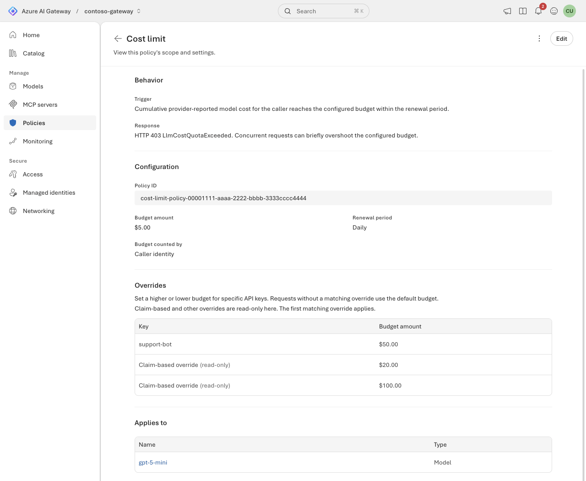
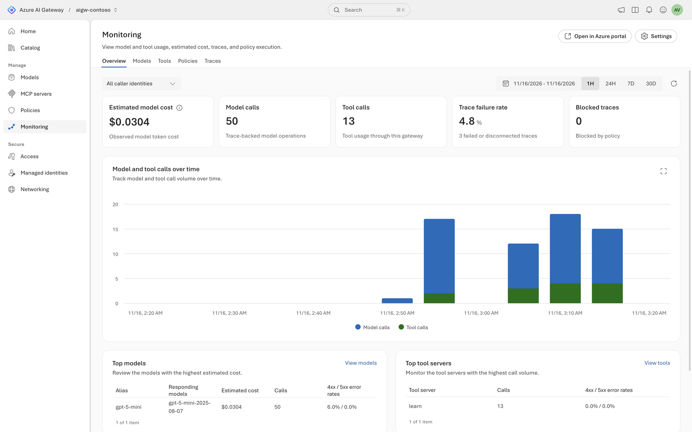

<!--
title: Enforce cost budgets with per-caller overrides
summary: Give every app, agent, and user a dollar budget per hour, day, or month, raise or lower it for specific API keys and Microsoft Entra identities, and watch the gateway answer 403 LlmCostQuotaExceeded once a caller's estimated spend runs out.
category: governance
level: Intermediate
duration: 30
tracks: [portal, cli, iac, terraform]
order: 7
illustration: diagrams/policy-scopes.svg
tags: [costLimit, budget, FinOps, LlmCostQuotaExceeded, "403", overrides, Entra ID, chargeback, Terraform]
objectives:
  - Explain how a cost limit estimates spend and counts it per caller in fixed calendar windows
  - Add a daily cost limit to a model in the portal or with the Azure CLI
  - Give specific API keys and Microsoft Entra identities their own budget with overrides
  - Declare a budgeted alias, its API keys, and their overrides with Bicep and azd or with Terraform
  - Trigger a 403 LlmCostQuotaExceeded response, find the remaining budget header, and review estimated spend in Monitoring
prereqs:
  - 06-token-limits
  - 10-api-keys
-->
<!-- gh:begin nav: generated by "npm run sync" from the metadata, do not edit -->
[AI Gateway labs](../README.md) › [Governance & cost](../README.md#governance--cost) › Lab 07
<!-- gh:end -->

# Enforce cost budgets with per-caller overrides

<!-- gh:begin intro: generated by "npm run sync" from the metadata, do not edit -->
> Give every app, agent, and user a dollar budget per hour, day, or month, raise or lower it for specific API keys and Microsoft Entra identities, and watch the gateway answer 403 LlmCostQuotaExceeded once a caller's estimated spend runs out.

| ⏱️ Time | 📶 Level | 🧭 Tracks | ✅ Before you start |
| :-- | :-- | :-- | :-- |
| 30 min | Intermediate | Portal · Azure CLI · Bicep + azd · Terraform · Notebook | [06 · Token limits](../06-token-limits/README.md)<br>[10 · Runtime API keys](../10-api-keys/README.md) |

**You'll learn to**

- Explain how a cost limit estimates spend and counts it per caller in fixed calendar windows
- Add a daily cost limit to a model in the portal or with the Azure CLI
- Give specific API keys and Microsoft Entra identities their own budget with overrides
- Declare a budgeted alias, its API keys, and their overrides with Bicep and azd or with Terraform
- Trigger a 403 LlmCostQuotaExceeded response, find the remaining budget header, and review estimated spend in Monitoring

**Follow along:** 🌐 [Interactive version](https://azure.github.io/aigateway/labs/07-cost-budgets/) with your own values filled in · 📓 [Jupyter notebook](07-cost-budgets.ipynb) · 📁 [Lab files](infra/)

**On this page:** [Before you begin](#before-you-begin) · [How it works](#how-it-works) · [Add a cost limit to the model](#add-a-cost-limit-to-the-model) · [Verify](#verify) · [Go further](#go-further) · [Clean up](#clean-up) · [Next steps](#next-steps)
<!-- gh:end -->

Your FinOps team has a problem that token limits can't solve: a thousand tokens on a premium reasoning model
costs many times more than a thousand tokens on a mini model, so "tokens per day" says nothing about the bill.
They want every app to have a **daily budget in dollars**, a bigger envelope for the production support bot,
and a separate allowance for a data science lead who signs in with Microsoft Entra ID. In this lab you set
that up as a cost limit at the gateway, so a caller who runs out of budget is stopped before the model is
called.


<!-- widget: budget {"amount":5,"period":"day"} -->
<!-- gh:begin widget: generated by "npm run sync" from the metadata, do not edit -->
> 🎛️ **Interactive:** try the cost budget simulator in the [web version of this lab](https://azure.github.io/aigateway/labs/07-cost-budgets/).
<!-- gh:end -->

## Before you begin

<!-- setup: tools sign-in extension clone -->
<!-- gh:begin setup: generated by "npm run sync" from the metadata, do not edit -->
🧰 **One-time setup** from the [Setup guide](../SETUP.md), if you haven't done it yet:
[Choose where to run commands](../SETUP.md#choose-where-to-run-commands) ·
[Sign in to Azure](../SETUP.md#sign-in-to-azure) ·
[Install the `aigateway` extension](../SETUP.md#install-the-aigateway-extension) ·
[Clone the labs repo](../SETUP.md#clone-the-labs-repo)
<!-- gh:end -->

> [!TIP]
> On the **Bicep + azd** and **Terraform** tracks, `azd up` or `terraform apply` creates its own gateway, model, and
> keys, so you can skip this section. You need only the one-time setup above.

- Complete [Throttle tokens per caller with token limits](../06-token-limits/README.md). This lab reuses the
  **Policies** › **Add policy** wizard and the idea of per-caller counters.
- Complete [Issue and rotate runtime API keys](../10-api-keys/README.md). You need **two** runtime keys from
  **Access** › **API keys**, for example `app-dev` (gets the default budget) and `support-bot` (gets an override).
- Recommended: configure Application Insights in [Monitor usage, cost, and traces](../13-monitoring/README.md)
  and send a few requests first, so **Monitoring** can show estimated spend before you choose a budget.
- Optional, for the Entra override: a user or service principal that can call the gateway with Microsoft
  Entra ID. [Go keyless with Microsoft Entra ID and RBAC](../11-entra-rbac/README.md) shows how.
- Permission to change the gateway, for example **Contributor** on the resource group.
- Run the scripts and samples from the lab's folder, `~/aigateway/labs/07-cost-budgets`.

Set these variables once. Both tracks and the **Verify** section reuse them. Use the `app-dev` key here.

<details open><summary>Bash</summary> <!-- gh -->

```bash title="Bash"
# Name your gateway, its model provider, and the backend model that gets the budget
export RG="<resource-group>"
export GATEWAY="<gateway>"                 # 24 characters or fewer
export PROVIDER="<provider-name>"          # for example foundry-models
export MODEL="<model-name>"                # the backend model name under that provider

# Read the gateway's resource ID, which the key commands use
export GATEWAY_ID="$(az aigateway show -g "$RG" -n "$GATEWAY" --query id -o tsv)"
echo "🆔 Gateway: $GATEWAY_ID"

# Read the gateway's runtime URL, which apps call
export AI_GATEWAY_URL="https://$(az aigateway show -g "$RG" -n "$GATEWAY" --query properties.frontend.defaultHostname -o tsv)"
echo "🌐 Runtime URL: $AI_GATEWAY_URL"

# Read the alias that apps send in the model field: for Foundry imports, it matches the deployment's model name
export AI_GATEWAY_MODEL="$(az aigateway model show -g "$RG" --gateway-name "$GATEWAY" --provider-name "$PROVIDER" \
  -n "$MODEL" --query properties.deployment.modelName -o tsv)"
echo "🔖 Model alias: $AI_GATEWAY_MODEL"

# Paste the app-dev runtime key from Access › API keys, without showing it: don't commit it or write it to a file
printf "AI Gateway API key: " && read -rs AI_GATEWAY_API_KEY && export AI_GATEWAY_API_KEY && echo
echo "🔑 Key: in AI_GATEWAY_API_KEY (${#AI_GATEWAY_API_KEY} characters, not shown)"
```
</details> <!-- gh -->

<details><summary>PowerShell</summary> <!-- gh -->

```powershell title="PowerShell"
# Name your gateway, its model provider, and the backend model that gets the budget
$RG         = "<resource-group>"
$GATEWAY    = "<gateway>"                 # 24 characters or fewer
$PROVIDER   = "<provider-name>"           # for example foundry-models
$MODEL      = "<model-name>"              # the backend model name under that provider

# Read the gateway's resource ID, which the key commands use
$GATEWAY_ID = az aigateway show -g $RG -n $GATEWAY --query id -o tsv
Write-Host "🆔 Gateway: $GATEWAY_ID"

# Read the gateway's runtime URL, which apps call
$env:AI_GATEWAY_URL = "https://$(az aigateway show -g $RG -n $GATEWAY --query properties.frontend.defaultHostname -o tsv)"
Write-Host "🌐 Runtime URL: $env:AI_GATEWAY_URL"

# Read the alias that apps send in the model field: for Foundry imports, it matches the deployment's model name
$env:AI_GATEWAY_MODEL = az aigateway model show -g $RG --gateway-name $GATEWAY --provider-name $PROVIDER `
  -n $MODEL --query properties.deployment.modelName -o tsv
Write-Host "🔖 Model alias: $env:AI_GATEWAY_MODEL"

# Paste the app-dev runtime key from Access › API keys, without showing it: don't commit it or write it to a file
$env:AI_GATEWAY_API_KEY = Read-Host "AI Gateway API key" -MaskInput
Write-Host "🔑 Key: in AI_GATEWAY_API_KEY ($($env:AI_GATEWAY_API_KEY.Length) characters, not shown)"
```
</details> <!-- gh -->

## How it works

After each model response, the gateway **estimates its cost** from the tokens the provider reported and the
model's public pricing, broken down by token category. A cost limit adds that estimate to the caller's
counter for the current renewal period. Before it forwards the next request, the gateway checks the counter.
Once spend reaches the budget, the gateway answers `403` (`LlmCostQuotaExceeded` in the product docs) with the
message `LLM cost quota is exceeded` and never calls the backend. Answered responses carry a header with the
estimated cost of the call, and blocked responses carry the remaining budget and the seconds until it renews.

| Setting | Portal label | JSON field | Values |
|---|---|---|---|
| Budget | **Budget amount** | `amount` | US dollars, for example `5` |
| Window | **Renewal period** | `period` | `hour`, `day`, `week`, `month`, `year` (**Hourly** … **Yearly**) |
| Who gets a counter | **Counter dimensions** (shown as **Budget counted by**) | `counterKey` | A required array: `["identity"]` (the API key, or the Entra tenant ID + object ID), `["ipAddress"]`, or `[]` for one counter that all callers share |
| Exceptions | **Overrides** | `overrides` | A different `amount` for an API key (`apiKeyResourceId`) or Entra identity (`claims`: a list of `name` and `value` pairs that must all match) |
| Policy identity | Not shown | `id` | Required, and unique on the asset. Editing the amount keeps accumulated spend. |

Renewal periods are **fixed calendar windows**, not rolling windows: a **Daily** budget starts fresh at the
beginning of each day, not 24 hours after the first call. Attach the policy to a **model** to budget spend on
that model, or at **Gateway** scope to track **one budget per caller across all models**.

> [!IMPORTANT]
> A cost limit is a guardrail, not an invoice. Spend is estimated from public pricing, and because gateway
> instances update counters concurrently, concurrent requests can briefly **overshoot** the budget before every
> instance sees the latest spend.

<!-- widget: policy-layers -->
<!-- gh:begin widget: generated by "npm run sync" from the metadata, do not edit -->
> 🎛️ **Interactive:** try the policy layers explorer in the [web version of this lab](https://azure.github.io/aigateway/labs/07-cost-budgets/).
<!-- gh:end -->

## Add a cost limit to the model

Pick one track. Each one produces the same default budget: **$5 per day for each caller identity**. The portal and
Azure CLI tracks put it on your model. The Bicep + azd and Terraform tracks create a new gateway and put it on a new
alias of the model. Every track also adds the overrides for specific callers.

<!-- track: portal | Portal -->
<details open><summary><b>🖥️ Portal</b></summary> <!-- gh -->

### Start the policy wizard

Open the [AI Gateway portal](https://ai.gateway.azure.com) and select your gateway from the gateway switcher.
Select **Policies** › **Add policy**. On the **Type** step, under **Cost and rate limits**, select
**Cost limit**, then **Next**.

### Choose where the budget applies

On the **Scope** step, select **Individual assets** ("Apply only to selected models, aliases, or MCP servers").
Select the row of type **Model** for your model, then **Next**.

> [!TIP]
> Choose **Gateway** ("Apply to the entire gateway workspace, including applicable assets added later") when the
> budget should cover **every** model a caller uses, including models you import later. A gateway-scoped cost
> limit tracks one budget across all models instead of one per model.

### Set the default budget

On the **Details** step, under **Parameters**, set:

| Field | Value |
|---|---|
| **Budget amount** | `5` (US dollars) |
| **Renewal period** | **Daily** |
| **Counter dimensions** | **Identity** |

Select **Next**.

> [!NOTE]
> **Identity** gives each API key, and each Entra caller, its own counter. **IP address** counts per client IP
> address instead, and can't be combined with overrides: while the policy has overrides, **Edit policy** disables
> **Counter dimensions** and shows "Remove all overrides before switching to Caller IP address."

### Give an API key a bigger budget

On the **Overrides** step, under **API keys**, select **Add**. In the new row, pick your `support-bot` key in
**API key** and set **Budget amount** to `50`. Each key can have only one override.

### Give a Microsoft Entra identity its own budget

Under **Microsoft Entra identities**, select **Add**. In **Add Microsoft Entra identities override**, choose how
**Match requests by** works:

- **Specific Microsoft Entra identity**: search for a user by name or email. For a service principal, enter its
  **object ID**, not its application (client) ID.
- **Custom token claim combination**: add one or more **Claim name** and **Value** pairs, for example `appid`
  and the client ID of an internal app. Every claim condition must match the validated token.

Set **Budget amount** to `20`, then select **Add**.

: API key overrides match a specific key; Microsoft Entra overrides match one identity or a combination of validated token claims. The first matching override wins.")

API key and Microsoft Entra overrides are evaluated together, in the order you add them. The **first match wins**,
and later overrides aren't evaluated. A claim combination never
pools callers into a shared budget: with identity counting, each matching identity gets the override amount
on its own counter.

### Create the policy

Select **Create**. The portal confirms **Policy created**, and **Policies** lists the **Cost limit** for your
model with **$5.00 / day per caller identity** under **Configuration**. Select it to review the policy.



> **Checkpoint**
> The **Cost limit** details page shows **Budget amount** $5.00, **Renewal period** **Daily**, and **Budget
> counted by** **Caller identity**. Under **Overrides**, `support-bot` has $50.00, and your Microsoft Entra
> override shows as **Claim-based override** (read-only) with $20.00. Your model is under **Applies to**.

</details> <!-- gh -->
<!-- track: cli | Azure CLI -->
<details><summary><b>⌨️ Azure CLI</b></summary> <!-- gh -->

### Set the cost limit

Policies live in the model's `properties.policies` array. `az aigateway model policy set-cost-limit` adds a cost
limit, or updates the one that's there, and keeps every other policy on the model. An update changes only the
flags you pass: the policy keeps its `id`, its overrides, and the spend it has counted so far.

<details open><summary>Bash</summary> <!-- gh -->

```bash title="Bash"
# Add a cost limit to the model: 5 US dollars per day, with its own counter for each caller identity
az aigateway model policy set-cost-limit -g "$RG" --gateway-name "$GATEWAY" --provider-name "$PROVIDER" -n "$MODEL" \
  --amount 5 --period day --counter-key identity --output none &&
  echo "🔐 Cost limit of \$5 per day for each caller is on $MODEL"
```
</details> <!-- gh -->

<details><summary>PowerShell</summary> <!-- gh -->

```powershell title="PowerShell"
# Add a cost limit to the model: 5 US dollars per day, with its own counter for each caller identity
az aigateway model policy set-cost-limit -g $RG --gateway-name $GATEWAY --provider-name $PROVIDER -n $MODEL `
  --amount 5 --period day --counter-key identity --output none
if ($?) { Write-Host "🔐 Cost limit of `$5 per day for each caller is on $MODEL" }
```
</details> <!-- gh -->

`--period` accepts `hour`, `day`, `week`, `month`, or `year`. `--counter-key` accepts `identity`, or `ipAddress` to
count per client IP address. A new cost limit gets the `id` `default` unless you pass `--id`.

### Give specific callers their own budget

`--overrides` sets the whole list of overrides, in order, and the first match wins. Give the `support-bot` key $50
per day with its resource ID (`apiKeyResourceId`), and your own Microsoft Entra identity $20 per day with your tenant
ID (`tid`) and object ID (`oid`). The CLI takes `claims` as a map of claim names to values, and stores it as the list
of `name` and `value` pairs that the API uses.

<details open><summary>Bash</summary> <!-- gh -->

```bash title="Bash"
# Read your tenant ID and object ID, which the Entra override matches
TENANT_ID="$(az account show --query tenantId -o tsv)"
OBJECT_ID="$(az ad signed-in-user show --query id -o tsv)"
echo "👤 Tenant ID: $TENANT_ID, object ID: $OBJECT_ID"

# Give support-bot 50 US dollars per day, and your Entra identity 20 US dollars per day
az aigateway model policy set-cost-limit -g "$RG" --gateway-name "$GATEWAY" --provider-name "$PROVIDER" -n "$MODEL" \
  --overrides "[{apiKeyResourceId:$GATEWAY_ID/apiKeys/support-bot,amount:50},{claims:{tid:$TENANT_ID,oid:$OBJECT_ID},amount:20}]" \
  --output none &&
  echo "🔐 support-bot gets \$50 and your identity gets \$20 per day on $MODEL"
```
</details> <!-- gh -->

<details><summary>PowerShell</summary> <!-- gh -->

```powershell title="PowerShell"
# Read your tenant ID and object ID, which the Entra override matches
$TENANT_ID = az account show --query tenantId -o tsv
$OBJECT_ID = az ad signed-in-user show --query id -o tsv
Write-Host "👤 Tenant ID: $TENANT_ID, object ID: $OBJECT_ID"

# Give support-bot 50 US dollars per day, and your Entra identity 20 US dollars per day
az aigateway model policy set-cost-limit -g $RG --gateway-name $GATEWAY --provider-name $PROVIDER -n $MODEL `
  --overrides "[{apiKeyResourceId:$GATEWAY_ID/apiKeys/support-bot,amount:50},{claims:{tid:$TENANT_ID,oid:$OBJECT_ID},amount:20}]" `
  --output none
if ($?) { Write-Host "🔐 support-bot gets `$50 and your identity gets `$20 per day on $MODEL" }
```
</details> <!-- gh -->

A later `set-cost-limit` without `--overrides` keeps them. To remove every override, pass `--overrides "[]"`. For a
service principal, use its **object ID**, not its application (client) ID.

### Confirm the policy

<details open><summary>Bash</summary> <!-- gh -->

```bash title="Bash"
# List the model's policies, to check the cost limit
echo "🔐 Policies on ${MODEL}:"
az aigateway model policy list -g "$RG" --gateway-name "$GATEWAY" --provider-name "$PROVIDER" -n "$MODEL" -o json
```
</details> <!-- gh -->

<details><summary>PowerShell</summary> <!-- gh -->

```powershell title="PowerShell"
# List the model's policies, to check the cost limit
Write-Host "🔐 Policies on ${MODEL}:"
az aigateway model policy list -g $RG --gateway-name $GATEWAY --provider-name $PROVIDER -n $MODEL -o json
```
</details> <!-- gh -->

> **Checkpoint**
> The output lists your other policies unchanged plus one `costLimit` entry with `"id": "default"`, `"amount": 5.0`,
> `"period": "day"`, `"counterKey": ["identity"]`, and `"scope": "resource"`. Its `overrides` list `"amount": 50.0`
> with the `apiKeyResourceId` of `support-bot`, then `"amount": 20.0` with `claims` that map `oid` and `tid` to your
> object ID and tenant ID.

</details> <!-- gh -->
<!-- track: iac | Bicep + azd -->
<details><summary><b>🏗️ Bicep + azd</b></summary> <!-- gh -->

**What you need:** only the one-time setup from **Before you begin**. This track doesn't use your gateway from lab 02:
`azd up` creates a new one, so it works on its own.

### Choose what to declare

A Bicep deployment sends a `PUT`, which replaces the whole resource. Redeclaring a model you imported in the
portal risks dropping settings you didn't copy. Instead, this template **adds a new alias**,
`<model-name>-budget`, that targets the same backend model and carries the cost limit. Existing clients keep
calling the original alias. Callers that you move to the new alias get the budget.

The template also declares what the portal track picks by hand: the `app-dev` and `support-bot` runtime keys,
and two entries in the policy's `overrides` array. Overrides are evaluated in order, and the first match wins.

| Override | Matches | Budget |
|---|---|---|
| API key | `apiKeyResourceId`: the resource ID of the `support-bot` key | $50 per day |
| Microsoft Entra identity | `claims`: two `name` and `value` pairs, your tenant ID (`tid`) and object ID (`oid`) | $20 per day |

azd fills in the object ID of the account you signed in with. The policy `id` is a GUID that the template derives
from the gateway and the alias name, so it stays the same on every deployment, and a new amount keeps the spend
accumulated so far.

### Review the templates

`infra/main.bicep` creates the resource group `rg-<environment name>` and calls the quick start's
[resources.bicep](../quickstart/infra/resources.bicep) for the gateway, the Foundry model, its default alias, and the
`app-first-call` key. Then it calls `infra/budget-alias.bicep` with the budget and the overrides:

<!-- include: infra/main.bicep -->
<!-- gh:begin include: generated by "npm run sync" from the metadata, do not edit -->
📄 [`infra/main.bicep`](infra/main.bicep)

<details><summary>Show all 74 lines</summary>

```bicep
// Lab 07 with azd: "azd up" creates the resource group rg-<environment name>, the quick start's gateway, Foundry
// model, default alias, and runtime API key, then the app-dev and support-bot keys and a second alias for the same
// model with a cost limit and per-caller overrides. Runtime API key values are never outputs.
targetScope = 'subscription'

@description('azd environment name. The resource group is rg-<environmentName>.')
@minLength(1)
@maxLength(60)
param environmentName string

@description('Region for every resource. Pick one where AI Gateway and the lab\'s Foundry models are available. List them with az provider show --namespace Microsoft.ApiManagement (Setup guide, Find the available regions).')
@metadata({ azd: { type: 'location' } })
param location string

@description('Default budget for each caller, in US dollars. azd reads it from COST_LIMIT_AMOUNT.')
param budgetAmount string = '5'

@description('Renewal period. azd reads it from COST_LIMIT_PERIOD.')
@allowed([ 'hour', 'day', 'week', 'month', 'year' ])
param period string = 'day'

@description('Budget for the support-bot key, in US dollars. azd reads it from COST_LIMIT_OVERRIDE_AMOUNT.')
param overrideAmount string = '50'

@description('Object ID of the Microsoft Entra identity that gets its own budget. azd sets AZURE_PRINCIPAL_ID to yours.')
param entraObjectId string = ''

@description('Budget for that Microsoft Entra identity, in US dollars. azd reads it from COST_LIMIT_ENTRA_AMOUNT.')
param entraAmount string = '20'

var suffix = take(uniqueString(subscription().id, environmentName, location), 6)
var tags = { 'azd-env-name': environmentName }

resource rg 'Microsoft.Resources/resourceGroups@2024-03-01' = {
  name: 'rg-${environmentName}'
  location: location
  tags: tags
}

// The quick start's template: a gateway, a Foundry model behind the default alias, and the app-first-call key.
module base '../../quickstart/infra/resources.bicep' = {
  name: 'aigw-base'
  scope: rg
  params: {
    location: location
    tags: tags
    gatewayName: 'aigw-${suffix}'
    foundryName: 'aigw${suffix}'
  }
}

module budgetAlias 'budget-alias.bicep' = {
  name: 'aigw-budget-alias'
  scope: rg
  params: {
    gatewayName: base.outputs.gatewayName
    providerName: base.outputs.providerName
    modelName: base.outputs.modelName
    budgetAmount: budgetAmount
    period: period
    overrideAmount: overrideAmount
    entraObjectId: entraObjectId
    entraAmount: entraAmount
  }
}

output AZURE_RESOURCE_GROUP string = rg.name
output AI_GATEWAY_NAME string = base.outputs.gatewayName
output AI_GATEWAY_ID string = base.outputs.gatewayId
output AI_GATEWAY_URL string = base.outputs.gatewayUrl
output AI_GATEWAY_PROVIDER string = base.outputs.providerName
output AI_GATEWAY_BACKEND_MODEL string = base.outputs.modelName
output AI_GATEWAY_MODEL string = budgetAlias.outputs.aliasName
output FOUNDRY_ACCOUNT_NAME string = base.outputs.foundryName
```

</details>
<!-- gh:end -->

`infra/budget-alias.bicep` adds the two keys and the alias. It only references the gateway, the provider, and the
model, so you can also deploy it on its own to a gateway you already have, with `az deployment group create`:

<!-- include: infra/budget-alias.bicep -->
<!-- gh:begin include: generated by "npm run sync" from the metadata, do not edit -->
📄 [`infra/budget-alias.bicep`](infra/budget-alias.bicep)

<details><summary>Show all 130 lines</summary>

```bicep
// Publishes an alias with a cost limit for an existing AI Gateway model, creates the app-dev and support-bot runtime
// API keys, and gives support-bot, and optionally one Microsoft Entra identity, a budget of its own with overrides.
// main.bicep calls it after the quick start's template, and you can also deploy it on its own to a gateway you
// already have. The alias points at the same backend model as your default alias, so only callers that send the
// new alias name are budgeted. Key values are never outputs.

@description('Name of the existing AI Gateway (Microsoft.ApiManagement/aigateways).')
param gatewayName string

@description('Name of the existing model provider in the gateway, for example foundry-models.')
param providerName string

@description('Name of the existing backend model registration under the provider.')
param modelName string

@description('Callable alias to create. Clients send this value in the request "model" field.')
param aliasName string = '${modelName}-budget'

@description('Default budget for each caller, in US dollars. A string, so that it can hold decimals such as 0.01.')
param budgetAmount string = '5'

@description('Renewal period. Budgets renew in fixed calendar windows.')
@allowed([ 'hour', 'day', 'week', 'month', 'year' ])
param period string = 'day'

@description('Runtime API key that gets the default budget. The template creates it if it doesn\'t exist.')
param defaultKeyName string = 'app-dev'

@description('Runtime API key that gets its own budget. The template creates it if it doesn\'t exist.')
param overrideKeyName string = 'support-bot'

@description('Budget for the override key, in US dollars.')
param overrideAmount string = '50'

@description('Optional object ID of a Microsoft Entra user or service principal that gets its own budget. Empty adds no Entra override.')
param entraObjectId string = ''

@description('Budget for the Microsoft Entra identity, in US dollars.')
param entraAmount string = '20'

#disable-next-line BCP081
resource gateway 'Microsoft.ApiManagement/aigateways@2026-11-01' existing = {
  name: gatewayName
}

#disable-next-line BCP081
resource workspace 'Microsoft.ApiManagement/aigateways/workspaces@2026-11-01' existing = {
  parent: gateway
  name: 'default'
}

#disable-next-line BCP081
resource provider 'Microsoft.ApiManagement/aigateways/workspaces/modelProviders@2026-11-01' existing = {
  parent: workspace
  name: providerName
}

#disable-next-line BCP081
resource model 'Microsoft.ApiManagement/aigateways/workspaces/modelProviders/models@2026-11-01' existing = {
  parent: provider
  name: modelName
}

// Each key is a separate caller identity, so each one gets its own budget counter.
#disable-next-line BCP081
resource defaultKey 'Microsoft.ApiManagement/aigateways/apiKeys@2026-11-01' = {
  parent: gateway
  name: defaultKeyName
  properties: {
    displayName: defaultKeyName
  }
}

#disable-next-line BCP081
resource overrideKey 'Microsoft.ApiManagement/aigateways/apiKeys@2026-11-01' = {
  parent: gateway
  name: overrideKeyName
  properties: {
    displayName: overrideKeyName
  }
}

// Overrides are evaluated in order, and the first match wins. An API key override matches the key's resource ID.
// An Entra override matches validated token claims, as name and value pairs that must all match: here the tenant ID
// and the object ID of one identity.
var keyOverrides = [
  {
    apiKeyResourceId: overrideKey.id
    amount: json(overrideAmount)
  }
]
var entraOverrides = empty(entraObjectId) ? [] : [
  {
    claims: [
      { name: 'tid', value: tenant().tenantId }
      { name: 'oid', value: entraObjectId }
    ]
    amount: json(entraAmount)
  }
]

#disable-next-line BCP081
resource budgetAlias 'Microsoft.ApiManagement/aigateways/workspaces/aliases@2026-11-01' = {
  parent: workspace
  name: aliasName
  dependsOn: [ defaultKey ]
  properties: {
    aliasName: aliasName
    backendModels: [
      { resourceId: model.id }
    ]
    policies: [
      {
        type: 'costLimit'
        // A stable ID: changing the amount on a later deployment keeps the spend accumulated so far.
        id: guid(gateway.id, aliasName, 'costLimit')
        amount: json(budgetAmount)
        period: period
        // Overrides need per-caller counters, so the template always counts by caller identity.
        counterKey: [ 'identity' ]
        overrides: concat(keyOverrides, entraOverrides)
      }
    ]
  }
}

output aliasName string = budgetAlias.name
output defaultKeyName string = defaultKey.name
output overrideKeyName string = overrideKey.name
output chatCompletionsUrl string = 'https://${gateway.properties.frontend.defaultHostname}/default/models/openai/v1/chat/completions'
```

</details>
<!-- gh:end -->

### Deploy with azd up

Move into the lab's folder, create an azd environment named `aigw-lab07` in your current subscription, then provision
everything. It takes about two minutes.

<details open><summary>Bash</summary> <!-- gh -->

```bash title="Bash"
# Move into the lab's folder, which holds the azd project
cd ~/aigateway/labs/07-cost-budgets &&
  echo "📂 Lab folder: $(pwd)"

# Create an azd environment in your current subscription, so that azd doesn't prompt you
azd env new aigw-lab07 --location eastus2 --subscription "$(az account show --query id --output tsv)" &&
  echo "📝 azd environment aigw-lab07 deploys to eastus2"

# Provision the gateway, the Foundry model, the app-dev and support-bot keys, and the budgeted alias
azd up &&
  echo "🚀 Gateway deployed: $(azd env get-value AI_GATEWAY_URL)"
```
</details> <!-- gh -->

<details><summary>PowerShell</summary> <!-- gh -->

```powershell title="PowerShell"
# Move into the lab's folder, which holds the azd project
Set-Location ~/aigateway/labs/07-cost-budgets
if ($?) { Write-Host "📂 Lab folder: $(Get-Location)" }

# Create an azd environment in your current subscription, so that azd doesn't prompt you
azd env new aigw-lab07 --location eastus2 --subscription (az account show --query id --output tsv)
if ($?) { Write-Host "📝 azd environment aigw-lab07 deploys to eastus2" }

# Provision the gateway, the Foundry model, the app-dev and support-bot keys, and the budgeted alias
azd up
if ($?) { Write-Host "🚀 Gateway deployed: $(azd env get-value AI_GATEWAY_URL)" }
```
</details> <!-- gh -->

For another region, pick one where AI Gateway and the `gpt-5-mini` model are available, as in [Find the available
regions](../SETUP.md#find-the-available-regions).

### Read the outputs and the key

Set the variables that **Verify** and **Go further** use from azd's environment values, and read the `app-dev` key
from the gateway, so that it never shows on screen.

<details open><summary>Bash</summary> <!-- gh -->

```bash title="Bash"
# Read the template's outputs: the resource group, the gateway, its model provider, and the backend model
export RG="$(azd env get-value AZURE_RESOURCE_GROUP)"
export GATEWAY="$(azd env get-value AI_GATEWAY_NAME)"
export PROVIDER="$(azd env get-value AI_GATEWAY_PROVIDER)"
export MODEL="$(azd env get-value AI_GATEWAY_BACKEND_MODEL)"

# Read the gateway's resource ID, and build the management URL of its default workspace for the az rest calls
export API="api-version=2026-11-01"
export GATEWAY_ID="$(azd env get-value AI_GATEWAY_ID)"
export WS="https://management.azure.com$GATEWAY_ID/workspaces/default"

# Read the gateway's runtime URL and the budgeted alias
export AI_GATEWAY_URL="$(azd env get-value AI_GATEWAY_URL)"
export AI_GATEWAY_MODEL="$(azd env get-value AI_GATEWAY_MODEL)"

# Read the app-dev key from the gateway, so that it never lands in a file or a deployment log
export AI_GATEWAY_API_KEY="$(az aigateway api-key list-secrets --ids "$GATEWAY_ID/apiKeys/app-dev" \
  --query primaryKey --output tsv)"
echo "🌐 Runtime URL: $AI_GATEWAY_URL"
echo "🔑 Key: in AI_GATEWAY_API_KEY (${#AI_GATEWAY_API_KEY} characters, not shown)"
echo "🔖 Model alias: $AI_GATEWAY_MODEL"
```
</details> <!-- gh -->

<details><summary>PowerShell</summary> <!-- gh -->

```powershell title="PowerShell"
# Read the template's outputs: the resource group, the gateway, its model provider, and the backend model
$RG                     = azd env get-value AZURE_RESOURCE_GROUP
$GATEWAY                = azd env get-value AI_GATEWAY_NAME
$PROVIDER               = azd env get-value AI_GATEWAY_PROVIDER
$MODEL                  = azd env get-value AI_GATEWAY_BACKEND_MODEL

# Read the gateway's resource ID, and build the management URL of its default workspace for the az rest calls
$API                    = "api-version=2026-11-01"
$GATEWAY_ID             = azd env get-value AI_GATEWAY_ID
$WS                     = "https://management.azure.com$GATEWAY_ID/workspaces/default"

# Read the gateway's runtime URL and the budgeted alias
$env:AI_GATEWAY_URL     = azd env get-value AI_GATEWAY_URL
$env:AI_GATEWAY_MODEL   = azd env get-value AI_GATEWAY_MODEL

# Read the app-dev key from the gateway, so that it never lands in a file or a deployment log
$env:AI_GATEWAY_API_KEY = az aigateway api-key list-secrets --ids "$GATEWAY_ID/apiKeys/app-dev" `
  --query primaryKey --output tsv
Write-Host "🌐 Runtime URL: $env:AI_GATEWAY_URL"
Write-Host "🔑 Key: in AI_GATEWAY_API_KEY ($($env:AI_GATEWAY_API_KEY.Length) characters, not shown)"
Write-Host "🔖 Model alias: $env:AI_GATEWAY_MODEL"
```
</details> <!-- gh -->

> **Checkpoint**
> `azd up` ended with `SUCCESS`, and the last command printed `🔖 Model alias: gpt-5-mini-budget`.
> `az rest --url "$WS/aliases/$AI_GATEWAY_MODEL?$API" --query properties.policies` returns one `costLimit` entry
> with `"amount": 5.0`, `"period": "day"`, `"counterKey": ["identity"]`, and two `overrides`: `"amount": 50.0`
> with the `apiKeyResourceId` of `support-bot`, and `"amount": 20.0` with a `claims` list that holds your `tid`
> and `oid` as `name` and `value` pairs.

### Change the budget

The parameters come from azd environment values, with the defaults in `infra/main.parameters.json`:
`COST_LIMIT_AMOUNT` for the default budget, `COST_LIMIT_PERIOD` (`hour`, `day`, `week`, `month`, or `year`),
`COST_LIMIT_OVERRIDE_AMOUNT` for `support-bot`, and `COST_LIMIT_ENTRA_AMOUNT` for your identity. Change one with
`azd env set` and run `azd provision`: only the alias changes, and it keeps the policy `id`. **Verify** lowers
`COST_LIMIT_AMOUNT` this way.

</details> <!-- gh -->
<!-- track: terraform | Terraform -->
<details><summary><b>🌍 Terraform</b></summary> <!-- gh -->

**What you need:** only the one-time setup from **Before you begin**, plus Terraform 1.9 or later, as in
[Deploy a lab with Terraform](../SETUP.md#deploy-a-lab-with-terraform). This track doesn't use your gateway from
lab 02: `terraform apply` creates a new one, so it works on its own.

### Review the configuration

Like the Bicep template, the configuration **adds a new alias**, `<model-name>-budget`, that targets the same
backend model and carries the cost limit, rather than redeclaring a model that you imported in the portal. It also
declares the `app-dev` and `support-bot` runtime keys, and two overrides, which are evaluated in order: $50 per day
for the `support-bot` key, matched by its resource ID, and $20 per day for your Microsoft Entra identity, matched by
the `tid` and `oid` claims.

`terraform/main.tf` creates the resource group `rg-<environment_name>` and calls the quick start's
[resources module](../quickstart/terraform/resources) for the gateway, the Foundry model, its default alias, and the
`app-first-call` key:

<!-- include: terraform/main.tf -->
<!-- gh:begin include: generated by "npm run sync" from the metadata, do not edit -->
📄 [`terraform/main.tf`](terraform/main.tf)

```tf
# Lab 07 with Terraform: creates the resource group rg-<environment_name>, the quick start's gateway, Foundry model,
# default alias, and runtime API key, then the app-dev and support-bot keys and a second alias for the same model
# with a cost limit and per-caller overrides (budget-alias.tf). Runtime API key values are never outputs.
data "azapi_client_config" "current" {}

locals {
  suffix = substr(sha1("${data.azapi_client_config.current.subscription_id}/${var.environment_name}/${var.location}"), 0, 6)
  tags   = { "environment-name" = var.environment_name }
}

resource "azurerm_resource_group" "rg" {
  name     = "rg-${var.environment_name}"
  location = var.location
  tags     = local.tags
}

# The quick start's module: a gateway, a Foundry model behind the default alias, and the app-first-call key.
module "base" {
  source = "../../quickstart/terraform/resources"

  subscription_id     = data.azapi_client_config.current.subscription_id
  resource_group_name = azurerm_resource_group.rg.name
  resource_group_id   = azurerm_resource_group.rg.id
  location            = var.location
  tags                = local.tags
  gateway_name        = "aigw-${local.suffix}"
  foundry_name        = "aigw${local.suffix}"
}
```
<!-- gh:end -->

`terraform/budget-alias.tf` adds the keys and the alias with the `azapi` provider, which sends the AI Gateway API
version, `2026-11-01`, as is. The Entra override uses the object ID of the identity that runs Terraform, and the
policy `id` is a UUID derived from the gateway and the alias name, so a new amount keeps the spend accumulated so
far. `terraform/variables.tf` declares the budgets with the same defaults as the Bicep template:

<!-- include: terraform/budget-alias.tf -->
<!-- gh:begin include: generated by "npm run sync" from the metadata, do not edit -->
📄 [`terraform/budget-alias.tf`](terraform/budget-alias.tf)

<details><summary>Show all 89 lines</summary>

```tf
# Publishes an alias with a cost limit for the quick start's model, creates the app-dev and support-bot runtime API
# keys, and gives support-bot, and optionally one Microsoft Entra identity, a budget of its own with overrides. The
# alias points at the same backend model as the default alias, so only callers that send the new alias name are
# budgeted. Key values are never outputs: read them with az aigateway api-key list-secrets.

# Each key is a separate caller identity, so each one gets its own budget counter.
resource "azapi_resource" "default_key" {
  type      = "Microsoft.ApiManagement/aigateways/apiKeys@2026-11-01"
  name      = var.default_key_name
  parent_id = module.base.gateway_id

  body = {
    properties = {
      displayName = var.default_key_name
    }
  }

  schema_validation_enabled = false
}

resource "azapi_resource" "override_key" {
  type      = "Microsoft.ApiManagement/aigateways/apiKeys@2026-11-01"
  name      = var.override_key_name
  parent_id = module.base.gateway_id

  body = {
    properties = {
      displayName = var.override_key_name
    }
  }

  schema_validation_enabled = false
}

locals {
  alias_name = "${module.base.model_name}-budget"

  # Your own object ID unless you pass another one; an empty string adds no Entra override.
  entra_object_id = var.entra_object_id == null ? data.azapi_client_config.current.object_id : var.entra_object_id

  # Overrides are evaluated in order, and the first match wins. An API key override matches the key's resource ID.
  # An Entra override matches validated token claims, as name and value pairs that must all match: here the tenant
  # ID and the object ID of one identity.
  key_overrides = [
    {
      apiKeyResourceId = azapi_resource.override_key.id
      amount           = var.override_amount
    }
  ]
  entra_overrides = local.entra_object_id == "" ? [] : [
    {
      claims = [
        { name = "tid", value = data.azapi_client_config.current.tenant_id },
        { name = "oid", value = local.entra_object_id },
      ]
      amount = var.entra_amount
    }
  ]
}

resource "azapi_resource" "budget_alias" {
  type      = "Microsoft.ApiManagement/aigateways/workspaces/aliases@2026-11-01"
  name      = local.alias_name
  parent_id = module.base.workspace_id

  body = {
    properties = {
      aliasName = local.alias_name
      backendModels = [
        { resourceId = module.base.model_id }
      ]
      policies = [
        {
          type = "costLimit"
          # A stable ID: changing the amount on a later apply keeps the spend accumulated so far.
          id     = uuidv5("url", "${module.base.gateway_id}/${local.alias_name}/costLimit")
          amount = var.budget_amount
          period = var.period
          # Overrides need per-caller counters, so the configuration always counts by caller identity.
          counterKey = ["identity"]
          overrides  = concat(local.key_overrides, local.entra_overrides)
        }
      ]
    }
  }

  schema_validation_enabled = false
  depends_on                = [azapi_resource.default_key]
}
```

</details>
<!-- gh:end -->

### Deploy with terraform apply

Move into the lab's Terraform folder, select your current subscription, then plan and apply the configuration. It
takes about three minutes.

<details open><summary>Bash</summary> <!-- gh -->

```bash title="Bash"
# Move into the lab's Terraform folder
cd ~/aigateway/labs/07-cost-budgets/terraform &&
  echo "📂 Terraform folder: $(pwd)"

# Deploy to the Azure CLI's current subscription
export ARM_SUBSCRIPTION_ID="$(az account show --query id --output tsv)" &&
  echo "📍 Subscription: $ARM_SUBSCRIPTION_ID"

# Download the providers, then plan and apply the gateway, the Foundry model, the app-dev and support-bot keys, and
# the budgeted alias
terraform init &&
  terraform plan -out tfplan &&
  terraform apply tfplan &&
  echo "🚀 Gateway deployed: $(terraform output -raw ai_gateway_url)"
```
</details> <!-- gh -->

<details><summary>PowerShell</summary> <!-- gh -->

```powershell title="PowerShell"
# Move into the lab's Terraform folder
Set-Location ~/aigateway/labs/07-cost-budgets/terraform
if ($?) { Write-Host "📂 Terraform folder: $(Get-Location)" }

# Deploy to the Azure CLI's current subscription
$env:ARM_SUBSCRIPTION_ID = az account show --query id --output tsv
if ($?) { Write-Host "📍 Subscription: $env:ARM_SUBSCRIPTION_ID" }

# Download the providers, then plan and apply the gateway, the Foundry model, the app-dev and support-bot keys, and
# the budgeted alias
terraform init
if ($?) { terraform plan -out tfplan }
if ($?) { terraform apply tfplan }
if ($?) { Write-Host "🚀 Gateway deployed: $(terraform output -raw ai_gateway_url)" }
```
</details> <!-- gh -->

The configuration deploys to `eastus2`. For another region where AI Gateway and the `gpt-5-mini` model are
available, as in [Find the available regions](../SETUP.md#find-the-available-regions), run
`export TF_VAR_location=<region>` (PowerShell: `$env:TF_VAR_location = "<region>"`) before `terraform plan`.

### Read the outputs and the key

Set the variables that **Verify** and **Go further** use from the Terraform outputs, and read the `app-dev` key from
the gateway, so that it never shows on screen or lands in the Terraform state.

<details open><summary>Bash</summary> <!-- gh -->

```bash title="Bash"
# Read the configuration's outputs: the resource group, the gateway, its model provider, and the backend model
export RG="$(terraform output -raw azure_resource_group)"
export GATEWAY="$(terraform output -raw ai_gateway_name)"
export PROVIDER="$(terraform output -raw ai_gateway_provider)"
export MODEL="$(terraform output -raw ai_gateway_backend_model)"

# Read the gateway's resource ID, and build the management URL of its default workspace for the az rest calls
export API="api-version=2026-11-01"
export GATEWAY_ID="$(terraform output -raw ai_gateway_id)"
export WS="https://management.azure.com$GATEWAY_ID/workspaces/default"

# Read the gateway's runtime URL and the budgeted alias
export AI_GATEWAY_URL="$(terraform output -raw ai_gateway_url)"
export AI_GATEWAY_MODEL="$(terraform output -raw ai_gateway_model)"

# Read the app-dev key from the gateway, so that it never lands in a file or the Terraform state
export AI_GATEWAY_API_KEY="$(az aigateway api-key list-secrets --ids "$GATEWAY_ID/apiKeys/app-dev" \
  --query primaryKey --output tsv)"
echo "🌐 Runtime URL: $AI_GATEWAY_URL"
echo "🔑 Key: in AI_GATEWAY_API_KEY (${#AI_GATEWAY_API_KEY} characters, not shown)"
echo "🔖 Model alias: $AI_GATEWAY_MODEL"
# Move back to the lab's folder, which holds the scripts
cd .. && echo "📂 Lab folder: $(pwd)"
```
</details> <!-- gh -->

<details><summary>PowerShell</summary> <!-- gh -->

```powershell title="PowerShell"
# Read the configuration's outputs: the resource group, the gateway, its model provider, and the backend model
$RG                     = terraform output -raw azure_resource_group
$GATEWAY                = terraform output -raw ai_gateway_name
$PROVIDER               = terraform output -raw ai_gateway_provider
$MODEL                  = terraform output -raw ai_gateway_backend_model

# Read the gateway's resource ID, and build the management URL of its default workspace for the az rest calls
$API                    = "api-version=2026-11-01"
$GATEWAY_ID             = terraform output -raw ai_gateway_id
$WS                     = "https://management.azure.com$GATEWAY_ID/workspaces/default"

# Read the gateway's runtime URL and the budgeted alias
$env:AI_GATEWAY_URL     = terraform output -raw ai_gateway_url
$env:AI_GATEWAY_MODEL   = terraform output -raw ai_gateway_model

# Read the app-dev key from the gateway, so that it never lands in a file or the Terraform state
$env:AI_GATEWAY_API_KEY = az aigateway api-key list-secrets --ids "$GATEWAY_ID/apiKeys/app-dev" `
  --query primaryKey --output tsv
Write-Host "🌐 Runtime URL: $env:AI_GATEWAY_URL"
Write-Host "🔑 Key: in AI_GATEWAY_API_KEY ($($env:AI_GATEWAY_API_KEY.Length) characters, not shown)"
Write-Host "🔖 Model alias: $env:AI_GATEWAY_MODEL"
# Move back to the lab's folder, which holds the scripts
Set-Location ..
if ($?) { Write-Host "📂 Lab folder: $(Get-Location)" }
```
</details> <!-- gh -->

> **Checkpoint**
> `terraform apply` ended with `Apply complete! Resources: 12 added, 0 changed, 0 destroyed.`, and the output
> shows `🔖 Model alias: gpt-5-mini-budget`. `az rest --url "$WS/aliases/$AI_GATEWAY_MODEL?$API" --query
> properties.policies` returns the same `costLimit` entry as on the Bicep + azd track: `"amount": 5.0`,
> `"period": "day"`, and the two `overrides` for `support-bot` and your identity.

### Change the budget

The next sections run from the lab's folder, with `-chdir=terraform` for the `terraform` commands.

The settings are Terraform variables, with the defaults in `terraform/variables.tf`: `budget_amount` for the
default budget, `period` (`hour`, `day`, `week`, `month`, or `year`), `override_amount` for `support-bot`, and
`entra_amount` for your identity. Pass one to `terraform plan` with `-var` and apply the plan: only the alias
changes, and it keeps the policy `id`. **Verify** lowers `budget_amount` this way. To give the Entra budget to
another user or service principal, set `entra_object_id` to its object ID, or to `""` for no Entra override.

</details> <!-- gh -->
<!-- /tracks -->

## Verify

A $5 budget takes a while to spend, so temporarily lower it, run a short series of requests with the `app-dev`
key (which has no override), and watch the gateway switch from `200` to `403`.

<!-- steps -->

### Lower the budget for the test

A call to `gpt-5-mini` costs about $0.0004, so a budget of `0.001` is spent after about three calls. For a more
expensive model, use `0.01`. In the portal, open the **Cost limit**, select **Edit**, set **Budget amount** to
`0.001`, and **Save**. On the Azure CLI track, run **Set the cost limit** again with `--amount 0.001`. The new
budget reaches the gateway within about a minute, so wait before you run the requests.

Because editing keeps accumulated spend, the very first request might already be blocked if `app-dev` spent more
than the new budget earlier today.

On the Bicep + azd track, set the budget to `0.001` too:

<details open><summary>Bash</summary> <!-- gh -->

```bash title="Bash"
# Lower the default budget to $0.001 for each caller, in the azd environment
azd env set COST_LIMIT_AMOUNT 0.001 &&
  echo "📝 COST_LIMIT_AMOUNT is 0.001"

# Deploy the change: only the budgeted alias changes, and it keeps its policy id and the spend so far
azd provision &&
  echo "🔐 Default budget on $AI_GATEWAY_MODEL is now \$0.001 for each caller"
```
</details> <!-- gh -->

<details><summary>PowerShell</summary> <!-- gh -->

```powershell title="PowerShell"
# Lower the default budget to $0.001 for each caller, in the azd environment
azd env set COST_LIMIT_AMOUNT 0.001
if ($?) { Write-Host "📝 COST_LIMIT_AMOUNT is 0.001" }

# Deploy the change: only the budgeted alias changes, and it keeps its policy id and the spend so far
azd provision
if ($?) { Write-Host "🔐 Default budget on $env:AI_GATEWAY_MODEL is now `$0.001 for each caller" }
```
</details> <!-- gh -->

On the Terraform track, in the lab folder, run `terraform -chdir=terraform plan -var budget_amount=0.001 -out tfplan`,
then `terraform -chdir=terraform apply tfplan`. The plan ends with `Plan: 0 to add, 1 to change, 0 to destroy.`, for
`azapi_resource.budget_alias`, which keeps its policy `id` and the spend so far.

### Run the requests

From the lab folder, run the script for your shell. It prints the status, the error code, the tokens used, and
any response header whose name mentions budget, cost, or remaining.

<details open><summary>Bash</summary> <!-- gh -->

```bash title="Bash"
# Send 10 requests with the app-dev key, and print the status, the tokens used, and the budget headers of each
echo "🚦 Expect 403 once app-dev's estimated spend reaches the budget:"
./infra/trigger-cost-limit.sh "$AI_GATEWAY_MODEL" 10
```
</details> <!-- gh -->

<details><summary>PowerShell</summary> <!-- gh -->

```powershell title="PowerShell"
# Send 10 requests with the app-dev key, and print the status, the tokens used, and the budget headers of each
Write-Host "🚦 Expect 403 once app-dev's estimated spend reaches the budget:"
./infra/trigger-cost-limit.ps1 -Model $env:AI_GATEWAY_MODEL -Requests 10
```
</details> <!-- gh -->

On GitHub, open [trigger-cost-limit.sh](infra/trigger-cost-limit.sh) or
[trigger-cost-limit.ps1](infra/trigger-cost-limit.ps1).

Example output with a $0.001 budget on the alias from the Bicep + azd track (your token counts, the number of
successful calls, and the header values will differ):

```text
🚦 Expect 403 once app-dev's estimated spend reaches the budget:
Request  Status  Error code               Tokens used  Budget headers
1        200     -                        205          …; x-alias-cost-per-day-consumed=0.000368000
2        200     -                        189          …; x-alias-cost-per-day-consumed=0.000336000
3        200     -                        196          …; x-alias-cost-per-day-consumed=0.000350000
4        200     -                        211          …; x-alias-cost-per-day-consumed=0.000380000
5        403     -                        -            x-alias-cost-per-day-retry-after=74726; x-alias-cost-per-day-consumed=0.000000000
…
10       403     -                        -            x-alias-cost-per-day-retry-after=74722; x-alias-cost-per-day-consumed=0.000000000
```

`x-alias-cost-per-day-consumed` is the estimated cost of an answered call; the elided headers are the Foundry
deployment's `x-ratelimit-*` headers. A blocked call carries `…-retry-after`, the seconds until the budget renews at
the start of the next day in UTC, and can also carry `x-alias-cost-per-day-remaining`, which is `0`. On a cost limit
attached to the model, the headers start with `x-cost-` instead. A blocked call has no error code in its body, so the
script prints `-`. How many calls succeed depends on the model's price. A call or two more than you expect is the
small overshoot described in [How it works](#how-it-works). If all 10 requests return `200`, run the script again: the
spend so far still counts.

### Inspect one blocked response

Look at the full headers and body of a single blocked call:

```bash
# Send one more request with the app-dev key, and show the whole response: the status line, the headers, and the body
echo "🚦 Expect 403 with the message LLM cost quota is exceeded:"
curl -i "${AI_GATEWAY_URL%/}/default/models/openai/v1/chat/completions" \
  -H "Authorization: Bearer $AI_GATEWAY_API_KEY" -H "Content-Type: application/json" \
  -d "{\"model\":\"$AI_GATEWAY_MODEL\",\"messages\":[{\"role\":\"user\",\"content\":\"ping\"}]}"
```

The status line is `HTTP/2 403`, and the body is
`{ "statusCode": 403, "message": "LLM cost quota is exceeded. Try again in 30 minutes and 36 seconds." }`, with your
own wait time. Scan the headers for the ones that report the cost and the remaining budget, and compare them with a
successful response from a key that still has budget.
Unlike a token limit, which frees up as the window rolls, the caller stays blocked until the next calendar
renewal period starts or you raise the budget.

### Prove the override and the per-caller counters

Set `AI_GATEWAY_API_KEY` to the `support-bot` key in a new terminal (repeat the variable block) and run the
script again. Every request succeeds, because that key has its own counter and a $50 override. On the Bicep + azd
and Terraform tracks, read that key from the gateway instead:

<details open><summary>Bash</summary> <!-- gh -->

```bash title="Bash"
# Read the support-bot key from the gateway, so that it never shows on screen
export AI_GATEWAY_API_KEY="$(az aigateway api-key list-secrets --ids "$GATEWAY_ID/apiKeys/support-bot" \
  --query primaryKey --output tsv)"
echo "🔑 support-bot key: in AI_GATEWAY_API_KEY (${#AI_GATEWAY_API_KEY} characters, not shown)"

# Send the same 10 requests with support-bot, which has its own counter and a $50 override
echo "📊 Expect 200 for every request, because support-bot has its own \$50 budget:"
./infra/trigger-cost-limit.sh "$AI_GATEWAY_MODEL" 10
```
</details> <!-- gh -->

<details><summary>PowerShell</summary> <!-- gh -->

```powershell title="PowerShell"
# Read the support-bot key from the gateway, so that it never shows on screen
$env:AI_GATEWAY_API_KEY = az aigateway api-key list-secrets --ids "$GATEWAY_ID/apiKeys/support-bot" `
  --query primaryKey --output tsv
Write-Host "🔑 support-bot key: in AI_GATEWAY_API_KEY ($($env:AI_GATEWAY_API_KEY.Length) characters, not shown)"

# Send the same 10 requests with support-bot, which has its own counter and a $50 override
Write-Host "📊 Expect 200 for every request, because support-bot has its own `$50 budget:"
./infra/trigger-cost-limit.ps1 -Model $env:AI_GATEWAY_MODEL -Requests 10
```
</details> <!-- gh -->

If you added an Entra override (the Bicep + azd and Terraform tracks add one for you), call the gateway with that identity's
token as shown in
[Go keyless with Microsoft Entra ID and RBAC](../11-entra-rbac/README.md): it gets its own counter too, keyed
by tenant ID and object ID.

### Review estimated spend in Monitoring

If you configured Application Insights, open **Monitoring**. **Estimated model cost** and **Top models** show
the spend the gateway estimated, and the dashboard attributes it to individual API keys and models.



<!-- /steps -->

> **Checkpoint**
> `app-dev` got `200` responses until its estimated spend reached the budget, then `403` with
> `LLM cost quota is exceeded`. `support-bot` wasn't affected, and the backend received no calls from `app-dev` while
> it was blocked.

## Go further

- **Cap spend across all models.** Add a second **Cost limit** with **Gateway** scope, for example $200
  **Monthly**. Each caller then has one budget across every model, including models you import later. With
  the Azure CLI, run `az aigateway policy set-cost-limit -g "$RG" --gateway-name "$GATEWAY" --amount 200 --period month
  --counter-key identity`.
- **Combine with token limits.** Keep a per-minute **Token rate limit** to smooth bursts and a **Cost limit**
  to cap spend. Both are checked on every request, and either one can block.
- **Budget by role or app.** Use **Custom token claim combination** overrides, for example a `roles` claim with
  an app role value, so everyone with that role gets a different per-identity amount.
- **Chargeback by team.** Export `tid`, `oid`, or a custom claim to cost metrics in
  [Attribute tokens and cost with OpenTelemetry](../14-otel-chargeback/README.md).

## Clean up

A $0.001 budget blocks real traffic. Delete the policy, or raise it to a production value, before you continue.
Raising the amount takes effect immediately, because the accumulated spend is kept and compared with the new
budget.

<!-- track: portal | Portal -->
<details open><summary><b>🖥️ Portal</b></summary> <!-- gh -->

### Remove or raise the budget

Select **Policies** and open the **Cost limit** you created. Select **More actions** (⋮) › **Delete**, then
**Delete** again in **Delete this policy?**, or select **Edit**, set a production **Budget amount**, and **Save**.
If you created runtime keys only for this lab, revoke them in **Access** › **API keys**.

</details> <!-- gh -->
<!-- track: cli | Azure CLI -->
<details><summary><b>⌨️ Azure CLI</b></summary> <!-- gh -->

### Remove the cost limit

<details open><summary>Bash</summary> <!-- gh -->

```bash title="Bash"
# Remove only the cost limit from the model, and keep every other policy
az aigateway model policy remove -g "$RG" --gateway-name "$GATEWAY" --provider-name "$PROVIDER" -n "$MODEL" \
  --remove-cost-limit true --output none &&
  echo "🚮 Cost limit is removed from $MODEL"
```
</details> <!-- gh -->

<details><summary>PowerShell</summary> <!-- gh -->

```powershell title="PowerShell"
# Remove only the cost limit from the model, and keep every other policy
az aigateway model policy remove -g $RG --gateway-name $GATEWAY --provider-name $PROVIDER -n $MODEL `
  --remove-cost-limit true --output none
if ($?) { Write-Host "🚮 Cost limit is removed from $MODEL" }
```
</details> <!-- gh -->

To keep the policy instead, run **Set the cost limit** again with a production budget, for example `--amount 100`.

</details> <!-- gh -->
<!-- track: iac | Bicep + azd -->
<details><summary><b>🏗️ Bicep + azd</b></summary> <!-- gh -->

### Delete everything azd created

In the `aigateway/labs/07-cost-budgets` folder, delete the resource group with the gateway, the Foundry account, the
keys, and the budgeted alias. [`--purge`](../SETUP.md#delete-what-azd-created) also purges the soft-deleted Foundry
account. It takes a few minutes.

```bash
# Delete everything that azd up created, and purge the Foundry account
azd down --purge --force &&
  echo "🚮 Everything that azd up created is deleted"
```

To keep this gateway for other labs instead, skip `azd down` and raise the budget to a production value:
`azd env set COST_LIMIT_AMOUNT 100`, then `azd provision`.

</details> <!-- gh -->
<!-- track: terraform | Terraform -->
<details><summary><b>🌍 Terraform</b></summary> <!-- gh -->

### Delete everything Terraform created

In the `aigateway/labs/07-cost-budgets` folder, delete the resource group with the gateway, the Foundry
account, the keys, and the budgeted alias. The [`azurerm` provider](../SETUP.md#delete-what-terraform-created) also
purges the soft-deleted Foundry account. It takes a few minutes.

```bash
# Delete everything that terraform apply created, and purge the soft-deleted Foundry account
terraform -chdir=terraform destroy -auto-approve &&
  echo "🚮 Everything that terraform apply created is deleted"
```

To keep this gateway for other labs instead, skip `terraform destroy` and raise the budget to a production value:
`terraform -chdir=terraform apply -var budget_amount=100`.

</details> <!-- gh -->
<!-- /tracks -->

Keep the gateway, model, and keys from earlier labs: the next labs reuse them. `azd down` and `terraform destroy`
don't touch them, because the Bicep + azd and Terraform tracks created their own gateways.

## Next steps

- [Set gateway-wide policy baselines](../09-gateway-baselines/README.md): combine gateway-scoped budgets with other guardrails.
- [Monitor usage, cost, and traces](../13-monitoring/README.md): see estimated spend by API key and model.
- [Attribute tokens and cost with OpenTelemetry](../14-otel-chargeback/README.md): build chargeback reports by team or identity.
- Docs: [Set cost limits](https://ai.gateway.azure.com/docs/finops/set-cost-limits),
  [Cost limit](https://ai.gateway.azure.com/docs/policies/cost-limit), and
  [Attribute and cap model spend](https://ai.gateway.azure.com/docs/finops).

<!-- gh:begin footer: generated by "npm run sync" from the metadata, do not edit -->

🛟 **Hit an error?** [Troubleshooting](../TROUBLESHOOTING.md#lab-07-cost-budgets) lists the errors of this lab, the steps where they happen, and their fixes.

---

| ⬅️ Previous | 🏠 | Next ➡️ |
| :-- | :-: | --: |
| [06 · Token limits](../06-token-limits/README.md) | [All labs](../README.md) | [08 · Content safety](../08-content-safety/README.md) |

<sub>Learning paths: [FinOps & operations](../README.md#learning-paths) (3 of 6)</sub>
<!-- gh:end -->
