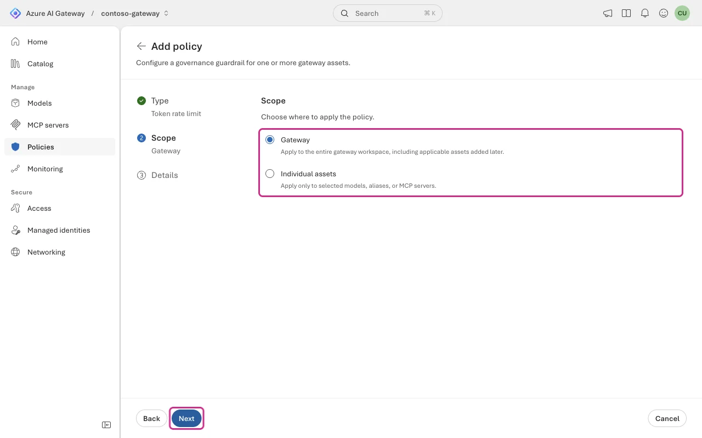

<!--
title: Set gateway-wide policy baselines
summary: Apply a baseline of token limit, request rate limit, content safety, and IP filter policies at Gateway scope so every model and MCP server, including the ones you add later, starts with the same guardrails, then layer stricter asset policies on top.
category: governance
level: Intermediate
duration: 25
tracks: [portal, cli, iac, terraform]
order: 9
illustration: diagrams/policy-scopes.svg
tags: [Gateway scope, baseline, tokenLimit, requestRateLimit, contentSafety, ipFilter, "403", policy as code, Terraform]
objectives:
  - Explain how Gateway scope policies and asset policies layer, and why any applicable policy can block a call
  - Apply a token limit, request rate limit, content safety, and IP filter baseline at Gateway scope
  - Keep the baseline in a reviewed policy file and apply it with a merge-safe script or with Terraform
  - Verify the baseline from your own IP address and see a stricter model policy take effect on top of it
prereqs:
  - 06-token-limits
  - 08-content-safety
-->
<!-- gh:begin nav: generated by "npm run sync" from the metadata, do not edit -->
[AI Gateway labs](../README.md) › [Governance & cost](../README.md#governance--cost) › Lab 09
<!-- gh:end -->

# Set gateway-wide policy baselines

<!-- gh:begin intro: generated by "npm run sync" from the metadata, do not edit -->
> Apply a baseline of token limit, request rate limit, content safety, and IP filter policies at Gateway scope so every model and MCP server, including the ones you add later, starts with the same guardrails, then layer stricter asset policies on top.

| ⏱️ Time | 📶 Level | 🧭 Tracks | ✅ Before you start |
| :-- | :-- | :-- | :-- |
| 25 min | Intermediate | Portal · Azure CLI · Policy as code · Terraform | [06 · Token limits](../06-token-limits/README.md)<br>[08 · Content safety](../08-content-safety/README.md) |

**You'll learn to**

- Explain how Gateway scope policies and asset policies layer, and why any applicable policy can block a call
- Apply a token limit, request rate limit, content safety, and IP filter baseline at Gateway scope
- Keep the baseline in a reviewed policy file and apply it with a merge-safe script or with Terraform
- Verify the baseline from your own IP address and see a stricter model policy take effect on top of it

**Follow along:** 🌐 [Interactive version](https://azure.github.io/aigateway/labs/09-gateway-baselines/) with your own values filled in · 📁 [Lab files](infra/)

**On this page:** [Before you begin](#before-you-begin) · [How it works](#how-it-works) · [Apply the baseline](#apply-the-baseline) · [Verify](#verify) · [Go further](#go-further) · [Clean up](#clean-up) · [Next steps](#next-steps)
<!-- gh:end -->

Your gateway now serves several models and MCP servers, and teams add new ones every week. Some assets have
carefully tuned policies, and some have none at all. The platform and security teams agree on a baseline that
every asset gets by default: a generous token limit, a request rate limit, **Balanced** content safety, and
runtime access only from approved networks. In this lab you apply that baseline once, at **Gateway** scope,
and keep tighter asset policies on top of it.


<!-- widget: policy-layers -->
<!-- gh:begin widget: generated by "npm run sync" from the metadata, do not edit -->
> 🎛️ **Interactive:** try the policy layers explorer in the [web version of this lab](https://azure.github.io/aigateway/labs/09-gateway-baselines/).
<!-- gh:end -->

## Before you begin

<!-- setup: tools sign-in extension clone -->
<!-- gh:begin setup: generated by "npm run sync" from the metadata, do not edit -->
🧰 **One-time setup** from the [Setup guide](../SETUP.md), if you haven't done it yet:
[Choose where to run commands](../SETUP.md#choose-where-to-run-commands) ·
[Sign in to Azure](../SETUP.md#sign-in-to-azure) ·
[Install the `aigateway` extension](../SETUP.md#install-the-aigateway-extension) ·
[Clone the labs repo](../SETUP.md#clone-the-labs-repo)
<!-- gh:end -->

- Complete [Throttle tokens per caller with token limits](../06-token-limits/README.md) and
  [Screen prompts and responses with content safety](../08-content-safety/README.md), including their
  **Clean up** sections. You need a gateway, an imported model, a callable alias, and a runtime API key from
  **Access** › **API keys**.
- Permission to change the gateway, for example **Contributor** on the resource group.
- The public IP addresses or CIDR ranges your callers use. Once the IP filter is on, calls from anywhere else get
  `403`.
- Run the scripts and samples from the lab's folder, `~/aigateway/labs/09-gateway-baselines`.

Set these variables once. Every track and the **Verify** section reuse them.

<details open><summary>Bash</summary> <!-- gh -->

```bash title="Bash"
# Name your gateway, its model provider, and the backend model that the Verify section calls
export RG="<resource-group>"
export GATEWAY="<gateway>"                 # 24 characters or fewer
export PROVIDER="<provider-name>"          # for example foundry-models
export MODEL="<model-name>"                # the backend model name under that provider

# Read the gateway's runtime URL, which apps call
export AI_GATEWAY_URL="https://$(az aigateway show -g "$RG" -n "$GATEWAY" --query properties.frontend.defaultHostname -o tsv)"
echo "🌐 Runtime URL: $AI_GATEWAY_URL"

# Read the alias that apps send in the model field: for Foundry imports, it matches the deployment's model name
export AI_GATEWAY_MODEL="$(az aigateway model show -g "$RG" --gateway-name "$GATEWAY" --provider-name "$PROVIDER" \
  -n "$MODEL" --query properties.deployment.modelName -o tsv)"
echo "🔖 Model alias: $AI_GATEWAY_MODEL"

# Paste the runtime key you created in Access › API keys, without showing it: don't commit it or write it to a file
printf "AI Gateway API key: " && read -rs AI_GATEWAY_API_KEY && export AI_GATEWAY_API_KEY && echo
echo "🔑 Key: in AI_GATEWAY_API_KEY (${#AI_GATEWAY_API_KEY} characters, not shown)"

# Read the public IP address that this machine uses on the internet
export MY_IP="$(curl -s https://api.ipify.org)"
echo "🌐 Public IP address: $MY_IP"

# Set the ranges that the IP filter allows
export ALLOWED_CIDRS="$MY_IP/32"           # comma-separated, for example "$MY_IP/32,198.51.100.0/24"
echo "📝 Ranges the IP filter allows: $ALLOWED_CIDRS"
```
</details> <!-- gh -->

<details><summary>PowerShell</summary> <!-- gh -->

```powershell title="PowerShell"
# Name your gateway, its model provider, and the backend model that the Verify section calls
$RG         = "<resource-group>"
$GATEWAY    = "<gateway>"                 # 24 characters or fewer
$PROVIDER   = "<provider-name>"           # for example foundry-models
$MODEL      = "<model-name>"              # the backend model name under that provider

# Read the gateway's runtime URL, which apps call
$env:AI_GATEWAY_URL = "https://$(az aigateway show -g $RG -n $GATEWAY --query properties.frontend.defaultHostname -o tsv)"
Write-Host "🌐 Runtime URL: $env:AI_GATEWAY_URL"

# Read the alias that apps send in the model field: for Foundry imports, it matches the deployment's model name
$env:AI_GATEWAY_MODEL = az aigateway model show -g $RG --gateway-name $GATEWAY --provider-name $PROVIDER `
  -n $MODEL --query properties.deployment.modelName -o tsv
Write-Host "🔖 Model alias: $env:AI_GATEWAY_MODEL"

# Paste the runtime key you created in Access › API keys, without showing it: don't commit it or write it to a file
$env:AI_GATEWAY_API_KEY = Read-Host "AI Gateway API key" -MaskInput
Write-Host "🔑 Key: in AI_GATEWAY_API_KEY ($($env:AI_GATEWAY_API_KEY.Length) characters, not shown)"

# Read the public IP address that this machine uses on the internet
$env:MY_IP = Invoke-RestMethod https://api.ipify.org
Write-Host "🌐 Public IP address: $env:MY_IP"

# Set the ranges that the IP filter allows
$env:ALLOWED_CIDRS = "$($env:MY_IP)/32"    # comma-separated, for example "$($env:MY_IP)/32,198.51.100.0/24"
Write-Host "📝 Ranges the IP filter allows: $env:ALLOWED_CIDRS"
```
</details> <!-- gh -->

## How it works

A policy with **Gateway** scope is stored on the gateway's `default` workspace instead of on one asset. It
applies to every compatible model, alias, and MCP server, including assets you add later, without another
policy update. Asset policies keep working alongside it. The gateway evaluates every applicable policy before
it forwards a request, and if any one of them blocks, the client gets an error and the backend is never
called. So an asset policy can make the rules **tighter** for one asset, but it can't loosen the baseline.

This lab's baseline:

| Policy | Applies to | Baseline value | Blocked calls get |
|---|---|---|---|
| **Token rate limit** | Models | 100,000 tokens per minute, per caller identity | `429` with `Retry-After` |
| **Request rate limit** | Models and MCP servers | 600 calls per 60 seconds, per caller identity | `429` with `Retry-After` |
| **Content safety** | Models and MCP servers | **Balanced** (`Medium`) for all four categories | `400` |
| **IP filter** | Models and MCP servers | **Allow listed IPs only**: your CIDR ranges | `403` |

A Gateway scope **Cost limit** is one budget across all models; you can add it in
[Enforce cost budgets with per-caller overrides](../07-cost-budgets/README.md). Agent 365 tool threat
protection can't be set at Gateway scope; it applies to individual MCP servers.

> [!NOTE]
> At the time of writing, AI Gateway resources save the content safety policy but don't block calls with it yet,
> as [Screen prompts and responses with content safety](../08-content-safety/README.md) explains. Keep it in the
> baseline so it applies once the gateway enforces it, and rely on your Foundry deployments' content filters
> until then.

> [!WARNING]
> The IP filter applies to **runtime** calls. You keep managing the gateway in the portal and with the Azure
> CLI, so you can always fix the list. But every caller outside it gets `403`: teammates, CI pipelines, hosted
> agents, and your own machine when you switch networks or VPN. Remove it in [Clean up](#clean-up).

## Apply the baseline

Pick one track. Each track creates the same four policies at **Gateway** scope. The Azure CLI track sets three
of them with one `az aigateway policy set` command and adds content safety with `az rest`. The Policy as code
track keeps them in a reviewed file and applies the whole file with a script, and the Terraform track applies the
same file with the `azapi` provider.

<!-- track: portal | Portal -->
<details open><summary><b>🖥️ Portal</b></summary> <!-- gh -->

### Add the token rate limit

Open the [AI Gateway portal](https://ai.gateway.azure.com) and select your gateway from the gateway switcher.
Select **Policies** › **Add policy**. On the **Type** step, select **Token rate limit**, then **Next**.

On the **Scope** step, select **Gateway** ("Apply to the entire gateway workspace, including applicable assets
added later."), then **Next**.



On the **Details** step, under **Parameters**, set:

| Field | Value |
|---|---|
| **Time period** | **Per minute** |
| **Allowed tokens** | `100000` |
| **Counter dimensions** | **Identity** |

Select **Create**.

### Add the request rate limit

Select **Add policy** again. Select **Request rate limit**, then **Gateway** scope, and set:

| Field | Value |
|---|---|
| **Calls** | `600` |
| **Renewal period** | **60 seconds** |
| **Counter dimensions** | **Identity** |

Select **Create**.

### Add content safety

The **Add policy** wizard doesn't list **Content safety** for AI Gateway resources, so create this policy with
the Azure CLI, for example in [Azure Cloud Shell](https://shell.azure.com), with the variables from
[Before you begin](#before-you-begin). Gateway scope policies live in the `properties.policies` array of the
gateway's `default` workspace. The commands read that array, add **Balanced** (`Medium`) content safety on all
four categories, and write the array back, so every other Gateway scope policy stays:

<details open><summary>Bash</summary> <!-- gh -->

```bash title="Bash"
# Build the management URL of the gateway's default workspace, which holds the Gateway scope policies
GATEWAY_ID="$(az aigateway show -g "$RG" -n "$GATEWAY" --query id -o tsv)"
URL="https://management.azure.com$GATEWAY_ID/workspaces/default?api-version=2026-11-01"

# Read the policies, drop any content safety policy, and add one at Medium (Balanced) in all four categories
POLICIES="$(az rest --method get --url "$URL" | jq -c '
  [(.properties.policies // [])[] | select(.type != "contentSafety")]
  + [{"type":"contentSafety","scope":"resource","hateSeverity":"Medium","violenceSeverity":"Medium","sexualSeverity":"Medium","selfHarmSeverity":"Medium"}]')"

# Send the merged array back: a PATCH replaces the whole policies array
az rest --method patch --url "$URL" --body "{\"properties\":{\"policies\":$POLICIES}}" --output none &&
  echo "🔐 Content safety on $GATEWAY is Balanced (Medium) for all four categories at Gateway scope"
```
</details> <!-- gh -->

<details><summary>PowerShell</summary> <!-- gh -->

```powershell title="PowerShell"
# Build the management URL of the gateway's default workspace, which holds the Gateway scope policies
$GATEWAY_ID = az aigateway show -g $RG -n $GATEWAY --query id -o tsv
$URL = "https://management.azure.com$GATEWAY_ID/workspaces/default?api-version=2026-11-01"

# Read the policies, drop any content safety policy, and add one at Medium (Balanced) in all four categories
$current  = az rest --method get --url $URL | ConvertFrom-Json
$policies = @($current.properties.policies | Where-Object { $_ -and $_.type -ne 'contentSafety' })
$policies += [pscustomobject]@{
  type = 'contentSafety'; scope = 'resource'
  hateSeverity = 'Medium'; violenceSeverity = 'Medium'; sexualSeverity = 'Medium'; selfHarmSeverity = 'Medium'
}

# Send the merged array back from a file, which keeps the JSON quotes intact: a PATCH replaces the whole array
@{ properties = @{ policies = $policies } } | ConvertTo-Json -Depth 10 -Compress | Set-Content -Path patch.json
az rest --method patch --url $URL --body '@patch.json' --output none
if ($?) { Write-Host "🔐 Content safety on $GATEWAY is Balanced (Medium) for all four categories at Gateway scope" }
Remove-Item patch.json
```
</details> <!-- gh -->

Reload **Policies**. The policy shows as **Content safety** with **Gateway** scope. To change a category later,
open its **More actions** menu and select **Edit**.

### Add the IP filter

Select **Add policy**. Under **Security**, select **IP filter**, then **Gateway** scope, and set:

| Field | Value |
|---|---|
| **Action** | **Allow listed IPs only** |
| **IP addresses / CIDR ranges** | Your `ALLOWED_CIDRS` value, for example `198.51.100.7/32` |

Use CIDR notation for every entry: `/32` for a single IPv4 address. Check the value against `echo "$MY_IP"`
before you select **Create**.

> **Checkpoint**
> **Policies** lists four policies whose scope is **Gateway**: **Token rate limit**, **Request rate limit**,
> **Content safety**, and **IP filter**.

</details> <!-- gh -->
<!-- track: cli | Azure CLI -->
<details><summary><b>⌨️ Azure CLI</b></summary> <!-- gh -->

### Set the baseline

`az aigateway policy set` creates or updates the token limit, request rate limit, and IP filter at **Gateway**
scope in one call. It replaces a policy of the same type and keeps every other Gateway scope policy, such as a
cost limit. `--allowed-ips` takes a list in brackets, so the command removes any spaces from your ranges.

<details open><summary>Bash</summary> <!-- gh -->

```bash title="Bash"
# Check the ranges that the IP filter will allow
echo "🔐 IP filter allows: $ALLOWED_CIDRS"

# Set the token limit, request rate limit, and IP filter at Gateway scope
az aigateway policy set -g "$RG" --gateway-name "$GATEWAY" --output none \
  --token-limit 100000 --token-period minute --token-counter-key Identity \
  --rate-limit 600 --period-seconds 60 --rate-counter-key Identity \
  --action Allow --allowed-ips "[${ALLOWED_CIDRS// /}]" &&
  echo "🔐 Token limit, request rate limit, and IP filter are on $GATEWAY at Gateway scope"
```
</details> <!-- gh -->

<details><summary>PowerShell</summary> <!-- gh -->

```powershell title="PowerShell"
# Check the ranges that the IP filter will allow
Write-Host "🔐 IP filter allows: $env:ALLOWED_CIDRS"

# Set the token limit, request rate limit, and IP filter at Gateway scope
az aigateway policy set -g $RG --gateway-name $GATEWAY --output none `
  --token-limit 100000 --token-period minute --token-counter-key Identity `
  --rate-limit 600 --period-seconds 60 --rate-counter-key Identity `
  --action Allow --allowed-ips "[$($env:ALLOWED_CIDRS -replace '\s')]"
if ($?) { Write-Host "🔐 Token limit, request rate limit, and IP filter are on $GATEWAY at Gateway scope" }
```
</details> <!-- gh -->

### Add content safety

The `aigateway` extension 1.0.0b34 removed its content safety options until they match API version
`2026-11-01`, so this step calls the management API with `az rest`. Gateway scope policies live in the
`properties.policies` array of the gateway's `default` workspace, and a `PATCH` **replaces the whole array**, so
the commands read it, swap in **Balanced** (`Medium`) content safety, and write the result back. That keeps the
three policies you just set and every other Gateway scope policy.

<details open><summary>Bash</summary> <!-- gh -->

```bash title="Bash"
# Build the management URL of the gateway's default workspace, which holds the Gateway scope policies
GATEWAY_ID="$(az aigateway show -g "$RG" -n "$GATEWAY" --query id -o tsv)"
URL="https://management.azure.com$GATEWAY_ID/workspaces/default?api-version=2026-11-01"

# Read the policies, drop any content safety policy, and add one at Medium (Balanced) in all four categories
POLICIES="$(az rest --method get --url "$URL" | jq -c '
  [(.properties.policies // [])[] | select(.type != "contentSafety")]
  + [{"type":"contentSafety","scope":"resource","hateSeverity":"Medium","violenceSeverity":"Medium","sexualSeverity":"Medium","selfHarmSeverity":"Medium"}]')"

# Send the merged array back: a PATCH replaces the whole policies array
az rest --method patch --url "$URL" --body "{\"properties\":{\"policies\":$POLICIES}}" --output none &&
  echo "🔐 Baseline of four policies is on $GATEWAY at Gateway scope"
```
</details> <!-- gh -->

<details><summary>PowerShell</summary> <!-- gh -->

```powershell title="PowerShell"
# Build the management URL of the gateway's default workspace, which holds the Gateway scope policies
$GATEWAY_ID = az aigateway show -g $RG -n $GATEWAY --query id -o tsv
$URL = "https://management.azure.com$GATEWAY_ID/workspaces/default?api-version=2026-11-01"

# Read the policies, drop any content safety policy, and add one at Medium (Balanced) in all four categories
$current  = az rest --method get --url $URL | ConvertFrom-Json
$policies = @($current.properties.policies | Where-Object { $_ -and $_.type -ne 'contentSafety' })
$policies += [pscustomobject]@{
  type = 'contentSafety'; scope = 'resource'
  hateSeverity = 'Medium'; violenceSeverity = 'Medium'; sexualSeverity = 'Medium'; selfHarmSeverity = 'Medium'
}

# Send the merged array back from a file, which keeps the JSON quotes intact: a PATCH replaces the whole array
@{ properties = @{ policies = $policies } } | ConvertTo-Json -Depth 10 -Compress | Set-Content -Path patch.json
az rest --method patch --url $URL --body '@patch.json' --output none
if ($?) { Write-Host "🔐 Baseline of four policies is on $GATEWAY at Gateway scope" }
Remove-Item patch.json
```
</details> <!-- gh -->

### Review the Gateway scope policies

<details open><summary>Bash</summary> <!-- gh -->

```bash title="Bash"
# List every policy at Gateway scope, one per line
echo "🔐 Gateway scope policies on $GATEWAY:"
az aigateway policy list -g "$RG" --gateway-name "$GATEWAY" --query "[].{Policy: type, Scope: scope}" -o table
```
</details> <!-- gh -->

<details><summary>PowerShell</summary> <!-- gh -->

```powershell title="PowerShell"
# List every policy at Gateway scope, one per line
Write-Host "🔐 Gateway scope policies on ${GATEWAY}:"
az aigateway policy list -g $RG --gateway-name $GATEWAY --query "[].{Policy: type, Scope: scope}" -o table
```
</details> <!-- gh -->

Expected output, in any order, plus a row for every other Gateway scope policy you already had:

```text
🔐 Gateway scope policies on aigw-contoso:
Policy            Scope
----------------  ---------
tokenLimit        workspace
requestRateLimit  workspace
ipFilter          resource
contentSafety     resource
```

> [!NOTE]
> Run `az aigateway policy list` without `--query` to see each policy's settings. The token and request rate
> limits have `"counterKey": ["identity"]`, which gives each API key or Entra caller its own counter. The CLI
> calls the management API version `2026-11-01`, like the Policy as code track, so it shows the request rate
> limit as `"count": 600` and `"period": "minute"`: the service stores `--period-seconds 60` as `minute`. The
> CLI stores the IP filter action as `"allow"` in lowercase, and the portal shows it as **Allow listed IPs only**.
> To change one policy later, use `az aigateway policy set-token-limit`, `set-rate-limit`, or `set-ip-filter`.
> Each keeps the other policies, including content safety. To change content safety, run **Add content safety**
> again with new values.

> **Checkpoint**
> `az aigateway policy list` returns `tokenLimit`, `requestRateLimit`, `ipFilter`, and `contentSafety` with
> `"Medium"` for all four categories, with your ranges in `cidrRanges`, plus any other Gateway scope policies you
> had.

</details> <!-- gh -->
<!-- track: iac | Policy as code -->
<details><summary><b>🏗️ Policy as code</b></summary> <!-- gh -->

### Choose what to declare

Gateway scope policies live on the gateway's `default` workspace. The sample Bicep templates only reference
that workspace as `existing`: the workspace accepts `PATCH` but not `PUT`, so a template that declares it fails
with `MethodNotAllowed`. Instead, keep the baseline in a policy file that goes through code review, and apply it
with a script. The `az aigateway policy` commands set policies from flags, so the script reads the workspace's
`properties.policies` array with `az rest`, merges the file into it, and writes the array back with a `PATCH`.

### Review the policy file

<!-- include: infra/baseline-policies.json -->
<!-- gh:begin include: generated by "npm run sync" from the metadata, do not edit -->
📄 [`infra/baseline-policies.json`](infra/baseline-policies.json)

<details><summary>Show all 30 lines</summary>

```json
[
  {
    "type": "tokenLimit",
    "count": 100000,
    "period": "minute",
    "counterKey": ["identity"],
    "scope": "workspace"
  },
  {
    "type": "requestRateLimit",
    "count": 600,
    "period": "minute",
    "counterKey": ["identity"],
    "scope": "workspace"
  },
  {
    "type": "contentSafety",
    "scope": "resource",
    "hateSeverity": "Medium",
    "violenceSeverity": "Medium",
    "sexualSeverity": "Medium",
    "selfHarmSeverity": "Medium"
  },
  {
    "type": "ipFilter",
    "scope": "resource",
    "action": "Allow",
    "cidrRanges": ["203.0.113.10/32"]
  }
]
```

</details>
<!-- gh:end -->

On GitHub, open [infra/baseline-policies.json](infra/baseline-policies.json).

The file uses the fields of the management API version `2026-11-01`, which the script calls. Both rate limits
take a `count` and a `period`: `minute`, or for the request rate limit a duration from `PT1S` to `PT300S`, such as
`PT30S`. Content safety and the IP filter take `"scope": "resource"` at Gateway scope; the API rejects
`"workspace"` for them.

The `ipFilter` entry holds a placeholder from the `203.0.113.0/24` documentation range. The script never applies
it: it replaces `cidrRanges` with your `ALLOWED_CIDRS` value and stops if that value is missing or isn't in CIDR
notation.

### Preview the change

From the lab folder, print the merged policy array without changing anything:

<details open><summary>Bash</summary> <!-- gh -->

```bash title="Bash"
# Print the merged policy array, without changing anything on the gateway
./infra/apply-baseline.sh --dry-run &&
  echo "💡 Nothing is applied yet: review the policies above, then apply them"
```
</details> <!-- gh -->

<details><summary>PowerShell</summary> <!-- gh -->

```powershell title="PowerShell"
# Print the merged policy array, without changing anything on the gateway
./infra/apply-baseline.ps1 -ResourceGroup $RG -Gateway $GATEWAY -DryRun
if ($?) { Write-Host "💡 Nothing is applied yet: review the policies above, then apply them" }
```
</details> <!-- gh -->

The PowerShell script reads `$env:ALLOWED_CIDRS` unless you pass `-AllowedCidrs`.

### Apply it

<details open><summary>Bash</summary> <!-- gh -->

```bash title="Bash"
# Merge the baseline into the Gateway scope policies, and keep every other policy
./infra/apply-baseline.sh &&
  echo "🔐 Baseline of four policies is on $GATEWAY at Gateway scope"
```
</details> <!-- gh -->

<details><summary>PowerShell</summary> <!-- gh -->

```powershell title="PowerShell"
# Merge the baseline into the Gateway scope policies, and keep every other policy
./infra/apply-baseline.ps1 -ResourceGroup $RG -Gateway $GATEWAY
if ($?) { Write-Host "🔐 Baseline of four policies is on $GATEWAY at Gateway scope" }
```
</details> <!-- gh -->

<!-- include: infra/apply-baseline.sh -->
<!-- gh:begin include: generated by "npm run sync" from the metadata, do not edit -->
📄 [`infra/apply-baseline.sh`](infra/apply-baseline.sh)

<details><summary>Show all 79 lines</summary>

```sh
#!/usr/bin/env bash
# Applies the policy baseline in baseline-policies.json at Gateway scope (the gateway's default
# workspace). It reads the current Gateway scope policies, replaces the entries whose type is in
# the baseline, keeps every other policy, and patches the workspace.
#
# Usage:
#   export RG="<resource-group>" GATEWAY="<gateway>"
#   export ALLOWED_CIDRS="198.51.100.7/32"   # comma-separated CIDR ranges for the IP filter
#   ./apply-baseline.sh              # apply the baseline
#   ./apply-baseline.sh --dry-run    # print the merged policies without changing anything
#   ./apply-baseline.sh --remove     # remove the baseline policy types from Gateway scope
#
# Set BASELINE_FILE to use a different policy file. Requires the Azure CLI (az login) with the
# aigateway extension, and jq.
set -euo pipefail

MODE="apply"
case "${1:-}" in
  "") ;;
  --dry-run) MODE="dry-run" ;;
  --remove) MODE="remove" ;;
  *) echo "Unknown option: $1. Use --dry-run or --remove." >&2; exit 2 ;;
esac

: "${RG:?Set RG to your resource group}"
: "${GATEWAY:?Set GATEWAY to your gateway name}"

SCRIPT_DIR="$(cd "$(dirname "${BASH_SOURCE[0]}")" && pwd)"
BASELINE_FILE="${BASELINE_FILE:-$SCRIPT_DIR/baseline-policies.json}"
BASELINE="$(jq -c '.' "$BASELINE_FILE")"

# The file holds a placeholder address for the IP filter. Never apply it: replace it with ALLOWED_CIDRS.
if [ "$MODE" != "remove" ] && jq -e 'any(.[]; .type == "ipFilter")' >/dev/null <<<"$BASELINE"; then
  : "${ALLOWED_CIDRS:?Set ALLOWED_CIDRS to the comma-separated CIDR ranges to allow, for example \"\$(curl -s https://api.ipify.org)/32\"}"
  BASELINE="$(jq -c --arg cidrs "$ALLOWED_CIDRS" '
    map(if .type == "ipFilter"
        then .cidrRanges = ($cidrs | split(",") | map(gsub("\\s"; "")) | map(select(length > 0)))
        else . end)' <<<"$BASELINE")"
  if ! jq -e 'all(.[] | select(.type == "ipFilter"); (.cidrRanges | length) > 0)' >/dev/null <<<"$BASELINE"; then
    echo "ALLOWED_CIDRS doesn't contain any CIDR ranges." >&2
    exit 2
  fi
  INVALID="$(jq -r '[.[] | select(.type == "ipFilter") | .cidrRanges[] | select(contains("/") | not)] | join(", ")' <<<"$BASELINE")"
  if [ -n "$INVALID" ]; then
    echo "Use CIDR notation with a prefix length, for example $INVALID/32 for a single address." >&2
    exit 2
  fi
fi

# The az aigateway policy commands set policies from flags, so to apply the whole file the script calls the
# management API with az rest.
GATEWAY_ID="$(az aigateway show -g "$RG" -n "$GATEWAY" --query id -o tsv)"
URL="https://management.azure.com$GATEWAY_ID/workspaces/default?api-version=2026-11-01"

# A PATCH replaces the whole properties.policies array, so always merge with the current array.
CURRENT="$(az rest --method get --url "$URL")"
KEEP='[(.properties.policies // [])[] | select(.type | IN($baseline[].type) | not)]'
if [ "$MODE" = "remove" ]; then
  POLICIES="$(jq -c --argjson baseline "$BASELINE" "$KEEP" <<<"$CURRENT")"
else
  POLICIES="$(jq -c --argjson baseline "$BASELINE" "$KEEP + \$baseline" <<<"$CURRENT")"
fi

if [ "$MODE" = "dry-run" ]; then
  echo "Gateway scope policies after the change (nothing was applied):"
  jq '.' <<<"$POLICIES"
  exit 0
fi

if [ "$MODE" = "apply" ] && jq -e 'any(.[]; .type == "ipFilter")' >/dev/null <<<"$BASELINE"; then
  echo "The IP filter allows runtime calls only from: $(jq -r '[.[] | select(.type == "ipFilter") | .cidrRanges[]] | join(", ")' <<<"$BASELINE")"
fi

az rest --method patch --url "$URL" --body "{\"properties\":{\"policies\":$POLICIES}}" --output none

echo "Gateway scope policies on $GATEWAY:"
az rest --method get --url "$URL" | jq -r '
  (.properties.policies // []) as $p
  | if ($p | length) == 0 then "  (none)" else $p[] | "  \(.type)  \(del(.type) | tojson)" end'
```

</details>
<!-- gh:end -->

On GitHub, open [infra/apply-baseline.sh](infra/apply-baseline.sh) or
[infra/apply-baseline.ps1](infra/apply-baseline.ps1).

> [!TIP]
> Run the script from a pipeline with an identity that can change the gateway, and change the baseline only
> through pull requests to `baseline-policies.json`. Post the `--dry-run` output in the pull request so
> reviewers see the exact policy array before it's applied.

> **Checkpoint**
> The script prints four Gateway scope policies (`tokenLimit`, `requestRateLimit`, `contentSafety`, and
> `ipFilter`) plus any other policies you already had.

</details> <!-- gh -->
<!-- track: terraform | Terraform -->
<details><summary><b>🌍 Terraform</b></summary> <!-- gh -->

**What you need:** the variables from **Before you begin**, plus Terraform 1.9 or later, as in
[Deploy a lab with Terraform](../SETUP.md#deploy-a-lab-with-terraform). Unlike the other labs' Terraform tracks,
this one creates no Azure resources: it applies the baseline to your existing gateway.

### Review the configuration

The configuration applies the same policy file as the Policy as code track, `infra/baseline-policies.json`.
`terraform/main.tf` reads your gateway and its `default` workspace, replaces the placeholder in the IP filter
with your ranges, and keeps every current Gateway scope policy whose type isn't in the file:

<!-- include: terraform/main.tf -->
<!-- gh:begin include: generated by "npm run sync" from the metadata, do not edit -->
📄 [`terraform/main.tf`](terraform/main.tf)

<details><summary>Show all 35 lines</summary>

```tf
# Lab 09 with Terraform: applies the policy baseline in ../infra/baseline-policies.json at Gateway scope on an
# existing gateway, the same file that the Policy as code scripts apply (baseline.tf). Terraform creates no
# Azure resources: it reads the gateway and its default workspace, where Gateway scope policies live.
data "azapi_client_config" "current" {}

data "azapi_resource" "gateway" {
  type      = "Microsoft.ApiManagement/aigateways@2026-11-01"
  name      = var.gateway_name
  parent_id = "/subscriptions/${data.azapi_client_config.current.subscription_id}/resourceGroups/${var.resource_group_name}"
}

# The current Gateway scope policies, so that removing the baseline keeps every other policy.
data "azapi_resource" "workspace" {
  type                   = "Microsoft.ApiManagement/aigateways/workspaces@2026-11-01"
  name                   = "default"
  parent_id              = data.azapi_resource.gateway.id
  response_export_values = ["properties.policies"]
}

locals {
  allowed_cidrs = [for c in split(",", var.allowed_cidrs) : trimspace(c) if trimspace(c) != ""]

  # The file holds a placeholder address for the IP filter. Never apply it: replace it with allowed_cidrs.
  baseline = [
    for p in jsondecode(file(coalesce(var.baseline_file, "${path.module}/../infra/baseline-policies.json"))) :
    merge(p, { for k in(p.type == "ipFilter" ? ["cidrRanges"] : []) : k => local.allowed_cidrs })
  ]
  baseline_types = [for p in local.baseline : p.type]

  # The Gateway scope policies whose type isn't in the baseline. The service can omit properties.policies when the
  # gateway has no Gateway scope policies, so try() returns an empty list then.
  other_policies = try([
    for p in data.azapi_resource.workspace.output.properties.policies : p if !contains(local.baseline_types, p.type)
  ], [])
}
```

</details>
<!-- gh:end -->

The workspace accepts `PATCH` but not `PUT`, so `terraform/baseline.tf` doesn't declare it as a resource. It
sends the same `PATCH` as the script with an `azapi_resource_action`, and sends it again whenever the merged
policy array changes:

<!-- include: terraform/baseline.tf -->
<!-- gh:begin include: generated by "npm run sync" from the metadata, do not edit -->
📄 [`terraform/baseline.tf`](terraform/baseline.tf)

```tf
# The baseline at Gateway scope. The default workspace accepts PATCH but not PUT, so Terraform sends the same PATCH
# as the Policy as code scripts: every current Gateway scope policy whose type isn't in the policy file, followed by
# the baseline. Other policies, such as a cost limit, stay. Terraform sends the PATCH again whenever that array
# changes. It doesn't read the policies back, so to undo an edit made in the portal or with the Azure CLI, run
# terraform apply -replace=azapi_resource_action.baseline.
#
# Destroying this resource changes nothing on the gateway. To remove the baseline, apply with
# -var remove_baseline=true first: the PATCH then keeps only the other policies.
resource "azapi_resource_action" "baseline" {
  type        = "Microsoft.ApiManagement/aigateways/workspaces@2026-11-01"
  resource_id = data.azapi_resource.workspace.id
  method      = "PATCH"

  body = {
    properties = {
      # jsonencode() lets the two arrays differ in length and shape.
      policies = jsondecode(var.remove_baseline ? jsonencode(local.other_policies) : jsonencode(flatten([local.other_policies, local.baseline])))
    }
  }

  response_export_values = ["properties.policies"]
}
```
<!-- gh:end -->

`terraform/variables.tf` declares the gateway, your ranges, and `remove_baseline`, which **Clean up** uses.

### Apply with terraform apply

Move into the lab's Terraform folder, select your current subscription, pass your gateway and ranges as
Terraform variables, then plan and apply. It takes a few seconds. The last command moves back to the lab's folder,
where **Verify** runs the scripts.

<details open><summary>Bash</summary> <!-- gh -->

```bash title="Bash"
# Move into the lab's Terraform folder
cd ~/aigateway/labs/09-gateway-baselines/terraform &&
  echo "📂 Terraform folder: $(pwd)"

# Use the Azure CLI's current subscription, your gateway, and the ranges that the IP filter allows
export ARM_SUBSCRIPTION_ID="$(az account show --query id --output tsv)"
export TF_VAR_resource_group_name="$RG"
export TF_VAR_gateway_name="$GATEWAY"
export TF_VAR_allowed_cidrs="$ALLOWED_CIDRS"
echo "📝 Baseline for $GATEWAY in $RG, allowing $ALLOWED_CIDRS"

# Download the provider, then plan and apply the baseline
terraform init &&
  terraform plan -out tfplan &&
  terraform apply tfplan &&
  echo "🔐 Baseline of four policies is on $GATEWAY at Gateway scope"
# Move back to the lab's folder, which holds the scripts
cd .. && echo "📂 Lab folder: $(pwd)"
```
</details> <!-- gh -->

<details><summary>PowerShell</summary> <!-- gh -->

```powershell title="PowerShell"
# Move into the lab's Terraform folder
Set-Location ~/aigateway/labs/09-gateway-baselines/terraform
if ($?) { Write-Host "📂 Terraform folder: $(Get-Location)" }

# Use the Azure CLI's current subscription, your gateway, and the ranges that the IP filter allows
$env:ARM_SUBSCRIPTION_ID         = az account show --query id --output tsv
$env:TF_VAR_resource_group_name  = $RG
$env:TF_VAR_gateway_name         = $GATEWAY
$env:TF_VAR_allowed_cidrs        = $env:ALLOWED_CIDRS
Write-Host "📝 Baseline for $GATEWAY in $RG, allowing $env:ALLOWED_CIDRS"

# Download the provider, then plan and apply the baseline
terraform init
if ($?) { terraform plan -out tfplan }
if ($?) { terraform apply tfplan }
if ($?) { Write-Host "🔐 Baseline of four policies is on $GATEWAY at Gateway scope" }
# Move back to the lab's folder, which holds the scripts
Set-Location ..
if ($?) { Write-Host "📂 Lab folder: $(Get-Location)" }
```
</details> <!-- gh -->

> **Checkpoint**
> `terraform apply` ended with `Apply complete! Resources: 1 added, 0 changed, 0 destroyed.`, and the
> `gateway_scope_policies` output lists `tokenLimit`, `requestRateLimit`, `contentSafety`, and `ipFilter`, plus
> any other Gateway scope policies you already had, such as `costLimit`.

### Change the baseline

To change a value, edit `infra/baseline-policies.json`, or pass `allowed_cidrs` to
`terraform -chdir=terraform plan` for other ranges, and apply the plan. Terraform sends the merged array again, and the plan ends with
`Plan: 0 to add, 1 to change, 0 to destroy.`

Terraform doesn't read the policies back, so a plan doesn't show changes that someone makes in the portal or with
the Azure CLI. To restore the file's values, run
`terraform -chdir=terraform apply -replace=azapi_resource_action.baseline`.

</details> <!-- gh -->
<!-- /tracks -->

## Verify

Check that the baseline covers your model and MCP servers, that your own calls still pass, and that a tighter
asset policy still takes effect on top of it.

<!-- steps -->

### Review the baseline in the portal

Select **Policies**. The four baseline policies show **Gateway** in the **Scope** column. Policies you add to
a model, alias, or MCP server show that asset instead.

### Call the model from your IP address

From the lab folder, send one chat completion:

<details open><summary>Bash</summary> <!-- gh -->

```bash title="Bash"
# Send one chat completion from this machine through the baseline
echo "🤖 Expect Status: 200 and a reply, because your IP address is on the allow list:"
./infra/check-call.sh "$AI_GATEWAY_MODEL"
```
</details> <!-- gh -->

<details><summary>PowerShell</summary> <!-- gh -->

```powershell title="PowerShell"
# Send one chat completion from this machine through the baseline
Write-Host "🤖 Expect Status: 200 and a reply, because your IP address is on the allow list:"
./infra/check-call.ps1 -Model $env:AI_GATEWAY_MODEL
```
</details> <!-- gh -->

On GitHub, open [check-call.sh](infra/check-call.sh) or [check-call.ps1](infra/check-call.ps1).

Expected output:

```text
🤖 Expect Status: 200 and a reply, because your IP address is on the allow list:
Status: 200
Reply:  A gateway-wide policy baseline is a default set of rules that applies to every asset ...
```

Your call passed all four baseline policies: your IP address is on the allow list, you're far below both rate
limits, and the prompt is benign.

> [!WARNING]
> If `check-call` keeps returning `403`, the gateway sees a different public IP address than `api.ipify.org`
> reported. A VPN, a corporate proxy, or a client such as Global Secure Access can send your Azure traffic
> through another egress address, and some networks rotate through a pool of egress addresses, so a `/32` can
> pass one call and block the next. Add your organization's egress ranges to `ALLOWED_CIDRS` and apply the
> baseline again, or run the lab from Azure Cloud Shell, where both addresses match.

If you completed [Federate MCP tools behind one endpoint](../04-federate-mcp-tools/README.md), run
`../04-federate-mcp-tools/infra/list-tools.sh learn` (PowerShell:
`../04-federate-mcp-tools/infra/list-tools.ps1 -Server learn`). The MCP server is covered by the same IP
filter, request rate limit, and content safety policies, and it still lists its tools.

### Layer a stricter model policy

Add a deliberately low token limit to your model only, the same one you used in lab 06.
`az aigateway model policy set-token-limit` keeps every other policy on the model:

<details open><summary>Bash</summary> <!-- gh -->

```bash title="Bash"
# Add a low token limit to the model only: 1,000 tokens per minute for each caller
az aigateway model policy set-token-limit -g "$RG" --gateway-name "$GATEWAY" --provider-name "$PROVIDER" -n "$MODEL" \
  --token-limit 1000 --output none &&
  echo "🔐 Token limit of 1,000 tokens per minute for each caller is on $MODEL"
```
</details> <!-- gh -->

<details><summary>PowerShell</summary> <!-- gh -->

```powershell title="PowerShell"
# Add a low token limit to the model only: 1,000 tokens per minute for each caller
az aigateway model policy set-token-limit -g $RG --gateway-name $GATEWAY --provider-name $PROVIDER -n $MODEL `
  --token-limit 1000 --output none
if ($?) { Write-Host "🔐 Token limit of 1,000 tokens per minute for each caller is on $MODEL" }
```
</details> <!-- gh -->

Then send a burst with the script from lab 06:

<details open><summary>Bash</summary> <!-- gh -->

```bash title="Bash"
# Send a burst of eight requests with the script from lab 06
echo "🚦 Expect 429 Too Many Requests once the 1,000-token allowance runs out:"
../06-token-limits/infra/trigger-token-limit.sh "$AI_GATEWAY_MODEL" 8
```
</details> <!-- gh -->

<details><summary>PowerShell</summary> <!-- gh -->

```powershell title="PowerShell"
# Send a burst of eight requests with the script from lab 06
Write-Host "🚦 Expect 429 Too Many Requests once the 1,000-token allowance runs out:"
../06-token-limits/infra/trigger-token-limit.ps1 -Model $env:AI_GATEWAY_MODEL -Requests 8
```
</details> <!-- gh -->

Once the 1,000-token allowance runs out, usually after four to six requests, the gateway returns `429`. A fast
burst can go a few hundred tokens past the budget before the first `429`. The baseline allows 100,000 tokens per
minute, but the model's tighter limit is evaluated too, and it blocks. If every request returns `200`, wait a
minute for the new limit to reach the gateway and run the burst again. Remove the model limit and run the burst again:

<details open><summary>Bash</summary> <!-- gh -->

```bash title="Bash"
# Remove only the token limit from the model, and keep its other policies
az aigateway model policy remove -g "$RG" --gateway-name "$GATEWAY" --provider-name "$PROVIDER" -n "$MODEL" \
  --remove-token-limit true --output none &&
  echo "🚮 Token limit is removed from $MODEL"
```
</details> <!-- gh -->

<details><summary>PowerShell</summary> <!-- gh -->

```powershell title="PowerShell"
# Remove only the token limit from the model, and keep its other policies
az aigateway model policy remove -g $RG --gateway-name $GATEWAY --provider-name $PROVIDER -n $MODEL `
  --remove-token-limit true --output none
if ($?) { Write-Host "🚮 Token limit is removed from $MODEL" }
```
</details> <!-- gh -->

All eight requests now return `200`, because only the generous baseline applies.

### See the IP filter block a call (optional)

Point the allow list at a documentation address that can't be yours, call the model, then restore your range.

- **Portal:** in **Policies**, select **Edit** on the **IP filter** policy, set the ranges to
  `203.0.113.10/32`, and save.
- **Azure CLI:** `az aigateway policy set-ip-filter -g "$RG" --gateway-name "$GATEWAY" --action Allow --allowed-ips "[203.0.113.10/32]" --output none`
- **Script (Bash):** `ALLOWED_CIDRS="203.0.113.10/32" ./infra/apply-baseline.sh`
- **Script (PowerShell):** `./infra/apply-baseline.ps1 -ResourceGroup $RG -Gateway $GATEWAY -AllowedCidrs "203.0.113.10/32"`
- **Terraform:** in the lab folder, `terraform -chdir=terraform plan -var allowed_cidrs=203.0.113.10/32 -out tfplan`,
  then `terraform -chdir=terraform apply tfplan`

Wait about a minute, then run `check-call` again. It now returns `Status: 403`, and the request never reaches
the model. Restore your range in the portal, with the same `set-ip-filter` command and
`--allowed-ips "[${ALLOWED_CIDRS// /}]"`, or by running the script again without the override
(`./infra/apply-baseline.sh`, or the PowerShell script without `-AllowedCidrs`), or by planning and applying
again without `-var` in Terraform. Then check that `check-call` returns `200`. Policy changes take up to a minute
to reach the gateway, so if you still see the old result, wait and retry.

### Watch outcomes in Monitoring

If you configured Application Insights in [Monitor usage, cost, and traces](../13-monitoring/README.md), open
**Monitoring** and compare `400`, `403`, and `429` outcomes before and after the baseline. A sudden rise in
`403` usually means a caller's network isn't on the allow list.

<!-- /steps -->

> **Checkpoint**
> **Policies** shows four **Gateway** scope policies. Your own call returned `200`, a stricter model limit
> still returned `429` on top of the baseline, and you know how a blocked IP address looks (`403`).

## Go further

- **Cap spend gateway-wide.** Add a **Cost limit** with **Gateway** scope for one budget across all models, as
  described in [Enforce cost budgets with per-caller overrides](../07-cost-budgets/README.md).
- **Tighten tool traffic.** Keep the baseline and add stricter controls to individual MCP servers in
  [Control which tools agents can call](../05-mcp-tool-controls/README.md) and
  [Protect tool calls with Agent 365 threat protection](../19-tool-threat-protection/README.md).
- **Keep the allow list for inbound traffic.** Inbound private endpoints, with public network access turned off,
  are in preview and need approval: see
  [Reach the gateway through an inbound private endpoint](../18-private-networking/README.md#reach-the-gateway-through-an-inbound-private-endpoint)
  and [Configure inbound access](https://ai.gateway.azure.com/docs/networking/private-endpoints). Until you have
  them, the IP filter is how you restrict who can call the gateway. To keep the gateway's traffic to your
  backends private, see [Lock down backend traffic with private networking](../18-private-networking/README.md).
- **Count Entra callers.** With `identity` counters, each Entra caller gets its own allowance. Move clients to
  keyless calls in [Go keyless with Microsoft Entra ID and RBAC](../11-entra-rbac/README.md).

## Clean up

Remove the baseline before you continue, especially the IP filter: later labs call the gateway from hosted
agents and other networks, which would get `403`. In your own environment, you can keep the other three
policies and replace the IP filter with your organization's egress ranges.

<!-- track: portal | Portal -->
<details open><summary><b>🖥️ Portal</b></summary> <!-- gh -->

### Remove the baseline

Select **Policies**. For each of the four policies with **Gateway** scope, select **Delete**. Remove the
**IP filter** first.

</details> <!-- gh -->
<!-- track: cli | Azure CLI -->
<details><summary><b>⌨️ Azure CLI</b></summary> <!-- gh -->

### Remove the baseline

`az aigateway policy remove` removes the token limit, request rate limit, and IP filter. Content safety has no
`az aigateway` option in extension 1.0.0b34, so the second command reads the Gateway scope policies, drops the
content safety policy, and writes the rest back with `az rest`.

<details open><summary>Bash</summary> <!-- gh -->

```bash title="Bash"
# Remove the token limit, request rate limit, and IP filter from Gateway scope, and keep every other policy
az aigateway policy remove -g "$RG" --gateway-name "$GATEWAY" --output none \
  --remove-token-limit true --remove-rate-limit true --remove-ip-filter true &&
  echo "🚮 Token limit, request rate limit, and IP filter are removed from $GATEWAY"

# Read the Gateway scope policies, drop the content safety policy, and send the rest back
GATEWAY_ID="$(az aigateway show -g "$RG" -n "$GATEWAY" --query id -o tsv)"
URL="https://management.azure.com$GATEWAY_ID/workspaces/default?api-version=2026-11-01"
POLICIES="$(az rest --method get --url "$URL" | jq -c '[(.properties.policies // [])[] | select(.type != "contentSafety")]')"
az rest --method patch --url "$URL" --body "{\"properties\":{\"policies\":$POLICIES}}" --output none &&
  echo "🚮 Baseline is removed from $GATEWAY"
```
</details> <!-- gh -->

<details><summary>PowerShell</summary> <!-- gh -->

```powershell title="PowerShell"
# Remove the token limit, request rate limit, and IP filter from Gateway scope, and keep every other policy
az aigateway policy remove -g $RG --gateway-name $GATEWAY --output none `
  --remove-token-limit true --remove-rate-limit true --remove-ip-filter true
if ($?) { Write-Host "🚮 Token limit, request rate limit, and IP filter are removed from $GATEWAY" }

# Read the Gateway scope policies, drop the content safety policy, and send the rest back from a file
$GATEWAY_ID = az aigateway show -g $RG -n $GATEWAY --query id -o tsv
$URL = "https://management.azure.com$GATEWAY_ID/workspaces/default?api-version=2026-11-01"
$current  = az rest --method get --url $URL | ConvertFrom-Json
$policies = @($current.properties.policies | Where-Object { $_ -and $_.type -ne 'contentSafety' })
ConvertTo-Json -InputObject @{ properties = @{ policies = $policies } } -Depth 10 -Compress | Set-Content -Path patch.json
az rest --method patch --url $URL --body '@patch.json' --output none
if ($?) { Write-Host "🚮 Baseline is removed from $GATEWAY" }
Remove-Item patch.json
```
</details> <!-- gh -->

Every other Gateway scope policy, such as a cost limit, stays.

</details> <!-- gh -->
<!-- track: iac | Policy as code -->
<details><summary><b>🏗️ Policy as code</b></summary> <!-- gh -->

### Remove the baseline

<details open><summary>Bash</summary> <!-- gh -->

```bash title="Bash"
# Remove the policy types listed in baseline-policies.json from Gateway scope, and keep every other policy
./infra/apply-baseline.sh --remove &&
  echo "🚮 Baseline is removed from $GATEWAY"
```
</details> <!-- gh -->

<details><summary>PowerShell</summary> <!-- gh -->

```powershell title="PowerShell"
# Remove the policy types listed in baseline-policies.json from Gateway scope, and keep every other policy
./infra/apply-baseline.ps1 -ResourceGroup $RG -Gateway $GATEWAY -Remove
if ($?) { Write-Host "🚮 Baseline is removed from $GATEWAY" }
```
</details> <!-- gh -->

The script removes the policy types listed in `baseline-policies.json` and keeps every other Gateway scope
policy.

</details> <!-- gh -->
<!-- track: terraform | Terraform -->
<details><summary><b>🌍 Terraform</b></summary> <!-- gh -->

### Remove the baseline

In the `aigateway/labs/09-gateway-baselines` folder, with the variables from the Terraform track still
set, apply once with `remove_baseline=true`: the `PATCH` then keeps only the other Gateway scope policies. Then
run `terraform destroy`, which only removes the baseline from the Terraform state and changes nothing on the
gateway.

<details open><summary>Bash</summary> <!-- gh -->

```bash title="Bash"
# Remove the policy types listed in baseline-policies.json from Gateway scope, and keep every other policy
terraform -chdir=terraform plan -var remove_baseline=true -out tfplan &&
  terraform -chdir=terraform apply tfplan &&
  echo "🚮 Baseline is removed from $GATEWAY"

# Forget the baseline in the Terraform state: this changes nothing on the gateway
terraform -chdir=terraform destroy -auto-approve &&
  echo "🚮 Terraform no longer tracks the baseline"
```
</details> <!-- gh -->

<details><summary>PowerShell</summary> <!-- gh -->

```powershell title="PowerShell"
# Remove the policy types listed in baseline-policies.json from Gateway scope, and keep every other policy
terraform -chdir=terraform plan -var remove_baseline=true -out tfplan
if ($?) { terraform -chdir=terraform apply tfplan }
if ($?) { Write-Host "🚮 Baseline is removed from $GATEWAY" }

# Forget the baseline in the Terraform state: this changes nothing on the gateway
terraform -chdir=terraform destroy -auto-approve
if ($?) { Write-Host "🚮 Terraform no longer tracks the baseline" }
```
</details> <!-- gh -->

> **Checkpoint**
> The apply ended with `Apply complete! Resources: 0 added, 1 changed, 0 destroyed.`, the
> `gateway_scope_policies` output lists only the policies you had before, and `terraform destroy` ended with
> `Destroy complete! Resources: 1 destroyed.`

</details> <!-- gh -->
<!-- /tracks -->

Keep the gateway, model, and key. The next labs reuse them.

## Next steps

- [Enforce cost budgets with per-caller overrides](../07-cost-budgets/README.md): add a spend limit to the
  baseline.
- [Monitor usage, cost, and traces](../13-monitoring/README.md): track `400`, `403`, and `429` outcomes per
  policy.
- [Lock down backend traffic with private networking](../18-private-networking/README.md): route the gateway's
  backend traffic through your virtual network.
- Docs: [Policies in AI Gateway](https://ai.gateway.azure.com/docs/policies),
  [Request rate limit](https://ai.gateway.azure.com/docs/policies/request-rate-limit), and
  [IP filter](https://ai.gateway.azure.com/docs/policies/ip-filter).

<!-- gh:begin footer: generated by "npm run sync" from the metadata, do not edit -->

🛟 **Hit an error?** [Troubleshooting](../TROUBLESHOOTING.md#lab-09-gateway-wide-baselines) lists the errors of this lab, the steps where they happen, and their fixes.

---

| ⬅️ Previous | 🏠 | Next ➡️ |
| :-- | :-: | --: |
| [08 · Content safety](../08-content-safety/README.md) | [All labs](../README.md) | [10 · Runtime API keys](../10-api-keys/README.md) |

<sub>Learning paths: [Platform engineer](../README.md#learning-paths) (8 of 11) · [Security & compliance](../README.md#learning-paths) (5 of 9)</sub>
<!-- gh:end -->
