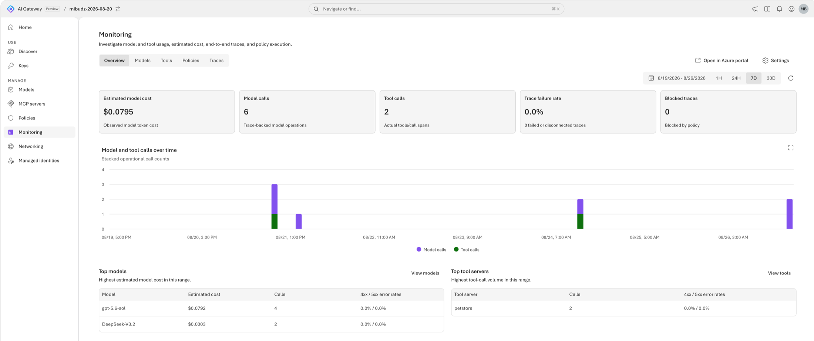
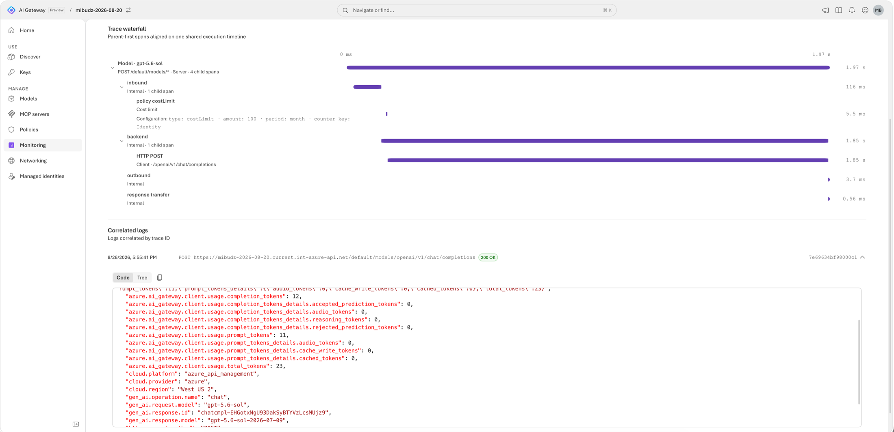

<!--
title: Monitor usage, cost, and traces
summary: Send the gateway's OpenTelemetry metrics, logs, and traces to Application Insights, then use the built-in Monitoring dashboard to see usage, estimated cost per model and API key, policy impact, and gateway-aware traces.
category: observability
level: Beginner
duration: 25
tracks: [portal, cli, iac]
order: 13
illustration: diagrams/observability.svg
tags: [OpenTelemetry, OTLP, Application Insights, traces, estimated cost, KQL, GenAI semantic conventions]
objectives:
  - Explain how the gateway exports metrics, logs, and traces independently over OTLP
  - Connect the gateway to Application Insights in the portal, with the Azure CLI, or with Bicep and azd
  - Read health, outcomes, policy impact, tokens, and estimated cost on the Monitoring dashboard
  - Follow one request through the trace waterfall, including its policy child spans
  - Query gateway telemetry in Log Analytics with KQL
prereqs:
  - 02-first-model-call
-->
<!-- gh:begin nav: generated by "npm run sync" from the metadata, do not edit -->
[AI Gateway labs](../README.md) › [Observability & FinOps](../README.md#observability--finops) › Lab 13
<!-- gh:end -->

# Monitor usage, cost, and traces

<!-- gh:begin intro: generated by "npm run sync" from the metadata, do not edit -->
> Send the gateway's OpenTelemetry metrics, logs, and traces to Application Insights, then use the built-in Monitoring dashboard to see usage, estimated cost per model and API key, policy impact, and gateway-aware traces.

| ⏱️ Time | 📶 Level | 🧭 Tracks | ✅ Before you start |
| :-- | :-- | :-- | :-- |
| 25 min | Beginner | Portal · Azure CLI · Bicep + azd | [02 · First model call](../02-first-model-call/README.md) |

**You'll learn to**

- Explain how the gateway exports metrics, logs, and traces independently over OTLP
- Connect the gateway to Application Insights in the portal, with the Azure CLI, or with Bicep and azd
- Read health, outcomes, policy impact, tokens, and estimated cost on the Monitoring dashboard
- Follow one request through the trace waterfall, including its policy child spans
- Query gateway telemetry in Log Analytics with KQL

**Follow along:** 🌐 [Interactive version](https://azure.github.io/aigateway/labs/13-monitoring/) with your own values filled in · 📁 [Lab files](infra/)

**On this page:** [Before you begin](#before-you-begin) · [How it works](#how-it-works) · [Connect Application Insights](#connect-application-insights) · [Generate traffic](#generate-traffic) · [Tour the dashboard](#tour-the-dashboard) · [Follow a request through the trace waterfall](#follow-a-request-through-the-trace-waterfall) · [Query telemetry with KQL](#query-telemetry-with-kql) · [Verify](#verify) · [Go further](#go-further) · [Clean up](#clean-up) · [Next steps](#next-steps)
<!-- gh:end -->

Your gateway now serves several apps. Finance asks what the models cost per team, an app owner reports
intermittent failures, and nobody can tell whether a policy or the backend rejected those calls. In this lab you
send the gateway's OpenTelemetry signals to Application Insights and answer all three questions from the built-in
**Monitoring** dashboard, down to a single request's trace.


<!-- widget: request-lifecycle -->
<!-- gh:begin widget: generated by "npm run sync" from the metadata, do not edit -->
> 🎛️ **Interactive:** try the request lifecycle explorer in the [web version of this lab](https://azure.github.io/aigateway/labs/13-monitoring/).
<!-- gh:end -->

## Before you begin

<!-- setup: tools sign-in extension clone -->
<!-- gh:begin setup: generated by "npm run sync" from the metadata, do not edit -->
🧰 **One-time setup** from the [Setup guide](../SETUP.md), if you haven't done it yet:
[Choose where to run commands](../SETUP.md#choose-where-to-run-commands) ·
[Sign in to Azure](../SETUP.md#sign-in-to-azure) ·
[Install the `aigateway` extension](../SETUP.md#install-the-aigateway-extension) ·
[Clone the labs repo](../SETUP.md#clone-the-labs-repo)
<!-- gh:end -->

> [!TIP]
> On the **Bicep + azd** track, `azd up` creates its own gateway, model, key, and Application Insights, so you can
> skip this section. You need only the one-time setup above, and permission to create role assignments, for example
> **Owner** on the subscription.

- Complete [Publish a Foundry model and make your first call](../02-first-model-call/README.md). You need a gateway,
  an imported model, a callable alias, and a runtime API key from **Access** › **API keys**.
- Permission to change the gateway, for example **Contributor** on its resource group, **and** permission to
  create role assignments, for example **Owner** or **Role Based Access Control Administrator**. Setup grants the
  gateway's managed identity a role on the telemetry destination. To reuse an existing Application Insights
  resource, you also need **Application Insights Contributor** on it.
- Run the scripts and samples from the lab's folder, `~/aigateway/labs/13-monitoring`.

Set these variables once. The tracks and the traffic script reuse them.

<details open><summary>Bash</summary> <!-- gh -->

```bash title="Bash"
# Name your gateway from lab 02, and the alias that the traffic script calls
export RG="<resource-group>"
export GATEWAY="<gateway>"
export AI_GATEWAY_MODEL="<model-name>"     # a callable alias, for example the one you used in lab 02

# Read the gateway's runtime URL
export AI_GATEWAY_URL="https://$(az aigateway show -g "$RG" -n "$GATEWAY" --query properties.frontend.defaultHostname -o tsv)"
echo "🌐 Runtime URL: $AI_GATEWAY_URL"

# Paste the runtime key you created in Access › API keys, without showing it: don't commit it or write it to a file
read -rsp "AI Gateway API key: " AI_GATEWAY_API_KEY && export AI_GATEWAY_API_KEY && echo
echo "🔑 Key: in AI_GATEWAY_API_KEY (${#AI_GATEWAY_API_KEY} characters, not shown)"
```
</details> <!-- gh -->

<details><summary>PowerShell</summary> <!-- gh -->

```powershell title="PowerShell"
# Name your gateway from lab 02, and the alias that the traffic script calls
$RG      = "<resource-group>"
$GATEWAY = "<gateway>"
$env:AI_GATEWAY_MODEL = "<model-name>"     # a callable alias, for example the one you used in lab 02

# Read the gateway's runtime URL
$env:AI_GATEWAY_URL = "https://$(az aigateway show -g $RG -n $GATEWAY --query properties.frontend.defaultHostname -o tsv)"
Write-Host "🌐 Runtime URL: $env:AI_GATEWAY_URL"

# Paste the runtime key you created in Access › API keys, without showing it: don't commit it or write it to a file
$env:AI_GATEWAY_API_KEY = Read-Host "AI Gateway API key" -MaskInput
Write-Host "🔑 Key: in AI_GATEWAY_API_KEY ($($env:AI_GATEWAY_API_KEY.Length) characters, not shown)"
```
</details> <!-- gh -->

> [!IMPORTANT]
> Did you configure monitoring before the 2026-08-28 release? Reconfigure it to get logs, traces, cost metrics, and
> policy spans: on the **Monitoring** page select **Settings**, disable monitoring, and configure it again. You can
> select the same Application Insights resource.

## How it works

The gateway emits three OpenTelemetry signals and exports each one **independently** over OTLP, to Azure Application
Insights or to any OTLP endpoint (for example Datadog, Splunk, Grafana Cloud, or your own collector). Configure only
the signals you need. Telemetry follows the OpenTelemetry GenAI and MCP semantic conventions, such as
`gen_ai.request.model`, `gen_ai.operation.name`, and `mcp.method.name`, and adds gateway attributes such as the API
key, alias, resolved model, and policy type.

When the destination is Application Insights and all three signals are on, the **Monitoring** page turns that data
into a dashboard. Estimated cost is **observed tokens × public pricing**: use it to spot trends and compare callers,
then reconcile with provider billing or Azure Cost Management for financial reporting.

| Signal | What the gateway sends | Where it lands with Application Insights | Dashboard uses it for |
|---|---|---|---|
| Metrics | Token usage and estimated token cost, by model, token type, API key, and caller | Azure Monitor workspace (managed Prometheus) linked to Application Insights | Tokens and **Estimated model cost** |
| Traces | One root span per request, with child spans for each stage and each policy that ran | `OTelSpans` table in the Log Analytics workspace | Calls, outcomes, blocked traces, the trace waterfall |
| Logs | Request records with status, caller, model, and the token usage the backend reported | `OTelLogs` table in the Log Analytics workspace | Correlated logs and caller attribution |

## Connect Application Insights

Pick one track. Each ends with the gateway exporting all three signals to an Application Insights resource named
`<gateway>-insights`.

<!-- track: portal | Portal -->
<details open><summary><b>🖥️ Portal</b></summary> <!-- gh -->

### Start the setup

Open the [AI Gateway portal](https://ai.gateway.azure.com) and select your gateway from the gateway switcher. Select
**Monitoring**. If monitoring isn't configured yet, the page shows **Set up monitoring**. Select
**Configure telemetry**. The wizard has three steps: **Destination**, **Authentication**, and **Review and apply**.

### Choose a destination

On **Destination**, select **New Azure Application Insights resource** and keep the suggested name,
`<gateway>-insights`. Select **Next**.

> [!TIP]
> The other choices are **Existing Azure Application Insights resource**, for a component you already have, and
> **Custom OpenTelemetry destination**, which takes separate **Metrics endpoint**, **Logs endpoint**, and
> **Traces endpoint** URLs. Leave an endpoint empty to turn that signal off. The built-in dashboard only reads
> Application Insights, so with a custom destination you use your own platform's views.

### Review authentication

On **Authentication**, the gateway exports with its managed identity. If none is enabled, the wizard enables the
system-assigned identity for you. It also assigns the **Monitoring Metrics Publisher** role on the destination's
Data Collection Rule when you apply.

Leave **Include recommended token claims in telemetry** selected. It adds Microsoft Entra caller claims to the
telemetry, which [Attribute tokens and cost with OpenTelemetry](../14-otel-chargeback/README.md) builds on. Select
**Next**.

### Apply the configuration

On **Review and apply**, select **Apply**. The wizard shows each step as it runs: **Register resource providers**,
**Resolve managed identity**, **Provision destination**, **Discover OTLP endpoints**,
**Assign Monitoring Metrics Publisher role**, and **Create telemetry exporter**. If a step fails, fix the cause
shown in the message and select **Retry**. If an Azure Policy assignment blocks a step, check the Activity Log for
the denied operation.

> **Checkpoint**
> The **Monitoring** page shows the **Overview**, **Models**, **Tools**, **Policies**, and **Traces** tabs, with
> **Open in Azure portal** and **Settings** in the header.

</details> <!-- gh -->
<!-- track: cli | Azure CLI -->
<details><summary><b>⌨️ Azure CLI</b></summary> <!-- gh -->

### Create the destination

Create what the wizard's **New Azure Application Insights resource** creates: a Log Analytics workspace and a
workspace-based Application Insights component, named after the gateway and in its region. `az monitor app-insights`
comes from the `application-insights` extension, which the Azure CLI offers to install the first time.

<details open><summary>Bash</summary> <!-- gh -->

```bash title="Bash"
# Read the gateway's region, so that the destination lives next to it
LOCATION="$(az aigateway show -g "$RG" -n "$GATEWAY" --query location -o tsv)"
echo "📍 Region: $LOCATION"

# Create the Log Analytics workspace that stores the spans and logs, and keep its ID for the queries
export LAW_CUSTOMER_ID="$(az monitor log-analytics workspace create -g "$RG" -n "$GATEWAY-logs" -l "$LOCATION" \
  --query customerId -o tsv)" &&
  echo "📊 Log Analytics workspace $GATEWAY-logs is ready"

# Create the Application Insights component on that workspace
az monitor app-insights component create -g "$RG" -a "$GATEWAY-insights" -l "$LOCATION" --kind web \
  --application-type web --workspace "$GATEWAY-logs" -o none &&
  echo "📊 Application Insights $GATEWAY-insights is ready"
```
</details> <!-- gh -->

<details><summary>PowerShell</summary> <!-- gh -->

```powershell title="PowerShell"
# Read the gateway's region, so that the destination lives next to it
$LOCATION = az aigateway show -g $RG -n $GATEWAY --query location -o tsv
Write-Host "📍 Region: $LOCATION"

# Create the Log Analytics workspace that stores the spans and logs, and keep its ID for the queries
$LAW_CUSTOMER_ID = az monitor log-analytics workspace create -g $RG -n "$GATEWAY-logs" -l $LOCATION `
  --query customerId -o tsv
if ($?) { Write-Host "📊 Log Analytics workspace $GATEWAY-logs is ready" }

# Create the Application Insights component on that workspace
az monitor app-insights component create -g $RG -a "$GATEWAY-insights" -l $LOCATION --kind web `
  --application-type web --workspace "$GATEWAY-logs" -o none
if ($?) { Write-Host "📊 Application Insights $GATEWAY-insights is ready" }
```
</details> <!-- gh -->

### Turn on OTLP ingestion

The component reports OTLP endpoints only after you turn on ingestion into an Azure Monitor workspace. Azure then
creates a managed resource group, `ai_<component>_<id>_managed`, with the Data Collection Rule and the Azure Monitor
workspace for the metrics. `az monitor app-insights` has no flag for this setting, so set the component's
`AzureMonitorWorkspaceIngestionMode` property with `az resource update`, wait for the endpoints, then read them back.
The wait usually takes seconds, and can take a few minutes.

<details open><summary>Bash</summary> <!-- gh -->

```bash title="Bash"
# Turn on OTLP ingestion, which creates the Data Collection Rule and the OTLP endpoints
COMPONENT_ID="$(az resource update -g "$RG" -n "$GATEWAY-insights" --resource-type Microsoft.Insights/components \
  --api-version 2020-02-02 --set properties.AzureMonitorWorkspaceIngestionMode=Enabled --query id -o tsv)" &&
  echo "📊 OTLP ingestion is on for $GATEWAY-insights"

# Wait until the component reports the Data Collection Rule and the three OTLP endpoints
READY="(properties.OTLPMetricsEndpoint && properties.OTLPLogsEndpoint && properties.OTLPTracesEndpoint) && properties.DataCollectionRuleResourceId || ''"
until [ -n "$(az resource show --ids "$COMPONENT_ID" --api-version 2020-02-02 --query "$READY" -o tsv)" ]; do
  echo "⏳ Waiting for the OTLP endpoints" && sleep 10
done

# Read the Data Collection Rule and the OTLP endpoint of each signal from the component
otlp() { az resource show --ids "$COMPONENT_ID" --api-version 2020-02-02 --query "properties.$1" -o tsv; }
DCR_ID="$(otlp DataCollectionRuleResourceId)"
METRICS_URL="$(otlp OTLPMetricsEndpoint)"
LOGS_URL="$(otlp OTLPLogsEndpoint)"
TRACES_URL="$(otlp OTLPTracesEndpoint)"
echo "🆔 Data Collection Rule: ${DCR_ID##*/}"
echo "🌐 Metrics endpoint: ${METRICS_URL%%/dataCollectionRules/*}"
echo "🌐 Logs and traces endpoint: ${LOGS_URL%%/dataCollectionRules/*}"
```
</details> <!-- gh -->

<details><summary>PowerShell</summary> <!-- gh -->

```powershell title="PowerShell"
# Turn on OTLP ingestion, which creates the Data Collection Rule and the OTLP endpoints
$COMPONENT_ID = az resource update -g $RG -n "$GATEWAY-insights" --resource-type Microsoft.Insights/components `
  --api-version 2020-02-02 --set properties.AzureMonitorWorkspaceIngestionMode=Enabled --query id -o tsv
if ($?) { Write-Host "📊 OTLP ingestion is on for $GATEWAY-insights" }

# Wait until the component reports the Data Collection Rule and the three OTLP endpoints
$READY = "(properties.OTLPMetricsEndpoint && properties.OTLPLogsEndpoint && properties.OTLPTracesEndpoint) && properties.DataCollectionRuleResourceId || ''"
while (-not (az resource show --ids $COMPONENT_ID --api-version 2020-02-02 --query $READY -o tsv)) {
  Write-Host "⏳ Waiting for the OTLP endpoints"; Start-Sleep -Seconds 10
}

# Read the Data Collection Rule and the OTLP endpoint of each signal from the component
function otlp($name) { az resource show --ids $COMPONENT_ID --api-version 2020-02-02 --query "properties.$name" -o tsv }
$DCR_ID      = otlp DataCollectionRuleResourceId
$METRICS_URL = otlp OTLPMetricsEndpoint
$LOGS_URL    = otlp OTLPLogsEndpoint
$TRACES_URL  = otlp OTLPTracesEndpoint
Write-Host "🆔 Data Collection Rule: $(Split-Path $DCR_ID -Leaf)"
Write-Host "🌐 Metrics endpoint: $(($METRICS_URL -split '/dataCollectionRules/')[0])"
Write-Host "🌐 Logs and traces endpoint: $(($LOGS_URL -split '/dataCollectionRules/')[0])"
```
</details> <!-- gh -->

### Let the gateway publish

The gateway exports with its system-assigned managed identity, which needs **Monitoring Metrics Publisher** on the
Data Collection Rule. The wizard's **Assign Monitoring Metrics Publisher role** step does the same.

<details open><summary>Bash</summary> <!-- gh -->

```bash title="Bash"
# Read the gateway's managed identity, which signs the telemetry export
PRINCIPAL_ID="$(az aigateway show -g "$RG" -n "$GATEWAY" --query identity.principalId -o tsv)"
echo "👤 Gateway identity: $PRINCIPAL_ID"

# Let the identity publish to the Data Collection Rule
az role assignment create --assignee-object-id "$PRINCIPAL_ID" --assignee-principal-type ServicePrincipal \
  --role "Monitoring Metrics Publisher" --scope "$DCR_ID" -o none &&
  echo "🔐 The gateway can publish to the Data Collection Rule"
```
</details> <!-- gh -->

<details><summary>PowerShell</summary> <!-- gh -->

```powershell title="PowerShell"
# Read the gateway's managed identity, which signs the telemetry export
$PRINCIPAL_ID = az aigateway show -g $RG -n $GATEWAY --query identity.principalId -o tsv
Write-Host "👤 Gateway identity: $PRINCIPAL_ID"

# Let the identity publish to the Data Collection Rule
az role assignment create --assignee-object-id $PRINCIPAL_ID --assignee-principal-type ServicePrincipal `
  --role "Monitoring Metrics Publisher" --scope $DCR_ID -o none
if ($?) { Write-Host "🔐 The gateway can publish to the Data Collection Rule" }
```
</details> <!-- gh -->

### Create the telemetry exporter

`az aigateway telemetry-exporter create` creates what the wizard's **Create telemetry exporter** step creates: an
exporter named `appinsights`, of kind `OpenTelemetry`, that sends each signal to its OTLP endpoint with the gateway's
managed identity. `--telemetry` adds the recommended token claims: `tid` and `oid` on every signal, and `appid` and
`azp` on logs and traces.

<details open><summary>Bash</summary> <!-- gh -->

```bash title="Bash"
# Export metrics, logs, and traces to the component's OTLP endpoints, signed with the gateway's managed identity
az aigateway telemetry-exporter create -g "$RG" --gateway-name "$GATEWAY" -n appinsights --kind OpenTelemetry \
  --application-insights "{resourceId:'$COMPONENT_ID'}" --payload-capture false \
  --open-telemetry "{metricsEndpoint:'$METRICS_URL',logsEndpoint:'$LOGS_URL',tracesEndpoint:'$TRACES_URL',credentials:{managedIdentity:{resource:'https://monitor.azure.com'}}}" \
  --telemetry "{attributes:[{source:{kind:claims,value:tid},signals:[logs,traces,metrics]},{source:{kind:claims,value:oid},signals:[logs,traces,metrics]},{source:{kind:claims,value:appid},signals:[logs,traces]},{source:{kind:claims,value:azp},signals:[logs,traces]}]}" \
  -o none &&
  echo "📊 Telemetry exporter appinsights sends metrics, logs, and traces to $GATEWAY-insights"

# List the gateway's telemetry exporters, with the kind of each one
echo "📊 Telemetry exporters on $GATEWAY:"
az aigateway telemetry-exporter list -g "$RG" --gateway-name "$GATEWAY" --query "[].{name:name, kind:properties.kind}" -o table
```
</details> <!-- gh -->

<details><summary>PowerShell</summary> <!-- gh -->

```powershell title="PowerShell"
# Export metrics, logs, and traces to the component's OTLP endpoints, signed with the gateway's managed identity
az aigateway telemetry-exporter create -g $RG --gateway-name $GATEWAY -n appinsights --kind OpenTelemetry `
  --application-insights "{resourceId:'$COMPONENT_ID'}" --payload-capture false `
  --open-telemetry "{metricsEndpoint:'$METRICS_URL',logsEndpoint:'$LOGS_URL',tracesEndpoint:'$TRACES_URL',credentials:{managedIdentity:{resource:'https://monitor.azure.com'}}}" `
  --telemetry "{attributes:[{source:{kind:claims,value:tid},signals:[logs,traces,metrics]},{source:{kind:claims,value:oid},signals:[logs,traces,metrics]},{source:{kind:claims,value:appid},signals:[logs,traces]},{source:{kind:claims,value:azp},signals:[logs,traces]}]}" `
  -o none
if ($?) { Write-Host "📊 Telemetry exporter appinsights sends metrics, logs, and traces to $GATEWAY-insights" }

# List the gateway's telemetry exporters, with the kind of each one
Write-Host "📊 Telemetry exporters on ${GATEWAY}:"
az aigateway telemetry-exporter list -g $RG --gateway-name $GATEWAY --query "[].{name:name, kind:properties.kind}" -o table
```
</details> <!-- gh -->

To change the exporter later, such as to turn on `--payload-capture`, run `az aigateway telemetry-exporter update`
with the same name and only the settings that change.

> **Checkpoint**
> The list shows one exporter, `appinsights`, of kind `OpenTelemetry`. In the portal, the gateway's **Monitoring**
> page shows the **Overview**, **Models**, **Tools**, **Policies**, and **Traces** tabs.

</details> <!-- gh -->
<!-- track: iac | Bicep + azd -->
<details><summary><b>🏗️ Bicep + azd</b></summary> <!-- gh -->

**What you need:** only the one-time setup from **Before you begin**. This track doesn't use your gateway from lab 02:
`azd up` creates a new one, so it works on its own.

### Choose what to declare

The templates declare what the portal's wizard sets up: a Log Analytics workspace, a workspace-based Application
Insights component with OTLP ingestion turned on, and a gateway telemetry exporter of kind `OpenTelemetry` that
sends metrics, logs, and traces to the component's OTLP endpoints with the recommended token claims. When OTLP
ingestion turns on, Azure creates a managed resource group, `ai_<component>_<id>_managed`, with the Data Collection
Rule and the Azure Monitor workspace for the metrics. The component reports the OTLP endpoints a few minutes later.

The exporter can't be part of that deployment. It needs the endpoints, and the gateway's managed identity needs
**Monitoring Metrics Publisher** on the Data Collection Rule before the exporter is created: an exporter created
earlier fails validation or gets empty endpoints. Bicep can't wait for the endpoints, and it can't assign the role,
because Azure locks the managed resource group with a deny assignment that blocks deployments. So `azd up` connects
the gateway in two steps:

1. `infra/main.bicep` deploys the gateway and the destination.
2. The `postprovision` hook in `azure.yaml`, which azd runs after each deployment, runs `infra/connect-telemetry.sh`
   (`infra/connect-telemetry.ps1` on Windows). The script waits for the endpoints, assigns the role with the Azure
   CLI, then deploys `infra/otel-exporter.bicep` and retries while the role assignment propagates.

The `applicationInsights` exporter kind that older samples deploy is legacy: the portal flags it because it no longer
activates the OTLP signals the dashboard needs. The templates don't use it.

### Review the templates

`infra/main.bicep` creates the resource group `rg-<environment name>` and calls the quick start's
[resources.bicep](../quickstart/infra/resources.bicep) for the gateway, the Foundry model, its default alias, and the
`app-first-call` key. Then it calls `infra/monitoring.bicep` for the destination. Its outputs become azd's
environment values, which the hook reads:

<!-- include: infra/main.bicep -->
<!-- gh:begin include: generated by "npm run sync" from the metadata, do not edit -->
📄 [`infra/main.bicep`](infra/main.bicep)

<details><summary>Show all 65 lines</summary>

```bicep
// Lab 13 with azd: "azd up" creates the resource group rg-<environment name>, the quick start's gateway, Foundry
// model, default alias, and runtime API key, then the Application Insights destination for the gateway's telemetry.
// azure.yaml then connects the gateway to it over OpenTelemetry, once Azure has created the OTLP endpoints. The
// runtime API key is never an output.
targetScope = 'subscription'

@description('azd environment name. The resource group is rg-<environmentName>.')
@minLength(1)
@maxLength(60)
param environmentName string

@description('Region for every resource. Pick one where AI Gateway and the lab\'s Foundry models are available. List them with az provider show --namespace Microsoft.ApiManagement (Setup guide, Find the available regions).')
@metadata({ azd: { type: 'location' } })
param location string

var suffix = take(uniqueString(subscription().id, environmentName, location), 6)
var tags = { 'azd-env-name': environmentName }

resource rg 'Microsoft.Resources/resourceGroups@2024-03-01' = {
  name: 'rg-${environmentName}'
  location: location
  tags: tags
}

// The quick start's template: a gateway, a Foundry model behind the default alias, and the app-first-call key.
module base '../../quickstart/infra/resources.bicep' = {
  name: 'aigw-base'
  scope: rg
  params: {
    location: location
    tags: tags
    gatewayName: 'aigw-${suffix}'
    foundryName: 'aigw${suffix}'
  }
}

// The destination: a Log Analytics workspace and an Application Insights component with OTLP ingestion on.
module monitoring 'monitoring.bicep' = {
  name: 'aigw-monitoring'
  scope: rg
  params: {
    gatewayName: base.outputs.gatewayName
    location: location
    tags: tags
    enableOtlpIngestion: true
  }
}

// What the portal's Configure telemetry wizard does next happens after this deployment: azure.yaml runs
// connect-telemetry.sh, which waits for the OTLP endpoints, grants the gateway's identity Monitoring Metrics Publisher
// on the data collection rule, and then deploys otel-exporter.bicep with the recommended token claims.

output AZURE_RESOURCE_GROUP string = rg.name
output AI_GATEWAY_NAME string = base.outputs.gatewayName
output AI_GATEWAY_ID string = base.outputs.gatewayId
output AI_GATEWAY_URL string = base.outputs.gatewayUrl
output AI_GATEWAY_PROVIDER string = base.outputs.providerName
output AI_GATEWAY_BACKEND_MODEL string = base.outputs.modelName
output AI_GATEWAY_MODEL string = base.outputs.aliasName
output FOUNDRY_ACCOUNT_NAME string = base.outputs.foundryName
output AI_GATEWAY_PRINCIPAL_ID string = base.outputs.gatewayPrincipalId
output APP_INSIGHTS_ID string = monitoring.outputs.appInsightsId
output APP_INSIGHTS_NAME string = monitoring.outputs.appInsightsName
output LOG_ANALYTICS_WORKSPACE_ID string = monitoring.outputs.logAnalyticsWorkspaceId
output LOG_ANALYTICS_CUSTOMER_ID string = monitoring.outputs.logAnalyticsCustomerId
```

</details>
<!-- gh:end -->

`infra/monitoring.bicep` creates the Log Analytics workspace and the Application Insights component, and turns on
OTLP ingestion when `enableOtlpIngestion` is `true`. You can also deploy it on its own to your gateway's resource
group with `az deployment group create`, then connect it in the portal with **Existing Azure Application Insights
resource**:

<!-- include: infra/monitoring.bicep -->
<!-- gh:begin include: generated by "npm run sync" from the metadata, do not edit -->
📄 [`infra/monitoring.bicep`](infra/monitoring.bicep)

<details><summary>Show all 62 lines</summary>

```bicep
// Creates the Application Insights destination for AI Gateway telemetry: a Log Analytics workspace and a
// workspace-based Application Insights component.
//
// The lab's main.bicep calls it with azd and sets enableOtlpIngestion. azure.yaml then connects the gateway with
// connect-telemetry.sh and otel-exporter.bicep. You can also deploy it on its own to the resource group of an existing
// gateway, then connect the gateway in the portal: Monitoring › Configure telemetry › Existing Azure Application
// Insights resource. The portal enables OTLP ingestion on the component, grants the gateway's managed identity the
// Monitoring Metrics Publisher role, and creates an OpenTelemetry exporter.

@description('Name of the existing AI Gateway (Microsoft.ApiManagement/aigateways).')
param gatewayName string

@description('Location for the monitoring resources.')
param location string = resourceGroup().location

@description('Application Insights component name. The portal suggests <gateway>-insights for new destinations.')
param appInsightsName string = '${gatewayName}-insights'

@description('Log Analytics workspace that stores the OTelSpans and OTelLogs tables.')
param logAnalyticsWorkspaceName string = take('${gatewayName}-logs', 63)

@description('Tags applied to the monitoring resources.')
param tags object = {}

@description('Turn on OTLP ingestion on the component, as the portal does when you connect it. Azure then creates a managed Azure Monitor workspace, data collection endpoint, and data collection rule, and the component reports its OTLP endpoints a few minutes later.')
param enableOtlpIngestion bool = false

resource logAnalyticsWorkspace 'Microsoft.OperationalInsights/workspaces@2023-09-01' = {
  name: logAnalyticsWorkspaceName
  location: location
  tags: tags
  properties: {
    retentionInDays: 30
    features: {
      enableLogAccessUsingOnlyResourcePermissions: true
    }
    sku: {
      name: 'PerGB2018'
    }
  }
}

resource appInsights 'Microsoft.Insights/components@2020-02-02' = {
  name: appInsightsName
  location: location
  kind: 'web'
  tags: tags
  // AzureMonitorWorkspaceIngestionMode isn't in the Bicep types for this API version yet, so union() adds it.
  properties: union(
    {
      Application_Type: 'web'
      WorkspaceResourceId: logAnalyticsWorkspace.id
    },
    enableOtlpIngestion ? { AzureMonitorWorkspaceIngestionMode: 'Enabled' } : {}
  )
}

output appInsightsId string = appInsights.id
output appInsightsName string = appInsights.name
output logAnalyticsWorkspaceId string = logAnalyticsWorkspace.id
output logAnalyticsWorkspaceName string = logAnalyticsWorkspace.name
output logAnalyticsCustomerId string = logAnalyticsWorkspace.properties.customerId
```

</details>
<!-- gh:end -->

`infra/otel-exporter.bicep` creates the exporter. The `claimAttributes` parameter lists the token claims to add to
the telemetry, and the signals that carry each one. Its default matches **Include recommended token claims in
telemetry**:

<!-- include: infra/otel-exporter.bicep -->
<!-- gh:begin include: generated by "npm run sync" from the metadata, do not edit -->
📄 [`infra/otel-exporter.bicep`](infra/otel-exporter.bicep)

<details><summary>Show all 92 lines</summary>

```bicep
// Connects an AI Gateway to Application Insights over OpenTelemetry, the same way the portal's Configure telemetry
// wizard does: an OpenTelemetry exporter that sends metrics, logs, and traces to the component's OTLP endpoints, with
// the token claims to add to the telemetry.
// Deploy it only once two things are in place, or the exporter fails validation or gets empty endpoints:
//   - The component reports its OTLP endpoints. Azure creates them, with a Data Collection Rule, a few minutes after
//     OTLP ingestion turns on (monitoring.bicep with enableOtlpIngestion=true).
//   - The gateway's system-assigned identity has Monitoring Metrics Publisher on that rule. Azure keeps the rule in a
//     managed resource group whose deny assignment blocks deployments, so Bicep can't assign the role.
// Neither can happen inside the deployment that turns ingestion on. So the lab's azure.yaml runs connect-telemetry.sh
// after "azd provision": it waits for the endpoints, assigns the role, then deploys this file with
// otel-exporter.bicepparam. You can also deploy it on your own, to the resource group of an existing gateway and
// component, once both are in place.
targetScope = 'resourceGroup'

@description('Name of the existing AI Gateway (Microsoft.ApiManagement/aigateways) in this resource group.')
param gatewayName string

@description('Name of the existing Application Insights component in this resource group, with OTLP ingestion on.')
param appInsightsName string

@description('Name of the telemetry exporter. The portal names it appinsights.')
param exporterName string = 'appinsights'

@description('Token claims to add to the telemetry, and the signals that carry each one. The default is the portal\'s "Include recommended token claims in telemetry".')
param claimAttributes array = [
  {
    source: { kind: 'claims', value: 'tid' }
    signals: ['logs', 'traces', 'metrics']
  }
  {
    source: { kind: 'claims', value: 'oid' }
    signals: ['logs', 'traces', 'metrics']
  }
  {
    source: { kind: 'claims', value: 'appid' }
    signals: ['logs', 'traces']
  }
  {
    source: { kind: 'claims', value: 'azp' }
    signals: ['logs', 'traces']
  }
]

@description('Log request and response payloads. Off by default: prompts and responses can be sensitive and add volume.')
param payloadCapture bool = false

#disable-next-line BCP081
resource gateway 'Microsoft.ApiManagement/aigateways@2025-09-01-preview' existing = {
  name: gatewayName
}

#disable-next-line BCP081
resource defaultWorkspace 'Microsoft.ApiManagement/aigateways/workspaces@2025-09-01-preview' existing = {
  parent: gateway
  name: 'default'
}

resource appInsights 'Microsoft.Insights/components@2020-02-02' existing = {
  name: appInsightsName
}

// The OTLP properties aren't in the Bicep types for this API version yet. any() skips the type check.
var otlp = any(appInsights.properties)

#disable-next-line BCP081
resource telemetryExporter 'Microsoft.ApiManagement/aigateways/workspaces/telemetryExporters@2025-09-01-preview' = {
  parent: defaultWorkspace
  name: exporterName
  properties: {
    kind: 'OpenTelemetry'
    payloadCapture: payloadCapture
    applicationInsights: {
      resourceId: appInsights.id
    }
    openTelemetry: {
      metricsEndpoint: otlp.OTLPMetricsEndpoint
      logsEndpoint: otlp.OTLPLogsEndpoint
      tracesEndpoint: otlp.OTLPTracesEndpoint
      credentials: {
        managedIdentity: {
          resource: 'https://monitor.azure.com'
        }
      }
    }
    telemetry: {
      attributes: claimAttributes
    }
  }
}

output telemetryExporterId string = telemetryExporter.id
output telemetryExporterName string = telemetryExporter.name
```

</details>
<!-- gh:end -->

`infra/otel-exporter.bicepparam` passes the gateway and the component names from azd's environment values:

<!-- include: infra/otel-exporter.bicepparam -->
<!-- gh:begin include: generated by "npm run sync" from the metadata, do not edit -->
📄 [`infra/otel-exporter.bicepparam`](infra/otel-exporter.bicepparam)

```bicepparam
// The lab's OpenTelemetry exporter, with the portal's recommended token claims (the template's default). azd doesn't
// deploy it with main.bicep: the postprovision hook in azure.yaml runs connect-telemetry.sh, which deploys it once
// the component reports its OTLP endpoints and the gateway can publish to them. The values come from the outputs of
// main.bicep, which azd passes to the hook as environment variables.
using 'otel-exporter.bicep'

param gatewayName = readEnvironmentVariable('AI_GATEWAY_NAME')
param appInsightsName = readEnvironmentVariable('APP_INSIGHTS_NAME')
```
<!-- gh:end -->

`azure.yaml` holds the `postprovision` hook that runs the script:

<!-- include: azure.yaml -->
<!-- gh:begin include: generated by "npm run sync" from the metadata, do not edit -->
📄 [`azure.yaml`](azure.yaml)

```yaml
# yaml-language-server: $schema=https://raw.githubusercontent.com/Azure/azure-dev/main/schemas/v1.0/azure.yaml.json
# Lab 13: "azd up" creates the quick start's gateway, model, and runtime API key, then an Application Insights
# destination, and connects the gateway to it over OpenTelemetry once Azure has created the OTLP endpoints.
# The lab clones the repo's main branch from GitHub and runs azd up in this folder.
name: aigw-lab13
metadata:
  template: aigw-lab13@1.0.0
infra:
  provider: bicep
  path: infra
hooks:
  # The telemetry exporter needs the component's OTLP endpoints and the Monitoring Metrics Publisher role on its data
  # collection rule, and Azure creates the endpoints and the rule a few minutes after the deployment turns OTLP
  # ingestion on. So after each deployment, azd runs connect-telemetry.sh: it waits for them, assigns the role, then
  # deploys the exporter. When azd provision finds no changes to deploy, it skips this hook too: run
  # "azd hooks run postprovision" to run it on its own. Running it again is harmless.
  postprovision:
    posix:
      shell: sh
      run: ./infra/connect-telemetry.sh infra/otel-exporter.bicepparam
    windows:
      shell: pwsh
      run: ./infra/connect-telemetry.ps1 -ParametersFile infra/otel-exporter.bicepparam
```
<!-- gh:end -->

### Deploy with azd up

Move into the lab's folder, create an azd environment named `aigw-lab13` in your current subscription, then provision
everything. It takes about four minutes.

<details open><summary>Bash</summary> <!-- gh -->

```bash title="Bash"
# Move into the lab's folder, which holds the azd project
cd ~/aigateway/labs/13-monitoring &&
  echo "📂 Lab folder: $(pwd)"

# Create an azd environment in your current subscription, so that azd doesn't prompt you
azd env new aigw-lab13 --location eastus2 --subscription "$(az account show --query id --output tsv)" &&
  echo "📝 azd environment aigw-lab13 deploys to eastus2"

# Provision the gateway, its model, alias, and key, and Application Insights, and connect the gateway to it
azd up &&
  echo "🚀 Gateway deployed: $(azd env get-value AI_GATEWAY_URL)"
```
</details> <!-- gh -->

<details><summary>PowerShell</summary> <!-- gh -->

```powershell title="PowerShell"
# Move into the lab's folder, which holds the azd project
Set-Location ~/aigateway/labs/13-monitoring
if ($?) { Write-Host "📂 Lab folder: $(Get-Location)" }

# Create an azd environment in your current subscription, so that azd doesn't prompt you
azd env new aigw-lab13 --location eastus2 --subscription (az account show --query id --output tsv)
if ($?) { Write-Host "📝 azd environment aigw-lab13 deploys to eastus2" }

# Provision the gateway, its model, alias, and key, and Application Insights, and connect the gateway to it
azd up
if ($?) { Write-Host "🚀 Gateway deployed: $(azd env get-value AI_GATEWAY_URL)" }
```
</details> <!-- gh -->

For another region, pick one where AI Gateway and the `gpt-5-mini` model are available, as in [Find the available
regions](../SETUP.md#find-the-available-regions).

### Read the outputs and the key

Set the variables that the next sections and **Verify** use from azd's environment values, and read the key from
the gateway, so that it never shows on screen. The last command lists the gateway's telemetry exporters.

<details open><summary>Bash</summary> <!-- gh -->

```bash title="Bash"
# Read the gateway's names, URLs, and alias, and the Log Analytics workspace ID, from azd's environment values
export RG="$(azd env get-value AZURE_RESOURCE_GROUP)"
export GATEWAY="$(azd env get-value AI_GATEWAY_NAME)"
export AI_GATEWAY_MODEL="$(azd env get-value AI_GATEWAY_MODEL)"
export GATEWAY_ID="$(azd env get-value AI_GATEWAY_ID)"
export AI_GATEWAY_URL="$(azd env get-value AI_GATEWAY_URL)"
export LAW_CUSTOMER_ID="$(azd env get-value LOG_ANALYTICS_CUSTOMER_ID)"
echo "📝 Gateway $GATEWAY in $RG"
echo "🌐 Runtime URL: $AI_GATEWAY_URL"
echo "🔖 Model alias: $AI_GATEWAY_MODEL"
echo "🆔 Log Analytics workspace ID: $LAW_CUSTOMER_ID"

# Read the key from the gateway, so that it never shows on screen or lands in a file
export AI_GATEWAY_API_KEY="$(az aigateway api-key list-secrets --ids "$GATEWAY_ID/apiKeys/app-first-call" \
  --query primaryKey --output tsv)"
echo "🔑 Key: in AI_GATEWAY_API_KEY (${#AI_GATEWAY_API_KEY} characters, not shown)"

# List the gateway's telemetry exporters, with the kind of each one
echo "📊 Telemetry exporters on $GATEWAY:"
az aigateway telemetry-exporter list -g "$RG" --gateway-name "$GATEWAY" --query "[].{name:name, kind:properties.kind}" -o table
```
</details> <!-- gh -->

<details><summary>PowerShell</summary> <!-- gh -->

```powershell title="PowerShell"
# Read the gateway's names, URLs, and alias, and the Log Analytics workspace ID, from azd's environment values
$RG                     = azd env get-value AZURE_RESOURCE_GROUP
$GATEWAY                = azd env get-value AI_GATEWAY_NAME
$env:AI_GATEWAY_MODEL   = azd env get-value AI_GATEWAY_MODEL
$GATEWAY_ID             = azd env get-value AI_GATEWAY_ID
$env:AI_GATEWAY_URL     = azd env get-value AI_GATEWAY_URL
$LAW_CUSTOMER_ID        = azd env get-value LOG_ANALYTICS_CUSTOMER_ID
Write-Host "📝 Gateway $GATEWAY in $RG"
Write-Host "🌐 Runtime URL: $env:AI_GATEWAY_URL"
Write-Host "🔖 Model alias: $env:AI_GATEWAY_MODEL"
Write-Host "🆔 Log Analytics workspace ID: $LAW_CUSTOMER_ID"

# Read the key from the gateway, so that it never shows on screen or lands in a file
$env:AI_GATEWAY_API_KEY = az aigateway api-key list-secrets --ids "$GATEWAY_ID/apiKeys/app-first-call" `
  --query primaryKey --output tsv
Write-Host "🔑 Key: in AI_GATEWAY_API_KEY ($($env:AI_GATEWAY_API_KEY.Length) characters, not shown)"

# List the gateway's telemetry exporters, with the kind of each one
Write-Host "📊 Telemetry exporters on ${GATEWAY}:"
az aigateway telemetry-exporter list -g $RG --gateway-name $GATEWAY --query "[].{name:name, kind:properties.kind}" -o table
```
</details> <!-- gh -->

> **Checkpoint**
> `azd up` ended with `SUCCESS`, and the list shows one exporter, `appinsights`, of kind `OpenTelemetry`. In the
> portal, the gateway's **Monitoring** page shows the **Overview**, **Models**, **Tools**, **Policies**, and
> **Traces** tabs.

</details> <!-- gh -->
<!-- /tracks -->

## Generate traffic

The dashboard needs data. Send a few requests through the gateway so every view has something to show.

<!-- steps -->

### Run the traffic script

From the lab folder, run the script for your shell. It sends ten chat completions with an `x-correlation-id` header
on each, then one request for an alias that doesn't exist, so you also get a failure to investigate.

<details open><summary>Bash</summary> <!-- gh -->

```bash title="Bash"
# Send ten chat completions, each with an x-correlation-id header, then one call to an alias that doesn't exist
echo "📊 Sending 10 requests to $AI_GATEWAY_MODEL, then one that fails on purpose:"
./infra/generate-traffic.sh "$AI_GATEWAY_MODEL" 10
```
</details> <!-- gh -->

<details><summary>PowerShell</summary> <!-- gh -->

```powershell title="PowerShell"
# Send ten chat completions, each with an x-correlation-id header, then one call to an alias that doesn't exist
Write-Host "📊 Sending 10 requests to $env:AI_GATEWAY_MODEL, then one that fails on purpose:"
./infra/generate-traffic.ps1 -Model $env:AI_GATEWAY_MODEL -Requests 10
```
</details> <!-- gh -->

On GitHub, open [generate-traffic.sh](infra/generate-traffic.sh) or
[generate-traffic.ps1](infra/generate-traffic.ps1).

Expected output: ten `200` rows and a final `error` row with a `4xx` status. Telemetry can take a few minutes to
reach the dashboard.

> [!TIP]
> Sending `x-correlation-id` from your apps makes application-level investigations easier. Never put personal data,
> secrets, prompts, or regulated identifiers in it.

<!-- /steps -->

## Tour the dashboard

Each tab answers a different question. Use the time range buttons (**1H**, **24H**, **7D**, **30D**) to match your
traffic.

<!-- steps -->

### Overview: is the gateway healthy, and what does it cost?

Select **Monitoring** › **Overview**. The cards summarize the range: **Estimated model cost**, **Model calls**,
**Tool calls**, **Trace failure rate**, and **Blocked traces**. Below them, **Model and tool calls over time**
stacks both kinds of traffic, **Top models** ranks models by estimated cost with their 4xx and 5xx error rates, and
**Top tool servers** ranks MCP servers by calls. **Recent traces requiring attention** and
**Top blocking policies** take you straight to problems.



### Models: who uses which model, and how many tokens?

Select **Models**. Each row is a responding model with its **Aliases**, **Calls**, **Input tokens**,
**Output tokens**, **Cached input tokens**, **Token share**, error counts, **Caller identities**, and
**Estimated cost**. **Model usage by caller identity** breaks usage and estimated cost down by API key or Entra
caller. That's your first view of cost by API key and model.

> [!NOTE]
> If you see "Model token and estimated cost data are incomplete until you add a Prometheus access token", follow
> the prompt: run `az account get-access-token --resource https://prometheus.monitor.azure.com --query accessToken -o tsv`
> and paste the value into **Prometheus access token**.

### Tools: which MCP tools are called?

Select **Tools**. You see **Total tool calls**, **Active tool servers**, **Usage by tool server**,
**Top tools within tool servers**, and **Tool usage by caller identity**. It stays empty until agents call tools
through the gateway, as in [Federate MCP tools behind one endpoint](../04-federate-mcp-tools/README.md).

### Policies: what did governance block?

Select **Policies**. The summary shows **Requests blocked**, **Caller identities blocked**, and
**Assets with blocked calls**. The table lists each **Policy type** with **Allowed requests**,
**Blocked requests**, and **Last executed**. After [Throttle tokens per caller](../06-token-limits/README.md), the
token limit's `429` responses show up here.

### Traces: find the failed request

Select **Traces**. Each row shows **Time**, **Assets**, **Outcome**, and **Applied policies**. Find the request
for `does-not-exist` from the script, or use **Search trace ID, asset, policy, or reason**.

<!-- /steps -->

> **Checkpoint**
> **Overview** shows the model calls you sent and a non-zero **Estimated model cost**, **Models** shows your API key
> as a caller identity, and **Traces** lists the failed request.

## Follow a request through the trace waterfall

A gateway-aware trace shows where time went and which policies ran, so you can tell a policy rejection from a
backend failure at a glance.

<!-- steps -->

### Open a successful trace

On **Traces**, select a successful model call. The header shows the **Trace ID**, the number of **Spans**, and the
**Duration**.

### Read the waterfall

**Trace waterfall** draws parent-first spans on one timeline. The root span is the model request, for example
`Model · <model-name>` on `POST /default/models/*`. Under it:

| Child span | What it measures |
|---|---|
| **inbound** | Work before the backend call. Each policy that ran is a child span, such as `policy costLimit` with its configuration. |
| **backend** | The call to the provider, for example `HTTP POST` on `/openai/v1/chat/completions`. |
| **outbound** | Work on the response before it returns to the client. |
| **response transfer** | Sending the response back to the client. |



### Read the correlated logs

Under **Correlated logs**, expand the request log and switch between **Code** and **Tree**. Look for:

- `gen_ai.operation.name` (for example `chat`), `gen_ai.request.model` (the alias you sent), and
  `gen_ai.response.model` (the versioned model that answered).
- `azure.ai_gateway.client.usage.prompt_tokens`, `...completion_tokens`, and `...total_tokens`: the usage the
  backend reported for this one call.

<!-- /steps -->

> **Checkpoint**
> You can point to the policy spans under **inbound**, compare **backend** time with total time, and read the
> token usage of one request in its correlated log.

## Query telemetry with KQL

The dashboard reads the `OTelSpans` and `OTelLogs` tables in the Log Analytics workspace behind Application Insights.
You can query them directly to build your own reports and alerts.

<!-- steps -->

### Open Logs

In the [Azure portal](https://portal.azure.com), open the Log Analytics workspace linked to your Application Insights
resource (`<gateway>-logs` if you used the Bicep + azd track) and select **Logs**. Switch the editor to **KQL mode**.

### Run the starter queries

Copy a query from [infra/queries.kql](infra/queries.kql) and run it. Start with query 2 (calls by alias, resolved
model, and API key) and query 3 (token usage per model and API key).

<!-- include: infra/queries.kql kusto -->
<!-- gh:begin include: generated by "npm run sync" from the metadata, do not edit -->
📄 [`infra/queries.kql`](infra/queries.kql)

<details><summary>Show all 102 lines</summary>

```kusto
// Starting-point KQL queries for AI Gateway telemetry. Adapt them to your traffic before you rely on them.
//
// Where to run them: the Log Analytics workspace behind your Application Insights resource, Logs, KQL mode.
// Select one query and run it.
//
// AI Gateway exports OpenTelemetry (OTLP) signals. Traces land in the OTelSpans table and logs in the
// OTelLogs table; span and log attributes are in the dynamic Attributes column. Attribute names follow the
// OpenTelemetry GenAI and MCP semantic conventions (gen_ai.request.model, gen_ai.response.model,
// gen_ai.operation.name, gen_ai.tool.name, mcp.method.name) plus gateway attributes (azure.ai_gateway.*,
// azure.apim.*). Run `OTelSpans | take 10` first and check the names your data actually carries.
// Token and cost metrics go to the Azure Monitor workspace (Prometheus), not to these tables.

// 1. Model and tool server requests over time, by outcome
OTelSpans
| where TimeGenerated > ago(24h)
| where Kind =~ "Server"
| extend Route = tostring(Attributes["http.route"]),
         Status = coalesce(toint(Attributes["http.response.status_code"]), toint(Attributes["http.status_code"]), toint(ResultCode))
| extend Asset = case(Route contains "/models/", "model", Route contains "/toolservers/", "tool server", "other"),
         Outcome = case(Status between (200 .. 399), "2xx-3xx", Status between (400 .. 499), "4xx", Status >= 500, "5xx", "unknown")
| summarize Requests = count() by bin(TimeGenerated, 15m), Series = strcat(Asset, " ", Outcome)
| render timechart

// 2. Model calls by requested alias, resolved model, and API key, with errors and latency
OTelSpans
| where TimeGenerated > ago(24h)
| where Kind =~ "Server" and tostring(Attributes["http.route"]) contains "/models/"
| extend RequestedModel = tostring(Attributes["gen_ai.request.model"]),
         ResolvedModel = tostring(Attributes["azure.ai_gateway.resolved_model.name"]),
         ApiKeyId = tostring(Attributes["azure.ai_gateway.api_key_id"]),
         Status = coalesce(toint(Attributes["http.response.status_code"]), toint(Attributes["http.status_code"]), toint(ResultCode))
| summarize Calls = count(), Errors4xx = countif(Status between (400 .. 499)), Errors5xx = countif(Status >= 500),
            P95DurationMs = percentile(DurationMs, 95)
    by RequestedModel, ResolvedModel, ApiKeyId
| order by Calls desc

// 3. Token usage reported by the backend, per model and API key (from request logs)
//    Chat Completions reports prompt/completion tokens; the Responses API reports input/output tokens.
//    Cached input tokens are part of the input tokens. Missing usage means "unknown", not zero.
OTelLogs
| where TimeGenerated > ago(24h)
| extend Model = tostring(Attributes["gen_ai.request.model"]),
         ApiKeyId = tostring(Attributes["azure.ai_gateway.api_key_id"]),
         InputTokens = coalesce(tolong(Attributes["azure.ai_gateway.client.usage.prompt_tokens"]), tolong(Attributes["azure.ai_gateway.client.usage.input_tokens"])),
         OutputTokens = coalesce(tolong(Attributes["azure.ai_gateway.client.usage.completion_tokens"]), tolong(Attributes["azure.ai_gateway.client.usage.output_tokens"])),
         CachedInputTokens = coalesce(tolong(Attributes["azure.ai_gateway.client.usage.prompt_tokens_details.cached_tokens"]), tolong(Attributes["azure.ai_gateway.client.usage.input_tokens_details.cached_tokens"]))
| where isnotnull(InputTokens) or isnotnull(OutputTokens)
| summarize Requests = count(), InputTokens = sum(InputTokens), CachedInputTokens = sum(CachedInputTokens),
            OutputTokens = sum(OutputTokens)
    by Model, ApiKeyId
| extend TotalTokens = InputTokens + OutputTokens
| order by TotalTokens desc

// 4. Policy impact: which policies ran, and how often the request ended in 4xx
//    A 4xx on a trace where a policy ran usually means that policy rejected it. Open the trace to confirm.
let requests = OTelSpans
| where TimeGenerated > ago(24h)
| where Kind =~ "Server"
| project TraceId, Status = coalesce(toint(Attributes["http.response.status_code"]), toint(Attributes["http.status_code"]), toint(ResultCode));
OTelSpans
| where TimeGenerated > ago(24h)
| extend PolicyType = tostring(Attributes["azure.apim.policy.type"]), ErrorType = tostring(Attributes["error.type"])
| where isnotempty(PolicyType)
| where PolicyType !in ("forward-request", "set-backend-service", "llm-emit-token-metric", "llm-emit-cost-metric")
| join kind=inner requests on TraceId
| summarize Requests = dcount(TraceId), RequestsEndingIn4xx = dcountif(TraceId, Status between (400 .. 499)),
            ErrorTypes = make_set_if(ErrorType, isnotempty(ErrorType), 5), LastExecuted = max(TimeGenerated)
    by PolicyType
| order by RequestsEndingIn4xx desc

// 5. Slowest model calls: total time versus time spent waiting for the backend
let backend = OTelSpans
| where TimeGenerated > ago(24h)
| where Name == "backend"
| project TraceId, BackendMs = DurationMs;
OTelSpans
| where TimeGenerated > ago(24h)
| where Kind =~ "Server" and tostring(Attributes["http.route"]) contains "/models/"
| project TimeGenerated, TraceId, Model = tostring(Attributes["gen_ai.request.model"]), TotalMs = DurationMs
| join kind=leftouter backend on TraceId
| extend GatewayMs = TotalMs - BackendMs
| project TimeGenerated, TraceId, Model, TotalMs, BackendMs, GatewayMs
| top 20 by TotalMs desc

// 6. MCP tool calls by tool name
OTelSpans
| where TimeGenerated > ago(24h)
| extend Operation = coalesce(tostring(Attributes["gen_ai.operation.name"]), tostring(Attributes["azure.ai_gateway.operation.name"]), tostring(Attributes["mcp.method.name"])),
         ToolName = tostring(Attributes["gen_ai.tool.name"])
| where Operation =~ "tools/call" or Name startswith "tools/call "
| where isnotempty(ToolName)
| summarize Calls = count(), Errors = countif(StatusCode =~ "Error") by ToolName
| order by Calls desc

// 7. Every span of one trace, in order (paste a trace ID from Monitoring › Traces)
let traceId = "<trace-id>";
OTelSpans
| where TimeGenerated > ago(30d)
| where TraceId == traceId
| project TimeGenerated, SpanId, ParentSpanId, Name, Kind, DurationMs, StatusCode,
          PolicyType = tostring(Attributes["azure.apim.policy.type"]), Attributes
| order by TimeGenerated asc
```

</details>
<!-- gh:end -->

On GitHub, open [infra/queries.kql](infra/queries.kql).

To run a query from the command line instead, pass the workspace's customer ID to
`az monitor log-analytics query`. The command comes from the `log-analytics` extension, which the Azure CLI offers to
install the first time. On the Azure CLI and Bicep + azd tracks, `LAW_CUSTOMER_ID` already holds the ID. Otherwise, set it to the
**Workspace ID** on the workspace's **Overview** page. This short query counts the model calls of the last hour by
alias and status code:

<details open><summary>Bash</summary> <!-- gh -->

```bash title="Bash"
# Count the model calls of the last hour by alias and status code, from the gateway's spans in Log Analytics
echo "📊 Model calls in the last hour, by alias and status code:"
az monitor log-analytics query -w "$LAW_CUSTOMER_ID" -o table --analytics-query \
  'OTelSpans | where TimeGenerated > ago(1h) | where Kind =~ "Server" and tostring(Attributes["http.route"]) contains "/models/" | summarize Calls = count() by Model = tostring(Attributes["gen_ai.request.model"]), Status = toint(Attributes["http.response.status_code"])'
```
</details> <!-- gh -->

<details><summary>PowerShell</summary> <!-- gh -->

```powershell title="PowerShell"
# Count the model calls of the last hour by alias and status code, from the gateway's spans in Log Analytics
Write-Host "📊 Model calls in the last hour, by alias and status code:"
az monitor log-analytics query -w $LAW_CUSTOMER_ID -o table --analytics-query `
  'OTelSpans | where TimeGenerated > ago(1h) | where Kind =~ "Server" and tostring(Attributes["http.route"]) contains "/models/" | summarize Calls = count() by Model = tostring(Attributes["gen_ai.request.model"]), Status = toint(Attributes["http.response.status_code"])'
```
</details> <!-- gh -->

These queries are starting points. Attribute names follow the OpenTelemetry GenAI conventions plus gateway
attributes. Run `OTelSpans | take 10` to see what your data carries, and adapt names before you build alerts on
them.

<!-- /steps -->

> **Checkpoint**
> Query 2 returns one row per alias and API key with your call count, and query 3 returns input and output token
> totals that match the order of magnitude on the **Models** tab.

## Verify

<!-- steps -->

### Match the dashboard to your traffic

Run the traffic script once more with five requests, wait a few minutes, and refresh **Monitoring** › **Overview**
with **1H** selected. **Model calls** grows by at least five.

### Confirm all signals are flowing

Open **Settings**. All three signals point at your Application Insights resource, and the dashboard doesn't show
"Enable all telemetry signals".

To check the exporter from the CLI, list the gateway's telemetry exporters:

<details open><summary>Bash</summary> <!-- gh -->

```bash title="Bash"
# List the gateway's telemetry exporters, with the kind of each one
echo "📊 Telemetry exporters on $GATEWAY:"
az aigateway telemetry-exporter list -g "$RG" --gateway-name "$GATEWAY" --query "[].{name:name, kind:properties.kind}" -o table
```
</details> <!-- gh -->

<details><summary>PowerShell</summary> <!-- gh -->

```powershell title="PowerShell"
# List the gateway's telemetry exporters, with the kind of each one
Write-Host "📊 Telemetry exporters on ${GATEWAY}:"
az aigateway telemetry-exporter list -g $RG --gateway-name $GATEWAY --query "[].{name:name, kind:properties.kind}" -o table
```
</details> <!-- gh -->

The exporter that every track creates has kind `OpenTelemetry`. A legacy `applicationInsights` exporter, from
[Troubleshooting](../TROUBLESHOOTING.md#lab-13-monitoring), shows an empty kind, because Azure doesn't return one.

<!-- /steps -->

## Go further

- **Query the token metrics.** Token and cost metrics land in the Azure Monitor workspace linked to Application
  Insights as `azure.ai_gateway.client.token.usage` and `azure.ai_gateway.client.token.cost`, with labels such as
  `gen_ai.request.model` and `gen_ai.token.type`. Docs show PromQL in its underscore form, for example
  `sum by (gen_ai_request_model) (gen_ai_client_token_usage)`. Check which names your backend received before you
  build on them. [Attribute tokens and cost with OpenTelemetry](../14-otel-chargeback/README.md) queries them.
- **Alert on what you can act on.** Start with token usage spikes, backend authentication failures, and telemetry
  export failures. Route each alert to an owner who can investigate the gateway, backend, policy, or destination.
- **Send telemetry somewhere else.** Use **Custom OpenTelemetry destination** to export to any OTLP endpoint. Store
  any credential headers as secrets.
- **Capture payloads carefully.** **Settings** › **Logging** has **Log request and response payloads**. It's off by
  default because prompts and responses can be sensitive and add volume.

## Clean up

Application Insights and Log Analytics bill for ingestion and retention. If you continue with
[Attribute tokens and cost with OpenTelemetry](../14-otel-chargeback/README.md), keep everything.

<!-- track: portal | Portal -->
<details open><summary><b>🖥️ Portal</b></summary> <!-- gh -->

### Disable monitoring

On the **Monitoring** page, select **Settings** › **General** › **Disable monitoring**. This stops the export but
doesn't delete the destination.

### Delete the destination

In the [Azure portal](https://portal.azure.com), delete the `<gateway>-insights` Application Insights resource and its
Log Analytics workspace if nothing else uses them. Enabling OTLP can also create an Azure Monitor workspace and a
Data Collection Rule for the metrics. Check the resource group for them and delete them if they're unused.

</details> <!-- gh -->
<!-- track: cli | Azure CLI -->
<details><summary><b>⌨️ Azure CLI</b></summary> <!-- gh -->

### Delete the exporter and the destination

Delete the exporter first, so that the gateway stops exporting, then the component and the workspace. Azure deletes
the component's managed resource group, with the Data Collection Rule, along with the component.

<details open><summary>Bash</summary> <!-- gh -->

```bash title="Bash"
# Stop the export by deleting the gateway's telemetry exporter
az aigateway telemetry-exporter delete -g "$RG" --gateway-name "$GATEWAY" -n appinsights --yes &&
  echo "🚮 Telemetry exporter appinsights is deleted"

# Delete the Application Insights component and the Log Analytics workspace, without a recovery period
az monitor app-insights component delete -g "$RG" -a "$GATEWAY-insights" &&
  echo "🚮 Application Insights $GATEWAY-insights is deleted"
az monitor log-analytics workspace delete -g "$RG" -n "$GATEWAY-logs" --force --yes &&
  echo "🚮 Log Analytics workspace $GATEWAY-logs is deleted"
```
</details> <!-- gh -->

<details><summary>PowerShell</summary> <!-- gh -->

```powershell title="PowerShell"
# Stop the export by deleting the gateway's telemetry exporter
az aigateway telemetry-exporter delete -g $RG --gateway-name $GATEWAY -n appinsights --yes
if ($?) { Write-Host "🚮 Telemetry exporter appinsights is deleted" }

# Delete the Application Insights component and the Log Analytics workspace, without a recovery period
az monitor app-insights component delete -g $RG -a "$GATEWAY-insights"
if ($?) { Write-Host "🚮 Application Insights $GATEWAY-insights is deleted" }
az monitor log-analytics workspace delete -g $RG -n "$GATEWAY-logs" --force --yes
if ($?) { Write-Host "🚮 Log Analytics workspace $GATEWAY-logs is deleted" }
```
</details> <!-- gh -->

</details> <!-- gh -->
<!-- track: iac | Bicep + azd -->
<details><summary><b>🏗️ Bicep + azd</b></summary> <!-- gh -->

### Delete everything azd created

In the `aigateway/labs/13-monitoring` folder, delete the resource group with the gateway, the Foundry account, the
Application Insights component, and the Log Analytics workspace. Azure deletes the component's managed resource group
with it. [`--purge`](../SETUP.md#delete-what-azd-created) also purges the soft-deleted Foundry account. It takes about
ten minutes.

```bash
# Delete everything that azd up created, and purge the Foundry account
azd down --purge --force &&
  echo "🚮 Everything that azd up created is deleted"
```

The Bicep + azd track of [Attribute tokens and cost with OpenTelemetry](../14-otel-chargeback/README.md) creates its
own gateway and destination, so you don't need to keep these for it.

</details> <!-- gh -->
<!-- /tracks -->

Keep the gateway, model, and key from lab 02: the next labs reuse them. `azd down` doesn't touch them, because the
Bicep + azd track created its own gateway.

## Next steps

- [Attribute tokens and cost with OpenTelemetry](../14-otel-chargeback/README.md): build a chargeback report by tenant, app, and claim.
- [Throttle tokens per caller with token limits](../06-token-limits/README.md): act on what the dashboard shows.
- [Enforce cost budgets with per-caller overrides](../07-cost-budgets/README.md): turn estimated cost into a hard budget.
- Docs: [Observability in AI Gateway](https://ai.gateway.azure.com/docs/observability).

<!-- gh:begin footer: generated by "npm run sync" from the metadata, do not edit -->

🛟 **Hit an error?** [Troubleshooting](../TROUBLESHOOTING.md#lab-13-monitoring) lists the errors of this lab, the steps where they happen, and their fixes.

---

| ⬅️ Previous | 🏠 | Next ➡️ |
| :-- | :-: | --: |
| [12 · Backend identities](../12-backend-identity/README.md) | [All labs](../README.md) | [14 · OpenTelemetry chargeback](../14-otel-chargeback/README.md) |

<sub>Learning paths: [FinOps & operations](../README.md#learning-paths) (4 of 5)</sub>
<!-- gh:end -->
