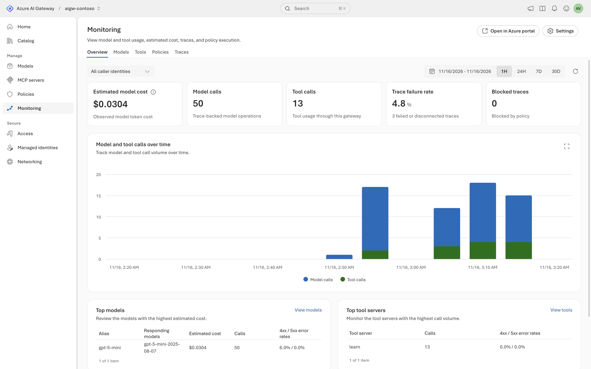
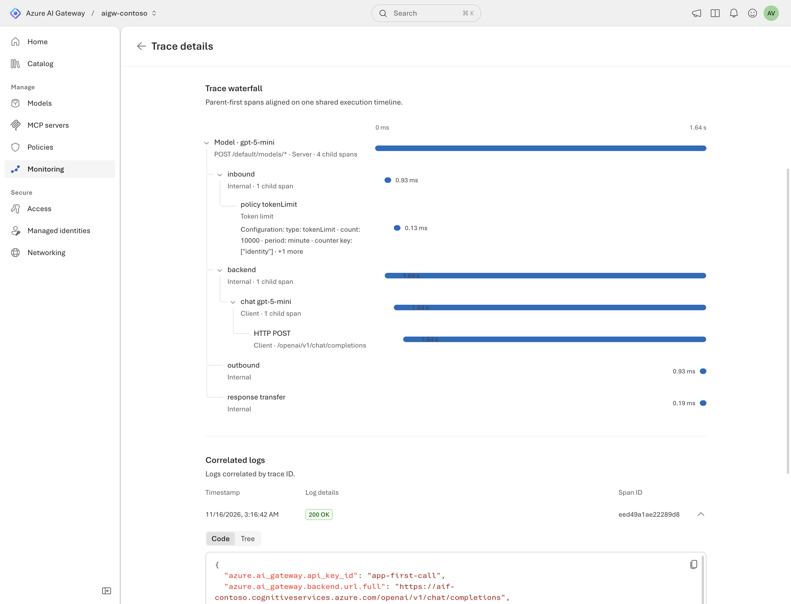
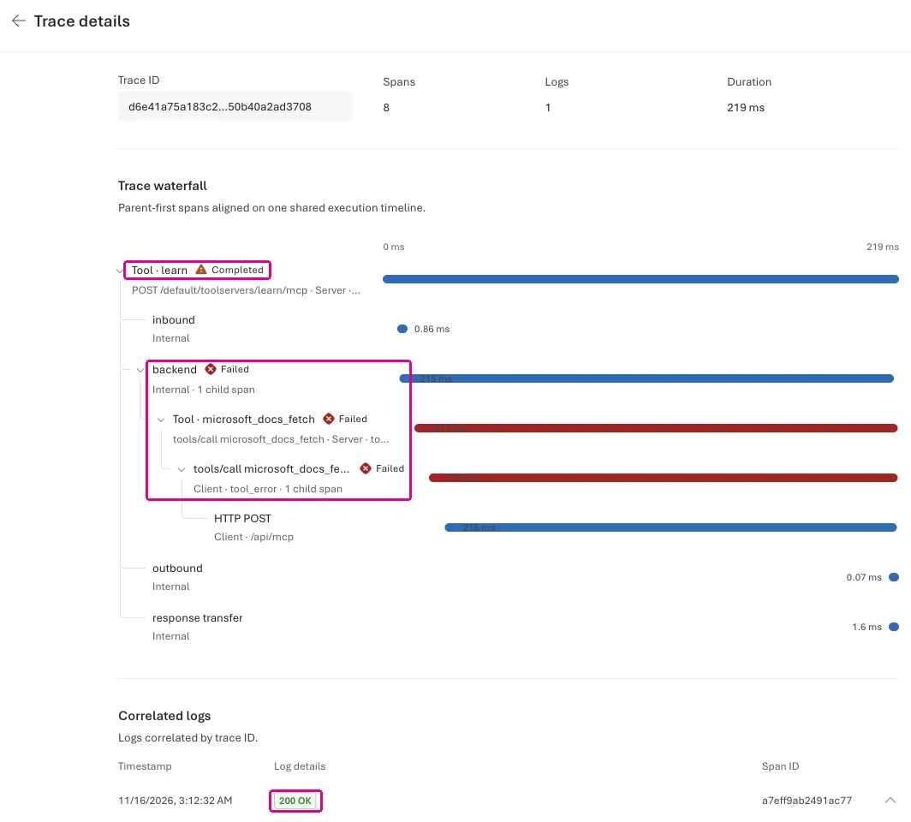

<!--
title: Monitor usage, cost, and traces
summary: Send the gateway's OpenTelemetry metrics, logs, and traces to Application Insights, then use the built-in Monitoring dashboard to see usage, estimated cost per model and API key, policy impact, and gateway-aware traces.
category: observability
level: Beginner
duration: 25
tracks: [portal, cli, iac, terraform]
order: 13
illustration: diagrams/observability.svg
tags: [OpenTelemetry, OTLP, Application Insights, traces, estimated cost, KQL, GenAI semantic conventions]
objectives:
  - Explain how the gateway exports metrics, logs, and traces independently over OTLP
  - Connect the gateway to Application Insights in the portal, with the Azure CLI, with Bicep and azd, or with Terraform
  - Read health, outcomes, policy impact, tokens, and estimated cost on the Monitoring dashboard
  - Follow one request through the trace waterfall, including its policy child spans
  - Query gateway telemetry in Log Analytics with KQL
prereqs:
  - 02-first-model-call
-->
<!-- gh:begin nav: generated by "npm run sync" from the metadata, do not edit -->
[AI Gateway labs](../README.md) › [Observability & FinOps](../README.md#observability--finops) › Lab 13
<!-- gh:end -->

# Monitor usage, cost, and traces

<!-- gh:begin intro: generated by "npm run sync" from the metadata, do not edit -->
> Send the gateway's OpenTelemetry metrics, logs, and traces to Application Insights, then use the built-in Monitoring dashboard to see usage, estimated cost per model and API key, policy impact, and gateway-aware traces.

| ⏱️ Time | 📶 Level | 🧭 Tracks | ✅ Before you start |
| :-- | :-- | :-- | :-- |
| 25 min | Beginner | Portal · Azure CLI · Bicep + azd · Terraform | [02 · First model call](../02-first-model-call/README.md) |

**You'll learn to**

- Explain how the gateway exports metrics, logs, and traces independently over OTLP
- Connect the gateway to Application Insights in the portal, with the Azure CLI, with Bicep and azd, or with Terraform
- Read health, outcomes, policy impact, tokens, and estimated cost on the Monitoring dashboard
- Follow one request through the trace waterfall, including its policy child spans
- Query gateway telemetry in Log Analytics with KQL

**Follow along:** 🌐 [Interactive version](https://azure.github.io/aigateway/labs/13-monitoring/) with your own values filled in · 📁 [Lab files](infra/)

**On this page:** [Before you begin](#before-you-begin) · [How it works](#how-it-works) · [Connect Application Insights](#connect-application-insights) · [Generate traffic](#generate-traffic) · [Tour the dashboard](#tour-the-dashboard) · [Follow a request through the trace waterfall](#follow-a-request-through-the-trace-waterfall) · [Query telemetry with KQL](#query-telemetry-with-kql) · [Find failed operations](#find-failed-operations) · [Verify](#verify) · [Go further](#go-further) · [Clean up](#clean-up) · [Next steps](#next-steps)
<!-- gh:end -->

Your gateway now serves several apps. Finance asks what the models cost per team, an app owner reports
intermittent failures, and nobody can tell whether a policy or the backend rejected those calls. In this lab you
send the gateway's OpenTelemetry signals to Application Insights and answer all three questions from the built-in
**Monitoring** dashboard, down to a single request's trace.


<!-- widget: request-lifecycle -->
<!-- gh:begin widget: generated by "npm run sync" from the metadata, do not edit -->
> 🎛️ **Interactive:** try the request lifecycle explorer in the [web version of this lab](https://azure.github.io/aigateway/labs/13-monitoring/).
<!-- gh:end -->

## Before you begin

<!-- setup: tools sign-in extension clone -->
<!-- gh:begin setup: generated by "npm run sync" from the metadata, do not edit -->
🧰 **One-time setup** from the [Setup guide](../SETUP.md), if you haven't done it yet:
[Choose where to run commands](../SETUP.md#choose-where-to-run-commands) ·
[Sign in to Azure](../SETUP.md#sign-in-to-azure) ·
[Install the `aigateway` extension](../SETUP.md#install-the-aigateway-extension) ·
[Clone the labs repo](../SETUP.md#clone-the-labs-repo)
<!-- gh:end -->

> [!TIP]
> On the **Bicep + azd** and **Terraform** tracks, `azd up` or `terraform apply` creates its own gateway, model, key,
> and Application Insights, so you can skip this section. You need only the one-time setup above, and permission to
> create role assignments, for example **Owner** on the subscription.

- Complete [Publish a Foundry model and make your first call](../02-first-model-call/README.md). You need a gateway,
  an imported model, a callable alias, and a runtime API key from **Access** › **API keys**.
- Permission to change the gateway, for example **Contributor** on its resource group, **and** permission to
  create role assignments, for example **Owner** or **Role Based Access Control Administrator**. Setup grants the
  gateway's managed identity a role on the telemetry destination. To reuse an existing Application Insights
  resource, you also need **Application Insights Contributor** on it.
- Run the scripts and samples from the lab's folder, `~/aigateway/labs/13-monitoring`.

Set these variables once. The tracks and the traffic script reuse them.

<details open><summary>Bash</summary> <!-- gh -->

```bash title="Bash"
# Name your gateway from lab 02, and the alias that the traffic script calls
export RG="<resource-group>"
export GATEWAY="<gateway>"
export AI_GATEWAY_MODEL="<model-name>"     # a callable alias, for example the one you used in lab 02

# Read the gateway's runtime URL
export AI_GATEWAY_URL="https://$(az aigateway show -g "$RG" -n "$GATEWAY" --query properties.frontend.defaultHostname -o tsv)"
echo "🌐 Runtime URL: $AI_GATEWAY_URL"

# Paste the runtime key you created in Access › API keys, without showing it: don't commit it or write it to a file
printf "AI Gateway API key: " && read -rs AI_GATEWAY_API_KEY && export AI_GATEWAY_API_KEY && echo
echo "🔑 Key: in AI_GATEWAY_API_KEY (${#AI_GATEWAY_API_KEY} characters, not shown)"
```
</details> <!-- gh -->

<details><summary>PowerShell</summary> <!-- gh -->

```powershell title="PowerShell"
# Name your gateway from lab 02, and the alias that the traffic script calls
$RG      = "<resource-group>"
$GATEWAY = "<gateway>"
$env:AI_GATEWAY_MODEL = "<model-name>"     # a callable alias, for example the one you used in lab 02

# Read the gateway's runtime URL
$env:AI_GATEWAY_URL = "https://$(az aigateway show -g $RG -n $GATEWAY --query properties.frontend.defaultHostname -o tsv)"
Write-Host "🌐 Runtime URL: $env:AI_GATEWAY_URL"

# Paste the runtime key you created in Access › API keys, without showing it: don't commit it or write it to a file
$env:AI_GATEWAY_API_KEY = Read-Host "AI Gateway API key" -MaskInput
Write-Host "🔑 Key: in AI_GATEWAY_API_KEY ($($env:AI_GATEWAY_API_KEY.Length) characters, not shown)"
```
</details> <!-- gh -->

> [!IMPORTANT]
> Did you configure monitoring before the 2026-08-28 release? If the **Monitoring** page flags the exporter as
> legacy, select **Settings** › **General** › **Disable monitoring**, then select **Configure** to run the setup
> again. You can select the same Application Insights resource.

## How it works

The gateway emits three OpenTelemetry signals and exports each one **independently** over OTLP, to Azure Application
Insights or to any OTLP endpoint (for example Datadog, Splunk, Grafana Cloud, or your own collector). Configure only
the signals you need. Telemetry follows the OpenTelemetry GenAI and MCP semantic conventions, such as
`gen_ai.request.model`, `gen_ai.operation.name`, and `mcp.method.name`, and adds gateway attributes under
`azure.ai_gateway.*`: the API key, the routing decision, the estimated cost, and the policy type.

A failed operation marks its span `Error` even when the HTTP response is `200`: for example an MCP tool call that
returns a tool error. The span's `error.type` names the failure, so you can find these calls even though no HTTP
error reached the client.

When the destination is Application Insights and all three signals are on, the **Monitoring** page turns that data
into a dashboard. Estimated cost is **observed tokens × public pricing**: use it to spot trends and compare callers,
then reconcile with provider billing or Azure Cost Management for financial reporting.

| Signal | What the gateway sends | Where it lands with Application Insights | Dashboard uses it for |
|---|---|---|---|
| Metrics | Token usage and estimated token cost, by model, token type, API key, and caller | Azure Monitor workspace (managed Prometheus) linked to Application Insights | Tokens and **Estimated model cost** |
| Traces | One root span per request, with child spans for each stage and each policy that ran | `OTelSpans` table in the Log Analytics workspace | Calls, outcomes, blocked traces, the trace waterfall |
| Logs | Request records with status, caller, model, routing, estimated cost, and the token usage the backend reported | `OTelLogs` table in the Log Analytics workspace | Correlated logs and caller attribution |

## Connect Application Insights

Pick one track. Each ends with the gateway exporting all three signals to an Application Insights resource named
after the gateway, `<gateway>-insights`.

<!-- track: portal | Portal -->
<details open><summary><b>🖥️ Portal</b></summary> <!-- gh -->

### Start the setup

Open the [AI Gateway portal](https://ai.gateway.azure.com) and select your gateway from the gateway switcher. Select
**Monitoring**. If monitoring isn't configured yet, a banner reads **Start by configuring telemetry**. Select
**Configure**. The **Configure telemetry** wizard has three steps: **Destination**, **Authentication**, and
**Review and apply**.

### Choose a destination

On **Destination**, keep **New Azure Application Insights resource**. The wizard suggests the resource name
`<gateway>-insights`, adds a short random suffix if that name is taken, and creates it in the gateway's region and
resource group. Select **Next**.

> [!TIP]
> The other choices are **Existing Azure Application Insights resource**, for a component you already have, and
> **Custom OpenTelemetry destination**, which takes separate **Metrics endpoint**, **Logs endpoint**, and
> **Traces endpoint** URLs. Leave an endpoint empty to turn that signal off. The built-in dashboard only reads
> Application Insights, so with a custom destination you use your own platform's views. See
> [Send telemetry to a custom destination](https://ai.gateway.azure.com/docs/observability/custom-destination).

### Review authentication

On **Authentication**, **Managed identity** shows **System-assigned managed identity**: the gateway exports with
its managed identity. If the gateway also has a user-assigned identity, you can pick it here instead. A note
confirms that the **Monitoring Metrics Publisher** role is assigned on the destination's Data Collection Rule when
you apply.

Leave **Include recommended token claims in telemetry** selected. It adds four Microsoft Entra caller claims to the
telemetry: `tid` and `oid` in logs, traces, and metrics, and `appid` and `azp` in logs and traces.
[Attribute tokens and cost with OpenTelemetry](../14-otel-chargeback/README.md) builds on them. Select **Next**.

### Apply the configuration

On **Review and apply**, check the **Destination**, the **Signals** (all three **Discovered automatically**), the
**Identity**, and the **Token claim attributes**, then select **Apply**. The button shows **Applying…** while the
wizard registers the resource providers, creates Application Insights on a managed Log Analytics workspace,
discovers the OTLP endpoints, assigns the role, and creates the exporter. It can take a few minutes. If it fails,
the wizard shows the error: fix the cause and select **Apply** again. If an Azure Policy assignment blocks a step,
check the Activity Log for the denied operation.

> **Checkpoint**
> The **Monitoring** page shows the **Overview**, **Models**, **Tools**, **Policies**, and **Traces** tabs, with
> **Open in Azure portal** and **Settings** in the header.

</details> <!-- gh -->
<!-- track: cli | Azure CLI -->
<details><summary><b>⌨️ Azure CLI</b></summary> <!-- gh -->

### Create the destination

Create a Log Analytics workspace and a workspace-based Application Insights component, named after the gateway and
in its region. The portal's wizard puts its component on a managed workspace; here you create and own the workspace,
so you can query it directly later. `az monitor app-insights` comes from the `application-insights` extension, which
the Azure CLI offers to install the first time.

<details open><summary>Bash</summary> <!-- gh -->

```bash title="Bash"
# Read the gateway's region, so that the destination lives next to it
LOCATION="$(az aigateway show -g "$RG" -n "$GATEWAY" --query location -o tsv)"
echo "📍 Region: $LOCATION"

# Create the Log Analytics workspace that stores the spans and logs, and keep its ID for the queries
export LAW_CUSTOMER_ID="$(az monitor log-analytics workspace create -g "$RG" -n "$GATEWAY-logs" -l "$LOCATION" \
  --query customerId -o tsv)" &&
  echo "📊 Log Analytics workspace $GATEWAY-logs is ready"

# Create the Application Insights component on that workspace
az monitor app-insights component create -g "$RG" -a "$GATEWAY-insights" -l "$LOCATION" --kind web \
  --application-type web --workspace "$GATEWAY-logs" -o none &&
  echo "📊 Application Insights $GATEWAY-insights is ready"
```
</details> <!-- gh -->

<details><summary>PowerShell</summary> <!-- gh -->

```powershell title="PowerShell"
# Read the gateway's region, so that the destination lives next to it
$LOCATION = az aigateway show -g $RG -n $GATEWAY --query location -o tsv
Write-Host "📍 Region: $LOCATION"

# Create the Log Analytics workspace that stores the spans and logs, and keep its ID for the queries
$LAW_CUSTOMER_ID = az monitor log-analytics workspace create -g $RG -n "$GATEWAY-logs" -l $LOCATION `
  --query customerId -o tsv
if ($?) { Write-Host "📊 Log Analytics workspace $GATEWAY-logs is ready" }

# Create the Application Insights component on that workspace
az monitor app-insights component create -g $RG -a "$GATEWAY-insights" -l $LOCATION --kind web `
  --application-type web --workspace "$GATEWAY-logs" -o none
if ($?) { Write-Host "📊 Application Insights $GATEWAY-insights is ready" }
```
</details> <!-- gh -->

### Turn on OTLP ingestion

The component reports OTLP endpoints only after you turn on ingestion into an Azure Monitor workspace. Azure then
creates a managed resource group, `ai_<component>_<id>_managed`, with the Data Collection Rule and the Azure Monitor
workspace for the metrics. `az monitor app-insights` has no flag for this setting, so set the component's
`AzureMonitorWorkspaceIngestionMode` property with `az resource update`, wait for the endpoints, then read them back.
The wait usually takes seconds, and can take a few minutes.

<details open><summary>Bash</summary> <!-- gh -->

```bash title="Bash"
# Turn on OTLP ingestion, which creates the Data Collection Rule and the OTLP endpoints
COMPONENT_ID="$(az resource update -g "$RG" -n "$GATEWAY-insights" --resource-type Microsoft.Insights/components \
  --api-version 2020-02-02 --set properties.AzureMonitorWorkspaceIngestionMode=Enabled --query id -o tsv)" &&
  echo "📊 OTLP ingestion is on for $GATEWAY-insights"

# Wait until the component reports the Data Collection Rule and the three OTLP endpoints
READY="(properties.OTLPMetricsEndpoint && properties.OTLPLogsEndpoint && properties.OTLPTracesEndpoint) && properties.DataCollectionRuleResourceId || ''"
until [ -n "$(az resource show --ids "$COMPONENT_ID" --api-version 2020-02-02 --query "$READY" -o tsv)" ]; do
  echo "⏳ Waiting for the OTLP endpoints" && sleep 10
done

# Read the Data Collection Rule and the OTLP endpoint of each signal from the component
otlp() { az resource show --ids "$COMPONENT_ID" --api-version 2020-02-02 --query "properties.$1" -o tsv; }
DCR_ID="$(otlp DataCollectionRuleResourceId)"
METRICS_URL="$(otlp OTLPMetricsEndpoint)"
LOGS_URL="$(otlp OTLPLogsEndpoint)"
TRACES_URL="$(otlp OTLPTracesEndpoint)"
echo "🆔 Data Collection Rule: ${DCR_ID##*/}"
echo "🌐 Metrics endpoint: ${METRICS_URL%%/dataCollectionRules/*}"
echo "🌐 Logs and traces endpoint: ${LOGS_URL%%/dataCollectionRules/*}"
```
</details> <!-- gh -->

<details><summary>PowerShell</summary> <!-- gh -->

```powershell title="PowerShell"
# Turn on OTLP ingestion, which creates the Data Collection Rule and the OTLP endpoints
$COMPONENT_ID = az resource update -g $RG -n "$GATEWAY-insights" --resource-type Microsoft.Insights/components `
  --api-version 2020-02-02 --set properties.AzureMonitorWorkspaceIngestionMode=Enabled --query id -o tsv
if ($?) { Write-Host "📊 OTLP ingestion is on for $GATEWAY-insights" }

# Wait until the component reports the Data Collection Rule and the three OTLP endpoints
$READY = "(properties.OTLPMetricsEndpoint && properties.OTLPLogsEndpoint && properties.OTLPTracesEndpoint) && properties.DataCollectionRuleResourceId || ''"
while (-not (az resource show --ids $COMPONENT_ID --api-version 2020-02-02 --query $READY -o tsv)) {
  Write-Host "⏳ Waiting for the OTLP endpoints"; Start-Sleep -Seconds 10
}

# Read the Data Collection Rule and the OTLP endpoint of each signal from the component
function otlp($name) { az resource show --ids $COMPONENT_ID --api-version 2020-02-02 --query "properties.$name" -o tsv }
$DCR_ID      = otlp DataCollectionRuleResourceId
$METRICS_URL = otlp OTLPMetricsEndpoint
$LOGS_URL    = otlp OTLPLogsEndpoint
$TRACES_URL  = otlp OTLPTracesEndpoint
Write-Host "🆔 Data Collection Rule: $(Split-Path $DCR_ID -Leaf)"
Write-Host "🌐 Metrics endpoint: $(($METRICS_URL -split '/dataCollectionRules/')[0])"
Write-Host "🌐 Logs and traces endpoint: $(($LOGS_URL -split '/dataCollectionRules/')[0])"
```
</details> <!-- gh -->

### Let the gateway publish

The gateway exports with its system-assigned managed identity, which needs **Monitoring Metrics Publisher** on the
Data Collection Rule. The portal's wizard assigns the same role when you apply.

<details open><summary>Bash</summary> <!-- gh -->

```bash title="Bash"
# Read the gateway's managed identity, which signs the telemetry export
PRINCIPAL_ID="$(az aigateway show -g "$RG" -n "$GATEWAY" --query identity.principalId -o tsv)"
echo "👤 Gateway identity: $PRINCIPAL_ID"

# Let the identity publish to the Data Collection Rule
az role assignment create --assignee-object-id "$PRINCIPAL_ID" --assignee-principal-type ServicePrincipal \
  --role "Monitoring Metrics Publisher" --scope "$DCR_ID" -o none &&
  echo "🔐 The gateway can publish to the Data Collection Rule"
```
</details> <!-- gh -->

<details><summary>PowerShell</summary> <!-- gh -->

```powershell title="PowerShell"
# Read the gateway's managed identity, which signs the telemetry export
$PRINCIPAL_ID = az aigateway show -g $RG -n $GATEWAY --query identity.principalId -o tsv
Write-Host "👤 Gateway identity: $PRINCIPAL_ID"

# Let the identity publish to the Data Collection Rule
az role assignment create --assignee-object-id $PRINCIPAL_ID --assignee-principal-type ServicePrincipal `
  --role "Monitoring Metrics Publisher" --scope $DCR_ID -o none
if ($?) { Write-Host "🔐 The gateway can publish to the Data Collection Rule" }
```
</details> <!-- gh -->

### Create the telemetry exporter

`az aigateway telemetry-exporter create` creates an exporter named `appinsights`, of kind `OpenTelemetry`, that sends
each signal to its OTLP endpoint with the gateway's managed identity, like the portal's wizard. `--telemetry` adds the
recommended token claims: `tid` and `oid` on every signal, and `appid` and `azp` on logs and traces. A gateway has
one exporter of each kind, and the kind can't change after you create it.

<details open><summary>Bash</summary> <!-- gh -->

```bash title="Bash"
# Export metrics, logs, and traces to the component's OTLP endpoints, signed with the gateway's managed identity
az aigateway telemetry-exporter create -g "$RG" --gateway-name "$GATEWAY" -n appinsights \
  --kind OpenTelemetry --payload-capture false \
  --open-telemetry "{metricsEndpoint:'$METRICS_URL',logsEndpoint:'$LOGS_URL',tracesEndpoint:'$TRACES_URL',credentials:{managedIdentity:{resource:'https://monitor.azure.com'}}}" \
  --telemetry "{attributes:[{source:{kind:claims,value:tid},signals:[logs,traces,metrics]},{source:{kind:claims,value:oid},signals:[logs,traces,metrics]},{source:{kind:claims,value:appid},signals:[logs,traces]},{source:{kind:claims,value:azp},signals:[logs,traces]}]}" \
  -o none &&
  echo "📊 Telemetry exporter appinsights sends metrics, logs, and traces to $GATEWAY-insights"

# List the gateway's telemetry exporters, with the kind of each one
echo "📊 Telemetry exporters on $GATEWAY:"
az aigateway telemetry-exporter list -g "$RG" --gateway-name "$GATEWAY" --query "[].{name:name, kind:properties.kind}" -o table
```
</details> <!-- gh -->

<details><summary>PowerShell</summary> <!-- gh -->

```powershell title="PowerShell"
# Export metrics, logs, and traces to the component's OTLP endpoints, signed with the gateway's managed identity
az aigateway telemetry-exporter create -g $RG --gateway-name $GATEWAY -n appinsights `
  --kind OpenTelemetry --payload-capture false `
  --open-telemetry "{metricsEndpoint:'$METRICS_URL',logsEndpoint:'$LOGS_URL',tracesEndpoint:'$TRACES_URL',credentials:{managedIdentity:{resource:'https://monitor.azure.com'}}}" `
  --telemetry "{attributes:[{source:{kind:claims,value:tid},signals:[logs,traces,metrics]},{source:{kind:claims,value:oid},signals:[logs,traces,metrics]},{source:{kind:claims,value:appid},signals:[logs,traces]},{source:{kind:claims,value:azp},signals:[logs,traces]}]}" `
  -o none
if ($?) { Write-Host "📊 Telemetry exporter appinsights sends metrics, logs, and traces to $GATEWAY-insights" }

# List the gateway's telemetry exporters, with the kind of each one
Write-Host "📊 Telemetry exporters on ${GATEWAY}:"
az aigateway telemetry-exporter list -g $RG --gateway-name $GATEWAY --query "[].{name:name, kind:properties.kind}" -o table
```
</details> <!-- gh -->

To change the exporter later, such as to turn on `--payload-capture`, run `az aigateway telemetry-exporter update`
with the same name and only the settings that change. `create` doesn't overwrite an exporter: when you run this step
again, it fails with `The telemetry exporter already exists; use telemetry-exporter update.` Run the same command
with `update` in place of `create` instead.

> [!NOTE]
> The `aigateway` extension nests the managed identity in `--open-telemetry` as `credentials`. In the management API
> version `2026-11-01`, which the Bicep + azd and Terraform tracks use, the same setting is a top-level
> `authentication` property and each endpoint is an object with a `url`.

> **Checkpoint**
> The list shows one exporter, `appinsights`, of kind `OpenTelemetry`. In the portal, the gateway's **Monitoring**
> page shows the **Overview**, **Models**, **Tools**, **Policies**, and **Traces** tabs.

</details> <!-- gh -->
<!-- track: iac | Bicep + azd -->
<details><summary><b>🏗️ Bicep + azd</b></summary> <!-- gh -->

**What you need:** only the one-time setup from **Before you begin**. This track doesn't use your gateway from lab 02:
`azd up` creates a new one, so it works on its own.

### Choose what to declare

The templates declare the same setup as the Azure CLI track: a Log Analytics workspace, a workspace-based Application
Insights component with OTLP ingestion turned on, and a gateway telemetry exporter of type `OpenTelemetry` that
sends metrics, logs, and traces to the component's OTLP endpoints with the recommended token claims. When OTLP
ingestion turns on, Azure creates a managed resource group, `ai_<component>_<id>_managed`, with the Data Collection
Rule and the Azure Monitor workspace for the metrics. The component reports the OTLP endpoints a few minutes later.

The exporter can't be part of that deployment. It needs the endpoints, and the gateway's managed identity needs
**Monitoring Metrics Publisher** on the Data Collection Rule before the exporter is created: an exporter created
earlier fails validation or gets empty endpoints. Bicep can't wait for the endpoints, and it can't assign the role,
because Azure locks the managed resource group with a deny assignment that blocks deployments. So `azd up` connects
the gateway in two steps:

1. `infra/main.bicep` deploys the gateway and the destination.
2. The `postprovision` hook in `azure.yaml`, which azd runs after each deployment, runs `infra/connect-telemetry.sh`
   (`infra/connect-telemetry.ps1` on Windows). The script waits for the endpoints, assigns the role with the Azure
   CLI, then deploys `infra/otel-exporter.bicep` and retries while the role assignment propagates.

The exporter uses the management API version `2026-11-01`: `telemetryExporterType` sets the type, each endpoint is
an object with a `url`, and the managed identity sits in a top-level `authentication` block. An `OpenTelemetry`
exporter can't also carry an `applicationInsights` block, and the type can't change after creation. The
`ApplicationInsights` type, with a connection string, is the legacy exporter that older samples deploy: the portal
flags it because it doesn't send the OTLP signals the dashboard needs. The templates don't use it.

### Review the templates

`infra/main.bicep` creates the resource group `rg-<environment name>` and calls the quick start's
[resources.bicep](../quickstart/infra/resources.bicep) for the gateway, the Foundry model, its default alias, and the
`app-first-call` key. Then it calls `infra/monitoring.bicep` for the destination. Its outputs become azd's
environment values, which the hook reads:

<!-- include: infra/main.bicep -->
<!-- gh:begin include: generated by "npm run sync" from the metadata, do not edit -->
📄 [`infra/main.bicep`](infra/main.bicep)

<details><summary>Show all 65 lines</summary>

```bicep
// Lab 13 with azd: "azd up" creates the resource group rg-<environment name>, the quick start's gateway, Foundry
// model, default alias, and runtime API key, then the Application Insights destination for the gateway's telemetry.
// azure.yaml then connects the gateway to it over OpenTelemetry, once Azure has created the OTLP endpoints. The
// runtime API key is never an output.
targetScope = 'subscription'

@description('azd environment name. The resource group is rg-<environmentName>.')
@minLength(1)
@maxLength(60)
param environmentName string

@description('Region for every resource. Pick one where AI Gateway and the lab\'s Foundry models are available. List them with az provider show --namespace Microsoft.ApiManagement (Setup guide, Find the available regions).')
@metadata({ azd: { type: 'location' } })
param location string

var suffix = take(uniqueString(subscription().id, environmentName, location), 6)
var tags = { 'azd-env-name': environmentName }

resource rg 'Microsoft.Resources/resourceGroups@2024-03-01' = {
  name: 'rg-${environmentName}'
  location: location
  tags: tags
}

// The quick start's template: a gateway, a Foundry model behind the default alias, and the app-first-call key.
module base '../../quickstart/infra/resources.bicep' = {
  name: 'aigw-base'
  scope: rg
  params: {
    location: location
    tags: tags
    gatewayName: 'aigw-${suffix}'
    foundryName: 'aigw${suffix}'
  }
}

// The destination: a Log Analytics workspace and an Application Insights component with OTLP ingestion on.
module monitoring 'monitoring.bicep' = {
  name: 'aigw-monitoring'
  scope: rg
  params: {
    gatewayName: base.outputs.gatewayName
    location: location
    tags: tags
    enableOtlpIngestion: true
  }
}

// What the portal's Configure telemetry wizard does next happens after this deployment: azure.yaml runs
// connect-telemetry.sh, which waits for the OTLP endpoints, grants the gateway's identity Monitoring Metrics Publisher
// on the data collection rule, and then deploys otel-exporter.bicep with the recommended token claims.

output AZURE_RESOURCE_GROUP string = rg.name
output AI_GATEWAY_NAME string = base.outputs.gatewayName
output AI_GATEWAY_ID string = base.outputs.gatewayId
output AI_GATEWAY_URL string = base.outputs.gatewayUrl
output AI_GATEWAY_PROVIDER string = base.outputs.providerName
output AI_GATEWAY_BACKEND_MODEL string = base.outputs.modelName
output AI_GATEWAY_MODEL string = base.outputs.aliasName
output FOUNDRY_ACCOUNT_NAME string = base.outputs.foundryName
output AI_GATEWAY_PRINCIPAL_ID string = base.outputs.gatewayPrincipalId
output APP_INSIGHTS_ID string = monitoring.outputs.appInsightsId
output APP_INSIGHTS_NAME string = monitoring.outputs.appInsightsName
output LOG_ANALYTICS_WORKSPACE_ID string = monitoring.outputs.logAnalyticsWorkspaceId
output LOG_ANALYTICS_CUSTOMER_ID string = monitoring.outputs.logAnalyticsCustomerId
```

</details>
<!-- gh:end -->

`infra/monitoring.bicep` creates the Log Analytics workspace and the Application Insights component, and turns on
OTLP ingestion when `enableOtlpIngestion` is `true`. You can also deploy it on its own to your gateway's resource
group with `az deployment group create`, then connect it in the portal with **Existing Azure Application Insights
resource**:

<!-- include: infra/monitoring.bicep -->
<!-- gh:begin include: generated by "npm run sync" from the metadata, do not edit -->
📄 [`infra/monitoring.bicep`](infra/monitoring.bicep)

<details><summary>Show all 62 lines</summary>

```bicep
// Creates the Application Insights destination for AI Gateway telemetry: a Log Analytics workspace and a
// workspace-based Application Insights component.
//
// The lab's main.bicep calls it with azd and sets enableOtlpIngestion. azure.yaml then connects the gateway with
// connect-telemetry.sh and otel-exporter.bicep. You can also deploy it on its own to the resource group of an existing
// gateway, then connect the gateway in the portal: Monitoring › Configure › Existing Azure Application Insights
// resource. The portal enables OTLP ingestion on the component, grants the gateway's managed identity the Monitoring
// Metrics Publisher role, and creates an OpenTelemetry exporter.

@description('Name of the existing AI Gateway (Microsoft.ApiManagement/aigateways).')
param gatewayName string

@description('Location for the monitoring resources.')
param location string = resourceGroup().location

@description('Application Insights component name. The portal suggests <gateway>-insights for new destinations.')
param appInsightsName string = '${gatewayName}-insights'

@description('Log Analytics workspace that stores the OTelSpans and OTelLogs tables.')
param logAnalyticsWorkspaceName string = take('${gatewayName}-logs', 63)

@description('Tags applied to the monitoring resources.')
param tags object = {}

@description('Turn on OTLP ingestion on the component, as the portal does when you connect it. Azure then creates a managed Azure Monitor workspace, data collection endpoint, and data collection rule, and the component reports its OTLP endpoints a few minutes later.')
param enableOtlpIngestion bool = false

resource logAnalyticsWorkspace 'Microsoft.OperationalInsights/workspaces@2023-09-01' = {
  name: logAnalyticsWorkspaceName
  location: location
  tags: tags
  properties: {
    retentionInDays: 30
    features: {
      enableLogAccessUsingOnlyResourcePermissions: true
    }
    sku: {
      name: 'PerGB2018'
    }
  }
}

resource appInsights 'Microsoft.Insights/components@2020-02-02' = {
  name: appInsightsName
  location: location
  kind: 'web'
  tags: tags
  // AzureMonitorWorkspaceIngestionMode isn't in the Bicep types for this API version yet, so union() adds it.
  properties: union(
    {
      Application_Type: 'web'
      WorkspaceResourceId: logAnalyticsWorkspace.id
    },
    enableOtlpIngestion ? { AzureMonitorWorkspaceIngestionMode: 'Enabled' } : {}
  )
}

output appInsightsId string = appInsights.id
output appInsightsName string = appInsights.name
output logAnalyticsWorkspaceId string = logAnalyticsWorkspace.id
output logAnalyticsWorkspaceName string = logAnalyticsWorkspace.name
output logAnalyticsCustomerId string = logAnalyticsWorkspace.properties.customerId
```

</details>
<!-- gh:end -->

`infra/otel-exporter.bicep` creates the exporter. The `claimAttributes` parameter lists the token claims to add to
the telemetry, and the signals that carry each one. Its default matches **Include recommended token claims in
telemetry**:

<!-- include: infra/otel-exporter.bicep -->
<!-- gh:begin include: generated by "npm run sync" from the metadata, do not edit -->
📄 [`infra/otel-exporter.bicep`](infra/otel-exporter.bicep)

<details><summary>Show all 98 lines</summary>

```bicep
// Connects an AI Gateway to Application Insights over OpenTelemetry, the same way the portal's Configure telemetry
// wizard does: an OpenTelemetry exporter that sends metrics, logs, and traces to the component's OTLP endpoints, with
// the token claims to add to the telemetry.
// Deploy it only once two things are in place, or the exporter fails validation or gets empty endpoints:
//   - The component reports its OTLP endpoints. Azure creates them, with a Data Collection Rule, a few minutes after
//     OTLP ingestion turns on (monitoring.bicep with enableOtlpIngestion=true).
//   - The gateway's system-assigned identity has Monitoring Metrics Publisher on that rule. Azure keeps the rule in a
//     managed resource group whose deny assignment blocks deployments, so Bicep can't assign the role.
// Neither can happen inside the deployment that turns ingestion on. So the lab's azure.yaml runs connect-telemetry.sh
// after "azd provision": it waits for the endpoints, assigns the role, then deploys this file with
// otel-exporter.bicepparam. You can also deploy it on your own, to the resource group of an existing gateway and
// component, once both are in place.
targetScope = 'resourceGroup'

@description('Name of the existing AI Gateway (Microsoft.ApiManagement/aigateways) in this resource group.')
param gatewayName string

@description('Name of the existing Application Insights component in this resource group, with OTLP ingestion on.')
param appInsightsName string

@description('Name of the telemetry exporter. The portal names it appinsights.')
param exporterName string = 'appinsights'

@description('Token claims to add to the telemetry, and the signals that carry each one. The default is the portal\'s "Include recommended token claims in telemetry".')
param claimAttributes array = [
  {
    source: { kind: 'claims', value: 'tid' }
    signals: ['logs', 'traces', 'metrics']
  }
  {
    source: { kind: 'claims', value: 'oid' }
    signals: ['logs', 'traces', 'metrics']
  }
  {
    source: { kind: 'claims', value: 'appid' }
    signals: ['logs', 'traces']
  }
  {
    source: { kind: 'claims', value: 'azp' }
    signals: ['logs', 'traces']
  }
]

@description('Log request and response payloads. Off by default: prompts and responses can be sensitive and add volume.')
param payloadCapture bool = false

#disable-next-line BCP081
resource gateway 'Microsoft.ApiManagement/aigateways@2026-11-01' existing = {
  name: gatewayName
}

#disable-next-line BCP081
resource defaultWorkspace 'Microsoft.ApiManagement/aigateways/workspaces@2026-11-01' existing = {
  parent: gateway
  name: 'default'
}

resource appInsights 'Microsoft.Insights/components@2020-02-02' existing = {
  name: appInsightsName
}

// The OTLP properties aren't in the Bicep types for this API version yet. any() skips the type check.
var otlp = any(appInsights.properties)

#disable-next-line BCP081
resource telemetryExporter 'Microsoft.ApiManagement/aigateways/workspaces/telemetryExporters@2026-11-01' = {
  parent: defaultWorkspace
  name: exporterName
  properties: {
    telemetryExporterType: 'OpenTelemetry'
    payloadCapture: payloadCapture
    // No applicationInsights block: an OpenTelemetry exporter can't carry one. The portal finds the component from
    // the Data Collection Rule in the endpoint URLs.
    openTelemetry: {
      metricsEndpoint: {
        url: otlp.OTLPMetricsEndpoint
      }
      logsEndpoint: {
        url: otlp.OTLPLogsEndpoint
      }
      tracesEndpoint: {
        url: otlp.OTLPTracesEndpoint
      }
    }
    // The gateway's system-assigned identity gets a token for Azure Monitor ingestion.
    authentication: {
      managedIdentity: {
        resource: 'https://monitor.azure.com'
      }
    }
    telemetry: {
      attributes: claimAttributes
    }
  }
}

output telemetryExporterId string = telemetryExporter.id
output telemetryExporterName string = telemetryExporter.name
```

</details>
<!-- gh:end -->

`infra/otel-exporter.bicepparam` passes the gateway and the component names from azd's environment values:

<!-- include: infra/otel-exporter.bicepparam -->
<!-- gh:begin include: generated by "npm run sync" from the metadata, do not edit -->
📄 [`infra/otel-exporter.bicepparam`](infra/otel-exporter.bicepparam)

```bicepparam
// The lab's OpenTelemetry exporter, with the portal's recommended token claims (the template's default). azd doesn't
// deploy it with main.bicep: the postprovision hook in azure.yaml runs connect-telemetry.sh, which deploys it once
// the component reports its OTLP endpoints and the gateway can publish to them. The values come from the outputs of
// main.bicep, which azd passes to the hook as environment variables.
using 'otel-exporter.bicep'

param gatewayName = readEnvironmentVariable('AI_GATEWAY_NAME')
param appInsightsName = readEnvironmentVariable('APP_INSIGHTS_NAME')
```
<!-- gh:end -->

`azure.yaml` holds the `postprovision` hook that runs the script:

<!-- include: azure.yaml -->
<!-- gh:begin include: generated by "npm run sync" from the metadata, do not edit -->
📄 [`azure.yaml`](azure.yaml)

```yaml
# yaml-language-server: $schema=https://raw.githubusercontent.com/Azure/azure-dev/main/schemas/v1.0/azure.yaml.json
# Lab 13: "azd up" creates the quick start's gateway, model, and runtime API key, then an Application Insights
# destination, and connects the gateway to it over OpenTelemetry once Azure has created the OTLP endpoints.
# The lab clones the repo's main branch from GitHub and runs azd up in this folder.
name: aigw-lab13
metadata:
  template: aigw-lab13@1.0.0
infra:
  provider: bicep
  path: infra
hooks:
  # The telemetry exporter needs the component's OTLP endpoints and the Monitoring Metrics Publisher role on its data
  # collection rule, and Azure creates the endpoints and the rule a few minutes after the deployment turns OTLP
  # ingestion on. So after each deployment, azd runs connect-telemetry.sh: it waits for them, assigns the role, then
  # deploys the exporter. When azd provision finds no changes to deploy, it skips this hook too: run
  # "azd hooks run postprovision" to run it on its own. Running it again is harmless.
  postprovision:
    posix:
      shell: sh
      run: ./infra/connect-telemetry.sh infra/otel-exporter.bicepparam
    windows:
      shell: pwsh
      run: ./infra/connect-telemetry.ps1 -ParametersFile infra/otel-exporter.bicepparam
```
<!-- gh:end -->

### Deploy with azd up

Move into the lab's folder, create an azd environment named `aigw-lab13` in your current subscription, then provision
everything. It takes about four minutes.

<details open><summary>Bash</summary> <!-- gh -->

```bash title="Bash"
# Move into the lab's folder, which holds the azd project
cd ~/aigateway/labs/13-monitoring &&
  echo "📂 Lab folder: $(pwd)"

# Create an azd environment in your current subscription, so that azd doesn't prompt you
azd env new aigw-lab13 --location eastus2 --subscription "$(az account show --query id --output tsv)" &&
  echo "📝 azd environment aigw-lab13 deploys to eastus2"

# Provision the gateway, its model, alias, and key, and Application Insights, and connect the gateway to it
azd up &&
  echo "🚀 Gateway deployed: $(azd env get-value AI_GATEWAY_URL)"
```
</details> <!-- gh -->

<details><summary>PowerShell</summary> <!-- gh -->

```powershell title="PowerShell"
# Move into the lab's folder, which holds the azd project
Set-Location ~/aigateway/labs/13-monitoring
if ($?) { Write-Host "📂 Lab folder: $(Get-Location)" }

# Create an azd environment in your current subscription, so that azd doesn't prompt you
azd env new aigw-lab13 --location eastus2 --subscription (az account show --query id --output tsv)
if ($?) { Write-Host "📝 azd environment aigw-lab13 deploys to eastus2" }

# Provision the gateway, its model, alias, and key, and Application Insights, and connect the gateway to it
azd up
if ($?) { Write-Host "🚀 Gateway deployed: $(azd env get-value AI_GATEWAY_URL)" }
```
</details> <!-- gh -->

For another region, pick one where AI Gateway and the `gpt-5-mini` model are available, as in [Find the available
regions](../SETUP.md#find-the-available-regions).

### Read the outputs and the key

Set the variables that the next sections and **Verify** use from azd's environment values, and read the key from
the gateway, so that it never shows on screen. The last command lists the gateway's telemetry exporters.

<details open><summary>Bash</summary> <!-- gh -->

```bash title="Bash"
# Read the gateway's names, URLs, and alias, and the Log Analytics workspace ID, from azd's environment values
export RG="$(azd env get-value AZURE_RESOURCE_GROUP)"
export GATEWAY="$(azd env get-value AI_GATEWAY_NAME)"
export AI_GATEWAY_MODEL="$(azd env get-value AI_GATEWAY_MODEL)"
export GATEWAY_ID="$(azd env get-value AI_GATEWAY_ID)"
export AI_GATEWAY_URL="$(azd env get-value AI_GATEWAY_URL)"
export LAW_CUSTOMER_ID="$(azd env get-value LOG_ANALYTICS_CUSTOMER_ID)"
echo "📝 Gateway $GATEWAY in $RG"
echo "🌐 Runtime URL: $AI_GATEWAY_URL"
echo "🔖 Model alias: $AI_GATEWAY_MODEL"
echo "🆔 Log Analytics workspace ID: $LAW_CUSTOMER_ID"

# Read the key from the gateway, so that it never shows on screen or lands in a file
export AI_GATEWAY_API_KEY="$(az aigateway api-key list-secrets --ids "$GATEWAY_ID/apiKeys/app-first-call" \
  --query primaryKey --output tsv)"
echo "🔑 Key: in AI_GATEWAY_API_KEY (${#AI_GATEWAY_API_KEY} characters, not shown)"

# List the gateway's telemetry exporters, with the kind of each one
echo "📊 Telemetry exporters on $GATEWAY:"
az aigateway telemetry-exporter list -g "$RG" --gateway-name "$GATEWAY" --query "[].{name:name, kind:properties.kind}" -o table
```
</details> <!-- gh -->

<details><summary>PowerShell</summary> <!-- gh -->

```powershell title="PowerShell"
# Read the gateway's names, URLs, and alias, and the Log Analytics workspace ID, from azd's environment values
$RG                     = azd env get-value AZURE_RESOURCE_GROUP
$GATEWAY                = azd env get-value AI_GATEWAY_NAME
$env:AI_GATEWAY_MODEL   = azd env get-value AI_GATEWAY_MODEL
$GATEWAY_ID             = azd env get-value AI_GATEWAY_ID
$env:AI_GATEWAY_URL     = azd env get-value AI_GATEWAY_URL
$LAW_CUSTOMER_ID        = azd env get-value LOG_ANALYTICS_CUSTOMER_ID
Write-Host "📝 Gateway $GATEWAY in $RG"
Write-Host "🌐 Runtime URL: $env:AI_GATEWAY_URL"
Write-Host "🔖 Model alias: $env:AI_GATEWAY_MODEL"
Write-Host "🆔 Log Analytics workspace ID: $LAW_CUSTOMER_ID"

# Read the key from the gateway, so that it never shows on screen or lands in a file
$env:AI_GATEWAY_API_KEY = az aigateway api-key list-secrets --ids "$GATEWAY_ID/apiKeys/app-first-call" `
  --query primaryKey --output tsv
Write-Host "🔑 Key: in AI_GATEWAY_API_KEY ($($env:AI_GATEWAY_API_KEY.Length) characters, not shown)"

# List the gateway's telemetry exporters, with the kind of each one
Write-Host "📊 Telemetry exporters on ${GATEWAY}:"
az aigateway telemetry-exporter list -g $RG --gateway-name $GATEWAY --query "[].{name:name, kind:properties.kind}" -o table
```
</details> <!-- gh -->

> **Checkpoint**
> `azd up` ended with `SUCCESS`, and the list shows one exporter, `appinsights`, of kind `OpenTelemetry`. In the
> portal, the gateway's **Monitoring** page shows the **Overview**, **Models**, **Tools**, **Policies**, and
> **Traces** tabs.

</details> <!-- gh -->
<!-- track: terraform | Terraform -->
<details><summary><b>🌍 Terraform</b></summary> <!-- gh -->

**What you need:** only the one-time setup from **Before you begin**, plus Terraform 1.9 or later, as in
[Deploy a lab with Terraform](../SETUP.md#deploy-a-lab-with-terraform). This track doesn't use your gateway from
lab 02: `terraform apply` creates a new one, so it works on its own. The apply also runs the Azure CLI that you
signed in with, to wait for the OTLP endpoints.

### Choose what to declare

The configuration declares the same setup as the Bicep + azd track: a Log Analytics workspace, a workspace-based
Application Insights component with OTLP ingestion turned on, **Monitoring Metrics Publisher** for the gateway's
managed identity on the component's Data Collection Rule, and a telemetry exporter of type `OpenTelemetry` with the
recommended token claims.

Terraform does it in one `terraform apply`, without a hook. The `azurerm` provider assigns the role with the role
assignment API, which the managed resource group's deny assignment doesn't block. And a `terraform_data` resource
waits for the OTLP endpoints with the Azure CLI, as `connect-telemetry.sh` does, before Terraform reads them and
creates the role assignment and the exporter.

### Review the configuration

`terraform/main.tf` creates the resource group `rg-<environment_name>` and calls the quick start's
[resources module](../quickstart/terraform/resources) for the gateway, the Foundry model, its default alias, and the
`app-first-call` key. Then it calls the lab's `telemetry` module, which lab 14 reuses:

<!-- include: terraform/main.tf -->
<!-- gh:begin include: generated by "npm run sync" from the metadata, do not edit -->
📄 [`terraform/main.tf`](terraform/main.tf)

<details><summary>Show all 42 lines</summary>

```tf
# Lab 13 with Terraform: creates the resource group rg-<environment_name>, the quick start's gateway, Foundry model,
# default alias, and runtime API key, then the Application Insights destination and the OpenTelemetry exporter that
# sends the gateway's metrics, logs, and traces to it (the telemetry module). The runtime API key is never an output.
data "azapi_client_config" "current" {}

locals {
  suffix = substr(sha1("${data.azapi_client_config.current.subscription_id}/${var.environment_name}/${var.location}"), 0, 6)
  tags   = { "environment-name" = var.environment_name }
}

resource "azurerm_resource_group" "rg" {
  name     = "rg-${var.environment_name}"
  location = var.location
  tags     = local.tags
}

# The quick start's module: a gateway, a Foundry model behind the default alias, and the app-first-call key.
module "base" {
  source = "../../quickstart/terraform/resources"

  subscription_id     = data.azapi_client_config.current.subscription_id
  resource_group_name = azurerm_resource_group.rg.name
  resource_group_id   = azurerm_resource_group.rg.id
  location            = var.location
  tags                = local.tags
  gateway_name        = "aigw-${local.suffix}"
  foundry_name        = "aigw${local.suffix}"
}

# The destination, the role, and the exporter, with the recommended token claims (the module's default).
module "telemetry" {
  source = "./telemetry"

  resource_group_name  = azurerm_resource_group.rg.name
  resource_group_id    = azurerm_resource_group.rg.id
  location             = var.location
  tags                 = local.tags
  gateway_name         = module.base.gateway_name
  gateway_principal_id = module.base.gateway_principal_id
  workspace_id         = module.base.workspace_id
  payload_capture      = var.payload_capture
}
```

</details>
<!-- gh:end -->

`terraform/telemetry/monitoring.tf` creates the destination. The `azapi` provider creates the component, because
`azurerm_application_insights` can't turn on OTLP ingestion. Then Terraform waits up to 15 minutes for the endpoints
and reads them once, with a `GET` that keeps them in the state:

<!-- include: terraform/telemetry/monitoring.tf -->
<!-- gh:begin include: generated by "npm run sync" from the metadata, do not edit -->
📄 [`terraform/telemetry/monitoring.tf`](terraform/telemetry/monitoring.tf)

<details><summary>Show all 81 lines</summary>

```tf
# The destination for the gateway's telemetry, like monitoring.bicep with enableOtlpIngestion: a Log Analytics
# workspace and a workspace-based Application Insights component with OTLP ingestion on. Azure then creates a managed
# resource group, ai_<component>_<id>_managed, with the Data Collection Rule and the Azure Monitor workspace for the
# metrics, and the component reports its OTLP endpoints a few minutes later. Labs 13 and 14 reuse this module.
terraform {
  required_providers {
    azapi = {
      source = "Azure/azapi"
    }
    azurerm = {
      source = "hashicorp/azurerm"
    }
  }
}

resource "azurerm_log_analytics_workspace" "logs" {
  name                            = substr("${var.gateway_name}-logs", 0, 63)
  location                        = var.location
  resource_group_name             = var.resource_group_name
  sku                             = "PerGB2018"
  retention_in_days               = 30
  allow_resource_only_permissions = true
  tags                            = var.tags
}

# azurerm_application_insights can't turn on OTLP ingestion, so azapi sends AzureMonitorWorkspaceIngestionMode as is.
resource "azapi_resource" "insights" {
  type      = "Microsoft.Insights/components@2020-02-02"
  name      = "${var.gateway_name}-insights"
  parent_id = var.resource_group_id
  location  = var.location
  tags      = var.tags

  body = {
    kind = "web"
    properties = {
      Application_Type                   = "web"
      WorkspaceResourceId                = azurerm_log_analytics_workspace.logs.id
      AzureMonitorWorkspaceIngestionMode = "Enabled"
    }
  }

  schema_validation_enabled = false
}

# Like connect-telemetry.sh: register Microsoft.Monitor, which the managed Azure Monitor workspace needs, then wait
# up to 15 minutes for the three OTLP endpoints and the Data Collection Rule. Terraform runs it once, with the Azure
# CLI, after it creates the component.
resource "terraform_data" "otlp_endpoints" {
  triggers_replace = [azapi_resource.insights.id]

  provisioner "local-exec" {
    command = "az provider register --namespace Microsoft.Monitor --wait && az resource wait --ids ${azapi_resource.insights.id} --api-version 2020-02-02 --custom \"properties.OTLPMetricsEndpoint && properties.OTLPLogsEndpoint && properties.OTLPTracesEndpoint && properties.DataCollectionRuleResourceId\" --interval 10 --timeout 900"
  }
}

# Then read the endpoints and the rule from the component once, with a GET that keeps its result in the state. A
# data source would read them again each time the gateway or the component changes, and replace the role assignment.
resource "azapi_resource_action" "otlp" {
  type        = "Microsoft.Insights/components@2020-02-02"
  resource_id = azapi_resource.insights.id
  method      = "GET"

  response_export_values = {
    metrics_endpoint = "properties.OTLPMetricsEndpoint"
    logs_endpoint    = "properties.OTLPLogsEndpoint"
    traces_endpoint  = "properties.OTLPTracesEndpoint"
    dcr_id           = "properties.DataCollectionRuleResourceId"
  }

  depends_on = [terraform_data.otlp_endpoints]

  lifecycle {
    replace_triggered_by = [terraform_data.otlp_endpoints]

    postcondition {
      condition     = alltrue([for k in ["metrics_endpoint", "logs_endpoint", "traces_endpoint", "dcr_id"] : try(length(self.output[k]) > 0, false)])
      error_message = "The component has no OTLP endpoints yet. Wait a few minutes, then run terraform apply -replace=module.telemetry.azapi_resource_action.otlp."
    }
  }
}
```

</details>
<!-- gh:end -->

`terraform/telemetry/otel-exporter.tf` assigns the role, then creates the exporter with the `2026-11-01` API: each
endpoint is an object with a `url`, and the managed identity sits in a top-level `authentication` block. The claims
come from the module's `claim_attributes` variable, whose default is the recommended preset:

<!-- include: terraform/telemetry/otel-exporter.tf -->
<!-- gh:begin include: generated by "npm run sync" from the metadata, do not edit -->
📄 [`terraform/telemetry/otel-exporter.tf`](terraform/telemetry/otel-exporter.tf)

<details><summary>Show all 52 lines</summary>

```tf
# Connects the gateway to the destination, like connect-telemetry.sh and otel-exporter.bicep: the gateway's
# managed identity gets Monitoring Metrics Publisher on the Data Collection Rule, then an OpenTelemetry exporter sends
# metrics, logs, and traces to the component's OTLP endpoints, with the token claims in claim_attributes.
locals {
  monitoring_metrics_publisher_role_id = "3913510d-42f4-4e42-8a64-420c390055eb"
  dcr_id                               = azapi_resource_action.otlp.output.dcr_id
}

# The rule lives in the managed resource group. Its deny assignment blocks deployments, which is why Bicep can't
# assign this role, but not the role assignment API that azurerm calls.
resource "azurerm_role_assignment" "metrics_publisher" {
  name                             = uuidv5("url", "${local.dcr_id}/${var.gateway_principal_id}/${local.monitoring_metrics_publisher_role_id}")
  scope                            = local.dcr_id
  role_definition_id               = "/subscriptions/${split("/", local.dcr_id)[2]}/providers/Microsoft.Authorization/roleDefinitions/${local.monitoring_metrics_publisher_role_id}"
  principal_id                     = var.gateway_principal_id
  principal_type                   = "ServicePrincipal"
  skip_service_principal_aad_check = true
}

resource "azapi_resource" "exporter" {
  type      = "Microsoft.ApiManagement/aigateways/workspaces/telemetryExporters@2026-11-01"
  name      = var.exporter_name
  parent_id = var.workspace_id

  body = {
    properties = {
      telemetryExporterType = "OpenTelemetry"
      payloadCapture        = var.payload_capture
      # No applicationInsights block: an OpenTelemetry exporter can't carry one.
      openTelemetry = {
        metricsEndpoint = { url = azapi_resource_action.otlp.output.metrics_endpoint }
        logsEndpoint    = { url = azapi_resource_action.otlp.output.logs_endpoint }
        tracesEndpoint  = { url = azapi_resource_action.otlp.output.traces_endpoint }
      }
      # The gateway's system-assigned identity gets a token for Azure Monitor ingestion.
      authentication = {
        managedIdentity = { resource = "https://monitor.azure.com" }
      }
      telemetry = {
        attributes = [
          for a in var.claim_attributes : {
            source  = { kind = "claims", value = a.claim }
            signals = a.signals
          }
        ]
      }
    }
  }

  schema_validation_enabled = false
  depends_on                = [azurerm_role_assignment.metrics_publisher]
}
```

</details>
<!-- gh:end -->

`terraform/variables.tf` keeps payload capture off. To turn it on later, pass `-var payload_capture=true` to
`terraform plan` in the `terraform` folder, and apply the plan: only the exporter changes.

### Deploy with terraform apply

Move into the lab's Terraform folder, select your current subscription, then plan and apply the configuration. It
takes about four minutes, most of it while the new gateway activates.

<details open><summary>Bash</summary> <!-- gh -->

```bash title="Bash"
# Move into the lab's Terraform folder
cd ~/aigateway/labs/13-monitoring/terraform &&
  echo "📂 Terraform folder: $(pwd)"

# Deploy to the Azure CLI's current subscription
export ARM_SUBSCRIPTION_ID="$(az account show --query id --output tsv)" &&
  echo "📍 Subscription: $ARM_SUBSCRIPTION_ID"

# Download the providers, then plan and apply the gateway, its model, alias, and key, Application Insights, and the
# exporter that connects the gateway to it
terraform init &&
  terraform plan -out tfplan &&
  terraform apply tfplan &&
  echo "🚀 Gateway deployed: $(terraform output -raw ai_gateway_url)"
```
</details> <!-- gh -->

<details><summary>PowerShell</summary> <!-- gh -->

```powershell title="PowerShell"
# Move into the lab's Terraform folder
Set-Location ~/aigateway/labs/13-monitoring/terraform
if ($?) { Write-Host "📂 Terraform folder: $(Get-Location)" }

# Deploy to the Azure CLI's current subscription
$env:ARM_SUBSCRIPTION_ID = az account show --query id --output tsv
if ($?) { Write-Host "📍 Subscription: $env:ARM_SUBSCRIPTION_ID" }

# Download the providers, then plan and apply the gateway, its model, alias, and key, Application Insights, and the
# exporter that connects the gateway to it
terraform init
if ($?) { terraform plan -out tfplan }
if ($?) { terraform apply tfplan }
if ($?) { Write-Host "🚀 Gateway deployed: $(terraform output -raw ai_gateway_url)" }
```
</details> <!-- gh -->

The configuration deploys to `eastus2`. For another region where AI Gateway and the `gpt-5-mini` model are
available, as in [Find the available regions](../SETUP.md#find-the-available-regions), run
`export TF_VAR_location=<region>` (PowerShell: `$env:TF_VAR_location = "<region>"`) before `terraform plan`.

### Read the outputs and the key

Set the variables that the next sections and **Verify** use from the Terraform outputs, and read the key from the
gateway, so that it never shows on screen or lands in the Terraform state. The commands list the gateway's
telemetry exporters, then move back to the lab's folder, which holds the traffic script.

<details open><summary>Bash</summary> <!-- gh -->

```bash title="Bash"
# Read the gateway's names, URLs, and alias, and the Log Analytics workspace ID, from the Terraform outputs
export RG="$(terraform output -raw azure_resource_group)"
export GATEWAY="$(terraform output -raw ai_gateway_name)"
export AI_GATEWAY_MODEL="$(terraform output -raw ai_gateway_model)"
export GATEWAY_ID="$(terraform output -raw ai_gateway_id)"
export AI_GATEWAY_URL="$(terraform output -raw ai_gateway_url)"
export LAW_CUSTOMER_ID="$(terraform output -raw log_analytics_customer_id)"
echo "📝 Gateway $GATEWAY in $RG"
echo "🌐 Runtime URL: $AI_GATEWAY_URL"
echo "🔖 Model alias: $AI_GATEWAY_MODEL"
echo "🆔 Log Analytics workspace ID: $LAW_CUSTOMER_ID"

# Read the key from the gateway, so that it never lands in a file or the Terraform state
export AI_GATEWAY_API_KEY="$(az aigateway api-key list-secrets --ids "$GATEWAY_ID/apiKeys/app-first-call" \
  --query primaryKey --output tsv)"
echo "🔑 Key: in AI_GATEWAY_API_KEY (${#AI_GATEWAY_API_KEY} characters, not shown)"

# List the gateway's telemetry exporters, with the kind of each one
echo "📊 Telemetry exporters on $GATEWAY:"
az aigateway telemetry-exporter list -g "$RG" --gateway-name "$GATEWAY" --query "[].{name:name, kind:properties.kind}" -o table

# Move back to the lab's folder, which holds the traffic script
cd .. && echo "📂 Lab folder: $(pwd)"
```
</details> <!-- gh -->

<details><summary>PowerShell</summary> <!-- gh -->

```powershell title="PowerShell"
# Read the gateway's names, URLs, and alias, and the Log Analytics workspace ID, from the Terraform outputs
$RG                     = terraform output -raw azure_resource_group
$GATEWAY                = terraform output -raw ai_gateway_name
$env:AI_GATEWAY_MODEL   = terraform output -raw ai_gateway_model
$GATEWAY_ID             = terraform output -raw ai_gateway_id
$env:AI_GATEWAY_URL     = terraform output -raw ai_gateway_url
$LAW_CUSTOMER_ID        = terraform output -raw log_analytics_customer_id
Write-Host "📝 Gateway $GATEWAY in $RG"
Write-Host "🌐 Runtime URL: $env:AI_GATEWAY_URL"
Write-Host "🔖 Model alias: $env:AI_GATEWAY_MODEL"
Write-Host "🆔 Log Analytics workspace ID: $LAW_CUSTOMER_ID"

# Read the key from the gateway, so that it never lands in a file or the Terraform state
$env:AI_GATEWAY_API_KEY = az aigateway api-key list-secrets --ids "$GATEWAY_ID/apiKeys/app-first-call" `
  --query primaryKey --output tsv
Write-Host "🔑 Key: in AI_GATEWAY_API_KEY ($($env:AI_GATEWAY_API_KEY.Length) characters, not shown)"

# List the gateway's telemetry exporters, with the kind of each one
Write-Host "📊 Telemetry exporters on ${GATEWAY}:"
az aigateway telemetry-exporter list -g $RG --gateway-name $GATEWAY --query "[].{name:name, kind:properties.kind}" -o table

# Move back to the lab's folder, which holds the traffic script
Set-Location ..
if ($?) { Write-Host "📂 Lab folder: $(Get-Location)" }
```
</details> <!-- gh -->

> **Checkpoint**
> `terraform apply` ended with `Apply complete! Resources: 15 added, 0 changed, 0 destroyed.`, and the list shows one
> exporter, `appinsights`, of kind `OpenTelemetry`. In the portal, the gateway's **Monitoring** page shows the
> **Overview**, **Models**, **Tools**, **Policies**, and **Traces** tabs.

</details> <!-- gh -->
<!-- /tracks -->

## Generate traffic

The dashboard needs data. Send a few requests through the gateway so every view has something to show.

<!-- steps -->

### Run the traffic script

From the lab folder, run the script for your shell. It sends ten chat completions, then a few calls that fail on
purpose, so you have failures to investigate: one to an alias that doesn't exist, which the gateway rejects, and one
with an invalid message role, which the model provider rejects. If you federated the `learn` tool server in
[Federate MCP tools behind one endpoint](../04-federate-mcp-tools/README.md), pass its name too: the script then calls
a tool without its required argument. That call returns HTTP `200`, but the tool reports an error.

<details open><summary>Bash</summary> <!-- gh -->

```bash title="Bash"
# Send ten chat completions, then the failing calls: drop "learn" if you don't have lab 04's tool server
echo "📊 Sending 10 requests to $AI_GATEWAY_MODEL, then the calls that fail on purpose:"
./infra/generate-traffic.sh "$AI_GATEWAY_MODEL" 10 learn
```
</details> <!-- gh -->

<details><summary>PowerShell</summary> <!-- gh -->

```powershell title="PowerShell"
# Send ten chat completions, then the failing calls: drop -ToolServer if you don't have lab 04's tool server
Write-Host "📊 Sending 10 requests to $env:AI_GATEWAY_MODEL, then the calls that fail on purpose:"
./infra/generate-traffic.ps1 -Model $env:AI_GATEWAY_MODEL -Requests 10 -ToolServer learn
```
</details> <!-- gh -->

On GitHub, open [generate-traffic.sh](infra/generate-traffic.sh) or
[generate-traffic.ps1](infra/generate-traffic.ps1).

Expected output, with the requests in the middle left out:

```text
Request  Target                             Status       Expected
1        gpt-5-mini                         200          200
...
10       gpt-5-mini                         200          200
fail-1   does-not-exist                     404          404, unknown alias
fail-2   gpt-5-mini                         400          400, from the provider
fail-3   learn: learn_microsoft_docs_fetch  200 isError  200 isError, tool error
```

Telemetry can take a few minutes to reach the dashboard.

> [!TIP]
> To find your own requests later, send a W3C `traceparent` header from your app, or let an OpenTelemetry SDK send
> it. The gateway continues your trace, so the trace ID your app logs is the **Trace ID** on the **Traces** tab and
> the `TraceId` in KQL.

<!-- /steps -->

## Tour the dashboard

Each tab answers a different question. Use the time range buttons (**1H**, **24H**, **7D**, **30D**) to match your
traffic.

<!-- steps -->

### Overview: is the gateway healthy, and what does it cost?

Select **Monitoring** › **Overview**. The cards summarize the range: **Estimated model cost**, **Model calls**,
**Tool calls**, **Trace failure rate**, and **Blocked traces**. Below them, **Model and tool calls over time**
stacks both kinds of traffic, **Top models** ranks models by estimated cost with their 4xx and 5xx error rates, and
**Top tool servers** ranks MCP servers by calls. **Recent traces requiring attention** and
**Top blocking policies** take you straight to problems.



### Models: who uses which model, and how many tokens?

Select **Models**. The cards show **Estimated model cost**, **Total tokens**, **Active aliases**,
**Active caller identities**, and **Peak throughput**. **Estimated cost over time** splits cost by token type, and
**Token breakdown** compares input, output, cached, and reasoning tokens. The **Usage** table lists each **Alias**
with its **Responding models**, **Caller identities**, **Estimated cost**, **Estimated cost share**,
**Total tokens**, and **Calls**: switch between **By alias** and **By model**. **Model usage by caller identity**
breaks cost, tokens, and calls down by API key or Microsoft Entra caller. That's your first view of cost by API key
and model.

> [!NOTE]
> If the page asks for a Prometheus access token, follow its Azure CLI instructions while you're signed in to the
> destination's tenant. The token is used only to query metrics.

### Tools: which MCP tools are called?

Select **Tools**. The cards show **Total tool calls**, **Active tool servers**, **Active tools**,
**Active caller identities**, and **Peak throughput**. **Tool calls over time by response status code** charts the
calls, then **Usage by tool server**, **Top tools within tool servers**, and **Tool usage by caller identity** rank
them. It stays empty until agents call tools through the gateway, as in
[Federate MCP tools behind one endpoint](../04-federate-mcp-tools/README.md).

### Policies: what did governance block?

Select **Policies**. The table lists each **Policy type** with **Allowed requests**, **Allowed caller identities**,
**Blocked requests**, **Blocked caller identities**, and **Last executed**. After
[Throttle tokens per caller](../06-token-limits/README.md), the token limit's `429` responses show up as blocked
requests.

### Traces: find the failed request

Select **Traces**. Each row shows the **Trace ID**, **Time**, **Assets**, **Caller identities**, **Outcome**,
**Applied policies**, and **Duration**. **Outcome** is **Succeeded**, **Completed with issues**, **Blocked by policy**,
**Failed**, or **Disconnected**. Narrow the list with the caller identity, outcome, and asset type filters (they're
under **Filters** in a narrow window). Find the `fail-2` request, which the provider rejected: set the outcome filter
to **Failed**, or paste a trace ID in **Search**.

<!-- /steps -->

> **Checkpoint**
> **Overview** shows the model calls you sent and a non-zero **Estimated model cost**, **Models** shows your API key
> as a caller identity, and **Traces** lists the `fail-2` request as **Failed**.

## Follow a request through the trace waterfall

A gateway-aware trace shows where time went and which policies ran, so you can tell a policy rejection from a
backend failure at a glance.

<!-- steps -->

### Open a successful trace

On **Traces**, select a successful model call. **Trace details** shows the **Trace ID**, the number of **Spans** and
**Logs**, and the **Duration**. For a model call, **Model identity** compares the **Alias** that the caller sent with
the **Responding model** that answered, for example `gpt-5-mini` and `gpt-5-mini-2025-08-07`.

### Read the waterfall

**Trace waterfall** draws parent-first spans on one timeline. The root span is the model request, for example
`Model · <model-name>` on `POST /default/models/*`. Under it:

| Child span | What it measures |
|---|---|
| **inbound** | Work before the backend call. Each policy that ran is a child span, such as `policy tokenLimit` with its configuration. |
| **backend** | The call to the provider: a `chat <alias>` span with the routing decision, and its `HTTP POST` on `/openai/v1/chat/completions`. |
| **outbound** | Work on the response before it returns to the client. |
| **response transfer** | Sending the response back to the client. |



### Read the correlated logs

Under **Correlated logs**, expand the request log and switch between **Code** and **Tree**. Look for:

- `gen_ai.operation.name` (for example `chat`), `gen_ai.request.model` (the alias you sent), and
  `gen_ai.response.model` (the versioned model that answered).
- `azure.ai_gateway.client.usage.prompt_tokens`, `...completion_tokens`, and `...total_tokens`: the usage the
  backend reported for this one call.
- `azure.ai_gateway.client.token.cost` and `azure.ai_gateway.currency`: the call's estimated cost.
- `azure.ai_gateway.api_key_id`: the API key that made the call.
- `azure.ai_gateway.routing.backend`, `...routing.attempt`, and `...routing.circuit.state`: which backend served the
  call, on which attempt, and the state of its circuit breaker.

<!-- /steps -->

> **Checkpoint**
> You can point to the policy spans under **inbound**, compare **backend** time with total time, and read the
> token usage of one request in its correlated log.

## Query telemetry with KQL

The dashboard reads the `OTelSpans` and `OTelLogs` tables in the Log Analytics workspace behind Application Insights.
You can query them directly to build your own reports and alerts.

<!-- steps -->

### Open Logs

The tables are in a Log Analytics workspace: the **Logs** page of the Application Insights resource doesn't resolve
`OTelSpans`. In the [Azure portal](https://portal.azure.com), open the workspace, select **Logs**, and switch the
editor to **KQL mode**:

- **Portal track**: the wizard's Application Insights resource stores its data in a managed workspace,
  `managed-<insights>-ws`, in a managed resource group whose name starts with `ai_<insights>_`. The resource's
  **Overview** page links to it.
- **Azure CLI, Bicep + azd, and Terraform tracks**: `<gateway>-logs`.

### Run the starter queries

Copy a query from [infra/queries.kql](infra/queries.kql) and run it. Start with query 2 (calls by alias, responding
models, and API key) and query 3 (token usage and estimated cost by alias and API key). Query 8 lists the failed
operations that the next section explores.

<!-- include: infra/queries.kql kusto -->
<!-- gh:begin include: generated by "npm run sync" from the metadata, do not edit -->
📄 [`infra/queries.kql`](infra/queries.kql)

<details><summary>Show all 156 lines</summary>

```kusto
// Starting-point KQL queries for AI Gateway telemetry. Adapt them to your traffic before you rely on them.
//
// Where to run them: the Log Analytics workspace behind your Application Insights resource, Logs, KQL mode.
// Select one query and run it.
//
// AI Gateway exports OpenTelemetry (OTLP) signals. Traces land in the OTelSpans table and logs in the
// OTelLogs table; span and log attributes are in the dynamic Attributes column. Attribute names follow the
// OpenTelemetry GenAI and MCP semantic conventions (gen_ai.request.model, gen_ai.response.model,
// gen_ai.operation.name, gen_ai.tool.name, mcp.method.name) plus gateway attributes (azure.ai_gateway.*).
// See https://ai.gateway.azure.com/docs/observability/telemetry-reference, and run `OTelSpans | take 10`
// to check the names your data carries. Token and cost metrics also go to the Azure Monitor workspace
// (Prometheus), which these queries don't use.
//
// A request's span is the Server span that carries http.route, for example POST /default/models/*, and its
// request log in OTelLogs has the trace ID and the span ID of that span. A client that sends a W3C traceparent
// header puts all its requests in one trace, so the queries match spans to their request span, not to the trace.
// A request that the gateway retried or failed over logs one record per attempt, with the same span ID.

// 1. Model and tool server requests over time, by HTTP outcome
OTelSpans
| where TimeGenerated > ago(24h)
| where Kind == "Server" and isnotempty(Attributes["http.route"])
| extend Route = tostring(Attributes["http.route"]), Status = toint(Attributes["http.response.status_code"])
| extend Asset = case(Route contains "/models", "model", Route contains "/toolservers/", "tool server", "other"),
         Outcome = case(Status between (200 .. 399), "2xx-3xx", Status between (400 .. 499), "4xx", Status >= 500, "5xx", "unknown")
| summarize Requests = count() by bin(TimeGenerated, 15m), Series = strcat(Asset, " ", Outcome)
| render timechart

// 2. Model calls by alias and API key: responding models, errors, and latency
//    The log of a request's last attempt gives its outcome.
let requests = OTelSpans
| where TimeGenerated > ago(24h)
| where Kind == "Server" and isnotempty(Attributes["http.route"])
| project TraceId, SpanId, DurationMs;
OTelLogs
| where TimeGenerated > ago(24h)
| where isnotempty(Attributes["gen_ai.request.model"])
| extend Attempt = coalesce(toint(Attributes["azure.ai_gateway.routing.attempt"]), 1)
| summarize arg_max(Attempt, Attributes) by TraceId, SpanId
| extend Alias = tostring(Attributes["gen_ai.request.model"]),
         RespondingModel = tostring(Attributes["gen_ai.response.model"]),
         ApiKeyId = tostring(Attributes["azure.ai_gateway.api_key_id"]),
         Status = toint(Attributes["http.response.status_code"])
| join kind=leftouter requests on TraceId, SpanId
| summarize Calls = count(), Errors4xx = countif(Status between (400 .. 499)), Errors5xx = countif(Status >= 500),
            RespondingModels = make_set_if(RespondingModel, isnotempty(RespondingModel), 5),
            P95DurationMs = round(percentile(DurationMs, 95))
    by Alias, ApiKeyId
| order by Calls desc

// 3. Token usage and estimated cost reported for each alias and API key (from request logs)
//    Chat Completions reports prompt/completion tokens; the Responses API reports input/output tokens.
//    Cached input tokens are part of the input tokens. Missing usage means "unknown", not zero.
//    The estimated cost uses the gateway's model prices, in the currency the log reports.
OTelLogs
| where TimeGenerated > ago(24h)
| extend Alias = tostring(Attributes["gen_ai.request.model"]),
         ApiKeyId = tostring(Attributes["azure.ai_gateway.api_key_id"]),
         InputTokens = coalesce(tolong(Attributes["azure.ai_gateway.client.usage.prompt_tokens"]), tolong(Attributes["azure.ai_gateway.client.usage.input_tokens"])),
         OutputTokens = coalesce(tolong(Attributes["azure.ai_gateway.client.usage.completion_tokens"]), tolong(Attributes["azure.ai_gateway.client.usage.output_tokens"])),
         CachedInputTokens = coalesce(tolong(Attributes["azure.ai_gateway.client.usage.prompt_tokens_details.cached_tokens"]), tolong(Attributes["azure.ai_gateway.client.usage.input_tokens_details.cached_tokens"])),
         Cost = todouble(Attributes["azure.ai_gateway.client.token.cost"]),
         Currency = tostring(Attributes["azure.ai_gateway.currency"])
| where isnotnull(InputTokens) or isnotnull(OutputTokens)
| summarize Requests = count(), InputTokens = sum(InputTokens), CachedInputTokens = sum(CachedInputTokens),
            OutputTokens = sum(OutputTokens), EstimatedCost = round(sum(Cost), 6)
    by Alias, ApiKeyId, Currency
| extend TotalTokens = InputTokens + OutputTokens
| order by TotalTokens desc

// 4. Policy impact: which policies ran, and how often the request ended in 4xx
//    A 4xx on a request where a policy ran usually means that policy rejected it. Open the trace to confirm.
//    A policy span sits under a phase span, such as inbound, under the request span.
let spans = OTelSpans
| where TimeGenerated > ago(24h);
let requests = spans
| where Kind == "Server" and isnotempty(Attributes["http.route"])
| project TraceId, RequestSpanId = SpanId, Status = toint(Attributes["http.response.status_code"]);
let parents = spans | project TraceId, SpanId, ParentSpanId;
spans
| extend PolicyType = tostring(Attributes["azure.ai_gateway.policy.type"])
| where isnotempty(PolicyType)
| project TraceId, PolicyType, TimeGenerated, S1 = ParentSpanId
| lookup kind=leftouter (parents | project TraceId, S1 = SpanId, S2 = ParentSpanId) on TraceId, S1
| lookup kind=leftouter (parents | project TraceId, S2 = SpanId, S3 = ParentSpanId) on TraceId, S2
| mv-expand RequestSpanId = pack_array(S1, S2, S3) to typeof(string)
| join kind=inner requests on TraceId, RequestSpanId
| summarize Requests = dcount(RequestSpanId), RequestsEndingIn4xx = dcountif(RequestSpanId, Status between (400 .. 499)),
            LastExecuted = max(TimeGenerated)
    by PolicyType
| order by RequestsEndingIn4xx desc

// 5. Slowest model calls: total time versus time spent waiting for the backend
//    The backend span is a child of the request span. A request that a policy rejected has none.
let backend = OTelSpans
| where TimeGenerated > ago(24h)
| where Name == "backend"
| project TraceId, SpanId = ParentSpanId, BackendMs = DurationMs;
OTelSpans
| where TimeGenerated > ago(24h)
| where Kind == "Server" and tostring(Attributes["http.route"]) contains "/models/"
| project TimeGenerated, TraceId, SpanId, Model = tostring(Attributes["gen_ai.request.model"]), TotalMs = DurationMs
| join kind=leftouter backend on TraceId, SpanId
| extend GatewayMs = TotalMs - BackendMs
| project TimeGenerated, TraceId, Model, TotalMs, BackendMs, GatewayMs
| top 20 by TotalMs desc

// 6. MCP tool calls by tool server and tool, with failed calls
//    A tool that returns isError: true still answers HTTP 200; its tools/call span has the status Error.
OTelSpans
| where TimeGenerated > ago(24h)
| where Kind == "Server" and tostring(Attributes["mcp.method.name"]) == "tools/call"
| extend ToolServer = tostring(Attributes["azure.ai_gateway.mcp.tool_server.name"]),
         ToolName = tostring(Attributes["gen_ai.tool.name"]),
         ErrorType = tostring(Attributes["error.type"])
| summarize Calls = count(), Failed = countif(StatusCode == "Error"),
            ErrorTypes = make_set_if(ErrorType, isnotempty(ErrorType), 5)
    by ToolServer, ToolName
| order by Calls desc

// 7. Every span of one trace, in order (paste a trace ID from Monitoring › Traces)
let traceId = "<trace-id>";
OTelSpans
| where TimeGenerated > ago(30d)
| where TraceId == traceId
| project TimeGenerated, SpanId, ParentSpanId, Name, Kind, DurationMs, StatusCode,
          ErrorType = tostring(Attributes["error.type"]),
          PolicyType = tostring(Attributes["azure.ai_gateway.policy.type"]), Attributes
| order by TimeGenerated asc

// 8. Failed operations: requests with at least one span whose status is Error, whatever the HTTP status
//    Model-stream errors and MCP tool errors can answer HTTP 200 and still mark a span as Error.
//    error.type names the cause, for example tool_error or LlmAliasNotFound. A request to a path that the
//    gateway doesn't serve has no http.route; its request span is named after the method, for example
//    HTTP GET, and its error.type is OperationNotFound.
//    A request that the gateway retried or failed over is listed too, with the spans of its failed attempt, even
//    when a later attempt answered.
//    Each Error span belongs to the request span among itself and its three nearest ancestors, for example
//    HTTP POST › chat <model> › backend › request span.
let spans = OTelSpans
| where TimeGenerated > ago(24h);
let requests = spans
| where Kind == "Server" and (isnotempty(Attributes["http.route"]) or Name startswith "HTTP ")
| project TraceId, RequestSpanId = SpanId, Start = TimeGenerated, Request = Name,
          HttpStatus = toint(Attributes["http.response.status_code"]);
let parents = spans | project TraceId, SpanId, ParentSpanId;
spans
| where StatusCode == "Error"
| project TraceId, FailedSpan = Name, ErrorType = tostring(Attributes["error.type"]), S0 = SpanId, S1 = ParentSpanId
| lookup kind=leftouter (parents | project TraceId, S1 = SpanId, S2 = ParentSpanId) on TraceId, S1
| lookup kind=leftouter (parents | project TraceId, S2 = SpanId, S3 = ParentSpanId) on TraceId, S2
| mv-expand RequestSpanId = pack_array(S0, S1, S2, S3) to typeof(string)
| join kind=inner requests on TraceId, RequestSpanId
| summarize FailedSpans = make_set(FailedSpan, 5), ErrorTypes = make_set_if(ErrorType, isnotempty(ErrorType), 5)
    by Start, TraceId, Request, HttpStatus
| order by Start desc
```

</details>
<!-- gh:end -->

On GitHub, open [infra/queries.kql](infra/queries.kql).

To run a query from the command line instead, pass the workspace's customer ID to
`az monitor log-analytics query`. The command comes from the `log-analytics` extension, which the Azure CLI offers to
install the first time. On the Azure CLI, Bicep + azd, and Terraform tracks, `LAW_CUSTOMER_ID` already holds the ID. Otherwise, set it to the
**Workspace ID** on the workspace's **Overview** page. This short query counts the model calls of the last hour by
alias and status code:

<details open><summary>Bash</summary> <!-- gh -->

```bash title="Bash"
# Count the model calls of the last hour by alias and status code, from the gateway's spans in Log Analytics
echo "📊 Model calls in the last hour, by alias and status code:"
az monitor log-analytics query -w "$LAW_CUSTOMER_ID" -o table --analytics-query \
  'OTelSpans | where TimeGenerated > ago(1h) | where Kind =~ "Server" and tostring(Attributes["http.route"]) contains "/models/" | summarize Calls = count() by Model = tostring(Attributes["gen_ai.request.model"]), Status = toint(Attributes["http.response.status_code"])'
```
</details> <!-- gh -->

<details><summary>PowerShell</summary> <!-- gh -->

```powershell title="PowerShell"
# Count the model calls of the last hour by alias and status code, from the gateway's spans in Log Analytics
Write-Host "📊 Model calls in the last hour, by alias and status code:"
az monitor log-analytics query -w $LAW_CUSTOMER_ID -o table --analytics-query `
  'OTelSpans | where TimeGenerated > ago(1h) | where Kind =~ "Server" and tostring(Attributes["http.route"]) contains "/models/" | summarize Calls = count() by Model = tostring(Attributes["gen_ai.request.model"]), Status = toint(Attributes["http.response.status_code"])'
```
</details> <!-- gh -->

These queries are starting points. Attribute names follow the OpenTelemetry GenAI conventions plus gateway
attributes. Run `OTelSpans | take 10` to see what your data carries, and adapt names before you build alerts on
them.

<!-- /steps -->

> **Checkpoint**
> Query 2 returns one row per alias and API key with your call count, and query 3 returns input and output token
> totals that match the order of magnitude on the **Models** tab.

## Find failed operations

HTTP status alone doesn't identify every failure. A model stream can fail after it has started, and an MCP tool can
report an error in a successful response. In both cases, the gateway marks the span of the failed operation with the
status `Error` and keeps `http.response.status_code` unchanged, so a `200` response can still carry a failure. The
`error.type` attribute names the cause, for example `tool_error` for a tool that failed. Docs:
[Operation failures](https://ai.gateway.azure.com/docs/observability/telemetry-reference#operation-failures).

<!-- steps -->

### Open the failed tool call

On **Traces**, set the outcome filter to **Completed with issues** and open the `fail-3` request, a `Tools: 1` row.
The request log under **Correlated logs** says `200 OK`, and the root span `Tool · learn` is only **Completed**. The
spans below it show the failure: **backend**, `Tool · microsoft_docs_fetch`, and `tools/call microsoft_docs_fetch`
are **Failed**, and the last two carry `tool_error`.



### Compare the three failures

Each failing call that the traffic script sent leaves a different trace:

| Request | HTTP status | Outcome on **Traces** | Spans with the status `Error` | `error.type` |
|---|---|---|---|---|
| `fail-1`, an unknown alias | `404` | Not listed | `inbound` | `LlmAliasNotFound` |
| `fail-2`, rejected by the provider | `400` | **Failed** | `chat <alias>` and `HTTP POST` | `400` |
| `fail-3`, a tool error | `200` | **Completed with issues** | `tools/call microsoft_docs_fetch` | `tool_error` |

The `fail-1` request doesn't name a model on the gateway, so it never appears on **Traces**: find it with KQL. The
request log of `fail-2` shows why it cost nothing: `azure.ai_gateway.routing.failure.type` is `http_response`, and
`azure.ai_gateway.client.token.cost` is `0`.

### Query failed operations

In Logs, run query 8 from [infra/queries.kql](infra/queries.kql). It lists every request with at least one span
whose status is `Error`, whatever its HTTP status, with the failed spans and their `error.type` values:

```text
Request                              HttpStatus  FailedSpans                          ErrorTypes
POST /default/toolservers/learn/mcp  200         ["tools/call microsoft_docs_fetch"]  ["tool_error"]
POST /default/models/*               400         ["HTTP POST","chat gpt-5-mini"]      ["400"]
POST /default/models                 404         ["inbound"]                          ["LlmAliasNotFound"]
```

The list can also show `HTTP GET` or `HTTP POST` requests with the status `404` and the `error.type`
`OperationNotFound`: calls to a path that the gateway doesn't serve, such as a probe of the runtime URL. Their request
span has no `http.route`. A model call that the gateway retried or failed over shows up too, with the spans of its
failed attempt, even when a later attempt answered `200`. Query 8 gives each request its own row, even when your app
sends one `traceparent` for several requests.

Query 6 counts the failed calls of each tool, and query 7 shows the `error.type` of each span of one trace. The
[telemetry reference](https://ai.gateway.azure.com/docs/observability/telemetry-reference#operation-failures) also
lists `rpc.response.status_code`, the JSON-RPC error code of a failed MCP call, when the tool server reports one.

### Read the routing attributes

The spans and logs also record why the gateway sent a call where it did. The `azure.ai_gateway.routing.*` attributes
on the `chat <alias>` span and in the request log name the backend, the attempt, the circuit breaker state, the
priority and weight, and the classified failure of a failed attempt. Requests to a
[Jev decision model](https://ai.gateway.azure.com/docs/models/use-jev) set `gen_ai.operation.name` to `decisions`.
Docs: [Routing attributes](https://ai.gateway.azure.com/docs/observability/telemetry-reference#routing-attributes)
and [Jev decisions](https://ai.gateway.azure.com/docs/observability/telemetry-reference#jev-decisions).

<!-- /steps -->

> **Checkpoint**
> You found the `fail-3` tool call that answered `200` with **Failed** spans, and query 8 lists all three failing
> calls with their `error.type`.

## Verify

<!-- steps -->

### Match the dashboard to your traffic

Run the traffic script once more with five requests, wait a few minutes, and refresh **Monitoring** › **Overview**
with **1H** selected. **Model calls** grows by at least five.

### Confirm all signals are flowing

Open **Settings** › **Endpoints**. **Metrics endpoint**, **Logs endpoint**, and **Traces endpoint** are all on: if
any endpoint is disabled, the built-in dashboard is unavailable. **Settings** › **General** shows your Application
Insights resource as the **Telemetry destination**.

To check the exporter from the CLI, list the gateway's telemetry exporters:

<details open><summary>Bash</summary> <!-- gh -->

```bash title="Bash"
# List the gateway's telemetry exporters, with the kind of each one
echo "📊 Telemetry exporters on $GATEWAY:"
az aigateway telemetry-exporter list -g "$RG" --gateway-name "$GATEWAY" --query "[].{name:name, kind:properties.kind}" -o table
```
</details> <!-- gh -->

<details><summary>PowerShell</summary> <!-- gh -->

```powershell title="PowerShell"
# List the gateway's telemetry exporters, with the kind of each one
Write-Host "📊 Telemetry exporters on ${GATEWAY}:"
az aigateway telemetry-exporter list -g $RG --gateway-name $GATEWAY --query "[].{name:name, kind:properties.kind}" -o table
```
</details> <!-- gh -->

Every track creates an exporter of kind `OpenTelemetry`. The extension calls the preview API, which names the type
`kind`; the `2026-11-01` API returns it as `properties.telemetryExporterType`. A legacy exporter of kind
`ApplicationInsights`, from [Troubleshooting](../TROUBLESHOOTING.md#lab-13-monitoring), shows an empty kind in this
list.

<!-- /steps -->

## Go further

- **Query the token metrics.** Token and cost metrics land in the Azure Monitor workspace linked to Application
  Insights as `azure.ai_gateway.client.token.usage` and `azure.ai_gateway.client.token.cost`, with labels such as
  `gen_ai.request.model` and `gen_ai.token.type`. Docs show PromQL in its underscore form, for example
  `sum by (gen_ai_request_model) (gen_ai_client_token_usage)`. Check which names your backend received before you
  build on them. [Attribute tokens and cost with OpenTelemetry](../14-otel-chargeback/README.md) queries them.
- **Alert on what you can act on.** Start with token usage spikes, backend authentication failures, and telemetry
  export failures. Route each alert to an owner who can investigate the gateway, backend, policy, or destination.
- **Send telemetry somewhere else.** In the **Configure telemetry** wizard, choose
  **Custom OpenTelemetry destination** to export to an OpenTelemetry Collector or any receiver that accepts OTLP/HTTP
  with binary Protobuf. Store any credential headers as secrets. The dashboard doesn't show data from a custom
  destination. Docs: [Send telemetry to a custom destination](https://ai.gateway.azure.com/docs/observability/custom-destination).
- **Capture payloads carefully.** **Settings** › **Logging** has **Log request and response payloads**. It's off by
  default because prompts and responses can be sensitive and add volume.

## Clean up

Application Insights and Log Analytics bill for ingestion and retention. If you continue with
[Attribute tokens and cost with OpenTelemetry](../14-otel-chargeback/README.md), keep everything.

<!-- track: portal | Portal -->
<details open><summary><b>🖥️ Portal</b></summary> <!-- gh -->

### Disable monitoring

On the **Monitoring** page, select **Settings** › **General** › **Disable monitoring**. This stops the export but
doesn't delete the destination.

### Delete the destination

In the [Azure portal](https://portal.azure.com), delete the Application Insights resource that the wizard created,
`<gateway>-insights` or the name you kept, if nothing else uses it. Azure deletes the managed Log Analytics workspace
and the data collection endpoint and rule along with it, then its managed resource group once the Azure Monitor
workspace in it is gone. Azure can take a long time to delete that workspace, and a deny assignment keeps you from
deleting it yourself.

</details> <!-- gh -->
<!-- track: cli | Azure CLI -->
<details><summary><b>⌨️ Azure CLI</b></summary> <!-- gh -->

### Delete the exporter and the destination

Delete the exporter first, so that the gateway stops exporting, then the component and the workspace. Azure deletes
the component's Data Collection Rule and endpoint along with it, then its managed resource group once the Azure
Monitor workspace in it is gone. Azure can take a long time to delete that workspace, and a deny assignment keeps you
from deleting it yourself.

<details open><summary>Bash</summary> <!-- gh -->

```bash title="Bash"
# Stop the export by deleting the gateway's telemetry exporter
az aigateway telemetry-exporter delete -g "$RG" --gateway-name "$GATEWAY" -n appinsights --yes &&
  echo "🚮 Telemetry exporter appinsights is deleted"

# Delete the Application Insights component and the Log Analytics workspace, without a recovery period
az monitor app-insights component delete -g "$RG" -a "$GATEWAY-insights" &&
  echo "🚮 Application Insights $GATEWAY-insights is deleted"
az monitor log-analytics workspace delete -g "$RG" -n "$GATEWAY-logs" --force --yes &&
  echo "🚮 Log Analytics workspace $GATEWAY-logs is deleted"
```
</details> <!-- gh -->

<details><summary>PowerShell</summary> <!-- gh -->

```powershell title="PowerShell"
# Stop the export by deleting the gateway's telemetry exporter
az aigateway telemetry-exporter delete -g $RG --gateway-name $GATEWAY -n appinsights --yes
if ($?) { Write-Host "🚮 Telemetry exporter appinsights is deleted" }

# Delete the Application Insights component and the Log Analytics workspace, without a recovery period
az monitor app-insights component delete -g $RG -a "$GATEWAY-insights"
if ($?) { Write-Host "🚮 Application Insights $GATEWAY-insights is deleted" }
az monitor log-analytics workspace delete -g $RG -n "$GATEWAY-logs" --force --yes
if ($?) { Write-Host "🚮 Log Analytics workspace $GATEWAY-logs is deleted" }
```
</details> <!-- gh -->

</details> <!-- gh -->
<!-- track: iac | Bicep + azd -->
<details><summary><b>🏗️ Bicep + azd</b></summary> <!-- gh -->

### Delete everything azd created

In the `aigateway/labs/13-monitoring` folder, delete the resource group with the gateway, the Foundry account, the
Application Insights component, and the Log Analytics workspace. Azure deletes the component's managed resource group
too, once the Azure Monitor workspace in it is gone, which can take longer than `azd down`.
[`--purge`](../SETUP.md#delete-what-azd-created) also purges the soft-deleted Foundry account. It takes a few
minutes.

```bash
# Delete everything that azd up created, and purge the Foundry account
azd down --purge --force &&
  echo "🚮 Everything that azd up created is deleted"
```

The Bicep + azd track of [Attribute tokens and cost with OpenTelemetry](../14-otel-chargeback/README.md) creates its
own gateway and destination, so you don't need to keep these for it.

</details> <!-- gh -->
<!-- track: terraform | Terraform -->
<details><summary><b>🌍 Terraform</b></summary> <!-- gh -->

### Delete everything Terraform created

In the `aigateway/labs/13-monitoring` folder, delete the resource group with the gateway, the Foundry
account, the Application Insights component, and the Log Analytics workspace. Azure deletes the component's managed
resource group too, once the Azure Monitor workspace in it is gone, which can take longer than `terraform destroy`.
The [`azurerm` provider](../SETUP.md#delete-what-terraform-created) also purges the soft-deleted Foundry account. It
takes a few minutes.

```bash
# Delete everything that terraform apply created, and purge the soft-deleted Foundry account
terraform -chdir=terraform destroy -auto-approve &&
  echo "🚮 Everything that terraform apply created is deleted"
```

The Terraform track of [Attribute tokens and cost with OpenTelemetry](../14-otel-chargeback/README.md) creates its own
gateway and destination, so you don't need to keep these for it.

</details> <!-- gh -->
<!-- /tracks -->

Keep the gateway, model, and key from lab 02: the next labs reuse them. `azd down` and `terraform destroy` don't touch
them, because the Bicep + azd and Terraform tracks created their own gateways.

## Next steps

- [Attribute tokens and cost with OpenTelemetry](../14-otel-chargeback/README.md): build a chargeback report by tenant, app, and claim.
- [Throttle tokens per caller with token limits](../06-token-limits/README.md): act on what the dashboard shows.
- [Enforce cost budgets with per-caller overrides](../07-cost-budgets/README.md): turn estimated cost into a hard budget.
- Docs: [Observability in AI Gateway](https://ai.gateway.azure.com/docs/observability).

<!-- gh:begin footer: generated by "npm run sync" from the metadata, do not edit -->

🛟 **Hit an error?** [Troubleshooting](../TROUBLESHOOTING.md#lab-13-monitoring) lists the errors of this lab, the steps where they happen, and their fixes.

---

| ⬅️ Previous | 🏠 | Next ➡️ |
| :-- | :-: | --: |
| [12 · Backend identities](../12-backend-identity/README.md) | [All labs](../README.md) | [14 · OpenTelemetry chargeback](../14-otel-chargeback/README.md) |

<sub>Learning paths: [FinOps & operations](../README.md#learning-paths) (5 of 6)</sub>
<!-- gh:end -->
