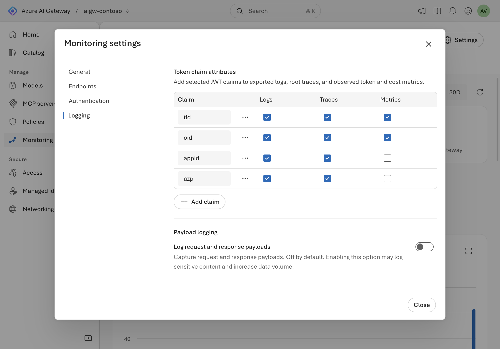

<!--
title: Attribute tokens and cost with OpenTelemetry
summary: Export Microsoft Entra token claims with the gateway's logs, traces, and token metrics, then turn observed tokens into a per-tenant, per-app, and per-key chargeback report with KQL, PromQL, and a small Python script.
category: observability
level: Advanced
duration: 35
tracks: [portal, cli, iac, terraform]
order: 14
status: new
illustration: diagrams/observability.svg
tags: [OpenTelemetry, token claims, chargeback, estimated cost, KQL, PromQL, Prometheus, Microsoft Entra ID]
objectives:
  - Choose which JWT claims the gateway exports to logs, root traces, and token and cost metrics
  - Check which claims your callers' tokens actually carry before you rely on them
  - Build a chargeback report from request logs by tenant, client app, and API key, with failed requests and the gateway's cost estimate
  - Query token and cost metrics with PromQL without double counting token types
prereqs:
  - 13-monitoring
  - 11-entra-rbac
-->
<!-- gh:begin nav: generated by "npm run sync" from the metadata, do not edit -->
[AI Gateway labs](../README.md) › [Observability & FinOps](../README.md#observability--finops) › Lab 14
<!-- gh:end -->

# Attribute tokens and cost with OpenTelemetry

<!-- gh:begin intro: generated by "npm run sync" from the metadata, do not edit -->
> Export Microsoft Entra token claims with the gateway's logs, traces, and token metrics, then turn observed tokens into a per-tenant, per-app, and per-key chargeback report with KQL, PromQL, and a small Python script.

| ⏱️ Time | 📶 Level | 🧭 Tracks | ✅ Before you start |
| :-- | :-- | :-- | :-- |
| 35 min | Advanced | Portal · Azure CLI · Bicep + azd · Terraform | [13 · Monitoring](../13-monitoring/README.md)<br>[11 · Entra ID & RBAC](../11-entra-rbac/README.md) |

**You'll learn to**

- Choose which JWT claims the gateway exports to logs, root traces, and token and cost metrics
- Check which claims your callers' tokens actually carry before you rely on them
- Build a chargeback report from request logs by tenant, client app, and API key, with failed requests and the gateway's cost estimate
- Query token and cost metrics with PromQL without double counting token types

**Follow along:** 🌐 [Interactive version](https://azure.github.io/aigateway/labs/14-otel-chargeback/) with your own values filled in · 📁 [Lab files](infra/)

**On this page:** [Before you begin](#before-you-begin) · [How it works](#how-it-works) · [Choose the claims to export](#choose-the-claims-to-export) · [Send attributed traffic](#send-attributed-traffic) · [Build a chargeback report](#build-a-chargeback-report) · [Query token and cost metrics with PromQL](#query-token-and-cost-metrics-with-promql) · [Verify](#verify) · [Go further](#go-further) · [Clean up](#clean-up) · [Next steps](#next-steps)
<!-- gh:end -->

Three teams and a partner tenant share your gateway. Some call it with API keys, others with Microsoft Entra ID.
Finance wants a monthly report of who used which model and what it cost. In this lab you export the right token
claims with the gateway's telemetry, send traffic as both kinds of caller, and build that report from the data
Application Insights already collects.


## Before you begin

<!-- setup: tools sign-in extension clone -->
<!-- gh:begin setup: generated by "npm run sync" from the metadata, do not edit -->
🧰 **One-time setup** from the [Setup guide](../SETUP.md), if you haven't done it yet:
[Choose where to run commands](../SETUP.md#choose-where-to-run-commands) ·
[Sign in to Azure](../SETUP.md#sign-in-to-azure) ·
[Install the `aigateway` extension](../SETUP.md#install-the-aigateway-extension) ·
[Clone the labs repo](../SETUP.md#clone-the-labs-repo)
<!-- gh:end -->

> [!TIP]
> On the **Bicep + azd** and **Terraform** tracks, `azd up` or `terraform apply` creates its own gateway, model, key,
> Application Insights, and role assignment, so you can skip this section. You need only the one-time setup above,
> and permission to create role assignments, for example **Owner** on the subscription. The later sections also use
> Python 3.10 or later.

- Complete [Connect Application Insights](../13-monitoring/README.md#connect-application-insights) in lab 13, so the
  gateway exports all three signals to Application Insights with an OpenTelemetry exporter.
- Complete [Go keyless with Microsoft Entra ID and RBAC](../11-entra-rbac/README.md), or make sure your signed-in
  user has **AI Gateway Models User** (or **AI Gateway User**) on the gateway or on the model alias.
- Permission to change the gateway, for example **Contributor** on its resource group, and **Log Analytics Reader**
  on the workspace behind Application Insights.
- Python 3.10 or later.
- Run the scripts and samples from the lab's folder, `~/aigateway/labs/14-otel-chargeback`.

Set these variables once. If you named the Application Insights resource differently in lab 13, change
`$GATEWAY-insights`. The portal's setup adds a short random suffix when that name is taken, such as
`<gateway>-insights-ak7s`: list your components with
`az resource list -g "$RG" --resource-type Microsoft.Insights/components --query "[].name" -o tsv`.

<details open><summary>Bash</summary> <!-- gh -->

```bash title="Bash"
# Name your gateway and the alias to call
export RG="<resource-group>"
export GATEWAY="<gateway>"
export AI_GATEWAY_MODEL="<model-name>"     # a callable alias
echo "📝 Gateway $GATEWAY in $RG, alias $AI_GATEWAY_MODEL"

# Read the gateway's runtime URL
export AI_GATEWAY_URL="https://$(az aigateway show -g "$RG" -n "$GATEWAY" --query properties.frontend.defaultHostname -o tsv)"
echo "🌐 Runtime URL: $AI_GATEWAY_URL"

# Read your API key without showing it, and export it for the scripts
printf "AI Gateway API key: " && read -rs AI_GATEWAY_API_KEY && export AI_GATEWAY_API_KEY && echo
echo "🔑 Key: in AI_GATEWAY_API_KEY (${#AI_GATEWAY_API_KEY} characters, not shown)"

# Find the Application Insights resource from lab 13, and the Log Analytics workspace behind it
APPI_ID="$(az resource show -g "$RG" -n "$GATEWAY-insights" --resource-type Microsoft.Insights/components --query id -o tsv)"
LAW_ID="$(az resource show --ids "$APPI_ID" --api-version 2020-02-02 --query properties.WorkspaceResourceId -o tsv)"
echo "🆔 Application Insights: $APPI_ID"
echo "🆔 Log Analytics workspace: $LAW_ID"
```
</details> <!-- gh -->

<details><summary>PowerShell</summary> <!-- gh -->

```powershell title="PowerShell"
# Name your gateway and the alias to call
$RG      = "<resource-group>"
$GATEWAY = "<gateway>"
$env:AI_GATEWAY_MODEL = "<model-name>"     # a callable alias
Write-Host "📝 Gateway $GATEWAY in $RG, alias $env:AI_GATEWAY_MODEL"

# Read the gateway's runtime URL
$env:AI_GATEWAY_URL = "https://$(az aigateway show -g $RG -n $GATEWAY --query properties.frontend.defaultHostname -o tsv)"
Write-Host "🌐 Runtime URL: $env:AI_GATEWAY_URL"

# Read your API key without showing it, and keep it in an environment variable for the scripts
$env:AI_GATEWAY_API_KEY = Read-Host "AI Gateway API key" -MaskInput
Write-Host "🔑 Key: in AI_GATEWAY_API_KEY ($($env:AI_GATEWAY_API_KEY.Length) characters, not shown)"

# Find the Application Insights resource from lab 13, and the Log Analytics workspace behind it
$APPI_ID = az resource show -g $RG -n "$GATEWAY-insights" --resource-type Microsoft.Insights/components --query id -o tsv
$LAW_ID  = az resource show --ids $APPI_ID --api-version 2020-02-02 --query properties.WorkspaceResourceId -o tsv
Write-Host "🆔 Application Insights: $APPI_ID"
Write-Host "🆔 Log Analytics workspace: $LAW_ID"
```
</details> <!-- gh -->

## How it works

Every request already carries its caller. An API key call is attributed by the key's ID
(`azure.ai_gateway.api_key_id`). A Microsoft Entra call carries a validated JWT, and **token claim attributes**
copy the claims you pick into telemetry as `azure.ai_gateway.identity.claims.<claim>`. For each claim you choose the
signals independently: **logs**, **root traces**, and **observed token and cost metrics**.

Logs hold the per-request token usage the backend reported, so they're the best source for a detailed report. Traces
add the failures that HTTP status codes miss: a span gets the status **Error** when a model stream or an MCP call
fails, even after HTTP 200. Metrics are cheaper to query over long ranges, but every exported claim value becomes
a label, so keep metrics to claims with a bounded number of values.

Estimated cost is **observed tokens × public pricing**. The gateway exports its estimate with each request as
`azure.ai_gateway.client.token.cost`, also for streamed responses whose logs report no token usage. Treat it as an
allocation key and reconcile the total with provider billing or Azure Cost Management.

| Claim | Identifies | Recommended preset | Use it for |
|---|---|---|---|
| `tid` | The caller's tenant | Logs, Traces, Metrics | Tenant or customer totals. With `oid`, the dashboard's Entra caller. |
| `oid` | The user, service principal, or managed identity | Logs, Traces, Metrics | Per-caller totals |
| `appid` (v1 tokens), `azp` (v2 tokens) | The client application | Logs, Traces | Per-app chargeback. This lab adds Metrics. |
| A custom claim, such as `cost_center` | Whatever your tokens carry | You choose | Team chargeback, if the claim is in the token |

## Choose the claims to export

You keep the recommended preset and add **Metrics** for `appid` and `azp`, so token and cost metrics can also be
split by client app.

<!-- track: portal | Portal -->
<details open><summary><b>🖥️ Portal</b></summary> <!-- gh -->

### Open the token claim attributes

In the [AI Gateway portal](https://ai.gateway.azure.com), select your gateway, then **Monitoring** › **Settings**.
On the **Logging** tab, find **Token claim attributes**: "Add selected JWT claims to exported logs, root traces, and
observed token and cost metrics." Each row is a claim with **Logs**, **Traces**, and **Metrics** checkboxes.



> [!NOTE]
> No **Token claim attributes** section? It's only shown for OpenTelemetry exporters. Reconfigure monitoring as
> in [Monitor usage, cost, and traces](../13-monitoring/README.md). If the table is empty ("No token claims are
> included in exported telemetry"), add `tid`, `oid`, `appid`, and `azp` with **Add claim**.

### Add metrics for the client app

Select **Metrics** for `appid` and for `azp`. Leave `tid` and `oid` on all three signals: the dashboard needs
both on metrics to attribute Entra callers. Changes save automatically while "Saving changes…" is shown. Every
claim needs at least one signal.

> [!TIP]
> **Add claim** adds a row (the placeholder suggests `cost_center`) that starts with **Logs** and **Traces**.
> Only add claims that your callers' tokens carry. The next section shows how to check.

</details> <!-- gh -->
<!-- track: cli | Azure CLI -->
<details><summary><b>⌨️ Azure CLI</b></summary> <!-- gh -->

### Read the current configuration

The claim attributes live on the gateway's telemetry exporter, in its `telemetry.attributes` list. Show the claims
of the `appinsights` exporter that lab 13 created, with the signals of each one:

<details open><summary>Bash</summary> <!-- gh -->

```bash title="Bash"
# Show the token claims that the gateway's exporter adds to its telemetry, with the signals of each one
echo "📊 Token claims of the appinsights exporter:"
az aigateway telemetry-exporter show -g "$RG" --gateway-name "$GATEWAY" -n appinsights \
  --query "properties.telemetry.attributes[].{claim:source.value, signals:join(', ', signals)}" -o table
```
</details> <!-- gh -->

<details><summary>PowerShell</summary> <!-- gh -->

```powershell title="PowerShell"
# Show the token claims that the gateway's exporter adds to its telemetry, with the signals of each one
Write-Host "📊 Token claims of the appinsights exporter:"
az aigateway telemetry-exporter show -g $RG --gateway-name $GATEWAY -n appinsights `
  --query "properties.telemetry.attributes[].{claim:source.value, signals:join(', ', signals)}" -o table
```
</details> <!-- gh -->

Expected output: `tid` and `oid` with `logs, traces, metrics`, and `appid` and `azp` with `logs, traces`. If the
exporter isn't found, list the exporters with `az aigateway telemetry-exporter list` and use the name of the one
whose kind is `OpenTelemetry`. Without one, reconfigure monitoring as in
[Monitor usage, cost, and traces](../13-monitoring/README.md) first.

### Add metrics for the client app

`--telemetry` replaces the whole list of claims, so pass all four, with `metrics` added for `appid` and `azp`. The
exporter keeps its other settings.

<details open><summary>Bash</summary> <!-- gh -->

```bash title="Bash"
# Export all four claims to logs, traces, and metrics, so that token and cost metrics can be split by client app
az aigateway telemetry-exporter update -g "$RG" --gateway-name "$GATEWAY" -n appinsights -o none \
  --telemetry "{attributes:[{source:{kind:claims,value:tid},signals:[logs,traces,metrics]},{source:{kind:claims,value:oid},signals:[logs,traces,metrics]},{source:{kind:claims,value:appid},signals:[logs,traces,metrics]},{source:{kind:claims,value:azp},signals:[logs,traces,metrics]}]}" &&
  echo "📊 appid and azp now export to logs, traces, and metrics"

# Show the claims again
az aigateway telemetry-exporter show -g "$RG" --gateway-name "$GATEWAY" -n appinsights \
  --query "properties.telemetry.attributes[].{claim:source.value, signals:join(', ', signals)}" -o table
```
</details> <!-- gh -->

<details><summary>PowerShell</summary> <!-- gh -->

```powershell title="PowerShell"
# Export all four claims to logs, traces, and metrics, so that token and cost metrics can be split by client app
az aigateway telemetry-exporter update -g $RG --gateway-name $GATEWAY -n appinsights -o none `
  --telemetry "{attributes:[{source:{kind:claims,value:tid},signals:[logs,traces,metrics]},{source:{kind:claims,value:oid},signals:[logs,traces,metrics]},{source:{kind:claims,value:appid},signals:[logs,traces,metrics]},{source:{kind:claims,value:azp},signals:[logs,traces,metrics]}]}"
if ($?) { Write-Host "📊 appid and azp now export to logs, traces, and metrics" }

# Show the claims again
az aigateway telemetry-exporter show -g $RG --gateway-name $GATEWAY -n appinsights `
  --query "properties.telemetry.attributes[].{claim:source.value, signals:join(', ', signals)}" -o table
```
</details> <!-- gh -->

To export a custom claim, such as `cost_center`, add an entry such as
`{source:{kind:claims,value:cost_center},signals:[logs,traces]}` to the list. Check that your callers' tokens carry it
first, as the next section shows.

</details> <!-- gh -->
<!-- track: iac | Bicep + azd -->
<details><summary><b>🏗️ Bicep + azd</b></summary> <!-- gh -->

**What you need:** only the one-time setup from **Before you begin**. This track doesn't use your gateway from the
earlier labs: `azd up` creates a new one, so it works on its own.

### Choose what to declare

The templates reuse lab 13's and lab 11's. Lab 13's
[monitoring.bicep](../13-monitoring/infra/monitoring.bicep) creates the Application Insights destination with OTLP
ingestion turned on, and its [otel-exporter.bicep](../13-monitoring/infra/otel-exporter.bicep) creates the gateway's
OpenTelemetry exporter. The claim attributes are part of that exporter, in its `telemetry.attributes` list. Each
entry names a claim in `source` (`kind` is `claims`, `value` is the claim name, such as `tid`) and lists the signals
that carry it in `signals`: `logs`, `traces`, and `metrics`.

`infra/otel-exporter.bicepparam` passes the recommended preset and adds `metrics` for `appid` and `azp`.
`infra/main.bicep` also calls lab 11's [role-assignment.bicep](../11-entra-rbac/infra/role-assignment.bicep) to grant
you **AI Gateway Models User** on the gateway, for the Entra calls in the next section.

As in lab 13, the exporter comes last. Azure creates the component's OTLP endpoints and its Data Collection Rule a
few minutes after the deployment, and the gateway's managed identity needs **Monitoring Metrics Publisher** on that
rule first. So `azure.yaml` runs lab 13's
[connect-telemetry.sh](../13-monitoring/infra/connect-telemetry.sh) in a `postprovision` hook: it waits for the
endpoints, assigns the role, then deploys the exporter with `infra/otel-exporter.bicepparam`.

### Review the templates

`infra/main.bicep` creates the resource group `rg-<environment name>` and calls the quick start's
[resources.bicep](../quickstart/infra/resources.bicep) for the gateway, the Foundry model, its default alias, and the
`app-first-call` key. Then it calls lab 13's `monitoring.bicep` for the destination, and lab 11's role assignment for
the identity that runs azd. `azd` passes your object ID in `AZURE_PRINCIPAL_ID`:

<!-- include: infra/main.bicep -->
<!-- gh:begin include: generated by "npm run sync" from the metadata, do not edit -->
📄 [`infra/main.bicep`](infra/main.bicep)

<details><summary>Show all 85 lines</summary>

```bicep
// Lab 14 with azd: "azd up" creates the resource group rg-<environment name>, the quick start's gateway, Foundry
// model, default alias, and runtime API key, then lab 13's Application Insights destination, and lab 11's role so
// that you can call the model with your Microsoft Entra token. azure.yaml then creates lab 13's OpenTelemetry
// exporter with the token claims in otel-exporter.bicepparam. The runtime API key is never an output.
targetScope = 'subscription'

@description('azd environment name. The resource group is rg-<environmentName>.')
@minLength(1)
@maxLength(60)
param environmentName string

@description('Region for every resource. Pick one where AI Gateway and the lab\'s Foundry models are available. List them with az provider show --namespace Microsoft.ApiManagement (Setup guide, Find the available regions).')
@metadata({ azd: { type: 'location' } })
param location string

@description('Object ID of the identity that calls the gateway with Entra tokens. azd sets AZURE_PRINCIPAL_ID to the signed-in user or service principal.')
param principalId string

@description('Type of that identity. azd reads it from AZURE_PRINCIPAL_TYPE, User by default.')
@allowed([ 'User', 'Group', 'ServicePrincipal' ])
param principalType string = 'User'

var suffix = take(uniqueString(subscription().id, environmentName, location), 6)
var tags = { 'azd-env-name': environmentName }

resource rg 'Microsoft.Resources/resourceGroups@2024-03-01' = {
  name: 'rg-${environmentName}'
  location: location
  tags: tags
}

// The quick start's template: a gateway, a Foundry model behind the default alias, and the app-first-call key.
module base '../../quickstart/infra/resources.bicep' = {
  name: 'aigw-base'
  scope: rg
  params: {
    location: location
    tags: tags
    gatewayName: 'aigw-${suffix}'
    foundryName: 'aigw${suffix}'
  }
}

// Lab 13's destination: a Log Analytics workspace and an Application Insights component with OTLP ingestion on.
module monitoring '../../13-monitoring/infra/monitoring.bicep' = {
  name: 'aigw-monitoring'
  scope: rg
  params: {
    gatewayName: base.outputs.gatewayName
    location: location
    tags: tags
    enableOtlpIngestion: true
  }
}

// Lab 13's OpenTelemetry exporter comes after this deployment, once Azure has created the OTLP endpoints: azure.yaml
// runs lab 13's connect-telemetry.sh, which grants the gateway's identity Monitoring Metrics Publisher on the data
// collection rule, then deploys otel-exporter.bicep with the claims in otel-exporter.bicepparam.

// Lab 11's role assignment: AI Gateway Models User on the gateway, for the Entra calls.
module roleAssignment '../../11-entra-rbac/infra/role-assignment.bicep' = {
  name: 'aigw-role-assignment'
  scope: rg
  params: {
    gatewayName: base.outputs.gatewayName
    principalId: principalId
    principalType: principalType
    role: 'models'
    scope: 'gateway'
  }
}

output AZURE_RESOURCE_GROUP string = rg.name
output AI_GATEWAY_NAME string = base.outputs.gatewayName
output AI_GATEWAY_ID string = base.outputs.gatewayId
output AI_GATEWAY_URL string = base.outputs.gatewayUrl
output AI_GATEWAY_PROVIDER string = base.outputs.providerName
output AI_GATEWAY_BACKEND_MODEL string = base.outputs.modelName
output AI_GATEWAY_MODEL string = base.outputs.aliasName
output FOUNDRY_ACCOUNT_NAME string = base.outputs.foundryName
output AI_GATEWAY_PRINCIPAL_ID string = base.outputs.gatewayPrincipalId
output APP_INSIGHTS_ID string = monitoring.outputs.appInsightsId
output APP_INSIGHTS_NAME string = monitoring.outputs.appInsightsName
output LOG_ANALYTICS_WORKSPACE_ID string = monitoring.outputs.logAnalyticsWorkspaceId
output AI_GATEWAY_ROLE_ASSIGNMENT_ID string = roleAssignment.outputs.roleAssignmentId
```

</details>
<!-- gh:end -->

`infra/otel-exporter.bicepparam` holds the claims to export, and the signals that carry each one:

<!-- include: infra/otel-exporter.bicepparam -->
<!-- gh:begin include: generated by "npm run sync" from the metadata, do not edit -->
📄 [`infra/otel-exporter.bicepparam`](infra/otel-exporter.bicepparam)

<details><summary>Show all 32 lines</summary>

```bicepparam
// Lab 13's OpenTelemetry exporter, with the token claims to export and the signals that carry each one: the
// recommended preset, plus metrics for the client app claims. azd doesn't deploy it with main.bicep: the postprovision
// hook in azure.yaml runs lab 13's connect-telemetry.sh, which deploys it once the component reports its OTLP
// endpoints and the gateway can publish to them. azd passes the outputs of main.bicep, and the azd environment's
// values such as CLIENT_APP_METRICS, to the hook as environment variables.
using '../../13-monitoring/infra/otel-exporter.bicep'

param gatewayName = readEnvironmentVariable('AI_GATEWAY_NAME')
param appInsightsName = readEnvironmentVariable('APP_INSIGHTS_NAME')

// Set CLIENT_APP_METRICS to false with azd env set to export appid and azp to logs and traces only.
var allSignals = ['logs', 'traces', 'metrics']
var clientAppSignals = bool(readEnvironmentVariable('CLIENT_APP_METRICS', 'true')) ? allSignals : ['logs', 'traces']

param claimAttributes = [
  {
    source: { kind: 'claims', value: 'tid' }
    signals: allSignals
  }
  {
    source: { kind: 'claims', value: 'oid' }
    signals: allSignals
  }
  {
    source: { kind: 'claims', value: 'appid' }
    signals: clientAppSignals
  }
  {
    source: { kind: 'claims', value: 'azp' }
    signals: clientAppSignals
  }
]
```

</details>
<!-- gh:end -->

`azure.yaml` holds the `postprovision` hook that connects the gateway:

<!-- include: azure.yaml -->
<!-- gh:begin include: generated by "npm run sync" from the metadata, do not edit -->
📄 [`azure.yaml`](azure.yaml)

```yaml
# yaml-language-server: $schema=https://raw.githubusercontent.com/Azure/azure-dev/main/schemas/v1.0/azure.yaml.json
# Lab 14: "azd up" creates the quick start's gateway, model, and runtime API key, lab 13's Application Insights
# destination and OpenTelemetry exporter with the token claims to export, and lab 11's role for your Entra calls.
# The lab clones the repo's main branch from GitHub and runs azd up in this folder.
name: aigw-lab14
metadata:
  template: aigw-lab14@1.0.0
infra:
  provider: bicep
  path: infra
hooks:
  # Lab 13's exporter needs the component's OTLP endpoints and the Monitoring Metrics Publisher role on its data
  # collection rule, and Azure creates the endpoints and the rule a few minutes after the deployment turns OTLP
  # ingestion on. So after each deployment, azd runs lab 13's connect-telemetry.sh: it waits for them, assigns the
  # role, then deploys the exporter with the claims in infra/otel-exporter.bicepparam. When azd provision finds no
  # changes to deploy, it skips this hook too: run "azd hooks run postprovision" to apply changed claims. Running it
  # again is harmless.
  postprovision:
    posix:
      shell: sh
      run: ../13-monitoring/infra/connect-telemetry.sh infra/otel-exporter.bicepparam
    windows:
      shell: pwsh
      run: ../13-monitoring/infra/connect-telemetry.ps1 -ParametersFile infra/otel-exporter.bicepparam
```
<!-- gh:end -->

### Deploy with azd up

Move into the lab's folder, create an azd environment named `aigw-lab14` in your current subscription, then provision
everything. It takes about four minutes.

<details open><summary>Bash</summary> <!-- gh -->

```bash title="Bash"
# Move into the lab's folder, which holds the azd project
cd ~/aigateway/labs/14-otel-chargeback &&
  echo "📂 Lab folder: $(pwd)"

# Create an azd environment in your current subscription, so that azd doesn't prompt you
azd env new aigw-lab14 --location eastus2 --subscription "$(az account show --query id --output tsv)" &&
  echo "📝 azd environment aigw-lab14 deploys to eastus2"

# Provision the gateway, the model, the key, Application Insights, the exporter with its claims, and your role
azd up &&
  echo "🚀 Gateway deployed: $(azd env get-value AI_GATEWAY_URL)"
```
</details> <!-- gh -->

<details><summary>PowerShell</summary> <!-- gh -->

```powershell title="PowerShell"
# Move into the lab's folder, which holds the azd project
Set-Location ~/aigateway/labs/14-otel-chargeback
if ($?) { Write-Host "📂 Lab folder: $(Get-Location)" }

# Create an azd environment in your current subscription, so that azd doesn't prompt you
azd env new aigw-lab14 --location eastus2 --subscription (az account show --query id --output tsv)
if ($?) { Write-Host "📝 azd environment aigw-lab14 deploys to eastus2" }

# Provision the gateway, the model, the key, Application Insights, the exporter with its claims, and your role
azd up
if ($?) { Write-Host "🚀 Gateway deployed: $(azd env get-value AI_GATEWAY_URL)" }
```
</details> <!-- gh -->

For another region, pick one where AI Gateway and the `gpt-5-mini` model are available, as in [Find the available
regions](../SETUP.md#find-the-available-regions).

### Read the outputs and the key

Set the variables that the next sections use from azd's environment values, and read the key from the gateway, so
that it never shows on screen. The last command shows the exporter's claims.

<details open><summary>Bash</summary> <!-- gh -->

```bash title="Bash"
# Read the names and URLs that azd up created
export RG="$(azd env get-value AZURE_RESOURCE_GROUP)"
export GATEWAY="$(azd env get-value AI_GATEWAY_NAME)"
export AI_GATEWAY_MODEL="$(azd env get-value AI_GATEWAY_MODEL)"
export GATEWAY_ID="$(azd env get-value AI_GATEWAY_ID)"
export AI_GATEWAY_URL="$(azd env get-value AI_GATEWAY_URL)"
echo "📝 Gateway $GATEWAY in $RG, alias $AI_GATEWAY_MODEL"
echo "🌐 Runtime URL: $AI_GATEWAY_URL"

# Read the key from the gateway, so that it never shows on screen or lands in a file
export AI_GATEWAY_API_KEY="$(az aigateway api-key list-secrets --ids "$GATEWAY_ID/apiKeys/app-first-call" \
  --query primaryKey --output tsv)"
echo "🔑 Key: in AI_GATEWAY_API_KEY (${#AI_GATEWAY_API_KEY} characters, not shown)"

# Read the IDs of the Application Insights resource and the Log Analytics workspace behind it
APPI_ID="$(azd env get-value APP_INSIGHTS_ID)"
LAW_ID="$(azd env get-value LOG_ANALYTICS_WORKSPACE_ID)"
echo "🆔 Application Insights: $APPI_ID"
echo "🆔 Log Analytics workspace: $LAW_ID"

# Show the token claims that the gateway's exporter adds to its telemetry, with the signals of each one
echo "📊 Token claims of the appinsights exporter:"
az aigateway telemetry-exporter show -g "$RG" --gateway-name "$GATEWAY" -n appinsights \
  --query "properties.telemetry.attributes[].{claim:source.value, signals:join(', ', signals)}" -o table
```
</details> <!-- gh -->

<details><summary>PowerShell</summary> <!-- gh -->

```powershell title="PowerShell"
# Read the names and URLs that azd up created
$RG                     = azd env get-value AZURE_RESOURCE_GROUP
$GATEWAY                = azd env get-value AI_GATEWAY_NAME
$env:AI_GATEWAY_MODEL   = azd env get-value AI_GATEWAY_MODEL
$GATEWAY_ID             = azd env get-value AI_GATEWAY_ID
$env:AI_GATEWAY_URL     = azd env get-value AI_GATEWAY_URL
Write-Host "📝 Gateway $GATEWAY in $RG, alias $env:AI_GATEWAY_MODEL"
Write-Host "🌐 Runtime URL: $env:AI_GATEWAY_URL"

# Read the key from the gateway, so that it never shows on screen or lands in a file
$env:AI_GATEWAY_API_KEY = az aigateway api-key list-secrets --ids "$GATEWAY_ID/apiKeys/app-first-call" `
  --query primaryKey --output tsv
Write-Host "🔑 Key: in AI_GATEWAY_API_KEY ($($env:AI_GATEWAY_API_KEY.Length) characters, not shown)"

# Read the IDs of the Application Insights resource and the Log Analytics workspace behind it
$APPI_ID                = azd env get-value APP_INSIGHTS_ID
$LAW_ID                 = azd env get-value LOG_ANALYTICS_WORKSPACE_ID
Write-Host "🆔 Application Insights: $APPI_ID"
Write-Host "🆔 Log Analytics workspace: $LAW_ID"

# Show the token claims that the gateway's exporter adds to its telemetry, with the signals of each one
Write-Host "📊 Token claims of the appinsights exporter:"
az aigateway telemetry-exporter show -g $RG --gateway-name $GATEWAY -n appinsights `
  --query "properties.telemetry.attributes[].{claim:source.value, signals:join(', ', signals)}" -o table
```
</details> <!-- gh -->

Expected output: `azd up` ended with `SUCCESS`, and the table lists `tid`, `oid`, `appid`, and `azp`, each with
`logs, traces, metrics`.

### Change the claims

The `postprovision` hook deploys the exporter with the claims in `infra/otel-exporter.bicepparam` each time it runs.
To go back to the recommended preset, without metrics for the client app, set `CLIENT_APP_METRICS` to `false` and run
the hook with `azd hooks run postprovision`. `azd provision` alone doesn't apply the change: the templates are the
same, so azd skips the deployment and its hooks. Then show the claims again: `appid` and `azp` list only `logs` and
`traces`. If you try it now, set it back to `true` and run the hook again before you continue, so that the PromQL
section can split metrics by client app.

<details open><summary>Bash</summary> <!-- gh -->

```bash title="Bash"
# Export the client app claims, appid and azp, to logs and traces only, as in the recommended preset
azd env set CLIENT_APP_METRICS false &&
  echo "📝 CLIENT_APP_METRICS is false"

# Run the postprovision hook, which deploys the exporter with the claims in infra/otel-exporter.bicepparam again
azd hooks run postprovision &&
  echo "🚀 Applied: appid and azp export to logs and traces only"
```
</details> <!-- gh -->

<details><summary>PowerShell</summary> <!-- gh -->

```powershell title="PowerShell"
# Export the client app claims, appid and azp, to logs and traces only, as in the recommended preset
azd env set CLIENT_APP_METRICS false
if ($?) { Write-Host "📝 CLIENT_APP_METRICS is false" }

# Run the postprovision hook, which deploys the exporter with the claims in infra/otel-exporter.bicepparam again
azd hooks run postprovision
if ($?) { Write-Host "🚀 Applied: appid and azp export to logs and traces only" }
```
</details> <!-- gh -->

To export a custom claim, such as `cost_center`, add an entry to the `claimAttributes` list in `infra/otel-exporter.bicepparam`
and run `azd hooks run postprovision`. Check that your callers' tokens carry it first, as the next section shows. For the chargeback
report, follow the **Azure CLI** track: it uses the variables you set here.

</details> <!-- gh -->
<!-- track: terraform | Terraform -->
<details><summary><b>🌍 Terraform</b></summary> <!-- gh -->

**What you need:** only the one-time setup from **Before you begin**, plus Terraform 1.9 or later, as in
[Deploy a lab with Terraform](../SETUP.md#deploy-a-lab-with-terraform). This track doesn't use your gateway from the
earlier labs: `terraform apply` creates a new one, so it works on its own. The apply also runs the Azure CLI that you
signed in with, to wait for the OTLP endpoints.

### Choose what to declare

The configuration reuses lab 13's Terraform module,
[telemetry](../13-monitoring/terraform/telemetry), which creates the Application Insights destination with OTLP
ingestion turned on, assigns the gateway's managed identity **Monitoring Metrics Publisher** on its Data Collection
Rule, and creates the gateway's OpenTelemetry exporter, all in one `terraform apply`. The claim attributes are part of
that exporter, in its `telemetry.attributes` list. Each entry names a claim in `source` (`kind` is `claims`, `value`
is the claim name, such as `tid`) and lists the signals that carry it in `signals`: `logs`, `traces`, and `metrics`.

`terraform/main.tf` passes the recommended preset to the module's `claim_attributes` variable, and adds `metrics` for
`appid` and `azp` while the `client_app_metrics` variable is `true`, its default. It also grants you
**AI Gateway Models User** on the gateway, as lab 11 does, for the Entra calls in the next section.

### Review the configuration

`terraform/main.tf` creates the resource group `rg-<environment_name>` and calls the quick start's
[resources module](../quickstart/terraform/resources) for the gateway, the Foundry model, its default alias, and the
`app-first-call` key. Then it calls lab 13's `telemetry` module with the claims, and assigns the role to the identity
that runs Terraform:

<!-- include: terraform/main.tf -->
<!-- gh:begin include: generated by "npm run sync" from the metadata, do not edit -->
📄 [`terraform/main.tf`](terraform/main.tf)

<details><summary>Show all 67 lines</summary>

```tf
# Lab 14 with Terraform: creates the resource group rg-<environment_name>, the quick start's gateway, Foundry model,
# default alias, and runtime API key, then lab 13's Application Insights destination and OpenTelemetry exporter with
# the token claims to export, and lab 11's role so that you can call the model with your Microsoft Entra token. The
# runtime API key is never an output.
data "azapi_client_config" "current" {}

locals {
  suffix = substr(sha1("${data.azapi_client_config.current.subscription_id}/${var.environment_name}/${var.location}"), 0, 6)
  tags   = { "environment-name" = var.environment_name }

  # The recommended preset exports appid and azp to logs and traces. client_app_metrics adds metrics, so that token
  # and cost metrics can be split by client app.
  client_app_signals = var.client_app_metrics ? ["logs", "traces", "metrics"] : ["logs", "traces"]
  claim_attributes = [
    { claim = "tid", signals = ["logs", "traces", "metrics"] },
    { claim = "oid", signals = ["logs", "traces", "metrics"] },
    { claim = "appid", signals = local.client_app_signals },
    { claim = "azp", signals = local.client_app_signals },
  ]

  # AI Gateway Models User: lets the identity call the gateway's model aliases with a Microsoft Entra token.
  models_user_role_id = "a6b68e3d-a1f0-4c60-8678-237c050cf4ea"
  principal_id        = coalesce(var.principal_id, data.azapi_client_config.current.object_id)
}

resource "azurerm_resource_group" "rg" {
  name     = "rg-${var.environment_name}"
  location = var.location
  tags     = local.tags
}

# The quick start's module: a gateway, a Foundry model behind the default alias, and the app-first-call key.
module "base" {
  source = "../../quickstart/terraform/resources"

  subscription_id     = data.azapi_client_config.current.subscription_id
  resource_group_name = azurerm_resource_group.rg.name
  resource_group_id   = azurerm_resource_group.rg.id
  location            = var.location
  tags                = local.tags
  gateway_name        = "aigw-${local.suffix}"
  foundry_name        = "aigw${local.suffix}"
}

# Lab 13's module: the destination, the role on its Data Collection Rule, and the exporter with the claims above.
module "telemetry" {
  source = "../../13-monitoring/terraform/telemetry"

  resource_group_name  = azurerm_resource_group.rg.name
  resource_group_id    = azurerm_resource_group.rg.id
  location             = var.location
  tags                 = local.tags
  gateway_name         = module.base.gateway_name
  gateway_principal_id = module.base.gateway_principal_id
  workspace_id         = module.base.workspace_id
  claim_attributes     = local.claim_attributes
}

# Lab 11's role assignment: AI Gateway Models User on the gateway, for the Entra calls.
resource "azurerm_role_assignment" "models_user" {
  name                             = uuidv5("url", "${module.base.gateway_id}/${local.principal_id}/${local.models_user_role_id}")
  scope                            = module.base.gateway_id
  role_definition_id               = "/subscriptions/${data.azapi_client_config.current.subscription_id}/providers/Microsoft.Authorization/roleDefinitions/${local.models_user_role_id}"
  principal_id                     = local.principal_id
  principal_type                   = var.principal_type
  skip_service_principal_aad_check = var.principal_type == "ServicePrincipal"
}
```

</details>
<!-- gh:end -->

### Deploy with terraform apply

Move into the lab's Terraform folder, select your current subscription, then plan and apply the configuration. It
takes about four minutes, most of it while the new gateway activates.

<details open><summary>Bash</summary> <!-- gh -->

```bash title="Bash"
# Move into the lab's Terraform folder
cd ~/aigateway/labs/14-otel-chargeback/terraform &&
  echo "📂 Terraform folder: $(pwd)"

# Deploy to the Azure CLI's current subscription
export ARM_SUBSCRIPTION_ID="$(az account show --query id --output tsv)" &&
  echo "📍 Subscription: $ARM_SUBSCRIPTION_ID"

# Download the providers, then plan and apply the gateway, the model, the key, Application Insights, the exporter
# with its claims, and your role
terraform init &&
  terraform plan -out tfplan &&
  terraform apply tfplan &&
  echo "🚀 Gateway deployed: $(terraform output -raw ai_gateway_url)"
```
</details> <!-- gh -->

<details><summary>PowerShell</summary> <!-- gh -->

```powershell title="PowerShell"
# Move into the lab's Terraform folder
Set-Location ~/aigateway/labs/14-otel-chargeback/terraform
if ($?) { Write-Host "📂 Terraform folder: $(Get-Location)" }

# Deploy to the Azure CLI's current subscription
$env:ARM_SUBSCRIPTION_ID = az account show --query id --output tsv
if ($?) { Write-Host "📍 Subscription: $env:ARM_SUBSCRIPTION_ID" }

# Download the providers, then plan and apply the gateway, the model, the key, Application Insights, the exporter
# with its claims, and your role
terraform init
if ($?) { terraform plan -out tfplan }
if ($?) { terraform apply tfplan }
if ($?) { Write-Host "🚀 Gateway deployed: $(terraform output -raw ai_gateway_url)" }
```
</details> <!-- gh -->

The configuration deploys to `eastus2`. For another region where AI Gateway and the `gpt-5-mini` model are
available, as in [Find the available regions](../SETUP.md#find-the-available-regions), run
`export TF_VAR_location=<region>` (PowerShell: `$env:TF_VAR_location = "<region>"`) before `terraform plan`.

### Read the outputs and the key

Set the variables that the next sections use from the Terraform outputs, and read the key from the gateway, so that
it never shows on screen or lands in the Terraform state. The commands show the exporter's claims, then move back to
the lab's folder, which holds the scripts and the query.

<details open><summary>Bash</summary> <!-- gh -->

```bash title="Bash"
# Read the names and URLs that terraform apply created
export RG="$(terraform output -raw azure_resource_group)"
export GATEWAY="$(terraform output -raw ai_gateway_name)"
export AI_GATEWAY_MODEL="$(terraform output -raw ai_gateway_model)"
export GATEWAY_ID="$(terraform output -raw ai_gateway_id)"
export AI_GATEWAY_URL="$(terraform output -raw ai_gateway_url)"
echo "📝 Gateway $GATEWAY in $RG, alias $AI_GATEWAY_MODEL"
echo "🌐 Runtime URL: $AI_GATEWAY_URL"

# Read the key from the gateway, so that it never lands in a file or the Terraform state
export AI_GATEWAY_API_KEY="$(az aigateway api-key list-secrets --ids "$GATEWAY_ID/apiKeys/app-first-call" \
  --query primaryKey --output tsv)"
echo "🔑 Key: in AI_GATEWAY_API_KEY (${#AI_GATEWAY_API_KEY} characters, not shown)"

# Read the IDs of the Application Insights resource and the Log Analytics workspace behind it
APPI_ID="$(terraform output -raw app_insights_id)"
LAW_ID="$(terraform output -raw log_analytics_workspace_id)"
echo "🆔 Application Insights: $APPI_ID"
echo "🆔 Log Analytics workspace: $LAW_ID"

# Show the token claims that the gateway's exporter adds to its telemetry, with the signals of each one
echo "📊 Token claims of the appinsights exporter:"
az aigateway telemetry-exporter show -g "$RG" --gateway-name "$GATEWAY" -n appinsights \
  --query "properties.telemetry.attributes[].{claim:source.value, signals:join(', ', signals)}" -o table

# Move back to the lab's folder, which holds the scripts and the query
cd .. && echo "📂 Lab folder: $(pwd)"
```
</details> <!-- gh -->

<details><summary>PowerShell</summary> <!-- gh -->

```powershell title="PowerShell"
# Read the names and URLs that terraform apply created
$RG                     = terraform output -raw azure_resource_group
$GATEWAY                = terraform output -raw ai_gateway_name
$env:AI_GATEWAY_MODEL   = terraform output -raw ai_gateway_model
$GATEWAY_ID             = terraform output -raw ai_gateway_id
$env:AI_GATEWAY_URL     = terraform output -raw ai_gateway_url
Write-Host "📝 Gateway $GATEWAY in $RG, alias $env:AI_GATEWAY_MODEL"
Write-Host "🌐 Runtime URL: $env:AI_GATEWAY_URL"

# Read the key from the gateway, so that it never lands in a file or the Terraform state
$env:AI_GATEWAY_API_KEY = az aigateway api-key list-secrets --ids "$GATEWAY_ID/apiKeys/app-first-call" `
  --query primaryKey --output tsv
Write-Host "🔑 Key: in AI_GATEWAY_API_KEY ($($env:AI_GATEWAY_API_KEY.Length) characters, not shown)"

# Read the IDs of the Application Insights resource and the Log Analytics workspace behind it
$APPI_ID                = terraform output -raw app_insights_id
$LAW_ID                 = terraform output -raw log_analytics_workspace_id
Write-Host "🆔 Application Insights: $APPI_ID"
Write-Host "🆔 Log Analytics workspace: $LAW_ID"

# Show the token claims that the gateway's exporter adds to its telemetry, with the signals of each one
Write-Host "📊 Token claims of the appinsights exporter:"
az aigateway telemetry-exporter show -g $RG --gateway-name $GATEWAY -n appinsights `
  --query "properties.telemetry.attributes[].{claim:source.value, signals:join(', ', signals)}" -o table

# Move back to the lab's folder, which holds the scripts and the query
Set-Location ..
if ($?) { Write-Host "📂 Lab folder: $(Get-Location)" }
```
</details> <!-- gh -->

Expected output: `terraform apply` ended with `Apply complete! Resources: 16 added, 0 changed, 0 destroyed.`, and the
table lists `tid`, `oid`, `appid`, and `azp`, each with `logs, traces, metrics`.

### Change the claims

The claims are in `terraform/main.tf`, and the `client_app_metrics` variable adds `metrics` for `appid` and `azp`. To
go back to the recommended preset, without metrics for the client app, pass `client_app_metrics=false` to
`terraform plan` and apply the plan. Only the exporter changes. You're in the lab's folder, so `-chdir=terraform`
runs Terraform in its folder. Then show the claims again: `appid` and `azp` list only `logs` and `traces`. If you try
it now, plan and apply again without `-var` before you continue, so that the PromQL section can split metrics by
client app.

<details open><summary>Bash</summary> <!-- gh -->

```bash title="Bash"
# Plan the change: export the client app claims, appid and azp, to logs and traces only, as in the recommended preset
terraform -chdir=terraform plan -var client_app_metrics=false -out tfplan &&
  echo "📝 The plan updates only the exporter"

# Apply the plan
terraform -chdir=terraform apply tfplan &&
  echo "🚀 Applied: appid and azp export to logs and traces only"
```
</details> <!-- gh -->

<details><summary>PowerShell</summary> <!-- gh -->

```powershell title="PowerShell"
# Plan the change: export the client app claims, appid and azp, to logs and traces only, as in the recommended preset
terraform -chdir=terraform plan -var client_app_metrics=false -out tfplan
if ($?) { Write-Host "📝 The plan updates only the exporter" }

# Apply the plan
terraform -chdir=terraform apply tfplan
if ($?) { Write-Host "🚀 Applied: appid and azp export to logs and traces only" }
```
</details> <!-- gh -->

> **Checkpoint**
> The plan ended with `Plan: 0 to add, 1 to change, 0 to destroy.`, for `module.telemetry.azapi_resource.exporter`.

To export a custom claim, such as `cost_center`, add an entry to the `claim_attributes` list in `terraform/main.tf`,
then plan and apply. Check that your callers' tokens carry it first, as the next section shows. For the chargeback
report, follow the **Azure CLI** track: it uses the variables you set here.

</details> <!-- gh -->
<!-- /tracks -->

> **Checkpoint**
> `tid` and `oid` export to logs, traces, and metrics, and `appid` and `azp` now export to all three as well.

## Send attributed traffic

<!-- steps -->

### Check what your token carries

A claim only appears in telemetry if the validated token has it. Decode your own token locally and look:

<details open><summary>Bash</summary> <!-- gh -->

```bash title="Bash"
# Get a token for AI Gateway, and decode its claims locally, including the custom cost_center claim
echo "👤 Claims in your token for AI Gateway:"
az account get-access-token --scope https://ai.gateway.azure.com/Data.All --query accessToken -o tsv \
  | python3 infra/show_claims.py cost_center
```
</details> <!-- gh -->

<details><summary>PowerShell</summary> <!-- gh -->

```powershell title="PowerShell"
# Get a token for AI Gateway, and decode its claims locally, including the custom cost_center claim
Write-Host "👤 Claims in your token for AI Gateway:"
az account get-access-token --scope https://ai.gateway.azure.com/Data.All --query accessToken -o tsv |
  python infra/show_claims.py cost_center
```
</details> <!-- gh -->

On GitHub, open [infra/show_claims.py](infra/show_claims.py). The script prints `aud`, `ver`, `tid`, `oid`, `appid`,
`azp`, and `idtyp`, plus any claim names you pass. Nothing leaves your machine.

Expected output: `aud` is AI Gateway's app ID, `18550318-e177-4205-a743-6816d6fcdc3f`, `ver` is `2.0`, `tid` and
`oid` are GUIDs, and `azp` holds the Azure CLI's client ID (a v1 token would carry it in `appid`). `cost_center` is `(not in token)`.

> [!IMPORTANT]
> Tokens for AI Gateway are issued for its app ID, `18550318-e177-4205-a743-6816d6fcdc3f`. Before you add a custom
> claim such as `cost_center` to **Token claim attributes**, decode a real token from that caller and confirm the
> claim is there. If it isn't, map client apps (`appid` or `azp`) to cost centers in your report instead.

### Call the gateway as two callers

Run the script for your shell. It sends five requests with your API key and five with your Entra token, each with an
`x-correlation-id` header that you can match in your client's own logs. The gateway doesn't add that header to its
telemetry, so in Monitoring you find the calls by caller and time.

<details open><summary>Bash</summary> <!-- gh -->

```bash title="Bash"
# Send five requests with your API key and five with your Entra token, and print the status of each one
echo "📊 Requests by caller:"
./infra/send-attributed-traffic.sh "$AI_GATEWAY_MODEL" 5
```
</details> <!-- gh -->

<details><summary>PowerShell</summary> <!-- gh -->

```powershell title="PowerShell"
# Send five requests with your API key and five with your Entra token, and print the status of each one
Write-Host "📊 Requests by caller:"
./infra/send-attributed-traffic.ps1 -Model $env:AI_GATEWAY_MODEL -Requests 5
```
</details> <!-- gh -->

On GitHub, open [send-attributed-traffic.sh](infra/send-attributed-traffic.sh) or
[send-attributed-traffic.ps1](infra/send-attributed-traffic.ps1).

Expected output: ten rows, all `200`, alternating between `key` and `entra`. A `401` or `403` on the `entra`
rows means your role assignment is missing or hasn't propagated yet.

### Find your callers in Monitoring

Wait a few minutes, then open **Monitoring** › **Models** with **1H** selected. In
**Model usage by caller identity**, your API key and your Entra identity appear as separate rows with their own
estimated cost, tokens, and calls: `app-first-call` as an **API key**, and your name as a **User** with your tenant.
Entra callers are resolved from `tid` and `oid`. Callers with neither an API key nor those claims show as
**Unattributed**.

Then select **Traces**. The **Caller identities** column shows the key or your name. Open one of your Entra requests:
under **Correlated logs**, its log shows `azure.ai_gateway.identity.claims.tid`, `...oid`, and `...appid` or `...azp`.
An API key request shows `azure.ai_gateway.api_key_id` instead.

<!-- /steps -->

> **Checkpoint**
> Both callers appear on the **Models** tab, and an Entra request's correlated log shows its claims.

## Build a chargeback report

The report groups the request logs by owner: requests, failed requests, token usage, and the gateway's own cost
estimate. It then prices the tokens with a price list you control. The query is in
[infra/chargeback.kql](infra/chargeback.kql):

<!-- include: infra/chargeback.kql kusto -->
<!-- gh:begin include: generated by "npm run sync" from the metadata, do not edit -->
📄 [`infra/chargeback.kql`](infra/chargeback.kql)

<details><summary>Show all 89 lines</summary>

```kusto
// Chargeback starter: requests, tokens, and cost per tenant, caller, client app, API key, and model, from AI Gateway
// request logs. This is a starting point. Check the attribute names in one request's correlated log before you rely
// on a column.
//
// Where to run it: the Log Analytics workspace behind your Application Insights resource, Logs, KQL mode.
// Then export the result as CSV, or call the query API, and price it with chargeback_report.py.
//
// What it needs:
// - The Logs signal, and each claim you group by enabled for Logs in Monitoring › Settings › Logging ›
//   Token claim attributes. Claims are exported as azure.ai_gateway.identity.claims.<claim>.
// - Token usage that the backend reported, exported as azure.ai_gateway.client.usage.*. Chat Completions reports
//   prompt_tokens and completion_tokens, and cached input tokens are part of the prompt tokens. The input_tokens and
//   output_tokens fallbacks cover APIs that use those names. Missing usage means "unknown", not zero: streamed
//   responses and failed calls often have none, and RequestsWithoutUsage counts them.
// - The gateway's own estimate, azure.ai_gateway.client.token.cost: observed tokens x public prices, in
//   azure.ai_gateway.currency. It's also there for streamed responses, so GatewayCost can exceed your token totals.
// - The Traces signal, for FailedRequests: a request failed if it answered HTTP 4xx or 5xx, or if one of its own
//   spans has the status Error, such as a model stream that reported an error after HTTP 200.
// Calls to an alias that doesn't exist have no model in their log, so they aren't counted.
//
// One request, one row before the totals:
// - A request's log has the span ID of its request span, the gateway's Server span. A client that sends a
//   traceparent header puts all its requests in one trace, so an Error span counts only for the request span above
//   it: HTTP POST › chat <model> › backend › request span.
// - A request that the gateway retried or failed over logs one record per attempt, with the same span ID and
//   azure.ai_gateway.routing.attempt 1, 2, and so on. The last attempt decides whether the request failed, and
//   the tokens and cost of every attempt add up.
let lookback = 30d;
let spans = OTelSpans
    | where TimeGenerated > ago(lookback)
    | project TraceId, SpanId, ParentSpanId, StatusCode, Attempt = toint(Attributes["azure.ai_gateway.routing.attempt"]);
let errorSpans = spans | where StatusCode == "Error";
let errorTraceSpans = spans | where TraceId in ((errorSpans | distinct TraceId));
// Each Error span, with the attempt it belongs to, under the span itself and its three nearest ancestors.
// The request span is one of them.
let spanErrors = errorSpans
    | project TraceId, S0 = SpanId, S1 = ParentSpanId, ErrorAttempt = Attempt
    | lookup kind=leftouter (errorTraceSpans | project TraceId, S1 = SpanId, S2 = ParentSpanId) on TraceId, S1
    | lookup kind=leftouter (errorTraceSpans | project TraceId, S2 = SpanId, S3 = ParentSpanId) on TraceId, S2
    | mv-expand SpanId = pack_array(S0, S1, S2, S3) to typeof(string)
    | where isnotempty(SpanId)
    // An Error span without an attempt, such as inbound or response transfer, fails the whole request.
    | summarize ErrorAttempts = make_set(coalesce(ErrorAttempt, 0)) by TraceId, SpanId;
OTelLogs
| where TimeGenerated > ago(lookback)
// Request logs of model calls. Tool calls have no gen_ai.request.model.
| where isnotempty(Attributes["gen_ai.request.model"])
| extend Attempt = coalesce(toint(Attributes["azure.ai_gateway.routing.attempt"]), 1),
         Status = toint(Attributes["http.response.status_code"]),
         InputTokens = coalesce(tolong(Attributes["azure.ai_gateway.client.usage.prompt_tokens"]),
                                tolong(Attributes["azure.ai_gateway.client.usage.input_tokens"])),
         CachedInputTokens = coalesce(tolong(Attributes["azure.ai_gateway.client.usage.prompt_tokens_details.cached_tokens"]),
                                      tolong(Attributes["azure.ai_gateway.client.usage.input_tokens_details.cached_tokens"])),
         OutputTokens = coalesce(tolong(Attributes["azure.ai_gateway.client.usage.completion_tokens"]),
                                 tolong(Attributes["azure.ai_gateway.client.usage.output_tokens"])),
         // The model that answered, such as a versioned name. A call that failed before an answer has only the alias.
         Model = coalesce(tostring(Attributes["gen_ai.response.model"]), tostring(Attributes["gen_ai.request.model"]))
| extend Tenant = tostring(Attributes["azure.ai_gateway.identity.claims.tid"]),
         ObjectId = tostring(Attributes["azure.ai_gateway.identity.claims.oid"]),
         // v2 tokens carry azp, v1 tokens carry appid. Both identify the client application.
         ClientApp = coalesce(tostring(Attributes["azure.ai_gateway.identity.claims.azp"]),
                              tostring(Attributes["azure.ai_gateway.identity.claims.appid"])),
         // Empty unless you add a custom claim named cost_center and your tokens carry it.
         CostCenter = tostring(Attributes["azure.ai_gateway.identity.claims.cost_center"]),
         ApiKeyId = tostring(Attributes["azure.ai_gateway.api_key_id"]),
         Alias = tostring(Attributes["gen_ai.request.model"])
// One row per request: the status and model of its last attempt, and the tokens and cost of all its attempts
| summarize arg_max(Attempt, Status, Model),
            HasUsage = countif(isnotnull(InputTokens) or isnotnull(OutputTokens)) > 0,
            InputTokens = sum(coalesce(InputTokens, long(0))),
            CachedInputTokens = sum(coalesce(CachedInputTokens, long(0))),
            OutputTokens = sum(coalesce(OutputTokens, long(0))),
            GatewayCost = sum(coalesce(todouble(Attributes["azure.ai_gateway.client.token.cost"]), 0.0)),
            Currency = take_anyif(tostring(Attributes["azure.ai_gateway.currency"]),
                                  isnotempty(Attributes["azure.ai_gateway.currency"]))
    by TraceId, SpanId, Tenant, ObjectId, ClientApp, CostCenter, ApiKeyId, Alias
| lookup kind=leftouter spanErrors on TraceId, SpanId
| extend Failed = coalesce(Status, 0) >= 400 or set_has_element(ErrorAttempts, 0) or set_has_element(ErrorAttempts, Attempt)
| summarize Requests = count(),
            FailedRequests = countif(Failed),
            RequestsWithoutUsage = countif(not(HasUsage)),
            InputTokens = sum(InputTokens),
            CachedInputTokens = sum(CachedInputTokens),
            OutputTokens = sum(OutputTokens),
            GatewayCost = round(sum(GatewayCost), 6),
            Currency = take_anyif(Currency, isnotempty(Currency))
    by Tenant, ObjectId, ClientApp, CostCenter, ApiKeyId, Alias, Model
| extend TotalTokens = InputTokens + OutputTokens
| order by TotalTokens desc
```

</details>
<!-- gh:end -->

On GitHub, open [infra/chargeback.kql](infra/chargeback.kql).

<!-- steps -->

### Prepare a price list

Copy [infra/prices.example.json](infra/prices.example.json) to `prices.json`. Replace `<model-name>` with each value
in the report's `Model` column, which is the model that answered (for example a versioned name), and copy current
prices per million tokens from your provider's pricing page or agreement. A versioned name such as
`my-model-2026-01-01` matches the key `my-model`.

> [!CAUTION]
> The example prices are placeholders. Don't publish a report until you've replaced them with real prices.

<!-- /steps -->

<!-- track: portal | Portal -->
<details open><summary><b>🖥️ Portal</b></summary> <!-- gh -->

### Run the query

In the [Azure portal](https://portal.azure.com), open the Log Analytics workspace behind your Application Insights
resource and select **Logs**. Switch from **Simple mode** to **KQL mode**, paste the contents of
`infra/chargeback.kql`, and select **Run**. You get one row per tenant, object ID, client app, API key, alias, and
model.

### Export it

Select **Share** › **Export to CSV (all columns)**. The browser downloads `query_data.csv`: move it to the lab folder
and rename it `usage.csv`.

### Price it

<details open><summary>Bash</summary> <!-- gh -->

```bash title="Bash"
# Price the exported usage with your price list, group it by tenant, client app, and API key, and save the report
echo "📊 Chargeback by tenant, client app, and API key:"
python3 infra/chargeback_report.py usage.csv prices.json --by Tenant,ClientApp,ApiKeyId --out chargeback.csv &&
  echo "📄 Report saved to chargeback.csv"
```
</details> <!-- gh -->

<details><summary>PowerShell</summary> <!-- gh -->

```powershell title="PowerShell"
# Price the exported usage with your price list, group it by tenant, client app, and API key, and save the report
Write-Host "📊 Chargeback by tenant, client app, and API key:"
python infra/chargeback_report.py usage.csv prices.json --by Tenant,ClientApp,ApiKeyId --out chargeback.csv
if ($?) { Write-Host "📄 Report saved to chargeback.csv" }
```
</details> <!-- gh -->

</details> <!-- gh -->
<!-- track: cli | Azure CLI -->
<details><summary><b>⌨️ Azure CLI</b></summary> <!-- gh -->

### Run the query

Run the query file on the Log Analytics workspace and save the rows. The CLI reads the query from the file after
`@`.

<details open><summary>Bash</summary> <!-- gh -->

```bash title="Bash"
# Read the workspace ID that queries use, from the Log Analytics workspace behind Application Insights
LAW_CUSTOMER_ID="$(az monitor log-analytics workspace show --ids "$LAW_ID" --query customerId -o tsv)"

# Run the chargeback query on the workspace, and save the rows
az monitor log-analytics query -w "$LAW_CUSTOMER_ID" --analytics-query @infra/chargeback.kql -o json > usage.json &&
  echo "📄 Usage by caller saved to usage.json"
```
</details> <!-- gh -->

<details><summary>PowerShell</summary> <!-- gh -->

```powershell title="PowerShell"
# Read the workspace ID that queries use, from the Log Analytics workspace behind Application Insights
$LAW_CUSTOMER_ID = az monitor log-analytics workspace show --ids $LAW_ID --query customerId -o tsv

# Run the chargeback query on the workspace, and save the rows
az monitor log-analytics query -w $LAW_CUSTOMER_ID --analytics-query "@infra/chargeback.kql" -o json |
  Set-Content usage.json
if ($?) { Write-Host "📄 Usage by caller saved to usage.json" }
```
</details> <!-- gh -->

The file holds one JSON object per row, which the report script reads directly.

### Price it

<details open><summary>Bash</summary> <!-- gh -->

```bash title="Bash"
# Price the usage with your price list, group it by tenant, client app, and API key, and save the report
echo "📊 Chargeback by tenant, client app, and API key:"
python3 infra/chargeback_report.py usage.json prices.json --by Tenant,ClientApp,ApiKeyId --out chargeback.csv &&
  echo "📄 Report saved to chargeback.csv"
```
</details> <!-- gh -->

<details><summary>PowerShell</summary> <!-- gh -->

```powershell title="PowerShell"
# Price the usage with your price list, group it by tenant, client app, and API key, and save the report
Write-Host "📊 Chargeback by tenant, client app, and API key:"
python infra/chargeback_report.py usage.json prices.json --by Tenant,ClientApp,ApiKeyId --out chargeback.csv
if ($?) { Write-Host "📄 Report saved to chargeback.csv" }
```
</details> <!-- gh -->

</details> <!-- gh -->
<!-- /tracks -->

On GitHub, open [infra/chargeback_report.py](infra/chargeback_report.py). It sums requests, failed requests, and
tokens per group, prices uncached input, cached input, and output tokens separately, and lists any model without a
price. Group by any column from the query, for example `--by CostCenter` or `--by ApiKeyId,Model`.

Expected output: one row for your API key (`(none)` in `Tenant` and `ClientApp`) and one for your Entra identity
(your tenant ID and the Azure CLI's client ID), followed by a total. For five calls per caller, the report looks like
this, with your own token counts and costs:

```text
Tenant     ClientApp  ApiKeyId        Requests  FailedRequests  InputTokens  CachedInputTokens  OutputTokens  UnpricedTokens  EstimatedCost (USD)  GatewayCost (USD)
(none)     (none)     app-first-call  5         0               85           0                  797           0               0.003273             0.001615
<tenant>   <app-id>   (none)          5         0               85           0                  706           0               0.002909             0.001433

Total: 1,673 tokens, estimated 0.006182 USD
```

Two columns come from the gateway rather than from your price list:

- **FailedRequests** counts calls that answered HTTP 4xx or 5xx, and calls with a span of their own whose status is
  **Error**. A model stream or an MCP call can fail after HTTP 200; see
  [Operation failures](https://ai.gateway.azure.com/docs/observability/telemetry-reference#operation-failures).
  Decide whether you charge for them: a failed stream can still have consumed tokens. A call that the gateway retried
  or failed over counts once, by its last attempt, so a failover that answered isn't a failure. Calls that share a
  client trace, through a W3C `traceparent` header, are still judged one by one.
- **GatewayCost** sums `azure.ai_gateway.client.token.cost`, the gateway's estimate from public prices. The logs of
  streamed responses carry this cost but no token usage, so they add nothing to **EstimatedCost**. If you sent
  streamed or failing traffic, for example with lab 13's traffic script, the API key row counts those calls too, and
  the report ends with a line such as
  `14 request(s) reported no token usage, such as streamed responses or failed calls.`

> [!TIP]
> The report shows IDs. Resolve a client app's name with
> `az ad sp show --id <client-app-id> --query displayName -o tsv`, and an API key's name under **Access** › **API keys**.

> **Checkpoint**
> `chargeback.csv` has a priced row for each caller, and no model is listed under "No price for".

## Query token and cost metrics with PromQL

Token and cost metrics land in the Azure Monitor workspace (managed Prometheus) linked to Application Insights, as
`azure.ai_gateway.client.token.usage` and `azure.ai_gateway.client.token.cost`. They're the same metrics the
dashboard reads, and they carry the claims you enabled for **Metrics** as labels.

<!-- steps -->

### Find the Prometheus endpoint

<details open><summary>Bash</summary> <!-- gh -->

```bash title="Bash"
# Find the Azure Monitor workspace (managed Prometheus) linked to Application Insights, and its query endpoint
AMW_ID="$(az resource show --ids "$APPI_ID" --api-version 2020-02-02 --query properties.AzureMonitorWorkspaceResourceId -o tsv)"
PROM_URL="$(az resource show --ids "$AMW_ID" --api-version 2023-04-03 --query properties.metrics.prometheusQueryEndpoint -o tsv)"
echo "🌐 Prometheus endpoint: $PROM_URL"

# Get a Microsoft Entra token for the Prometheus query API
PROM_TOKEN="$(az account get-access-token --resource https://prometheus.monitor.azure.com --query accessToken -o tsv)"
echo "👤 Token acquired: in PROM_TOKEN (${#PROM_TOKEN} characters, not shown)"
```
</details> <!-- gh -->

<details><summary>PowerShell</summary> <!-- gh -->

```powershell title="PowerShell"
# Find the Azure Monitor workspace (managed Prometheus) linked to Application Insights, and its query endpoint
$AMW_ID     = az resource show --ids $APPI_ID --api-version 2020-02-02 --query properties.AzureMonitorWorkspaceResourceId -o tsv
$PROM_URL   = az resource show --ids $AMW_ID --api-version 2023-04-03 --query properties.metrics.prometheusQueryEndpoint -o tsv
Write-Host "🌐 Prometheus endpoint: $PROM_URL"

# Get a Microsoft Entra token for the Prometheus query API
$PROM_TOKEN = az account get-access-token --resource https://prometheus.monitor.azure.com --query accessToken -o tsv
Write-Host "👤 Token acquired: in PROM_TOKEN ($($PROM_TOKEN.Length) characters, not shown)"
```
</details> <!-- gh -->

### Query token usage for the last day

The metric and label names contain dots, so the query quotes them. The `microsoft.appresourceid` label limits it to
your Application Insights resource.

Each gateway instance exports its own cumulative counters, labeled with `service.instance.id`, so the query takes the
highest value of each series in the last day and adds up the instances. `increase()` doesn't fit lab traffic: it
measures growth between samples, and a new series often appears with its first burst already counted, so a short
burst reads as 0.

<details open><summary>Bash</summary> <!-- gh -->

```bash title="Bash"
# Select the token usage metric of your Application Insights resource, with quoted names because they contain dots
APPI_LABEL="$(echo "$APPI_ID" | tr '[:upper:]' '[:lower:]')"
SELECTOR="{__name__=\"azure.ai_gateway.client.token.usage\",\"microsoft.appresourceid\"=\"$APPI_LABEL\"}"

# Group by model, token type, API key, tenant, and client app
BY='"gen_ai.response.model","gen_ai.token.type","azure.ai_gateway.api_key_id"'
BY+=',"azure.ai_gateway.identity.claims.tid","azure.ai_gateway.identity.claims.appid"'
BY+=',"azure.ai_gateway.identity.claims.azp"'

# Query the tokens of the last day, and print one row per group. v1 tokens carry appid, v2 tokens carry azp
echo "📊 Tokens in the last day, by model, token type, API key, tenant, and client app:"
curl -sS -G "${PROM_URL%/}/api/v1/query" -H "Authorization: Bearer $PROM_TOKEN" \
  --data-urlencode "query=sum by ($BY) (max_over_time(${SELECTOR}[1d])) > 0" \
  | jq -r '.data.result[] | [.metric["gen_ai.response.model"], .metric["gen_ai.token.type"],
      .metric["azure.ai_gateway.api_key_id"], .metric["azure.ai_gateway.identity.claims.tid"],
      ((.metric["azure.ai_gateway.identity.claims.appid"] | select(. != "n/a"))
        // .metric["azure.ai_gateway.identity.claims.azp"] // "-"),
      (.value[1] | tonumber | round)] | @tsv'
```
</details> <!-- gh -->

<details><summary>PowerShell</summary> <!-- gh -->

```powershell title="PowerShell"
# Select the token usage metric of your Application Insights resource, with quoted names because they contain dots
$APPI_LABEL = $APPI_ID.ToLower()
$selector = '{__name__="azure.ai_gateway.client.token.usage","microsoft.appresourceid"="' + $APPI_LABEL + '"}'

# Group by model, token type, API key, tenant, and client app
$by = '"gen_ai.response.model","gen_ai.token.type","azure.ai_gateway.api_key_id",' +
  '"azure.ai_gateway.identity.claims.tid","azure.ai_gateway.identity.claims.appid",' +
  '"azure.ai_gateway.identity.claims.azp"'

# Query the tokens of the last day from the Prometheus query API
$query = 'sum by (' + $by + ') (max_over_time(' + $selector + '[1d])) > 0'
$result = Invoke-RestMethod -Uri "$($PROM_URL.TrimEnd('/'))/api/v1/query" `
  -Headers @{ Authorization = "Bearer $PROM_TOKEN" } -Body @{ query = $query }

# Print one row per group. v1 tokens carry appid, v2 tokens carry azp
if ($?) { Write-Host "📊 Tokens in the last day, by model, token type, API key, tenant, and client app:" }
$result.data.result | ForEach-Object {
  $appid = $_.metric.'azure.ai_gateway.identity.claims.appid'
  $azp = $_.metric.'azure.ai_gateway.identity.claims.azp'
  [pscustomobject]@{
    Model     = $_.metric.'gen_ai.response.model'
    TokenType = $_.metric.'gen_ai.token.type'
    ApiKeyId  = $_.metric.'azure.ai_gateway.api_key_id'
    Tenant    = $_.metric.'azure.ai_gateway.identity.claims.tid'
    ClientApp = if ($appid -and $appid -ne 'n/a') { $appid } elseif ($azp) { $azp } else { '-' }
    Tokens    = [long][double]$_.value[1] } } | Format-Table
```
</details> <!-- gh -->

Expected output: rows per model, token type, and caller, in any order. A claim that a caller doesn't have shows
`n/a`, so your API key rows show `n/a` for the tenant and client app, and your Entra rows show `unknown` for the API
key. A `-` for the client app marks series from before you exported `appid` and `azp` to metrics, such as lab 13's
traffic.

```text
gpt-5-mini-2025-08-07  prompt_tokens                               app-first-call  n/a       n/a       85
gpt-5-mini-2025-08-07  completion_tokens                           app-first-call  n/a       n/a       809
gpt-5-mini-2025-08-07  completion_tokens_details.reasoning_tokens  app-first-call  n/a       n/a       512
gpt-5-mini-2025-08-07  total_tokens                                app-first-call  n/a       n/a       894
gpt-5-mini-2025-08-07  prompt_tokens                               unknown         <tenant>  <app-id>  85
gpt-5-mini-2025-08-07  completion_tokens                           unknown         <tenant>  <app-id>  958
gpt-5-mini-2025-08-07  total_tokens                                unknown         <tenant>  <app-id>  1043
gpt-5-mini-2025-08-07  total_tokens                                app-first-call  n/a       -         2202
```

> [!WARNING]
> Don't add up every token type. A model reports totals and details (for example `total_tokens` and
> `prompt_tokens_details.cached_tokens`) next to input and output, so a plain sum double counts. Use the total
> type if there is one, otherwise input plus output. Cached tokens are usually a subset of input tokens.

The names follow the API of each call: Chat Completions reports `prompt_tokens` and `completion_tokens`, while
Responses reports `input_tokens` and `output_tokens`. `gen_ai.response.model` is the model name that the provider
returned, so one deployment can show up as `gpt-5-mini-2025-08-07` for Chat Completions and `gpt-5-mini` for Responses.
Streamed calls report no token usage, so they have no series here, but they have a cost.

### Query estimated cost

`azure.ai_gateway.client.token.cost` has one series per token type and one that covers the whole call, with an empty
`gen_ai.token.type`. Select that one, so you don't add up the same cost twice.

<details open><summary>Bash</summary> <!-- gh -->

```bash title="Bash"
# Select the cost series that cover a whole call: their gen_ai.token.type label is empty
COST_SELECTOR="{__name__=\"azure.ai_gateway.client.token.cost\",\"gen_ai.token.type\"=\"\","
COST_SELECTOR+="\"microsoft.appresourceid\"=\"$APPI_LABEL\"}"

# Group by model, API key, tenant, client app, currency, and whether a price was missing
COST_BY='"gen_ai.response.model","azure.ai_gateway.api_key_id","azure.ai_gateway.identity.claims.tid"'
COST_BY+=',"azure.ai_gateway.identity.claims.appid","azure.ai_gateway.identity.claims.azp"'
COST_BY+=',"azure.ai_gateway.currency","azure.ai_gateway.price_missing"'

# Query the cost of the last day, and print one row per group
echo "📊 Estimated cost in the last day, by model, API key, tenant, client app, and price status:"
curl -sS -G "${PROM_URL%/}/api/v1/query" -H "Authorization: Bearer $PROM_TOKEN" \
  --data-urlencode "query=sum by ($COST_BY) (max_over_time(${COST_SELECTOR}[1d])) > 0" \
  | jq -r '.data.result[] | [.metric["gen_ai.response.model"], .metric["azure.ai_gateway.api_key_id"],
      .metric["azure.ai_gateway.identity.claims.tid"],
      ((.metric["azure.ai_gateway.identity.claims.appid"] | select(. != "n/a"))
        // .metric["azure.ai_gateway.identity.claims.azp"] // "-"),
      .metric["azure.ai_gateway.price_missing"], .metric["azure.ai_gateway.currency"],
      (.value[1] | tonumber * 1000000 | round / 1000000)] | @tsv'
```
</details> <!-- gh -->

<details><summary>PowerShell</summary> <!-- gh -->

```powershell title="PowerShell"
# Select the cost series that cover a whole call: their gen_ai.token.type label is empty
$costSelector = '{__name__="azure.ai_gateway.client.token.cost","gen_ai.token.type"="",' +
  '"microsoft.appresourceid"="' + $APPI_LABEL + '"}'

# Group by model, API key, tenant, client app, currency, and whether a price was missing
$costBy = '"gen_ai.response.model","azure.ai_gateway.api_key_id","azure.ai_gateway.identity.claims.tid",' +
  '"azure.ai_gateway.identity.claims.appid","azure.ai_gateway.identity.claims.azp",' +
  '"azure.ai_gateway.currency","azure.ai_gateway.price_missing"'

# Query the cost of the last day from the Prometheus query API
$query = 'sum by (' + $costBy + ') (max_over_time(' + $costSelector + '[1d])) > 0'
$result = Invoke-RestMethod -Uri "$($PROM_URL.TrimEnd('/'))/api/v1/query" `
  -Headers @{ Authorization = "Bearer $PROM_TOKEN" } -Body @{ query = $query }

# Print one row per group
if ($?) { Write-Host "📊 Estimated cost in the last day, by model, API key, tenant, client app, and price status:" }
$result.data.result | ForEach-Object {
  $appid = $_.metric.'azure.ai_gateway.identity.claims.appid'
  $azp = $_.metric.'azure.ai_gateway.identity.claims.azp'
  [pscustomobject]@{
    Model        = $_.metric.'gen_ai.response.model'
    ApiKeyId     = $_.metric.'azure.ai_gateway.api_key_id'
    Tenant       = $_.metric.'azure.ai_gateway.identity.claims.tid'
    ClientApp    = if ($appid -and $appid -ne 'n/a') { $appid } elseif ($azp) { $azp } else { '-' }
    PriceMissing = $_.metric.'azure.ai_gateway.price_missing'
    Currency     = $_.metric.'azure.ai_gateway.currency'
    Cost         = '{0:0.######}' -f [double]$_.value[1] } } | Format-Table
```
</details> <!-- gh -->

Expected output: one row per model and caller, in the currency `usd`. Add up a caller's rows: the total matches its
**GatewayCost** in the chargeback report. Lab 13's traffic adds API key rows for `gpt-5-mini`, from streamed
Responses calls that have a cost but no token series, and for `unknown`, from streams that failed before a model
answered.

```text
gpt-5-mini-2025-08-07  app-first-call  n/a       n/a       true   usd  0.001639
gpt-5-mini-2025-08-07  unknown         <tenant>  <app-id>  true   usd  0.001937
gpt-5-mini-2025-08-07  app-first-call  n/a       -         true   usd  0.004248
gpt-5-mini             app-first-call  n/a       -         false  usd  0.002518
unknown                app-first-call  n/a       -         false  usd  0.000338
```

`azure.ai_gateway.price_missing` is `true` when a token type of the call has no public price, so the cost is a lower
bound. Chat Completions calls can show `true` even when every token you used has a price: the call also reports
categories such as `completion_tokens_details.accepted_prediction_tokens`, which have no price, even at 0 tokens.

<!-- /steps -->

> [!NOTE]
> The query above is exact for series that started in the last day, and also counts the earlier traffic of an
> instance that ran longer. The docs show PromQL in its underscore form,
> `sum by (gen_ai_request_model) (gen_ai_client_token_usage)`, which is how some OTLP backends store these names.
> If a query returns nothing, list the names your backend stored with `count by (__name__) ({__name__=~".*token.*"})`.

## Verify

<!-- steps -->

### Compare the report with the dashboard

Open **Monitoring** › **Models** with **24H** selected. The cost, tokens, and calls of your two callers in
**Model usage by caller identity** are in the same range as their **GatewayCost** and token columns in
`chargeback.csv`.

### Confirm the client app label

Run the PromQL queries again. Your Entra rows show a client app ID, which comes from the **Metrics** signal you
enabled for `appid` and `azp`, and each caller's cost adds up to its **GatewayCost**.

<!-- /steps -->

## Go further

- **Enforce what you measure.** A cost limit can give a different budget to a specific Entra identity or to a
  **Custom token claim combination**, such as an `appid` value. See
  [Enforce cost budgets with per-caller overrides](../07-cost-budgets/README.md).
- **Send telemetry to another backend.** In the setup wizard, **Custom OpenTelemetry destination** takes a
  **Metrics endpoint**, **Logs endpoint**, and **Traces endpoint**, such as a collector, Grafana, Datadog, or any
  OTLP service. Authenticate with **Custom headers**, whose saved values the API doesn't return, or a
  **Managed identity** with the receiver's token audience. Claims are exported the same way. The built-in dashboard
  only reads Application Insights, so with a custom destination you build these views in that platform. See
  [Send telemetry to a custom destination](https://ai.gateway.azure.com/docs/observability/custom-destination) and
  [Attribute estimated model costs](https://ai.gateway.azure.com/docs/finops/attribute-costs).
- **Fan out with a collector.** To keep claims in one place and send them to several backends, point the gateway at
  your own OpenTelemetry Collector and route from there.
- **Keep metric cardinality in check.** Every distinct claim value is a new series. Put high-cardinality claims such
  as `oid` on logs and traces for detail, and keep metrics to `tid`, client apps, and bounded custom claims.
- **Schedule the report.** Run the REST track monthly from a pipeline with a managed identity that has
  **Log Analytics Reader**, and store `chargeback.csv` with your finance data.

## Clean up

The exported files contain tenant and object IDs. Treat them as personal data.

<!-- track: portal | Portal -->
<details open><summary><b>🖥️ Portal</b></summary> <!-- gh -->

### Restore the preset

In **Monitoring** › **Settings** › **Logging** › **Token claim attributes**, clear **Include appid in metrics** and
**Include azp in metrics**. **Saving changes…** shows while the portal saves each change. Remove any custom claim you
added with its row's **More actions** menu › **Remove**. Close and reopen **Settings** to confirm.

### Delete the exported files

Delete `usage.csv`, `prices.json`, and `chargeback.csv` from the lab folder.

</details> <!-- gh -->
<!-- track: cli | Azure CLI -->
<details><summary><b>⌨️ Azure CLI</b></summary> <!-- gh -->

### Restore the preset and delete the exported files

<details open><summary>Bash</summary> <!-- gh -->

```bash title="Bash"
# Export the client app claims, appid and azp, to logs and traces only, as in the recommended preset
az aigateway telemetry-exporter update -g "$RG" --gateway-name "$GATEWAY" -n appinsights -o none \
  --telemetry "{attributes:[{source:{kind:claims,value:tid},signals:[logs,traces,metrics]},{source:{kind:claims,value:oid},signals:[logs,traces,metrics]},{source:{kind:claims,value:appid},signals:[logs,traces]},{source:{kind:claims,value:azp},signals:[logs,traces]}]}" &&
  echo "📊 appid and azp export to logs and traces only"

# Delete the usage, the price list, and the report, because they hold tenant and object IDs
rm -f usage.json prices.json chargeback.csv &&
  echo "🚮 The exported files are deleted"
```
</details> <!-- gh -->

<details><summary>PowerShell</summary> <!-- gh -->

```powershell title="PowerShell"
# Export the client app claims, appid and azp, to logs and traces only, as in the recommended preset
az aigateway telemetry-exporter update -g $RG --gateway-name $GATEWAY -n appinsights -o none `
  --telemetry "{attributes:[{source:{kind:claims,value:tid},signals:[logs,traces,metrics]},{source:{kind:claims,value:oid},signals:[logs,traces,metrics]},{source:{kind:claims,value:appid},signals:[logs,traces]},{source:{kind:claims,value:azp},signals:[logs,traces]}]}"
if ($?) { Write-Host "📊 appid and azp export to logs and traces only" }

# Delete the usage, the price list, and the report, because they hold tenant and object IDs
Remove-Item usage.json, prices.json, chargeback.csv -ErrorAction SilentlyContinue
Write-Host "🚮 The exported files are deleted"
```
</details> <!-- gh -->

</details> <!-- gh -->
<!-- track: iac | Bicep + azd -->
<details><summary><b>🏗️ Bicep + azd</b></summary> <!-- gh -->

### Delete the exported files

In the `aigateway/labs/14-otel-chargeback` folder, delete the files the report created:

<details open><summary>Bash</summary> <!-- gh -->

```bash title="Bash"
# Delete the usage, the price list, and the report, because they hold tenant and object IDs
rm -f usage.json prices.json chargeback.csv &&
  echo "🚮 The exported files are deleted"
```
</details> <!-- gh -->

<details><summary>PowerShell</summary> <!-- gh -->

```powershell title="PowerShell"
# Delete the usage, the price list, and the report, because they hold tenant and object IDs
Remove-Item usage.json, prices.json, chargeback.csv -ErrorAction SilentlyContinue
Write-Host "🚮 The exported files are deleted"
```
</details> <!-- gh -->

### Delete everything azd created

In the same folder, delete the resource group with the gateway, the Foundry account, the Application Insights
component, the Log Analytics workspace, and your role assignment on the gateway. Azure deletes the component's managed
resource group too, once the Azure Monitor workspace in it is gone, which can take longer than `azd down`.
[`--purge`](../SETUP.md#delete-what-azd-created) also purges the soft-deleted Foundry account. It takes a few
minutes.

```bash
# Delete everything that azd up created, and purge the Foundry account
azd down --purge --force &&
  echo "🚮 Everything that azd up created is deleted"
```

To keep this gateway for other labs instead, skip `azd down` and restore the preset:
`azd env set CLIENT_APP_METRICS false`, then `azd hooks run postprovision`.

</details> <!-- gh -->
<!-- track: terraform | Terraform -->
<details><summary><b>🌍 Terraform</b></summary> <!-- gh -->

### Delete the exported files

In the `aigateway/labs/14-otel-chargeback` folder, delete the files the report created:

<details open><summary>Bash</summary> <!-- gh -->

```bash title="Bash"
# Delete the usage, the price list, and the report, because they hold tenant and object IDs
rm -f usage.json prices.json chargeback.csv &&
  echo "🚮 The exported files are deleted"
```
</details> <!-- gh -->

<details><summary>PowerShell</summary> <!-- gh -->

```powershell title="PowerShell"
# Delete the usage, the price list, and the report, because they hold tenant and object IDs
Remove-Item usage.json, prices.json, chargeback.csv -ErrorAction SilentlyContinue
Write-Host "🚮 The exported files are deleted"
```
</details> <!-- gh -->

### Delete everything Terraform created

From the same folder, delete the resource group with the gateway, the Foundry account, the Application Insights
component, the Log Analytics workspace, and your role assignment on the gateway. Azure deletes the component's managed
resource group too, once the Azure Monitor workspace in it is gone, which can take longer than `terraform destroy`.
The [`azurerm` provider](../SETUP.md#delete-what-terraform-created) also purges the soft-deleted Foundry account. It
takes a few minutes.

```bash
# Delete everything that terraform apply created, and purge the soft-deleted Foundry account
terraform -chdir=terraform destroy -auto-approve &&
  echo "🚮 Everything that terraform apply created is deleted"
```

To keep this gateway for other labs instead, skip `terraform destroy` and restore the preset: plan and apply with
`-var client_app_metrics=false`, as in **Change the claims**.

</details> <!-- gh -->
<!-- /tracks -->

Keep monitoring on if you continue: the agent labs use it to show where agent calls went. Otherwise, follow the
clean-up steps in [Monitor usage, cost, and traces](../13-monitoring/README.md). `azd down` and `terraform destroy`
don't touch the gateway and monitoring from the earlier labs, because the Bicep + azd and Terraform tracks created
their own.

## Next steps

- [Enforce cost budgets with per-caller overrides](../07-cost-budgets/README.md): turn the report into budgets per
  key, identity, or claim.
- [Connect agent frameworks to models and tools](../15-agent-frameworks/README.md): give each agent its own key or
  identity so the report shows it.
- [Go keyless with Microsoft Entra ID and RBAC](../11-entra-rbac/README.md): move callers from keys to identities
  that carry claims.
- Docs: [Observability](https://ai.gateway.azure.com/docs/observability),
  [Export Microsoft Entra token claims](https://ai.gateway.azure.com/docs/observability/entra-claims), and
  [Attribute estimated model costs](https://ai.gateway.azure.com/docs/finops/attribute-costs)

<!-- gh:begin footer: generated by "npm run sync" from the metadata, do not edit -->

🛟 **Hit an error?** [Troubleshooting](../TROUBLESHOOTING.md#lab-14-opentelemetry-chargeback) lists the errors of this lab, the steps where they happen, and their fixes.

---

| ⬅️ Previous | 🏠 | Next ➡️ |
| :-- | :-: | --: |
| [13 · Monitoring](../13-monitoring/README.md) | [All labs](../README.md) | [15 · Agent frameworks](../15-agent-frameworks/README.md) |

<sub>Learning paths: [FinOps & operations](../README.md#learning-paths) (6 of 6)</sub>
<!-- gh:end -->
