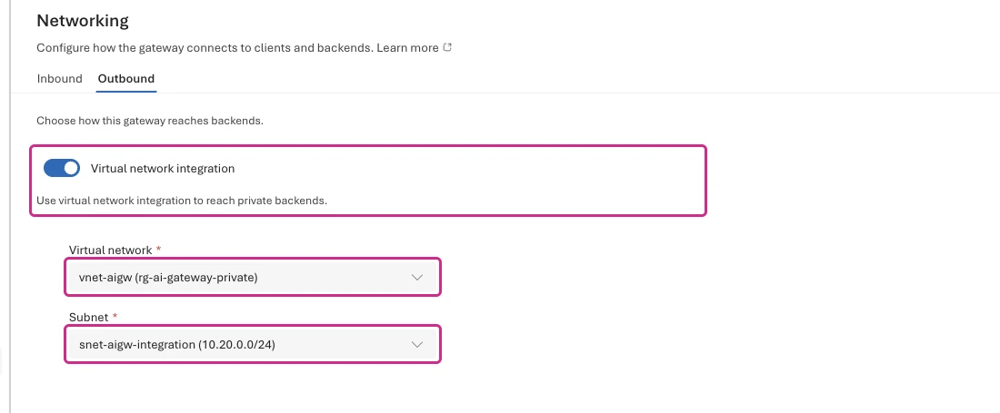
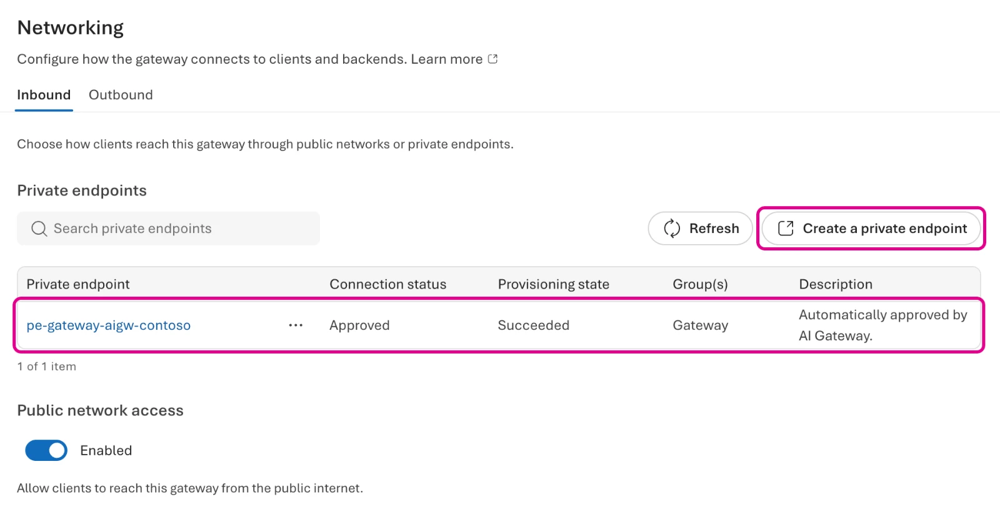
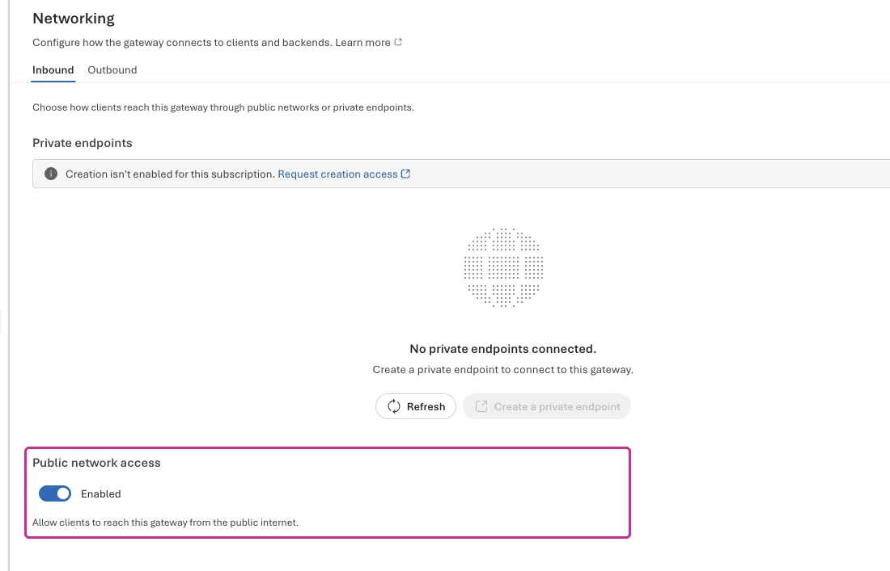

<!--
title: Lock down backend traffic with private networking
summary: Create an Azure AI Gateway with private routing through your virtual network, reach a Foundry backend over a private endpoint with its public access turned off, change the routing of the running gateway, and give the gateway its own inbound private endpoint so you can turn off its public access.
category: production
level: Advanced
duration: 75
tracks: [portal, cli, iac]
order: 18
illustration: diagrams/private-networking.svg
tags: [VNet integration, private routing, private endpoint, inbound private endpoint, private DNS, public network access, NSG, backend subnet, Foundry, Container Instances, ipFilter]
objectives:
  - Explain which private networking options AI Gateway supports, and which ones need preview access
  - Create a gateway with private routing through a dedicated subnet delegated to Microsoft.App/environments
  - Give Foundry a private endpoint and private DNS, turn off its public access, and prove the gateway still reaches it
  - Remove and add back the private routing of a running gateway
  - Give the gateway an inbound private endpoint and its private DNS zone, and call it from a client in the virtual network
  - Turn off the gateway's public network access while clients in the virtual network still reach it
  - Clean up in the right order, so the subnets and the Foundry resource are released
prereqs:
  - 01-provision-gateway
  - 12-backend-identity
-->
<!-- gh:begin nav: generated by "npm run sync" from the metadata, do not edit -->
[AI Gateway labs](../README.md) › [Production & emerging](../README.md#production--emerging) › Lab 18
<!-- gh:end -->

# Lock down backend traffic with private networking

<!-- gh:begin intro: generated by "npm run sync" from the metadata, do not edit -->
> Create an Azure AI Gateway with private routing through your virtual network, reach a Foundry backend over a private endpoint with its public access turned off, change the routing of the running gateway, and give the gateway its own inbound private endpoint so you can turn off its public access.

| ⏱️ Time | 📶 Level | 🧭 Tracks | ✅ Before you start |
| :-- | :-- | :-- | :-- |
| 75 min | Advanced | Portal · Azure CLI · Bicep + azd | [01 · Provision a gateway](../01-provision-gateway/README.md)<br>[12 · Backend identities](../12-backend-identity/README.md) |

**You'll learn to**

- Explain which private networking options AI Gateway supports, and which ones need preview access
- Create a gateway with private routing through a dedicated subnet delegated to Microsoft.App/environments
- Give Foundry a private endpoint and private DNS, turn off its public access, and prove the gateway still reaches it
- Remove and add back the private routing of a running gateway
- Give the gateway an inbound private endpoint and its private DNS zone, and call it from a client in the virtual network
- Turn off the gateway's public network access while clients in the virtual network still reach it
- Clean up in the right order, so the subnets and the Foundry resource are released

**Follow along:** 🌐 [Interactive version](https://azure.github.io/aigateway/labs/18-private-networking/) with your own values filled in · 📁 [Lab files](infra/)

**On this page:** [Before you begin](#before-you-begin) · [How it works](#how-it-works) · [Prepare the virtual network](#prepare-the-virtual-network) · [Create the gateway with private routing](#create-the-gateway-with-private-routing) · [Give Foundry a private endpoint](#give-foundry-a-private-endpoint) · [Publish a model on the new gateway](#publish-a-model-on-the-new-gateway) · [Turn off public access to Foundry](#turn-off-public-access-to-foundry) · [Remove and add back private routing](#remove-and-add-back-private-routing) · [Reach the gateway through an inbound private endpoint](#reach-the-gateway-through-an-inbound-private-endpoint) · [Turn off the gateway's public network access](#turn-off-the-gateways-public-network-access) · [Verify](#verify) · [Go further](#go-further) · [Clean up](#clean-up) · [Next steps](#next-steps)
<!-- gh:end -->

Your security team wants model traffic kept off the public internet wherever the platform allows it. In this lab
you create a gateway with **private routing**, so its outbound calls leave through a subnet in your virtual
network. Then you give the Foundry resource a private endpoint, turn off Foundry's public access, and prove that
the gateway still reaches the model while the internet can't. You remove and add back the private routing of the
running gateway. Finally, you give the gateway its own inbound private endpoint, call it from a client inside the
virtual network, and turn off the gateway's public network access, so only private clients get through.

> [!IMPORTANT]
> Outbound virtual network integration (private routing) and inbound private endpoints for AI Gateway are in
> public preview. Inbound private endpoints also need access for your subscription: until Microsoft enables it,
> creating one fails with `SubscriptionNotRegisteredForFeature`. See
> [Inbound private endpoints](#inbound-private-endpoints) and
> [Request access to private endpoints](https://ai.gateway.azure.com/docs/networking/request-private-endpoint-access).
> Without access, skip
> [Reach the gateway through an inbound private endpoint](#reach-the-gateway-through-an-inbound-private-endpoint):
> the rest of the lab works without it. Setting the gateway's **Public network access** to **Disabled** is enforced:
> calls to its public endpoint return `403`, and only clients that use a private endpoint get through. While the
> frontend is public, protect it with runtime keys or Microsoft Entra ID
> ([Issue and rotate runtime API keys](../10-api-keys/README.md),
> [Go keyless with Microsoft Entra ID and RBAC](../11-entra-rbac/README.md)) and an `ipFilter` policy
> ([Set gateway-wide policy baselines](../09-gateway-baselines/README.md)).

## Before you begin

<!-- setup: tools sign-in extension providers clone -->
<!-- gh:begin setup: generated by "npm run sync" from the metadata, do not edit -->
🧰 **One-time setup** from the [Setup guide](../SETUP.md), if you haven't done it yet:
[Choose where to run commands](../SETUP.md#choose-where-to-run-commands) ·
[Sign in to Azure](../SETUP.md#sign-in-to-azure) ·
[Install the `aigateway` extension](../SETUP.md#install-the-aigateway-extension) ·
[Register the resource providers](../SETUP.md#register-the-resource-providers) ·
[Clone the labs repo](../SETUP.md#clone-the-labs-repo)
<!-- gh:end -->

> [!TIP]
> On the **Bicep + azd** track, `azd up` creates its own resource group, network, gateway, and a Foundry resource with
> `gpt-5-mini` that only this lab uses, so you can skip this section, including the variables. You need only the
> one-time setup above.

- Complete [Provision your AI Gateway](../01-provision-gateway/README.md) and
  [Call backends with managed identities](../12-backend-identity/README.md). You need a Foundry resource with a
  chat model deployment, for example `gpt-5-mini`.
- This lab creates a **new** gateway with private routing, so the gateway from the earlier labs stays as it is. You
  can also add private routing to a gateway that already exists: see
  [Remove and add back private routing](#remove-and-add-back-private-routing).
- Every track uses the Azure CLI for the checks.
- Permission to create a resource group, network resources, and a gateway, to change the Foundry resource, and
  to assign roles on it, for example **Owner**, or **Contributor** plus **Role Based Access Control
  Administrator**.
- A region where AI Gateway and `gpt-5-mini` are available, as in
  [Find the available regions](../SETUP.md#find-the-available-regions). The virtual network must be
  in the gateway's subscription and region.

> [!WARNING]
> Turning off public access on the Foundry resource blocks every caller that reaches it over the internet,
> including the gateway from the earlier labs, which has no private routing, and tools on your workstation. Use a
> dedicated Foundry resource for this lab if others depend on it, and re-enable public access when you clean up.

> [!IMPORTANT]
> This lab creates billable resources: private endpoints, private DNS zones, and a container group that bills only
> while it runs. Follow [Clean up](#clean-up) when you finish.

Set these variables once. The portal and Azure CLI tracks and the **Verify** section reuse them; the Bicep + azd
track sets the ones it needs from azd's outputs. The lab puts the new gateway and the network in their own
resource group, so clean-up is one command.

<details open><summary>Bash</summary> <!-- gh -->

```bash title="Bash"
# Name the lab's resource group, region, and new gateway, and build the gateway's resource ID from your subscription
export RG="rg-ai-gateway-private"            # a new resource group for this lab
export LOCATION="eastus2"                    # a region where AI Gateway is available
export GATEWAY="<private-gateway>"           # a NEW, globally unique name, 24 characters or fewer
export SUBSCRIPTION_ID="$(az account show --query id -o tsv)"
export GATEWAY_ID="/subscriptions/$SUBSCRIPTION_ID/resourceGroups/$RG/providers/Microsoft.ApiManagement/aigateways/$GATEWAY"
echo "📝 Gateway $GATEWAY in $RG ($LOCATION)"
echo "🆔 Subscription: $SUBSCRIPTION_ID"

# Name the virtual network, its subnets, the NSG of the integration subnet, and the private endpoints
export VNET="vnet-aigw"
export INTEGRATION_SUBNET="snet-aigw-integration"
export PE_SUBNET="snet-private-endpoints"
export CLIENT_SUBNET="snet-clients"
export NSG="nsg-aigw-integration"
export FOUNDRY_PE="pe-foundry-$GATEWAY"
export GATEWAY_PE="pe-gateway-$GATEWAY"
echo "📝 Network $VNET with subnets $INTEGRATION_SUBNET, $PE_SUBNET, and $CLIENT_SUBNET, NSG $NSG"
echo "📝 Private endpoints $FOUNDRY_PE to Foundry and $GATEWAY_PE to the gateway"

# Point at the Foundry resource and deployment from the earlier labs, and read the account's resource ID and endpoint
export FOUNDRY_RG="<foundry-resource-group>"
export FOUNDRY_ACCOUNT="<foundry-account-name>"
export DEPLOYMENT="gpt-5-mini"
export FOUNDRY_ID="$(az cognitiveservices account show -g "$FOUNDRY_RG" -n "$FOUNDRY_ACCOUNT" --query id -o tsv)"
export FOUNDRY_ENDPOINT="$(az cognitiveservices account show -g "$FOUNDRY_RG" -n "$FOUNDRY_ACCOUNT" --query properties.endpoint -o tsv)"
echo "🆔 Foundry account: $FOUNDRY_ID"
echo "🌐 Foundry endpoint: $FOUNDRY_ENDPOINT"

# Name what the lab publishes on the new gateway: a model provider, an alias, and a runtime API key
export PROVIDER="foundry-private"
export ALIAS="private-chat"
export KEY_NAME="private-net-lab"
echo "📝 Provider $PROVIDER, alias $ALIAS, and API key private-net-lab on the new gateway"

# Create the resource group that holds the new gateway and the network, so that clean-up is one command
az group create -n "$RG" -l "$LOCATION" -o none &&
  echo "📦 Resource group $RG is ready in $LOCATION"
```
</details> <!-- gh -->

<details><summary>PowerShell</summary> <!-- gh -->

```powershell title="PowerShell"
# Name the lab's resource group, region, and new gateway, and build the gateway's resource ID from your subscription
$RG              = "rg-ai-gateway-private"   # a new resource group for this lab
$LOCATION        = "eastus2"                 # a region where AI Gateway is available
$GATEWAY         = "<private-gateway>"       # a NEW, globally unique name, 24 characters or fewer
$SUBSCRIPTION_ID = az account show --query id -o tsv
$GATEWAY_ID      = "/subscriptions/$SUBSCRIPTION_ID/resourceGroups/$RG/providers/Microsoft.ApiManagement/aigateways/$GATEWAY"
Write-Host "📝 Gateway $GATEWAY in $RG ($LOCATION)"
Write-Host "🆔 Subscription: $SUBSCRIPTION_ID"

# Name the virtual network, its subnets, the NSG of the integration subnet, and the private endpoints
$VNET               = "vnet-aigw"
$INTEGRATION_SUBNET = "snet-aigw-integration"
$PE_SUBNET          = "snet-private-endpoints"
$CLIENT_SUBNET      = "snet-clients"
$NSG                = "nsg-aigw-integration"
$FOUNDRY_PE         = "pe-foundry-$GATEWAY"
$GATEWAY_PE         = "pe-gateway-$GATEWAY"
Write-Host "📝 Network $VNET with subnets $INTEGRATION_SUBNET, $PE_SUBNET, and $CLIENT_SUBNET, NSG $NSG"
Write-Host "📝 Private endpoints $FOUNDRY_PE to Foundry and $GATEWAY_PE to the gateway"

# Point at the Foundry resource and deployment from the earlier labs, and read the account's resource ID and endpoint
$FOUNDRY_RG       = "<foundry-resource-group>"
$FOUNDRY_ACCOUNT  = "<foundry-account-name>"
$DEPLOYMENT       = "gpt-5-mini"
$FOUNDRY_ID       = az cognitiveservices account show -g $FOUNDRY_RG -n $FOUNDRY_ACCOUNT --query id -o tsv
$FOUNDRY_ENDPOINT = az cognitiveservices account show -g $FOUNDRY_RG -n $FOUNDRY_ACCOUNT --query properties.endpoint -o tsv
Write-Host "🆔 Foundry account: $FOUNDRY_ID"
Write-Host "🌐 Foundry endpoint: $FOUNDRY_ENDPOINT"

# Name what the lab publishes on the new gateway: a model provider, an alias, and a runtime API key
$PROVIDER = "foundry-private"
$ALIAS    = "private-chat"
$KEY_NAME = "private-net-lab"
Write-Host "📝 Provider $PROVIDER, alias $ALIAS, and API key private-net-lab on the new gateway"

# Create the resource group that holds the new gateway and the network, so that clean-up is one command
az group create -n $RG -l $LOCATION -o none
if ($?) { Write-Host "📦 Resource group $RG is ready in $LOCATION" }
```
</details> <!-- gh -->

> [!TIP]
> Single-line commands and the `az network` commands in the tracks work in both shells. In PowerShell, replace
> the Bash line continuation (`\`) with a backtick (`` ` ``) or put the command on one line. Snippets that build
> JSON bodies or URLs have separate Bash and PowerShell tabs.

## How it works

A gateway has two network directions. **Inbound**, clients call the gateway's frontend on
`<gateway-url>`. **Outbound**, the gateway calls models, MCP servers, and
APIs. With **private routing**, the gateway joins a dedicated, delegated subnet in your virtual network and sends
its outbound calls through it, so it can reach backends on private IPs. When a backend's private DNS zones are
linked to that virtual network, the gateway resolves the backend's usual host name to its private endpoint IP.

You can choose private routing when you create the gateway, or add, change, or remove it later. The create
dialog calls it **Private routing**, and the gateway's **Networking** page calls it **Virtual network
integration**. Each change takes one to three minutes. Most connectivity problems after that are DNS: the gateway
must resolve each backend to its private IP.

| Piece | Direction | Available | Where you set it | Key values |
|---|---|---|---|---|
| Integration subnet | Outbound | Yes | Your virtual network | At least `/27` (`/24` recommended), same subscription and region as the gateway, dedicated to one gateway, delegated to `Microsoft.App/environments`. It needs no outbound NSG rules |
| Private routing | Outbound | Preview, at creation or later | **Create AI gateway** › **Advanced** › **Private routing**, or **Networking** › **Outbound** › **Virtual network integration** | `properties.backend.subnet.id` set to the integration subnet (`az aigateway create` or `az aigateway network update` with `--subnet`); `backend.subnet` set to `null` removes it |
| Backend private endpoints | Outbound | Yes | Each backend, plus its private DNS zones linked to the virtual network | Foundry uses the `account` group ID |
| Gateway private endpoint | Inbound | Preview, needs access for your subscription | **Networking** › **Inbound** › **Create a private endpoint** | Group ID `Gateway`, in the private DNS zone that follows the gateway's host name. Approved automatically. See [Inbound private endpoints](#inbound-private-endpoints) |
| Public network access | Inbound | Yes | **Networking** › **Inbound** › **Public network access**, or `az aigateway network update --public-network-access` | `Enabled` (default) or `Disabled`. `Disabled` makes the public endpoint return `403`; clients that use a private endpoint still get through |
| IP filter | Inbound | Yes | Gateway-wide policy ([lab 09](../09-gateway-baselines/README.md)) | `ipFilter` with `action: Allow` and `cidrRanges` |

### Inbound private endpoints

An inbound private endpoint gives the gateway a private IP in a client virtual network. It's in preview and needs
access for your subscription, which you ask for with an Azure support request (**Service**: **Azure AI Gateway**,
**Summary**: `Enable private endpoints for Azure AI Gateway`). See
[Request access to private endpoints](https://ai.gateway.azure.com/docs/networking/request-private-endpoint-access).
Until access is granted, **Networking** › **Inbound** shows "Creation isn't enabled for this subscription", and
creating a private endpoint with the group ID `Gateway` fails:

```text
(SubscriptionNotRegisteredForFeature) Subscription /subscriptions/<subscription-id>/resourceGroups//providers/
Microsoft.Network/subscriptions/ is not registered for feature Microsoft.Network/AllowPrivateEndpoints required to
carry out the requested operation.
```

Registering the feature yourself with `az feature register --namespace Microsoft.Network --name
AllowPrivateEndpoints` doesn't skip the request: the feature stays **Pending** until Microsoft approves it. Once
access is granted, it shows **Registered**:

```bash
# Show whether the subscription has private endpoint access: Registered once Microsoft approves the request
az feature show --namespace Microsoft.Network --name AllowPrivateEndpoints --query properties.state -o tsv
```

With access, the gateway approves its private endpoints by itself: the connection shows **Approved** with the
description `Automatically approved by AI Gateway.`

The gateway's private link resource names the private DNS zone for its endpoint. It's region specific and follows
the gateway's host name, for example `privatelink.eastus2-01.ai.gateway.azure.com` for a gateway in East US 2. The
portal's private endpoint wizard proposes this zone. The product docs name `privatelink.azure-api.net` instead,
which never gets the gateway's record, so create the zone that your gateway returns:

```bash
# Show the gateway's private link resource: its group ID and the private DNS zone that clients must resolve
az rest --method get --url "https://management.azure.com$GATEWAY_ID/privateLinkResources?api-version=2026-11-01" \
  --query "value[].{groupId:properties.groupId, zones:properties.requiredZoneNames}" -o json
```

A private endpoint doesn't turn off public access. Once every client resolves the gateway to its private IP, set
**Public network access** to **Disabled**. You do both in
[Reach the gateway through an inbound private endpoint](#reach-the-gateway-through-an-inbound-private-endpoint) and
[Turn off the gateway's public network access](#turn-off-the-gateways-public-network-access).

## Prepare the virtual network

You create one virtual network with two subnets. The integration subnet belongs to the new gateway alone, and
private endpoints get their own subnet. Later,
[Reach the gateway through an inbound private endpoint](#reach-the-gateway-through-an-inbound-private-endpoint) adds
a third subnet, `snet-clients` (`10.20.2.0/24`), for a test client.

| Subnet | Prefix | Used for | Settings |
|---|---|---|---|
| `snet-aigw-integration` | `10.20.0.0/24` | Gateway private routing (outbound) | NSG `nsg-aigw-integration`, delegated to `Microsoft.App/environments`, nothing else deployed in it |
| `snet-private-endpoints` | `10.20.1.0/24` | Private endpoints to backends such as Foundry, and the gateway's own private endpoint | None |

Pick one track. The Bicep + azd track declares the network, the gateway, the Foundry resource and its private
endpoint, and the model in one azd project, so you deploy everything once in the next section.

<!-- track: portal | Portal -->
<details open><summary><b>🖥️ Portal</b></summary> <!-- gh -->

### Create the network security group

In the [Azure portal](https://portal.azure.com), create a network security group named `nsg-aigw-integration`
in the lab's resource group and region. Keep its default rules: the gateway needs no custom outbound rules.

### Create the virtual network and subnets

Create a virtual network named `vnet-aigw` in the **same subscription and region as the new gateway**, with the
address space `10.20.0.0/16`. Add the two subnets from the table above. On `snet-aigw-integration`, select the
`nsg-aigw-integration` network security group and delegate the subnet to `Microsoft.App/environments`.

> **Checkpoint**
> The virtual network shows two subnets, and `snet-aigw-integration` lists the delegation
> `Microsoft.App/environments` and the NSG `nsg-aigw-integration`.

</details> <!-- gh -->
<!-- track: cli | Azure CLI -->
<details><summary><b>⌨️ Azure CLI</b></summary> <!-- gh -->

### Create the network security group

```bash
# Create the network security group that the integration subnet uses; its default rules are enough for the gateway
az network nsg create -g "$RG" -n "$NSG" -l "$LOCATION" -o none &&
  echo "🔒 NSG $NSG is ready"
```

### Create the virtual network and subnets

```bash
# Create the virtual network, with an address space that holds both subnets
az network vnet create -g "$RG" -n "$VNET" -l "$LOCATION" --address-prefixes 10.20.0.0/16 -o none &&
  echo "🔒 Virtual network $VNET is ready in $LOCATION"

# Create the integration subnet for the gateway alone: delegated to Microsoft.App/environments, with the NSG
az network vnet subnet create -g "$RG" --vnet-name "$VNET" -n "$INTEGRATION_SUBNET" \
  --address-prefixes 10.20.0.0/24 \
  --delegations Microsoft.App/environments --network-security-group "$NSG" -o none &&
  echo "🔒 Integration subnet $INTEGRATION_SUBNET (10.20.0.0/24) is ready"

# Create the subnet that holds the private endpoints to backends such as Foundry
az network vnet subnet create -g "$RG" --vnet-name "$VNET" -n "$PE_SUBNET" --address-prefixes 10.20.1.0/24 -o none &&
  echo "🔒 Private endpoint subnet $PE_SUBNET (10.20.1.0/24) is ready"
```

> **Checkpoint**
> This command shows the `/24` prefix, the `Microsoft.App/environments` delegation, and the NSG:
>
> ```bash
> # Show the integration subnet's prefix, delegation, and NSG
> echo "🔒 Prefix, delegation, and NSG of $INTEGRATION_SUBNET, the integration subnet:"
> az network vnet subnet show -g "$RG" --vnet-name "$VNET" -n "$INTEGRATION_SUBNET" \
>   --query "{prefix:addressPrefix, delegation:delegations[0].serviceName, nsg:networkSecurityGroup.id}"
> ```

</details> <!-- gh -->
<!-- track: iac | Bicep + azd -->
<details><summary><b>🏗️ Bicep + azd</b></summary> <!-- gh -->

**What you need:** only the one-time setup from **Before you begin**. This track doesn't use your gateway or Foundry
resource from the earlier labs: `azd up` creates new ones, so it works on its own.

### Review the templates

`infra/main.bicep` creates the resource group `rg-<environment name>` and calls three modules: a Foundry resource
for this lab, the network with the gateway, and the template from
[Make your first model call](../02-first-model-call/README.md),
[publish-model.bicep](../02-first-model-call/infra/publish-model.bicep). That last one grants the gateway's
identity the **Foundry User** role on the Foundry resource, creates the `foundry-private` provider and the
`gpt-5-mini` model, publishes the `private-chat` alias, and creates the `private-net-lab` runtime key:

<!-- include: infra/main.bicep -->
<!-- gh:begin include: generated by "npm run sync" from the metadata, do not edit -->
📄 [`infra/main.bicep`](infra/main.bicep)

<details><summary>Show all 93 lines</summary>

```bicep
// Lab 18 with azd: "azd up" creates the resource group rg-<environment name> with a dedicated Foundry account and
// gpt-5-mini, a virtual network, a new gateway with private routing through the network's integration subnet, a
// private endpoint and private DNS for Foundry, and lab 02's provider, model, private-chat alias, and runtime key.
// Set FOUNDRY_PUBLIC_NETWORK_ACCESS to Disabled and run "azd provision" to turn off Foundry's public access.
// Set GATEWAY_PRIVATE_ENDPOINT to true and run "azd provision" to add an inbound private endpoint to the gateway,
// once the subscription has private endpoint access.
// The key value is never an output.
targetScope = 'subscription'

@description('azd environment name. The resource group is rg-<environmentName>.')
@minLength(1)
@maxLength(60)
param environmentName string

@description('Region for every resource. Pick one where AI Gateway and the lab\'s Foundry models are available. List them with az provider show --namespace Microsoft.ApiManagement (Setup guide, Find the available regions).')
@metadata({ azd: { type: 'location' } })
param location string

@description('Public network access of the lab\'s Foundry account. Set it to Disabled once the private endpoint exists.')
@allowed([
  'Enabled'
  'Disabled'
])
param foundryPublicNetworkAccess string = 'Enabled'

@description('Add an inbound private endpoint to the gateway, its private DNS zone, and a client subnet. Needs private endpoint access for the subscription.')
param gatewayPrivateEndpoint bool = false

var suffix = take(uniqueString(subscription().id, environmentName, location), 6)
var tags = { 'azd-env-name': environmentName }

resource rg 'Microsoft.Resources/resourceGroups@2024-03-01' = {
  name: 'rg-${environmentName}'
  location: location
  tags: tags
}

// A Foundry account with gpt-5-mini that only this lab uses, so you can turn off its public access.
module foundry 'foundry.bicep' = {
  name: 'aigw-foundry'
  scope: rg
  params: {
    accountName: 'aigw${suffix}'
    location: location
    tags: tags
    publicNetworkAccess: foundryPublicNetworkAccess
  }
}

// The network, the gateway with private routing, and the Foundry private endpoint with its private DNS zones.
module network 'private-network.bicep' = {
  name: 'aigw-private-network'
  scope: rg
  params: {
    gatewayName: 'aigw-${suffix}'
    location: location
    tags: tags
    foundryAccountId: foundry.outputs.accountId
    gatewayPrivateEndpoint: gatewayPrivateEndpoint
  }
}

// Lab 02's template: the Foundry User role for the gateway, the provider, the model, the alias, and a runtime key.
module publish '../../02-first-model-call/infra/publish-model.bicep' = {
  name: 'aigw-publish-model'
  scope: rg
  params: {
    gatewayName: network.outputs.gatewayName
    foundryAccountId: foundry.outputs.accountId
    deploymentName: foundry.outputs.deploymentName
    providerName: 'foundry-private'
    aliasName: 'private-chat'
    apiKeyName: 'private-net-lab'
    apiKeyDisplayName: 'private-net-lab'
  }
}

output AZURE_RESOURCE_GROUP string = rg.name
output AI_GATEWAY_NAME string = network.outputs.gatewayName
output AI_GATEWAY_ID string = network.outputs.gatewayId
output AI_GATEWAY_URL string = network.outputs.gatewayUrl
output AI_GATEWAY_PROVIDER string = publish.outputs.providerName
output AI_GATEWAY_BACKEND_MODEL string = publish.outputs.modelName
output AI_GATEWAY_MODEL string = publish.outputs.aliasName
output AI_GATEWAY_KEY_NAME string = publish.outputs.apiKeyName
output AI_GATEWAY_SUBNET_ID string = network.outputs.integrationSubnetId
output FOUNDRY_ACCOUNT_NAME string = foundry.outputs.accountName
output FOUNDRY_ACCOUNT_ID string = foundry.outputs.accountId
output FOUNDRY_ENDPOINT string = foundry.outputs.endpoint
output FOUNDRY_PRIVATE_ENDPOINT_NAME string = network.outputs.foundryPrivateEndpointName
output AI_GATEWAY_PRIVATE_ENDPOINT_NAME string = network.outputs.gatewayPrivateEndpointName
output AI_GATEWAY_PRIVATE_DNS_ZONE string = network.outputs.gatewayPrivateDnsZone
output CLIENT_SUBNET_ID string = network.outputs.clientSubnetId
```

</details>
<!-- gh:end -->

`infra/private-network.bicep` declares the NSG, the virtual network and its two subnets, and the gateway itself.
It creates the gateway with the template from [Provision your AI Gateway](../01-provision-gateway/README.md),
[gateway.bicep](../01-provision-gateway/infra/gateway.bicep), used as a module, and passes the integration subnet
in its `backendSubnetId` parameter, which becomes `properties.backend.subnet.id`. When you pass a Foundry resource
ID in `foundryAccountId`, it also adds a private endpoint to Foundry with the `account` group ID, the three Foundry
private DNS zones, their virtual network links, and a DNS zone group. You can also deploy it on its own to an
existing resource group.

The template leaves the gateway's public network access at its default, `Enabled`. With `gatewayPrivateEndpoint`
set to `true`, it also gives the gateway an inbound private endpoint, with
[gateway-private-endpoint.bicep](infra/gateway-private-endpoint.bicep), and adds the `snet-clients` subnet for a
test client. It's `false` by default, because inbound private endpoints need
[access for your subscription](#inbound-private-endpoints).
[Reach the gateway through an inbound private endpoint](#reach-the-gateway-through-an-inbound-private-endpoint)
turns it on with the `GATEWAY_PRIVATE_ENDPOINT` azd environment value.

<!-- include: infra/private-network.bicep -->
<!-- gh:begin include: generated by "npm run sync" from the metadata, do not edit -->
📄 [`infra/private-network.bicep`](infra/private-network.bicep)

<details><summary>Show all 238 lines</summary>

```bicep
// Outbound virtual network integration for an AI Gateway (Microsoft.ApiManagement/aigateways). This template creates:
//   - an NSG for the integration subnet, with no custom rules: AI Gateway needs no outbound service-tag rules
//   - a virtual network with an integration subnet (delegated to Microsoft.App/environments, dedicated to the
//     gateway) and a private-endpoint subnet
//   - the gateway, joined to the integration subnet, by reusing the lab 01 template as a module
//   - optionally, a private endpoint to a Foundry resource (group ID "account") with its private DNS zones
//   - optionally, an inbound private endpoint to the gateway (group ID "Gateway") with its private DNS zone, and a
//     client subnet delegated to Microsoft.ContainerInstance/containerGroups for a test client in the network
// The subnet isn't fixed at creation: redeploy with a different backendSubnetId to change it, or use the portal,
// "az aigateway network update", or a REST PATCH to add, change, or remove it on an existing gateway.
// The inbound private endpoint needs private endpoint access for the subscription, so it's off by default: set
// gatewayPrivateEndpoint to true once the subscription has access.
// The lab's main.bicep calls it with azd. You can also deploy it on its own to an existing resource group with
// "az deployment group create".

@description('Name of the new gateway, 24 characters or fewer. It becomes the first label of the runtime host name.')
@minLength(1)
@maxLength(24)
param gatewayName string

@description('Region for the gateway and the network. Pick one where AI Gateway is available. The integration subnet must be in the gateway region.')
param location string = 'eastus2'

@description('Tags applied to the gateway and the network resources.')
param tags object = {}

@description('Name of the virtual network.')
param vnetName string = 'vnet-aigw'

@description('Address space of the virtual network.')
param vnetAddressPrefix string = '10.20.0.0/16'

@description('Name of the subnet dedicated to the gateway\'s outbound integration.')
param integrationSubnetName string = 'snet-aigw-integration'

@description('Prefix of the integration subnet. /27 is the minimum; /24 leaves room to scale.')
param integrationSubnetPrefix string = '10.20.0.0/24'

@description('Name of the subnet that holds private endpoints to backends.')
param privateEndpointSubnetName string = 'snet-private-endpoints'

@description('Prefix of the private-endpoint subnet.')
param privateEndpointSubnetPrefix string = '10.20.1.0/24'

@description('Name of the network security group attached to the integration subnet.')
param nsgName string = 'nsg-aigw-integration'

@description('Optional resource ID of a Foundry (AIServices) account to reach privately. Leave empty to skip.')
param foundryAccountId string = ''

@description('Name of the private endpoint to the Foundry account.')
param foundryPrivateEndpointName string = 'pe-foundry-${gatewayName}'

@description('Create an inbound private endpoint to the gateway in the private-endpoint subnet, with its private DNS zone, and a client subnet. Needs private endpoint access for the subscription.')
param gatewayPrivateEndpoint bool = false

@description('Name of the inbound private endpoint to the gateway.')
param gatewayPrivateEndpointName string = 'pe-gateway-${gatewayName}'

@description('Name of the subnet for test clients, delegated to Microsoft.ContainerInstance/containerGroups.')
param clientSubnetName string = 'snet-clients'

@description('Prefix of the client subnet.')
param clientSubnetPrefix string = '10.20.2.0/24'

var includeFoundryPrivateEndpoint = !empty(foundryAccountId)

// The client subnet exists only with the gateway's private endpoint: a container there tests the private path.
var clientSubnets = gatewayPrivateEndpoint ? [
  {
    name: clientSubnetName
    properties: {
      addressPrefix: clientSubnetPrefix
      delegations: [
        {
          name: 'Microsoft.ContainerInstance.containerGroups'
          properties: {
            serviceName: 'Microsoft.ContainerInstance/containerGroups'
          }
        }
      ]
    }
  }
] : []

// Standard private DNS zones for Foundry (AIServices) accounts.
var foundryDnsZoneNames = [
  'privatelink.cognitiveservices.azure.com'
  'privatelink.openai.azure.com'
  'privatelink.services.ai.azure.com'
]

// The default NSG rules are enough: the gateway reaches backends over TCP 443 inside the virtual network.
resource nsg 'Microsoft.Network/networkSecurityGroups@2024-05-01' = {
  name: nsgName
  location: location
  tags: tags
  properties: {
    securityRules: []
  }
}

// Subnets are declared inline so that redeploying the template never tries to delete them.
resource vnet 'Microsoft.Network/virtualNetworks@2024-05-01' = {
  name: vnetName
  location: location
  tags: tags
  properties: {
    addressSpace: {
      addressPrefixes: [ vnetAddressPrefix ]
    }
    subnets: concat([
      {
        name: integrationSubnetName
        properties: {
          addressPrefix: integrationSubnetPrefix
          networkSecurityGroup: {
            id: nsg.id
          }
          delegations: [
            {
              name: 'Microsoft.App.environments'
              properties: {
                serviceName: 'Microsoft.App/environments'
              }
            }
          ]
        }
      }
      {
        name: privateEndpointSubnetName
        properties: {
          addressPrefix: privateEndpointSubnetPrefix
          privateEndpointNetworkPolicies: 'Disabled'
        }
      }
    ], clientSubnets)
  }
}

resource integrationSubnet 'Microsoft.Network/virtualNetworks/subnets@2024-05-01' existing = {
  parent: vnet
  name: integrationSubnetName
}

resource privateEndpointSubnet 'Microsoft.Network/virtualNetworks/subnets@2024-05-01' existing = {
  parent: vnet
  name: privateEndpointSubnetName
}

// The gateway, created with private routing through the integration subnet (lab 01's template).
module gateway '../../01-provision-gateway/infra/gateway.bicep' = {
  name: 'aigw-${gatewayName}'
  params: {
    gatewayName: gatewayName
    location: location
    tags: tags
    backendSubnetId: integrationSubnet.id
  }
}

// Outbound: the integrated gateway resolves the Foundry account to a private IP and calls it privately.
resource foundryDnsZones 'Microsoft.Network/privateDnsZones@2020-06-01' = [for zoneName in foundryDnsZoneNames: if (includeFoundryPrivateEndpoint) {
  name: zoneName
  location: 'global'
  tags: tags
}]

resource foundryDnsZoneLinks 'Microsoft.Network/privateDnsZones/virtualNetworkLinks@2020-06-01' = [for (zoneName, i) in foundryDnsZoneNames: if (includeFoundryPrivateEndpoint) {
  parent: foundryDnsZones[i]
  name: '${vnetName}-link'
  location: 'global'
  properties: {
    registrationEnabled: false
    virtualNetwork: {
      id: vnet.id
    }
  }
}]

resource foundryPrivateEndpoint 'Microsoft.Network/privateEndpoints@2024-05-01' = if (includeFoundryPrivateEndpoint) {
  name: foundryPrivateEndpointName
  location: location
  tags: tags
  properties: {
    subnet: {
      id: privateEndpointSubnet.id
    }
    privateLinkServiceConnections: [
      {
        name: 'foundry'
        properties: {
          privateLinkServiceId: foundryAccountId
          groupIds: [ 'account' ]
        }
      }
    ]
  }
}

resource foundryPrivateDnsZoneGroup 'Microsoft.Network/privateEndpoints/privateDnsZoneGroups@2024-05-01' = if (includeFoundryPrivateEndpoint) {
  parent: foundryPrivateEndpoint
  name: 'default'
  properties: {
    privateDnsZoneConfigs: [for (zoneName, i) in foundryDnsZoneNames: {
      name: replace(zoneName, '.', '-')
      properties: {
        privateDnsZoneId: foundryDnsZones[i].id
      }
    }]
  }
}

// Inbound: clients in the virtual network resolve the gateway's host name to a private IP and call it privately.
module gatewayPrivateEndpointDeployment 'gateway-private-endpoint.bicep' = if (gatewayPrivateEndpoint) {
  name: 'aigw-pe-${gatewayName}'
  params: {
    gatewayId: gateway.outputs.gatewayId
    gatewayHostName: replace(gateway.outputs.gatewayUrl, 'https://', '')
    subnetId: privateEndpointSubnet.id
    vnetId: vnet.id
    privateEndpointName: gatewayPrivateEndpointName
    location: location
    tags: tags
  }
}

output vnetId string = vnet.id
output integrationSubnetId string = integrationSubnet.id
output privateEndpointSubnetId string = privateEndpointSubnet.id
output gatewayName string = gateway.outputs.gatewayName
output gatewayId string = gateway.outputs.gatewayId
output gatewayUrl string = gateway.outputs.gatewayUrl
output principalId string = gateway.outputs.principalId
output foundryPrivateEndpointName string = includeFoundryPrivateEndpoint ? foundryPrivateEndpoint.name : ''
output gatewayPrivateEndpointName string = gatewayPrivateEndpointDeployment.?outputs.privateEndpointName ?? ''
output gatewayPrivateDnsZone string = gatewayPrivateEndpointDeployment.?outputs.dnsZoneName ?? ''
output clientSubnetId string = gatewayPrivateEndpoint ? '${vnet.id}/subnets/${clientSubnetName}' : ''
```

</details>
<!-- gh:end -->

`infra/foundry.bicep` creates the Foundry resource with local authentication turned off and a `gpt-5-mini`
deployment. Its `publicNetworkAccess` parameter starts as `Enabled`, and you turn it off later in the lab:

<!-- include: infra/foundry.bicep -->
<!-- gh:begin include: generated by "npm run sync" from the metadata, do not edit -->
📄 [`infra/foundry.bicep`](infra/foundry.bicep)

<details><summary>Show all 85 lines</summary>

```bicep
// A dedicated Microsoft Foundry (Azure AI Services) account with one gpt-5-mini deployment for this lab, so turning
// off its public access doesn't block the Foundry resource that the earlier labs use. Local auth is off: only
// Microsoft Entra identities, such as the gateway's managed identity, can call it. Model inference is billed.
// The lab's main.bicep calls it with azd, first with publicNetworkAccess 'Enabled', then 'Disabled' once the
// private endpoint is in place.
targetScope = 'resourceGroup'

@description('Foundry account name. It is also used as the custom subdomain, so it must be globally unique.')
@minLength(2)
@maxLength(64)
param accountName string

@description('Region for the Foundry account. The model and SKU must be available in this region.')
param location string = resourceGroup().location

@description('Name of the model deployment that the gateway publishes.')
param deploymentName string = 'gpt-5-mini'

@description('Model to deploy.')
param modelName string = 'gpt-5-mini'

@description('Model version to deploy.')
param modelVersion string = '2025-08-07'

@description('Deployment SKU.')
param skuName string = 'GlobalStandard'

@description('Deployment capacity in thousands of tokens per minute.')
@minValue(1)
param capacity int = 10

@description('Public network access. Set it to Disabled after the private endpoint exists, so that only callers in the virtual network, such as the gateway, reach the account.')
@allowed([
  'Enabled'
  'Disabled'
])
param publicNetworkAccess string = 'Enabled'

@description('Tags applied to the account.')
param tags object = {}

resource account 'Microsoft.CognitiveServices/accounts@2025-04-01-preview' = {
  name: accountName
  location: location
  tags: tags
  kind: 'AIServices'
  sku: {
    name: 'S0'
  }
  identity: {
    type: 'SystemAssigned'
  }
  properties: {
    allowProjectManagement: false
    customSubDomainName: toLower(accountName)
    disableLocalAuth: true
    networkAcls: {
      defaultAction: 'Allow'
      virtualNetworkRules: []
      ipRules: []
    }
    publicNetworkAccess: publicNetworkAccess
  }
}

resource deployment 'Microsoft.CognitiveServices/accounts/deployments@2025-04-01-preview' = {
  parent: account
  name: deploymentName
  sku: {
    name: skuName
    capacity: capacity
  }
  properties: {
    model: {
      name: modelName
      format: 'OpenAI'
      version: modelVersion
    }
  }
}

output accountId string = account.id
output accountName string = account.name
output endpoint string = account.properties.endpoint
output deploymentName string = deployment.name
```

</details>
<!-- gh:end -->

> **Checkpoint**
> You know what `azd up` creates. You deploy it in the next section.

</details> <!-- gh -->
<!-- /tracks -->

## Create the gateway with private routing

This lab puts private routing in the create request, so the new gateway uses the integration subnet from its first
call. To add private routing to a gateway that already exists, see
[Remove and add back private routing](#remove-and-add-back-private-routing).

<!-- track: portal | Portal -->
<details open><summary><b>🖥️ Portal</b></summary> <!-- gh -->

### Enter the gateway details

1. Open the [AI Gateway portal](https://ai.gateway.azure.com). Open the gateway switcher in the top bar and select
   **Create new gateway**.
2. In **Create AI gateway**, enter the new gateway's **Name**, then choose the subscription, the
   `rg-ai-gateway-private` **Resource group** (**Existing**), and the **Region** that matches the virtual network.
3. Expand **Advanced**. Keep **Enable system-assigned managed identity** selected and **Public network access**
   set to **Enabled**: you test turning it off later in this lab.

### Choose private routing

1. Under **Networking**, select **Private routing** ("Allow access to private backends through secure outbound
   connections").
2. In **Virtual network**, select `vnet-aigw (rg-ai-gateway-private)`. In **Subnet**, select
   `snet-aigw-integration (10.20.0.0/24)`. The lists show the networks in the gateway's subscription and region.
3. Select **Create gateway**. **All gateways** opens with "Gateway creation is in progress", and the new gateway's
   **Provisioning** goes from **Created** to **Succeeded** within a few minutes.

> **Checkpoint**
> **All gateways** shows the new gateway with **Provisioning** **Succeeded**.

</details> <!-- gh -->
<!-- track: cli | Azure CLI -->
<details><summary><b>⌨️ Azure CLI</b></summary> <!-- gh -->

If you haven't yet, [register the resource providers](../SETUP.md#register-the-resource-providers) in this
subscription, including `Microsoft.Network` for this lab.

### Create the gateway in the integration subnet

The command is the same as in lab 01, plus `--subnet`, which sets `properties.backend.subnet.id`. It waits until
provisioning finishes, usually within a few minutes.

<details open><summary>Bash</summary> <!-- gh -->

```bash title="Bash"
# Read the resource ID of the integration subnet
SUBNET_ID="$(az network vnet subnet show -g "$RG" --vnet-name "$VNET" -n "$INTEGRATION_SUBNET" --query id -o tsv)"
echo "🆔 Integration subnet: $SUBNET_ID"

# Create the gateway with a system-assigned managed identity and private routing through the integration subnet;
# the command waits until provisioning finishes
az aigateway create -g "$RG" -n "$GATEWAY" --location "$LOCATION" --system-assigned true \
  --subnet "$SUBNET_ID" -o none &&
  echo "🚀 Gateway $GATEWAY is ready, with private routing through $INTEGRATION_SUBNET"
```
</details> <!-- gh -->

<details><summary>PowerShell</summary> <!-- gh -->

```powershell title="PowerShell"
# Read the resource ID of the integration subnet
$SUBNET_ID = az network vnet subnet show -g $RG --vnet-name $VNET -n $INTEGRATION_SUBNET --query id -o tsv
Write-Host "🆔 Integration subnet: $SUBNET_ID"

# Create the gateway with a system-assigned managed identity and private routing through the integration subnet;
# the command waits until provisioning finishes
az aigateway create -g $RG -n $GATEWAY --location $LOCATION --system-assigned true `
  --subnet $SUBNET_ID -o none
if ($?) { Write-Host "🚀 Gateway $GATEWAY is ready, with private routing through $INTEGRATION_SUBNET" }
```
</details> <!-- gh -->

> **Checkpoint**
> `az aigateway create` returns without an error, usually within a few minutes, and the commands print
> `🚀 Gateway <private-gateway> is ready, with private routing through snet-aigw-integration`.

</details> <!-- gh -->
<!-- track: iac | Bicep + azd -->
<details><summary><b>🏗️ Bicep + azd</b></summary> <!-- gh -->

### Deploy with azd up

Move into the lab's folder, create an azd environment named `aigw-lab18` in your current subscription, then provision
everything. It takes about seven minutes.

<details open><summary>Bash</summary> <!-- gh -->

```bash title="Bash"
# Move into the lab's folder, which holds the azd project
cd ~/aigateway/labs/18-private-networking &&
  echo "📂 Lab folder: $(pwd)"

# Create an azd environment in your current subscription, so that azd doesn't prompt you
azd env new aigw-lab18 --location eastus2 --subscription "$(az account show --query id --output tsv)" &&
  echo "📝 azd environment aigw-lab18 deploys to eastus2"

# Provision the network, the gateway with private routing, Foundry with its private endpoint, and the model
azd up &&
  echo "🚀 Gateway deployed: $(azd env get-value AI_GATEWAY_URL)"
```
</details> <!-- gh -->

<details><summary>PowerShell</summary> <!-- gh -->

```powershell title="PowerShell"
# Move into the lab's folder, which holds the azd project
Set-Location ~/aigateway/labs/18-private-networking
if ($?) { Write-Host "📂 Lab folder: $(Get-Location)" }

# Create an azd environment in your current subscription, so that azd doesn't prompt you
azd env new aigw-lab18 --location eastus2 --subscription (az account show --query id --output tsv)
if ($?) { Write-Host "📝 azd environment aigw-lab18 deploys to eastus2" }

# Provision the network, the gateway with private routing, Foundry with its private endpoint, and the model
azd up
if ($?) { Write-Host "🚀 Gateway deployed: $(azd env get-value AI_GATEWAY_URL)" }
```
</details> <!-- gh -->

For another region, pick one where AI Gateway and the `gpt-5-mini` model are available, as in [Find the available
regions](../SETUP.md#find-the-available-regions). The Foundry resource's public access comes
from the `FOUNDRY_PUBLIC_NETWORK_ACCESS` azd environment value, with the default `Enabled` in
`infra/main.parameters.json`.

Bicep has no type definitions yet for `Microsoft.ApiManagement/aigateways`, so the templates silence the `BCP081`
warnings about it with `#disable-next-line BCP081`.

### Read the outputs and the key

Set the variables that the next sections and **Verify** use from azd's environment values, and read the key from
the gateway so that it never shows on screen:

<details open><summary>Bash</summary> <!-- gh -->

```bash title="Bash"
# Read azd's outputs: the resource group, the gateway, the key's name, Foundry's private endpoint and endpoint,
# the gateway's runtime URL, the alias, and the Foundry deployment
export RG="$(azd env get-value AZURE_RESOURCE_GROUP)"
export GATEWAY="$(azd env get-value AI_GATEWAY_NAME)"
export GATEWAY_ID="$(azd env get-value AI_GATEWAY_ID)"
export KEY_NAME="$(azd env get-value AI_GATEWAY_KEY_NAME)"
export FOUNDRY_PE="$(azd env get-value FOUNDRY_PRIVATE_ENDPOINT_NAME)"
export FOUNDRY_ENDPOINT="$(azd env get-value FOUNDRY_ENDPOINT)"
export AI_GATEWAY_URL="$(azd env get-value AI_GATEWAY_URL)"
export AI_GATEWAY_MODEL="$(azd env get-value AI_GATEWAY_MODEL)"
export DEPLOYMENT="$(azd env get-value AI_GATEWAY_BACKEND_MODEL)"

# Read the key from the gateway, so that it never lands in a file or a deployment log
export AI_GATEWAY_API_KEY="$(az aigateway api-key list-secrets --ids "$GATEWAY_ID/apiKeys/$KEY_NAME" \
  --query primaryKey --output tsv)"

echo "📝 Gateway $GATEWAY in $RG"
echo "🔒 Foundry private endpoint: $FOUNDRY_PE"
echo "🔖 Model alias: $AI_GATEWAY_MODEL"
echo "🔑 Key: in AI_GATEWAY_API_KEY (${#AI_GATEWAY_API_KEY} characters, not shown)"
```
</details> <!-- gh -->

<details><summary>PowerShell</summary> <!-- gh -->

```powershell title="PowerShell"
# Read azd's outputs: the resource group, the gateway, the key's name, Foundry's private endpoint and endpoint,
# the gateway's runtime URL, the alias, and the Foundry deployment
$RG                     = azd env get-value AZURE_RESOURCE_GROUP
$GATEWAY                = azd env get-value AI_GATEWAY_NAME
$GATEWAY_ID             = azd env get-value AI_GATEWAY_ID
$KEY_NAME               = azd env get-value AI_GATEWAY_KEY_NAME
$FOUNDRY_PE             = azd env get-value FOUNDRY_PRIVATE_ENDPOINT_NAME
$FOUNDRY_ENDPOINT       = azd env get-value FOUNDRY_ENDPOINT
$env:AI_GATEWAY_URL     = azd env get-value AI_GATEWAY_URL
$env:AI_GATEWAY_MODEL   = azd env get-value AI_GATEWAY_MODEL
$DEPLOYMENT             = azd env get-value AI_GATEWAY_BACKEND_MODEL

# Read the key from the gateway, so that it never lands in a file or a deployment log
$env:AI_GATEWAY_API_KEY = az aigateway api-key list-secrets --ids "$GATEWAY_ID/apiKeys/$KEY_NAME" `
  --query primaryKey --output tsv

Write-Host "📝 Gateway $GATEWAY in $RG"
Write-Host "🔒 Foundry private endpoint: $FOUNDRY_PE"
Write-Host "🔖 Model alias: $env:AI_GATEWAY_MODEL"
Write-Host "🔑 Key: in AI_GATEWAY_API_KEY ($($env:AI_GATEWAY_API_KEY.Length) characters, not shown)"
```
</details> <!-- gh -->

> **Checkpoint**
> `azd up` ended with `SUCCESS`, and the last commands printed the gateway name, the private endpoint name, and
> the alias, for example `📝 Gateway aigw-abc123 in rg-aigw-lab18`,
> `🔒 Foundry private endpoint: pe-foundry-aigw-abc123`, and `🔖 Model alias: private-chat`.

</details> <!-- gh -->
<!-- /tracks -->

Whichever track you used, load the runtime URL and confirm that the gateway uses the integration subnet:

<details open><summary>Bash</summary> <!-- gh -->

```bash title="Bash"
# Read the gateway's runtime URL
export AI_GATEWAY_URL="https://$(az aigateway show -g "$RG" -n "$GATEWAY" --query properties.frontend.defaultHostname -o tsv)"
echo "🌐 Runtime URL: $AI_GATEWAY_URL"

# Show the gateway's provisioning state, the subnet that its outbound calls go through, and its host name
echo "🔒 Gateway $GATEWAY and its private routing:"
az aigateway show -g "$RG" -n "$GATEWAY" \
  --query "{state:properties.provisioningState, backendSubnet:properties.backend.subnet.id, host:properties.frontend.defaultHostname}"
```
</details> <!-- gh -->

<details><summary>PowerShell</summary> <!-- gh -->

```powershell title="PowerShell"
# Read the gateway's runtime URL
$env:AI_GATEWAY_URL = "https://$(az aigateway show -g $RG -n $GATEWAY --query properties.frontend.defaultHostname -o tsv)"
Write-Host "🌐 Runtime URL: $env:AI_GATEWAY_URL"

# Show the gateway's provisioning state, the subnet that its outbound calls go through, and its host name
Write-Host "🔒 Gateway $GATEWAY and its private routing:"
az aigateway show -g $RG -n $GATEWAY `
  --query "{state:properties.provisioningState, backendSubnet:properties.backend.subnet.id, host:properties.frontend.defaultHostname}"
```
</details> <!-- gh -->

The commands print the runtime URL, for example
`🌐 Runtime URL: https://aigw-x7k2q-k3v7qz2m9xw4p.eastus2-01.ai.gateway.azure.com`, and then the gateway's settings:

```json
{
  "state": "Succeeded",
  "backendSubnet": "/subscriptions/<subscription-id>/resourceGroups/rg-ai-gateway-private/providers/Microsoft.Network/virtualNetworks/vnet-aigw/subnets/snet-aigw-integration",
  "host": "aigw-x7k2q-k3v7qz2m9xw4p.eastus2-01.ai.gateway.azure.com"
}
```

## Give Foundry a private endpoint

The gateway now sends outbound calls through your virtual network, but Foundry still resolves to its public IP.
Give the Foundry resource a private endpoint in `snet-private-endpoints` and link its private DNS zones to the
virtual network, so the gateway resolves Foundry to a private IP.

<!-- track: portal | Portal -->
<details open><summary><b>🖥️ Portal</b></summary> <!-- gh -->

### Add a private endpoint to Foundry

In the Azure portal, open your Foundry resource and add a private endpoint named `pe-foundry-<private-gateway>`
in the lab's resource group, in `vnet-aigw` › `snet-private-endpoints`, for the `account` sub-resource, with
private DNS integration turned on. The private DNS zones for Foundry are
`privatelink.cognitiveservices.azure.com`, `privatelink.openai.azure.com`, and `privatelink.services.ai.azure.com`.
For the full walkthrough, see
[How to configure network isolation for Microsoft Foundry](https://learn.microsoft.com/azure/ai-foundry/how-to/configure-private-link).

</details> <!-- gh -->
<!-- track: cli | Azure CLI -->
<details><summary><b>⌨️ Azure CLI</b></summary> <!-- gh -->

### Add a private endpoint to Foundry

```bash
# Create a private endpoint in the private endpoint subnet to the Foundry account's account sub-resource
az network private-endpoint create -g "$RG" -n "$FOUNDRY_PE" -l "$LOCATION" \
  --vnet-name "$VNET" --subnet "$PE_SUBNET" \
  --private-connection-resource-id "$FOUNDRY_ID" --group-id account --connection-name foundry -o none &&
  echo "🔒 Private endpoint $FOUNDRY_PE connects $PE_SUBNET to Foundry"
```

### Link the Foundry private DNS zones

Create each zone, link it to the virtual network, and add it to the endpoint's DNS zone group:

<details open><summary>Bash</summary> <!-- gh -->

```bash title="Bash"
# For each Foundry private DNS zone: the first one creates the endpoint's DNS zone group, the others join it
first=true
for zone in privatelink.cognitiveservices.azure.com privatelink.openai.azure.com privatelink.services.ai.azure.com; do
  # Create the zone, and link it to the virtual network without auto-registration of records (-e false)
  az network private-dns zone create -g "$RG" -n "$zone" -o none &&
    echo "🔒 Private DNS zone $zone is ready"
  az network private-dns link vnet create -g "$RG" -z "$zone" -n "$VNET-link" -v "$VNET" -e false -o none &&
    echo "🔒 $zone is linked to $VNET"

  # Add the zone to the private endpoint's DNS zone group, so that Foundry's private IP gets an A record in it
  if $first; then action=create; first=false; else action=add; fi
  az network private-endpoint dns-zone-group "$action" -g "$RG" --endpoint-name "$FOUNDRY_PE" \
    -n default --private-dns-zone "$zone" --zone-name "${zone//./-}" -o none &&
    echo "🔒 $zone is in the DNS zone group of $FOUNDRY_PE"
done
```
</details> <!-- gh -->

<details><summary>PowerShell</summary> <!-- gh -->

```powershell title="PowerShell"
# For each Foundry private DNS zone: the first one creates the endpoint's DNS zone group, the others join it
$zones = "privatelink.cognitiveservices.azure.com", "privatelink.openai.azure.com", "privatelink.services.ai.azure.com"
foreach ($zone in $zones) {
  # Create the zone, and link it to the virtual network without auto-registration of records (-e false)
  az network private-dns zone create -g $RG -n $zone -o none
  if ($?) { Write-Host "🔒 Private DNS zone $zone is ready" }
  az network private-dns link vnet create -g $RG -z $zone -n "$VNET-link" -v $VNET -e false -o none
  if ($?) { Write-Host "🔒 $zone is linked to $VNET" }

  # Add the zone to the private endpoint's DNS zone group, so that Foundry's private IP gets an A record in it
  $action = if ($zone -eq $zones[0]) { "create" } else { "add" }
  az network private-endpoint dns-zone-group $action -g $RG --endpoint-name $FOUNDRY_PE `
    -n default --private-dns-zone $zone --zone-name $zone.Replace('.', '-') -o none
  if ($?) { Write-Host "🔒 $zone is in the DNS zone group of $FOUNDRY_PE" }
}
```
</details> <!-- gh -->

</details> <!-- gh -->
<!-- track: iac | Bicep + azd -->
<details><summary><b>🏗️ Bicep + azd</b></summary> <!-- gh -->

### Check what azd created

`azd up` passed the lab's Foundry resource to `infra/private-network.bicep` in `foundryAccountId`, so it already
created the private endpoint, the three private DNS zones, their virtual network links, and the DNS zone group.
Check them with the commands in the next checkpoint.

</details> <!-- gh -->
<!-- /tracks -->

> **Checkpoint**
> The private endpoint is approved, and the Foundry host has an `A` record in the `10.20.1.0/24` range:
>
> ```bash
> # Show the status of the private endpoint's connection to Foundry
> echo "🔒 Status of the connection from $FOUNDRY_PE to Foundry:"
> az network private-endpoint show -g "$RG" -n "$FOUNDRY_PE" \
>   --query "privateLinkServiceConnections[0].privateLinkServiceConnectionState.status" -o tsv
>
> # List the A records in the Foundry private DNS zone: the account's name and its private IP
> echo "🔒 A records in privatelink.cognitiveservices.azure.com:"
> az network private-dns record-set a list -g "$RG" -z privatelink.cognitiveservices.azure.com \
>   --query "[].{name:name, ip:aRecords[0].ipv4Address}" -o table
> ```
>
> The connection status is `Approved`, and the table shows `<foundry-account-name>` with an IP like `10.20.1.4`.

## Publish a model on the new gateway

The new gateway starts empty. Publish your Foundry deployment on it, as in
[Make your first model call](../02-first-model-call/README.md), and create a runtime API key. The gateway calls
Foundry with its own system-assigned managed identity, which needs the **Foundry User** role on the account.

<!-- track: portal | Portal -->
<details open><summary><b>🖥️ Portal</b></summary> <!-- gh -->

### Import the deployment from Foundry

1. In the [AI Gateway portal](https://ai.gateway.azure.com), select the new gateway in the top bar.
2. Select **Models** › **Add** › **Models from Microsoft Foundry**.
3. Select the subscription and resource group of your Foundry account, then select your deployment and keep
   **Managed identity** as the **Authentication method**.
4. Under **Aliases**, keep **Create an alias for each model** selected, then select **Add models**.
5. Open the imported model on **Models**, open the **Aliases** tab, and copy the alias exactly as shown.

### Create a runtime API key

Select **Access** › **API keys** › **Create API key**, enter `private-net-lab` in **Key name**, select **Create**,
and copy the value. Then set both values in your shell without echoing the key:

<details open><summary>Bash</summary> <!-- gh -->

```bash title="Bash"
# Set the alias that apps send in the model field
export AI_GATEWAY_MODEL="<model-name>"    # the alias from the Aliases tab
echo "🔖 Model alias: $AI_GATEWAY_MODEL"

# Read the key without showing it, and export it for the next commands
printf "AI Gateway API key: " && read -rs AI_GATEWAY_API_KEY && export AI_GATEWAY_API_KEY && echo
echo "🔑 Key: in AI_GATEWAY_API_KEY (${#AI_GATEWAY_API_KEY} characters, not shown)"
```
</details> <!-- gh -->

<details><summary>PowerShell</summary> <!-- gh -->

```powershell title="PowerShell"
# Set the alias that apps send in the model field, and read the key without showing it
$env:AI_GATEWAY_MODEL   = "<model-name>"  # the alias from the Aliases tab
$env:AI_GATEWAY_API_KEY = Read-Host "AI Gateway API key" -MaskInput
Write-Host "🔖 Model alias: $env:AI_GATEWAY_MODEL"
Write-Host "🔑 Key: in AI_GATEWAY_API_KEY ($($env:AI_GATEWAY_API_KEY.Length) characters, not shown)"
```
</details> <!-- gh -->

</details> <!-- gh -->
<!-- track: cli | Azure CLI -->
<details><summary><b>⌨️ Azure CLI</b></summary> <!-- gh -->

### Grant the gateway access to Foundry

<details open><summary>Bash</summary> <!-- gh -->

```bash title="Bash"
# Read the principal ID of the new gateway's managed identity
PRINCIPAL_ID="$(az aigateway show -g "$RG" -n "$GATEWAY" --query identity.principalId -o tsv)"
echo "👤 Gateway identity: $PRINCIPAL_ID"

# Give the gateway's identity the Foundry User role on the account, so that it can call the model
az role assignment create --assignee-object-id "$PRINCIPAL_ID" --assignee-principal-type ServicePrincipal \
  --role "53ca6127-db72-4b80-b1b0-d745d6d5456d" --scope "$FOUNDRY_ID" -o none &&
  echo "🔐 The gateway's identity has the Foundry User role on $FOUNDRY_ACCOUNT"
```
</details> <!-- gh -->

<details><summary>PowerShell</summary> <!-- gh -->

```powershell title="PowerShell"
# Read the principal ID of the new gateway's managed identity
$PRINCIPAL_ID = az aigateway show -g $RG -n $GATEWAY --query identity.principalId -o tsv
Write-Host "👤 Gateway identity: $PRINCIPAL_ID"

# Give the gateway's identity the Foundry User role on the account, so that it can call the model
az role assignment create --assignee-object-id $PRINCIPAL_ID --assignee-principal-type ServicePrincipal `
  --role "53ca6127-db72-4b80-b1b0-d745d6d5456d" --scope $FOUNDRY_ID -o none
if ($?) { Write-Host "🔐 The gateway's identity has the Foundry User role on $FOUNDRY_ACCOUNT" }
```
</details> <!-- gh -->

`53ca6127-db72-4b80-b1b0-d745d6d5456d` is the **Foundry User** role.

### Publish the deployment and an alias

Create a provider that signs in to Foundry with the gateway's managed identity, register the deployment under it,
and publish an alias.

<details open><summary>Bash</summary> <!-- gh -->

```bash title="Bash"
# Add a model provider that points at the Foundry account and signs in with the gateway's managed identity
az aigateway model-provider create -g "$RG" --gateway-name "$GATEWAY" -n "$PROVIDER" \
  --kind Foundry --display-name "Foundry (private)" \
  --foundry "{endpoint:'$FOUNDRY_ENDPOINT',resourceIds:[$FOUNDRY_ID],authentication:{kind:ManagedIdentity,managedIdentity:{resource:'https://cognitiveservices.azure.com/'}}}" -o none &&
  echo "🔌 Model provider $PROVIDER points at $FOUNDRY_ACCOUNT"

# Add a model for the deployment, with the endpoints that apps can call
az aigateway model create -g "$RG" --gateway-name "$GATEWAY" --provider-name "$PROVIDER" -n "$DEPLOYMENT" \
  --display-name "$DEPLOYMENT" --api-format OpenAIChatCompletions \
  --supported-endpoints /openai/v1/chat/completions /openai/v1/responses \
  --deployment-config "{resourceId:$FOUNDRY_ID/deployments/$DEPLOYMENT,modelName:$DEPLOYMENT}" -o none &&
  echo "✨ Model $DEPLOYMENT is published through $PROVIDER"

# Build the model's resource ID, and publish (or update) the alias that apps send in the model field
MODEL_ID="$GATEWAY_ID/workspaces/default/modelProviders/$PROVIDER/models/$DEPLOYMENT"
az aigateway model-alias set -g "$RG" --gateway-name "$GATEWAY" -n "$ALIAS" \
  --backend-model resource-id="$MODEL_ID" --only-show-errors -o none &&
  echo "🔖 Alias $ALIAS is ready"
```
</details> <!-- gh -->

<details><summary>PowerShell</summary> <!-- gh -->

```powershell title="PowerShell"
# Add a model provider that points at the Foundry account and signs in with the gateway's managed identity
az aigateway model-provider create -g $RG --gateway-name $GATEWAY -n $PROVIDER `
  --kind Foundry --display-name "Foundry (private)" `
  --foundry "{endpoint:'$FOUNDRY_ENDPOINT',resourceIds:[$FOUNDRY_ID],authentication:{kind:ManagedIdentity,managedIdentity:{resource:'https://cognitiveservices.azure.com/'}}}" -o none
if ($?) { Write-Host "🔌 Model provider $PROVIDER points at $FOUNDRY_ACCOUNT" }

# Add a model for the deployment, with the endpoints that apps can call
az aigateway model create -g $RG --gateway-name $GATEWAY --provider-name $PROVIDER -n $DEPLOYMENT `
  --display-name $DEPLOYMENT --api-format OpenAIChatCompletions `
  --supported-endpoints /openai/v1/chat/completions /openai/v1/responses `
  --deployment-config "{resourceId:$FOUNDRY_ID/deployments/$DEPLOYMENT,modelName:$DEPLOYMENT}" -o none
if ($?) { Write-Host "✨ Model $DEPLOYMENT is published through $PROVIDER" }

# Build the model's resource ID, and publish (or update) the alias that apps send in the model field
$MODEL_ID = "$GATEWAY_ID/workspaces/default/modelProviders/$PROVIDER/models/$DEPLOYMENT"
az aigateway model-alias set -g $RG --gateway-name $GATEWAY -n $ALIAS `
  --backend-model resource-id="$MODEL_ID" --only-show-errors -o none
if ($?) { Write-Host "🔖 Alias $ALIAS is ready" }
```
</details> <!-- gh -->

`az aigateway model-alias set` creates the alias, or updates it if it exists, so you can run the step again.

### Create a runtime API key

`api-key create` returns metadata only. Read the generated value with `list-secrets` straight into a variable, so
it never appears on screen.

<details open><summary>Bash</summary> <!-- gh -->

```bash title="Bash"
# Create a runtime API key for your app
az aigateway api-key create -g "$RG" --gateway-name "$GATEWAY" -n "$KEY_NAME" -o none &&
  echo "🔑 API key private-net-lab is ready"

# Read the key straight into a variable, so that it never shows on screen, and set the alias for the next calls
AI_GATEWAY_API_KEY="$(az aigateway api-key list-secrets -g "$RG" --gateway-name "$GATEWAY" -n "$KEY_NAME" \
  --query primaryKey -o tsv)" && export AI_GATEWAY_API_KEY
export AI_GATEWAY_MODEL="$ALIAS"
echo "🔑 Key: in AI_GATEWAY_API_KEY (${#AI_GATEWAY_API_KEY} characters, not shown)"
echo "🔖 Model alias: $AI_GATEWAY_MODEL"
```
</details> <!-- gh -->

<details><summary>PowerShell</summary> <!-- gh -->

```powershell title="PowerShell"
# Create a runtime API key for your app
az aigateway api-key create -g $RG --gateway-name $GATEWAY -n $KEY_NAME -o none
if ($?) { Write-Host "🔑 API key private-net-lab is ready" }

# Read the key straight into a variable, so that it never shows on screen, and set the alias for the next calls
$env:AI_GATEWAY_API_KEY = az aigateway api-key list-secrets -g $RG --gateway-name $GATEWAY -n $KEY_NAME `
  --query primaryKey -o tsv
$env:AI_GATEWAY_MODEL   = $ALIAS
Write-Host "🔑 Key: in AI_GATEWAY_API_KEY ($($env:AI_GATEWAY_API_KEY.Length) characters, not shown)"
Write-Host "🔖 Model alias: $env:AI_GATEWAY_MODEL"
```
</details> <!-- gh -->

</details> <!-- gh -->
<!-- track: iac | Bicep + azd -->
<details><summary><b>🏗️ Bicep + azd</b></summary> <!-- gh -->

### Check the model and the key

`azd up` also deployed lab 02's template on the new gateway: the gateway's identity has the **Foundry User** role
on the lab's Foundry resource, and the gateway has the `foundry-private` provider, the `gpt-5-mini` model, the
`private-chat` alias, and the `private-net-lab` runtime key. You read the alias and the key into `AI_GATEWAY_MODEL`
and `AI_GATEWAY_API_KEY` in the previous section. Check where the alias points:

```bash
# Show the resource ID of the model that the alias points at
echo "🔖 Alias $AI_GATEWAY_MODEL points at this model:"
az aigateway model-alias show -g "$RG" --gateway-name "$GATEWAY" -n "$AI_GATEWAY_MODEL" \
  --query "properties.backendModels[0].resourceId" -o tsv
```

The output ends with `/modelProviders/foundry-private/models/gpt-5-mini`.

</details> <!-- gh -->
<!-- /tracks -->

> **Checkpoint**
> Call the model through the new gateway. Foundry's public access is still on, so a `200` proves that the
> gateway, the model, and the key work before you lock anything down:
>
> ```bash title="Bash"
> # Call the model through the new gateway, and print only the HTTP status code
> echo "🔒 Model call through the gateway, which reaches Foundry over the private endpoint:"
> curl -sS -o /dev/null -w 'HTTP %{http_code}\n' "${AI_GATEWAY_URL%/}/default/models/openai/v1/chat/completions" \
>   -H "Authorization: Bearer $AI_GATEWAY_API_KEY" -H "Content-Type: application/json" \
>   -d "{\"model\":\"$AI_GATEWAY_MODEL\",\"messages\":[{\"role\":\"user\",\"content\":\"Reply with exactly one word: ok\"}],\"max_completion_tokens\":128}"
> ```
>
> ```powershell title="PowerShell"
> # Build a short request with the alias in model
> $body = @{ model = $env:AI_GATEWAY_MODEL; max_completion_tokens = 128
>   messages = @(@{ role = "user"; content = "Reply with exactly one word: ok" }) } | ConvertTo-Json -Depth 5
>
> # Call the model through the new gateway; -SkipHttpErrorCheck returns error responses instead of throwing
> Write-Host "🔒 Model call through the gateway, which reaches Foundry over the private endpoint:"
> $r = Invoke-WebRequest -Method Post -Uri "$env:AI_GATEWAY_URL/default/models/openai/v1/chat/completions" `
>   -Headers @{ Authorization = "Bearer $env:AI_GATEWAY_API_KEY" } -ContentType "application/json" -Body $body -SkipHttpErrorCheck
> "HTTP $($r.StatusCode)"
> ```
>
> If the first call returns `401` or `403` from the backend, the role assignment hasn't taken effect yet. Wait a
> few minutes and try again.

## Turn off public access to Foundry

The gateway resolves Foundry through the private DNS zones, so its calls already use the private endpoint. Turn
off Foundry's public access, so the private endpoint is the only way in.

<!-- track: portal | Portal -->
<details open><summary><b>🖥️ Portal</b></summary> <!-- gh -->

### Disable public network access on Foundry

After the private endpoint shows as approved, open the Foundry resource's networking settings in the Azure portal
and disable public network access. See
[Configure virtual networks for Foundry Tools](https://learn.microsoft.com/azure/ai-services/cognitive-services-virtual-networks).

</details> <!-- gh -->
<!-- track: cli | Azure CLI -->
<details><summary><b>⌨️ Azure CLI</b></summary> <!-- gh -->

### Disable public network access on Foundry

```bash
# Turn off public network access on the Foundry account, so that the private endpoint is the only way in
echo "🔒 Public network access of the Foundry account, after the update:"
az resource update --ids "$FOUNDRY_ID" --set properties.publicNetworkAccess=Disabled \
  --query properties.publicNetworkAccess -o tsv
```

</details> <!-- gh -->
<!-- track: iac | Bicep + azd -->
<details><summary><b>🏗️ Bicep + azd</b></summary> <!-- gh -->

### Disable public network access on Foundry

`infra/foundry.bicep` takes the Foundry resource's public access from the `FOUNDRY_PUBLIC_NETWORK_ACCESS` azd
environment value. Set it to `Disabled` and provision again. azd updates the Foundry resource, and the gateway keeps
its private routing, because the template passes the same subnet:

```bash
# Set Foundry's public network access to Disabled in the azd environment
azd env set FOUNDRY_PUBLIC_NETWORK_ACCESS Disabled &&
  echo "📝 FOUNDRY_PUBLIC_NETWORK_ACCESS is Disabled in the azd environment"

# Provision again: azd updates the Foundry resource, and the gateway keeps its private routing
azd provision &&
  echo "🔒 Foundry's public network access is off"
```

</details> <!-- gh -->
<!-- /tracks -->

The change can take a few minutes to apply.

## Remove and add back private routing

Private routing isn't fixed at creation: you can add a subnet to a running gateway, move it to another delegated
subnet, or remove it. Remove it now, while Foundry accepts only private traffic, to see what the gateway's model
calls depend on. Then add it back. Each change takes one to three minutes.

<!-- track: portal | Portal -->
<details open><summary><b>🖥️ Portal</b></summary> <!-- gh -->

### Turn off virtual network integration

1. In the [AI Gateway portal](https://ai.gateway.azure.com), open the new gateway and select **Networking** ›
   **Outbound** ("Choose how this gateway reaches backends.").
2. Turn off **Virtual network integration** and select **Save**. The page shows "Applying networking changes...
   Networking edits are locked while this task runs." until the gateway finishes the change.



</details> <!-- gh -->
<!-- track: cli | Azure CLI -->
<details><summary><b>⌨️ Azure CLI</b></summary> <!-- gh -->

### Remove the integration subnet

`az aigateway network update` changes the network settings of a running gateway. `--disable-vnet-integration`
removes the subnet, and the command waits until the change finishes:

```bash
# Remove private routing: the gateway stops sending its outbound calls through the integration subnet
az aigateway network update -g "$RG" -n "$GATEWAY" --disable-vnet-integration true -o none &&
  echo "🔒 Gateway $GATEWAY no longer uses private routing"
```

Or remove it with the REST API instead: a `PATCH` that sets `backend.subnet` to `null` returns `202 Accepted`, and
the gateway's `provisioningState` stays `Updating` until the change finishes:

<details open><summary>Bash</summary> <!-- gh -->

```bash title="Bash"
# Remove private routing with the REST API: set backend.subnet to null
az rest --method patch --url "https://management.azure.com$GATEWAY_ID?api-version=2026-11-01" \
  --body '{"properties":{"backend":{"subnet":null}}}' -o none &&
  echo "🔒 Removal of private routing accepted for $GATEWAY"
```
</details> <!-- gh -->

<details><summary>PowerShell</summary> <!-- gh -->

```powershell title="PowerShell"
# Remove private routing with the REST API: set backend.subnet to null
'{"properties":{"backend":{"subnet":null}}}' | Set-Content -Path patch-subnet.json
az rest --method patch --url "https://management.azure.com$GATEWAY_ID`?api-version=2026-11-01" `
  --body '@patch-subnet.json' -o none
if ($?) { Write-Host "🔒 Removal of private routing accepted for $GATEWAY" }
```
</details> <!-- gh -->

</details> <!-- gh -->
<!-- track: iac | Bicep + azd -->
<details><summary><b>🏗️ Bicep + azd</b></summary> <!-- gh -->

### Remove the integration subnet

The template declares the integration subnet, so a new deployment of it puts the subnet back. Remove it outside
the template, with the Azure CLI:

```bash
# Remove private routing from the gateway that azd deployed
az aigateway network update -g "$RG" -n "$GATEWAY" --disable-vnet-integration true -o none &&
  echo "🔒 Gateway $GATEWAY no longer uses private routing"
```

To remove private routing for good in Bicep, set `backend.subnet` to `null`. Leaving out `backend`, as the lab 01
gateway module does when it gets no subnet, keeps the subnet that the gateway already has:

```bicep
#disable-next-line BCP081
resource gateway 'Microsoft.ApiManagement/aigateways@2026-11-01' = {
  name: gatewayName
  location: location
  identity: { type: 'SystemAssigned' }
  properties: {
    backend: { subnet: null }   // removes private routing; a { id: subnetId } value adds or changes it
  }
}
```

</details> <!-- gh -->
<!-- /tracks -->

Wait until the change finishes, then call the model through the gateway again:

<details open><summary>Bash</summary> <!-- gh -->

```bash title="Bash"
# Wait until the gateway has finished the change, then show its routing type
until [ "$(az aigateway show -g "$RG" -n "$GATEWAY" --query properties.provisioningState -o tsv)" = "Succeeded" ]; do
  sleep 10
done
echo "🔒 Routing of gateway ${GATEWAY}: $(az aigateway network show -g "$RG" -n "$GATEWAY" --query virtualNetworkType -o tsv)"

# Call the model through the gateway, and print the response and the HTTP status code
echo "🚦 Model call through the gateway:"
curl -sS -w '\nHTTP %{http_code}\n' "${AI_GATEWAY_URL%/}/default/models/openai/v1/chat/completions" \
  -H "Authorization: Bearer $AI_GATEWAY_API_KEY" -H "Content-Type: application/json" \
  -d "{\"model\":\"$AI_GATEWAY_MODEL\",\"messages\":[{\"role\":\"user\",\"content\":\"Reply with exactly one word: ok\"}],\"max_completion_tokens\":128}"
```
</details> <!-- gh -->

<details><summary>PowerShell</summary> <!-- gh -->

```powershell title="PowerShell"
# Wait until the gateway has finished the change, then show its routing type
while ((az aigateway show -g $RG -n $GATEWAY --query properties.provisioningState -o tsv) -ne "Succeeded") {
  Start-Sleep -Seconds 10
}
Write-Host "🔒 Routing of gateway ${GATEWAY}: $(az aigateway network show -g $RG -n $GATEWAY --query virtualNetworkType -o tsv)"

# Build a short request with the alias in model
$body = @{ model = $env:AI_GATEWAY_MODEL; max_completion_tokens = 128
  messages = @(@{ role = "user"; content = "Reply with exactly one word: ok" }) } | ConvertTo-Json -Depth 5

# Call the model through the gateway; -SkipHttpErrorCheck returns error responses instead of throwing
Write-Host "🚦 Model call through the gateway:"
$r = Invoke-WebRequest -Method Post -Uri "$env:AI_GATEWAY_URL/default/models/openai/v1/chat/completions" `
  -Headers @{ Authorization = "Bearer $env:AI_GATEWAY_API_KEY" } -ContentType "application/json" -Body $body -SkipHttpErrorCheck
$r.Content; "HTTP $($r.StatusCode)"
```
</details> <!-- gh -->

The routing is `None`, and the call returns `HTTP 403` with Foundry's error, which the gateway passes on:

```json
{"error":{"code":"403","message": "Public access is disabled. Please configure private endpoint."}}
```

Without private routing, the gateway resolves Foundry's public address and calls it over the internet, which
Foundry no longer accepts. Add the integration subnet back:

<!-- track: portal | Portal -->
<details open><summary><b>🖥️ Portal</b></summary> <!-- gh -->

### Turn virtual network integration back on

1. On **Networking** › **Outbound**, turn on **Virtual network integration**.
2. In **Virtual network**, select `vnet-aigw (rg-ai-gateway-private)`. In **Subnet**, select
   `snet-aigw-integration (10.20.0.0/24)`. A subnet that isn't delegated shows "Not delegated to
   Microsoft.App/environments" and can't be used.
3. Select **Save**, and wait until "Applying networking changes..." goes away.

To move the gateway to another subnet, select that subnet instead and save. It needs the same preparation as
`snet-aigw-integration`.

</details> <!-- gh -->
<!-- track: cli | Azure CLI -->
<details><summary><b>⌨️ Azure CLI</b></summary> <!-- gh -->

### Add the integration subnet back

`--subnet` adds private routing to a gateway that has none, or moves it to another delegated subnet. You can't
pass `--subnet` and `--disable-vnet-integration` together:

<details open><summary>Bash</summary> <!-- gh -->

```bash title="Bash"
# Read the resource ID of the integration subnet
SUBNET_ID="$(az network vnet subnet show -g "$RG" --vnet-name "$VNET" -n "$INTEGRATION_SUBNET" --query id -o tsv)"

# Add private routing back through the integration subnet; the command waits until the change finishes
az aigateway network update -g "$RG" -n "$GATEWAY" --subnet "$SUBNET_ID" -o none &&
  echo "🔒 Gateway $GATEWAY uses private routing through $INTEGRATION_SUBNET again"
```
</details> <!-- gh -->

<details><summary>PowerShell</summary> <!-- gh -->

```powershell title="PowerShell"
# Read the resource ID of the integration subnet
$SUBNET_ID = az network vnet subnet show -g $RG --vnet-name $VNET -n $INTEGRATION_SUBNET --query id -o tsv

# Add private routing back through the integration subnet; the command waits until the change finishes
az aigateway network update -g $RG -n $GATEWAY --subnet $SUBNET_ID -o none
if ($?) { Write-Host "🔒 Gateway $GATEWAY uses private routing through $INTEGRATION_SUBNET again" }
```
</details> <!-- gh -->

With the REST API, send `{"properties":{"backend":{"subnet":{"id":"<subnet-resource-id>"}}}}` in the same
`PATCH`. A subnet without the `Microsoft.App/environments` delegation fails with `AIGatewaySubnetNotDelegated`.

</details> <!-- gh -->
<!-- track: iac | Bicep + azd -->
<details><summary><b>🏗️ Bicep + azd</b></summary> <!-- gh -->

### Provision the declared subnet again

azd skips a deployment when the template and its parameters haven't changed, so it doesn't notice a change made
outside the template. `--no-state` makes it deploy the template again, which sets the gateway's subnet back to
`snet-aigw-integration`. It takes a few minutes:

```bash
# Deploy the template again, even though nothing changed in it: the gateway gets the declared integration subnet back
azd provision --no-state &&
  echo "🔒 Gateway $GATEWAY uses the template's integration subnet again"
```

</details> <!-- gh -->
<!-- /tracks -->

Run the wait and the call from the previous step again. The routing is `External` again, and the call returns
`HTTP 200` with the model's answer.

> **Checkpoint**
> Without private routing, the gateway's model call fails, because the gateway reaches Foundry over the internet,
> and Foundry no longer accepts that. With private routing back, the same call returns `HTTP 200`.

## Reach the gateway through an inbound private endpoint

So far, every client reaches the gateway over the internet. Give the gateway its own private endpoint in
`snet-private-endpoints`, so that clients in the virtual network reach it on a private IP, and prove it with a test
client that runs inside the network. This section needs [private endpoint access](#inbound-private-endpoints) for
your subscription. Without it, skip to
[Turn off the gateway's public network access](#turn-off-the-gateways-public-network-access).

| Resource | Name | What it does |
|---|---|---|
| Private endpoint | `pe-gateway-<private-gateway>` | Gives the gateway a private IP in `snet-private-endpoints`, with the group ID `Gateway` |
| Private DNS zone | `privatelink.<region>-01.ai.gateway.azure.com` | Resolves the gateway's usual host name to that private IP inside the virtual network |
| Subnet | `snet-clients` (`10.20.2.0/24`) | Holds the test client, delegated to `Microsoft.ContainerInstance/containerGroups` |
| Container group | `aci-private-client` | Resolves the gateway's host name, calls the model once, prints the IP that answered, and stops |

<!-- track: portal | Portal -->
<details open><summary><b>🖥️ Portal</b></summary> <!-- gh -->

### Create the gateway's private endpoint

1. In the AI Gateway portal, open the new gateway's **Networking** page and select **Inbound**. Under **Private
   endpoints**, select **Create a private endpoint**. It opens the **Create a private endpoint** wizard in the Azure
   portal. If you use more than one directory, check that the Azure portal opened in the gateway's directory.
2. On **Basics**, select the lab's subscription and the resource group `rg-ai-gateway-private`, enter the name
   `pe-gateway-<private-gateway>`, and select the gateway's **Region**, for example **East US 2**. The wizard
   doesn't default to the gateway's region. **Network Interface Name** fills in by itself.
3. On **Resource**, check that **Resource type** is `Microsoft.ApiManagement/aigateways`, **Resource** is the new
   gateway, and **Target sub-resource** is **Gateway**.
4. On **Virtual Network**, select `vnet-aigw` and the subnet `snet-private-endpoints`. The wizard selects the first
   virtual network in the region, so check it. Keep **Dynamically allocate IP address**.
5. On **DNS**, keep **Integrate with private DNS zone** at **Yes**. The wizard proposes the gateway's zone,
   `privatelink.<region>-01.ai.gateway.azure.com`, in the lab's resource group.
6. Select **Review + create**, wait for "Validation passed", and select **Create**. It takes a minute or two.
7. Back on **Networking** › **Inbound** in the AI Gateway portal, select **Refresh**. The private endpoint shows
   **Approved** and **Succeeded**, with the group **Gateway** and the description "Automatically approved by AI
   Gateway."



### Add the client subnet

In the Azure portal, open `vnet-aigw` › **Subnets**, and add a subnet named `snet-clients` with the address range
`10.20.2.0/24`. Under **Subnet delegation**, select `Microsoft.ContainerInstance/containerGroups`.

</details> <!-- gh -->
<!-- track: cli | Azure CLI -->
<details><summary><b>⌨️ Azure CLI</b></summary> <!-- gh -->

### Create the gateway's private endpoint

```bash
# Create a private endpoint in the private endpoint subnet to the gateway's Gateway sub-resource
az network private-endpoint create -g "$RG" -n "$GATEWAY_PE" -l "$LOCATION" \
  --vnet-name "$VNET" --subnet "$PE_SUBNET" \
  --private-connection-resource-id "$GATEWAY_ID" --group-id Gateway --connection-name gateway -o none &&
  echo "🔒 Private endpoint $GATEWAY_PE connects $PE_SUBNET to the gateway"
```

### Link the gateway's private DNS zone

Read the zone from the gateway's private link resource, create it, link it to the virtual network, and add it to
the endpoint's DNS zone group:

<details open><summary>Bash</summary> <!-- gh -->

```bash title="Bash"
# Read the private DNS zone that the gateway's private link resource requires
export GATEWAY_ZONE="$(az rest --method get \
  --url "https://management.azure.com$GATEWAY_ID/privateLinkResources?api-version=2026-11-01" \
  --query "value[0].properties.requiredZoneNames[0]" -o tsv)"
echo "🌐 Private DNS zone of the gateway: $GATEWAY_ZONE"

# Create the zone, and link it to the virtual network without auto-registration of records (-e false)
az network private-dns zone create -g "$RG" -n "$GATEWAY_ZONE" -o none &&
  echo "🔒 Private DNS zone $GATEWAY_ZONE is ready"
az network private-dns link vnet create -g "$RG" -z "$GATEWAY_ZONE" -n "$VNET-link" -v "$VNET" -e false -o none &&
  echo "🔒 $GATEWAY_ZONE is linked to $VNET"

# Add the zone to the private endpoint's DNS zone group, so that the gateway's private IP gets an A record in it
az network private-endpoint dns-zone-group create -g "$RG" --endpoint-name "$GATEWAY_PE" \
  -n default --private-dns-zone "$GATEWAY_ZONE" --zone-name "${GATEWAY_ZONE//./-}" -o none &&
  echo "🔒 $GATEWAY_ZONE is in the DNS zone group of $GATEWAY_PE"
```
</details> <!-- gh -->

<details><summary>PowerShell</summary> <!-- gh -->

```powershell title="PowerShell"
# Read the private DNS zone that the gateway's private link resource requires
$GATEWAY_ZONE = az rest --method get `
  --url "https://management.azure.com$GATEWAY_ID/privateLinkResources?api-version=2026-11-01" `
  --query "value[0].properties.requiredZoneNames[0]" -o tsv
Write-Host "🌐 Private DNS zone of the gateway: $GATEWAY_ZONE"

# Create the zone, and link it to the virtual network without auto-registration of records (-e false)
az network private-dns zone create -g $RG -n $GATEWAY_ZONE -o none
if ($?) { Write-Host "🔒 Private DNS zone $GATEWAY_ZONE is ready" }
az network private-dns link vnet create -g $RG -z $GATEWAY_ZONE -n "$VNET-link" -v $VNET -e false -o none
if ($?) { Write-Host "🔒 $GATEWAY_ZONE is linked to $VNET" }

# Add the zone to the private endpoint's DNS zone group, so that the gateway's private IP gets an A record in it
az network private-endpoint dns-zone-group create -g $RG --endpoint-name $GATEWAY_PE `
  -n default --private-dns-zone $GATEWAY_ZONE --zone-name ($GATEWAY_ZONE -replace '\.', '-') -o none
if ($?) { Write-Host "🔒 $GATEWAY_ZONE is in the DNS zone group of $GATEWAY_PE" }
```
</details> <!-- gh -->

### Add the client subnet

```bash
# Create a subnet for the test client, delegated to Azure Container Instances
az network vnet subnet create -g "$RG" --vnet-name "$VNET" -n "$CLIENT_SUBNET" --address-prefixes 10.20.2.0/24 \
  --delegations Microsoft.ContainerInstance/containerGroups -o none &&
  echo "🔒 Subnet $CLIENT_SUBNET is ready for the test client"
```

</details> <!-- gh -->
<!-- track: iac | Bicep + azd -->
<details><summary><b>🏗️ Bicep + azd</b></summary> <!-- gh -->

### Turn on the gateway's private endpoint

`infra/private-network.bicep` declares the gateway's private endpoint, its private DNS zone, and the client subnet
behind the `gatewayPrivateEndpoint` parameter, which comes from the `GATEWAY_PRIVATE_ENDPOINT` azd environment
value. Set it to `true` and provision again. It takes about five minutes:

```bash
# Turn on the gateway's private endpoint and the client subnet, and deploy the template again
azd env set GATEWAY_PRIVATE_ENDPOINT true
azd provision
```

Then show the new outputs:

```bash
# Show the private endpoint, its private DNS zone, and the client subnet that azd created
azd env get-value AI_GATEWAY_PRIVATE_ENDPOINT_NAME
azd env get-value AI_GATEWAY_PRIVATE_DNS_ZONE
azd env get-value CLIENT_SUBNET_ID
```

They print `pe-gateway-<gateway>`, the zone, for example `privatelink.eastus2-01.ai.gateway.azure.com`, and the
ID of `vnet-aigw/subnets/snet-clients`.

### Review the template

`infra/gateway-private-endpoint.bicep` builds the zone name from the gateway's host name: `privatelink.` followed by
the host name without its first label, which is the zone that the gateway's private link resource requires. It
creates the zone, links it to the virtual network, and creates the private endpoint with the group ID `Gateway`
and a DNS zone group that adds the gateway's `A` record:

<!-- include: infra/gateway-private-endpoint.bicep -->
<!-- gh:begin include: generated by "npm run sync" from the metadata, do not edit -->
📄 [`infra/gateway-private-endpoint.bicep`](infra/gateway-private-endpoint.bicep)

<details><summary>Show all 89 lines</summary>

```bicep
// Inbound private endpoint to an AI Gateway (Microsoft.ApiManagement/aigateways). This template creates:
//   - a private endpoint with the group ID "Gateway" in a subnet of the client virtual network
//   - the gateway's private DNS zone, linked to that virtual network, and a DNS zone group that adds the gateway's
//     A record to it, so clients in the network resolve the gateway's usual host name to the private IP
// The zone follows the gateway's host name: a gateway at <name>-<hash>.eastus2-01.ai.gateway.azure.com uses
// privatelink.eastus2-01.ai.gateway.azure.com, the zone that its private link resource returns in requiredZoneNames.
// Creating the endpoint needs private endpoint access for the subscription. AI Gateway approves the connection
// automatically.
// The lab's private-network.bicep calls it when gatewayPrivateEndpoint is true.

@description('Resource ID of the gateway.')
param gatewayId string

@description('Runtime host name of the gateway, without https://, for example aigw-abc123-k3v7qz2m9xw4p.eastus2-01.ai.gateway.azure.com.')
param gatewayHostName string

@description('Resource ID of the subnet that holds the private endpoint.')
param subnetId string

@description('Resource ID of the virtual network that the private DNS zone is linked to.')
param vnetId string

@description('Name of the private endpoint.')
param privateEndpointName string

@description('Region of the private endpoint. It must be the region of its virtual network.')
param location string = resourceGroup().location

@description('Tags applied to the private endpoint and the private DNS zone.')
param tags object = {}

// privatelink. followed by the host name without its first label, for example privatelink.eastus2-01.ai.gateway.azure.com.
var dnsZoneName = 'privatelink.${join(skip(split(gatewayHostName, '.'), 1), '.')}'

resource dnsZone 'Microsoft.Network/privateDnsZones@2020-06-01' = {
  name: dnsZoneName
  location: 'global'
  tags: tags
}

resource dnsZoneLink 'Microsoft.Network/privateDnsZones/virtualNetworkLinks@2020-06-01' = {
  parent: dnsZone
  name: '${last(split(vnetId, '/'))}-link'
  location: 'global'
  properties: {
    registrationEnabled: false
    virtualNetwork: {
      id: vnetId
    }
  }
}

resource privateEndpoint 'Microsoft.Network/privateEndpoints@2024-05-01' = {
  name: privateEndpointName
  location: location
  tags: tags
  properties: {
    subnet: {
      id: subnetId
    }
    privateLinkServiceConnections: [
      {
        name: 'gateway'
        properties: {
          privateLinkServiceId: gatewayId
          groupIds: [ 'Gateway' ]
        }
      }
    ]
  }
}

resource dnsZoneGroup 'Microsoft.Network/privateEndpoints/privateDnsZoneGroups@2024-05-01' = {
  parent: privateEndpoint
  name: 'default'
  properties: {
    privateDnsZoneConfigs: [
      {
        name: replace(dnsZoneName, '.', '-')
        properties: {
          privateDnsZoneId: dnsZone.id
        }
      }
    ]
  }
}

output privateEndpointName string = privateEndpoint.name
output dnsZoneName string = dnsZone.name
```

</details>
<!-- gh:end -->

</details> <!-- gh -->
<!-- /tracks -->

<!-- steps -->

### Check the private endpoint and its DNS record

Whichever track you used, read the zone and the client subnet, then check the private endpoint and its DNS record:

<details open><summary>Bash</summary> <!-- gh -->

```bash title="Bash"
# Name the gateway's private endpoint, and read its private DNS zone and the ID of the client subnet
export GATEWAY_PE="pe-gateway-$GATEWAY"
export GATEWAY_ZONE="$(az rest --method get \
  --url "https://management.azure.com$GATEWAY_ID/privateLinkResources?api-version=2026-11-01" \
  --query "value[0].properties.requiredZoneNames[0]" -o tsv)"
export CLIENT_SUBNET_ID="$(az network vnet subnet show -g "$RG" --vnet-name vnet-aigw -n snet-clients --query id -o tsv)"

# Show the status of the private endpoint's connection to the gateway
echo "🔒 Connection from $GATEWAY_PE to the gateway:"
az network private-endpoint show -g "$RG" -n "$GATEWAY_PE" \
  --query "privateLinkServiceConnections[0].privateLinkServiceConnectionState.{status:status, description:description}" -o table

# List the A records in the gateway's private DNS zone: the first label of the host name and its private IP
echo "🔒 A records in ${GATEWAY_ZONE}:"
az network private-dns record-set a list -g "$RG" -z "$GATEWAY_ZONE" \
  --query "[].{name:name, ip:aRecords[0].ipv4Address}" -o table
```
</details> <!-- gh -->

<details><summary>PowerShell</summary> <!-- gh -->

```powershell title="PowerShell"
# Name the gateway's private endpoint, and read its private DNS zone and the ID of the client subnet
$GATEWAY_PE       = "pe-gateway-$GATEWAY"
$GATEWAY_ZONE     = az rest --method get `
  --url "https://management.azure.com$GATEWAY_ID/privateLinkResources?api-version=2026-11-01" `
  --query "value[0].properties.requiredZoneNames[0]" -o tsv
$CLIENT_SUBNET_ID = az network vnet subnet show -g $RG --vnet-name vnet-aigw -n snet-clients --query id -o tsv

# Show the status of the private endpoint's connection to the gateway
Write-Host "🔒 Connection from $GATEWAY_PE to the gateway:"
az network private-endpoint show -g $RG -n $GATEWAY_PE `
  --query "privateLinkServiceConnections[0].privateLinkServiceConnectionState.{status:status, description:description}" -o table

# List the A records in the gateway's private DNS zone: the first label of the host name and its private IP
Write-Host "🔒 A records in ${GATEWAY_ZONE}:"
az network private-dns record-set a list -g $RG -z $GATEWAY_ZONE `
  --query "[].{name:name, ip:aRecords[0].ipv4Address}" -o table
```
</details> <!-- gh -->

The connection is `Approved`, with the description `Automatically approved by AI Gateway.`, and the zone has one
`A` record, named after the first label of the gateway's host name, with an IP in `10.20.1.0/24`.

### Call the gateway from inside the virtual network

Your workstation still resolves the gateway's host name to its public IP, because the private DNS zone answers
only inside the virtual network. To see the private path, run a test client in `snet-clients`:
`infra/private-client.bicep` deploys an Azure Container Instances container group with the Azure CLI image, which
resolves the gateway's host name, calls the model once, and prints the IP that answered. The key goes in as a
secure environment variable, so it doesn't show in the deployment or in the container group's properties. The
deployment returns once the call has finished, in about three minutes the first time.

<details open><summary>Bash</summary> <!-- gh -->

```bash title="Bash"
# Register Azure Container Instances in the subscription, once
az provider register --namespace Microsoft.ContainerInstance --wait &&
  echo "📦 Microsoft.ContainerInstance is registered"

# Take the gateway's host name out of the runtime URL
GATEWAY_HOST="${AI_GATEWAY_URL#https://}"; GATEWAY_HOST="${GATEWAY_HOST%%/*}"
echo "🌐 Gateway host: $GATEWAY_HOST"

# Deploy the test client in the client subnet: it resolves the host, calls the model once, and stops
cd ~/aigateway/labs/18-private-networking &&
  az deployment group create -g "$RG" -n private-client -f infra/private-client.bicep \
    -p subnetId="$CLIENT_SUBNET_ID" gatewayHostName="$GATEWAY_HOST" model="$AI_GATEWAY_MODEL" \
    apiKey="$AI_GATEWAY_API_KEY" -o none &&
  echo "🚀 Test client aci-private-client ran in snet-clients"

# Show what the test client printed
az container logs -g "$RG" -n aci-private-client
```
</details> <!-- gh -->

<details><summary>PowerShell</summary> <!-- gh -->

```powershell title="PowerShell"
# Register Azure Container Instances in the subscription, once
az provider register --namespace Microsoft.ContainerInstance --wait
if ($?) { Write-Host "📦 Microsoft.ContainerInstance is registered" }

# Take the gateway's host name out of the runtime URL
$GATEWAY_HOST = ([Uri]$env:AI_GATEWAY_URL).Host
Write-Host "🌐 Gateway host: $GATEWAY_HOST"

# Deploy the test client in the client subnet: it resolves the host, calls the model once, and stops
Set-Location ~/aigateway/labs/18-private-networking
az deployment group create -g $RG -n private-client -f infra/private-client.bicep `
  -p subnetId=$CLIENT_SUBNET_ID gatewayHostName=$GATEWAY_HOST model=$env:AI_GATEWAY_MODEL `
  apiKey=$env:AI_GATEWAY_API_KEY -o none
if ($?) { Write-Host "🚀 Test client aci-private-client ran in snet-clients" }

# Show what the test client printed
az container logs -g $RG -n aci-private-client
```
</details> <!-- gh -->

The test client resolves the gateway's usual host name, through a `CNAME` to the `privatelink` zone, to the private
endpoint's IP, and the call returns `200` from that IP:

```text
DNS: 10.20.1.5      aigw-x7k2q-k3v7qz2m9xw4p.privatelink.eastus2-01.ai.gateway.azure.com aigw-x7k2q-k3v7qz2m9xw4p.eastus2-01.ai.gateway.azure.com
HTTP 200 from 10.20.1.5
```

<!-- include: infra/private-client.bicep -->
<!-- gh:begin include: generated by "npm run sync" from the metadata, do not edit -->
📄 [`infra/private-client.bicep`](infra/private-client.bicep)

<details><summary>Show all 83 lines</summary>

```bicep
// A throwaway client inside the virtual network, to test the gateway's inbound private endpoint: an Azure Container
// Instances container group in a subnet delegated to Microsoft.ContainerInstance/containerGroups. It resolves the
// gateway's host name, calls the model alias once through the gateway, prints the IP it reached and the HTTP status,
// and stops. Run it again with "az container start", and read its output with "az container logs".
// The API key is a secure environment variable: it never shows in the deployment or in the container's properties.
// Every track of lab 18 deploys it with "az deployment group create". Container Instances bills only while it runs.

@description('Name of the container group.')
param name string = 'aci-private-client'

@description('Region of the container group. It must be the region of its virtual network.')
param location string = resourceGroup().location

@description('Resource ID of a subnet delegated to Microsoft.ContainerInstance/containerGroups.')
param subnetId string

@description('Runtime host name of the gateway, without https://.')
param gatewayHostName string

@description('Model alias to call.')
param model string

@description('Runtime API key of the gateway.')
@secure()
param apiKey string

@description('Tags applied to the container group.')
param tags object = {}

// Resolve the host, then call the alias and print the HTTP status and the IP that answered.
var probe = '''
echo "DNS: $(getent hosts "$AI_GATEWAY_HOST")"
curl -sS -o /dev/null -w 'HTTP %{http_code} from %{remote_ip}\n' \
  "https://$AI_GATEWAY_HOST/default/models/openai/v1/chat/completions" \
  -H "Authorization: Bearer $AI_GATEWAY_API_KEY" -H "Content-Type: application/json" \
  -d "{\"model\":\"$AI_GATEWAY_MODEL\",\"messages\":[{\"role\":\"user\",\"content\":\"Reply with exactly one word: ok\"}],\"max_completion_tokens\":128}"
'''

resource client 'Microsoft.ContainerInstance/containerGroups@2023-05-01' = {
  name: name
  location: location
  tags: tags
  properties: {
    osType: 'Linux'
    restartPolicy: 'Never'
    subnetIds: [
      {
        id: subnetId
      }
    ]
    containers: [
      {
        name: 'probe'
        properties: {
          image: 'mcr.microsoft.com/azure-cli:latest'
          command: [ '/bin/bash', '-c', probe ]
          environmentVariables: [
            {
              name: 'AI_GATEWAY_HOST'
              value: gatewayHostName
            }
            {
              name: 'AI_GATEWAY_MODEL'
              value: model
            }
            {
              name: 'AI_GATEWAY_API_KEY'
              secureValue: apiKey
            }
          ]
          resources: {
            requests: {
              cpu: 1
              memoryInGB: 1
            }
          }
        }
      }
    ]
  }
}

output name string = client.name
```

</details>
<!-- gh:end -->

<!-- /steps -->

> **Checkpoint**
> The gateway's private endpoint is `Approved`, its zone `privatelink.<region>-01.ai.gateway.azure.com` has an `A`
> record in `10.20.1.0/24`, and the test client prints `HTTP 200 from 10.20.1.x`: it reached the gateway on its
> private IP.

## Turn off the gateway's public network access

**Public network access** controls the gateway's own public endpoint. With **Disabled**, the gateway accepts calls
only through its inbound private endpoints: your workstation is blocked, while the test client in `snet-clients`
still gets through. If you skipped
[Reach the gateway through an inbound private endpoint](#reach-the-gateway-through-an-inbound-private-endpoint),
the gateway has no private endpoint, so turning public access off blocks every client. Turn it off briefly to see
the effect, then turn it back on. Each change takes about a minute.

<!-- track: portal | Portal -->
<details open><summary><b>🖥️ Portal</b></summary> <!-- gh -->

### Disable public network access

1. On the new gateway's **Networking** page, select **Inbound** ("Choose how clients reach this gateway through
   public networks or private endpoints.").
2. Turn off **Public network access** ("Allow clients to reach this gateway from the public internet.") and select
   **Save**.
3. In **Disable public network access?**, select **Disable public access**. Wait until "Applying networking
   changes..." goes away.



</details> <!-- gh -->
<!-- track: cli | Azure CLI -->
<details><summary><b>⌨️ Azure CLI</b></summary> <!-- gh -->

### Disable public network access

```bash
# Turn off the gateway's public network access; the command waits until the change finishes
az aigateway network update -g "$RG" -n "$GATEWAY" --public-network-access Disabled -o none &&
  echo "🔒 Public network access of $GATEWAY: $(az aigateway network show -g "$RG" -n "$GATEWAY" --query publicNetworkAccess -o tsv)"
```

The REST API sets the same value with a `PATCH` of `{"properties":{"publicNetworkAccess":"Disabled"}}`.

</details> <!-- gh -->
<!-- track: iac | Bicep + azd -->
<details><summary><b>🏗️ Bicep + azd</b></summary> <!-- gh -->

### Disable public network access

The template leaves `publicNetworkAccess` at its default, `Enabled`, so turn it off for this test with the Azure CLI.
In your own templates, set `publicNetworkAccess: 'Disabled'` in the gateway's `properties` once every client
reaches the gateway through a private endpoint.

```bash
# Turn off the gateway's public network access; the command waits until the change finishes
az aigateway network update -g "$RG" -n "$GATEWAY" --public-network-access Disabled -o none &&
  echo "🔒 Public network access of $GATEWAY: $(az aigateway network show -g "$RG" -n "$GATEWAY" --query publicNetworkAccess -o tsv)"
```

</details> <!-- gh -->
<!-- /tracks -->

Call the model through the gateway again, with the same command as in
[Remove and add back private routing](#remove-and-add-back-private-routing). It returns `HTTP 403`, from the
gateway itself:

```json
{"error":"Public network access is disabled for this resource."}
```

If you created the gateway's private endpoint, run the test client again. It takes about a minute, and these two
commands work in Bash and PowerShell:

```bash
# Run the test client in snet-clients again, and show what it printed
az container start -g "$RG" -n aci-private-client -o none
az container logs -g "$RG" -n aci-private-client
```

It still prints `HTTP 200 from 10.20.1.x`: the private endpoint isn't affected by the public access setting.

<!-- track: portal | Portal -->
<details open><summary><b>🖥️ Portal</b></summary> <!-- gh -->

### Enable public network access again

On **Networking** › **Inbound**, turn on **Public network access** and select **Save**. Wait until "Applying
networking changes..." goes away.

</details> <!-- gh -->
<!-- track: cli | Azure CLI -->
<details><summary><b>⌨️ Azure CLI</b></summary> <!-- gh -->

### Enable public network access again

```bash
# Turn the gateway's public network access back on
az aigateway network update -g "$RG" -n "$GATEWAY" --public-network-access Enabled -o none &&
  echo "🌐 Public network access of $GATEWAY: $(az aigateway network show -g "$RG" -n "$GATEWAY" --query publicNetworkAccess -o tsv)"
```

</details> <!-- gh -->
<!-- track: iac | Bicep + azd -->
<details><summary><b>🏗️ Bicep + azd</b></summary> <!-- gh -->

### Enable public network access again

```bash
# Turn the gateway's public network access back on
az aigateway network update -g "$RG" -n "$GATEWAY" --public-network-access Enabled -o none &&
  echo "🌐 Public network access of $GATEWAY: $(az aigateway network show -g "$RG" -n "$GATEWAY" --query publicNetworkAccess -o tsv)"
```

</details> <!-- gh -->
<!-- /tracks -->

> **Checkpoint**
> With public network access `Disabled`, the call from your workstation returns `HTTP 403` with
> `Public network access is disabled for this resource.`, and the test client in the virtual network, if you created
> it, still gets `HTTP 200` from the private IP. After you enable public access again, the call from your
> workstation returns `HTTP 200`. The change can take a minute after the command returns.

## Verify

<!-- steps -->

### Check the gateway's private routing

```bash
# Show the gateway's network settings: the routing type and the subnet that its outbound calls go through
echo "🔒 Network settings of gateway ${GATEWAY}:"
az aigateway network show -g "$RG" -n "$GATEWAY" \
  --query "{routing:virtualNetworkType, subnet:virtualNetworkConfiguration.subnetResourceId}" -o json
```

The output shows `"routing": "External"`, and `subnet` ends with `/virtualNetworks/vnet-aigw/subnets/snet-aigw-integration`.

### Check name resolution for Foundry

```bash
# List the A records that the private endpoint registered in the zone
echo "🔒 A records in privatelink.cognitiveservices.azure.com:"
az network private-dns record-set a list -g "$RG" -z privatelink.cognitiveservices.azure.com \
  --query "[].{name:name, ip:aRecords[0].ipv4Address}" -o table
```

The Foundry account resolves to an IP in `snet-private-endpoints` (`10.20.1.x`) for anything that uses the
virtual network's DNS, including the gateway.

### Check name resolution for the gateway

If you created the gateway's private endpoint, check its record in the gateway's zone. The command works in Bash
and PowerShell:

```bash
# List the A record that the gateway's private endpoint registered in its zone
echo "🔒 A records in ${GATEWAY_ZONE}:"
az network private-dns record-set a list -g "$RG" -z "$GATEWAY_ZONE" --query "[].{name:name, ip:aRecords[0].ipv4Address}" -o table
```

The gateway's host name resolves to an IP in `snet-private-endpoints` (`10.20.1.x`) for clients in the virtual
network, such as the test client.

### Call the model through the gateway

<details open><summary>Bash</summary> <!-- gh -->

```bash title="Bash"
# Call the model through the gateway, and print only the HTTP status code
echo "🔒 Model call through the gateway, with Foundry's public access off:"
curl -sS -o /dev/null -w 'HTTP %{http_code}\n' "${AI_GATEWAY_URL%/}/default/models/openai/v1/chat/completions" \
  -H "Authorization: Bearer $AI_GATEWAY_API_KEY" -H "Content-Type: application/json" \
  -d "{\"model\":\"$AI_GATEWAY_MODEL\",\"messages\":[{\"role\":\"user\",\"content\":\"Reply with exactly one word: ok\"}],\"max_completion_tokens\":128}"
```
</details> <!-- gh -->

<details><summary>PowerShell</summary> <!-- gh -->

```powershell title="PowerShell"
# Build a short request with the alias in model
$body = @{ model = $env:AI_GATEWAY_MODEL; max_completion_tokens = 128
  messages = @(@{ role = "user"; content = "Reply with exactly one word: ok" }) } | ConvertTo-Json -Depth 5

# Call the model through the gateway; -SkipHttpErrorCheck returns error responses instead of throwing
Write-Host "🔒 Model call through the gateway, with Foundry's public access off:"
$r = Invoke-WebRequest -Method Post -Uri "$env:AI_GATEWAY_URL/default/models/openai/v1/chat/completions" `
  -Headers @{ Authorization = "Bearer $env:AI_GATEWAY_API_KEY" } -ContentType "application/json" -Body $body -SkipHttpErrorCheck
"HTTP $($r.StatusCode)"
```
</details> <!-- gh -->

The call still returns `HTTP 200`. Your workstation reaches the gateway on its public endpoint, and the gateway
reaches Foundry through the integration subnet and the private endpoint.

### Call Foundry directly from your workstation

<details open><summary>Bash</summary> <!-- gh -->

```bash title="Bash"
# Get a Microsoft Entra token for Foundry with your own sign-in
TOKEN="$(az account get-access-token --resource https://cognitiveservices.azure.com --query accessToken -o tsv)"
echo "👤 Token acquired: in TOKEN (${#TOKEN} characters, not shown)"

# Call the deployment on Foundry's public endpoint directly, and print the response and the HTTP status code
echo "🚦 Direct call to Foundry from your workstation (expect HTTP 403, or 401 without a Foundry role):"
curl -sS -w '\nHTTP %{http_code}\n' "${FOUNDRY_ENDPOINT%/}/openai/v1/chat/completions" \
  -H "Authorization: Bearer $TOKEN" -H "Content-Type: application/json" \
  -d "{\"model\":\"$DEPLOYMENT\",\"messages\":[{\"role\":\"user\",\"content\":\"Reply with exactly one word: ok\"}],\"max_completion_tokens\":128}"
```
</details> <!-- gh -->

<details><summary>PowerShell</summary> <!-- gh -->

```powershell title="PowerShell"
# Get a Microsoft Entra token for Foundry with your own sign-in
$TOKEN = az account get-access-token --resource https://cognitiveservices.azure.com --query accessToken -o tsv
Write-Host "👤 Token acquired: in TOKEN ($($TOKEN.Length) characters, not shown)"

# Build a short request for the deployment
$body = @{ model = $DEPLOYMENT; max_completion_tokens = 128
  messages = @(@{ role = "user"; content = "Reply with exactly one word: ok" }) } | ConvertTo-Json -Depth 5

# Call the deployment on Foundry's public endpoint directly; -SkipHttpErrorCheck returns error responses instead of throwing
Write-Host "🚦 Direct call to Foundry from your workstation (expect HTTP 403, or 401 without a Foundry role):"
$r = Invoke-WebRequest -Method Post -Uri "$($FOUNDRY_ENDPOINT.TrimEnd('/'))/openai/v1/chat/completions" `
  -Headers @{ Authorization = "Bearer $TOKEN" } -ContentType "application/json" -Body $body -SkipHttpErrorCheck
$r.Content; "HTTP $($r.StatusCode)"
```
</details> <!-- gh -->

The call returns `HTTP 403`, so the internet can't reach Foundry anymore, but the gateway can:

```json
{"error":{"code":"403","message": "Public access is disabled. Please configure private endpoint."}}
```

Foundry checks your data-plane role before the network rule. Without a role such as **Cognitive Services OpenAI
User** or **Foundry User** on the Foundry resource, the call returns `HTTP 401` instead. The call is blocked either
way:

```json
{"error":{"code":"PermissionDenied","message":"Principal does not have access to API/Operation."}}
```

To see the network block itself, assign yourself **Cognitive Services OpenAI User** on the Foundry resource and
call again later. A new data-plane role can take 30 minutes or more to apply, and until then calls can alternate
between `401` and `403`.

<!-- /steps -->

> **Checkpoint**
> The new gateway uses private routing through `snet-aigw-integration`, Foundry and, if you created its private
> endpoint, the gateway resolve to `10.20.1.x` addresses inside the virtual network, model calls through the gateway
> return `200`, and direct calls to Foundry from the internet return `403` (or `401` if you have no data-plane role
> on Foundry).

## Go further

- **Filter who can call the gateway.** While the frontend stays public, add a gateway-wide `ipFilter` policy
  (`action: Allow` with your egress `cidrRanges`) next to keys or Microsoft Entra ID. See
  [Set gateway-wide policy baselines](../09-gateway-baselines/README.md).
- **Hub-and-spoke networks.** Keep backend private endpoints and their private DNS zones in a hub, peer the
  gateway's virtual network to it, and link the zones to the integrated virtual network. If you use your own DNS
  servers, forward the `privatelink` zones to Azure DNS. See
  [Azure private endpoint DNS configuration](https://learn.microsoft.com/azure/private-link/private-endpoint-dns).
- **Private MCP servers and APIs.** Any backend with a private endpoint or a private IP that the integrated
  virtual network can reach works the same way, including the tool servers from
  [Federate MCP tools behind one endpoint](../04-federate-mcp-tools/README.md).
- **Data residency.** Residency follows the whole request path, so account for where your backends, tools, logs,
  and clients live, not only the gateway region.

## Clean up

On the portal and Azure CLI tracks, re-enable Foundry's public access first, because the gateway from the earlier
labs and other callers reach it over the internet. Then remove the new gateway's role assignment on Foundry and
delete the lab's resource group, which holds the gateway, the private endpoints, the private DNS zones, the virtual
network, the NSG, and the test client if you created it.

<!-- track: portal | Portal -->
<details open><summary><b>🖥️ Portal</b></summary> <!-- gh -->

### Delete the lab's resources

In the Azure portal, re-enable public network access on the Foundry resource, remove the new gateway's
**Foundry User** role assignment in its **Access control (IAM)**, and delete `rg-ai-gateway-private`.

If you put the lab's resources in a resource group you want to keep, delete them in this order instead: the test
client `aci-private-client` and the gateway's private endpoint, if you created them, then the gateway, with
**More actions** (**⋮**) › **Delete** on its row in **All gateways** of the AI Gateway portal, then Foundry's
private endpoint, the private DNS zone links and zones, the virtual network, and the NSG.

</details> <!-- gh -->
<!-- track: cli | Azure CLI -->
<details><summary><b>⌨️ Azure CLI</b></summary> <!-- gh -->

### Delete the lab's resources

<details open><summary>Bash</summary> <!-- gh -->

```bash title="Bash"
# Turn Foundry's public network access back on, for the gateway from the earlier labs and other callers
echo "🔒 Public network access of the Foundry account, after the update:"
az resource update --ids "$FOUNDRY_ID" --set properties.publicNetworkAccess=Enabled \
  --query properties.publicNetworkAccess -o tsv

# Read the new gateway's identity, and remove its Foundry User role on the account
PRINCIPAL_ID="$(az aigateway show -g "$RG" -n "$GATEWAY" --query identity.principalId -o tsv)"
echo "👤 Gateway identity: $PRINCIPAL_ID"
az role assignment delete --assignee "$PRINCIPAL_ID" --role "53ca6127-db72-4b80-b1b0-d745d6d5456d" --scope "$FOUNDRY_ID" &&
  echo "🚮 The gateway's Foundry User role on $FOUNDRY_ACCOUNT is removed"

# Delete the resource group: the gateway, the private endpoints, the private DNS zones,
# the virtual network, the NSG, and the test client
az group delete -n "$RG" --yes &&
  echo "🚮 Resource group $RG is deleted"
```
</details> <!-- gh -->

<details><summary>PowerShell</summary> <!-- gh -->

```powershell title="PowerShell"
# Turn Foundry's public network access back on, for the gateway from the earlier labs and other callers
Write-Host "🔒 Public network access of the Foundry account, after the update:"
az resource update --ids $FOUNDRY_ID --set properties.publicNetworkAccess=Enabled `
  --query properties.publicNetworkAccess -o tsv

# Read the new gateway's identity, and remove its Foundry User role on the account
$PRINCIPAL_ID = az aigateway show -g $RG -n $GATEWAY --query identity.principalId -o tsv
Write-Host "👤 Gateway identity: $PRINCIPAL_ID"
az role assignment delete --assignee $PRINCIPAL_ID --role "53ca6127-db72-4b80-b1b0-d745d6d5456d" --scope $FOUNDRY_ID
if ($?) { Write-Host "🚮 The gateway's Foundry User role on $FOUNDRY_ACCOUNT is removed" }

# Delete the resource group: the gateway, the private endpoints, the private DNS zones,
# the virtual network, the NSG, and the test client
az group delete -n $RG --yes
if ($?) { Write-Host "🚮 Resource group $RG is deleted" }
```
</details> <!-- gh -->

If you put the lab's resources in a resource group you want to keep, delete them in this order instead: the test
client and the gateway's private endpoint, if you created them, then the gateway, Foundry's private endpoint, the
private DNS zone links and zones, the virtual network, and the NSG.

<details open><summary>Bash</summary> <!-- gh -->

```bash title="Bash"
# If you created them, delete the test client and the gateway's private endpoint first
az container delete -g "$RG" -n aci-private-client --yes -o none &&
  echo "🚮 Test client aci-private-client is deleted"
az network private-endpoint delete -g "$RG" -n "$GATEWAY_PE" &&
  echo "🚮 Private endpoint $GATEWAY_PE is deleted"

# Then delete the gateway
az aigateway delete -g "$RG" -n "$GATEWAY" --yes &&
  echo "🚮 Gateway $GATEWAY is deleted"
```
</details> <!-- gh -->

<details><summary>PowerShell</summary> <!-- gh -->

```powershell title="PowerShell"
# If you created them, delete the test client and the gateway's private endpoint first
az container delete -g $RG -n aci-private-client --yes -o none
if ($?) { Write-Host "🚮 Test client aci-private-client is deleted" }
az network private-endpoint delete -g $RG -n $GATEWAY_PE
if ($?) { Write-Host "🚮 Private endpoint $GATEWAY_PE is deleted" }

# Then delete the gateway
az aigateway delete -g $RG -n $GATEWAY --yes
if ($?) { Write-Host "🚮 Gateway $GATEWAY is deleted" }
```
</details> <!-- gh -->

</details> <!-- gh -->
<!-- track: iac | Bicep + azd -->
<details><summary><b>🏗️ Bicep + azd</b></summary> <!-- gh -->

### Delete everything azd created

In the `aigateway/labs/18-private-networking` folder, delete the resource group with the gateway, the network, the
private endpoints and DNS zones, the test client if you created it, and the lab's Foundry resource. [`--purge`](../SETUP.md#delete-what-azd-created) also
purges the soft-deleted Foundry resource. It takes about ten minutes.

```bash
# Delete everything that azd up created, and purge the soft-deleted Foundry resource
azd down --purge --force &&
  echo "🚮 Everything that azd up created is deleted"
```

</details> <!-- gh -->
<!-- /tracks -->

Keep the gateway, model, and key from the earlier labs. The next labs reuse them. `azd down` doesn't touch them,
because the Bicep + azd track created its own gateway and Foundry resource.

## Next steps

- [Deploy an enterprise reference architecture](../21-enterprise-reference/README.md): put the gateway, models,
  tools, policies, and telemetry in one repeatable deployment.
- [Set gateway-wide policy baselines](../09-gateway-baselines/README.md): add an IP filter to the public
  frontend.
- [Go keyless with Microsoft Entra ID and RBAC](../11-entra-rbac/README.md): combine network isolation with identity.
- [Monitor usage, cost, and traces](../13-monitoring/README.md): confirm that private traffic still produces
  telemetry.
- Docs: [Virtual network integration](https://ai.gateway.azure.com/docs/networking/vnet) and
  [Private endpoints](https://ai.gateway.azure.com/docs/networking/private-endpoints).

<!-- gh:begin footer: generated by "npm run sync" from the metadata, do not edit -->

🛟 **Hit an error?** [Troubleshooting](../TROUBLESHOOTING.md#lab-18-private-networking) lists the errors of this lab, the steps where they happen, and their fixes.

---

| ⬅️ Previous | 🏠 | Next ➡️ |
| :-- | :-: | --: |
| [25 · Claude Code](../25-claude-code/README.md) | [All labs](../README.md) | [19 · Tool threat protection](../19-tool-threat-protection/README.md) |

<sub>Learning paths: [Platform engineer](../README.md#learning-paths) (10 of 11)</sub>
<!-- gh:end -->
