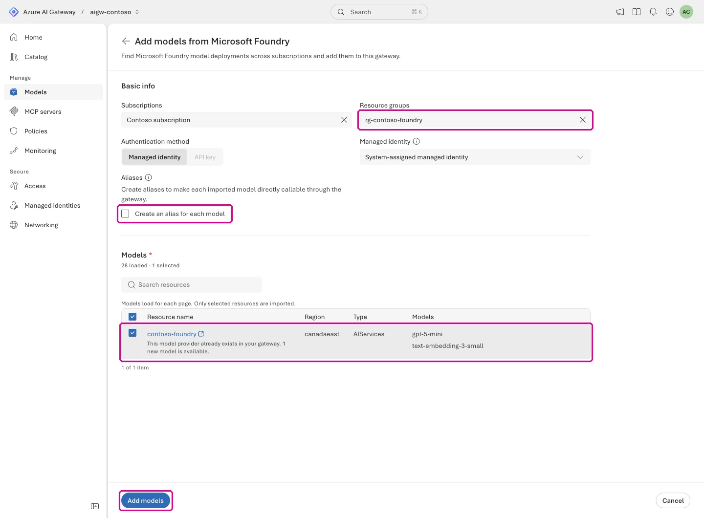
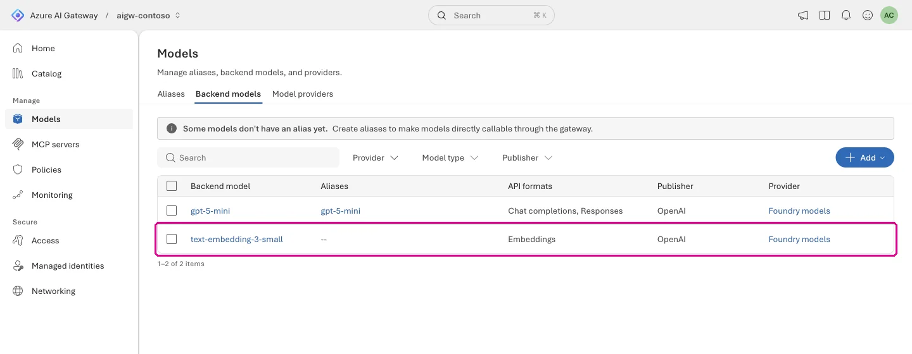
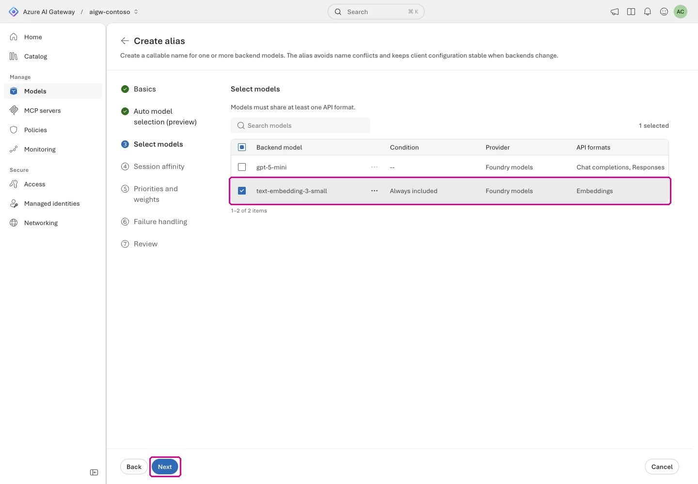
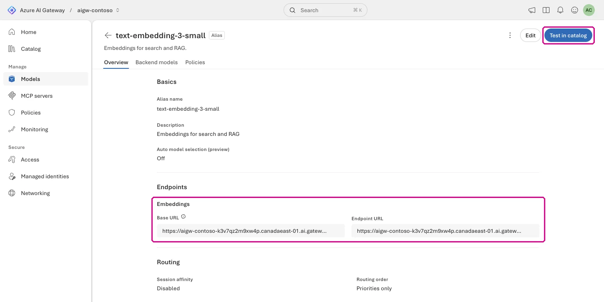
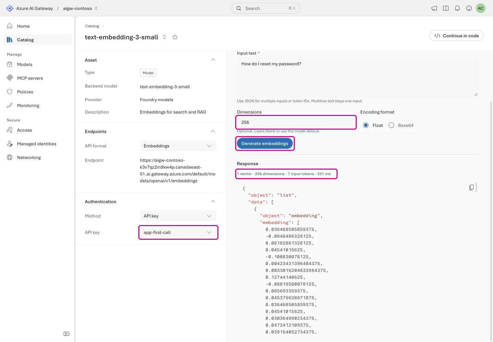
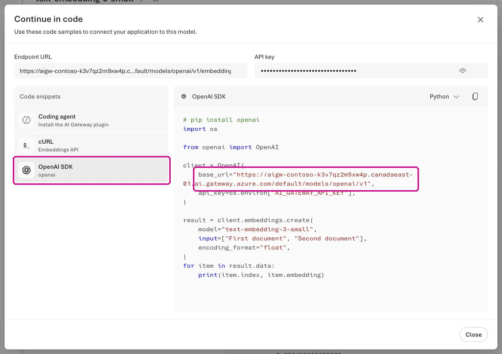
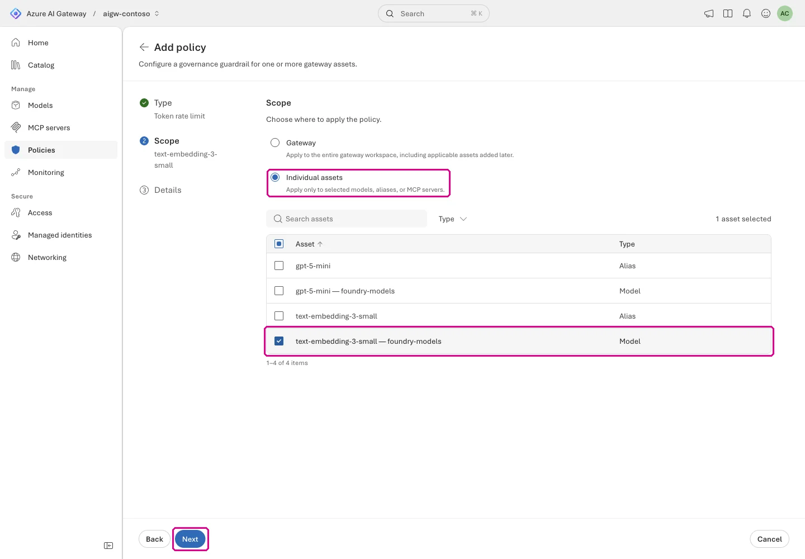
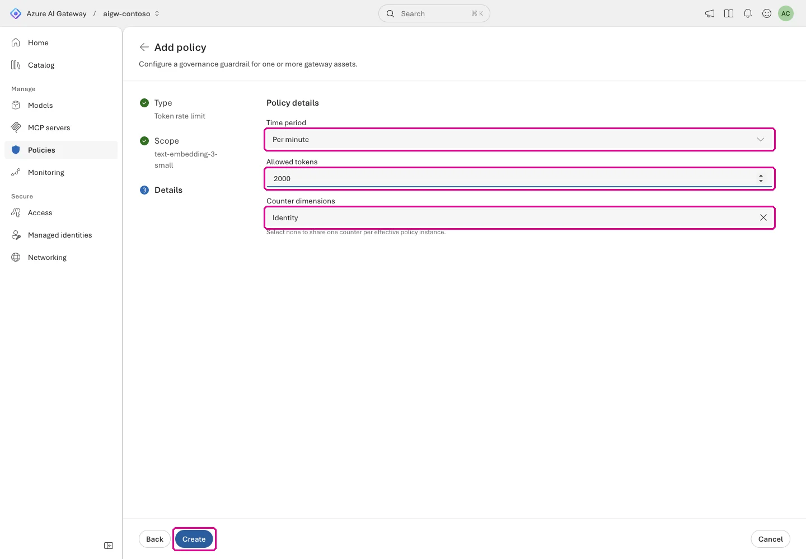

<!--
title: Publish embedding models for search and RAG
summary: Publish a Foundry embedding model through the gateway behind its own alias, generate vectors with curl, the OpenAI SDK, and the portal playground, build a mini RAG app on one gateway URL and key, and cap ingestion with a token limit.
category: models
level: Intermediate
duration: 30
tracks: [portal, cli, iac, terraform, code]
order: 3.8
status: new
illustration: diagrams/embeddings.svg
tags: [embeddings, text-embedding-3-small, RAG, retrieval-augmented generation, vector search, cosine similarity, dimensions, model alias, tokenLimit, ingestion]
objectives:
  - Publish a Foundry embedding deployment through the gateway behind its own alias
  - Generate embeddings with curl, the OpenAI Python SDK, and the portal's embeddings playground
  - Build a mini RAG app that embeds, retrieves, and answers through one gateway URL and one key
  - Cap an ingestion job with a per-caller token limit on the embedding model
prereqs:
  - 02-first-model-call
-->
<!-- gh:begin nav: generated by "npm run sync" from the metadata, do not edit -->
[AI Gateway labs](../README.md) › [Models & routing](../README.md#models--routing) › Lab 26
<!-- gh:end -->

# Publish embedding models for search and RAG

<!-- gh:begin intro: generated by "npm run sync" from the metadata, do not edit -->
> Publish a Foundry embedding model through the gateway behind its own alias, generate vectors with curl, the OpenAI SDK, and the portal playground, build a mini RAG app on one gateway URL and key, and cap ingestion with a token limit.

| ⏱️ Time | 📶 Level | 🧭 Tracks | ✅ Before you start |
| :-- | :-- | :-- | :-- |
| 30 min | Intermediate | Portal · Azure CLI · Bicep + azd · Terraform · Code · Notebook | [02 · First model call](../02-first-model-call/README.md) |

**You'll learn to**

- Publish a Foundry embedding deployment through the gateway behind its own alias
- Generate embeddings with curl, the OpenAI Python SDK, and the portal's embeddings playground
- Build a mini RAG app that embeds, retrieves, and answers through one gateway URL and one key
- Cap an ingestion job with a per-caller token limit on the embedding model

**Follow along:** 🌐 [Interactive version](https://azure.github.io/aigateway/labs/26-embeddings/) with your own values filled in · 📓 [Jupyter notebook](26-embeddings.ipynb) · 📁 [Lab files](infra/)

**On this page:** [Before you begin](#before-you-begin) · [How it works](#how-it-works) · [Publish the embedding model](#publish-the-embedding-model) · [Generate embeddings](#generate-embeddings) · [Build a mini RAG app](#build-a-mini-rag-app) · [Cap ingestion with a token limit](#cap-ingestion-with-a-token-limit) · [Verify](#verify) · [Go further](#go-further) · [Clean up](#clean-up) · [Next steps](#next-steps)
<!-- gh:end -->

Your team is building a help desk assistant with retrieval-augmented generation (RAG): an ingestion job turns every
article into a vector, and the app finds the articles closest to each question before a chat model answers. The
chat model already goes through AI Gateway, but the embedding calls go straight to Foundry, with their own key and
no limits or usage records. In this lab you publish `text-embedding-3-small` through the same gateway, call it with
curl, the OpenAI SDK, and the portal, build a mini RAG app that uses one URL and one key for both models, and cap
the ingestion job with a token limit.


## Before you begin

<!-- setup: tools sign-in extension clone -->
<!-- gh:begin setup: generated by "npm run sync" from the metadata, do not edit -->
🧰 **One-time setup** from the [Setup guide](../SETUP.md), if you haven't done it yet:
[Choose where to run commands](../SETUP.md#choose-where-to-run-commands) ·
[Sign in to Azure](../SETUP.md#sign-in-to-azure) ·
[Install the `aigateway` extension](../SETUP.md#install-the-aigateway-extension) ·
[Clone the labs repo](../SETUP.md#clone-the-labs-repo)
<!-- gh:end -->

> [!TIP]
> On the **Bicep + azd** and **Terraform** tracks, `azd up` or `terraform apply` creates its own gateway, Foundry
> account with both models, aliases, token limit, and key, so you can skip this section. Run that track in
> [Publish the embedding model](#publish-the-embedding-model) first: it sets the variables that the next sections
> and **Verify** use. You need only the one-time setup above, and Python 3.10 or later.

- Complete [Publish a Foundry model and make your first call](../02-first-model-call/README.md). You need the
  gateway, the `gpt-5-mini` alias, and a runtime API key. Lab 02 also gave the gateway the **Foundry User** role on
  your Foundry account, which covers the embedding deployment in this lab.
- Permission to change the gateway, for example **Contributor** on its resource group, and to create deployments
  in the Foundry account.
- Python 3.10 or later for the mini RAG app and **Verify**, and `jq` for the Bash steps.
- Run the scripts and samples from the lab's folder, `~/aigateway/labs/26-embeddings`.

Set these variables once. Every track and the **Verify** section reuse them.

<details open><summary>Bash</summary> <!-- gh -->

```bash title="Bash"
# Name your gateway, the Foundry account from lab 02, the provider, and the two aliases that apps call
export RG="<resource-group>"
export GATEWAY="<gateway>"
export FOUNDRY_RG="<foundry-resource-group>"     # resource group of the Foundry account from lab 02
export FOUNDRY_ACCOUNT="<foundry-account-name>"
export PROVIDER="foundry-models"                 # the gateway provider that holds gpt-5-mini
export EMBEDDINGS="text-embedding-3-small"       # the Foundry deployment and the backend model
export AI_GATEWAY_EMBEDDINGS_MODEL="text-embedding-3-small"   # the alias that apps send in "model"
export AI_GATEWAY_MODEL="gpt-5-mini"             # the chat alias from lab 02
echo "📝 Alias $AI_GATEWAY_EMBEDDINGS_MODEL will serve $EMBEDDINGS on gateway $GATEWAY in $RG"

# Read the resource IDs of the gateway and the Foundry account, and the gateway's runtime URL
export GATEWAY_ID="$(az aigateway show -g "$RG" -n "$GATEWAY" --query id -o tsv)"
export FOUNDRY_ID="$(az cognitiveservices account show -g "$FOUNDRY_RG" -n "$FOUNDRY_ACCOUNT" --query id -o tsv)"
export AI_GATEWAY_URL="https://$(az aigateway show -g "$RG" -n "$GATEWAY" --query properties.frontend.defaultHostname -o tsv)"
echo "🆔 Gateway: $GATEWAY_ID"
echo "🆔 Foundry account: $FOUNDRY_ID"
echo "🌐 Runtime URL: $AI_GATEWAY_URL"

# Paste the gateway runtime key from lab 02 without showing it, and don't commit it or write it to a file
printf "AI Gateway API key: " && read -rs AI_GATEWAY_API_KEY && export AI_GATEWAY_API_KEY && echo
echo "🔑 Key: in AI_GATEWAY_API_KEY (${#AI_GATEWAY_API_KEY} characters, not shown)"
```
</details> <!-- gh -->

<details><summary>PowerShell</summary> <!-- gh -->

```powershell title="PowerShell"
# Name your gateway, the Foundry account from lab 02, the provider, and the two aliases that apps call
$RG                              = "<resource-group>"
$GATEWAY                         = "<gateway>"
$FOUNDRY_RG                      = "<foundry-resource-group>"   # resource group of the Foundry account from lab 02
$FOUNDRY_ACCOUNT                 = "<foundry-account-name>"
$PROVIDER                        = "foundry-models"             # the gateway provider that holds gpt-5-mini
$EMBEDDINGS                      = "text-embedding-3-small"     # the Foundry deployment and the backend model
$env:AI_GATEWAY_EMBEDDINGS_MODEL = "text-embedding-3-small"     # the alias that apps send in "model"
$env:AI_GATEWAY_MODEL            = "gpt-5-mini"                 # the chat alias from lab 02
Write-Host "📝 Alias $env:AI_GATEWAY_EMBEDDINGS_MODEL will serve $EMBEDDINGS on gateway $GATEWAY in $RG"

# Read the resource IDs of the gateway and the Foundry account, and the gateway's runtime URL
$GATEWAY_ID = az aigateway show -g $RG -n $GATEWAY --query id -o tsv
$FOUNDRY_ID = az cognitiveservices account show -g $FOUNDRY_RG -n $FOUNDRY_ACCOUNT --query id -o tsv
$env:AI_GATEWAY_URL = "https://$(az aigateway show -g $RG -n $GATEWAY --query properties.frontend.defaultHostname -o tsv)"
Write-Host "🆔 Gateway: $GATEWAY_ID"
Write-Host "🆔 Foundry account: $FOUNDRY_ID"
Write-Host "🌐 Runtime URL: $env:AI_GATEWAY_URL"

# Paste the gateway runtime key from lab 02 without showing it, and don't commit it or write it to a file
$env:AI_GATEWAY_API_KEY = Read-Host "AI Gateway API key" -MaskInput
Write-Host "🔑 Key: in AI_GATEWAY_API_KEY ($($env:AI_GATEWAY_API_KEY.Length) characters, not shown)"
```
</details> <!-- gh -->

The CLI and Bicep tracks of lab 02 name the provider `foundry-models`. A portal import names it after your
Foundry account. To check, list the backend models. The **Provider** column shows the provider of each one.

<details open><summary>Bash</summary> <!-- gh -->

```bash title="Bash"
# List the backend models on the gateway, with the provider that holds each one
echo "✨ Backend models on $GATEWAY:"
az aigateway model list -g "$RG" --gateway-name "$GATEWAY" -o table
```
</details> <!-- gh -->

<details><summary>PowerShell</summary> <!-- gh -->

```powershell title="PowerShell"
# List the backend models on the gateway, with the provider that holds each one
Write-Host "✨ Backend models on ${GATEWAY}:"
az aigateway model list -g $RG --gateway-name $GATEWAY -o table
```
</details> <!-- gh -->

Deploy `text-embedding-3-small` in the same Foundry account as `gpt-5-mini`. Embedding inference is billed per use,
at a small fraction of the price of chat tokens.

<details open><summary>Bash</summary> <!-- gh -->

```bash title="Bash"
# Deploy text-embedding-3-small next to gpt-5-mini, with 20,000 tokens per minute of Global Standard capacity
az cognitiveservices account deployment create -g "$FOUNDRY_RG" -n "$FOUNDRY_ACCOUNT" \
  --deployment-name "$EMBEDDINGS" --model-name text-embedding-3-small --model-version 1 \
  --model-format OpenAI --sku-name GlobalStandard --sku-capacity 20 \
  --query "{name:name, state:properties.provisioningState}" &&
  echo "✨ Model deployment $EMBEDDINGS is ready in $FOUNDRY_ACCOUNT"
```
</details> <!-- gh -->

<details><summary>PowerShell</summary> <!-- gh -->

```powershell title="PowerShell"
# Deploy text-embedding-3-small next to gpt-5-mini, with 20,000 tokens per minute of Global Standard capacity
az cognitiveservices account deployment create -g $FOUNDRY_RG -n $FOUNDRY_ACCOUNT `
  --deployment-name $EMBEDDINGS --model-name text-embedding-3-small --model-version 1 `
  --model-format OpenAI --sku-name GlobalStandard --sku-capacity 20 `
  --query "{name:name, state:properties.provisioningState}"
if ($?) { Write-Host "✨ Model deployment $EMBEDDINGS is ready in $FOUNDRY_ACCOUNT" }
```
</details> <!-- gh -->

## How it works

An embedding model turns text into a vector: a list of numbers in which texts with similar meanings sit close
together. A RAG app embeds its documents once, when it ingests them, and embeds each question when a user asks it.
Since the [October 28, 2026 release](https://ai.gateway.azure.com/docs/releases#release-2026-10-28), the gateway publishes
embedding models like chat models: you register the deployment as a backend model, give it an alias, and apps send
the alias in `model`. Apps get one URL and one key or Entra token for both models, ingestion jobs get the same token
limits and usage records as chat, and you can change the backend behind the alias without touching the apps.

An embedding model supports only the embeddings endpoint. An alias exposes the endpoints that all its backend models
share, and an embedding model shares none with a chat model, so each one gets its own alias.

| What | Value |
|---|---|
| Endpoint | `POST $AI_GATEWAY_URL/default/models/openai/v1/embeddings` |
| OpenAI SDK `base_url` | `$AI_GATEWAY_URL/default/models/openai/v1`, the same as for chat |
| Backend model | Supported endpoint `/openai/v1/embeddings`. The portal shows the API format **Embeddings** |
| `input` | A string, an array of strings, or arrays of token IDs. One request embeds a whole batch |
| `dimensions` | Optional. `text-embedding-3-small` returns 1,536 numbers by default, and fewer when you ask, such as `256` |
| `encoding_format` | `float` (the default) or `base64` |
| `usage` | `prompt_tokens` and `total_tokens`. Token limits and Monitoring count them |

## Publish the embedding model

Register the deployment as a backend model under your Foundry provider, then publish it under an alias with the same
name, `text-embedding-3-small`, so that apps that called the model on Foundry keep the same model name.

<!-- track: portal | Portal -->
<details open><summary><b>🖥️ Portal</b></summary> <!-- gh -->

### Import the embedding model

1. Open the [AI Gateway portal](https://ai.gateway.azure.com) and select your gateway in the top bar.
2. Select **Models** › **Add** › **Models from Microsoft Foundry**.
3. In **Resource groups**, select the resource group of your Foundry account. The wizard otherwise selects every
   Foundry resource in the subscription. Keep **Managed identity** as the **Authentication method**.
4. Clear **Create an alias for each model**. When it's selected, the wizard names the alias
   `<foundry-account-name>/text-embedding-3-small`. You create a shorter alias in the next step.
5. Under **Models**, select your Foundry account. Its row says **This model provider already exists in your
   gateway. 1 new model is available.**
6. Select **Add models**. The portal confirms **Models imported** and `1 model(s) were created. No aliases were
   created.`



Select **Models** › **Backend models**. `text-embedding-3-small` shows **Embeddings** under **API formats** and
`--` under **Aliases**, and a banner says **Some models don't have an alias yet.**



### Create the alias

1. Select **Models** › **Add** › **Alias for existing models**.
2. On **Basics**, set **Alias name** to `text-embedding-3-small` and **Description** to
   `Embeddings for search and RAG`. Select **Next**.
3. On **Auto model selection (preview)**, keep it off. Select **Next**.
4. On **Select models**, select `text-embedding-3-small`, whose **API formats** column says **Embeddings**. The
   page notes that **Models must share at least one API format**, so don't add `gpt-5-mini`. Select **Next**.
5. Keep the defaults on **Session affinity**, **Priorities and weights**, and **Failure handling**. On **Review**,
   select **Create**.



The alias's overview opens. Under **Endpoints**, **Embeddings** shows the **Base URL** for SDKs and the full
**Endpoint URL**.



> **Checkpoint**
> **Models** › **Aliases** lists `text-embedding-3-small`, and its overview shows an **Embeddings** endpoint that
> ends with `/default/models/openai/v1/embeddings`.

</details> <!-- gh -->
<!-- track: cli | Azure CLI -->
<details><summary><b>⌨️ Azure CLI</b></summary> <!-- gh -->

### Register the embedding model

`az aigateway model create` registers the deployment under the provider. `--foundry-resource-id` and `--deployment`
name the Foundry deployment, and the CLI reads its model name and version. Set `--supported-endpoints` to the
embeddings endpoint, and leave out `--api-format`: its values, such as `OpenAIChatCompletions`, describe chat APIs.

<details open><summary>Bash</summary> <!-- gh -->

```bash title="Bash"
# Register the deployment as a backend model that supports only the embeddings endpoint
az aigateway model create -g "$RG" --gateway-name "$GATEWAY" --provider-name "$PROVIDER" -n "$EMBEDDINGS" \
  --display-name "$EMBEDDINGS" --supported-endpoints /openai/v1/embeddings \
  --foundry-resource-id "$FOUNDRY_ID" --deployment "$EMBEDDINGS" \
  --query "{name:name, endpoints:properties.supportedEndpoints}" &&
  echo "✨ Model $EMBEDDINGS is published through $PROVIDER"
```
</details> <!-- gh -->

<details><summary>PowerShell</summary> <!-- gh -->

```powershell title="PowerShell"
# Register the deployment as a backend model that supports only the embeddings endpoint
az aigateway model create -g $RG --gateway-name $GATEWAY --provider-name $PROVIDER -n $EMBEDDINGS `
  --display-name $EMBEDDINGS --supported-endpoints /openai/v1/embeddings `
  --foundry-resource-id $FOUNDRY_ID --deployment $EMBEDDINGS `
  --query "{name:name, endpoints:properties.supportedEndpoints}"
if ($?) { Write-Host "✨ Model $EMBEDDINGS is published through $PROVIDER" }
```
</details> <!-- gh -->

To import every deployment of a Foundry account at once, `az aigateway model-provider import` (or
`az aigateway model-provider create --import-models`) registers embedding deployments with the embeddings endpoint
too, but it creates no aliases. Create them as in the next step.

### Create the alias

<details open><summary>Bash</summary> <!-- gh -->

```bash title="Bash"
# Publish the backend model under an alias with the same name, which apps send in "model"
echo "🔖 Alias $AI_GATEWAY_EMBEDDINGS_MODEL:"
az aigateway model-alias set -g "$RG" --gateway-name "$GATEWAY" -n "$AI_GATEWAY_EMBEDDINGS_MODEL" \
  --description "Embeddings for search and RAG" \
  --backend-model resource-id="$GATEWAY_ID/workspaces/default/modelProviders/$PROVIDER/models/$EMBEDDINGS" \
  --only-show-errors --query "{endpoints:properties.supportedEndpoints, backend:properties.backendModels[0].resourceId}" -o json |
  jq -r '"Endpoints: \(.endpoints | join(", "))\nBackend:   \(.backend | split("/") | last)"'
```
</details> <!-- gh -->

<details><summary>PowerShell</summary> <!-- gh -->

```powershell title="PowerShell"
# Publish the backend model under an alias with the same name, which apps send in "model"
Write-Host "🔖 Alias $($env:AI_GATEWAY_EMBEDDINGS_MODEL):"
az aigateway model-alias set -g $RG --gateway-name $GATEWAY -n $env:AI_GATEWAY_EMBEDDINGS_MODEL `
  --description "Embeddings for search and RAG" `
  --backend-model resource-id="$GATEWAY_ID/workspaces/default/modelProviders/$PROVIDER/models/$EMBEDDINGS" `
  --only-show-errors --query "{endpoints:properties.supportedEndpoints, backend:properties.backendModels[0].resourceId}" -o json |
  ConvertFrom-Json | ForEach-Object { "Endpoints: $($_.endpoints -join ', ')"; "Backend:   $(($_.backend -split '/')[-1])" }
```
</details> <!-- gh -->

`az aigateway model-alias set` creates the alias, or updates it if it exists, so you can run the step again.

> **Checkpoint**
> The output shows `Endpoints: /openai/v1/embeddings` and `Backend:   text-embedding-3-small`.

</details> <!-- gh -->
<!-- track: iac | Bicep + azd -->
<details><summary><b>🏗️ Bicep + azd</b></summary> <!-- gh -->

**What you need:** only the one-time setup from **Before you begin**. This track doesn't use your gateway from lab 02:
`azd up` creates a new one, so it works on its own.

### Review the templates

`infra/main.bicep` creates the resource group `rg-<environment name>` and calls the quick start's
[resources.bicep](../quickstart/infra/resources.bicep) for the gateway, `gpt-5-mini`, its alias, and the
`app-first-call` key. Then it deploys `text-embedding-3-small` in the same Foundry account with
[embeddings-deployment.bicep](infra/embeddings-deployment.bicep), and publishes it:

<!-- include: infra/main.bicep -->
<!-- gh:begin include: generated by "npm run sync" from the metadata, do not edit -->
📄 [`infra/main.bicep`](infra/main.bicep)

<details><summary>Show all 70 lines</summary>

```bicep
// Lab 26 with azd: "azd up" creates the resource group rg-<environment name>, the quick start's gateway, Foundry
// account, gpt-5-mini model, default alias, and runtime API key, then deploys text-embedding-3-small in the same
// Foundry account and publishes it through the gateway with its own alias and token limit.
// The runtime API key is never an output.
targetScope = 'subscription'

@description('azd environment name. The resource group is rg-<environmentName>.')
@minLength(1)
@maxLength(60)
param environmentName string

@description('Region for every resource. Pick one where AI Gateway, gpt-5-mini, and text-embedding-3-small are available. List them with az provider show --namespace Microsoft.ApiManagement (Setup guide, Find the available regions).')
@metadata({ azd: { type: 'location' } })
param location string

@description('Tokens per minute that each caller identity can send to the embedding model. azd reads it from EMBEDDINGS_TOKENS_PER_MINUTE.')
@minValue(1)
param embeddingsTokensPerMinute int = 2000

var suffix = take(uniqueString(subscription().id, environmentName, location), 6)
var tags = { 'azd-env-name': environmentName }

resource rg 'Microsoft.Resources/resourceGroups@2024-03-01' = {
  name: 'rg-${environmentName}'
  location: location
  tags: tags
}

// The quick start's template: a gateway, gpt-5-mini behind the default alias, and the app-first-call key.
module base '../../quickstart/infra/resources.bicep' = {
  name: 'aigw-base'
  scope: rg
  params: {
    location: location
    tags: tags
    gatewayName: 'aigw-${suffix}'
    foundryName: 'aigw${suffix}'
  }
}

// The embedding deployment, in the same Foundry account. The gateway's Foundry User role already covers it.
module embeddingsDeployment 'embeddings-deployment.bicep' = {
  name: 'aigw-embeddings-deployment'
  scope: rg
  params: {
    foundryName: base.outputs.foundryName
  }
}

module embeddings 'publish-embeddings.bicep' = {
  name: 'aigw-publish-embeddings'
  scope: rg
  params: {
    gatewayName: base.outputs.gatewayName
    providerName: base.outputs.providerName
    deploymentId: embeddingsDeployment.outputs.deploymentId
    deploymentModelName: embeddingsDeployment.outputs.deploymentName
    modelVersion: embeddingsDeployment.outputs.modelVersion
    tokensPerMinute: embeddingsTokensPerMinute
  }
}

output AZURE_RESOURCE_GROUP string = rg.name
output AI_GATEWAY_NAME string = base.outputs.gatewayName
output AI_GATEWAY_ID string = base.outputs.gatewayId
output AI_GATEWAY_URL string = base.outputs.gatewayUrl
output AI_GATEWAY_PROVIDER string = base.outputs.providerName
output AI_GATEWAY_MODEL string = base.outputs.aliasName
output AI_GATEWAY_EMBEDDINGS_MODEL string = embeddings.outputs.aliasName
output FOUNDRY_ACCOUNT_NAME string = base.outputs.foundryName
```

</details>
<!-- gh:end -->

`infra/publish-embeddings.bicep` registers the deployment with the embeddings endpoint and a token limit, then
creates the alias. You can also deploy it on its own to the gateway from lab 02:

<!-- include: infra/publish-embeddings.bicep -->
<!-- gh:begin include: generated by "npm run sync" from the metadata, do not edit -->
📄 [`infra/publish-embeddings.bicep`](infra/publish-embeddings.bicep)

<details><summary>Show all 93 lines</summary>

```bicep
// Publishes a Foundry embedding deployment through an existing AI Gateway. main.bicep calls it after the quick start's
// template, and you can also deploy it on its own to a gateway you already have, such as the one from lab 02.
// Registers the deployment under the existing Foundry provider with the embeddings endpoint and a per-caller token
// limit, then publishes an alias that clients send in the request "model" field.
// The gateway's managed identity needs the Foundry User role on the account, which lab 02 and the quick start grant.
targetScope = 'resourceGroup'

@description('Name of the existing AI Gateway (Microsoft.ApiManagement/aigateways) in this resource group.')
param gatewayName string

@description('Name of the existing Foundry model provider in the gateway, for example foundry-models from lab 02.')
param providerName string = 'foundry-models'

@description('Resource ID of the embedding deployment: <Foundry account ID>/deployments/<deployment name>.')
param deploymentId string

@description('Model name of the deployment, for example text-embedding-3-small.')
param deploymentModelName string = 'text-embedding-3-small'

@description('Version of the deployed model, for example 1. Optional.')
param modelVersion string = ''

@description('Name of the backend model registration under the provider.')
param modelName string = deploymentModelName

@description('Callable alias that clients send in the request "model" field.')
param aliasName string = modelName

@description('Tokens per minute that each caller identity can send to the embedding model.')
@minValue(1)
param tokensPerMinute int = 2000

#disable-next-line BCP081
resource aiGateway 'Microsoft.ApiManagement/aigateways@2026-11-01' existing = {
  name: gatewayName
}

#disable-next-line BCP081
resource defaultWorkspace 'Microsoft.ApiManagement/aigateways/workspaces@2026-11-01' existing = {
  parent: aiGateway
  name: 'default'
}

#disable-next-line BCP081
resource provider 'Microsoft.ApiManagement/aigateways/workspaces/modelProviders@2026-11-01' existing = {
  parent: defaultWorkspace
  name: providerName
}

// An embedding model supports only the embeddings endpoint, so chat calls to it fail with unsupported_endpoint.
#disable-next-line BCP081
resource model 'Microsoft.ApiManagement/aigateways/workspaces/modelProviders/models@2026-11-01' = {
  parent: provider
  name: modelName
  properties: {
    displayName: modelName
    description: 'Foundry embedding deployment ${deploymentModelName} published through AI Gateway.'
    supportedEndpoints: [
      '/openai/v1/embeddings'
    ]
    deployment: {
      resourceId: deploymentId
      modelName: deploymentModelName
      modelVersion: empty(modelVersion) ? null : modelVersion
    }
    policies: [
      {
        type: 'tokenLimit'
        period: 'minute'
        count: tokensPerMinute
        counterKey: [
          'identity'
        ]
      }
    ]
  }
}

#disable-next-line BCP081
resource alias 'Microsoft.ApiManagement/aigateways/workspaces/aliases@2026-11-01' = {
  parent: defaultWorkspace
  name: aliasName
  properties: {
    description: 'Embeddings for search and RAG'
    backendModels: [
      { resourceId: model.id }
    ]
  }
}

output modelName string = model.name
output aliasName string = alias.name
output embeddingsUrl string = 'https://${aiGateway.properties.frontend.defaultHostname}/default/models/openai/v1/embeddings'
```

</details>
<!-- gh:end -->

### Deploy with azd up

Move into the lab's folder, create an azd environment named `aigw-lab26` in your current subscription, then provision
everything. It takes about 27 minutes, most of it while the new gateway activates.

<details open><summary>Bash</summary> <!-- gh -->

```bash title="Bash"
# Move into the lab's folder, which holds the azd project
cd ~/aigateway/labs/26-embeddings &&
  echo "📂 Lab folder: $(pwd)"

# Create an azd environment named aigw-lab26 in your current subscription, so that azd doesn't prompt you
azd env new aigw-lab26 --location eastus2 --subscription "$(az account show --query id --output tsv)" &&
  echo "📝 azd environment aigw-lab26 deploys to eastus2"

# Provision the resource group, the gateway, the Foundry account with both models, the aliases, and the key
azd up &&
  echo "🚀 Gateway deployed: $(azd env get-value AI_GATEWAY_URL)"
```
</details> <!-- gh -->

<details><summary>PowerShell</summary> <!-- gh -->

```powershell title="PowerShell"
# Move into the lab's folder, which holds the azd project
Set-Location ~/aigateway/labs/26-embeddings
if ($?) { Write-Host "📂 Lab folder: $(Get-Location)" }

# Create an azd environment named aigw-lab26 in your current subscription, so that azd doesn't prompt you
azd env new aigw-lab26 --location eastus2 --subscription (az account show --query id --output tsv)
if ($?) { Write-Host "📝 azd environment aigw-lab26 deploys to eastus2" }

# Provision the resource group, the gateway, the Foundry account with both models, the aliases, and the key
azd up
if ($?) { Write-Host "🚀 Gateway deployed: $(azd env get-value AI_GATEWAY_URL)" }
```
</details> <!-- gh -->

Expected output (your names differ):

```text
  (✓) Done: Resource group: rg-aigw-lab26
  (✓) Done: Foundry: aigw2bn3tl
  (✓) Done: Azure AI Services Model Deployment: aigw2bn3tl/gpt-5-mini
  (✓) Done: Azure AI Services Model Deployment: aigw2bn3tl/text-embedding-3-small

SUCCESS: Your application was provisioned and deployed to Azure in 26 minutes 37 seconds.
```

For another region, pick one where AI Gateway, `gpt-5-mini`, and `text-embedding-3-small` are available, as in
[Find the available regions](../SETUP.md#find-the-available-regions). The token limit comes from the azd
environment value `EMBEDDINGS_TOKENS_PER_MINUTE`, with the default `2000` in `infra/main.parameters.json`.

### Read the outputs and the key

Set the variables that the next sections and **Verify** use from azd's environment values, then read the key from
the gateway so that it never shows on screen.

<details open><summary>Bash</summary> <!-- gh -->

```bash title="Bash"
# Read azd's outputs into the variables that the next sections use
export RG="$(azd env get-value AZURE_RESOURCE_GROUP)"
export GATEWAY="$(azd env get-value AI_GATEWAY_NAME)"
export GATEWAY_ID="$(azd env get-value AI_GATEWAY_ID)"
export PROVIDER="$(azd env get-value AI_GATEWAY_PROVIDER)"
export AI_GATEWAY_MODEL="$(azd env get-value AI_GATEWAY_MODEL)"
export AI_GATEWAY_EMBEDDINGS_MODEL="$(azd env get-value AI_GATEWAY_EMBEDDINGS_MODEL)"
export EMBEDDINGS="$AI_GATEWAY_EMBEDDINGS_MODEL"
export FOUNDRY_RG="$RG"
export FOUNDRY_ACCOUNT="$(azd env get-value FOUNDRY_ACCOUNT_NAME)"
export AI_GATEWAY_URL="$(azd env get-value AI_GATEWAY_URL)"
echo "📝 Aliases $AI_GATEWAY_EMBEDDINGS_MODEL and $AI_GATEWAY_MODEL on gateway $GATEWAY in $RG"
echo "🌐 Runtime URL: $AI_GATEWAY_URL"

# Read the app-first-call key from the gateway, so that it never shows on screen or lands in a file
export AI_GATEWAY_API_KEY="$(az aigateway api-key list-secrets --ids "$GATEWAY_ID/apiKeys/app-first-call" \
  --query primaryKey --output tsv)"
echo "🔑 Key: in AI_GATEWAY_API_KEY (${#AI_GATEWAY_API_KEY} characters, not shown)"
```
</details> <!-- gh -->

<details><summary>PowerShell</summary> <!-- gh -->

```powershell title="PowerShell"
# Read azd's outputs into the variables that the next sections use
$RG                              = azd env get-value AZURE_RESOURCE_GROUP
$GATEWAY                         = azd env get-value AI_GATEWAY_NAME
$GATEWAY_ID                      = azd env get-value AI_GATEWAY_ID
$PROVIDER                        = azd env get-value AI_GATEWAY_PROVIDER
$env:AI_GATEWAY_MODEL            = azd env get-value AI_GATEWAY_MODEL
$env:AI_GATEWAY_EMBEDDINGS_MODEL = azd env get-value AI_GATEWAY_EMBEDDINGS_MODEL
$EMBEDDINGS                      = $env:AI_GATEWAY_EMBEDDINGS_MODEL
$FOUNDRY_RG                      = $RG
$FOUNDRY_ACCOUNT                 = azd env get-value FOUNDRY_ACCOUNT_NAME
$env:AI_GATEWAY_URL              = azd env get-value AI_GATEWAY_URL
Write-Host "📝 Aliases $env:AI_GATEWAY_EMBEDDINGS_MODEL and $env:AI_GATEWAY_MODEL on gateway $GATEWAY in $RG"
Write-Host "🌐 Runtime URL: $env:AI_GATEWAY_URL"

# Read the app-first-call key from the gateway, so that it never shows on screen or lands in a file
$env:AI_GATEWAY_API_KEY = az aigateway api-key list-secrets --ids "$GATEWAY_ID/apiKeys/app-first-call" `
  --query primaryKey --output tsv
Write-Host "🔑 Key: in AI_GATEWAY_API_KEY ($($env:AI_GATEWAY_API_KEY.Length) characters, not shown)"
```
</details> <!-- gh -->

> **Checkpoint**
> `azd up` ended with `SUCCESS`, the variables point to the new gateway, and the key has 32 characters.

</details> <!-- gh -->
<!-- track: terraform | Terraform -->
<details><summary><b>🌍 Terraform</b></summary> <!-- gh -->

**What you need:** only the one-time setup from **Before you begin**, plus Terraform 1.9 or later, as in
[Deploy a lab with Terraform](../SETUP.md#deploy-a-lab-with-terraform). This track doesn't use your gateway from
lab 02: `terraform apply` creates a new one, so it works on its own.

### Review the configuration

`terraform/main.tf` creates the resource group `rg-<environment_name>` and calls the quick start's
[resources module](../quickstart/terraform/resources) for the gateway, `gpt-5-mini`, its alias, and the
`app-first-call` key:

<!-- include: terraform/main.tf -->
<!-- gh:begin include: generated by "npm run sync" from the metadata, do not edit -->
📄 [`terraform/main.tf`](terraform/main.tf)

<details><summary>Show all 29 lines</summary>

```tf
# Lab 26 with Terraform: creates the resource group rg-<environment_name>, the quick start's gateway, Foundry account,
# gpt-5-mini model, default alias, and runtime API key, then deploys text-embedding-3-small in the same Foundry
# account and publishes it through the gateway with its own alias and token limit (embeddings.tf).
# The runtime API key is never an output.
data "azapi_client_config" "current" {}

locals {
  suffix = substr(sha1("${data.azapi_client_config.current.subscription_id}/${var.environment_name}/${var.location}"), 0, 6)
  tags   = { "environment-name" = var.environment_name }
}

resource "azurerm_resource_group" "rg" {
  name     = "rg-${var.environment_name}"
  location = var.location
  tags     = local.tags
}

# The quick start's module: a gateway, gpt-5-mini behind the default alias, and the app-first-call key.
module "base" {
  source = "../../quickstart/terraform/resources"

  subscription_id     = data.azapi_client_config.current.subscription_id
  resource_group_name = azurerm_resource_group.rg.name
  resource_group_id   = azurerm_resource_group.rg.id
  location            = var.location
  tags                = local.tags
  gateway_name        = "aigw-${local.suffix}"
  foundry_name        = "aigw${local.suffix}"
}
```

</details>
<!-- gh:end -->

`terraform/embeddings.tf` deploys `text-embedding-3-small` in the same Foundry account with the `azurerm` provider,
then registers it as a backend model with its token limit, and publishes its alias, with the `azapi` provider, which
sends the AI Gateway API version, `2026-11-01`, as is:

<!-- include: terraform/embeddings.tf -->
<!-- gh:begin include: generated by "npm run sync" from the metadata, do not edit -->
📄 [`terraform/embeddings.tf`](terraform/embeddings.tf)

<details><summary>Show all 68 lines</summary>

```tf
# text-embedding-3-small, deployed in the quick start's Foundry account and published through the gateway. The
# gateway's Foundry User role on the account already covers the new deployment.
resource "azurerm_cognitive_deployment" "embeddings" {
  name                 = "text-embedding-3-small"
  cognitive_account_id = module.base.foundry_id

  sku {
    name     = "GlobalStandard"
    capacity = 20
  }

  model {
    format  = "OpenAI"
    name    = "text-embedding-3-small"
    version = "1"
  }
}

# The deployment as a backend model under the quick start's provider, with a per-caller token limit. An embedding
# model supports only the embeddings endpoint, so chat calls to it fail with unsupported_endpoint.
resource "azapi_resource" "embeddings_model" {
  type      = "Microsoft.ApiManagement/aigateways/workspaces/modelProviders/models@2026-11-01"
  name      = azurerm_cognitive_deployment.embeddings.name
  parent_id = module.base.provider_id

  body = {
    properties = {
      displayName = azurerm_cognitive_deployment.embeddings.name
      description = "Foundry embedding deployment ${azurerm_cognitive_deployment.embeddings.name} published through AI Gateway."
      supportedEndpoints = [
        "/openai/v1/embeddings",
      ]
      deployment = {
        resourceId   = azurerm_cognitive_deployment.embeddings.id
        modelName    = azurerm_cognitive_deployment.embeddings.model[0].name
        modelVersion = azurerm_cognitive_deployment.embeddings.model[0].version
      }
      policies = [
        {
          type       = "tokenLimit"
          period     = "minute"
          count      = var.embeddings_tokens_per_minute
          counterKey = ["identity"]
        },
      ]
    }
  }

  schema_validation_enabled = false
}

# The alias that apps send in the request "model" field, with the same name as the deployment.
resource "azapi_resource" "embeddings_alias" {
  type      = "Microsoft.ApiManagement/aigateways/workspaces/aliases@2026-11-01"
  name      = azapi_resource.embeddings_model.name
  parent_id = module.base.workspace_id

  body = {
    properties = {
      description = "Embeddings for search and RAG"
      backendModels = [
        { resourceId = azapi_resource.embeddings_model.id },
      ]
    }
  }

  schema_validation_enabled = false
}
```

</details>
<!-- gh:end -->

`terraform/variables.tf` declares the token limit with the same default as the Bicep template, and
`terraform/outputs.tf` returns the names that the next sections use:

<!-- include: terraform/variables.tf -->
<!-- gh:begin include: generated by "npm run sync" from the metadata, do not edit -->
📄 [`terraform/variables.tf`](terraform/variables.tf)

```tf
variable "environment_name" {
  description = "Names the resource group rg-<environment_name> and seeds the unique resource names."
  type        = string
  default     = "aigw-lab26-tf"
}

variable "location" {
  description = "Region for every resource. Pick one where AI Gateway, gpt-5-mini, and text-embedding-3-small are available."
  type        = string
  default     = "eastus2"
}

variable "embeddings_tokens_per_minute" {
  description = "Tokens per minute that each caller identity can send to the embedding model."
  type        = number
  default     = 2000

  validation {
    condition     = var.embeddings_tokens_per_minute >= 1
    error_message = "The token limit must be at least 1."
  }
}
```
<!-- gh:end -->

### Deploy with terraform apply

Move into the lab's Terraform folder, select your current subscription, then plan and apply the configuration. It
takes about three minutes, most of it while the new gateway activates.

<details open><summary>Bash</summary> <!-- gh -->

```bash title="Bash"
# Move into the lab's Terraform folder
cd ~/aigateway/labs/26-embeddings/terraform &&
  echo "📂 Terraform folder: $(pwd)"

# Deploy to the Azure CLI's current subscription
export ARM_SUBSCRIPTION_ID="$(az account show --query id --output tsv)" &&
  echo "📍 Subscription: $ARM_SUBSCRIPTION_ID"

# Download the providers, then plan and apply the gateway, the Foundry account with both models, the aliases, the
# token limit, and the key
terraform init &&
  terraform plan -out tfplan &&
  terraform apply tfplan &&
  echo "🚀 Gateway deployed: $(terraform output -raw ai_gateway_url)"
```
</details> <!-- gh -->

<details><summary>PowerShell</summary> <!-- gh -->

```powershell title="PowerShell"
# Move into the lab's Terraform folder
Set-Location ~/aigateway/labs/26-embeddings/terraform
if ($?) { Write-Host "📂 Terraform folder: $(Get-Location)" }

# Deploy to the Azure CLI's current subscription
$env:ARM_SUBSCRIPTION_ID = az account show --query id --output tsv
if ($?) { Write-Host "📍 Subscription: $env:ARM_SUBSCRIPTION_ID" }

# Download the providers, then plan and apply the gateway, the Foundry account with both models, the aliases, the
# token limit, and the key
terraform init
if ($?) { terraform plan -out tfplan }
if ($?) { terraform apply tfplan }
if ($?) { Write-Host "🚀 Gateway deployed: $(terraform output -raw ai_gateway_url)" }
```
</details> <!-- gh -->

The configuration deploys to `eastus2`. For another region where AI Gateway, `gpt-5-mini`, and
`text-embedding-3-small` are available, as in [Find the available regions](../SETUP.md#find-the-available-regions),
run `export TF_VAR_location=<region>` (PowerShell: `$env:TF_VAR_location = "<region>"`) before `terraform plan`.

### Read the outputs and the key

Set the variables that the next sections and **Verify** use from the Terraform outputs, and read the key from the
gateway, so that it never shows on screen or lands in the Terraform state.

<details open><summary>Bash</summary> <!-- gh -->

```bash title="Bash"
# Read the configuration's outputs into the variables that the next sections use
export RG="$(terraform output -raw azure_resource_group)"
export GATEWAY="$(terraform output -raw ai_gateway_name)"
export GATEWAY_ID="$(terraform output -raw ai_gateway_id)"
export PROVIDER="$(terraform output -raw ai_gateway_provider)"
export AI_GATEWAY_MODEL="$(terraform output -raw ai_gateway_model)"
export AI_GATEWAY_EMBEDDINGS_MODEL="$(terraform output -raw ai_gateway_embeddings_model)"
export EMBEDDINGS="$AI_GATEWAY_EMBEDDINGS_MODEL"
export FOUNDRY_RG="$RG"
export FOUNDRY_ACCOUNT="$(terraform output -raw foundry_account_name)"
export AI_GATEWAY_URL="$(terraform output -raw ai_gateway_url)"
echo "📝 Aliases $AI_GATEWAY_EMBEDDINGS_MODEL and $AI_GATEWAY_MODEL on gateway $GATEWAY in $RG"
echo "🌐 Runtime URL: $AI_GATEWAY_URL"

# Read the app-first-call key from the gateway, so that it never lands in a file or the Terraform state
export AI_GATEWAY_API_KEY="$(az aigateway api-key list-secrets --ids "$GATEWAY_ID/apiKeys/app-first-call" \
  --query primaryKey --output tsv)"
echo "🔑 Key: in AI_GATEWAY_API_KEY (${#AI_GATEWAY_API_KEY} characters, not shown)"
# Move back to the lab's folder, which holds the scripts
cd .. && echo "📂 Lab folder: $(pwd)"
```
</details> <!-- gh -->

<details><summary>PowerShell</summary> <!-- gh -->

```powershell title="PowerShell"
# Read the configuration's outputs into the variables that the next sections use
$RG                              = terraform output -raw azure_resource_group
$GATEWAY                         = terraform output -raw ai_gateway_name
$GATEWAY_ID                      = terraform output -raw ai_gateway_id
$PROVIDER                        = terraform output -raw ai_gateway_provider
$env:AI_GATEWAY_MODEL            = terraform output -raw ai_gateway_model
$env:AI_GATEWAY_EMBEDDINGS_MODEL = terraform output -raw ai_gateway_embeddings_model
$EMBEDDINGS                      = $env:AI_GATEWAY_EMBEDDINGS_MODEL
$FOUNDRY_RG                      = $RG
$FOUNDRY_ACCOUNT                 = terraform output -raw foundry_account_name
$env:AI_GATEWAY_URL              = terraform output -raw ai_gateway_url
Write-Host "📝 Aliases $env:AI_GATEWAY_EMBEDDINGS_MODEL and $env:AI_GATEWAY_MODEL on gateway $GATEWAY in $RG"
Write-Host "🌐 Runtime URL: $env:AI_GATEWAY_URL"

# Read the app-first-call key from the gateway, so that it never lands in a file or the Terraform state
$env:AI_GATEWAY_API_KEY = az aigateway api-key list-secrets --ids "$GATEWAY_ID/apiKeys/app-first-call" `
  --query primaryKey --output tsv
Write-Host "🔑 Key: in AI_GATEWAY_API_KEY ($($env:AI_GATEWAY_API_KEY.Length) characters, not shown)"
# Move back to the lab's folder, which holds the scripts
Set-Location ..
if ($?) { Write-Host "📂 Lab folder: $(Get-Location)" }
```
</details> <!-- gh -->

> **Checkpoint**
> `terraform apply` ended with `Apply complete! Resources: 12 added, 0 changed, 0 destroyed.`, the variables point
> to the new gateway, and the key has 32 characters.

The next sections run from the lab's folder, with `-chdir=terraform` for the `terraform` commands.

</details> <!-- gh -->
<!-- /tracks -->

## Generate embeddings

Send text to the alias and look at what comes back: one vector per input, and the tokens that the request used. A
new alias reaches the runtime within a few seconds. If the first call returns `model_not_found`, wait a few seconds
and try again.

<!-- track: portal | Portal -->
<details open><summary><b>🖥️ Portal</b></summary> <!-- gh -->

### Test in the playground

1. On the alias's overview, select **Test in catalog**. The **Generate embeddings** playground opens in
   **Catalog**.
2. Under **Authentication**, keep **API key** as the **Method**, and select your key from lab 02 in **API key**.
   The default, **Built-in all-access API key**, works too, but testing with your app's key tests its access.
3. In **Input text**, enter `How do I reset my password?`. Set **Dimensions** to `256`, and keep **Float** as the
   **Encoding format**.
4. Select **Generate embeddings**.



To embed a batch or token IDs, set **Input format** to **JSON** and enter an array, such as
`["First document", "Second document"]`.

### Continue in code

Select **Continue in code** › **OpenAI SDK**. The Python snippet sets `base_url` to the alias's base URL, which ends
with `/default/models/openai/v1`, and calls `client.embeddings.create`. The **cURL** snippet calls the
**Embeddings API** at the full endpoint URL.



> **Checkpoint**
> The **Response** summary shows `1 vector · 256 dimensions · 7 input tokens`. The first call to a new alias can
> take several seconds; the next ones take a few hundred milliseconds.

</details> <!-- gh -->
<!-- track: cli | curl and PowerShell -->
<details><summary><b>⌨️ curl and PowerShell</b></summary> <!-- gh -->

### Embed a sentence

<details open><summary>Bash</summary> <!-- gh -->

```bash title="Bash"
# Embed one sentence through the gateway: the embeddings alias in model, and the runtime key as a bearer token
curl -sS "${AI_GATEWAY_URL%/}/default/models/openai/v1/embeddings" \
  -H "Authorization: Bearer $AI_GATEWAY_API_KEY" -H "Content-Type: application/json" \
  -d "{\"model\":\"$AI_GATEWAY_EMBEDDINGS_MODEL\",\"input\":\"How do I reset my password?\"}" \
  | jq -r 'if .data then "📊 \(.data | length) vector of \(.data[0].embedding | length) numbers, starting \(.data[0].embedding[0:3]), \(.usage.total_tokens) tokens" else "🚨 \(.error.message // .message // .)" end'
```
</details> <!-- gh -->

<details><summary>PowerShell</summary> <!-- gh -->

```powershell title="PowerShell"
# Build the request: the embeddings alias in model, and one sentence as input
$body = @{ model = $env:AI_GATEWAY_EMBEDDINGS_MODEL; input = "How do I reset my password?" } | ConvertTo-Json

# Embed the sentence through the gateway, with the runtime key as a bearer token
$result = Invoke-RestMethod -Method Post `
  -Uri "$($env:AI_GATEWAY_URL.TrimEnd('/'))/default/models/openai/v1/embeddings" `
  -Headers @{ Authorization = "Bearer $env:AI_GATEWAY_API_KEY" } -ContentType "application/json" -Body $body
if ($?) { Write-Host "📊 $($result.data.Count) vector of $($result.data[0].embedding.Count) numbers, starting $($result.data[0].embedding[0..2] | ConvertTo-Json -Compress), $($result.usage.total_tokens) tokens" }
```
</details> <!-- gh -->

Expected output (your numbers differ slightly):

```text
📊 1 vector of 1536 numbers, starting [0.017578125,-0.045745849609375,0.029815673828125], 7 tokens
```

### Embed a batch with shorter vectors

One request can embed many inputs. `dimensions` asks `text-embedding-3-small` for shorter vectors, which take less
space in a vector index.

<details open><summary>Bash</summary> <!-- gh -->

```bash title="Bash"
# Embed two sentences in one request, with 256 dimensions instead of the default 1,536
curl -sS "${AI_GATEWAY_URL%/}/default/models/openai/v1/embeddings" \
  -H "Authorization: Bearer $AI_GATEWAY_API_KEY" -H "Content-Type: application/json" \
  -d "{\"model\":\"$AI_GATEWAY_EMBEDDINGS_MODEL\",\"input\":[\"Reset my password\",\"Order a new laptop\"],\"dimensions\":256}" \
  | jq -r 'if .data then "📊 \(.data | length) vectors of \(.data[0].embedding | length) numbers, \(.usage.total_tokens) tokens" else "🚨 \(.error.message // .message // .)" end'
```
</details> <!-- gh -->

<details><summary>PowerShell</summary> <!-- gh -->

```powershell title="PowerShell"
# Build the request: two sentences as input, with 256 dimensions instead of the default 1,536
$body = @{ model = $env:AI_GATEWAY_EMBEDDINGS_MODEL; input = @("Reset my password", "Order a new laptop"); dimensions = 256 } | ConvertTo-Json

# Embed both sentences in one request
$result = Invoke-RestMethod -Method Post `
  -Uri "$($env:AI_GATEWAY_URL.TrimEnd('/'))/default/models/openai/v1/embeddings" `
  -Headers @{ Authorization = "Bearer $env:AI_GATEWAY_API_KEY" } -ContentType "application/json" -Body $body
if ($?) { Write-Host "📊 $($result.data.Count) vectors of $($result.data[0].embedding.Count) numbers, $($result.usage.total_tokens) tokens" }
```
</details> <!-- gh -->

> **Checkpoint**
> The first call printed `1 vector of 1536 numbers`, and the second `2 vectors of 256 numbers, 7 tokens`.

</details> <!-- gh -->
<!-- track: code | Code -->
<details><summary><b>🧑‍💻 Code</b></summary> <!-- gh -->

### Install the SDK

The samples read `AI_GATEWAY_URL`, `AI_GATEWAY_EMBEDDINGS_MODEL`, `AI_GATEWAY_MODEL`, and `AI_GATEWAY_API_KEY` from
the environment. Run the commands from the lab folder.

```bash title="Python"
# Install the samples' requirements: the openai package
pip install -r infra/requirements.txt &&
  echo "📦 The OpenAI SDK is installed"
```

### Embed with the OpenAI SDK

Point the client's `base_url` at the gateway, the same base URL as for chat, and call `client.embeddings.create`
with the alias as the model:

```python title="Python"
client = OpenAI(
    base_url=f"{gateway_url}/default/models/openai/v1",
    api_key=os.environ["AI_GATEWAY_API_KEY"],
)

# One call embeds the whole batch: the response has one vector per input, in the same order.
result = client.embeddings.create(model=model, input=sentences)
vectors = [item.embedding for item in result.data]
```

The sample embeds three sentences, compares the first one with the other two by cosine similarity, and then asks
for 256 dimensions:

<!-- include: infra/embed.py -->
<!-- gh:begin include: generated by "npm run sync" from the metadata, do not edit -->
📄 [`infra/embed.py`](infra/embed.py)

<details><summary>Show all 50 lines</summary>

```py
"""Turns sentences into vectors through AI Gateway with the OpenAI Python SDK, then compares them with cosine
similarity. The gateway serves the embedding model at the same OpenAI-compatible base URL as its chat models,
with the same runtime key.

Usage:
  pip install -r requirements.txt
  export AI_GATEWAY_URL="<gateway-url>"
  export AI_GATEWAY_EMBEDDINGS_MODEL="text-embedding-3-small"
  export AI_GATEWAY_API_KEY="..."      # never commit this value
  python embed.py
"""

import math
import os

from openai import OpenAI

gateway_url = os.environ["AI_GATEWAY_URL"].rstrip("/")
model = os.environ.get("AI_GATEWAY_EMBEDDINGS_MODEL", "text-embedding-3-small")

client = OpenAI(
    base_url=f"{gateway_url}/default/models/openai/v1",
    api_key=os.environ["AI_GATEWAY_API_KEY"],
)


def cosine(a, b):
    dot = sum(x * y for x, y in zip(a, b))
    return dot / (math.sqrt(sum(x * x for x in a)) * math.sqrt(sum(y * y for y in b)))


sentences = [
    "How do I reset my password?",
    "I forgot the credentials I use to sign in.",
    "What's on the cafeteria menu today?",
]

# One call embeds the whole batch: the response has one vector per input, in the same order.
result = client.embeddings.create(model=model, input=sentences)
vectors = [item.embedding for item in result.data]
print(f"Model:       {result.model}")
print(f"Vectors:     {len(vectors)} with {len(vectors[0])} dimensions each")
print(f"Tokens used: {result.usage.total_tokens}")

for other in (1, 2):
    print(f"Similarity:  {cosine(vectors[0], vectors[other]):.3f}  {sentences[0]!r} vs {sentences[other]!r}")

# text-embedding-3 models can return shorter vectors, which take less space in a vector index.
short = client.embeddings.create(model=model, input=sentences[0], dimensions=256)
print(f"Shorter:     {len(short.data[0].embedding)} dimensions with dimensions=256")
```

</details>
<!-- gh:end -->

### Run the sample

```bash title="Python"
# Run the sample: it embeds three sentences and compares them
echo "📊 Embeddings through the gateway:"
python infra/embed.py
```

Expected output (your numbers differ slightly):

```text
📊 Embeddings through the gateway:
Model:       text-embedding-3-small
Vectors:     3 with 1536 dimensions each
Tokens used: 25
Similarity:  0.524  'How do I reset my password?' vs 'I forgot the credentials I use to sign in.'
Similarity:  0.137  'How do I reset my password?' vs "What's on the cafeteria menu today?"
Shorter:     256 dimensions with dimensions=256
```

> **Checkpoint**
> The two password questions score much higher than the password question and the cafeteria question, although
> they share almost no words.

</details> <!-- gh -->
<!-- /tracks -->

## Build a mini RAG app

[infra/rag.py](infra/rag.py) is a whole RAG app in about 80 lines. It embeds eight help desk articles in one batch,
embeds the question with the same alias, ranks the articles by cosine similarity, and asks `gpt-5-mini` to answer
from the two best matches. Both models use the same `OpenAI` client, so the same gateway URL and key. A real app
stores the vectors in a vector index, such as Azure AI Search, instead of a Python dictionary.

<!-- include: infra/rag.py -->
<!-- gh:begin include: generated by "npm run sync" from the metadata, do not edit -->
📄 [`infra/rag.py`](infra/rag.py)

<details><summary>Show all 83 lines</summary>

```py
"""A mini retrieval-augmented generation (RAG) app that runs entirely through AI Gateway: it embeds a few help desk
articles, finds the ones closest to a question with cosine similarity, and asks a chat model to answer from them.
Both models use the same gateway URL and the same runtime key.

Usage:
  pip install -r requirements.txt
  export AI_GATEWAY_URL="<gateway-url>"
  export AI_GATEWAY_MODEL="gpt-5-mini"                          # the chat alias
  export AI_GATEWAY_EMBEDDINGS_MODEL="text-embedding-3-small"   # the embeddings alias
  export AI_GATEWAY_API_KEY="..."      # never commit this value
  python rag.py ["Your question"]
"""

import math
import os
import sys

from openai import OpenAI

gateway_url = os.environ["AI_GATEWAY_URL"].rstrip("/")
chat_model = os.environ.get("AI_GATEWAY_MODEL", "gpt-5-mini")
embeddings_model = os.environ.get("AI_GATEWAY_EMBEDDINGS_MODEL", "text-embedding-3-small")
question = sys.argv[1] if len(sys.argv) > 1 else "My laptop screen cracked. How do I get it fixed, and how long does it take?"

client = OpenAI(
    base_url=f"{gateway_url}/default/models/openai/v1",
    api_key=os.environ["AI_GATEWAY_API_KEY"],
)

ARTICLES = {
    "password": "Reset a forgotten password in the self-service password portal. You need the authenticator app "
    "on your phone. A locked account unlocks by itself after 15 minutes.",
    "laptop-repair": "Report a cracked screen or other laptop damage in the IT portal under Hardware > Repair. "
    "Contoso ships a loaner laptop within two business days, and the repair takes about a week.",
    "vpn": "Connect to the corporate network with the Global Secure Access client. If the client shows "
    "Disconnected, sign out of Windows and sign in again.",
    "new-hire": "New employees get their laptop on their first day. Their manager requests it in the IT portal at "
    "least five business days before the start date.",
    "printers": "Add a printer from Settings > Printers. Floor printers are named after the building and the floor, "
    "for example RED-3.",
    "new-phone": "Before you wipe an old phone, register the authenticator app on the new phone from the security "
    "info page.",
    "software": "Install approved software from Company Portal. Software that isn't listed needs a request with a "
    "business justification.",
    "expenses": "Submit travel expenses within 30 days in the finance portal, with a receipt for every item over "
    "25 USD.",
}


def cosine(a, b):
    dot = sum(x * y for x, y in zip(a, b))
    return dot / (math.sqrt(sum(x * x for x in a)) * math.sqrt(sum(y * y for y in b)))


# 1. Index: embed every article in one batch. A real app stores these vectors in a vector index.
ids = list(ARTICLES)
indexed = client.embeddings.create(model=embeddings_model, input=[ARTICLES[i] for i in ids])
index = {i: item.embedding for i, item in zip(ids, indexed.data)}
print(f"Indexed:  {len(index)} articles with {embeddings_model}, {indexed.usage.total_tokens} tokens")

# 2. Retrieve: embed the question with the same model, and rank the articles by cosine similarity.
query = client.embeddings.create(model=embeddings_model, input=question).data[0].embedding
ranked = sorted(((cosine(query, vector), i) for i, vector in index.items()), reverse=True)
top = ranked[:2]
print(f"Question: {question}")
for score, article in top:
    print(f"Match:    {score:.3f}  {article}")

# 3. Generate: answer with the chat model, from the retrieved articles only.
context = "\n".join(f"[{article}] {ARTICLES[article]}" for _, article in top)
completion = client.chat.completions.create(
    model=chat_model,
    messages=[
        {
            "role": "system",
            "content": "Answer the question in at most two sentences, using only the articles below. "
            "Cite the article ID in square brackets. If the articles don't answer it, say so.\n\n" + context,
        },
        {"role": "user", "content": question},
    ],
)
print(f"Answer:   {completion.choices[0].message.content}")
print(f"Tokens:   {completion.usage.total_tokens} with {chat_model}" if completion.usage else "")
```

</details>
<!-- gh:end -->

<!-- steps -->

### Ask a question

```bash title="Bash or PowerShell"
# Install the openai package that the app uses, if you haven't on the Code track
pip install -r infra/requirements.txt &&
  echo "📦 The OpenAI SDK is installed"

# Run the app with its default question: it embeds the articles and the question, then answers with gpt-5-mini
echo "🤖 Mini RAG through the gateway:"
python infra/rag.py
```

Expected output (your answer differs):

```text
🤖 Mini RAG through the gateway:
Indexed:  8 articles with text-embedding-3-small, 216 tokens
Question: My laptop screen cracked. How do I get it fixed, and how long does it take?
Match:    0.701  laptop-repair
Match:    0.298  new-hire
Answer:   Report a cracked screen in the IT portal under Hardware > Repair; Contoso ships a loaner within two business days and the repair takes about a week [laptop-repair].
Tokens:   373 with gpt-5-mini
```

### Ask your own question

```bash title="Bash or PowerShell"
# Ask a question that no article answers: the app should say so instead of making something up
echo "🤖 Mini RAG through the gateway:"
python infra/rag.py "Can I bring my dog to the office?"
```

<!-- /steps -->

> **Checkpoint**
> The best match for the laptop question is `laptop-repair`, the answer cites `[laptop-repair]`, and the question
> about dogs gets an answer that says the articles don't cover it.

## Cap ingestion with a token limit

An ingestion job can embed thousands of chunks in a few minutes and use up the deployment's quota that the RAG app
needs for its questions. Give the embedding model its own token limit: **2,000 tokens per minute for each caller
identity**, low enough to watch it work. In production, size it from the deployment's capacity, 20,000 tokens per
minute in this lab, and the number of callers.

<!-- track: portal | Portal -->
<details open><summary><b>🖥️ Portal</b></summary> <!-- gh -->

### Add the token limit

1. Select **Policies** › **Add policy**.
2. On **Type**, select **Token rate limit**. Select **Next**.
3. On **Scope**, select **Individual assets**, then select `text-embedding-3-small — foundry-models`, the row whose
   **Type** is **Model**. Select **Next**.

   

4. On **Details**, keep **Per minute** as the **Time period**, set **Allowed tokens** to `2000`, and keep
   **Identity** in **Counter dimensions**. Select **Create**.

   

> **Checkpoint**
> **Policies** lists `2,000 tokens / minute per caller identity`, of type **Token rate limit**, on
> **Model: text-embedding-3-small**.

</details> <!-- gh -->
<!-- track: cli | Azure CLI -->
<details><summary><b>⌨️ Azure CLI</b></summary> <!-- gh -->

### Set the token limit

<details open><summary>Bash</summary> <!-- gh -->

```bash title="Bash"
# Add a token limit to the embedding model: 2,000 tokens per minute, with its own counter for each caller identity
az aigateway model policy set-token-limit -g "$RG" --gateway-name "$GATEWAY" --provider-name "$PROVIDER" \
  -n "$EMBEDDINGS" --token-limit 2000 --token-period minute --token-counter-key Identity &&
  echo "🔐 Token limit of 2,000 tokens per minute is on $EMBEDDINGS"
```
</details> <!-- gh -->

<details><summary>PowerShell</summary> <!-- gh -->

```powershell title="PowerShell"
# Add a token limit to the embedding model: 2,000 tokens per minute, with its own counter for each caller identity
az aigateway model policy set-token-limit -g $RG --gateway-name $GATEWAY --provider-name $PROVIDER `
  -n $EMBEDDINGS --token-limit 2000 --token-period minute --token-counter-key Identity
if ($?) { Write-Host "🔐 Token limit of 2,000 tokens per minute is on $EMBEDDINGS" }
```
</details> <!-- gh -->

> **Checkpoint**
> The command prints the model's policies: one `tokenLimit` with `count` `2000`, `period` `minute`, and
> `counterKey` `["identity"]`.

</details> <!-- gh -->
<!-- track: iac | Bicep + azd -->
<details><summary><b>🏗️ Bicep + azd</b></summary> <!-- gh -->

### Check the token limit

`publish-embeddings.bicep` already put the token limit in the model's `policies`. Print it:

<details open><summary>Bash</summary> <!-- gh -->

```bash title="Bash"
# Print the policies of the embedding model that azd deployed
echo "🔐 Policies on $EMBEDDINGS:"
az aigateway model show -g "$RG" --gateway-name "$GATEWAY" --provider-name "$PROVIDER" -n "$EMBEDDINGS" \
  --query properties.policies -o json
```
</details> <!-- gh -->

<details><summary>PowerShell</summary> <!-- gh -->

```powershell title="PowerShell"
# Print the policies of the embedding model that azd deployed
Write-Host "🔐 Policies on ${EMBEDDINGS}:"
az aigateway model show -g $RG --gateway-name $GATEWAY --provider-name $PROVIDER -n $EMBEDDINGS `
  --query properties.policies -o json
```
</details> <!-- gh -->

> **Checkpoint**
> The output has one `tokenLimit` with `count` `2000`, `period` `minute`, and `counterKey` `["identity"]`.

</details> <!-- gh -->
<!-- track: terraform | Terraform -->
<details><summary><b>🌍 Terraform</b></summary> <!-- gh -->

### Check the token limit

`terraform/embeddings.tf` already put the token limit in the model's `policies`. Print it:

<details open><summary>Bash</summary> <!-- gh -->

```bash title="Bash"
# Print the policies of the embedding model that Terraform deployed
echo "🔐 Policies on $EMBEDDINGS:"
az aigateway model show -g "$RG" --gateway-name "$GATEWAY" --provider-name "$PROVIDER" -n "$EMBEDDINGS" \
  --query properties.policies -o json
```
</details> <!-- gh -->

<details><summary>PowerShell</summary> <!-- gh -->

```powershell title="PowerShell"
# Print the policies of the embedding model that Terraform deployed
Write-Host "🔐 Policies on ${EMBEDDINGS}:"
az aigateway model show -g $RG --gateway-name $GATEWAY --provider-name $PROVIDER -n $EMBEDDINGS `
  --query properties.policies -o json
```
</details> <!-- gh -->

> **Checkpoint**
> The output has one `tokenLimit` with `count` `2000`, `period` `minute`, and `counterKey` `["identity"]`.

To size the limit for production later, pass `embeddings_tokens_per_minute` to `terraform plan` and apply the plan,
for example `terraform -chdir=terraform plan -var embeddings_tokens_per_minute=20000 -out tfplan`. Only the
embedding model changes: the plan ends with `Plan: 0 to add, 1 to change, 0 to destroy.` Keep `2000` for **Verify**.

</details> <!-- gh -->
<!-- /tracks -->

## Verify

<!-- steps -->

### Call each alias with the wrong API

Each alias accepts only the endpoints of its backend models. A chat request to the embeddings alias, or a request
for a model that the gateway doesn't know, fails at the gateway:

<details open><summary>Bash</summary> <!-- gh -->

```bash title="Bash"
# Send a chat request to the embeddings alias, which supports only the embeddings endpoint
curl -sS "${AI_GATEWAY_URL%/}/default/models/openai/v1/chat/completions" \
  -H "Authorization: Bearer $AI_GATEWAY_API_KEY" -H "Content-Type: application/json" \
  -d "{\"model\":\"$AI_GATEWAY_EMBEDDINGS_MODEL\",\"messages\":[{\"role\":\"user\",\"content\":\"ping\"}]}" \
  | jq -r '"🚦 \(.error.code // .statusCode): \(.error.message // .message)"'

# Ask for an embedding model that the gateway doesn't publish
curl -sS "${AI_GATEWAY_URL%/}/default/models/openai/v1/embeddings" \
  -H "Authorization: Bearer $AI_GATEWAY_API_KEY" -H "Content-Type: application/json" \
  -d "{\"model\":\"text-embedding-3-large\",\"input\":\"ping\"}" \
  | jq -r '"🚦 \(.error.code // .statusCode): \(.error.message // .message)"'
```
</details> <!-- gh -->

<details><summary>PowerShell</summary> <!-- gh -->

```powershell title="PowerShell"
# Send a chat request to the embeddings alias, which supports only the embeddings endpoint
$body = @{ model = $env:AI_GATEWAY_EMBEDDINGS_MODEL; messages = @(@{ role = "user"; content = "ping" }) } | ConvertTo-Json -Depth 5
$reply = Invoke-WebRequest -Method Post -Uri "$($env:AI_GATEWAY_URL.TrimEnd('/'))/default/models/openai/v1/chat/completions" `
  -Headers @{ Authorization = "Bearer $env:AI_GATEWAY_API_KEY" } -ContentType "application/json" -Body $body -SkipHttpErrorCheck
$error1 = ($reply.Content | ConvertFrom-Json).error
Write-Host "🚦 $($error1.code): $($error1.message)"

# Ask for an embedding model that the gateway doesn't publish
$body = @{ model = "text-embedding-3-large"; input = "ping" } | ConvertTo-Json
$reply = Invoke-WebRequest -Method Post -Uri "$($env:AI_GATEWAY_URL.TrimEnd('/'))/default/models/openai/v1/embeddings" `
  -Headers @{ Authorization = "Bearer $env:AI_GATEWAY_API_KEY" } -ContentType "application/json" -Body $body -SkipHttpErrorCheck
$error2 = ($reply.Content | ConvertFrom-Json).error
Write-Host "🚦 $($error2.code): $($error2.message)"
```
</details> <!-- gh -->

Expected output:

```text
🚦 unsupported_endpoint: Model 'text-embedding-3-small' does not support the requested endpoint '/default/models/openai/v1/chat/completions'.
🚦 model_not_found: 'text-embedding-3-large' is not a known model alias.
```

### Run an ingestion burst

[infra/ingest.py](infra/ingest.py) sends eight batches of 20 short chunks, about 800 tokens each, with the SDK's
retries turned off so that you see every response. The gateway applies a new token limit within about 30 seconds, so
if you added it a moment ago, wait half a minute first.

<!-- include: infra/ingest.py -->
<!-- gh:begin include: generated by "npm run sync" from the metadata, do not edit -->
📄 [`infra/ingest.py`](infra/ingest.py)

<details><summary>Show all 44 lines</summary>

```py
"""Simulates a bulk ingestion job: it embeds the same batch of document chunks again and again through AI Gateway,
without retries, and prints the HTTP status, the tokens of each batch, and Retry-After. Use it to watch a gateway
token limit stop a runaway ingestion job before it uses up the embedding deployment's capacity.

Usage:
  pip install -r requirements.txt
  export AI_GATEWAY_URL="<gateway-url>"
  export AI_GATEWAY_EMBEDDINGS_MODEL="text-embedding-3-small"
  export AI_GATEWAY_API_KEY="..."      # never commit this value
  python ingest.py [batches]
"""

import os
import sys

from openai import OpenAI, RateLimitError

gateway_url = os.environ["AI_GATEWAY_URL"].rstrip("/")
model = os.environ.get("AI_GATEWAY_EMBEDDINGS_MODEL", "text-embedding-3-small")
batches = int(sys.argv[1]) if len(sys.argv) > 1 else 8

# max_retries=0 shows every 429. In a real ingestion job, keep the SDK's retries: they wait for Retry-After.
client = OpenAI(
    base_url=f"{gateway_url}/default/models/openai/v1",
    api_key=os.environ["AI_GATEWAY_API_KEY"],
    max_retries=0,
)

chunk = (
    "AI Gateway publishes models from Microsoft Foundry and other providers behind one endpoint, with API keys, "
    "token limits, cost limits, and usage telemetry for every call. Chunk {n} of the product handbook."
)
batch = [chunk.format(n=n) for n in range(1, 21)]

total = 0
print(f"{'Batch':<7}{'Status':<8}{'Tokens':<8}{'Total':<8}Retry-After")
for number in range(1, batches + 1):
    try:
        result = client.embeddings.create(model=model, input=batch)
        total += result.usage.total_tokens
        print(f"{number:<7}{200:<8}{result.usage.total_tokens:<8}{total:<8}-")
    except RateLimitError as error:
        retry_after = error.response.headers.get("retry-after", "-")
        print(f"{number:<7}{error.status_code:<8}{'-':<8}{total:<8}{retry_after} s")
```

</details>
<!-- gh:end -->

```bash title="Bash or PowerShell"
# Send eight batches of 20 chunks to the embeddings alias, and print the status and tokens of each one
echo "🚦 Expect 429 Too Many Requests once the 2,000-token allowance runs out:"
python infra/ingest.py
```

Expected output:

```text
🚦 Expect 429 Too Many Requests once the 2,000-token allowance runs out:
Batch  Status  Tokens  Total   Retry-After
1      200     800     800     -
2      200     800     1600    -
3      200     800     2400    -
4      429     -       2400    11 s
5      429     -       2400    10 s
6      429     -       2400    10 s
7      429     -       2400    10 s
8      429     -       2400    10 s
```

The gateway checks the counter before it forwards a request. The third batch starts at 1,600 tokens, under the
limit, so it passes and takes the counter to 2,400. Every batch after it gets `429` with a `Retry-After` header until
the minute is over. Keep the SDK's retries on in a real ingestion job: the OpenAI SDKs wait for `Retry-After` and
send the batch again.

While the counter is over the limit, every request to the alias gets `429`, even the chat request from the previous
step, because the gateway applies the token limit before it checks the endpoint.

<!-- /steps -->

> **Checkpoint**
> The chat request to the embeddings alias got `unsupported_endpoint`, the unknown model got `model_not_found`, and
> the burst got `429` after about 2,000 tokens.

## Go further

- **Change the embedding model behind the alias.** Apps keep sending `text-embedding-3-small`, but vectors from
  another model, or with other dimensions, can't be compared with the ones in your index. Re-embed your documents
  with the new model first, then switch the alias. See [model aliases](https://ai.gateway.azure.com/docs/models/aliases).
- **Spread ingestion across deployments.** An alias can route among several deployments of the same embedding model
  by priority and weight, and each request or batch goes to one of them. See
  [Route an alias across models by priority and weight](../22-model-routing/README.md).
- **Watch ingestion in Monitoring.** Token usage per caller, model, and alias shows in **Monitoring** once the
  gateway sends telemetry to Application Insights. See [Monitor usage, cost, and traces](../13-monitoring/README.md).
- **Sign in without keys.** Apps can call both aliases with a Microsoft Entra token instead of a key. See
  [Go keyless with Microsoft Entra ID and RBAC](../11-entra-rbac/README.md).
- **Shrink the payload.** `"encoding_format": "base64"` returns each vector as a base64 string of 4-byte floats,
  8,192 characters for 1,536 numbers, instead of a long JSON array.

## Clean up

Delete the embeddings alias and its backend model. The token limit goes with the model, and `gpt-5-mini`, its alias,
and your key from lab 02 stay.

<!-- track: portal | Portal -->
<details open><summary><b>🖥️ Portal</b></summary> <!-- gh -->

### Delete the alias and the model

1. Select **Models** › **Aliases**. On the `text-embedding-3-small` row, select **More actions** (⋮) › **Delete**,
   then **Delete alias**. Requests that use the alias fail from now on, and the backend model stays.
2. Select **Backend models**, where `text-embedding-3-small` now shows `--` under **Aliases**. Select its checkbox,
   then **Delete selected items** (the trash can) in the bar that says **1 item selected**, then **Delete**.

> **Checkpoint**
> **Models** › **Backend models** lists only `gpt-5-mini`, with its alias `gpt-5-mini`.

</details> <!-- gh -->
<!-- track: cli | Azure CLI -->
<details><summary><b>⌨️ Azure CLI</b></summary> <!-- gh -->

### Delete the alias and the model

<details open><summary>Bash</summary> <!-- gh -->

```bash title="Bash"
# Delete the alias first, then the backend model that it routes to, with its token limit
az aigateway model-alias delete -g "$RG" --gateway-name "$GATEWAY" -n "$AI_GATEWAY_EMBEDDINGS_MODEL" --yes &&
  echo "🚮 Alias $AI_GATEWAY_EMBEDDINGS_MODEL is deleted"
az aigateway model delete -g "$RG" --gateway-name "$GATEWAY" --provider-name "$PROVIDER" -n "$EMBEDDINGS" --yes &&
  echo "🚮 Model $EMBEDDINGS is deleted"
```
</details> <!-- gh -->

<details><summary>PowerShell</summary> <!-- gh -->

```powershell title="PowerShell"
# Delete the alias first, then the backend model that it routes to, with its token limit
az aigateway model-alias delete -g $RG --gateway-name $GATEWAY -n $env:AI_GATEWAY_EMBEDDINGS_MODEL --yes
if ($?) { Write-Host "🚮 Alias $env:AI_GATEWAY_EMBEDDINGS_MODEL is deleted" }
az aigateway model delete -g $RG --gateway-name $GATEWAY --provider-name $PROVIDER -n $EMBEDDINGS --yes
if ($?) { Write-Host "🚮 Model $EMBEDDINGS is deleted" }
```
</details> <!-- gh -->

</details> <!-- gh -->
<!-- track: iac | Bicep + azd -->
<details><summary><b>🏗️ Bicep + azd</b></summary> <!-- gh -->

### Delete everything azd created

In the `aigateway/labs/26-embeddings` folder, delete everything that `azd up` created. It takes about two minutes.

```bash title="Bash or PowerShell"
# Delete the resource group with the gateway and the Foundry account, and purge the account so its name is free
azd down --purge --force &&
  echo "🚮 The lab's resources are deleted"
```

</details> <!-- gh -->
<!-- track: terraform | Terraform -->
<details><summary><b>🌍 Terraform</b></summary> <!-- gh -->

### Delete everything Terraform created

In the `aigateway/labs/26-embeddings` folder, delete the resource group with the gateway, the Foundry
account with both models, and the aliases. The [`azurerm` provider](../SETUP.md#delete-what-terraform-created) also
purges the soft-deleted Foundry account. It takes about two minutes.

```bash title="Bash or PowerShell"
# Delete everything that terraform apply created, and purge the soft-deleted Foundry account
terraform -chdir=terraform destroy -auto-approve &&
  echo "🚮 Everything that terraform apply created is deleted"
```

</details> <!-- gh -->
<!-- /tracks -->

On the portal and CLI tracks, the Foundry deployment stays. Delete it when no other app uses it:

<details open><summary>Bash</summary> <!-- gh -->

```bash title="Bash"
# Delete the embedding deployment from the Foundry account
az cognitiveservices account deployment delete -g "$FOUNDRY_RG" -n "$FOUNDRY_ACCOUNT" --deployment-name "$EMBEDDINGS" &&
  echo "🚮 Model deployment $EMBEDDINGS is deleted"
```
</details> <!-- gh -->

<details><summary>PowerShell</summary> <!-- gh -->

```powershell title="PowerShell"
# Delete the embedding deployment from the Foundry account
az cognitiveservices account deployment delete -g $FOUNDRY_RG -n $FOUNDRY_ACCOUNT --deployment-name $EMBEDDINGS
if ($?) { Write-Host "🚮 Model deployment $EMBEDDINGS is deleted" }
```
</details> <!-- gh -->

Keep the gateway, `gpt-5-mini`, and the key from lab 02: the next labs reuse them. `azd down` and `terraform destroy`
don't touch them, because the Bicep + azd and Terraform tracks created their own gateways.

## Next steps

- [Throttle tokens per caller with token limits](../06-token-limits/README.md): give every caller its own allowance.
- [Monitor usage, cost, and traces](../13-monitoring/README.md): see ingestion and chat tokens side by side.
- [Route an alias across models by priority and weight](../22-model-routing/README.md): spread one alias across
  deployments.
- Product docs: [supported APIs](https://ai.gateway.azure.com/docs/models/api-formats-and-providers#supported-apis),
  [import models](https://ai.gateway.azure.com/docs/models/import-models), and
  [create an alias](https://ai.gateway.azure.com/docs/models/create-alias).
- [October 28 release: embedding models](https://ai.gateway.azure.com/docs/releases#release-2026-10-28)

<!-- gh:begin footer: generated by "npm run sync" from the metadata, do not edit -->

🛟 **Hit an error?** [Troubleshooting](../TROUBLESHOOTING.md#lab-26-embeddings) lists the errors of this lab, the steps where they happen, and their fixes.

---

| ⬅️ Previous | 🏠 | Next ➡️ |
| :-- | :-: | --: |
| [23 · Streaming responses](../23-streaming-responses/README.md) | [All labs](../README.md) | [31 · Jev decisions](../31-jev-decisions/README.md) |

<sub>Learning paths: [App & agent developer](../README.md#learning-paths) (3 of 15)</sub>
<!-- gh:end -->
