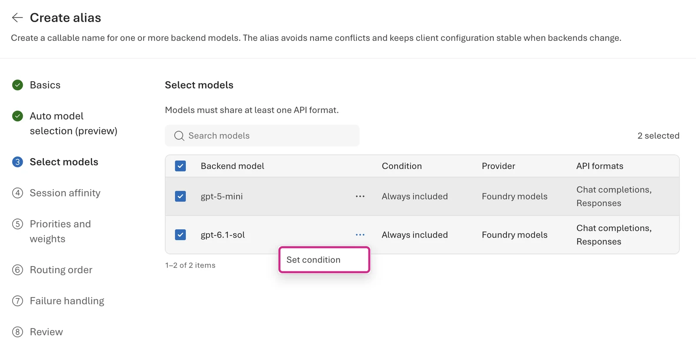
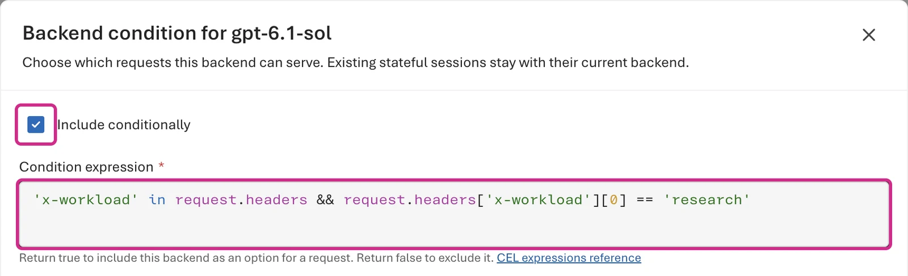
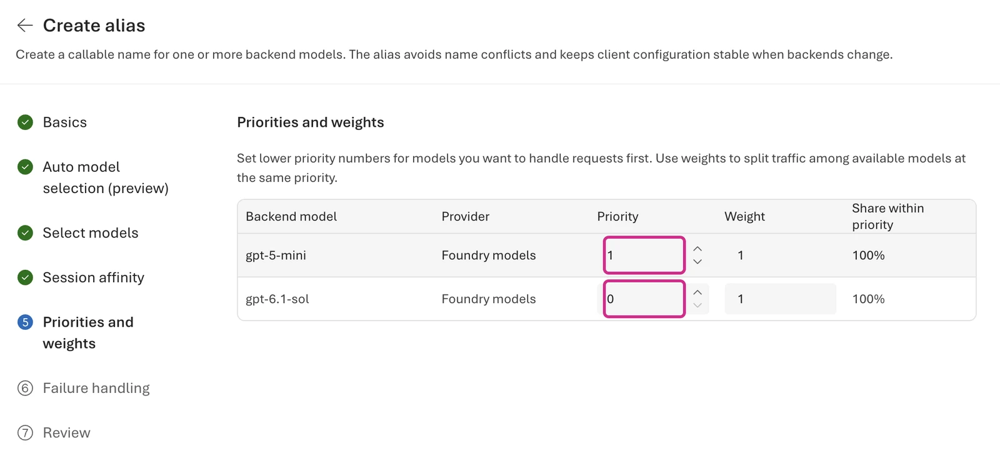
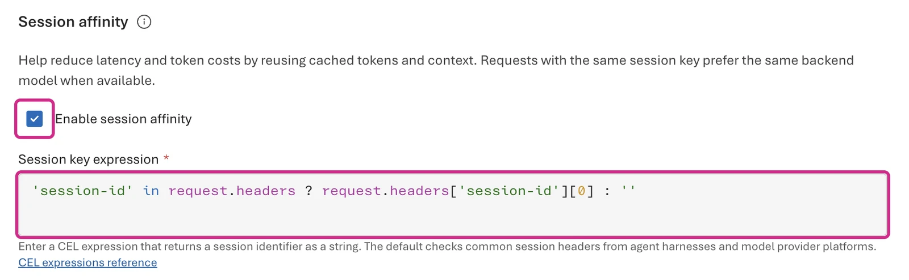
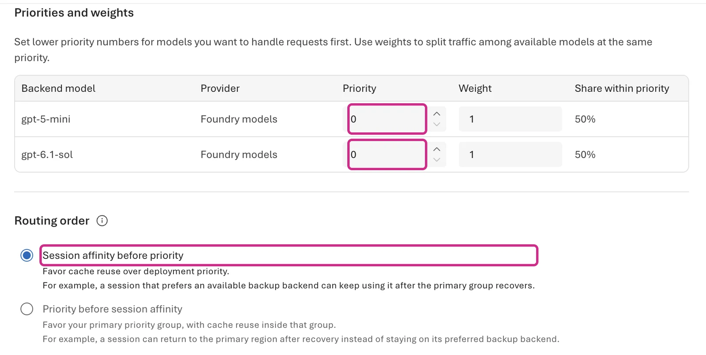

<!--
title: Route alias requests with conditions and session affinity
summary: Send the requests that carry a research header to a larger model with a CEL backend condition, then split traffic between two models and keep every conversation on one of them with session affinity, all behind one alias.
category: models
level: Intermediate
duration: 30
tracks: [portal, cli, iac, terraform]
order: 3.55
status: new
illustration: diagrams/conditional-routing.svg
tags: [model alias, routing, backend conditions, CEL, session affinity, routing order, selectionOrder, prompt caching, request headers]
objectives:
  - Explain how backend conditions, session affinity, priority, and weight combine to pick a backend model
  - Send the requests that carry a header to a larger model with a CEL backend condition
  - Keep every request of a session on the same backend model with a session key expression
  - Choose whether session affinity or priority decides first with the routing order
prereqs:
  - 02-first-model-call
-->
<!-- gh:begin nav: generated by "npm run sync" from the metadata, do not edit -->
[AI Gateway labs](../README.md) › [Models & routing](../README.md#models--routing) › Lab 27
<!-- gh:end -->

# Route alias requests with conditions and session affinity

<!-- gh:begin intro: generated by "npm run sync" from the metadata, do not edit -->
> Send the requests that carry a research header to a larger model with a CEL backend condition, then split traffic between two models and keep every conversation on one of them with session affinity, all behind one alias.

| ⏱️ Time | 📶 Level | 🧭 Tracks | ✅ Before you start |
| :-- | :-- | :-- | :-- |
| 30 min | Intermediate | Portal · Azure CLI · Bicep + azd · Terraform | [02 · First model call](../02-first-model-call/README.md) |

**You'll learn to**

- Explain how backend conditions, session affinity, priority, and weight combine to pick a backend model
- Send the requests that carry a header to a larger model with a CEL backend condition
- Keep every request of a session on the same backend model with a session key expression
- Choose whether session affinity or priority decides first with the routing order

**Follow along:** 🌐 [Interactive version](https://azure.github.io/aigateway/labs/27-conditional-routing/) with your own values filled in · 📁 [Lab files](infra/)

**On this page:** [Before you begin](#before-you-begin) · [How it works](#how-it-works) · [Route research requests to the larger model](#route-research-requests-to-the-larger-model) · [Watch the conditions](#watch-the-conditions) · [Keep each session on one backend](#keep-each-session-on-one-backend) · [Watch the sessions](#watch-the-sessions) · [Verify](#verify) · [Go further](#go-further) · [Clean up](#clean-up) · [Next steps](#next-steps)
<!-- gh:end -->

Your research team needs `gpt-6.1-sol` for deep analysis, but `gpt-5-mini` is good enough for everyone else, and
every app already sends `"model": "chat"`. In this lab you give the larger model a backend condition, so that only
requests with the header `x-workload: research` reach it. Then you split the traffic between both models and add
session affinity, so that every turn of a conversation stays on the same model, which keeps answers consistent and
prompt caches warm. The apps never change the model name they send.


## Before you begin

<!-- setup: tools sign-in extension clone -->
<!-- gh:begin setup: generated by "npm run sync" from the metadata, do not edit -->
🧰 **One-time setup** from the [Setup guide](../SETUP.md), if you haven't done it yet:
[Choose where to run commands](../SETUP.md#choose-where-to-run-commands) ·
[Sign in to Azure](../SETUP.md#sign-in-to-azure) ·
[Install the `aigateway` extension](../SETUP.md#install-the-aigateway-extension) ·
[Clone the labs repo](../SETUP.md#clone-the-labs-repo)
<!-- gh:end -->

> [!TIP]
> On the **Bicep + azd** and **Terraform** tracks, `azd up` or `terraform apply` creates its own gateway, both
> models, the alias, and a key, so you can skip this section. You need only the one-time setup above.

- Complete [Publish a Foundry model and make your first call](../02-first-model-call/README.md). You need the
  gateway, the `app-first-call` runtime key, and the `gpt-5-mini` backend model. Lab 02 also gave the gateway the
  **Foundry User** role on your Foundry account, which covers the new deployment in this lab.
- Recommended: [Route an alias across models by priority and weight](../22-model-routing/README.md) explains
  priority and weight. This lab builds on them. If you kept lab 22's `chat` alias, this lab replaces it.
- Permission to change the gateway, for example **Contributor** on its resource group, and to create deployments
  in the Foundry account.
- Run the scripts from the lab's folder, `~/aigateway/labs/27-conditional-routing`. The Bash scripts and snippets
  need `curl` and `jq`, which Cloud Shell has.

Set these variables once. Every track and the **Verify** section reuse them.

<details open><summary>Bash</summary> <!-- gh -->

```bash title="Bash"
# Name your gateway, the Foundry account from lab 02, the two backend models, and the alias that clients call
export RG="<resource-group>"
export GATEWAY="<gateway>"
export FOUNDRY_RG="<foundry-resource-group>"     # resource group of the Foundry account from lab 02
export FOUNDRY_ACCOUNT="<foundry-account-name>"
export PROVIDER="foundry-models"                 # the gateway provider that holds gpt-5-mini
export GENERAL="gpt-5-mini"                      # the backend model for everyday requests
export RESEARCH="gpt-6.1-sol"                    # the larger model for research requests
export RESEARCH_VERSION="2026-09-29"
export ALIAS="chat"                              # the name that clients send in "model"
echo "📝 Alias $ALIAS will route between $GENERAL and $RESEARCH on gateway $GATEWAY in $RG"

# Read the resource IDs of the gateway and the Foundry account, and the gateway's runtime URL
export GATEWAY_ID="$(az aigateway show -g "$RG" -n "$GATEWAY" --query id -o tsv)"
export FOUNDRY_ID="$(az cognitiveservices account show -g "$FOUNDRY_RG" -n "$FOUNDRY_ACCOUNT" --query id -o tsv)"
export AI_GATEWAY_URL="https://$(az aigateway show -g "$RG" -n "$GATEWAY" --query properties.frontend.defaultHostname -o tsv)"
echo "🆔 Gateway: $GATEWAY_ID"
echo "🌐 Runtime URL: $AI_GATEWAY_URL"

# Build the management URL of the gateway's default workspace, and the API version, for the az rest calls
export WS="https://management.azure.com$GATEWAY_ID/workspaces/default"
export API="api-version=2026-11-01"

# Read the app-first-call key from the gateway, so that it never shows on screen or lands in a file
export AI_GATEWAY_API_KEY="$(az aigateway api-key list-secrets -g "$RG" --gateway-name "$GATEWAY" -n app-first-call \
  --query primaryKey -o tsv)"
echo "🔑 Key: in AI_GATEWAY_API_KEY (${#AI_GATEWAY_API_KEY} characters, not shown)"

# Keep a jq filter that prints the alias's routing: each backend model with its priority, weight, and condition
export ROUTES='.properties
  | (.backendModels[] | "\(.resourceId | split("/") | last)  priority \(.priority)  weight \(.weight)  "
      + (if .when then "when \(.when)" else "always included" end)),
    "Routing order: \((.selectionOrder // ["priority"]) | join(", "))",
    "Session key: \(.sessionBackendPreference.key // "none")"'
```
</details> <!-- gh -->

<details><summary>PowerShell</summary> <!-- gh -->

```powershell title="PowerShell"
# Name your gateway, the Foundry account from lab 02, the two backend models, and the alias that clients call
$RG               = "<resource-group>"
$GATEWAY          = "<gateway>"
$FOUNDRY_RG       = "<foundry-resource-group>"    # resource group of the Foundry account from lab 02
$FOUNDRY_ACCOUNT  = "<foundry-account-name>"
$PROVIDER         = "foundry-models"              # the gateway provider that holds gpt-5-mini
$GENERAL          = "gpt-5-mini"                  # the backend model for everyday requests
$RESEARCH         = "gpt-6.1-sol"                 # the larger model for research requests
$RESEARCH_VERSION = "2026-09-29"
$ALIAS            = "chat"                        # the name that clients send in "model"
Write-Host "📝 Alias $ALIAS will route between $GENERAL and $RESEARCH on gateway $GATEWAY in $RG"

# Read the resource IDs of the gateway and the Foundry account, and the gateway's runtime URL
$GATEWAY_ID = az aigateway show -g $RG -n $GATEWAY --query id -o tsv
$FOUNDRY_ID = az cognitiveservices account show -g $FOUNDRY_RG -n $FOUNDRY_ACCOUNT --query id -o tsv
$env:AI_GATEWAY_URL = "https://$(az aigateway show -g $RG -n $GATEWAY --query properties.frontend.defaultHostname -o tsv)"
Write-Host "🆔 Gateway: $GATEWAY_ID"
Write-Host "🌐 Runtime URL: $env:AI_GATEWAY_URL"

# Build the management URL of the gateway's default workspace, and the API version, for the az rest calls
$WS  = "https://management.azure.com$GATEWAY_ID/workspaces/default"
$API = "api-version=2026-11-01"

# Read the app-first-call key from the gateway, so that it never shows on screen or lands in a file
$env:AI_GATEWAY_API_KEY = az aigateway api-key list-secrets -g $RG --gateway-name $GATEWAY -n app-first-call `
  --query primaryKey -o tsv
Write-Host "🔑 Key: in AI_GATEWAY_API_KEY ($($env:AI_GATEWAY_API_KEY.Length) characters, not shown)"

# Define a function that prints the alias's routing: each backend model with its priority, weight, and condition
function Show-Routes($alias) {
  $p = $alias.properties
  $p.backendModels | ForEach-Object {
    $rule = if ($_.when) { "when $($_.when)" } else { 'always included' }
    '{0}  priority {1}  weight {2}  {3}' -f ($_.resourceId -split '/')[-1], $_.priority, $_.weight, $rule
  }
  "Routing order: $(if ($p.selectionOrder) { $p.selectionOrder -join ', ' } else { 'priority' })"
  "Session key: $(if ($p.sessionBackendPreference) { $p.sessionBackendPreference.key } else { 'none' })"
}
```
</details> <!-- gh -->

The CLI and Bicep tracks of lab 02 name the provider `foundry-models`. A portal import names it after your
Foundry account. To check, list the backend models. The **Provider** column shows the provider of each one.

<details open><summary>Bash</summary> <!-- gh -->

```bash title="Bash"
# List the backend models on the gateway, with the provider that holds each one
echo "✨ Backend models on $GATEWAY:"
az aigateway model list -g "$RG" --gateway-name "$GATEWAY" -o table
```
</details> <!-- gh -->

<details><summary>PowerShell</summary> <!-- gh -->

```powershell title="PowerShell"
# List the backend models on the gateway, with the provider that holds each one
Write-Host "✨ Backend models on ${GATEWAY}:"
az aigateway model list -g $RG --gateway-name $GATEWAY -o table
```
</details> <!-- gh -->

Deploy the research model in the same Foundry account as `gpt-5-mini`. If you kept it from lab 22, the command
leaves it as it is. Pick a region where the model is available. Model inference is billed per use.

<details open><summary>Bash</summary> <!-- gh -->

```bash title="Bash"
# Deploy the research model next to gpt-5-mini, with 50,000 tokens and 50 requests per minute of Global Standard capacity
az cognitiveservices account deployment create -g "$FOUNDRY_RG" -n "$FOUNDRY_ACCOUNT" \
  --deployment-name "$RESEARCH" --model-name "$RESEARCH" --model-version "$RESEARCH_VERSION" \
  --model-format OpenAI --sku-name GlobalStandard --sku-capacity 50 \
  --query "{name:name, state:properties.provisioningState}" &&
  echo "✨ Model deployment $RESEARCH is ready in $FOUNDRY_ACCOUNT"
```
</details> <!-- gh -->

<details><summary>PowerShell</summary> <!-- gh -->

```powershell title="PowerShell"
# Deploy the research model next to gpt-5-mini, with 50,000 tokens and 50 requests per minute of Global Standard capacity
az cognitiveservices account deployment create -g $FOUNDRY_RG -n $FOUNDRY_ACCOUNT `
  --deployment-name $RESEARCH --model-name $RESEARCH --model-version $RESEARCH_VERSION `
  --model-format OpenAI --sku-name GlobalStandard --sku-capacity 50 `
  --query "{name:name, state:properties.provisioningState}"
if ($?) { Write-Host "✨ Model deployment $RESEARCH is ready in $FOUNDRY_ACCOUNT" }
```
</details> <!-- gh -->

## How it works

Lab 22 picked a backend model with priority and weight. Two more settings run before them:

| Setting | Alias field | Portal | What it does |
|---|---|---|---|
| **Backend condition** | `backendModels[].when` | **Select models** › **…** › **Set condition** | A CEL expression that returns `true` or `false` for each request. `false` removes the backend model from this request's choices. A backend model without a condition is always included. |
| **Session key** | `sessionBackendPreference.key` | **Session affinity** › **Session key expression** | A CEL expression that returns a string. Requests with the same key prefer the same backend model, from the first request on. An empty string means no affinity. |
| **Routing order** | `selectionOrder` | **Routing order** | Whether session affinity runs before or after priority. The default, `["priority"]`, has no affinity. |

For each request, the gateway first drops the backend models whose condition is `false`. Then session affinity and
priority narrow the rest in the routing order, and weight splits what's left. If every backend model is excluded,
the request fails before it reaches a provider.

Conditions and session keys are [CEL](https://ai.gateway.azure.com/docs/cel) expressions over the request.
`request.headers` maps each header name, in lowercase, to a list of values, so read the first value with `[0]`.
Other roots include `authorization.key.resource.name` (the runtime key's name) and `authorization.jwt.claims`.
Over the API, in Bicep, and in Terraform, wrap each expression in `@cel('…')`. The portal adds the wrapper for you.

Three habits keep expressions safe:

- **Check that a header exists before you read it.** `'x-workload' in request.headers && …` returns `false` when the
  header is missing. In our tests, reading a missing header failed the request with `HTTP 500`.
- **Compare exact values.** Comparisons are case-sensitive: `x-workload: Research` doesn't match `'research'`.
- **Route with headers, don't authorize with them.** Any caller with a key can send `x-workload: research`. To limit
  the larger model to some apps, test the key name or a token claim instead, as in **Go further**.

Session affinity matters for two reasons. Providers cache the long prompt prefix of a conversation per deployment,
so when every turn lands on the same backend model, cache hits cut latency and token cost. A weighted split alone
can move consecutive turns between models and miss the cache. And a Responses API conversation that continues
with `previous_response_id` must reach the backend that stored the earlier response: the gateway keeps those
continuations on their owning backend. Affinity is best effort, not guaranteed session continuity. If the preferred
backend is excluded or unavailable, the other settings decide, and adding or removing backend models can change
which backend a key maps to. Keep secrets out of session keys.

## Route research requests to the larger model

Register `gpt-6.1-sol` in the gateway, then create the `chat` alias. `gpt-6.1-sol` gets priority `0` and the
research condition, so research requests prefer it. `gpt-5-mini` gets priority `1` and no condition, so it serves
every other request.

<!-- track: portal | Portal -->
<details open><summary><b>🖥️ Portal</b></summary> <!-- gh -->

### Import the research model

1. Open the [AI Gateway portal](https://ai.gateway.azure.com) and select your gateway in the top bar.
2. Select **Models** › **Add** › **Models from Microsoft Foundry**.
3. In **Resource groups**, select the resource group of your Foundry account. Keep **Managed identity** as the
   **Authentication method**, and clear **Create an alias for each model**.
4. In **Models**, the list selects every Foundry account it finds. Make sure only your Foundry account is selected,
   then select **Add models**. The banner reads `1 model(s) were created. No aliases were created.`: the gateway
   already has `gpt-5-mini`, so it adds only `gpt-6.1-sol`. Select **Close**.

> **Checkpoint**
> **Models** › **Backend models** lists `gpt-5-mini` and `gpt-6.1-sol`. The portal names the new backend model
> `gpt-6-1-sol` and shows its display name, `gpt-6.1-sol`.

### Create the chat alias with a condition

If you kept lab 22's `chat` alias, delete it in **Models** › **Aliases** first, or open it, select **Edit**, and
make the same changes on one page.

1. Select **Models** › **Add** › **Alias for existing models**.
2. On **Basics**, set **Alias name** to `chat` and **Description** to `Research requests go to the larger model`.
   Select **Next**.
3. On **Auto model selection (preview)**, leave the option cleared, and select **Next**.
4. On **Select models**, select `gpt-5-mini` and `gpt-6.1-sol`. In the `gpt-6.1-sol` row, select **…** ›
   **Set condition**.

   

5. In **Backend condition for gpt-6.1-sol**, select **Include conditionally**, and enter this **Condition
   expression**, without the `@cel()` wrapper:

   ```text
   'x-workload' in request.headers && request.headers['x-workload'][0] == 'research'
   ```

   The editor checks the syntax as you type. An unbalanced quote or parenthesis shows `Check the expression's
   parentheses, strings, and comments.` It doesn't check that a header exists, so keep the `in` guard.

   Select **Apply**. The **Condition** column shows **Condition set** for `gpt-6.1-sol` and **Always included**
   for `gpt-5-mini`. Select **Next**.

   

6. On **Session affinity**, clear **Enable session affinity**. You turn it on in the next section. Select **Next**.
7. On **Priorities and weights**, set **Priority** to `0` for `gpt-6.1-sol` and `1` for `gpt-5-mini`. Keep both
   weights at `1`. Select **Next**.

   

8. On **Failure handling**, keep the defaults, and select **Next**.
9. On **Review**, check that **Session affinity** reads **Disabled**, then select **Create**.

> **Checkpoint**
> The `chat` alias opens. Its **Backend models** tab shows `gpt-6.1-sol` with **Condition set** at priority `0`,
> and `gpt-5-mini` with **Always included** at priority `1`.

</details> <!-- gh -->
<!-- track: cli | Azure CLI -->
<details><summary><b>⌨️ Azure CLI</b></summary> <!-- gh -->

### Register the research model

A backend model registers one deployment under the provider. `--foundry-resource-id` and `--deployment` name the
Foundry deployment, and the CLI reads its model name and version. If you kept `gpt-6.1-sol` from lab 22, skip this
step.

<details open><summary>Bash</summary> <!-- gh -->

```bash title="Bash"
# Register the research deployment as a backend model under the provider, with its model version
az aigateway model create -g "$RG" --gateway-name "$GATEWAY" --provider-name "$PROVIDER" -n "$RESEARCH" \
  --display-name "$RESEARCH" --api-format OpenAIChatCompletions \
  --supported-endpoints /openai/v1/chat/completions /openai/v1/responses \
  --foundry-resource-id "$FOUNDRY_ID" --deployment "$RESEARCH" \
  --query "{name:name, version:properties.deployment.modelVersion}" &&
  echo "✨ Model $RESEARCH is published through $PROVIDER"
```
</details> <!-- gh -->

<details><summary>PowerShell</summary> <!-- gh -->

```powershell title="PowerShell"
# Register the research deployment as a backend model under the provider, with its model version
az aigateway model create -g $RG --gateway-name $GATEWAY --provider-name $PROVIDER -n $RESEARCH `
  --display-name $RESEARCH --api-format OpenAIChatCompletions `
  --supported-endpoints /openai/v1/chat/completions /openai/v1/responses `
  --foundry-resource-id $FOUNDRY_ID --deployment $RESEARCH `
  --query "{name:name, version:properties.deployment.modelVersion}"
if ($?) { Write-Host "✨ Model $RESEARCH is published through $PROVIDER" }
```
</details> <!-- gh -->

### Create the chat alias with a condition

The `az aigateway model-alias` commands have no options yet for backend conditions, session affinity, or the
routing order, so this step sends the whole alias to the management API with `az rest`, at API version
`2026-11-01`. A `PUT` creates the alias or replaces all of it. `az aigateway model-alias show` prints all of these
settings, but don't change this alias with `model-alias set` or `update --backend-model`: they replace the backend
models without their conditions.

<details open><summary>Bash</summary> <!-- gh -->

```bash title="Bash"
# Build the resource ID prefix of the provider's backend models, and the research condition with its @cel() wrapper
export MODELS="$GATEWAY_ID/workspaces/default/modelProviders/$PROVIDER/models"
export RESEARCH_WHEN="@cel('x-workload' in request.headers && request.headers['x-workload'][0] == 'research')"

# Build the alias: the research model at priority 0 with the condition, gpt-5-mini at priority 1 for everything else
BODY="$(jq -cn --arg general "$MODELS/$GENERAL" --arg research "$MODELS/$RESEARCH" --arg when "$RESEARCH_WHEN" '
  {properties: {
    description: "Research requests go to the larger model",
    backendModels: [
      {resourceId: $research, priority: 0, weight: 1, when: $when},
      {resourceId: $general, priority: 1, weight: 1}],
    selectionOrder: ["priority"]}}')"

# Create or replace the alias, then print its routing
echo "🔖 Alias $ALIAS routes to:"
az rest --method put --url "$WS/aliases/$ALIAS?$API" --body "$BODY" | jq -r "$ROUTES"
```
</details> <!-- gh -->

<details><summary>PowerShell</summary> <!-- gh -->

```powershell title="PowerShell"
# Build the resource ID prefix of the provider's backend models, and the research condition with its @cel() wrapper
$MODELS        = "$GATEWAY_ID/workspaces/default/modelProviders/$PROVIDER/models"
$RESEARCH_WHEN = "@cel('x-workload' in request.headers && request.headers['x-workload'][0] == 'research')"

# Build the alias: the research model at priority 0 with the condition, gpt-5-mini at priority 1 for everything else
# Write it to a file, which --body reads with the @ prefix, so that its quotes reach az intact
@{ properties = @{
    description    = "Research requests go to the larger model"
    backendModels  = @(
      @{ resourceId = "$MODELS/$RESEARCH"; priority = 0; weight = 1; when = $RESEARCH_WHEN },
      @{ resourceId = "$MODELS/$GENERAL"; priority = 1; weight = 1 })
    selectionOrder = @("priority") } } | ConvertTo-Json -Depth 10 -Compress | Set-Content -Path alias.json

# Create or replace the alias, print its routing, and delete the file
Write-Host "🔖 Alias $ALIAS routes to:"
Show-Routes (az rest --method put --url "$WS/aliases/${ALIAS}?$API" --body '@alias.json' | ConvertFrom-Json)
Remove-Item alias.json
```
</details> <!-- gh -->

> **Checkpoint**
> The output shows
> `gpt-6.1-sol  priority 0  weight 1  when @cel('x-workload' in request.headers && request.headers['x-workload'][0] == 'research')`,
> `gpt-5-mini  priority 1  weight 1  always included`, `Routing order: priority`, and `Session key: none`.

</details> <!-- gh -->
<!-- track: iac | Bicep + azd -->
<details><summary><b>🏗️ Bicep + azd</b></summary> <!-- gh -->

**What you need:** only the one-time setup from **Before you begin**. This track doesn't use your gateway from lab 02:
`azd up` creates a new one, so it works on its own.

### Review the templates

`infra/main.bicep` creates the resource group `rg-<environment name>` and calls the quick start's
[resources.bicep](../quickstart/infra/resources.bicep) for the gateway, `gpt-5-mini`, its default alias, and the
`app-first-call` key. Then it deploys the research model in the same Foundry account and publishes the `chat` alias:

<!-- include: infra/main.bicep -->
<!-- gh:begin include: generated by "npm run sync" from the metadata, do not edit -->
📄 [`infra/main.bicep`](infra/main.bicep)

<details><summary>Show all 85 lines</summary>

```bicep
// Lab 27 with azd: "azd up" creates the resource group rg-<environment name>, the quick start's gateway, Foundry
// model, default alias, and runtime API key, then deploys a research model in the same Foundry account and publishes
// the chat alias, which routes by request header (conditions) or keeps each session on one backend model (affinity).
// The runtime API key is never an output.
targetScope = 'subscription'

@description('azd environment name. The resource group is rg-<environmentName>.')
@minLength(1)
@maxLength(60)
param environmentName string

@description('Region for every resource. Pick one where AI Gateway and the lab\'s Foundry models are available. List them with az provider show --namespace Microsoft.ApiManagement (Setup guide, Find the available regions).')
@metadata({ azd: { type: 'location' } })
param location string

@description('Research model to deploy in Foundry and route to. azd reads it from RESEARCH_MODEL.')
param researchModelName string = 'gpt-6.1-sol'

@description('Version of the research model. azd reads it from RESEARCH_MODEL_VERSION.')
param researchModelVersion string = '2026-09-29'

@description('conditions: x-workload: research requests go to the research model, the rest to gpt-5-mini. affinity: both models share the traffic, and each session stays on one of them. azd reads it from ROUTING_MODE.')
@allowed([
  'conditions'
  'affinity'
])
param routingMode string = 'conditions'

var suffix = take(uniqueString(subscription().id, environmentName, location), 6)
var tags = { 'azd-env-name': environmentName }

resource rg 'Microsoft.Resources/resourceGroups@2024-03-01' = {
  name: 'rg-${environmentName}'
  location: location
  tags: tags
}

// The quick start's template: a gateway, gpt-5-mini behind the default alias, and the app-first-call key.
module base '../../quickstart/infra/resources.bicep' = {
  name: 'aigw-base'
  scope: rg
  params: {
    location: location
    tags: tags
    gatewayName: 'aigw-${suffix}'
    foundryName: 'aigw${suffix}'
  }
}

// The research deployment, in the same Foundry account. The gateway's Foundry User role already covers it.
module researchDeployment 'research-deployment.bicep' = {
  name: 'aigw-research-deployment'
  scope: rg
  params: {
    foundryName: base.outputs.foundryName
    modelName: researchModelName
    modelVersion: researchModelVersion
  }
}

module routing 'conditional-alias.bicep' = {
  name: 'aigw-conditional-alias'
  scope: rg
  params: {
    gatewayName: base.outputs.gatewayName
    providerName: base.outputs.providerName
    generalModelName: base.outputs.modelName
    foundryAccountId: researchDeployment.outputs.foundryId
    researchDeploymentName: researchDeployment.outputs.deploymentName
    researchModelVersion: researchModelVersion
    aliasName: 'chat'
    routingMode: routingMode
  }
}

output AZURE_RESOURCE_GROUP string = rg.name
output AI_GATEWAY_NAME string = base.outputs.gatewayName
output AI_GATEWAY_ID string = base.outputs.gatewayId
output AI_GATEWAY_URL string = base.outputs.gatewayUrl
output AI_GATEWAY_PROVIDER string = base.outputs.providerName
output AI_GATEWAY_BACKEND_MODEL string = base.outputs.modelName
output AI_GATEWAY_RESEARCH_MODEL string = routing.outputs.researchModelName
output AI_GATEWAY_MODEL string = routing.outputs.aliasName
output AI_GATEWAY_ROUTING_MODE string = routing.outputs.routingMode
output FOUNDRY_ACCOUNT_NAME string = base.outputs.foundryName
```

</details>
<!-- gh:end -->

`infra/research-deployment.bicep` deploys `gpt-6.1-sol` next to `gpt-5-mini`:

<!-- include: infra/research-deployment.bicep -->
<!-- gh:begin include: generated by "npm run sync" from the metadata, do not edit -->
📄 [`infra/research-deployment.bicep`](infra/research-deployment.bicep)

<details><summary>Show all 39 lines</summary>

```bicep
// Deploys the larger research model in an existing Foundry account, next to gpt-5-mini. main.bicep calls it after the
// quick start's template has created the account and its gpt-5-mini deployment.
targetScope = 'resourceGroup'

@description('Name of the existing Foundry (Azure AI Services) account.')
param foundryName string

@description('Model to deploy. The deployment uses the same name.')
param modelName string = 'gpt-6.1-sol'

@description('Version of the model to deploy.')
param modelVersion string = '2026-09-29'

@description('Deployment capacity in thousands of tokens per minute. 50 also allows 50 requests per minute, enough for the lab\'s scripts.')
@minValue(1)
param capacity int = 50

resource foundry 'Microsoft.CognitiveServices/accounts@2025-04-01-preview' existing = {
  name: foundryName
}

resource deployment 'Microsoft.CognitiveServices/accounts/deployments@2025-04-01-preview' = {
  parent: foundry
  name: modelName
  sku: {
    name: 'GlobalStandard'
    capacity: capacity
  }
  properties: {
    model: {
      format: 'OpenAI'
      name: modelName
      version: modelVersion
    }
  }
}

output deploymentName string = deployment.name
output foundryId string = foundry.id
```

</details>
<!-- gh:end -->

`infra/conditional-alias.bicep` registers the research model and writes the alias. `ROUTING_MODE` picks one of its
two shapes: `conditions` adds the `when` condition, and `affinity` adds the session key and the routing order. In
Bicep, the quotes inside a CEL expression are escaped as `\'`. You can also deploy this file on its own to the
gateway from lab 02.

<!-- include: infra/conditional-alias.bicep -->
<!-- gh:begin include: generated by "npm run sync" from the metadata, do not edit -->
📄 [`infra/conditional-alias.bicep`](infra/conditional-alias.bicep)

<details><summary>Show all 124 lines</summary>

```bicep
// Routes one callable alias across two Foundry backend models with CEL expressions. main.bicep calls it after the
// quick start's template, and you can also deploy it on its own to a gateway you already have, such as the one from
// lab 02. Registers the research deployment under the existing Foundry provider, then publishes an alias that either
// sends requests with the header x-workload: research to the research model (conditions), or splits traffic between
// both models and keeps each session on one of them (affinity).
// The general backend model is only referenced, so its policies stay untouched.
targetScope = 'resourceGroup'

@description('Name of the existing AI Gateway (Microsoft.ApiManagement/aigateways) in this resource group.')
param gatewayName string

@description('Name of the existing Foundry model provider in the gateway, for example foundry-models from lab 02.')
param providerName string = 'foundry-models'

@description('Name of the existing backend model that serves everyday requests, for example gpt-5-mini.')
param generalModelName string = 'gpt-5-mini'

@description('Resource ID of the Foundry account that hosts the research deployment.')
param foundryAccountId string

@description('Name of the research deployment in that account, for example gpt-6.1-sol.')
param researchDeploymentName string = 'gpt-6.1-sol'

@description('Version of the research model, for example 2026-09-29. Optional.')
param researchModelVersion string = ''

@description('Callable alias that clients send in the request "model" field.')
param aliasName string = 'chat'

@description('conditions: requests that match the condition go to the research model, the rest to the general model. affinity: both models share the traffic, and each session stays on one of them.')
@allowed([
  'conditions'
  'affinity'
])
param routingMode string = 'conditions'

@description('Conditions mode: the CEL expression that includes the research model for a request. It must return a Boolean.')
param researchCondition string = '@cel(\'x-workload\' in request.headers && request.headers[\'x-workload\'][0] == \'research\')'

@description('Affinity mode: the CEL expression that returns the session key. An empty string means no affinity for the request.')
param sessionKey string = '@cel(\'session-id\' in request.headers ? request.headers[\'session-id\'][0] : \'\')'

#disable-next-line BCP081
resource aiGateway 'Microsoft.ApiManagement/aigateways@2026-11-01' existing = {
  name: gatewayName
}

#disable-next-line BCP081
resource defaultWorkspace 'Microsoft.ApiManagement/aigateways/workspaces@2026-11-01' existing = {
  parent: aiGateway
  name: 'default'
}

#disable-next-line BCP081
resource provider 'Microsoft.ApiManagement/aigateways/workspaces/modelProviders@2026-11-01' existing = {
  parent: defaultWorkspace
  name: providerName
}

#disable-next-line BCP081
resource general 'Microsoft.ApiManagement/aigateways/workspaces/modelProviders/models@2026-11-01' existing = {
  parent: provider
  name: generalModelName
}

#disable-next-line BCP081
resource research 'Microsoft.ApiManagement/aigateways/workspaces/modelProviders/models@2026-11-01' = {
  parent: provider
  name: researchDeploymentName
  properties: {
    displayName: researchDeploymentName
    description: 'Research model that the ${aliasName} alias routes to.'
    supportedEndpoints: [
      '/openai/v1/chat/completions'
      '/openai/v1/responses'
    ]
    deployment: {
      resourceId: '${foundryAccountId}/deployments/${researchDeploymentName}'
      modelName: researchDeploymentName
      modelVersion: empty(researchModelVersion) ? null : researchModelVersion
    }
  }
}

// Conditions: the research model is preferred (priority 0) but only included when its condition is true, so every
// other request falls through to the general model at priority 1.
var conditionsProperties = {
  description: 'Sends x-workload: research requests to ${researchDeploymentName}, everything else to ${generalModelName}.'
  backendModels: [
    { resourceId: research.id, priority: 0, weight: 1, when: researchCondition }
    { resourceId: general.id, priority: 1, weight: 1 }
  ]
  selectionOrder: [
    'priority'
  ]
}

// Affinity: both models share priority 0, and the session key picks the backend before priority and weight do.
var affinityProperties = {
  description: 'Splits sessions between ${generalModelName} and ${researchDeploymentName}, and keeps each session on one of them.'
  backendModels: [
    { resourceId: general.id, priority: 0, weight: 1 }
    { resourceId: research.id, priority: 0, weight: 1 }
  ]
  selectionOrder: [
    'sessionBackendPreference'
    'priority'
  ]
  sessionBackendPreference: {
    key: sessionKey
  }
}

#disable-next-line BCP081
resource alias 'Microsoft.ApiManagement/aigateways/workspaces/aliases@2026-11-01' = {
  parent: defaultWorkspace
  name: aliasName
  properties: routingMode == 'conditions' ? conditionsProperties : affinityProperties
}

output aliasName string = alias.name
output researchModelName string = research.name
output routingMode string = routingMode
output chatCompletionsUrl string = 'https://${aiGateway.properties.frontend.defaultHostname}/default/models/openai/v1/chat/completions'
```

</details>
<!-- gh:end -->

### Deploy with azd up

Move into the lab's folder, create an azd environment named `aigw-lab27` in your current subscription, then
provision everything. It takes about 29 minutes, most of it while the new gateway activates.

<details open><summary>Bash</summary> <!-- gh -->

```bash title="Bash"
# Move into the lab's folder, which holds the azd project
cd ~/aigateway/labs/27-conditional-routing &&
  echo "📂 Lab folder: $(pwd)"

# Create an azd environment named aigw-lab27 in your current subscription, so that azd doesn't prompt you
azd env new aigw-lab27 --location eastus2 --subscription "$(az account show --query id --output tsv)" &&
  echo "📝 azd environment aigw-lab27 deploys to eastus2"

# Provision the resource group, the gateway, the Foundry account with both models, the chat alias, and the key
azd up &&
  echo "🚀 Gateway deployed: $(azd env get-value AI_GATEWAY_URL)"
```
</details> <!-- gh -->

<details><summary>PowerShell</summary> <!-- gh -->

```powershell title="PowerShell"
# Move into the lab's folder, which holds the azd project
Set-Location ~/aigateway/labs/27-conditional-routing
if ($?) { Write-Host "📂 Lab folder: $(Get-Location)" }

# Create an azd environment named aigw-lab27 in your current subscription, so that azd doesn't prompt you
azd env new aigw-lab27 --location eastus2 --subscription (az account show --query id --output tsv)
if ($?) { Write-Host "📝 azd environment aigw-lab27 deploys to eastus2" }

# Provision the resource group, the gateway, the Foundry account with both models, the chat alias, and the key
azd up
if ($?) { Write-Host "🚀 Gateway deployed: $(azd env get-value AI_GATEWAY_URL)" }
```
</details> <!-- gh -->

For another region, pick one where AI Gateway and the `gpt-5-mini` and `gpt-6.1-sol` models are available, as in
[Find the available regions](../SETUP.md#find-the-available-regions). The parameters come from azd environment
values, with the defaults in `infra/main.parameters.json`: `ROUTING_MODE` (`conditions`), `RESEARCH_MODEL`
(`gpt-6.1-sol`), and `RESEARCH_MODEL_VERSION` (`2026-09-29`).

### Read the outputs and the key

Set the variables that the next sections and **Verify** use from azd's environment values, read the key from the
gateway so that it never shows on screen, then print the alias's routing.

<details open><summary>Bash</summary> <!-- gh -->

```bash title="Bash"
# Read azd's outputs into the variables that the next sections use
export RG="$(azd env get-value AZURE_RESOURCE_GROUP)"
export GATEWAY="$(azd env get-value AI_GATEWAY_NAME)"
export GATEWAY_ID="$(azd env get-value AI_GATEWAY_ID)"
export GENERAL="$(azd env get-value AI_GATEWAY_BACKEND_MODEL)"
export RESEARCH="$(azd env get-value AI_GATEWAY_RESEARCH_MODEL)"
export ALIAS="$(azd env get-value AI_GATEWAY_MODEL)"
export AI_GATEWAY_URL="$(azd env get-value AI_GATEWAY_URL)"
echo "📝 Alias $ALIAS routes between $GENERAL and $RESEARCH on gateway $GATEWAY in $RG"
echo "🌐 Runtime URL: $AI_GATEWAY_URL"

# Read the app-first-call key from the gateway, so that it never shows on screen or lands in a file
export AI_GATEWAY_API_KEY="$(az aigateway api-key list-secrets --ids "$GATEWAY_ID/apiKeys/app-first-call" \
  --query primaryKey --output tsv)"
echo "🔑 Key: in AI_GATEWAY_API_KEY (${#AI_GATEWAY_API_KEY} characters, not shown)"

# Keep a jq filter that prints the alias's routing, then print it
export ROUTES='.properties
  | (.backendModels[] | "\(.resourceId | split("/") | last)  priority \(.priority)  weight \(.weight)  "
      + (if .when then "when \(.when)" else "always included" end)),
    "Routing order: \((.selectionOrder // ["priority"]) | join(", "))",
    "Session key: \(.sessionBackendPreference.key // "none")"'
echo "🔖 Alias $ALIAS routes to:"
az aigateway model-alias show -g "$RG" --gateway-name "$GATEWAY" -n "$ALIAS" | jq -r "$ROUTES"
```
</details> <!-- gh -->

<details><summary>PowerShell</summary> <!-- gh -->

```powershell title="PowerShell"
# Read azd's outputs into the variables that the next sections use
$RG                     = azd env get-value AZURE_RESOURCE_GROUP
$GATEWAY                = azd env get-value AI_GATEWAY_NAME
$GATEWAY_ID             = azd env get-value AI_GATEWAY_ID
$GENERAL                = azd env get-value AI_GATEWAY_BACKEND_MODEL
$RESEARCH               = azd env get-value AI_GATEWAY_RESEARCH_MODEL
$ALIAS                  = azd env get-value AI_GATEWAY_MODEL
$env:AI_GATEWAY_URL     = azd env get-value AI_GATEWAY_URL
Write-Host "📝 Alias $ALIAS routes between $GENERAL and $RESEARCH on gateway $GATEWAY in $RG"
Write-Host "🌐 Runtime URL: $env:AI_GATEWAY_URL"

# Read the app-first-call key from the gateway, so that it never shows on screen or lands in a file
$env:AI_GATEWAY_API_KEY = az aigateway api-key list-secrets --ids "$GATEWAY_ID/apiKeys/app-first-call" `
  --query primaryKey --output tsv
Write-Host "🔑 Key: in AI_GATEWAY_API_KEY ($($env:AI_GATEWAY_API_KEY.Length) characters, not shown)"

# Define a function that prints the alias's routing, then print it
function Show-Routes($alias) {
  $p = $alias.properties
  $p.backendModels | ForEach-Object {
    $rule = if ($_.when) { "when $($_.when)" } else { 'always included' }
    '{0}  priority {1}  weight {2}  {3}' -f ($_.resourceId -split '/')[-1], $_.priority, $_.weight, $rule
  }
  "Routing order: $(if ($p.selectionOrder) { $p.selectionOrder -join ', ' } else { 'priority' })"
  "Session key: $(if ($p.sessionBackendPreference) { $p.sessionBackendPreference.key } else { 'none' })"
}
Write-Host "🔖 Alias $ALIAS routes to:"
Show-Routes (az aigateway model-alias show -g $RG --gateway-name $GATEWAY -n $ALIAS | ConvertFrom-Json)
```
</details> <!-- gh -->

> **Checkpoint**
> `azd up` ended with `SUCCESS`, and the last command printed `gpt-6.1-sol  priority 0  weight 1  when @cel(…)`,
> `gpt-5-mini  priority 1  weight 1  always included`, and `Routing order: priority`.

</details> <!-- gh -->
<!-- track: terraform | Terraform -->
<details><summary><b>🌍 Terraform</b></summary> <!-- gh -->

**What you need:** only the one-time setup from **Before you begin**, plus Terraform 1.9 or later, as in
[Deploy a lab with Terraform](../SETUP.md#deploy-a-lab-with-terraform). This track doesn't use your gateway from
lab 02: `terraform apply` creates a new one, so it works on its own.

### Review the configuration

`terraform/main.tf` creates the resource group `rg-<environment_name>` and calls the quick start's
[resources module](../quickstart/terraform/resources) for the gateway, `gpt-5-mini`, its default alias, and the
`app-first-call` key:

<!-- include: terraform/main.tf -->
<!-- gh:begin include: generated by "npm run sync" from the metadata, do not edit -->
📄 [`terraform/main.tf`](terraform/main.tf)

<details><summary>Show all 29 lines</summary>

```tf
# Lab 27 with Terraform: creates the resource group rg-<environment_name>, the quick start's gateway, Foundry model,
# default alias, and runtime API key, then deploys a research model in the same Foundry account (research-model.tf)
# and publishes the chat alias, which routes by request header (conditions) or keeps each session on one backend
# model (affinity) (conditional-alias.tf). The runtime API key is never an output.
data "azapi_client_config" "current" {}

locals {
  suffix = substr(sha1("${data.azapi_client_config.current.subscription_id}/${var.environment_name}/${var.location}"), 0, 6)
  tags   = { "environment-name" = var.environment_name }
}

resource "azurerm_resource_group" "rg" {
  name     = "rg-${var.environment_name}"
  location = var.location
  tags     = local.tags
}

# The quick start's module: a gateway, gpt-5-mini behind the default alias, and the app-first-call key.
module "base" {
  source = "../../quickstart/terraform/resources"

  subscription_id     = data.azapi_client_config.current.subscription_id
  resource_group_name = azurerm_resource_group.rg.name
  resource_group_id   = azurerm_resource_group.rg.id
  location            = var.location
  tags                = local.tags
  gateway_name        = "aigw-${local.suffix}"
  foundry_name        = "aigw${local.suffix}"
}
```

</details>
<!-- gh:end -->

`terraform/research-model.tf` deploys the research model in the same Foundry account with the `azurerm` provider,
and registers it as a backend model with the `azapi` provider, which sends the AI Gateway API version,
`2026-11-01`, as is:

<!-- include: terraform/research-model.tf -->
<!-- gh:begin include: generated by "npm run sync" from the metadata, do not edit -->
📄 [`terraform/research-model.tf`](terraform/research-model.tf)

<details><summary>Show all 42 lines</summary>

```tf
# The research model, deployed in the quick start's Foundry account next to gpt-5-mini and registered as a second
# backend model under the quick start's provider. The gateway's Foundry User role on the account already covers it.
resource "azurerm_cognitive_deployment" "research" {
  name                 = var.research_model_name
  cognitive_account_id = module.base.foundry_id

  # 50 also allows 50 requests per minute, enough for the lab's scripts.
  sku {
    name     = "GlobalStandard"
    capacity = 50
  }

  model {
    format  = "OpenAI"
    name    = var.research_model_name
    version = var.research_model_version
  }
}

resource "azapi_resource" "research_model" {
  type      = "Microsoft.ApiManagement/aigateways/workspaces/modelProviders/models@2026-11-01"
  name      = azurerm_cognitive_deployment.research.name
  parent_id = module.base.provider_id

  body = {
    properties = {
      displayName = azurerm_cognitive_deployment.research.name
      description = "Research model that the chat alias routes to."
      supportedEndpoints = [
        "/openai/v1/chat/completions",
        "/openai/v1/responses",
      ]
      deployment = {
        resourceId   = azurerm_cognitive_deployment.research.id
        modelName    = var.research_model_name
        modelVersion = var.research_model_version
      }
    }
  }

  schema_validation_enabled = false
}
```

</details>
<!-- gh:end -->

`terraform/conditional-alias.tf` publishes the `chat` alias. It keeps both routing modes in a map, and the
`routing_mode` variable picks one, so switching modes changes only the alias:

<!-- include: terraform/conditional-alias.tf -->
<!-- gh:begin include: generated by "npm run sync" from the metadata, do not edit -->
📄 [`terraform/conditional-alias.tf`](terraform/conditional-alias.tf)

<details><summary>Show all 42 lines</summary>

```tf
# The chat alias, which routes across gpt-5-mini and the research model with CEL expressions. The gpt-5-mini backend
# model comes from the quick start's module and is only referenced, so its policies stay untouched.
locals {
  general_model = module.base.model_name
  research      = azapi_resource.research_model.name

  routing = {
    # Conditions: the research model is preferred (priority 0) but only included when its condition is true, so
    # every other request falls through to gpt-5-mini at priority 1.
    conditions = {
      description = "Sends x-workload: research requests to ${local.research}, everything else to ${local.general_model}."
      backendModels = [
        { resourceId = azapi_resource.research_model.id, priority = 0, weight = 1, when = var.research_condition },
        { resourceId = module.base.model_id, priority = 1, weight = 1 },
      ]
      selectionOrder = ["priority"]
    }

    # Affinity: both models share priority 0, and the session key picks the backend before priority and weight do.
    affinity = {
      description = "Splits sessions between ${local.general_model} and ${local.research}, and keeps each session on one of them."
      backendModels = [
        { resourceId = module.base.model_id, priority = 0, weight = 1 },
        { resourceId = azapi_resource.research_model.id, priority = 0, weight = 1 },
      ]
      selectionOrder           = ["sessionBackendPreference", "priority"]
      sessionBackendPreference = { key = var.session_key }
    }
  }
}

resource "azapi_resource" "chat_alias" {
  type      = "Microsoft.ApiManagement/aigateways/workspaces/aliases@2026-11-01"
  name      = "chat"
  parent_id = module.base.workspace_id

  body = {
    properties = local.routing[var.routing_mode]
  }

  schema_validation_enabled = false
}
```

</details>
<!-- gh:end -->

`terraform/variables.tf` declares the research model, the routing mode, and both CEL expressions, with the same
defaults as the Bicep templates:

<!-- include: terraform/variables.tf -->
<!-- gh:begin include: generated by "npm run sync" from the metadata, do not edit -->
📄 [`terraform/variables.tf`](terraform/variables.tf)

<details><summary>Show all 46 lines</summary>

```tf
variable "environment_name" {
  description = "Names the resource group rg-<environment_name> and seeds the unique resource names."
  type        = string
  default     = "aigw-lab27-tf"
}

variable "location" {
  description = "Region for every resource. Pick one where AI Gateway and the lab's Foundry models are available."
  type        = string
  default     = "eastus2"
}

variable "research_model_name" {
  description = "Research model to deploy in Foundry and route to. The deployment and the backend model use this name."
  type        = string
  default     = "gpt-6.1-sol"
}

variable "research_model_version" {
  description = "Version of the research model."
  type        = string
  default     = "2026-09-29"
}

variable "routing_mode" {
  description = "conditions: x-workload: research requests go to the research model, the rest to gpt-5-mini. affinity: both models share the traffic, and each session stays on one of them."
  type        = string
  default     = "conditions"

  validation {
    condition     = contains(["conditions", "affinity"], var.routing_mode)
    error_message = "The routing mode must be conditions or affinity."
  }
}

variable "research_condition" {
  description = "Conditions mode: the CEL expression that includes the research model for a request. It must return a Boolean."
  type        = string
  default     = "@cel('x-workload' in request.headers && request.headers['x-workload'][0] == 'research')"
}

variable "session_key" {
  description = "Affinity mode: the CEL expression that returns the session key. An empty string means no affinity for the request."
  type        = string
  default     = "@cel('session-id' in request.headers ? request.headers['session-id'][0] : '')"
}
```

</details>
<!-- gh:end -->

### Deploy with terraform apply

Move into the lab's Terraform folder, select your current subscription, then plan and apply the configuration. It
takes about three minutes, most of it while the new gateway activates.

<details open><summary>Bash</summary> <!-- gh -->

```bash title="Bash"
# Move into the lab's Terraform folder
cd ~/aigateway/labs/27-conditional-routing/terraform &&
  echo "📂 Terraform folder: $(pwd)"

# Deploy to the Azure CLI's current subscription
export ARM_SUBSCRIPTION_ID="$(az account show --query id --output tsv)" &&
  echo "📍 Subscription: $ARM_SUBSCRIPTION_ID"

# Download the providers, then plan and apply the gateway, the Foundry account with both models, the chat alias,
# and the key
terraform init &&
  terraform plan -out tfplan &&
  terraform apply tfplan &&
  echo "🚀 Gateway deployed: $(terraform output -raw ai_gateway_url)"
```
</details> <!-- gh -->

<details><summary>PowerShell</summary> <!-- gh -->

```powershell title="PowerShell"
# Move into the lab's Terraform folder
Set-Location ~/aigateway/labs/27-conditional-routing/terraform
if ($?) { Write-Host "📂 Terraform folder: $(Get-Location)" }

# Deploy to the Azure CLI's current subscription
$env:ARM_SUBSCRIPTION_ID = az account show --query id --output tsv
if ($?) { Write-Host "📍 Subscription: $env:ARM_SUBSCRIPTION_ID" }

# Download the providers, then plan and apply the gateway, the Foundry account with both models, the chat alias,
# and the key
terraform init
if ($?) { terraform plan -out tfplan }
if ($?) { terraform apply tfplan }
if ($?) { Write-Host "🚀 Gateway deployed: $(terraform output -raw ai_gateway_url)" }
```
</details> <!-- gh -->

The configuration deploys to `eastus2`. For another region where AI Gateway and the `gpt-5-mini` and `gpt-6.1-sol`
models are available, as in [Find the available regions](../SETUP.md#find-the-available-regions), run
`export TF_VAR_location=<region>` (PowerShell: `$env:TF_VAR_location = "<region>"`) before `terraform plan`.

### Read the outputs and the key

Set the variables that the next sections and **Verify** use from the Terraform outputs, read the key from the
gateway so that it never shows on screen or lands in the Terraform state, then print the alias's routing.

<details open><summary>Bash</summary> <!-- gh -->

```bash title="Bash"
# Read the configuration's outputs into the variables that the next sections use
export RG="$(terraform output -raw azure_resource_group)"
export GATEWAY="$(terraform output -raw ai_gateway_name)"
export GATEWAY_ID="$(terraform output -raw ai_gateway_id)"
export GENERAL="$(terraform output -raw ai_gateway_backend_model)"
export RESEARCH="$(terraform output -raw ai_gateway_research_model)"
export ALIAS="$(terraform output -raw ai_gateway_model)"
export AI_GATEWAY_URL="$(terraform output -raw ai_gateway_url)"
echo "📝 Alias $ALIAS routes between $GENERAL and $RESEARCH on gateway $GATEWAY in $RG"
echo "🌐 Runtime URL: $AI_GATEWAY_URL"

# Read the app-first-call key from the gateway, so that it never lands in a file or the Terraform state
export AI_GATEWAY_API_KEY="$(az aigateway api-key list-secrets --ids "$GATEWAY_ID/apiKeys/app-first-call" \
  --query primaryKey --output tsv)"
echo "🔑 Key: in AI_GATEWAY_API_KEY (${#AI_GATEWAY_API_KEY} characters, not shown)"

# Keep a jq filter that prints the alias's routing, then print it
export ROUTES='.properties
  | (.backendModels[] | "\(.resourceId | split("/") | last)  priority \(.priority)  weight \(.weight)  "
      + (if .when then "when \(.when)" else "always included" end)),
    "Routing order: \((.selectionOrder // ["priority"]) | join(", "))",
    "Session key: \(.sessionBackendPreference.key // "none")"'
echo "🔖 Alias $ALIAS routes to:"
az aigateway model-alias show -g "$RG" --gateway-name "$GATEWAY" -n "$ALIAS" | jq -r "$ROUTES"
# Move back to the lab's folder, which holds the scripts
cd .. && echo "📂 Lab folder: $(pwd)"
```
</details> <!-- gh -->

<details><summary>PowerShell</summary> <!-- gh -->

```powershell title="PowerShell"
# Read the configuration's outputs into the variables that the next sections use
$RG                     = terraform output -raw azure_resource_group
$GATEWAY                = terraform output -raw ai_gateway_name
$GATEWAY_ID             = terraform output -raw ai_gateway_id
$GENERAL                = terraform output -raw ai_gateway_backend_model
$RESEARCH               = terraform output -raw ai_gateway_research_model
$ALIAS                  = terraform output -raw ai_gateway_model
$env:AI_GATEWAY_URL     = terraform output -raw ai_gateway_url
Write-Host "📝 Alias $ALIAS routes between $GENERAL and $RESEARCH on gateway $GATEWAY in $RG"
Write-Host "🌐 Runtime URL: $env:AI_GATEWAY_URL"

# Read the app-first-call key from the gateway, so that it never lands in a file or the Terraform state
$env:AI_GATEWAY_API_KEY = az aigateway api-key list-secrets --ids "$GATEWAY_ID/apiKeys/app-first-call" `
  --query primaryKey --output tsv
Write-Host "🔑 Key: in AI_GATEWAY_API_KEY ($($env:AI_GATEWAY_API_KEY.Length) characters, not shown)"

# Define a function that prints the alias's routing, then print it
function Show-Routes($alias) {
  $p = $alias.properties
  $p.backendModels | ForEach-Object {
    $rule = if ($_.when) { "when $($_.when)" } else { 'always included' }
    '{0}  priority {1}  weight {2}  {3}' -f ($_.resourceId -split '/')[-1], $_.priority, $_.weight, $rule
  }
  "Routing order: $(if ($p.selectionOrder) { $p.selectionOrder -join ', ' } else { 'priority' })"
  "Session key: $(if ($p.sessionBackendPreference) { $p.sessionBackendPreference.key } else { 'none' })"
}
Write-Host "🔖 Alias $ALIAS routes to:"
Show-Routes (az aigateway model-alias show -g $RG --gateway-name $GATEWAY -n $ALIAS | ConvertFrom-Json)
# Move back to the lab's folder, which holds the scripts
Set-Location ..
if ($?) { Write-Host "📂 Lab folder: $(Get-Location)" }
```
</details> <!-- gh -->

> **Checkpoint**
> `terraform apply` ended with `Apply complete! Resources: 12 added, 0 changed, 0 destroyed.`, and the output
> shows `gpt-6.1-sol  priority 0  weight 1  when @cel(…)`, `gpt-5-mini  priority 1  weight 1  always included`,
> and `Routing order: priority`.

The next sections run from the lab's folder, with `-chdir=terraform` for the `terraform` commands.

</details> <!-- gh -->
<!-- /tracks -->

## Watch the conditions

Send a few requests to `chat` without a header, with `x-workload: research`, and with `x-workload: Research`, and
count which backend model answered each one. The script reads the `model` field of each response.

<details open><summary>Bash</summary> <!-- gh -->

```bash title="Bash"
# Send 4 requests without a workload header, then 4 with the research header, then 4 with a capitalized value
echo "📊 Counting the backend models that serve $ALIAS for each header"
./infra/count-models.sh "$ALIAS" 4
./infra/count-models.sh "$ALIAS" 4 "x-workload: research"
./infra/count-models.sh "$ALIAS" 4 "x-workload: Research"
```
</details> <!-- gh -->

<details><summary>PowerShell</summary> <!-- gh -->

```powershell title="PowerShell"
# Send 4 requests without a workload header, then 4 with the research header, then 4 with a capitalized value
Write-Host "📊 Counting the backend models that serve $ALIAS for each header"
./infra/count-models.ps1 -Alias $ALIAS -Count 4
./infra/count-models.ps1 -Alias $ALIAS -Count 4 -Headers @{ 'x-workload' = 'research' }
./infra/count-models.ps1 -Alias $ALIAS -Count 4 -Headers @{ 'x-workload' = 'Research' }
```
</details> <!-- gh -->

```text
📊 Counting the backend models that serve chat for each header
Sending 4 requests with "model": "chat"
  1  gpt-5-mini-2025-08-07
  2  gpt-5-mini-2025-08-07
  3  gpt-5-mini-2025-08-07
  4  gpt-5-mini-2025-08-07

Requests per backend model:
   4 gpt-5-mini-2025-08-07
Sending 4 requests with "model": "chat" and the header x-workload: research
  1  gpt-6.1-sol-2026-09-29
  2  gpt-6.1-sol-2026-09-29
  3  gpt-6.1-sol-2026-09-29
  4  gpt-6.1-sol-2026-09-29

Requests per backend model:
   4 gpt-6.1-sol-2026-09-29
Sending 4 requests with "model": "chat" and the header x-workload: Research
  1  gpt-5-mini-2025-08-07
  2  gpt-5-mini-2025-08-07
  3  gpt-5-mini-2025-08-07
  4  gpt-5-mini-2025-08-07

Requests per backend model:
   4 gpt-5-mini-2025-08-07
```

Without the header, the condition is `false`, so `gpt-6.1-sol` is excluded and `gpt-5-mini` serves the request at
priority `1`. With the header, both models are included, and priority prefers `gpt-6.1-sol`. `Research` with a
capital R doesn't match. Foundry models also return the backend model in an `x-ms-served-model` header:

<details open><summary>Bash</summary> <!-- gh -->

```bash title="Bash"
# Send one research request to the alias, and print only the x-ms-served-model header of the response
echo "✨ Backend model that served one research request to $ALIAS:"
curl -sS -D - -o /dev/null "$AI_GATEWAY_URL/default/models/openai/v1/chat/completions" \
  -H "Authorization: Bearer $AI_GATEWAY_API_KEY" -H "Content-Type: application/json" -H "x-workload: research" \
  -d "{\"model\": \"$ALIAS\", \"max_completion_tokens\": 16, \"messages\": [{\"role\": \"user\", \"content\": \"Hi\"}]}" |
  grep -i "^x-ms-served-model"
```
</details> <!-- gh -->

<details><summary>PowerShell</summary> <!-- gh -->

```powershell title="PowerShell"
# Build a short request to the alias, capped at 16 completion tokens
$body = @{ model = $ALIAS; max_completion_tokens = 16; messages = @(@{ role = "user"; content = "Hi" }) } | ConvertTo-Json -Compress

# Send it with the research header, and print only the x-ms-served-model header of the response
Write-Host "✨ Backend model that served one research request to ${ALIAS}:"
(Invoke-WebRequest -Method Post -Uri "$env:AI_GATEWAY_URL/default/models/openai/v1/chat/completions" `
  -Headers @{ Authorization = "Bearer $env:AI_GATEWAY_API_KEY"; "x-workload" = "research" } `
  -ContentType "application/json" -Body $body).Headers["x-ms-served-model"]
```
</details> <!-- gh -->

> **Checkpoint**
> Requests without the header, or with `Research`, show `gpt-5-mini-…`. Requests with `x-workload: research` show
> `gpt-6.1-sol-…`, and the header reads `x-ms-served-model: gpt-6.1-sol-2026-09-29`. Right after you create or
> change the alias, the first requests can return `HTTP 404 model_not_found` or use the old routing for a few
> seconds. An `HTTP 429` line means that a deployment reached its requests per minute. In both cases, wait a minute
> and run the count again.

## Keep each session on one backend

The research pilot is over, and the team wants to compare both models on live traffic with a 50/50 split. Chat
apps send many turns per conversation, though, and a split by weight alone moves turns between models. Remove the
condition, give both models priority `0`, and turn on session affinity keyed on a `session-id` header, so that every
conversation stays on one model.

<!-- track: portal | Portal -->
<details open><summary><b>🖥️ Portal</b></summary> <!-- gh -->

### Edit the alias

1. In **Models** › **Aliases**, open `chat` and select **Edit**. The alias opens on one page, with a section for
   each step.
2. In **Select models**, in the `gpt-6.1-sol` row, select **…** › **Edit condition**. Clear **Include
   conditionally**, and select **Apply**. The **Condition** column shows **Always included** for both models.
3. In **Session affinity**, select **Enable session affinity**. The **Session key expression** starts with a default
   that reads many common session headers. Replace it with this expression:

   ```text
   'session-id' in request.headers ? request.headers['session-id'][0] : ''
   ```

   

4. In **Priorities and weights**, set **Priority** to `0` for both models, and keep both weights at `1`. **Share
   within priority** shows `50%` for each.
5. In **Routing order**, keep **Session affinity before priority**.

   

6. Select **Save**. New requests use the new settings within a few seconds.

> **Checkpoint**
> The alias **Backend models** tab shows both models with **Always included**, at priority `0` and weight `1`.

</details> <!-- gh -->
<!-- track: cli | Azure CLI -->
<details><summary><b>⌨️ Azure CLI</b></summary> <!-- gh -->

### Add session affinity

Replace the alias: both models at priority `0` without a condition, the session key, and the routing order with
session affinity first.

<details open><summary>Bash</summary> <!-- gh -->

```bash title="Bash"
# Build the session key: the first session-id header value, or an empty string, which means no affinity
export SESSION_KEY="@cel('session-id' in request.headers ? request.headers['session-id'][0] : '')"

# Build the alias: both models at priority 0 and weight 1, and session affinity before priority
BODY="$(jq -cn --arg general "$MODELS/$GENERAL" --arg research "$MODELS/$RESEARCH" --arg key "$SESSION_KEY" '
  {properties: {
    description: "Keep each session on one backend",
    backendModels: [
      {resourceId: $general, priority: 0, weight: 1},
      {resourceId: $research, priority: 0, weight: 1}],
    selectionOrder: ["sessionBackendPreference", "priority"],
    sessionBackendPreference: {key: $key}}}')"

# Replace the alias, then print its routing
echo "🔖 Alias $ALIAS routes to:"
az rest --method put --url "$WS/aliases/$ALIAS?$API" --body "$BODY" | jq -r "$ROUTES"
```
</details> <!-- gh -->

<details><summary>PowerShell</summary> <!-- gh -->

```powershell title="PowerShell"
# Build the session key: the first session-id header value, or an empty string, which means no affinity
$SESSION_KEY = "@cel('session-id' in request.headers ? request.headers['session-id'][0] : '')"

# Build the alias: both models at priority 0 and weight 1, and session affinity before priority
@{ properties = @{
    description              = "Keep each session on one backend"
    backendModels            = @(
      @{ resourceId = "$MODELS/$GENERAL"; priority = 0; weight = 1 },
      @{ resourceId = "$MODELS/$RESEARCH"; priority = 0; weight = 1 })
    selectionOrder           = @("sessionBackendPreference", "priority")
    sessionBackendPreference = @{ key = $SESSION_KEY } } } | ConvertTo-Json -Depth 10 -Compress | Set-Content -Path alias.json

# Replace the alias, print its routing, and delete the file
Write-Host "🔖 Alias $ALIAS routes to:"
Show-Routes (az rest --method put --url "$WS/aliases/${ALIAS}?$API" --body '@alias.json' | ConvertFrom-Json)
Remove-Item alias.json
```
</details> <!-- gh -->

> **Checkpoint**
> The output shows both models at `priority 0  weight 1  always included`,
> `Routing order: sessionBackendPreference, priority`, and
> `Session key: @cel('session-id' in request.headers ? request.headers['session-id'][0] : '')`.

</details> <!-- gh -->
<!-- track: iac | Bicep + azd -->
<details><summary><b>🏗️ Bicep + azd</b></summary> <!-- gh -->

### Provision the affinity mode

Set `ROUTING_MODE` to `affinity` and provision again. It takes about a minute. Only the alias changes: both models
get priority `0` and no condition, and the alias gets the session key and the routing order.

<details open><summary>Bash</summary> <!-- gh -->

```bash title="Bash"
# Switch the template's routing mode from conditions to session affinity
azd env set ROUTING_MODE affinity &&
  echo "📝 ROUTING_MODE is affinity"

# Provision again: only the alias changes
azd provision &&
  echo "🚀 The $ALIAS alias now keeps each session on one backend model"
```
</details> <!-- gh -->

<details><summary>PowerShell</summary> <!-- gh -->

```powershell title="PowerShell"
# Switch the template's routing mode from conditions to session affinity
azd env set ROUTING_MODE affinity
if ($?) { Write-Host "📝 ROUTING_MODE is affinity" }

# Provision again: only the alias changes
azd provision
if ($?) { Write-Host "🚀 The $ALIAS alias now keeps each session on one backend model" }
```
</details> <!-- gh -->

To go back to the condition, run `azd env set ROUTING_MODE conditions` and `azd provision`.

> **Checkpoint**
> `azd provision` ended with `SUCCESS`. **Read the alias** in **Verify** shows both models at
> `priority 0  weight 1  always included` and `Routing order: sessionBackendPreference, priority`.

</details> <!-- gh -->
<!-- track: terraform | Terraform -->
<details><summary><b>🌍 Terraform</b></summary> <!-- gh -->

### Apply the affinity mode

Pass `routing_mode=affinity` to `terraform plan` and apply the plan. Only the alias changes: both models get
priority `0` and no condition, and the alias gets the session key and the routing order.

<details open><summary>Bash</summary> <!-- gh -->

```bash title="Bash"
# Plan the change: switch the routing mode from conditions to session affinity
terraform -chdir=terraform plan -var routing_mode=affinity -out tfplan &&
  echo "📝 The plan updates only the $ALIAS alias"

# Apply the plan
terraform -chdir=terraform apply tfplan &&
  echo "🚀 The $ALIAS alias now keeps each session on one backend model"
```
</details> <!-- gh -->

<details><summary>PowerShell</summary> <!-- gh -->

```powershell title="PowerShell"
# Plan the change: switch the routing mode from conditions to session affinity
terraform -chdir=terraform plan -var routing_mode=affinity -out tfplan
if ($?) { Write-Host "📝 The plan updates only the $ALIAS alias" }

# Apply the plan
terraform -chdir=terraform apply tfplan
if ($?) { Write-Host "🚀 The $ALIAS alias now keeps each session on one backend model" }
```
</details> <!-- gh -->

To go back to the condition, plan and apply again without `-var`. Pass `-var routing_mode=affinity` to every later
`terraform plan` or `terraform apply` that should keep the affinity mode.

> **Checkpoint**
> The plan ended with `Plan: 0 to add, 1 to change, 0 to destroy.`, for `azapi_resource.chat_alias`. **Read the
> alias** in **Verify** shows both models at `priority 0  weight 1  always included` and
> `Routing order: sessionBackendPreference, priority`.

</details> <!-- gh -->
<!-- /tracks -->

## Watch the sessions

Send four requests for each of a few sessions, each with its own `session-id` header, plus four requests without
the header (`none`). The script prints the backend model of each request, then `stays` when all of a session's
requests went to one model, `moves` when they didn't, or `inconclusive` when a request failed.

<details open><summary>Bash</summary> <!-- gh -->

```bash title="Bash"
# Send 4 requests for each session, with a session-id header, and 4 without one, and print each backend model
echo "📊 Backend model of each request, per session"
./infra/count-sessions.sh "$ALIAS" 4 alpha bravo charlie delta echo none
```
</details> <!-- gh -->

<details><summary>PowerShell</summary> <!-- gh -->

```powershell title="PowerShell"
# Send 4 requests for each session, with a session-id header, and 4 without one, and print each backend model
Write-Host "📊 Backend model of each request, per session"
./infra/count-sessions.ps1 -Alias $ALIAS -Count 4 -Sessions alpha, bravo, charlie, delta, echo, none
```
</details> <!-- gh -->

```text
📊 Backend model of each request, per session
Sending 4 requests per session with "model": "chat" and a session-id header
Session   Backend model of each request
alpha     gpt-6.1-sol  gpt-6.1-sol  gpt-6.1-sol  gpt-6.1-sol   stays
bravo     gpt-6.1-sol  gpt-6.1-sol  gpt-6.1-sol  gpt-6.1-sol   stays
charlie   gpt-5-mini   gpt-5-mini   gpt-5-mini   gpt-5-mini    stays
delta     gpt-6.1-sol  gpt-6.1-sol  gpt-6.1-sol  gpt-6.1-sol   stays
echo      gpt-6.1-sol  gpt-6.1-sol  gpt-6.1-sol  gpt-6.1-sol   stays
none      gpt-5-mini   gpt-6.1-sol  gpt-5-mini   gpt-6.1-sol   moves
```

Every session stays on one model, from its first request on, while the requests without a key alternate between
the two models by weight. Which model a given session maps to depends on the key and on the alias's backend models,
so your sessions can land differently. Run the script again: each session keeps its model.

> **Checkpoint**
> Every named session shows `stays`, and the sessions are spread over both models. The `none` row shows both models.
> An `HTTP-429` entry, with `inconclusive` at the end of the row, means that a deployment reached its requests per
> minute, not that the session moved: wait a minute and run the script again.

## Verify

<!-- steps -->

### Read the alias

<details open><summary>Bash</summary> <!-- gh -->

```bash title="Bash"
# Read the alias, and print its routing
echo "🔖 Alias $ALIAS routes to:"
az aigateway model-alias show -g "$RG" --gateway-name "$GATEWAY" -n "$ALIAS" | jq -r "$ROUTES"
```
</details> <!-- gh -->

<details><summary>PowerShell</summary> <!-- gh -->

```powershell title="PowerShell"
# Read the alias, and print its routing
Write-Host "🔖 Alias $ALIAS routes to:"
Show-Routes (az aigateway model-alias show -g $RG --gateway-name $GATEWAY -n $ALIAS | ConvertFrom-Json)
```
</details> <!-- gh -->

> **Checkpoint**
> Both backend models show `priority 0  weight 1  always included`, followed by
> `Routing order: sessionBackendPreference, priority` and the `session-id` key. On the portal track, the research
> model shows as `gpt-6-1-sol`, the name that the import gave it.

### Check that sessions keep their model

<details open><summary>Bash</summary> <!-- gh -->

```bash title="Bash"
# Send 3 requests for each of three sessions, and print each backend model
echo "📊 Backend model of each request, per session"
./infra/count-sessions.sh "$ALIAS" 3 alpha delta foxtrot
```
</details> <!-- gh -->

<details><summary>PowerShell</summary> <!-- gh -->

```powershell title="PowerShell"
# Send 3 requests for each of three sessions, and print each backend model
Write-Host "📊 Backend model of each request, per session"
./infra/count-sessions.ps1 -Alias $ALIAS -Count 3 -Sessions alpha, delta, foxtrot
```
</details> <!-- gh -->

> **Checkpoint**
> Each session shows `stays`, and `alpha` and `delta` keep the models that they had in **Watch the sessions**.

<!-- /steps -->

## Go further

- **Choose the routing order.** Give `gpt-6.1-sol` priority `1`. With **Session affinity before priority**
  (`["sessionBackendPreference", "priority"]`), sessions that map to `gpt-6.1-sol` stay there, which favors cache
  reuse. With **Priority before session affinity** (`["priority", "sessionBackendPreference"]`), every session goes
  to `gpt-5-mini` while it's available, and affinity only chooses among backend models that share the best
  priority. Use the second order when a lower priority means a backup, such as another region.
- **Combine a condition with affinity.** Put the research condition back on `gpt-6.1-sol` at priority `0`, with
  `gpt-5-mini` at priority `1`, and keep the session key. With session affinity first, a research request in a
  session that maps to `gpt-5-mini` stays on `gpt-5-mini`. With priority first, research requests go to
  `gpt-6.1-sol`, and the other requests to `gpt-5-mini`.
- **Keep research requests off the general model.** Priority still lets a research request fall back to
  `gpt-5-mini` when `gpt-6.1-sol` is unavailable. To prevent that, give `gpt-5-mini` the opposite condition,
  `!('x-workload' in request.headers && request.headers['x-workload'][0] == 'research')`. When every backend model
  is excluded, the gateway answers `HTTP 503` without calling a provider.
- **Route by caller instead of by header.** Create a runtime key named `research-app`, and use the condition
  `has(authorization.key) && authorization.key.resource.name == 'research-app'`, so that only that key reaches the
  larger model. Requests that use a Microsoft Entra token can test claims instead, such as
  `has(authorization.jwt) && 'roles' in authorization.jwt.claims && 'research' in authorization.jwt.claims['roles']`.
- **Use the portal's default session key.** It reads the first non-empty header among common session headers of
  agent harnesses and SDKs, such as `x-ai-session-id`, `x-claude-code-session-id`, `thread-id`, `x-ms-session-id`,
  `session-id`, and `x-session-id`, so most agents get affinity without changes.

## Clean up

Keep the gateway, the runtime key, and `gpt-5-mini` from lab 02. Later labs use them. Remove what you added in
this lab: the alias first, then the backend model, then the Foundry deployment.

<!-- track: portal | Portal -->
<details open><summary><b>🖥️ Portal</b></summary> <!-- gh -->

### Remove the alias and the research model

In **Models** › **Aliases**, select **More actions** on the `chat` row, then **Delete** and **Delete alias**.
Requests that use the alias fail immediately; the backend models stay in the gateway. Then delete the
`gpt-6.1-sol` model from **Models** › **Backend models**. Finally, delete the `gpt-6.1-sol` deployment from your
Foundry account, for example with the last command of the CLI track.

</details> <!-- gh -->
<!-- track: cli | Azure CLI -->
<details><summary><b>⌨️ Azure CLI</b></summary> <!-- gh -->

### Remove the alias and the research model

<details open><summary>Bash</summary> <!-- gh -->

```bash title="Bash"
# Delete the alias first, so that nothing points to the research model: requests to the alias now fail
az aigateway model-alias delete -g "$RG" --gateway-name "$GATEWAY" -n "$ALIAS" --yes &&
  echo "🚮 Alias $ALIAS is deleted"

# Delete the research backend model from the gateway's provider
az aigateway model delete -g "$RG" --gateway-name "$GATEWAY" --provider-name "$PROVIDER" -n "$RESEARCH" --yes &&
  echo "🚮 Model $RESEARCH is deleted from $PROVIDER"

# Delete the research deployment from the Foundry account, and keep gpt-5-mini for later labs
az cognitiveservices account deployment delete -g "$FOUNDRY_RG" -n "$FOUNDRY_ACCOUNT" --deployment-name "$RESEARCH" &&
  echo "🚮 Model deployment $RESEARCH is deleted from $FOUNDRY_ACCOUNT"
```
</details> <!-- gh -->

<details><summary>PowerShell</summary> <!-- gh -->

```powershell title="PowerShell"
# Delete the alias first, so that nothing points to the research model: requests to the alias now fail
az aigateway model-alias delete -g $RG --gateway-name $GATEWAY -n $ALIAS --yes
if ($?) { Write-Host "🚮 Alias $ALIAS is deleted" }

# Delete the research backend model from the gateway's provider
az aigateway model delete -g $RG --gateway-name $GATEWAY --provider-name $PROVIDER -n $RESEARCH --yes
if ($?) { Write-Host "🚮 Model $RESEARCH is deleted from $PROVIDER" }

# Delete the research deployment from the Foundry account, and keep gpt-5-mini for later labs
az cognitiveservices account deployment delete -g $FOUNDRY_RG -n $FOUNDRY_ACCOUNT --deployment-name $RESEARCH
if ($?) { Write-Host "🚮 Model deployment $RESEARCH is deleted from $FOUNDRY_ACCOUNT" }
```
</details> <!-- gh -->

</details> <!-- gh -->
<!-- track: iac | Bicep + azd -->
<details><summary><b>🏗️ Bicep + azd</b></summary> <!-- gh -->

### Delete everything azd created

In the `aigateway/labs/27-conditional-routing` folder, delete the resource group with the gateway, the Foundry
account and its two deployments, and the `chat` alias. [`--purge`](../SETUP.md#delete-what-azd-created) also purges
the soft-deleted Foundry account. It takes about three minutes.

```bash
# Delete everything that azd up created in this lab, purge the soft-deleted Foundry account, and skip the prompt
azd down --purge --force &&
  echo "🚮 Everything that azd up created is deleted"
```

</details> <!-- gh -->
<!-- track: terraform | Terraform -->
<details><summary><b>🌍 Terraform</b></summary> <!-- gh -->

### Delete everything Terraform created

In the `aigateway/labs/27-conditional-routing` folder, delete the resource group with the gateway, the
Foundry account and its two deployments, and the `chat` alias. The
[`azurerm` provider](../SETUP.md#delete-what-terraform-created) also purges the soft-deleted Foundry account. It
takes about two minutes.

```bash
# Delete everything that terraform apply created, and purge the soft-deleted Foundry account
terraform -chdir=terraform destroy -auto-approve &&
  echo "🚮 Everything that terraform apply created is deleted"
```

</details> <!-- gh -->
<!-- /tracks -->

`azd down` and `terraform destroy` don't touch the gateway, key, and `gpt-5-mini` from lab 02, because the
Bicep + azd and Terraform tracks created their own gateways.

## Next steps

- [Route an alias across models by priority and weight](../22-model-routing/README.md)
- [Let the gateway choose the model for each request](../28-auto-model-selection/README.md)
- [Fail over to a backup model when a backend fails](../29-model-failover/README.md)
- [November 6 release: backend conditions and session affinity](https://ai.gateway.azure.com/docs/releases#release-2026-11-06)

<!-- gh:begin footer: generated by "npm run sync" from the metadata, do not edit -->

🛟 **Hit an error?** [Troubleshooting](../TROUBLESHOOTING.md#lab-27-conditions-and-session-affinity) lists the errors of this lab, the steps where they happen, and their fixes.

---

| ⬅️ Previous | 🏠 | Next ➡️ |
| :-- | :-: | --: |
| [22 · Priority & weighted routing](../22-model-routing/README.md) | [All labs](../README.md) | [28 · Auto model selection](../28-auto-model-selection/README.md) |

<sub>Learning paths: [Platform engineer](../README.md#learning-paths) (5 of 11)</sub>
<!-- gh:end -->
