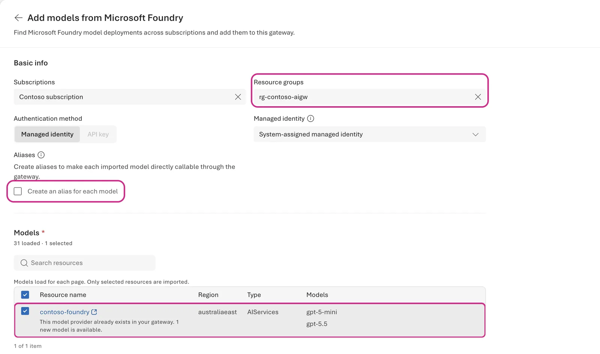
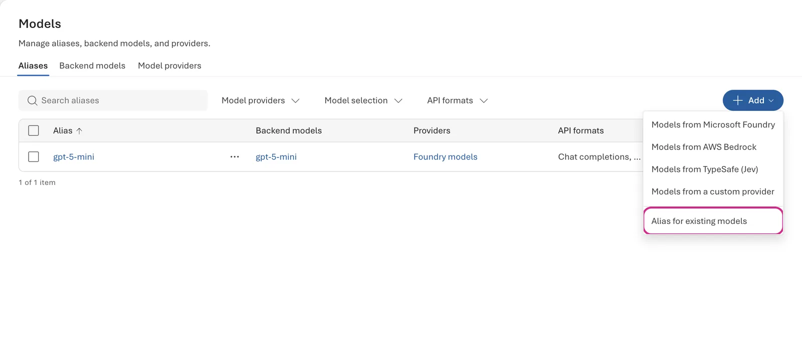
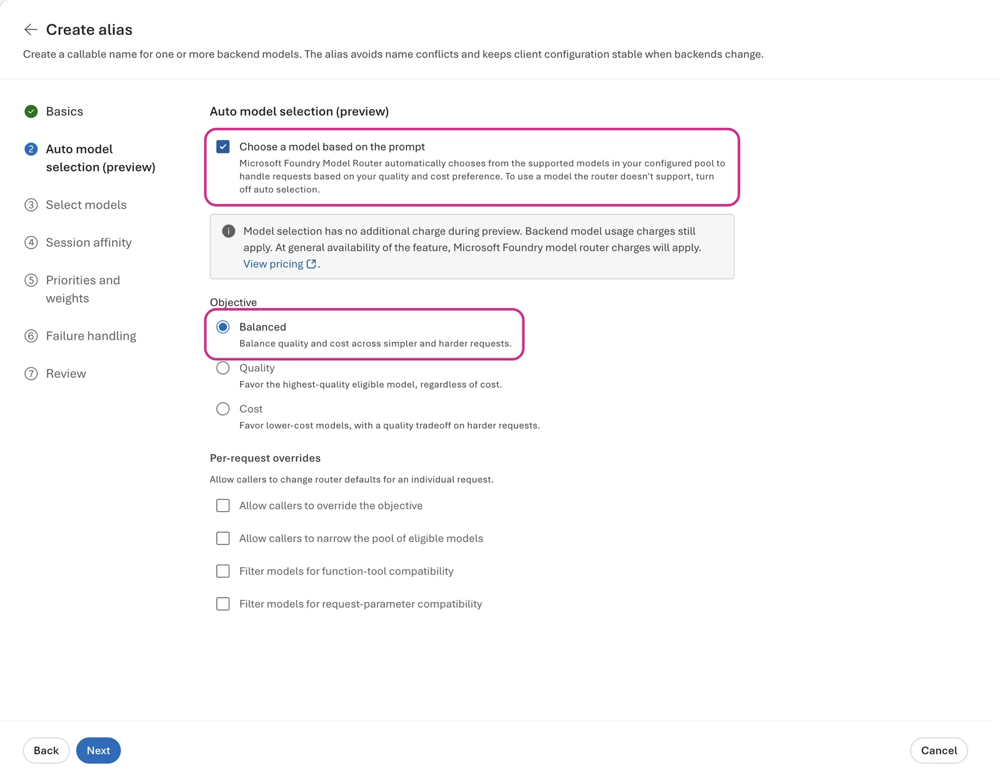
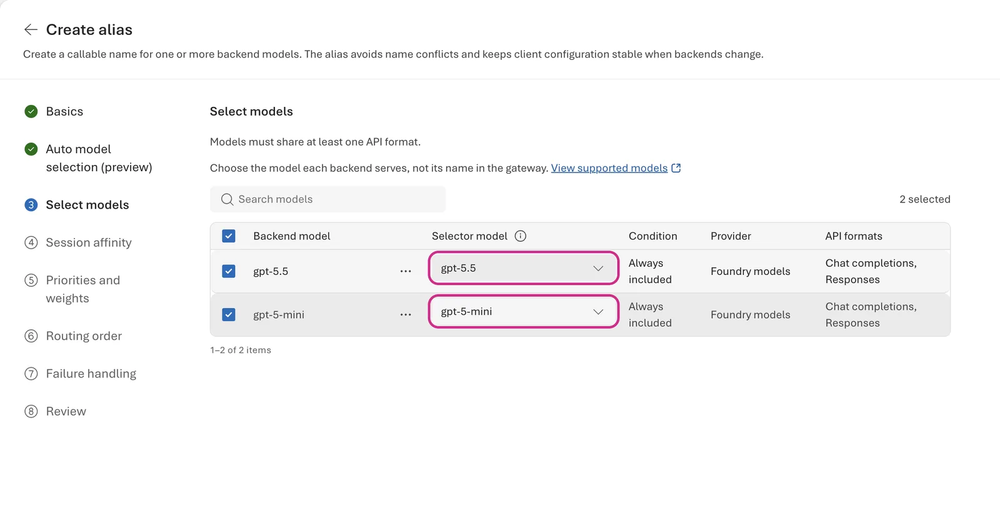
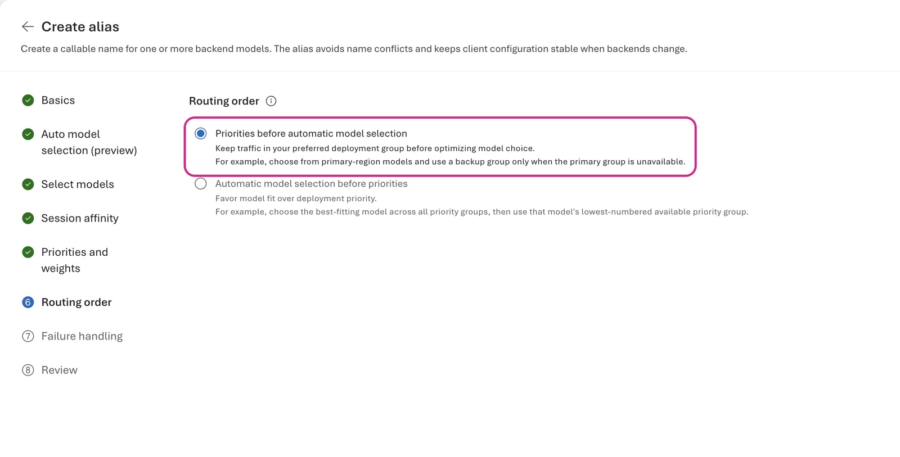
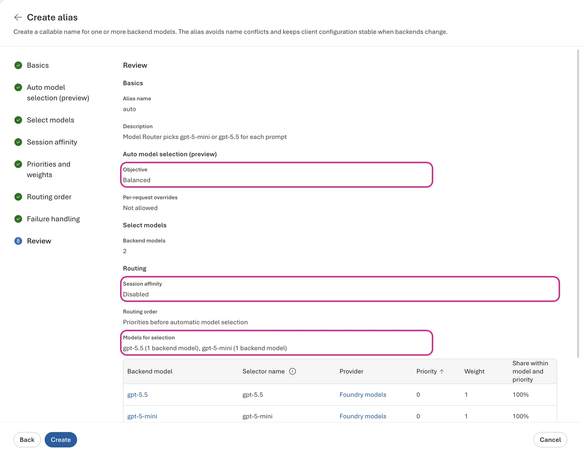
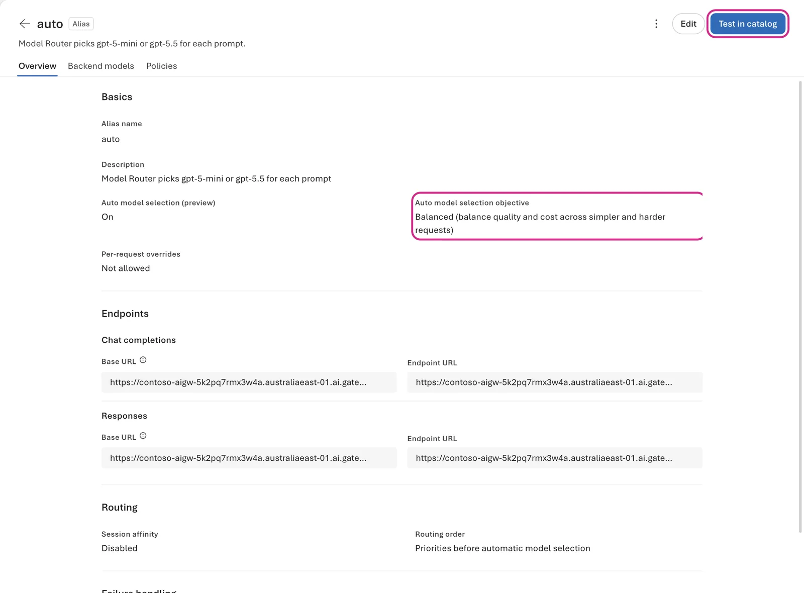
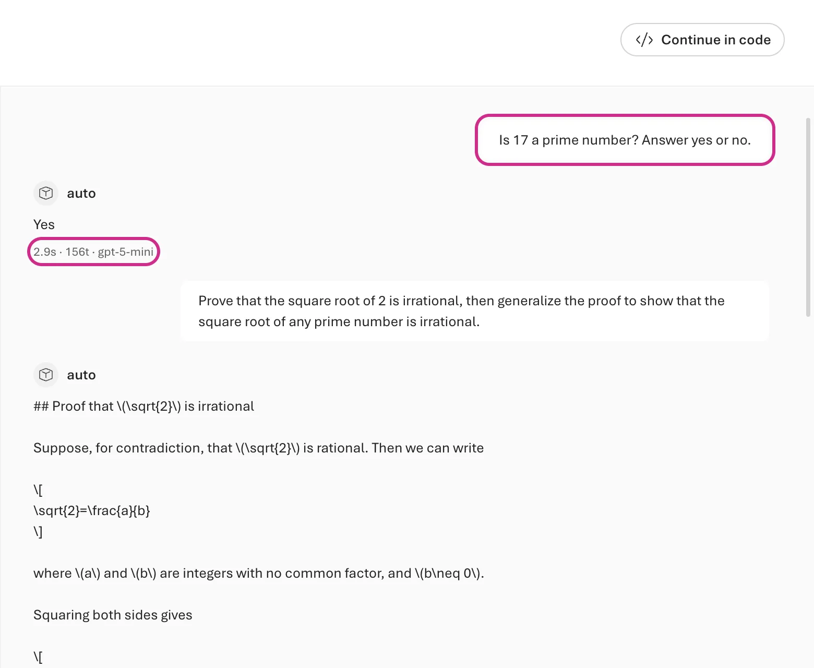
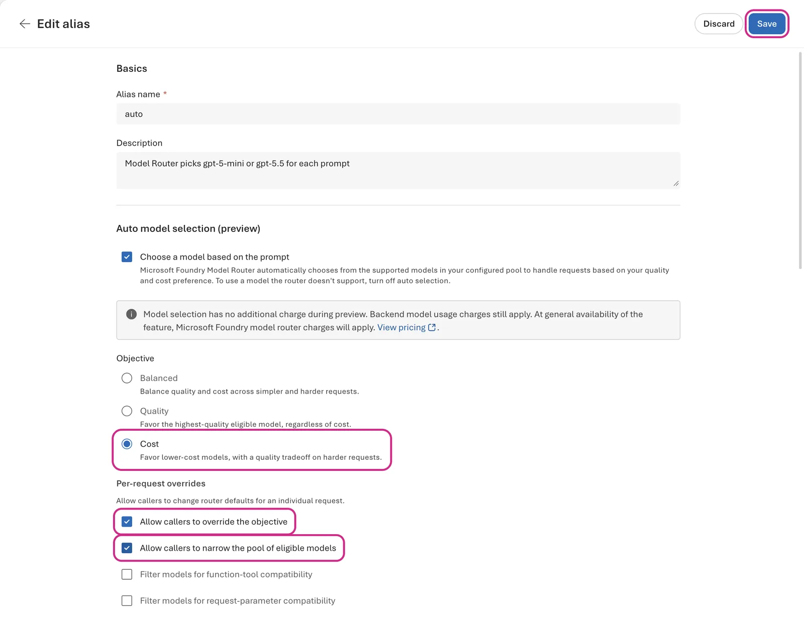
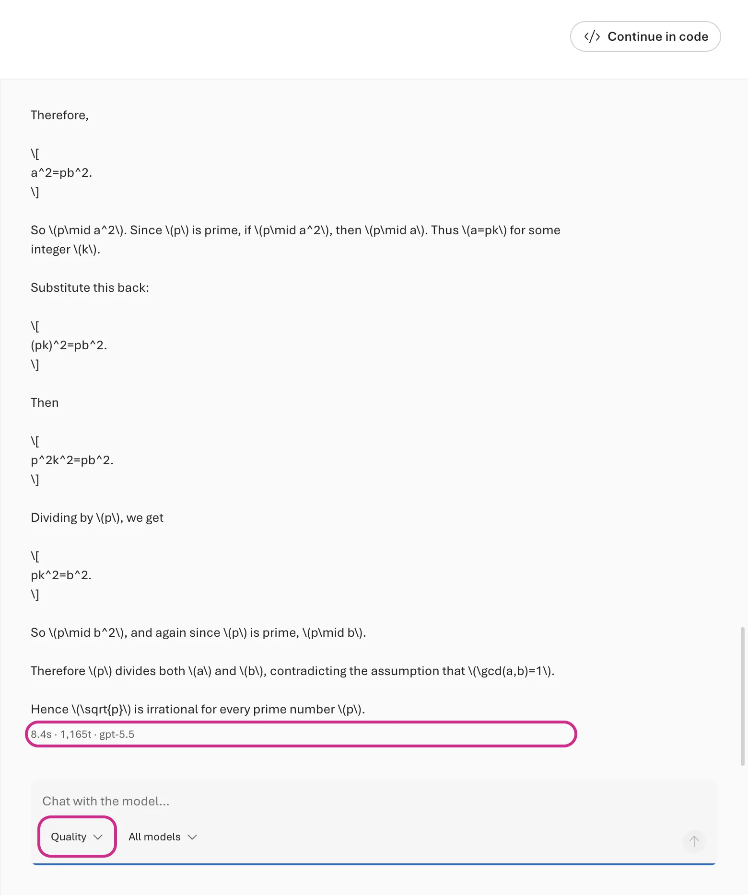

<!--
title: Let the gateway choose the model for each request
summary: Put gpt-5-mini and gpt-5.5 behind one alias and let Model Router pick one of them for each prompt. Prove which model served each request, switch the objective between cost and quality, and let callers override it per request.
category: models
level: Intermediate
duration: 25
tracks: [portal, cli, iac]
order: 3.6
status: emerging
illustration: diagrams/auto-model-selection.svg
tags: [auto model selection, Model Router, model alias, routing, objective, cost, quality, selectorModelName, per-request override, x-ms-served-model]
objectives:
  - Explain how Model Router picks a model for each prompt and how the objective trades cost against quality
  - Create an alias with auto model selection over gpt-5-mini and gpt-5.5
  - Prove which model served a request with the x-ms-served-model response header
  - Change the objective and watch the split between the models shift
  - Let callers override the objective or narrow the model pool for one request
prereqs:
  - 02-first-model-call
-->
<!-- gh:begin nav: generated by "npm run sync" from the metadata, do not edit -->
[AI Gateway labs](../README.md) › [Models & routing](../README.md#models--routing) › Lab 28
<!-- gh:end -->

# Let the gateway choose the model for each request

<!-- gh:begin intro: generated by "npm run sync" from the metadata, do not edit -->
> Put gpt-5-mini and gpt-5.5 behind one alias and let Model Router pick one of them for each prompt. Prove which model served each request, switch the objective between cost and quality, and let callers override it per request.

| ⏱️ Time | 📶 Level | 🧭 Tracks | ✅ Before you start |
| :-- | :-- | :-- | :-- |
| 25 min | Intermediate | Portal · Azure CLI · Bicep + azd · Notebook | [02 · First model call](../02-first-model-call/README.md) |

**You'll learn to**

- Explain how Model Router picks a model for each prompt and how the objective trades cost against quality
- Create an alias with auto model selection over gpt-5-mini and gpt-5.5
- Prove which model served a request with the x-ms-served-model response header
- Change the objective and watch the split between the models shift
- Let callers override the objective or narrow the model pool for one request

**Follow along:** 🌐 [Interactive version](https://azure.github.io/aigateway/labs/28-auto-model-selection/) with your own values filled in · 📓 [Jupyter notebook](28-auto-model-selection.ipynb) · 📁 [Lab files](infra/)

**On this page:** [Before you begin](#before-you-begin) · [How it works](#how-it-works) · [Create the auto alias](#create-the-auto-alias) · [Send a simple and a hard prompt](#send-a-simple-and-a-hard-prompt) · [Run a set of prompts](#run-a-set-of-prompts) · [Switch the objective to cost](#switch-the-objective-to-cost) · [Let callers choose per request](#let-callers-choose-per-request) · [Verify](#verify) · [Go further](#go-further) · [Clean up](#clean-up) · [Next steps](#next-steps)
<!-- gh:end -->

Most of the questions that reach your assistant are simple, and `gpt-5-mini` answers them well for a fraction of the
cost of `gpt-5.5`. A few are hard, and only the larger model gets them right. No app wants to decide which is which.
In this lab you put both models behind one alias, `auto`, and turn on auto model selection: for each request,
Microsoft Foundry Model Router reads the prompt and picks the model that fits it, as the alias's objective asks. You
prove which model served each prompt, move the whole split toward cost, and then let one caller ask for quality on
its own requests. The apps only ever send `"model": "auto"`.

Auto model selection is emerging: it's in preview since the
[November 6 release](https://ai.gateway.azure.com/docs/releases#release-2026-11-06), and per-request overrides arrived in the
[November 9 release](https://ai.gateway.azure.com/docs/releases#release-2026-11-09).


## Before you begin

<!-- setup: tools sign-in extension clone -->
<!-- gh:begin setup: generated by "npm run sync" from the metadata, do not edit -->
🧰 **One-time setup** from the [Setup guide](../SETUP.md), if you haven't done it yet:
[Choose where to run commands](../SETUP.md#choose-where-to-run-commands) ·
[Sign in to Azure](../SETUP.md#sign-in-to-azure) ·
[Install the `aigateway` extension](../SETUP.md#install-the-aigateway-extension) ·
[Clone the labs repo](../SETUP.md#clone-the-labs-repo)
<!-- gh:end -->

> [!TIP]
> On the **Bicep + azd** track, `azd up` creates its own gateway, both models, the alias, and a key, so you can skip
> this section. You need only the one-time setup above.

- Complete [Publish a Foundry model and make your first call](../02-first-model-call/README.md). You need the
  gateway, the `app-first-call` runtime key, and the `gpt-5-mini` backend model. Lab 02 also gave the gateway the
  **Foundry User** role on your Foundry account, which covers the new deployment in this lab.
- Recommended: [Route an alias across models by priority and weight](../22-model-routing/README.md) explains
  aliases, priority, and weight. This lab adds a new step after them.
- Permission to change the gateway, for example **Contributor** on its resource group, and to create deployments
  in the Foundry account.
- Run the scripts from the lab's folder, `~/aigateway/labs/28-auto-model-selection`. The Bash scripts and snippets
  need `curl` and `jq`, which Cloud Shell has.

Set these variables once. Every track and the **Verify** section reuse them.

<details open><summary>Bash</summary> <!-- gh -->

```bash title="Bash"
# Name your gateway, the Foundry account from lab 02, the two models, and the alias that clients call
export RG="<resource-group>"
export GATEWAY="<gateway>"
export FOUNDRY_RG="<foundry-resource-group>"     # resource group of the Foundry account from lab 02
export FOUNDRY_ACCOUNT="<foundry-account-name>"
export PROVIDER="foundry-models"                 # the gateway provider that holds gpt-5-mini
export SMALL="gpt-5-mini"                        # the lower-cost model, already published in lab 02
export LARGE="gpt-5.5"                           # the higher-quality model that you deploy in this lab
export LARGE_VERSION="2026-04-24"
export LARGE_BACKEND="gpt-5-5"                   # the gateway's name for gpt-5.5, as the portal import names it
export ALIAS="auto"                              # the name that clients send in "model"
echo "📝 Alias $ALIAS will choose between $SMALL and $LARGE on gateway $GATEWAY in $RG"

# Read the resource IDs of the gateway and the Foundry account, and the gateway's runtime URL
export GATEWAY_ID="$(az aigateway show -g "$RG" -n "$GATEWAY" --query id -o tsv)"
export FOUNDRY_ID="$(az cognitiveservices account show -g "$FOUNDRY_RG" -n "$FOUNDRY_ACCOUNT" --query id -o tsv)"
export AI_GATEWAY_URL="https://$(az aigateway show -g "$RG" -n "$GATEWAY" --query properties.frontend.defaultHostname -o tsv)"
echo "🆔 Gateway: $GATEWAY_ID"
echo "🌐 Runtime URL: $AI_GATEWAY_URL"

# Build the management URL of the gateway's default workspace, and the API version, for the az rest calls
export WS="https://management.azure.com$GATEWAY_ID/workspaces/default"
export API="api-version=2026-11-01"

# Read the app-first-call key from the gateway, so that it never shows on screen or lands in a file
export AI_GATEWAY_API_KEY="$(az aigateway api-key list-secrets -g "$RG" --gateway-name "$GATEWAY" -n app-first-call \
  --query primaryKey -o tsv)"
echo "🔑 Key: in AI_GATEWAY_API_KEY (${#AI_GATEWAY_API_KEY} characters, not shown)"

# Keep a jq filter that prints the alias's auto model selection: each backend model, the routing order, the objective,
# and what callers may override
export AUTO='.properties
  | (.backendModels[] | "\(.resourceId | split("/") | last)  selector \(.selectorModelName // "none")  priority \(.priority)  weight \(.weight)"),
    "Routing order: \((.selectionOrder // ["priority"]) | join(", "))",
    "Objective: \(.autoModelSelection.objective // "off")",
    "Caller overrides: \((.autoModelSelection.allowedRequestOverrides // []) | if length == 0 then "none" else join(", ") end)"'
```
</details> <!-- gh -->

<details><summary>PowerShell</summary> <!-- gh -->

```powershell title="PowerShell"
# Name your gateway, the Foundry account from lab 02, the two models, and the alias that clients call
$RG              = "<resource-group>"
$GATEWAY         = "<gateway>"
$FOUNDRY_RG      = "<foundry-resource-group>"    # resource group of the Foundry account from lab 02
$FOUNDRY_ACCOUNT = "<foundry-account-name>"
$PROVIDER        = "foundry-models"              # the gateway provider that holds gpt-5-mini
$SMALL           = "gpt-5-mini"                  # the lower-cost model, already published in lab 02
$LARGE           = "gpt-5.5"                     # the higher-quality model that you deploy in this lab
$LARGE_VERSION   = "2026-04-24"
$LARGE_BACKEND   = "gpt-5-5"                     # the gateway's name for gpt-5.5, as the portal import names it
$ALIAS           = "auto"                        # the name that clients send in "model"
Write-Host "📝 Alias $ALIAS will choose between $SMALL and $LARGE on gateway $GATEWAY in $RG"

# Read the resource IDs of the gateway and the Foundry account, and the gateway's runtime URL
$GATEWAY_ID = az aigateway show -g $RG -n $GATEWAY --query id -o tsv
$FOUNDRY_ID = az cognitiveservices account show -g $FOUNDRY_RG -n $FOUNDRY_ACCOUNT --query id -o tsv
$env:AI_GATEWAY_URL = "https://$(az aigateway show -g $RG -n $GATEWAY --query properties.frontend.defaultHostname -o tsv)"
Write-Host "🆔 Gateway: $GATEWAY_ID"
Write-Host "🌐 Runtime URL: $env:AI_GATEWAY_URL"

# Build the management URL of the gateway's default workspace, and the API version, for the az rest calls
$WS  = "https://management.azure.com$GATEWAY_ID/workspaces/default"
$API = "api-version=2026-11-01"

# Read the app-first-call key from the gateway, so that it never shows on screen or lands in a file
$env:AI_GATEWAY_API_KEY = az aigateway api-key list-secrets -g $RG --gateway-name $GATEWAY -n app-first-call `
  --query primaryKey -o tsv
Write-Host "🔑 Key: in AI_GATEWAY_API_KEY ($($env:AI_GATEWAY_API_KEY.Length) characters, not shown)"

# Define a function that prints the alias's auto model selection: each backend model, the routing order, the
# objective, and what callers may override
function Show-Auto($alias) {
  $p = $alias.properties
  $p.backendModels | ForEach-Object {
    '{0}  selector {1}  priority {2}  weight {3}' -f ($_.resourceId -split '/')[-1], $_.selectorModelName, $_.priority, $_.weight
  }
  "Routing order: $(if ($p.selectionOrder) { $p.selectionOrder -join ', ' } else { 'priority' })"
  "Objective: $(if ($p.autoModelSelection) { $p.autoModelSelection.objective } else { 'off' })"
  $o = $p.autoModelSelection.allowedRequestOverrides
  "Caller overrides: $(if ($o) { $o -join ', ' } else { 'none' })"
}
```
</details> <!-- gh -->

The CLI and Bicep tracks of lab 02 name the provider `foundry-models`. A portal import names it after your
Foundry account. To check, list the backend models. The **Provider** column shows the provider of each one.

<details open><summary>Bash</summary> <!-- gh -->

```bash title="Bash"
# List the backend models on the gateway, with the provider that holds each one
echo "✨ Backend models on $GATEWAY:"
az aigateway model list -g "$RG" --gateway-name "$GATEWAY" -o table
```
</details> <!-- gh -->

<details><summary>PowerShell</summary> <!-- gh -->

```powershell title="PowerShell"
# List the backend models on the gateway, with the provider that holds each one
Write-Host "✨ Backend models on ${GATEWAY}:"
az aigateway model list -g $RG --gateway-name $GATEWAY -o table
```
</details> <!-- gh -->

Deploy `gpt-5.5` in the same Foundry account as `gpt-5-mini`. Pick a region where the model is available. Model
inference is billed per use, and `gpt-5.5` costs more per token than `gpt-5-mini`: that difference is what auto
model selection saves.

<details open><summary>Bash</summary> <!-- gh -->

```bash title="Bash"
# Deploy gpt-5.5 next to gpt-5-mini, with 20,000 tokens and 20 requests per minute of Global Standard capacity
az cognitiveservices account deployment create -g "$FOUNDRY_RG" -n "$FOUNDRY_ACCOUNT" \
  --deployment-name "$LARGE" --model-name "$LARGE" --model-version "$LARGE_VERSION" \
  --model-format OpenAI --sku-name GlobalStandard --sku-capacity 20 \
  --query "{name:name, state:properties.provisioningState}" &&
  echo "✨ Model deployment $LARGE is ready in $FOUNDRY_ACCOUNT"
```
</details> <!-- gh -->

<details><summary>PowerShell</summary> <!-- gh -->

```powershell title="PowerShell"
# Deploy gpt-5.5 next to gpt-5-mini, with 20,000 tokens and 20 requests per minute of Global Standard capacity
az cognitiveservices account deployment create -g $FOUNDRY_RG -n $FOUNDRY_ACCOUNT `
  --deployment-name $LARGE --model-name $LARGE --model-version $LARGE_VERSION `
  --model-format OpenAI --sku-name GlobalStandard --sku-capacity 20 `
  --query "{name:name, state:properties.provisioningState}"
if ($?) { Write-Host "✨ Model deployment $LARGE is ready in $FOUNDRY_ACCOUNT" }
```
</details> <!-- gh -->

## How it works

Lab 22 picked a backend model with priority and weight, and lab 27 added backend conditions and session affinity.
Auto model selection adds a step that reads the prompt itself. You turn it on in an alias with four settings:

| Setting | Alias field | Portal | What it does |
|---|---|---|---|
| **Auto model selection** | `autoModelSelection` | **Auto model selection (preview)** › **Choose a model based on the prompt** | Asks Model Router to choose among the alias's models for each request. |
| **Objective** | `autoModelSelection.objective` | **Objective** | What Model Router favors: `Balanced`, `Cost`, or `Quality`. |
| **Selector model** | `backendModels[].selectorModelName` | **Select models** › **Selector model** | The unversioned model name that Model Router knows each backend model by, such as `gpt-5-mini`. It names the model that the deployment serves, not the backend model's name in the gateway. |
| **Routing order** | `selectionOrder` | **Routing order** | When Model Router runs. `["priority", "autoModelSelection"]`, **Priorities before automatic model selection**, keeps the best available priority group, then lets Model Router choose a model in it. |

For each request, the gateway first drops the backend models whose condition is `false`. Then it applies the routing
order: here, priority keeps the backend models of the best available priority group, and Model Router reads the
prompt and picks one of their selector models, as the objective asks. If several backend models serve that model,
weight or session affinity picks one. Then the gateway calls it, and three response headers tell you what happened:
`x-ms-served-model` names the model and version that answered, `x-ms-model-router-model` names the model that
Model Router picked, as `name@version`, and `x-ms-model-router-mode` names the objective that it used.

The portal describes the three objectives:

| Objective | Portal hint | What you see in this lab |
|---|---|---|
| **Balanced** | Balance quality and cost across simpler and harder requests. | Simple prompts mostly go to `gpt-5-mini`, hard ones to `gpt-5.5`. |
| **Quality** | Favor the highest-quality eligible model, regardless of cost. | Every prompt goes to `gpt-5.5`. |
| **Cost** | Favor lower-cost models, with a quality tradeoff on harder requests. | Every prompt goes to `gpt-5-mini`, even the hard ones. |

Three rules shape what you can put behind an auto alias:

- **Model Router supports a defined set of models.** In the portal, **Select models** › **View supported models**
  opens the [Model Router catalog page](https://ai.azure.com/catalog/models/model-router), and the portal warns
  `Some models aren't supported for auto model selection.` when you pick another one. The list includes OpenAI
  models such as `gpt-5-nano`, `gpt-5-mini`, `gpt-5`, `gpt-5.4`, and `gpt-5.5`, and models from other providers,
  such as Claude, Grok, DeepSeek, and Llama models. This lab uses `gpt-5-mini` and `gpt-5.5`, because
  `gpt-6.1-sol`, the larger model of labs 22 and 27, isn't on the list when we write this.
- **Every backend model must share an API endpoint, and requests must be text.** Model Router rejects embeddings
  and images, and a new selection can't continue a conversation that a provider stored, such as a Responses
  request with `previous_response_id`. Send the whole conversation in each request.
- **Callers can't change the selection unless you allow it.** **Per-request overrides** are off by default. You
  turn them on in the last section.

Auto model selection is in preview. The portal notes that model selection has no additional charge during the
preview, that the backend models' usage is still billed, and that
[Model Router pricing](https://azure.microsoft.com/en-us/pricing/details/ai-foundry-models/model-router/) applies
once the feature is generally available.

## Create the auto alias

Register `gpt-5.5` in the gateway, then create the `auto` alias with both models at the same priority, so that
priority keeps both and Model Router chooses between them. Start with the **Balanced** objective and no per-request
overrides.

<!-- track: portal | Portal -->
<details open><summary><b>🖥️ Portal</b></summary> <!-- gh -->

### Import gpt-5.5

1. Open the [AI Gateway portal](https://ai.gateway.azure.com) and select your gateway in the top bar.
2. Select **Models** › **Add** › **Models from Microsoft Foundry**.
3. In **Resource groups**, select the resource group of your Foundry account. Keep **Managed identity** as the
   **Authentication method**, and clear **Create an alias for each model**.
4. In **Models**, the list selects every Foundry account it finds. Make sure only your Foundry account is selected.
   Its row reads `This model provider already exists in your gateway. 1 new model is available.` Select **Add
   models**, then **Close**.

   

> **Checkpoint**
> **Models** › **Backend models** lists `gpt-5-mini` and `gpt-5.5`. The portal names the new backend model `gpt-5-5`
> and shows its display name, `gpt-5.5`.

### Create the auto alias

1. Select **Models** › **Add** › **Alias for existing models**.

   

2. On **Basics**, set **Alias name** to `auto` and **Description** to
   `Model Router picks gpt-5-mini or gpt-5.5 for each prompt`. Select **Next**.
3. On **Auto model selection (preview)**, select **Choose a model based on the prompt**. Keep **Objective** at
   **Balanced**, and leave every option under **Per-request overrides** cleared. Select **Next**.

   

4. On **Select models**, select `gpt-5-mini` and `gpt-5.5`. Check that the **Selector model** column shows
   `gpt-5-mini` and `gpt-5.5`, and pick them from the list if it doesn't. Select **Next**.

   

5. On **Session affinity**, clear **Enable session affinity**, so that every request gets its own choice. Select
   **Next**.
6. On **Priorities and weights**, keep **Priority** `0` and **Weight** `1` for both models. Select **Next**.
7. On **Routing order**, keep **Priorities before automatic model selection**. Select **Next**.

   

8. On **Failure handling**, keep the defaults, and select **Next**.
9. On **Review**, check that **Objective** reads **Balanced**, **Per-request overrides** reads **Not allowed**,
   **Session affinity** reads **Disabled**, and **Models for selection** reads
   `gpt-5.5 (1 backend model), gpt-5-mini (1 backend model)`. Select **Create**.

   

> **Checkpoint**
> The `auto` alias opens on **Overview**. **Auto model selection (preview)** reads **On**, **Auto model selection
> objective** reads `Balanced (balance quality and cost across simpler and harder requests)`, **Per-request
> overrides** reads **Not allowed**, and **Routing order** reads **Priorities before automatic model selection**.
>
> 

</details> <!-- gh -->
<!-- track: cli | Azure CLI -->
<details><summary><b>⌨️ Azure CLI</b></summary> <!-- gh -->

### Register gpt-5.5

A backend model registers one deployment under the provider. Name it `gpt-5-5`, as the portal's import does, and
keep `gpt-5.5` as its display name.

<details open><summary>Bash</summary> <!-- gh -->

```bash title="Bash"
# Register the gpt-5.5 deployment as a backend model under the provider, with its model version
az aigateway model create -g "$RG" --gateway-name "$GATEWAY" --provider-name "$PROVIDER" -n "$LARGE_BACKEND" \
  --display-name "$LARGE" --api-format OpenAIChatCompletions \
  --supported-endpoints /openai/v1/chat/completions /openai/v1/responses \
  --deployment-config "{resourceId:$FOUNDRY_ID/deployments/$LARGE,modelName:$LARGE,modelVersion:$LARGE_VERSION}" \
  --query "{name:name, version:properties.deployment.modelVersion}" &&
  echo "✨ Model $LARGE_BACKEND is published through $PROVIDER"
```
</details> <!-- gh -->

<details><summary>PowerShell</summary> <!-- gh -->

```powershell title="PowerShell"
# Register the gpt-5.5 deployment as a backend model under the provider, with its model version
az aigateway model create -g $RG --gateway-name $GATEWAY --provider-name $PROVIDER -n $LARGE_BACKEND `
  --display-name $LARGE --api-format OpenAIChatCompletions `
  --supported-endpoints /openai/v1/chat/completions /openai/v1/responses `
  --deployment-config "{resourceId:$FOUNDRY_ID/deployments/$LARGE,modelName:$LARGE,modelVersion:$LARGE_VERSION}" `
  --query "{name:name, version:properties.deployment.modelVersion}"
if ($?) { Write-Host "✨ Model $LARGE_BACKEND is published through $PROVIDER" }
```
</details> <!-- gh -->

### Create the auto alias

The `az aigateway model-alias` commands have no options yet for auto model selection, so this step sends the whole
alias to the management API with `az rest`, at API version `2026-11-01`. A `PUT` creates the alias or replaces all
of it. Each backend model gets its `selectorModelName`, and `selectionOrder` runs priority before Model Router.

<details open><summary>Bash</summary> <!-- gh -->

```bash title="Bash"
# Build the resource ID prefix of the provider's backend models
export MODELS="$GATEWAY_ID/workspaces/default/modelProviders/$PROVIDER/models"

# Build the alias: both models at priority 0 with their selector names, priority first, then the Balanced objective
BODY="$(jq -cn --arg small "$SMALL" --arg large "$LARGE" --arg models "$MODELS" --arg backend "$LARGE_BACKEND" '
  {properties: {
    description: "Model Router picks \($small) or \($large) for each prompt",
    backendModels: [
      {resourceId: "\($models)/\($small)", priority: 0, weight: 1, selectorModelName: $small},
      {resourceId: "\($models)/\($backend)", priority: 0, weight: 1, selectorModelName: $large}],
    selectionOrder: ["priority", "autoModelSelection"],
    autoModelSelection: {objective: "Balanced", allowedRequestOverrides: []}}}')"

# Create or replace the alias, then print its auto model selection
echo "🔖 Alias $ALIAS:"
az rest --method put --url "$WS/aliases/$ALIAS?$API" --body "$BODY" | jq -r "$AUTO"
```
</details> <!-- gh -->

<details><summary>PowerShell</summary> <!-- gh -->

```powershell title="PowerShell"
# Build the resource ID prefix of the provider's backend models
$MODELS = "$GATEWAY_ID/workspaces/default/modelProviders/$PROVIDER/models"

# Build the alias: both models at priority 0 with their selector names, priority first, then the Balanced objective
# Write it to a file, which --body reads with the @ prefix, so that its quotes reach az intact
@{ properties = @{
    description        = "Model Router picks $SMALL or $LARGE for each prompt"
    backendModels      = @(
      @{ resourceId = "$MODELS/$SMALL"; priority = 0; weight = 1; selectorModelName = $SMALL },
      @{ resourceId = "$MODELS/$LARGE_BACKEND"; priority = 0; weight = 1; selectorModelName = $LARGE })
    selectionOrder     = @("priority", "autoModelSelection")
    autoModelSelection = @{ objective = "Balanced"; allowedRequestOverrides = @() } } } |
  ConvertTo-Json -Depth 10 -Compress | Set-Content -Path alias.json

# Create or replace the alias, print its auto model selection, and delete the file
Write-Host "🔖 Alias ${ALIAS}:"
Show-Auto (az rest --method put --url "$WS/aliases/${ALIAS}?$API" --body '@alias.json' | ConvertFrom-Json)
Remove-Item alias.json
```
</details> <!-- gh -->

> **Checkpoint**
> The output shows `gpt-5-mini  selector gpt-5-mini  priority 0  weight 1`,
> `gpt-5-5  selector gpt-5.5  priority 0  weight 1`, `Routing order: priority, autoModelSelection`,
> `Objective: Balanced`, and `Caller overrides: none`. `az aigateway model-alias show -g "$RG" --gateway-name
> "$GATEWAY" -n "$ALIAS"` shows the same settings.

</details> <!-- gh -->
<!-- track: iac | Bicep + azd -->
<details><summary><b>🏗️ Bicep + azd</b></summary> <!-- gh -->

**What you need:** only the one-time setup from **Before you begin**. This track doesn't use your gateway from lab 02:
`azd up` creates a new one, so it works on its own.

### Review the templates

`infra/main.bicep` creates the resource group `rg-<environment name>` and calls the quick start's
[resources.bicep](../quickstart/infra/resources.bicep) for the gateway, `gpt-5-mini`, its default alias, and the
`app-first-call` key. Then it deploys `gpt-5.5` in the same Foundry account and publishes the `auto` alias:

<!-- include: infra/main.bicep -->
<!-- gh:begin include: generated by "npm run sync" from the metadata, do not edit -->
📄 [`infra/main.bicep`](infra/main.bicep)

<details><summary>Show all 93 lines</summary>

```bicep
// Lab 28 with azd: "azd up" creates the resource group rg-<environment name>, the quick start's gateway, Foundry
// model, default alias, and runtime API key, then deploys gpt-5.5 in the same Foundry account and publishes the auto
// alias, which lets Model Router pick gpt-5-mini or gpt-5.5 for each prompt. The runtime API key is never an output.
targetScope = 'subscription'

@description('azd environment name. The resource group is rg-<environmentName>.')
@minLength(1)
@maxLength(60)
param environmentName string

@description('Region for every resource. Pick one where AI Gateway and the lab\'s Foundry models are available. List them with az provider show --namespace Microsoft.ApiManagement (Setup guide, Find the available regions).')
@metadata({ azd: { type: 'location' } })
param location string

@description('Higher-quality model to deploy in Foundry. It must be a model that Model Router supports. azd reads it from LARGE_MODEL.')
param largeModelName string = 'gpt-5.5'

@description('Version of the higher-quality model. azd reads it from LARGE_MODEL_VERSION.')
param largeModelVersion string = '2026-04-24'

@description('What Model Router favors: Balanced, Cost, or Quality. azd reads it from AUTO_OBJECTIVE.')
@allowed([
  'Balanced'
  'Cost'
  'Quality'
])
param objective string = 'Balanced'

@description('What callers may override per request: objective, model, both, or none. azd reads it from AUTO_ALLOWED_OVERRIDES, for example ["model","objective"].')
param allowedRequestOverrides ('model' | 'objective' | 'filterModelsForToolCompatibility' | 'filterModelsForParameterCompatibility')[] = []

var suffix = take(uniqueString(subscription().id, environmentName, location), 6)
var tags = { 'azd-env-name': environmentName }

resource rg 'Microsoft.Resources/resourceGroups@2024-03-01' = {
  name: 'rg-${environmentName}'
  location: location
  tags: tags
}

// The quick start's template: a gateway, gpt-5-mini behind the default alias, and the app-first-call key.
module base '../../quickstart/infra/resources.bicep' = {
  name: 'aigw-base'
  scope: rg
  params: {
    location: location
    tags: tags
    gatewayName: 'aigw-${suffix}'
    foundryName: 'aigw${suffix}'
  }
}

// The higher-quality deployment, in the same Foundry account. The gateway's Foundry User role already covers it.
module largeDeployment 'large-deployment.bicep' = {
  name: 'aigw-large-deployment'
  scope: rg
  params: {
    foundryName: base.outputs.foundryName
    modelName: largeModelName
    modelVersion: largeModelVersion
  }
}

module auto 'auto-alias.bicep' = {
  name: 'aigw-auto-alias'
  scope: rg
  params: {
    gatewayName: base.outputs.gatewayName
    providerName: base.outputs.providerName
    smallModelName: base.outputs.modelName
    smallSelectorModelName: 'gpt-5-mini'
    foundryAccountId: largeDeployment.outputs.foundryId
    largeDeploymentName: largeDeployment.outputs.deploymentName
    largeModelName: largeModelName
    largeModelVersion: largeModelVersion
    largeBackendModelName: replace(largeModelName, '.', '-')
    aliasName: 'auto'
    objective: objective
    allowedRequestOverrides: allowedRequestOverrides
  }
}

output AZURE_RESOURCE_GROUP string = rg.name
output AI_GATEWAY_NAME string = base.outputs.gatewayName
output AI_GATEWAY_ID string = base.outputs.gatewayId
output AI_GATEWAY_URL string = base.outputs.gatewayUrl
output AI_GATEWAY_PROVIDER string = base.outputs.providerName
output AI_GATEWAY_BACKEND_MODEL string = base.outputs.modelName
output AI_GATEWAY_LARGE_MODEL string = largeModelName
output AI_GATEWAY_LARGE_BACKEND_MODEL string = auto.outputs.largeBackendModelName
output AI_GATEWAY_MODEL string = auto.outputs.aliasName
output AI_GATEWAY_OBJECTIVE string = auto.outputs.objective
output FOUNDRY_ACCOUNT_NAME string = base.outputs.foundryName
```

</details>
<!-- gh:end -->

`infra/large-deployment.bicep` deploys `gpt-5.5` next to `gpt-5-mini`:

<!-- include: infra/large-deployment.bicep -->
<!-- gh:begin include: generated by "npm run sync" from the metadata, do not edit -->
📄 [`infra/large-deployment.bicep`](infra/large-deployment.bicep)

<details><summary>Show all 39 lines</summary>

```bicep
// Deploys the higher-quality model in an existing Foundry account, next to gpt-5-mini. main.bicep calls it after the
// quick start's template has created the account and its gpt-5-mini deployment.
targetScope = 'resourceGroup'

@description('Name of the existing Foundry (Azure AI Services) account.')
param foundryName string

@description('Model to deploy. The deployment uses the same name.')
param modelName string = 'gpt-5.5'

@description('Version of the model to deploy.')
param modelVersion string = '2026-04-24'

@description('Deployment capacity in thousands of tokens per minute.')
@minValue(1)
param capacity int = 20

resource foundry 'Microsoft.CognitiveServices/accounts@2025-04-01-preview' existing = {
  name: foundryName
}

resource deployment 'Microsoft.CognitiveServices/accounts/deployments@2025-04-01-preview' = {
  parent: foundry
  name: modelName
  sku: {
    name: 'GlobalStandard'
    capacity: capacity
  }
  properties: {
    model: {
      format: 'OpenAI'
      name: modelName
      version: modelVersion
    }
  }
}

output deploymentName string = deployment.name
output foundryId string = foundry.id
```

</details>
<!-- gh:end -->

`infra/auto-alias.bicep` registers `gpt-5.5` as the backend model `gpt-5-5` and writes the alias, with a
`selectorModelName` for each backend model, the routing order, and `autoModelSelection`. You can also deploy this
file on its own to the gateway from lab 02.

<!-- include: infra/auto-alias.bicep -->
<!-- gh:begin include: generated by "npm run sync" from the metadata, do not edit -->
📄 [`infra/auto-alias.bicep`](infra/auto-alias.bicep)

<details><summary>Show all 128 lines</summary>

```bicep
// Publishes an alias that lets Model Router pick a model for each prompt. main.bicep calls it after the quick start's
// template, and you can also deploy it on its own to a gateway you already have, such as the one from lab 02.
// Registers the gpt-5.5 deployment under the existing Foundry provider, then publishes the auto alias with gpt-5-mini
// and gpt-5.5 at the same priority, so auto model selection chooses between them.
// The gpt-5-mini backend model is only referenced, so its settings stay untouched.
targetScope = 'resourceGroup'

@description('Name of the existing AI Gateway (Microsoft.ApiManagement/aigateways) in this resource group.')
param gatewayName string

@description('Name of the existing Foundry model provider in the gateway, for example foundry-models from lab 02.')
param providerName string = 'foundry-models'

@description('Name of the existing lower-cost backend model, for example gpt-5-mini.')
param smallModelName string = 'gpt-5-mini'

@description('Model Router name of the lower-cost model: its unversioned model name.')
param smallSelectorModelName string = 'gpt-5-mini'

@description('Resource ID of the Foundry account that hosts the higher-quality deployment.')
param foundryAccountId string

@description('Name of the higher-quality deployment in that account.')
param largeDeploymentName string = 'gpt-5.5'

@description('Model of that deployment. It\'s also the model\'s Model Router name, which must be a supported selector model.')
param largeModelName string = 'gpt-5.5'

@description('Version of the higher-quality model.')
param largeModelVersion string = '2026-04-24'

@description('Name of the backend model to register. The portal\'s Foundry import names gpt-5.5 as gpt-5-5, so every track of the lab uses that name.')
param largeBackendModelName string = 'gpt-5-5'

@description('Callable alias that clients send in the request "model" field.')
param aliasName string = 'auto'

@description('What Model Router favors: Balanced for a balance of cost and quality, Cost for lower cost, Quality for quality.')
@allowed([
  'Balanced'
  'Cost'
  'Quality'
])
param objective string = 'Balanced'

@description('What callers may override in a request\'s auto_model_selection field: objective, model (narrow the model pool), both, or none. The two filter values turn on the portal\'s compatibility filters, which aren\'t caller fields.')
param allowedRequestOverrides ('model' | 'objective' | 'filterModelsForToolCompatibility' | 'filterModelsForParameterCompatibility')[] = []

#disable-next-line BCP081
resource aiGateway 'Microsoft.ApiManagement/aigateways@2026-11-01' existing = {
  name: gatewayName
}

#disable-next-line BCP081
resource defaultWorkspace 'Microsoft.ApiManagement/aigateways/workspaces@2026-11-01' existing = {
  parent: aiGateway
  name: 'default'
}

#disable-next-line BCP081
resource provider 'Microsoft.ApiManagement/aigateways/workspaces/modelProviders@2026-11-01' existing = {
  parent: defaultWorkspace
  name: providerName
}

#disable-next-line BCP081
resource small 'Microsoft.ApiManagement/aigateways/workspaces/modelProviders/models@2026-11-01' existing = {
  parent: provider
  name: smallModelName
}

#disable-next-line BCP081
resource large 'Microsoft.ApiManagement/aigateways/workspaces/modelProviders/models@2026-11-01' = {
  parent: provider
  name: largeBackendModelName
  properties: {
    displayName: largeModelName
    description: 'Higher-quality model that the ${aliasName} alias can select.'
    supportedEndpoints: [
      '/openai/v1/chat/completions'
      '/openai/v1/responses'
    ]
    deployment: {
      resourceId: '${foundryAccountId}/deployments/${largeDeploymentName}'
      modelName: largeModelName
      modelVersion: largeModelVersion
    }
  }
}

#disable-next-line BCP081
resource alias 'Microsoft.ApiManagement/aigateways/workspaces/aliases@2026-11-01' = {
  parent: defaultWorkspace
  name: aliasName
  properties: {
    aliasName: aliasName
    description: 'Model Router picks ${smallSelectorModelName} or ${largeModelName} for each prompt'
    // Both models share priority 0, so priority keeps both, then auto model selection picks one by its selector name.
    backendModels: [
      {
        resourceId: small.id
        priority: 0
        weight: 1
        selectorModelName: smallSelectorModelName
      }
      {
        resourceId: large.id
        priority: 0
        weight: 1
        selectorModelName: largeModelName
      }
    ]
    selectionOrder: [
      'priority'
      'autoModelSelection'
    ]
    autoModelSelection: {
      objective: objective
      allowedRequestOverrides: allowedRequestOverrides
    }
  }
}

output aliasName string = alias.name
output largeBackendModelName string = large.name
output objective string = objective
output allowedRequestOverrides array = allowedRequestOverrides
output chatCompletionsUrl string = 'https://${aiGateway.properties.frontend.defaultHostname}/default/models/openai/v1/chat/completions'
```

</details>
<!-- gh:end -->

### Deploy with azd up

Move into the lab's folder, create an azd environment named `aigw-lab28` in your current subscription, then
provision everything. It takes about three minutes.

<details open><summary>Bash</summary> <!-- gh -->

```bash title="Bash"
# Move into the lab's folder, which holds the azd project
cd ~/aigateway/labs/28-auto-model-selection &&
  echo "📂 Lab folder: $(pwd)"

# Create an azd environment named aigw-lab28 in your current subscription, so that azd doesn't prompt you
azd env new aigw-lab28 --location eastus2 --subscription "$(az account show --query id --output tsv)" &&
  echo "📝 azd environment aigw-lab28 deploys to eastus2"

# Provision the resource group, the gateway, the Foundry account with both models, the auto alias, and the key
azd up &&
  echo "🚀 Gateway deployed: $(azd env get-value AI_GATEWAY_URL)"
```
</details> <!-- gh -->

<details><summary>PowerShell</summary> <!-- gh -->

```powershell title="PowerShell"
# Move into the lab's folder, which holds the azd project
Set-Location ~/aigateway/labs/28-auto-model-selection
if ($?) { Write-Host "📂 Lab folder: $(Get-Location)" }

# Create an azd environment named aigw-lab28 in your current subscription, so that azd doesn't prompt you
azd env new aigw-lab28 --location eastus2 --subscription (az account show --query id --output tsv)
if ($?) { Write-Host "📝 azd environment aigw-lab28 deploys to eastus2" }

# Provision the resource group, the gateway, the Foundry account with both models, the auto alias, and the key
azd up
if ($?) { Write-Host "🚀 Gateway deployed: $(azd env get-value AI_GATEWAY_URL)" }
```
</details> <!-- gh -->

For another region, pick one where AI Gateway and the `gpt-5-mini` and `gpt-5.5` models are available, as in
[Find the available regions](../SETUP.md#find-the-available-regions). The parameters come from azd environment
values, with the defaults in `infra/main.parameters.json`: `AUTO_OBJECTIVE` (`Balanced`), `AUTO_ALLOWED_OVERRIDES`
(`[]`), `LARGE_MODEL` (`gpt-5.5`), and `LARGE_MODEL_VERSION` (`2026-04-24`).

### Read the outputs and the key

Set the variables that the next sections and **Verify** use from azd's environment values, read the key from the
gateway so that it never shows on screen, then print the alias's auto model selection.

<details open><summary>Bash</summary> <!-- gh -->

```bash title="Bash"
# Read azd's outputs into the variables that the next sections use
export RG="$(azd env get-value AZURE_RESOURCE_GROUP)"
export GATEWAY="$(azd env get-value AI_GATEWAY_NAME)"
export GATEWAY_ID="$(azd env get-value AI_GATEWAY_ID)"
export SMALL="$(azd env get-value AI_GATEWAY_BACKEND_MODEL)"
export LARGE="$(azd env get-value AI_GATEWAY_LARGE_MODEL)"
export ALIAS="$(azd env get-value AI_GATEWAY_MODEL)"
export AI_GATEWAY_URL="$(azd env get-value AI_GATEWAY_URL)"
echo "📝 Alias $ALIAS chooses between $SMALL and $LARGE on gateway $GATEWAY in $RG"
echo "🌐 Runtime URL: $AI_GATEWAY_URL"

# Build the management URL of the gateway's default workspace, and the API version, for the az rest calls
export WS="https://management.azure.com$GATEWAY_ID/workspaces/default"
export API="api-version=2026-11-01"

# Read the app-first-call key from the gateway, so that it never shows on screen or lands in a file
export AI_GATEWAY_API_KEY="$(az aigateway api-key list-secrets --ids "$GATEWAY_ID/apiKeys/app-first-call" \
  --query primaryKey --output tsv)"
echo "🔑 Key: in AI_GATEWAY_API_KEY (${#AI_GATEWAY_API_KEY} characters, not shown)"

# Keep a jq filter that prints the alias's auto model selection, then print it
export AUTO='.properties
  | (.backendModels[] | "\(.resourceId | split("/") | last)  selector \(.selectorModelName // "none")  priority \(.priority)  weight \(.weight)"),
    "Routing order: \((.selectionOrder // ["priority"]) | join(", "))",
    "Objective: \(.autoModelSelection.objective // "off")",
    "Caller overrides: \((.autoModelSelection.allowedRequestOverrides // []) | if length == 0 then "none" else join(", ") end)"'
echo "🔖 Alias $ALIAS:"
az rest --method get --url "$WS/aliases/$ALIAS?$API" | jq -r "$AUTO"
```
</details> <!-- gh -->

<details><summary>PowerShell</summary> <!-- gh -->

```powershell title="PowerShell"
# Read azd's outputs into the variables that the next sections use
$RG                 = azd env get-value AZURE_RESOURCE_GROUP
$GATEWAY            = azd env get-value AI_GATEWAY_NAME
$GATEWAY_ID         = azd env get-value AI_GATEWAY_ID
$SMALL              = azd env get-value AI_GATEWAY_BACKEND_MODEL
$LARGE              = azd env get-value AI_GATEWAY_LARGE_MODEL
$ALIAS              = azd env get-value AI_GATEWAY_MODEL
$env:AI_GATEWAY_URL = azd env get-value AI_GATEWAY_URL
Write-Host "📝 Alias $ALIAS chooses between $SMALL and $LARGE on gateway $GATEWAY in $RG"
Write-Host "🌐 Runtime URL: $env:AI_GATEWAY_URL"

# Build the management URL of the gateway's default workspace, and the API version, for the az rest calls
$WS  = "https://management.azure.com$GATEWAY_ID/workspaces/default"
$API = "api-version=2026-11-01"

# Read the app-first-call key from the gateway, so that it never shows on screen or lands in a file
$env:AI_GATEWAY_API_KEY = az aigateway api-key list-secrets --ids "$GATEWAY_ID/apiKeys/app-first-call" `
  --query primaryKey --output tsv
Write-Host "🔑 Key: in AI_GATEWAY_API_KEY ($($env:AI_GATEWAY_API_KEY.Length) characters, not shown)"

# Define a function that prints the alias's auto model selection, then print it
function Show-Auto($alias) {
  $p = $alias.properties
  $p.backendModels | ForEach-Object {
    '{0}  selector {1}  priority {2}  weight {3}' -f ($_.resourceId -split '/')[-1], $_.selectorModelName, $_.priority, $_.weight
  }
  "Routing order: $(if ($p.selectionOrder) { $p.selectionOrder -join ', ' } else { 'priority' })"
  "Objective: $(if ($p.autoModelSelection) { $p.autoModelSelection.objective } else { 'off' })"
  $o = $p.autoModelSelection.allowedRequestOverrides
  "Caller overrides: $(if ($o) { $o -join ', ' } else { 'none' })"
}
Write-Host "🔖 Alias ${ALIAS}:"
Show-Auto (az rest --method get --url "$WS/aliases/${ALIAS}?$API" | ConvertFrom-Json)
```
</details> <!-- gh -->

> **Checkpoint**
> `azd up` ended with `SUCCESS`, and the last command printed `gpt-5-mini  selector gpt-5-mini  priority 0  weight 1`,
> `gpt-5-5  selector gpt-5.5  priority 0  weight 1`, `Routing order: priority, autoModelSelection`,
> `Objective: Balanced`, and `Caller overrides: none`.

</details> <!-- gh -->
<!-- /tracks -->

## Send a simple and a hard prompt

Send two prompts to `auto`: a yes-or-no question and a proof. Each answer stops at 1,000 output tokens to keep the
run short and cheap, which doesn't change the model that Model Router picks. The commands print only the three
response headers of auto model selection. A new alias takes up to a minute to reach every gateway instance: until
then, requests return `HTTP 404` with `'auto' is not a known model alias.`

<details open><summary>Bash</summary> <!-- gh -->

```bash title="Bash"
# Send a simple and a hard prompt to the alias, and print the model that served each one, the model that Model Router
# picked, and the objective that it used
for PROMPT in "Is 17 a prime number? Answer yes or no." \
  "Prove that the square root of 2 is irrational, then generalize the proof to show that the square root of any prime number is irrational."; do
  echo "📊 $PROMPT"
  jq -cn --arg m "$ALIAS" --arg p "$PROMPT" '{model: $m, max_completion_tokens: 1000, messages: [{role: "user", content: $p}]}' |
    curl -sS -D - -o /dev/null "$AI_GATEWAY_URL/default/models/openai/v1/chat/completions" \
      -H "Authorization: Bearer $AI_GATEWAY_API_KEY" -H "Content-Type: application/json" -d @- |
    grep -iE "^x-ms-(served-model|model-router-model|model-router-mode):"
done
```
</details> <!-- gh -->

<details><summary>PowerShell</summary> <!-- gh -->

```powershell title="PowerShell"
# Send a simple and a hard prompt to the alias, and print the model that served each one, the model that Model Router
# picked, and the objective that it used
foreach ($prompt in "Is 17 a prime number? Answer yes or no.",
  "Prove that the square root of 2 is irrational, then generalize the proof to show that the square root of any prime number is irrational.") {
  Write-Host "📊 $prompt"
  $body = @{ model = $ALIAS; max_completion_tokens = 1000; messages = @(@{ role = "user"; content = $prompt }) } |
    ConvertTo-Json -Depth 5 -Compress
  $r = Invoke-WebRequest -Method Post -Uri "$env:AI_GATEWAY_URL/default/models/openai/v1/chat/completions" `
    -Headers @{ Authorization = "Bearer $env:AI_GATEWAY_API_KEY" } -ContentType "application/json" -Body $body
  foreach ($h in "x-ms-served-model", "x-ms-model-router-model", "x-ms-model-router-mode") {
    if ($r.Headers[$h]) { "${h}: $($r.Headers[$h])" }
  }
}
```
</details> <!-- gh -->

```text
📊 Is 17 a prime number? Answer yes or no.
x-ms-served-model: gpt-5-mini-2025-08-07
x-ms-model-router-model: gpt-5-mini@2025-08-07
x-ms-model-router-mode: balanced
📊 Prove that the square root of 2 is irrational, then generalize the proof to show that the square root of any prime number is irrational.
x-ms-served-model: gpt-5.5-2026-04-24
x-ms-model-router-model: gpt-5.5@2026-04-24
x-ms-model-router-mode: balanced
```

The same alias sent the yes-or-no question to `gpt-5-mini` and the proof to `gpt-5.5`, without any hint from the
caller. `x-ms-served-model` names the model and version that answered, and the response body's `model` field agrees.
`x-ms-model-router-model` shows that Model Router made that choice, and `x-ms-model-router-mode` that it used the
alias's **Balanced** objective.

On the portal track, you can see the same in the playground. On the alias's **Overview**, select **Test in
catalog**, then send both prompts. The line under each answer shows the time, the tokens, and the model that served
it.



> **Checkpoint**
> The simple prompt shows `x-ms-served-model: gpt-5-mini-2025-08-07`, and the hard one
> `x-ms-served-model: gpt-5.5-2026-04-24`, both with `x-ms-model-router-mode: balanced`. If you see `HTTP 404`
> with `model_not_found`, wait a minute, and send them again.

## Run a set of prompts

`infra/prompts.json` holds five simple prompts and five hard ones: proofs, a scheduling puzzle, and a system design
question. The script sends them one at a time, then prints the model that served each one with its token usage, and
the totals per model.

<details open><summary>Bash</summary> <!-- gh -->

```bash title="Bash"
# Send the ten prompts to the alias with its own objective, and count the requests and tokens per model
echo "📊 Which model serves each prompt with the alias's objective"
./infra/route-prompts.sh "$ALIAS"
```
</details> <!-- gh -->

<details><summary>PowerShell</summary> <!-- gh -->

```powershell title="PowerShell"
# Send the ten prompts to the alias with its own objective, and count the requests and tokens per model
Write-Host "📊 Which model serves each prompt with the alias's objective"
./infra/route-prompts.ps1 -Alias $ALIAS
```
</details> <!-- gh -->

```text
Sending 10 prompts with "model": "auto" and the alias's objective
  #  kind    served model              prompt  output  text
  1  simple  gpt-5-mini-2025-08-07         18      10  Is 17 a prime number? Answer yes or no.
  2  simple  gpt-5-mini-2025-08-07         16      94  Translate 'thank you very much' into French.
  3  simple  gpt-5-mini-2025-08-07         14      10  What is 12 times 12?
  4  simple  gpt-5.5-2026-04-24            12      13  What does HTTP stand for?
  5  simple  gpt-5.5-2026-04-24            14      13  Which planet is closest to the sun?
  6  hard    gpt-5.5-2026-04-24            36     746  Prove that the square root of 2 is irrational, the
  7  hard    gpt-5.5-2026-04-24            86     719  A train leaves at 09:40 and travels 315 km at 84 k
  8  hard    gpt-5.5-2026-04-24            86    1000  Let f be a continuous function on [0,1] with f(0)=
  9  hard    gpt-5.5-2026-04-24            54    1000  Design a sharded rate limiter for 50 million API k
 10  hard    gpt-5.5-2026-04-24            40    1000  Find all integer solutions of x^2 - 7y^2 = 1 with 

Requests and tokens per model:
gpt-5-mini-2025-08-07      3 requests      48 prompt tokens     114 output tokens
gpt-5.5-2026-04-24         7 requests     328 prompt tokens    4491 output tokens
```

With **Balanced**, Model Router sent every hard prompt to `gpt-5.5`, and three of the five simple ones to
`gpt-5-mini`. It sent the two short factual questions to `gpt-5.5` too: Balanced weighs quality as well as cost, and
the answer is so short that the larger model costs little. Its choices for borderline prompts can change from one
run to the next. The hard prompts use most of the output tokens, so they're where the larger model's price matters.

> **Checkpoint**
> Every row shows an answer from `gpt-5-mini-2025-08-07` or `gpt-5.5-2026-04-24`, the five `hard` rows show
> `gpt-5.5-2026-04-24`, and the totals list both models. A `HTTP 429, retrying` line means that a deployment
> reached its requests per minute; the script waits and sends the prompt again.

## Switch the objective to cost

Your finance team asks you to cut the cost of this assistant, and accepts weaker answers on hard questions. Change
the alias's objective to **Cost**. The apps don't change.

<!-- track: portal | Portal -->
<details open><summary><b>🖥️ Portal</b></summary> <!-- gh -->

### Switch the objective

1. In **Models** › **Aliases**, open `auto` and select **Edit**. The alias opens on one page, with a section for
   each step.
2. In **Auto model selection (preview)** › **Objective**, select **Cost**.
3. Select **Save**. New requests use the new objective within a minute.

> **Checkpoint**
> The alias **Overview** shows **Auto model selection objective** `Cost (favor lower-cost models, with a quality
> tradeoff on harder requests)`.

</details> <!-- gh -->
<!-- track: cli | Azure CLI -->
<details><summary><b>⌨️ Azure CLI</b></summary> <!-- gh -->

### Switch the objective

A `PATCH` changes only the fields that it sends, but it replaces `autoModelSelection` as a whole: a body with only
`objective` also clears `allowedRequestOverrides`. Always send both fields.

<details open><summary>Bash</summary> <!-- gh -->

```bash title="Bash"
# Switch the objective to Cost, and send the overrides too, because a PATCH replaces all of autoModelSelection
echo "🔖 Alias $ALIAS:"
az rest --method patch --url "$WS/aliases/$ALIAS?$API" \
  --body '{"properties": {"autoModelSelection": {"objective": "Cost", "allowedRequestOverrides": []}}}' |
  jq -r "$AUTO"
```
</details> <!-- gh -->

<details><summary>PowerShell</summary> <!-- gh -->

```powershell title="PowerShell"
# Switch the objective to Cost, and send the overrides too, because a PATCH replaces all of autoModelSelection
@{ properties = @{ autoModelSelection = @{ objective = "Cost"; allowedRequestOverrides = @() } } } |
  ConvertTo-Json -Depth 10 -Compress | Set-Content -Path alias.json
Write-Host "🔖 Alias ${ALIAS}:"
Show-Auto (az rest --method patch --url "$WS/aliases/${ALIAS}?$API" --body '@alias.json' | ConvertFrom-Json)
Remove-Item alias.json
```
</details> <!-- gh -->

> **Checkpoint**
> The output ends with `Objective: Cost` and `Caller overrides: none`. The backend models and the routing order
> don't change.

</details> <!-- gh -->
<!-- track: iac | Bicep + azd -->
<details><summary><b>🏗️ Bicep + azd</b></summary> <!-- gh -->

### Provision the Cost objective

Set `AUTO_OBJECTIVE` to `Cost` and provision again. Only the alias changes.

<details open><summary>Bash</summary> <!-- gh -->

```bash title="Bash"
# Switch the alias's objective to Cost in the azd environment
azd env set AUTO_OBJECTIVE Cost &&
  echo "📝 AUTO_OBJECTIVE is Cost"

# Provision again: only the alias changes
azd provision &&
  echo "🚀 The $ALIAS alias now favors lower-cost models"
```
</details> <!-- gh -->

<details><summary>PowerShell</summary> <!-- gh -->

```powershell title="PowerShell"
# Switch the alias's objective to Cost in the azd environment
azd env set AUTO_OBJECTIVE Cost
if ($?) { Write-Host "📝 AUTO_OBJECTIVE is Cost" }

# Provision again: only the alias changes
azd provision
if ($?) { Write-Host "🚀 The $ALIAS alias now favors lower-cost models" }
```
</details> <!-- gh -->

> **Checkpoint**
> `azd provision` ended with `SUCCESS`. **Read the alias** in **Verify** shows `Objective: Cost`.

</details> <!-- gh -->
<!-- /tracks -->

Run the same prompts again:

<details open><summary>Bash</summary> <!-- gh -->

```bash title="Bash"
# Send the ten prompts again, now with the Cost objective
echo "📊 Which model serves each prompt with the Cost objective"
./infra/route-prompts.sh "$ALIAS"
```
</details> <!-- gh -->

<details><summary>PowerShell</summary> <!-- gh -->

```powershell title="PowerShell"
# Send the ten prompts again, now with the Cost objective
Write-Host "📊 Which model serves each prompt with the Cost objective"
./infra/route-prompts.ps1 -Alias $ALIAS
```
</details> <!-- gh -->

```text
Sending 10 prompts with "model": "auto" and the alias's objective
  #  kind    served model              prompt  output  text
  1  simple  gpt-5-mini-2025-08-07         18     138  Is 17 a prime number? Answer yes or no.
  2  simple  gpt-5-mini-2025-08-07         16     153  Translate 'thank you very much' into French.
  3  simple  gpt-5-mini-2025-08-07         14      10  What is 12 times 12?
  4  simple  gpt-5-mini-2025-08-07         12     102  What does HTTP stand for?
  5  simple  gpt-5-mini-2025-08-07         14      95  Which planet is closest to the sun?
  6  hard    gpt-5-mini-2025-08-07         36    1000  Prove that the square root of 2 is irrational, the
  7  hard    gpt-5-mini-2025-08-07         86    1000  A train leaves at 09:40 and travels 315 km at 84 k
  8  hard    gpt-5-mini-2025-08-07         86    1000  Let f be a continuous function on [0,1] with f(0)=
  9  hard    gpt-5-mini-2025-08-07         54    1000  Design a sharded rate limiter for 50 million API k
 10  hard    gpt-5-mini-2025-08-07         40    1000  Find all integer solutions of x^2 - 7y^2 = 1 with 

Requests and tokens per model:
gpt-5-mini-2025-08-07     10 requests     376 prompt tokens    5498 output tokens
```

Every prompt now goes to `gpt-5-mini`, the hard ones too. That's the trade-off that the portal hint warns about:
the bill drops, and the hard answers come from the smaller model. `gpt-5-mini` also used the whole 1,000-token cap
on every hard prompt, so some of its answers stop before the end. Compare its answers to the hard prompts with the
earlier run's before you pick this objective for a real workload.

> **Checkpoint**
> All ten rows show `gpt-5-mini-2025-08-07`, and the totals list only that model. If a few rows still show
> `gpt-5.5`, the change hadn't reached every gateway instance yet: wait a minute, and run the script again.

## Let callers choose per request

One app, a tutoring tool, needs the best answer every time, even though the alias now favors cost. Instead of a
second alias, let callers send an `auto_model_selection` field in the request body. Its `objective` overrides the
alias's objective, and its `models` narrows the pool to some of the alias's selector models. Both are off by
default, so try one first:

<details open><summary>Bash</summary> <!-- gh -->

```bash title="Bash"
# Ask for the Quality objective in the request body, and print the response and its status code
jq -cn --arg m "$ALIAS" '{model: $m, max_completion_tokens: 1000, auto_model_selection: {objective: "quality"},
    messages: [{role: "user", content: "Prove that the square root of 2 is irrational."}]}' |
  curl -sS "$AI_GATEWAY_URL/default/models/openai/v1/chat/completions" -w '\nHTTP %{http_code}\n' \
    -H "Authorization: Bearer $AI_GATEWAY_API_KEY" -H "Content-Type: application/json" -d @-
```
</details> <!-- gh -->

<details><summary>PowerShell</summary> <!-- gh -->

```powershell title="PowerShell"
# Ask for the Quality objective in the request body, and print the response and its status code
$body = @{ model = $ALIAS; max_completion_tokens = 1000; auto_model_selection = @{ objective = "quality" }
  messages = @(@{ role = "user"; content = "Prove that the square root of 2 is irrational." }) } | ConvertTo-Json -Depth 5 -Compress
$r = Invoke-WebRequest -Method Post -Uri "$env:AI_GATEWAY_URL/default/models/openai/v1/chat/completions" -SkipHttpErrorCheck `
  -Headers @{ Authorization = "Bearer $env:AI_GATEWAY_API_KEY" } -ContentType "application/json" -Body $body
$r.Content
"HTTP $($r.StatusCode)"
```
</details> <!-- gh -->

```text
{"error":{"code":"request_override_not_allowed","message":"The Alias does not permit every supplied auto_model_selection field.","param":"auto_model_selection","type":"invalid_request_error"}}
HTTP 403
```

The gateway refuses the request with `HTTP 403` before it reaches a model. Allow both overrides on the alias:

<!-- track: portal | Portal -->
<details open><summary><b>🖥️ Portal</b></summary> <!-- gh -->

### Allow per-request overrides

1. Open `auto` and select **Edit**.
2. Under **Per-request overrides**, select **Allow callers to override the objective** and **Allow callers to
   narrow the pool of eligible models**. Keep the **Cost** objective.
3. Select **Save**.

   

> **Checkpoint**
> The alias **Overview** shows **Per-request overrides** `Objective, Eligible model pool`.

</details> <!-- gh -->
<!-- track: cli | Azure CLI -->
<details><summary><b>⌨️ Azure CLI</b></summary> <!-- gh -->

### Allow per-request overrides

`allowedRequestOverrides` accepts `objective`, for the request's objective, and `model`, for its model pool. Send
both, with the same objective.

<details open><summary>Bash</summary> <!-- gh -->

```bash title="Bash"
# Let callers override the objective and narrow the model pool, and keep the Cost objective
echo "🔖 Alias $ALIAS:"
az rest --method patch --url "$WS/aliases/$ALIAS?$API" \
  --body '{"properties": {"autoModelSelection": {"objective": "Cost", "allowedRequestOverrides": ["model", "objective"]}}}' |
  jq -r "$AUTO"
```
</details> <!-- gh -->

<details><summary>PowerShell</summary> <!-- gh -->

```powershell title="PowerShell"
# Let callers override the objective and narrow the model pool, and keep the Cost objective
@{ properties = @{ autoModelSelection = @{ objective = "Cost"; allowedRequestOverrides = @("model", "objective") } } } |
  ConvertTo-Json -Depth 10 -Compress | Set-Content -Path alias.json
Write-Host "🔖 Alias ${ALIAS}:"
Show-Auto (az rest --method patch --url "$WS/aliases/${ALIAS}?$API" --body '@alias.json' | ConvertFrom-Json)
Remove-Item alias.json
```
</details> <!-- gh -->

> **Checkpoint**
> The output ends with `Objective: Cost` and `Caller overrides: model, objective`.

</details> <!-- gh -->
<!-- track: iac | Bicep + azd -->
<details><summary><b>🏗️ Bicep + azd</b></summary> <!-- gh -->

### Provision the overrides

Set `AUTO_ALLOWED_OVERRIDES` to a JSON list and provision again. The objective stays `Cost`.

<details open><summary>Bash</summary> <!-- gh -->

```bash title="Bash"
# Let callers override the objective and narrow the model pool, in the azd environment
azd env set AUTO_ALLOWED_OVERRIDES '["model","objective"]' &&
  echo "📝 AUTO_ALLOWED_OVERRIDES is model and objective"

# Provision again: only the alias changes
azd provision &&
  echo "🚀 Callers of the $ALIAS alias can now choose their objective and models"
```
</details> <!-- gh -->

<details><summary>PowerShell</summary> <!-- gh -->

```powershell title="PowerShell"
# Let callers override the objective and narrow the model pool, in the azd environment
azd env set AUTO_ALLOWED_OVERRIDES '["model","objective"]'
if ($?) { Write-Host "📝 AUTO_ALLOWED_OVERRIDES is model and objective" }

# Provision again: only the alias changes
azd provision
if ($?) { Write-Host "🚀 Callers of the $ALIAS alias can now choose their objective and models" }
```
</details> <!-- gh -->

> **Checkpoint**
> `azd provision` ended with `SUCCESS`. **Read the alias** in **Verify** shows
> `Caller overrides: model, objective`.

</details> <!-- gh -->
<!-- /tracks -->

Run the prompts again, and this time ask for **Quality** in each request. The script sends
`"auto_model_selection": {"objective": "Quality"}`; the values aren't case-sensitive.

<details open><summary>Bash</summary> <!-- gh -->

```bash title="Bash"
# Send the ten prompts with the Quality objective in each request, while the alias keeps Cost
echo "📊 Which model serves each prompt when the caller asks for Quality"
./infra/route-prompts.sh "$ALIAS" Quality
```
</details> <!-- gh -->

<details><summary>PowerShell</summary> <!-- gh -->

```powershell title="PowerShell"
# Send the ten prompts with the Quality objective in each request, while the alias keeps Cost
Write-Host "📊 Which model serves each prompt when the caller asks for Quality"
./infra/route-prompts.ps1 -Alias $ALIAS -Objective Quality
```
</details> <!-- gh -->

```text
Sending 10 prompts with "model": "auto" and the Quality objective
  #  kind    served model              prompt  output  text
  1  simple  gpt-5.5-2026-04-24            18      16  Is 17 a prime number? Answer yes or no.
  2  simple  gpt-5.5-2026-04-24            16      17  Translate 'thank you very much' into French.
  3  simple  gpt-5.5-2026-04-24            14      21  What is 12 times 12?
  4  simple  gpt-5.5-2026-04-24            12      13  What does HTTP stand for?
  5  simple  gpt-5.5-2026-04-24            14      13  Which planet is closest to the sun?
  6  hard    gpt-5.5-2026-04-24            36     764  Prove that the square root of 2 is irrational, the
  7  hard    gpt-5.5-2026-04-24            86     880  A train leaves at 09:40 and travels 315 km at 84 k
  8  hard    gpt-5.5-2026-04-24            86    1000  Let f be a continuous function on [0,1] with f(0)=
  9  hard    gpt-5.5-2026-04-24            54    1000  Design a sharded rate limiter for 50 million API k
 10  hard    gpt-5.5-2026-04-24            40    1000  Find all integer solutions of x^2 - 7y^2 = 1 with 

Requests and tokens per model:
gpt-5.5-2026-04-24        10 requests     376 prompt tokens    4724 output tokens
```

Every prompt of this caller goes to `gpt-5.5`, while other callers keep the alias's Cost objective. Now narrow the
pool instead: ask for Quality, but only from `gpt-5-mini`. `models` takes selector model names, not backend model
names.

<details open><summary>Bash</summary> <!-- gh -->

```bash title="Bash"
# Ask for the Quality objective but only gpt-5-mini, and print the auto model selection headers of the hard prompt
jq -cn --arg m "$ALIAS" --arg small "$SMALL" '{model: $m, max_completion_tokens: 1000,
    auto_model_selection: {objective: "quality", models: [$small]},
    messages: [{role: "user", content: "Prove that the square root of 2 is irrational."}]}' |
  curl -sS -D - -o /dev/null "$AI_GATEWAY_URL/default/models/openai/v1/chat/completions" \
    -H "Authorization: Bearer $AI_GATEWAY_API_KEY" -H "Content-Type: application/json" -d @- |
  grep -iE "^x-ms-(served-model|model-router-model|model-router-mode):"
```
</details> <!-- gh -->

<details><summary>PowerShell</summary> <!-- gh -->

```powershell title="PowerShell"
# Ask for the Quality objective but only gpt-5-mini, and print the auto model selection headers of the hard prompt
$body = @{ model = $ALIAS; max_completion_tokens = 1000; auto_model_selection = @{ objective = "quality"; models = @($SMALL) }
  messages = @(@{ role = "user"; content = "Prove that the square root of 2 is irrational." }) } | ConvertTo-Json -Depth 5 -Compress
$r = Invoke-WebRequest -Method Post -Uri "$env:AI_GATEWAY_URL/default/models/openai/v1/chat/completions" `
  -Headers @{ Authorization = "Bearer $env:AI_GATEWAY_API_KEY" } -ContentType "application/json" -Body $body
foreach ($h in "x-ms-served-model", "x-ms-model-router-model", "x-ms-model-router-mode") {
  if ($r.Headers[$h]) { "${h}: $($r.Headers[$h])" }
}
```
</details> <!-- gh -->

```text
x-ms-served-model: gpt-5-mini-2025-08-07
x-ms-model-router-model: gpt-5-mini@2025-08-07
```

The pool held one model, so `gpt-5-mini` answered the proof even though the request asked for Quality. With a single
model to choose from, the response has no `x-ms-model-router-mode` header.

On the portal track, the playground now shows an objective list and a model list in the message composer. Select
**Quality** and **All models**, and send the proof prompt: `gpt-5.5` answers.



> **Checkpoint**
> With the Quality override, every row shows `gpt-5.5-2026-04-24`. If the first rows show
> `HTTP 403 request_override_not_allowed`, the alias change hadn't reached every gateway instance yet: wait a minute,
> and run the script again. With `models: ["gpt-5-mini"]`, the proof shows
> `x-ms-served-model: gpt-5-mini-2025-08-07`. A pool with a name that isn't a selector model of the alias, such as
> `gpt-5-5`, returns `HTTP 400` with `auto_model_selection.models must contain unique names from this Alias's
> configured selector Model pool.`

## Verify

<!-- steps -->

### Read the alias

<details open><summary>Bash</summary> <!-- gh -->

```bash title="Bash"
# Read the alias from the management API, and print its auto model selection
echo "🔖 Alias $ALIAS:"
az rest --method get --url "$WS/aliases/$ALIAS?$API" | jq -r "$AUTO"
```
</details> <!-- gh -->

<details><summary>PowerShell</summary> <!-- gh -->

```powershell title="PowerShell"
# Read the alias from the management API, and print its auto model selection
Write-Host "🔖 Alias ${ALIAS}:"
Show-Auto (az rest --method get --url "$WS/aliases/${ALIAS}?$API" | ConvertFrom-Json)
```
</details> <!-- gh -->

> **Checkpoint**
> Both backend models show their selector names at `priority 0  weight 1`, followed by
> `Routing order: priority, autoModelSelection`, `Objective: Cost`, and `Caller overrides: model, objective`.

### Send the hard prompt with each objective

<details open><summary>Bash</summary> <!-- gh -->

```bash title="Bash"
# Send the proof prompt once with each objective in the request, and print the model that served it
for OBJECTIVE in cost balanced quality; do
  jq -cn --arg m "$ALIAS" --arg o "$OBJECTIVE" '{model: $m, max_completion_tokens: 1000,
      auto_model_selection: {objective: $o},
      messages: [{role: "user", content: "Prove that the square root of 2 is irrational."}]}' |
    curl -sS -D - -o /dev/null "$AI_GATEWAY_URL/default/models/openai/v1/chat/completions" \
      -H "Authorization: Bearer $AI_GATEWAY_API_KEY" -H "Content-Type: application/json" -d @- |
    grep -i "^x-ms-served-model" | sed "s/^/✨ $OBJECTIVE: /"
done
```
</details> <!-- gh -->

<details><summary>PowerShell</summary> <!-- gh -->

```powershell title="PowerShell"
# Send the proof prompt once with each objective in the request, and print the model that served it
foreach ($objective in "cost", "balanced", "quality") {
  $body = @{ model = $ALIAS; max_completion_tokens = 1000; auto_model_selection = @{ objective = $objective }
    messages = @(@{ role = "user"; content = "Prove that the square root of 2 is irrational." }) } | ConvertTo-Json -Depth 5 -Compress
  $r = Invoke-WebRequest -Method Post -Uri "$env:AI_GATEWAY_URL/default/models/openai/v1/chat/completions" `
    -Headers @{ Authorization = "Bearer $env:AI_GATEWAY_API_KEY" } -ContentType "application/json" -Body $body
  Write-Host "✨ ${objective}: x-ms-served-model: $($r.Headers['x-ms-served-model'])"
}
```
</details> <!-- gh -->

> **Checkpoint**
> `cost` shows `gpt-5-mini-2025-08-07`, and `quality` shows `gpt-5.5-2026-04-24`. `balanced` usually shows
> `gpt-5.5-2026-04-24` for a proof.

<!-- /steps -->

## Go further

- **Let Model Router choose before priority.** Add a second deployment of `gpt-5-mini` in another region at
  priority `1`, with the same selector model. With **Priorities before automatic model selection**, Model Router
  chooses among the priority `0` models only, and the backup serves only when they're unavailable. With
  **Automatic model selection before priorities** (`["autoModelSelection", "priority"]`), Model Router chooses the
  model across every priority group first, then the gateway uses that model's best available priority group.
- **Keep a conversation on one model.** Add session affinity, as in lab 27, and pick a routing order that includes
  it, such as **Session affinity, then priorities, then automatic model selection**
  (`["sessionBackendPreference", "priority", "autoModelSelection"]`). When affinity comes first, a request can reuse
  its session's backend model without another Model Router call, which keeps prompt caches warm.
- **Filter models for tools and request options.** **Filter models for function-tool compatibility** and **Filter
  models for request-parameter compatibility** are saved alias settings, not caller fields. Over the API, they're
  the `allowedRequestOverrides` values `filterModelsForToolCompatibility` and
  `filterModelsForParameterCompatibility`. They keep Model Router to the models that can handle a request's
  function tools or its native Chat Completions and Responses options.
- **Cap the spend too.** Model Router lowers the cost per request, but doesn't cap it. Add a budget per caller, as in
  [Enforce cost budgets with per-caller overrides](../07-cost-budgets/README.md).
- **Watch the split in production.** Follow the requests and token usage of the alias over time, as in
  [Monitor usage, cost, and traces](../13-monitoring/README.md).

## Clean up

Keep the gateway, the runtime key, and `gpt-5-mini` from lab 02. Later labs use them. Remove what you added in
this lab: the alias first, then the backend model, then the Foundry deployment.

<!-- track: portal | Portal -->
<details open><summary><b>🖥️ Portal</b></summary> <!-- gh -->

### Remove the alias and gpt-5.5

Open `auto` in **Models** › **Aliases** and select **Delete**. Requests that use the alias fail immediately; the
backend models stay in the gateway. Then delete `gpt-5-5` from **Models** › **Backend models**. Finally, delete the
`gpt-5.5` deployment from your Foundry account, for example with the last command of the CLI track.

</details> <!-- gh -->
<!-- track: cli | Azure CLI -->
<details><summary><b>⌨️ Azure CLI</b></summary> <!-- gh -->

### Remove the alias and gpt-5.5

<details open><summary>Bash</summary> <!-- gh -->

```bash title="Bash"
# Delete the alias first, so that nothing points to gpt-5.5: requests to the alias now fail
az aigateway model-alias delete -g "$RG" --gateway-name "$GATEWAY" -n "$ALIAS" --yes &&
  echo "🚮 Alias $ALIAS is deleted"

# Delete the gpt-5.5 backend model from the gateway's provider
az aigateway model delete -g "$RG" --gateway-name "$GATEWAY" --provider-name "$PROVIDER" -n "$LARGE_BACKEND" --yes &&
  echo "🚮 Model $LARGE_BACKEND is deleted from $PROVIDER"

# Delete the gpt-5.5 deployment from the Foundry account, and keep gpt-5-mini for later labs
az cognitiveservices account deployment delete -g "$FOUNDRY_RG" -n "$FOUNDRY_ACCOUNT" --deployment-name "$LARGE" &&
  echo "🚮 Model deployment $LARGE is deleted from $FOUNDRY_ACCOUNT"
```
</details> <!-- gh -->

<details><summary>PowerShell</summary> <!-- gh -->

```powershell title="PowerShell"
# Delete the alias first, so that nothing points to gpt-5.5: requests to the alias now fail
az aigateway model-alias delete -g $RG --gateway-name $GATEWAY -n $ALIAS --yes
if ($?) { Write-Host "🚮 Alias $ALIAS is deleted" }

# Delete the gpt-5.5 backend model from the gateway's provider
az aigateway model delete -g $RG --gateway-name $GATEWAY --provider-name $PROVIDER -n $LARGE_BACKEND --yes
if ($?) { Write-Host "🚮 Model $LARGE_BACKEND is deleted from $PROVIDER" }

# Delete the gpt-5.5 deployment from the Foundry account, and keep gpt-5-mini for later labs
az cognitiveservices account deployment delete -g $FOUNDRY_RG -n $FOUNDRY_ACCOUNT --deployment-name $LARGE
if ($?) { Write-Host "🚮 Model deployment $LARGE is deleted from $FOUNDRY_ACCOUNT" }
```
</details> <!-- gh -->

</details> <!-- gh -->
<!-- track: iac | Bicep + azd -->
<details><summary><b>🏗️ Bicep + azd</b></summary> <!-- gh -->

### Delete everything azd created

In the `aigateway/labs/28-auto-model-selection` folder, delete the resource group with the gateway, the Foundry
account and its two deployments, and the `auto` alias. [`--purge`](../SETUP.md#delete-what-azd-created) also purges
the soft-deleted Foundry account. It takes about three minutes.

```bash
# Delete everything that azd up created in this lab, purge the soft-deleted Foundry account, and skip the prompt
azd down --purge --force &&
  echo "🚮 Everything that azd up created is deleted"
```

</details> <!-- gh -->
<!-- /tracks -->

`azd down` doesn't touch the gateway, key, and `gpt-5-mini` from lab 02, because the Bicep + azd track created its
own gateway.

## Next steps

- [Route an alias across models by priority and weight](../22-model-routing/README.md)
- [Route alias requests with conditions and session affinity](../27-conditional-routing/README.md)
- [Fail over to a backup model when a backend fails](../29-model-failover/README.md)
- [Enforce cost budgets with per-caller overrides](../07-cost-budgets/README.md)
- [November 6 release: auto model selection](https://ai.gateway.azure.com/docs/releases#release-2026-11-06)
- [November 9 release: per-request model selection](https://ai.gateway.azure.com/docs/releases#release-2026-11-09)

<!-- gh:begin footer: generated by "npm run sync" from the metadata, do not edit -->

🛟 **Hit an error?** [Troubleshooting](../TROUBLESHOOTING.md#lab-28-auto-model-selection) lists the errors of this lab, the steps where they happen, and their fixes.

---

| ⬅️ Previous | 🏠 | Next ➡️ |
| :-- | :-: | --: |
| [27 · Conditions & session affinity](../27-conditional-routing/README.md) | [All labs](../README.md) | [29 · Model failover](../29-model-failover/README.md) |

<sub>Learning paths: [App & agent developer](../README.md#learning-paths) (5 of 14) · [FinOps & operations](../README.md#learning-paths) (4 of 6)</sub>
<!-- gh:end -->
