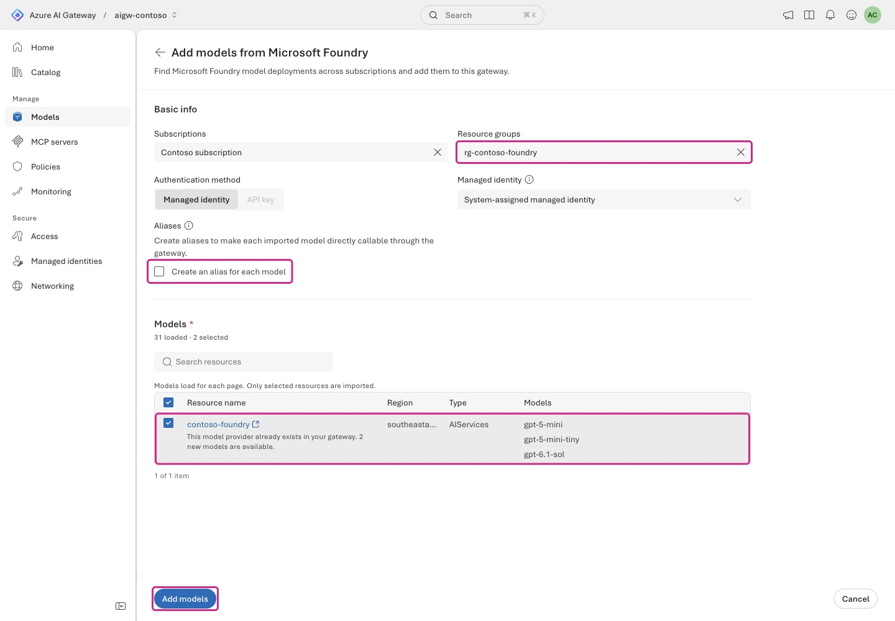
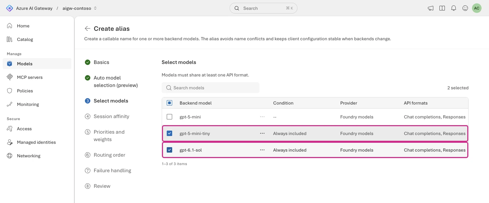
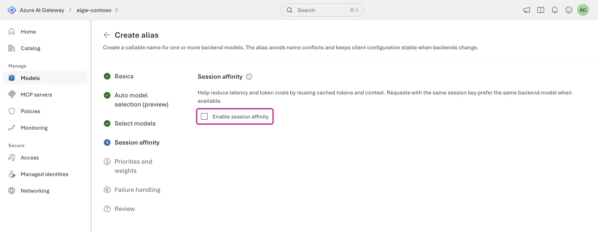
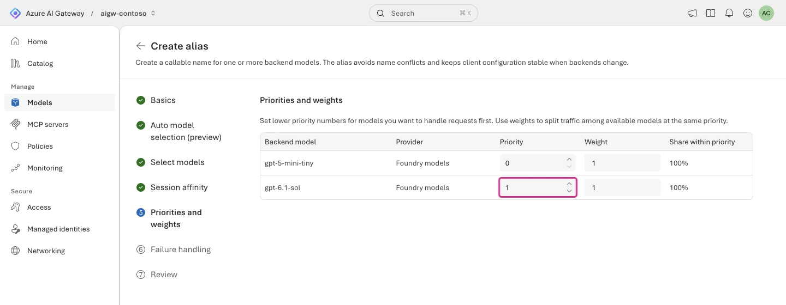
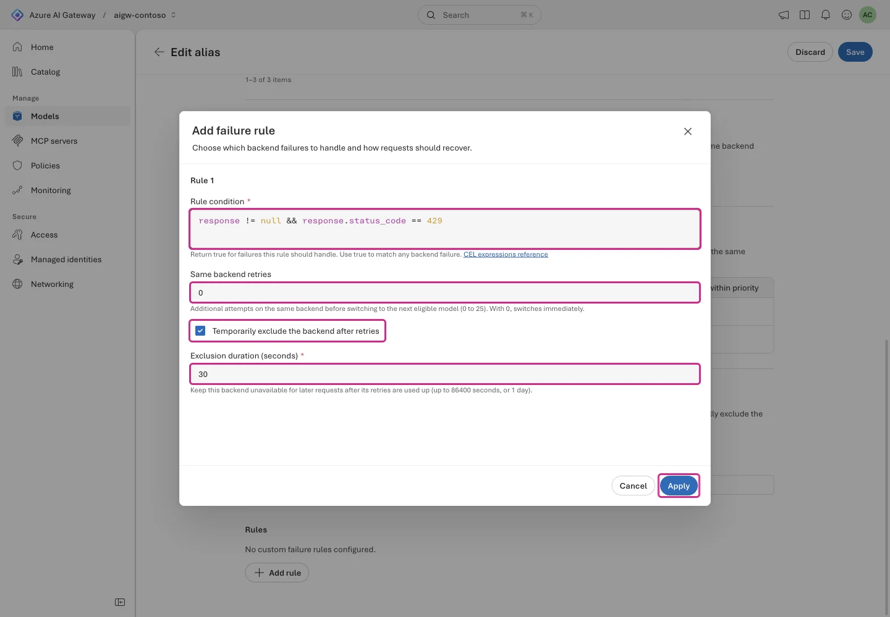
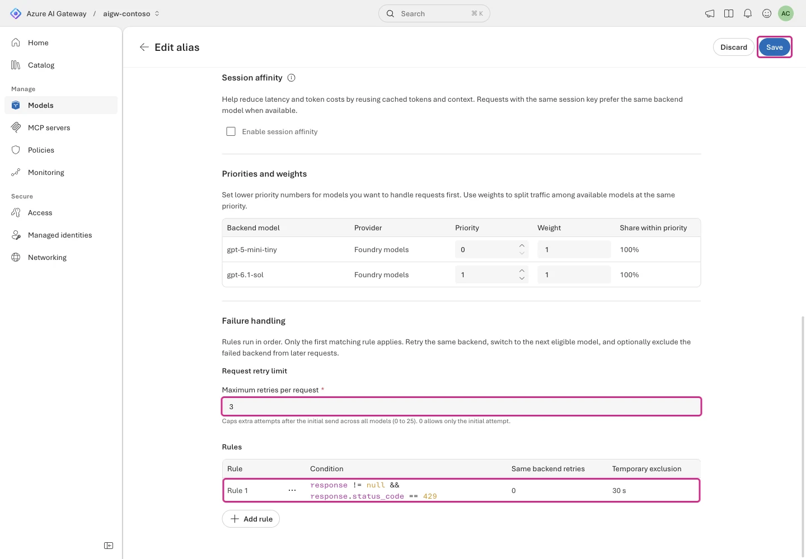
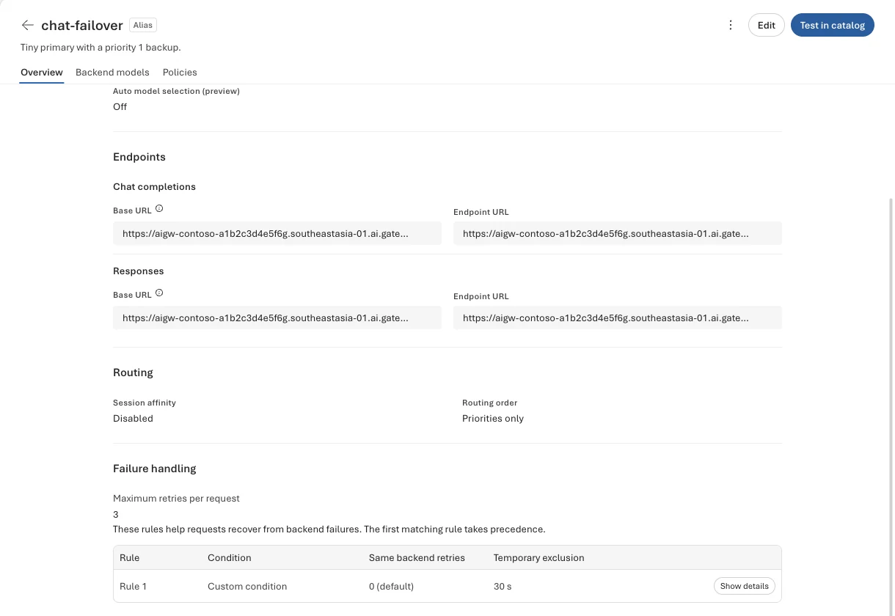

<!--
title: Fail over to a backup model when a backend fails
summary: Put a deliberately tiny deployment and a healthy backup behind one alias, watch throttling errors reach clients, then add a failure rule that retries on the backup and keeps the throttled backend out for 30 seconds, so every request succeeds.
category: models
level: Intermediate
duration: 30
tracks: [portal, cli, iac, terraform]
order: 3.6
status: new
illustration: diagrams/model-failover.svg
tags: [model alias, failover, retry, failure rules, CEL, HTTP 429, rate limit, temporary exclusion, maxRetryAttempts, high availability, resilience]
objectives:
  - Explain how failure rules, same-backend retries, temporary exclusion, and the retry limit decide where a failed request goes next
  - See throttling errors reach clients when an alias has priorities but no failure rules
  - Fail over to a backup model on HTTP 429 with a CEL failure rule, and prove it with the x-ms-served-model header
  - Keep a throttled backend out of the alias for 30 seconds, and watch it come back
prereqs:
  - 02-first-model-call
-->
<!-- gh:begin nav: generated by "npm run sync" from the metadata, do not edit -->
[AI Gateway labs](../README.md) › [Models & routing](../README.md#models--routing) › Lab 29
<!-- gh:end -->

# Fail over to a backup model when a backend fails

<!-- gh:begin intro: generated by "npm run sync" from the metadata, do not edit -->
> Put a deliberately tiny deployment and a healthy backup behind one alias, watch throttling errors reach clients, then add a failure rule that retries on the backup and keeps the throttled backend out for 30 seconds, so every request succeeds.

| ⏱️ Time | 📶 Level | 🧭 Tracks | ✅ Before you start |
| :-- | :-- | :-- | :-- |
| 30 min | Intermediate | Portal · Azure CLI · Bicep + azd · Terraform | [02 · First model call](../02-first-model-call/README.md) |

**You'll learn to**

- Explain how failure rules, same-backend retries, temporary exclusion, and the retry limit decide where a failed request goes next
- See throttling errors reach clients when an alias has priorities but no failure rules
- Fail over to a backup model on HTTP 429 with a CEL failure rule, and prove it with the x-ms-served-model header
- Keep a throttled backend out of the alias for 30 seconds, and watch it come back

**Follow along:** 🌐 [Interactive version](https://azure.github.io/aigateway/labs/29-model-failover/) with your own values filled in · 📁 [Lab files](infra/)

**On this page:** [Before you begin](#before-you-begin) · [How it works](#how-it-works) · [Create the alias](#create-the-alias) · [See the 429s without failover](#see-the-429s-without-failover) · [Turn on failover](#turn-on-failover) · [Watch the failover](#watch-the-failover) · [Verify](#verify) · [Go further](#go-further) · [Clean up](#clean-up) · [Next steps](#next-steps)
<!-- gh:end -->

Your chat app calls the `chat-failover` alias, which prefers a `gpt-5-mini` deployment. When that deployment runs
out of capacity, it returns `HTTP 429`, and so do your users' requests. In this lab you make the problem easy to see
with a deliberately tiny primary deployment, then add one failure rule to the alias: a `429` from a backend moves
the request to a healthy backup, `gpt-6.1-sol`, and keeps the throttled backend out of the alias for 30 seconds.
The app keeps sending `"model": "chat-failover"` and never retries on its own.

## Before you begin

<!-- setup: tools sign-in extension clone -->
<!-- gh:begin setup: generated by "npm run sync" from the metadata, do not edit -->
🧰 **One-time setup** from the [Setup guide](../SETUP.md), if you haven't done it yet:
[Choose where to run commands](../SETUP.md#choose-where-to-run-commands) ·
[Sign in to Azure](../SETUP.md#sign-in-to-azure) ·
[Install the `aigateway` extension](../SETUP.md#install-the-aigateway-extension) ·
[Clone the labs repo](../SETUP.md#clone-the-labs-repo)
<!-- gh:end -->

> [!TIP]
> On the **Bicep + azd** and **Terraform** tracks, `azd up` or `terraform apply` creates its own gateway, both
> deployments, the alias, and a key, so you can skip this section. You need only the one-time setup above.

- Complete [Publish a Foundry model and make your first call](../02-first-model-call/README.md). You need the
  gateway, the `app-first-call` runtime key, and the Foundry account. Lab 02 also gave the gateway the **Foundry
  User** role on your Foundry account, which covers the two new deployments in this lab.
- Recommended: [Route an alias across models by priority and weight](../22-model-routing/README.md) explains
  priority and weight. This lab builds on them.
- Permission to change the gateway, for example **Contributor** on its resource group, and to create deployments
  in the Foundry account.
- Run the scripts from the lab's folder, `~/aigateway/labs/29-model-failover`. The Bash scripts and snippets
  need `curl` and `jq`, which Cloud Shell has.

Set these variables once. Every track and the **Verify** section reuse them.

<details open><summary>Bash</summary> <!-- gh -->

```bash title="Bash"
# Name your gateway, the Foundry account from lab 02, the two backend models, and the alias that clients call
export RG="<resource-group>"
export GATEWAY="<gateway>"
export FOUNDRY_RG="<foundry-resource-group>"     # resource group of the Foundry account from lab 02
export FOUNDRY_ACCOUNT="<foundry-account-name>"
export PROVIDER="foundry-models"                 # the gateway provider of your Foundry account
export PRIMARY="gpt-5-mini-tiny"                 # the preferred deployment, deliberately tiny
export PRIMARY_VERSION="2025-08-07"
export BACKUP="gpt-6.1-sol"                      # the healthy backup deployment
export BACKUP_VERSION="2026-09-29"
export ALIAS="chat-failover"                     # the name that clients send in "model"
echo "📝 Alias $ALIAS will prefer $PRIMARY and fall back to $BACKUP on gateway $GATEWAY in $RG"

# Read the resource IDs of the gateway and the Foundry account, and the gateway's runtime URL
export GATEWAY_ID="$(az aigateway show -g "$RG" -n "$GATEWAY" --query id -o tsv)"
export FOUNDRY_ID="$(az cognitiveservices account show -g "$FOUNDRY_RG" -n "$FOUNDRY_ACCOUNT" --query id -o tsv)"
export AI_GATEWAY_URL="https://$(az aigateway show -g "$RG" -n "$GATEWAY" --query properties.frontend.defaultHostname -o tsv)"
echo "🆔 Gateway: $GATEWAY_ID"
echo "🌐 Runtime URL: $AI_GATEWAY_URL"

# Build the management URL of the gateway's default workspace, and the API version, for the az rest calls
export WS="https://management.azure.com$GATEWAY_ID/workspaces/default"
export API="api-version=2026-11-01"

# Read the app-first-call key from the gateway, so that it never shows on screen or lands in a file
export AI_GATEWAY_API_KEY="$(az aigateway api-key list-secrets -g "$RG" --gateway-name "$GATEWAY" -n app-first-call \
  --query primaryKey -o tsv)"
echo "🔑 Key: in AI_GATEWAY_API_KEY (${#AI_GATEWAY_API_KEY} characters, not shown)"

# Keep a jq filter that prints the alias's backend models, its retry limit, and its failure rules
export ROUTES='.properties
  | (.backendModels[] | "\(.resourceId | split("/") | last)  priority \(.priority)  weight \(.weight)"),
    "Maximum retries per request: \(.maxRetryAttempts // 0)",
    (if ((.failures // []) | length) == 0 then "Failure rules: none"
     else (.failures | to_entries[] | "Rule \(.key + 1): when \(.value.when)  retries \(.value.retryAttempts // 0)"
       + "  exclude for \(.value.excludeFor // "this request only")") end)'
```
</details> <!-- gh -->

<details><summary>PowerShell</summary> <!-- gh -->

```powershell title="PowerShell"
# Name your gateway, the Foundry account from lab 02, the two backend models, and the alias that clients call
$RG              = "<resource-group>"
$GATEWAY         = "<gateway>"
$FOUNDRY_RG      = "<foundry-resource-group>"    # resource group of the Foundry account from lab 02
$FOUNDRY_ACCOUNT = "<foundry-account-name>"
$PROVIDER        = "foundry-models"              # the gateway provider of your Foundry account
$PRIMARY         = "gpt-5-mini-tiny"             # the preferred deployment, deliberately tiny
$PRIMARY_VERSION = "2025-08-07"
$BACKUP          = "gpt-6.1-sol"                 # the healthy backup deployment
$BACKUP_VERSION  = "2026-09-29"
$ALIAS           = "chat-failover"               # the name that clients send in "model"
Write-Host "📝 Alias $ALIAS will prefer $PRIMARY and fall back to $BACKUP on gateway $GATEWAY in $RG"

# Read the resource IDs of the gateway and the Foundry account, and the gateway's runtime URL
$GATEWAY_ID = az aigateway show -g $RG -n $GATEWAY --query id -o tsv
$FOUNDRY_ID = az cognitiveservices account show -g $FOUNDRY_RG -n $FOUNDRY_ACCOUNT --query id -o tsv
$env:AI_GATEWAY_URL = "https://$(az aigateway show -g $RG -n $GATEWAY --query properties.frontend.defaultHostname -o tsv)"
Write-Host "🆔 Gateway: $GATEWAY_ID"
Write-Host "🌐 Runtime URL: $env:AI_GATEWAY_URL"

# Build the management URL of the gateway's default workspace, and the API version, for the az rest calls
$WS  = "https://management.azure.com$GATEWAY_ID/workspaces/default"
$API = "api-version=2026-11-01"

# Read the app-first-call key from the gateway, so that it never shows on screen or lands in a file
$env:AI_GATEWAY_API_KEY = az aigateway api-key list-secrets -g $RG --gateway-name $GATEWAY -n app-first-call `
  --query primaryKey -o tsv
Write-Host "🔑 Key: in AI_GATEWAY_API_KEY ($($env:AI_GATEWAY_API_KEY.Length) characters, not shown)"

# Define a function that prints the alias's backend models, its retry limit, and its failure rules
function Show-Routes($alias) {
  $p = $alias.properties
  $p.backendModels | ForEach-Object { '{0}  priority {1}  weight {2}' -f ($_.resourceId -split '/')[-1], $_.priority, $_.weight }
  "Maximum retries per request: $([int]$p.maxRetryAttempts)"
  if (-not $p.failures) { 'Failure rules: none' }
  $n = 0
  foreach ($f in $p.failures) {
    $n++
    $exclude = if ($f.excludeFor) { $f.excludeFor } else { 'this request only' }
    'Rule {0}: when {1}  retries {2}  exclude for {3}' -f $n, $f.when, [int]$f.retryAttempts, $exclude
  }
}
```
</details> <!-- gh -->

The CLI and Bicep tracks of lab 02 name the provider `foundry-models`. A portal import names it after your
Foundry account. To check, list the backend models. The **Provider** column shows the provider of each one.

<details open><summary>Bash</summary> <!-- gh -->

```bash title="Bash"
# List the backend models on the gateway, with the provider that holds each one
echo "✨ Backend models on $GATEWAY:"
az aigateway model list -g "$RG" --gateway-name "$GATEWAY" -o table
```
</details> <!-- gh -->

<details><summary>PowerShell</summary> <!-- gh -->

```powershell title="PowerShell"
# List the backend models on the gateway, with the provider that holds each one
Write-Host "✨ Backend models on ${GATEWAY}:"
az aigateway model list -g $RG --gateway-name $GATEWAY -o table
```
</details> <!-- gh -->

Deploy the two models in your Foundry account. The primary gets capacity `1`, the smallest there is, so that it
returns `HTTP 429` after a couple of requests; a production deployment would be much larger. If you kept
`gpt-6.1-sol` from lab 22 or 27, skip the second command. Model inference is billed per use.

<details open><summary>Bash</summary> <!-- gh -->

```bash title="Bash"
# Deploy the primary: gpt-5-mini with 1,000 tokens and 1 request per minute of Global Standard capacity
az cognitiveservices account deployment create -g "$FOUNDRY_RG" -n "$FOUNDRY_ACCOUNT" \
  --deployment-name "$PRIMARY" --model-name gpt-5-mini --model-version "$PRIMARY_VERSION" \
  --model-format OpenAI --sku-name GlobalStandard --sku-capacity 1 \
  --query "{name:name, capacity:sku.capacity, state:properties.provisioningState}" &&
  echo "✨ Model deployment $PRIMARY is ready in $FOUNDRY_ACCOUNT"

# Deploy the backup: gpt-6.1-sol with 10,000 tokens and 10 requests per minute
az cognitiveservices account deployment create -g "$FOUNDRY_RG" -n "$FOUNDRY_ACCOUNT" \
  --deployment-name "$BACKUP" --model-name "$BACKUP" --model-version "$BACKUP_VERSION" \
  --model-format OpenAI --sku-name GlobalStandard --sku-capacity 10 \
  --query "{name:name, capacity:sku.capacity, state:properties.provisioningState}" &&
  echo "✨ Model deployment $BACKUP is ready in $FOUNDRY_ACCOUNT"
```
</details> <!-- gh -->

<details><summary>PowerShell</summary> <!-- gh -->

```powershell title="PowerShell"
# Deploy the primary: gpt-5-mini with 1,000 tokens and 1 request per minute of Global Standard capacity
az cognitiveservices account deployment create -g $FOUNDRY_RG -n $FOUNDRY_ACCOUNT `
  --deployment-name $PRIMARY --model-name gpt-5-mini --model-version $PRIMARY_VERSION `
  --model-format OpenAI --sku-name GlobalStandard --sku-capacity 1 `
  --query "{name:name, capacity:sku.capacity, state:properties.provisioningState}"
if ($?) { Write-Host "✨ Model deployment $PRIMARY is ready in $FOUNDRY_ACCOUNT" }

# Deploy the backup: gpt-6.1-sol with 10,000 tokens and 10 requests per minute
az cognitiveservices account deployment create -g $FOUNDRY_RG -n $FOUNDRY_ACCOUNT `
  --deployment-name $BACKUP --model-name $BACKUP --model-version $BACKUP_VERSION `
  --model-format OpenAI --sku-name GlobalStandard --sku-capacity 10 `
  --query "{name:name, capacity:sku.capacity, state:properties.provisioningState}"
if ($?) { Write-Host "✨ Model deployment $BACKUP is ready in $FOUNDRY_ACCOUNT" }
```
</details> <!-- gh -->

## How it works

An alias without failure rules sends each request to one backend model, picked by priority and weight, and returns
whatever that backend answers, errors included. Failure rules tell the gateway what to do when a backend fails:

| Setting | Alias field | Portal | What it does |
|---|---|---|---|
| **Rule condition** | `failures[].when` | **Failure handling** › **Add rule** › **Rule condition** | A CEL expression over the backend's `response`. Rules run in order, and only the first matching rule applies. A failure that matches no rule goes to the client. |
| **Same backend retries** | `failures[].retryAttempts` | **Same backend retries** | Extra attempts on the failed backend before switching. The default, `0`, switches at once. |
| **Temporary exclusion** | `failures[].excludeFor` | **Temporarily exclude the backend after retries** › **Exclusion duration (seconds)** | Keeps the failed backend out of later requests to the alias for a while, up to one day. Without it, the backend is skipped only for the current request. |
| **Maximum retries per request** | `maxRetryAttempts` | **Request retry limit** › **Maximum retries per request** | Caps the extra sends of one request across all backend models, from `0` to `25`. `3` allows four sends in total. The portal suggests `3`. The API default, `0`, leaves a matching rule nowhere to send the request: in our tests, the client then got an empty `HTTP 503` instead of the backend's `429`. |

When a rule matches and its same-backend retries are used up, the gateway skips the failed backend for the rest of
the request and runs the alias's [routing](https://ai.gateway.azure.com/docs/models/routing-order) again over the
remaining backend models: another model in the same priority group first, then the next priority group. So
priorities pick the order of the backups, and the rules decide when to move to them.


Conditions are [CEL](https://ai.gateway.azure.com/docs/cel-expressions#cel-features) expressions. `response` is `null` when the backend sent no
HTTP response at all, such as a timeout or a refused connection, so check `response != null` before you read
`response.status_code`. Over the API, in Bicep, and in Terraform, wrap each expression in `@cel(…)`; the portal adds
the wrapper.

Not every failure can be recovered:

- **Output already sent.** The gateway retries or switches only before any output reaches the client, and only when
  it can replay the request safely. A stream that fails after its first tokens isn't retried.
- **Stored conversations.** A Responses API request with `previous_response_id` stays on the backend that stored the
  earlier response, and doesn't switch.
- **Policies.** Alias policies run once per request. A same-backend retry doesn't run that model's policies again; a
  switch runs the new model's policies before calling it.

## Create the alias

Register both deployments in the gateway, then create the `chat-failover` alias with `gpt-5-mini-tiny` at priority
`0` and `gpt-6.1-sol` at priority `1`, without failure rules for now.

<!-- track: portal | Portal -->
<details open><summary><b>🖥️ Portal</b></summary> <!-- gh -->

### Import the two models

1. Open the [AI Gateway portal](https://ai.gateway.azure.com) and select your gateway in the top bar.
2. Select **Models** › **Add** › **Models from Microsoft Foundry**.
3. In **Resource groups**, select the resource group of your Foundry account. Keep **Managed identity** as the
   **Authentication method**, and clear **Create an alias for each model**.

   

4. In **Models**, make sure only your Foundry account is selected. Its row reads `This model provider already exists
   in your gateway. 2 new models are available.` Select **Add models**. The banner reads `Models imported. 2 model(s)
   were created. No aliases were created.` Select **Close**.

> **Checkpoint**
> **Models** › **Backend models** lists `gpt-5-mini-tiny` and `gpt-6.1-sol`, next to `gpt-5-mini` from lab 02.
> The portal names the new backend model `gpt-6-1-sol` and shows its display name, `gpt-6.1-sol`.

### Create the alias

1. Select **Models** › **Add** › **Alias for existing models**.
2. On **Basics**, set **Alias name** to `chat-failover` and **Description** to `Prefers the tiny deployment`.
   Select **Next**.
3. On **Auto model selection (preview)**, leave the option cleared, and select **Next**.
4. On **Select models**, select `gpt-5-mini-tiny` and `gpt-6.1-sol`. Select **Next**.

   

5. On **Session affinity**, clear **Enable session affinity**. Select **Next**.

   

6. On **Priorities and weights**, set **Priority** to `0` for `gpt-5-mini-tiny` and `1` for `gpt-6.1-sol`. Keep
   both weights at `1`. Select **Next**.

   

7. On **Failure handling**, keep the defaults, without rules, and select **Next**. You add a rule after you've seen
   the errors.
8. On **Review**, select **Create**.

> **Checkpoint**
> The `chat-failover` alias opens. Its overview shows **Session affinity** **Disabled** and **Routing order**
> **Priorities only**, and its **Backend models** tab shows `gpt-5-mini-tiny` at priority `0` and `gpt-6.1-sol` at
> priority `1`.

</details> <!-- gh -->
<!-- track: cli | Azure CLI -->
<details><summary><b>⌨️ Azure CLI</b></summary> <!-- gh -->

### Register the two models

A backend model registers one deployment under the provider. `modelName` must be the deployment's name: the
gateway calls the deployment that it names. If you kept `gpt-6.1-sol` in the gateway from lab 22 or 27, skip the
second command.

<details open><summary>Bash</summary> <!-- gh -->

```bash title="Bash"
# Register the primary deployment as a backend model under the provider
az aigateway model create -g "$RG" --gateway-name "$GATEWAY" --provider-name "$PROVIDER" -n "$PRIMARY" \
  --display-name "$PRIMARY" --api-format OpenAIChatCompletions \
  --supported-endpoints /openai/v1/chat/completions /openai/v1/responses \
  --deployment-config "{resourceId:$FOUNDRY_ID/deployments/$PRIMARY,modelName:$PRIMARY,modelVersion:$PRIMARY_VERSION}" \
  --query "{name:name, deployment:properties.deployment.modelName}" &&
  echo "✨ Model $PRIMARY is published through $PROVIDER"

# Register the backup deployment the same way
az aigateway model create -g "$RG" --gateway-name "$GATEWAY" --provider-name "$PROVIDER" -n "$BACKUP" \
  --display-name "$BACKUP" --api-format OpenAIChatCompletions \
  --supported-endpoints /openai/v1/chat/completions /openai/v1/responses \
  --deployment-config "{resourceId:$FOUNDRY_ID/deployments/$BACKUP,modelName:$BACKUP,modelVersion:$BACKUP_VERSION}" \
  --query "{name:name, deployment:properties.deployment.modelName}" &&
  echo "✨ Model $BACKUP is published through $PROVIDER"
```
</details> <!-- gh -->

<details><summary>PowerShell</summary> <!-- gh -->

```powershell title="PowerShell"
# Register the primary deployment as a backend model under the provider
az aigateway model create -g $RG --gateway-name $GATEWAY --provider-name $PROVIDER -n $PRIMARY `
  --display-name $PRIMARY --api-format OpenAIChatCompletions `
  --supported-endpoints /openai/v1/chat/completions /openai/v1/responses `
  --deployment-config "{resourceId:$FOUNDRY_ID/deployments/$PRIMARY,modelName:$PRIMARY,modelVersion:$PRIMARY_VERSION}" `
  --query "{name:name, deployment:properties.deployment.modelName}"
if ($?) { Write-Host "✨ Model $PRIMARY is published through $PROVIDER" }

# Register the backup deployment the same way
az aigateway model create -g $RG --gateway-name $GATEWAY --provider-name $PROVIDER -n $BACKUP `
  --display-name $BACKUP --api-format OpenAIChatCompletions `
  --supported-endpoints /openai/v1/chat/completions /openai/v1/responses `
  --deployment-config "{resourceId:$FOUNDRY_ID/deployments/$BACKUP,modelName:$BACKUP,modelVersion:$BACKUP_VERSION}" `
  --query "{name:name, deployment:properties.deployment.modelName}"
if ($?) { Write-Host "✨ Model $BACKUP is published through $PROVIDER" }
```
</details> <!-- gh -->

### Create the alias

Each `--backend-model` adds an entry to the alias's `backendModels` list, with a `resource-id`, a `priority`, and
a `weight`.

<details open><summary>Bash</summary> <!-- gh -->

```bash title="Bash"
# Build the resource ID prefix of the provider's backend models, which each --backend-model entry uses
export MODELS="$GATEWAY_ID/workspaces/default/modelProviders/$PROVIDER/models"

# Create or update the alias with the primary at priority 0 and the backup at priority 1, then print it
az aigateway model-alias set -g "$RG" --gateway-name "$GATEWAY" -n "$ALIAS" \
  --description "Prefers the tiny deployment" \
  --backend-model resource-id="$MODELS/$PRIMARY" priority=0 weight=1 \
  --backend-model resource-id="$MODELS/$BACKUP" priority=1 weight=1 \
  --only-show-errors -o none &&
  echo "🔖 Alias $ALIAS routes to:" &&
  az rest --method get --url "$WS/aliases/$ALIAS?$API" | jq -r "$ROUTES"
```
</details> <!-- gh -->

<details><summary>PowerShell</summary> <!-- gh -->

```powershell title="PowerShell"
# Build the resource ID prefix of the provider's backend models, which each --backend-model entry uses
$MODELS = "$GATEWAY_ID/workspaces/default/modelProviders/$PROVIDER/models"

# Create or update the alias with the primary at priority 0 and the backup at priority 1, then print it
az aigateway model-alias set -g $RG --gateway-name $GATEWAY -n $ALIAS `
  --description "Prefers the tiny deployment" `
  --backend-model resource-id="$MODELS/$PRIMARY" priority=0 weight=1 `
  --backend-model resource-id="$MODELS/$BACKUP" priority=1 weight=1 `
  --only-show-errors -o none
if ($?) {
  Write-Host "🔖 Alias $ALIAS routes to:"
  Show-Routes (az rest --method get --url "$WS/aliases/${ALIAS}?$API" | ConvertFrom-Json)
}
```
</details> <!-- gh -->

> **Checkpoint**
> The output shows `gpt-5-mini-tiny  priority 0  weight 1`, `gpt-6.1-sol  priority 1  weight 1`,
> `Maximum retries per request: 0`, and `Failure rules: none`.

</details> <!-- gh -->
<!-- track: iac | Bicep + azd -->
<details><summary><b>🏗️ Bicep + azd</b></summary> <!-- gh -->

**What you need:** only the one-time setup from **Before you begin**. This track doesn't use your gateway from lab 02:
`azd up` creates a new one, so it works on its own.

### Review the templates

`infra/main.bicep` creates the resource group `rg-<environment name>` and calls the quick start's
[resources.bicep](../quickstart/infra/resources.bicep) for the gateway, the Foundry account with `gpt-5-mini`, its
default alias, and the `app-first-call` key. Then it adds the two deployments and publishes the `chat-failover`
alias:

<!-- include: infra/main.bicep -->
<!-- gh:begin include: generated by "npm run sync" from the metadata, do not edit -->
📄 [`infra/main.bicep`](infra/main.bicep)

<details><summary>Show all 90 lines</summary>

```bicep
// Lab 29 with azd: "azd up" creates the resource group rg-<environment name>, the quick start's gateway, Foundry
// model, default alias, and runtime API key. Then it adds a tiny primary deployment and a backup deployment in the same
// Foundry account, and publishes the chat-failover alias, which prefers the primary and, with FAILOVER=on, fails over
// to the backup when the primary returns 429. The runtime API key is never an output.
targetScope = 'subscription'

@description('azd environment name. The resource group is rg-<environmentName>.')
@minLength(1)
@maxLength(60)
param environmentName string

@description('Region for every resource. Pick one where AI Gateway and the lab\'s Foundry models are available. List them with az provider show --namespace Microsoft.ApiManagement (Setup guide, Find the available regions).')
@metadata({ azd: { type: 'location' } })
param location string

@description('Backup model to deploy in Foundry. azd reads it from BACKUP_MODEL.')
param backupModelName string = 'gpt-6.1-sol'

@description('Version of the backup model. azd reads it from BACKUP_MODEL_VERSION.')
param backupModelVersion string = '2026-09-29'

@description('off: the alias only prefers the primary by priority. on: it also fails over on 429. azd reads it from FAILOVER.')
@allowed([
  'off'
  'on'
])
param failover string = 'off'

@description('How long a throttled backend stays out of the alias, as an ISO 8601 duration up to P1D. Empty: only for the current request. azd reads it from FAILOVER_EXCLUDE_FOR.')
param excludeFor string = 'PT30S'

var suffix = take(uniqueString(subscription().id, environmentName, location), 6)
var tags = { 'azd-env-name': environmentName }

resource rg 'Microsoft.Resources/resourceGroups@2024-03-01' = {
  name: 'rg-${environmentName}'
  location: location
  tags: tags
}

// The quick start's template: a gateway, gpt-5-mini behind the default alias, and the app-first-call key.
module base '../../quickstart/infra/resources.bicep' = {
  name: 'aigw-base'
  scope: rg
  params: {
    location: location
    tags: tags
    gatewayName: 'aigw-${suffix}'
    foundryName: 'aigw${suffix}'
  }
}

// The tiny primary and the backup, in the same Foundry account. The gateway's Foundry User role already covers them.
module deployments 'deployments.bicep' = {
  name: 'aigw-failover-deployments'
  scope: rg
  params: {
    foundryName: base.outputs.foundryName
    backupModelName: backupModelName
    backupModelVersion: backupModelVersion
  }
}

module alias 'failover-alias.bicep' = {
  name: 'aigw-failover-alias'
  scope: rg
  params: {
    gatewayName: base.outputs.gatewayName
    providerName: base.outputs.providerName
    foundryAccountId: base.outputs.foundryId
    primaryDeploymentName: deployments.outputs.primaryDeploymentName
    primaryModelVersion: deployments.outputs.primaryModelVersion
    backupDeploymentName: deployments.outputs.backupDeploymentName
    backupModelVersion: backupModelVersion
    aliasName: 'chat-failover'
    failover: failover
    excludeFor: excludeFor
  }
}

output AZURE_RESOURCE_GROUP string = rg.name
output AI_GATEWAY_NAME string = base.outputs.gatewayName
output AI_GATEWAY_ID string = base.outputs.gatewayId
output AI_GATEWAY_URL string = base.outputs.gatewayUrl
output AI_GATEWAY_PROVIDER string = base.outputs.providerName
output AI_GATEWAY_BACKEND_MODEL string = alias.outputs.primaryModelName
output AI_GATEWAY_BACKUP_MODEL string = alias.outputs.backupModelName
output AI_GATEWAY_MODEL string = alias.outputs.aliasName
output FOUNDRY_ACCOUNT_NAME string = base.outputs.foundryName
output FOUNDRY_ACCOUNT_ID string = base.outputs.foundryId
```

</details>
<!-- gh:end -->

`infra/deployments.bicep` deploys the tiny primary, with capacity `1`, and the backup, one after the other:

<!-- include: infra/deployments.bicep -->
<!-- gh:begin include: generated by "npm run sync" from the metadata, do not edit -->
📄 [`infra/deployments.bicep`](infra/deployments.bicep)

<details><summary>Show all 73 lines</summary>

```bicep
// Deploys the lab's two models in an existing Foundry account: a deliberately tiny gpt-5-mini deployment that quickly
// returns 429, and a healthy backup. main.bicep calls it after the quick start's template has created the account.
targetScope = 'resourceGroup'

@description('Name of the existing Foundry (Azure AI Services) account.')
param foundryName string

@description('Name of the tiny primary deployment.')
param primaryDeploymentName string = 'gpt-5-mini-tiny'

@description('Model of the tiny primary deployment.')
param primaryModelName string = 'gpt-5-mini'

@description('Version of the primary deployment\'s model.')
param primaryModelVersion string = '2025-08-07'

@description('Capacity of the primary, in thousands of tokens per minute. 1 makes it return 429 after a couple of requests.')
@minValue(1)
param primaryCapacity int = 1

@description('Backup model to deploy. The deployment uses the same name.')
param backupModelName string = 'gpt-6.1-sol'

@description('Version of the backup model.')
param backupModelVersion string = '2026-09-29'

@description('Capacity of the backup, in thousands of tokens per minute.')
@minValue(1)
param backupCapacity int = 10

resource foundry 'Microsoft.CognitiveServices/accounts@2025-04-01-preview' existing = {
  name: foundryName
}

resource primary 'Microsoft.CognitiveServices/accounts/deployments@2025-04-01-preview' = {
  parent: foundry
  name: primaryDeploymentName
  sku: {
    name: 'GlobalStandard'
    capacity: primaryCapacity
  }
  properties: {
    model: {
      format: 'OpenAI'
      name: primaryModelName
      version: primaryModelVersion
    }
  }
}

// One deployment at a time: Foundry rejects a second change to an account while the first one is running.
resource backup 'Microsoft.CognitiveServices/accounts/deployments@2025-04-01-preview' = {
  parent: foundry
  name: backupModelName
  dependsOn: [
    primary
  ]
  sku: {
    name: 'GlobalStandard'
    capacity: backupCapacity
  }
  properties: {
    model: {
      format: 'OpenAI'
      name: backupModelName
      version: backupModelVersion
    }
  }
}

output primaryDeploymentName string = primary.name
output primaryModelVersion string = primaryModelVersion
output backupDeploymentName string = backup.name
```

</details>
<!-- gh:end -->

`infra/failover-alias.bicep` registers both deployments and writes the alias. `FAILOVER` picks one of two shapes:
`off` gives the alias priorities only, and `on` adds `maxRetryAttempts` and the failure rule for `429`. You can
also deploy this file on its own to the gateway from lab 02, once both deployments exist.

<!-- include: infra/failover-alias.bicep -->
<!-- gh:begin include: generated by "npm run sync" from the metadata, do not edit -->
📄 [`infra/failover-alias.bicep`](infra/failover-alias.bicep)

<details><summary>Show all 141 lines</summary>

```bicep
// Publishes an alias that prefers a primary Foundry deployment and, with failover on, fails over to a backup when the
// primary returns 429. main.bicep calls it after the quick start's template, and you can also deploy it on its own to
// a gateway you already have, such as the one from lab 02, once both deployments exist in your Foundry account.
// Registers both deployments as backend models under the existing Foundry provider, then publishes the alias.
targetScope = 'resourceGroup'

@description('Name of the existing AI Gateway (Microsoft.ApiManagement/aigateways) in this resource group.')
param gatewayName string

@description('Name of the existing Foundry model provider in the gateway, for example foundry-models from lab 02.')
param providerName string = 'foundry-models'

@description('Resource ID of the Foundry account that hosts both deployments.')
param foundryAccountId string

@description('Deployment that the alias prefers, at priority 0. The backend model uses the same name.')
param primaryDeploymentName string = 'gpt-5-mini-tiny'

@description('Version of the primary deployment\'s model. Optional.')
param primaryModelVersion string = '2025-08-07'

@description('Deployment that takes over, at priority 1. The backend model uses the same name.')
param backupDeploymentName string = 'gpt-6.1-sol'

@description('Version of the backup deployment\'s model. Optional.')
param backupModelVersion string = '2026-09-29'

@description('Callable alias that clients send in the request "model" field.')
param aliasName string = 'chat-failover'

@description('off: the alias only prefers the primary by priority, and errors go to the client. on: a failure rule switches to the backup on 429.')
@allowed([
  'off'
  'on'
])
param failover string = 'on'

@description('How long a throttled backend stays out of the alias, as an ISO 8601 duration up to P1D. Empty: only for the current request.')
param excludeFor string = 'PT30S'

@description('Cap on the extra sends of one request across all backend models. 3 allows up to four sends.')
@minValue(0)
@maxValue(25)
param maxRetryAttempts int = 3

#disable-next-line BCP081
resource aiGateway 'Microsoft.ApiManagement/aigateways@2026-11-01' existing = {
  name: gatewayName
}

#disable-next-line BCP081
resource defaultWorkspace 'Microsoft.ApiManagement/aigateways/workspaces@2026-11-01' existing = {
  parent: aiGateway
  name: 'default'
}

#disable-next-line BCP081
resource provider 'Microsoft.ApiManagement/aigateways/workspaces/modelProviders@2026-11-01' existing = {
  parent: defaultWorkspace
  name: providerName
}

// The gateway calls the Foundry deployment that deployment.modelName names, so it matches the deployment name.
#disable-next-line BCP081
resource primary 'Microsoft.ApiManagement/aigateways/workspaces/modelProviders/models@2026-11-01' = {
  parent: provider
  name: primaryDeploymentName
  properties: {
    displayName: primaryDeploymentName
    description: 'Primary deployment of the ${aliasName} alias.'
    supportedEndpoints: [
      '/openai/v1/chat/completions'
      '/openai/v1/responses'
    ]
    deployment: {
      resourceId: '${foundryAccountId}/deployments/${primaryDeploymentName}'
      modelName: primaryDeploymentName
      modelVersion: empty(primaryModelVersion) ? null : primaryModelVersion
    }
  }
}

#disable-next-line BCP081
resource backup 'Microsoft.ApiManagement/aigateways/workspaces/modelProviders/models@2026-11-01' = {
  parent: provider
  name: backupDeploymentName
  properties: {
    displayName: backupDeploymentName
    description: 'Backup deployment of the ${aliasName} alias.'
    supportedEndpoints: [
      '/openai/v1/chat/completions'
      '/openai/v1/responses'
    ]
    deployment: {
      resourceId: '${foundryAccountId}/deployments/${backupDeploymentName}'
      modelName: backupDeploymentName
      modelVersion: empty(backupModelVersion) ? null : backupModelVersion
    }
  }
}

// One rule: a 429 from a backend switches the request to the next backend model at once (no same-backend retries),
// and keeps the throttled backend out of the alias for excludeFor. Rules use CEL over the backend response.
var throttlingRule = union(
  { when: '@cel(response != null && response.status_code == 429)' },
  empty(excludeFor) ? {} : { excludeFor: excludeFor }
)

#disable-next-line BCP081
resource alias 'Microsoft.ApiManagement/aigateways/workspaces/aliases@2026-11-01' = {
  parent: defaultWorkspace
  name: aliasName
  properties: {
    description: failover == 'on'
      ? 'Prefers ${primaryDeploymentName}, and fails over to ${backupDeploymentName} on 429.'
      : 'Prefers ${primaryDeploymentName}. ${backupDeploymentName} has a lower preference.'
    backendModels: [
      {
        resourceId: primary.id
        priority: 0
        weight: 1
      }
      {
        resourceId: backup.id
        priority: 1
        weight: 1
      }
    ]
    selectionOrder: [
      'priority'
    ]
    maxRetryAttempts: failover == 'on' ? maxRetryAttempts : null
    failures: failover == 'on' ? [throttlingRule] : null
  }
}

output aliasName string = alias.name
output primaryModelName string = primary.name
output backupModelName string = backup.name
output failures array = failover == 'on' ? [throttlingRule] : []
output chatCompletionsUrl string = 'https://${aiGateway.properties.frontend.defaultHostname}/default/models/openai/v1/chat/completions'
```

</details>
<!-- gh:end -->

### Deploy with azd up

Move into the lab's folder, create an azd environment named `aigw-lab29` in your current subscription, then
provision everything. It takes about five minutes.

<details open><summary>Bash</summary> <!-- gh -->

```bash title="Bash"
# Move into the lab's folder, which holds the azd project
cd ~/aigateway/labs/29-model-failover &&
  echo "📂 Lab folder: $(pwd)"

# Create an azd environment named aigw-lab29 in your current subscription, so that azd doesn't prompt you
azd env new aigw-lab29 --location eastus2 --subscription "$(az account show --query id --output tsv)" &&
  echo "📝 azd environment aigw-lab29 deploys to eastus2"

# Provision the resource group, the gateway, the Foundry account with three deployments, the alias, and the key
azd up &&
  echo "🚀 Gateway deployed: $(azd env get-value AI_GATEWAY_URL)"
```
</details> <!-- gh -->

<details><summary>PowerShell</summary> <!-- gh -->

```powershell title="PowerShell"
# Move into the lab's folder, which holds the azd project
Set-Location ~/aigateway/labs/29-model-failover
if ($?) { Write-Host "📂 Lab folder: $(Get-Location)" }

# Create an azd environment named aigw-lab29 in your current subscription, so that azd doesn't prompt you
azd env new aigw-lab29 --location eastus2 --subscription (az account show --query id --output tsv)
if ($?) { Write-Host "📝 azd environment aigw-lab29 deploys to eastus2" }

# Provision the resource group, the gateway, the Foundry account with three deployments, the alias, and the key
azd up
if ($?) { Write-Host "🚀 Gateway deployed: $(azd env get-value AI_GATEWAY_URL)" }
```
</details> <!-- gh -->

For another region, pick one where AI Gateway and the `gpt-5-mini` and `gpt-6.1-sol` models are available, as in
[Find the available regions](../SETUP.md#find-the-available-regions). The parameters come from azd environment
values, with the defaults in `infra/main.parameters.json`: `FAILOVER` (`off`), `FAILOVER_EXCLUDE_FOR` (`PT30S`),
`BACKUP_MODEL` (`gpt-6.1-sol`), and `BACKUP_MODEL_VERSION` (`2026-09-29`).

### Read the outputs and the key

Set the variables that the next sections and **Verify** use from azd's environment values, read the key from the
gateway so that it never shows on screen, then print the alias.

<details open><summary>Bash</summary> <!-- gh -->

```bash title="Bash"
# Read azd's outputs into the variables that the next sections use
export RG="$(azd env get-value AZURE_RESOURCE_GROUP)"
export GATEWAY="$(azd env get-value AI_GATEWAY_NAME)"
export GATEWAY_ID="$(azd env get-value AI_GATEWAY_ID)"
export PROVIDER="$(azd env get-value AI_GATEWAY_PROVIDER)"
export PRIMARY="$(azd env get-value AI_GATEWAY_BACKEND_MODEL)"
export BACKUP="$(azd env get-value AI_GATEWAY_BACKUP_MODEL)"
export ALIAS="$(azd env get-value AI_GATEWAY_MODEL)"
export FOUNDRY_ID="$(azd env get-value FOUNDRY_ACCOUNT_ID)"
export AI_GATEWAY_URL="$(azd env get-value AI_GATEWAY_URL)"
echo "📝 Alias $ALIAS prefers $PRIMARY and falls back to $BACKUP on gateway $GATEWAY in $RG"
echo "🌐 Runtime URL: $AI_GATEWAY_URL"

# Build the management URL of the gateway's default workspace, and the API version, for the az rest calls
export WS="https://management.azure.com$GATEWAY_ID/workspaces/default"
export API="api-version=2026-11-01"

# Read the app-first-call key from the gateway, so that it never shows on screen or lands in a file
export AI_GATEWAY_API_KEY="$(az aigateway api-key list-secrets --ids "$GATEWAY_ID/apiKeys/app-first-call" \
  --query primaryKey --output tsv)"
echo "🔑 Key: in AI_GATEWAY_API_KEY (${#AI_GATEWAY_API_KEY} characters, not shown)"

# Keep a jq filter that prints the alias's backend models, its retry limit, and its failure rules, then print them
export ROUTES='.properties
  | (.backendModels[] | "\(.resourceId | split("/") | last)  priority \(.priority)  weight \(.weight)"),
    "Maximum retries per request: \(.maxRetryAttempts // 0)",
    (if ((.failures // []) | length) == 0 then "Failure rules: none"
     else (.failures | to_entries[] | "Rule \(.key + 1): when \(.value.when)  retries \(.value.retryAttempts // 0)"
       + "  exclude for \(.value.excludeFor // "this request only")") end)'
echo "🔖 Alias $ALIAS routes to:"
az rest --method get --url "$WS/aliases/$ALIAS?$API" | jq -r "$ROUTES"
```
</details> <!-- gh -->

<details><summary>PowerShell</summary> <!-- gh -->

```powershell title="PowerShell"
# Read azd's outputs into the variables that the next sections use
$RG                     = azd env get-value AZURE_RESOURCE_GROUP
$GATEWAY                = azd env get-value AI_GATEWAY_NAME
$GATEWAY_ID             = azd env get-value AI_GATEWAY_ID
$PROVIDER               = azd env get-value AI_GATEWAY_PROVIDER
$PRIMARY                = azd env get-value AI_GATEWAY_BACKEND_MODEL
$BACKUP                 = azd env get-value AI_GATEWAY_BACKUP_MODEL
$ALIAS                  = azd env get-value AI_GATEWAY_MODEL
$FOUNDRY_ID             = azd env get-value FOUNDRY_ACCOUNT_ID
$env:AI_GATEWAY_URL     = azd env get-value AI_GATEWAY_URL
Write-Host "📝 Alias $ALIAS prefers $PRIMARY and falls back to $BACKUP on gateway $GATEWAY in $RG"
Write-Host "🌐 Runtime URL: $env:AI_GATEWAY_URL"

# Build the management URL of the gateway's default workspace, and the API version, for the az rest calls
$WS  = "https://management.azure.com$GATEWAY_ID/workspaces/default"
$API = "api-version=2026-11-01"

# Read the app-first-call key from the gateway, so that it never shows on screen or lands in a file
$env:AI_GATEWAY_API_KEY = az aigateway api-key list-secrets --ids "$GATEWAY_ID/apiKeys/app-first-call" `
  --query primaryKey --output tsv
Write-Host "🔑 Key: in AI_GATEWAY_API_KEY ($($env:AI_GATEWAY_API_KEY.Length) characters, not shown)"

# Define a function that prints the alias's backend models, its retry limit, and its failure rules, then print them
function Show-Routes($alias) {
  $p = $alias.properties
  $p.backendModels | ForEach-Object { '{0}  priority {1}  weight {2}' -f ($_.resourceId -split '/')[-1], $_.priority, $_.weight }
  "Maximum retries per request: $([int]$p.maxRetryAttempts)"
  if (-not $p.failures) { 'Failure rules: none' }
  $n = 0
  foreach ($f in $p.failures) {
    $n++
    $exclude = if ($f.excludeFor) { $f.excludeFor } else { 'this request only' }
    'Rule {0}: when {1}  retries {2}  exclude for {3}' -f $n, $f.when, [int]$f.retryAttempts, $exclude
  }
}
Write-Host "🔖 Alias $ALIAS routes to:"
Show-Routes (az rest --method get --url "$WS/aliases/${ALIAS}?$API" | ConvertFrom-Json)
```
</details> <!-- gh -->

> **Checkpoint**
> `azd up` ended with `SUCCESS`, and the last command printed `gpt-5-mini-tiny  priority 0  weight 1`,
> `gpt-6.1-sol  priority 1  weight 1`, `Maximum retries per request: 0`, and `Failure rules: none`.

</details> <!-- gh -->
<!-- track: terraform | Terraform -->
<details><summary><b>🌍 Terraform</b></summary> <!-- gh -->

**What you need:** only the one-time setup from **Before you begin**, plus Terraform 1.9 or later, as in
[Deploy a lab with Terraform](../SETUP.md#deploy-a-lab-with-terraform). This track doesn't use your gateway from
lab 02: `terraform apply` creates a new one, so it works on its own.

### Review the configuration

The configuration deploys the same resources as the Bicep templates. `terraform/main.tf` creates the resource group
`rg-<environment_name>` and calls the quick start's [resources module](../quickstart/terraform/resources) for the
gateway, the Foundry account with `gpt-5-mini`, its default alias, and the `app-first-call` key:

<!-- include: terraform/main.tf -->
<!-- gh:begin include: generated by "npm run sync" from the metadata, do not edit -->
📄 [`terraform/main.tf`](terraform/main.tf)

<details><summary>Show all 30 lines</summary>

```tf
# Lab 29 with Terraform: creates the resource group rg-<environment_name>, the quick start's gateway, Foundry model,
# default alias, and runtime API key. Then it adds a tiny primary deployment and a backup deployment in the same
# Foundry account (deployments.tf), and publishes the chat-failover alias (failover-alias.tf), which prefers the
# primary and, with failover = "on", fails over to the backup when the primary returns 429. The runtime API key is
# never an output.
data "azapi_client_config" "current" {}

locals {
  suffix = substr(sha1("${data.azapi_client_config.current.subscription_id}/${var.environment_name}/${var.location}"), 0, 6)
  tags   = { "environment-name" = var.environment_name }
}

resource "azurerm_resource_group" "rg" {
  name     = "rg-${var.environment_name}"
  location = var.location
  tags     = local.tags
}

# The quick start's module: a gateway, gpt-5-mini behind the default alias, and the app-first-call key.
module "base" {
  source = "../../quickstart/terraform/resources"

  subscription_id     = data.azapi_client_config.current.subscription_id
  resource_group_name = azurerm_resource_group.rg.name
  resource_group_id   = azurerm_resource_group.rg.id
  location            = var.location
  tags                = local.tags
  gateway_name        = "aigw-${local.suffix}"
  foundry_name        = "aigw${local.suffix}"
}
```

</details>
<!-- gh:end -->

`terraform/deployments.tf` deploys the tiny primary, with capacity `1`, and the backup, one after the other:

<!-- include: terraform/deployments.tf -->
<!-- gh:begin include: generated by "npm run sync" from the metadata, do not edit -->
📄 [`terraform/deployments.tf`](terraform/deployments.tf)

<details><summary>Show all 47 lines</summary>

```tf
# The lab's two models, in the quick start's Foundry account: a deliberately tiny gpt-5-mini deployment that quickly
# returns 429, and a healthy backup. The gateway's Foundry User role on the account already covers them.
locals {
  primary_deployment_name = "gpt-5-mini-tiny"
  primary_model_name      = "gpt-5-mini"
  primary_model_version   = "2025-08-07"
}

# Capacity 1, the smallest there is: 1,000 tokens and 1 request per minute, so it returns 429 after a couple of
# requests. Foundry rejects a second change to an account while the first one is running, so the deployments wait
# for the quick start's module, and then for each other.
resource "azurerm_cognitive_deployment" "primary" {
  name                 = local.primary_deployment_name
  cognitive_account_id = module.base.foundry_id

  sku {
    name     = "GlobalStandard"
    capacity = 1
  }

  model {
    format  = "OpenAI"
    name    = local.primary_model_name
    version = local.primary_model_version
  }

  depends_on = [module.base]
}

# The backup, with 10,000 tokens and 10 requests per minute. The deployment uses the model's name.
resource "azurerm_cognitive_deployment" "backup" {
  name                 = var.backup_model_name
  cognitive_account_id = module.base.foundry_id

  sku {
    name     = "GlobalStandard"
    capacity = 10
  }

  model {
    format  = "OpenAI"
    name    = var.backup_model_name
    version = var.backup_model_version
  }

  depends_on = [azurerm_cognitive_deployment.primary]
}
```

</details>
<!-- gh:end -->

`terraform/failover-alias.tf` registers both deployments and writes the alias with the `azapi` provider. The
`failover` variable picks one of two shapes: `off` gives the alias priorities only, and `on` adds
`maxRetryAttempts` and the failure rule for `429`. `terraform/variables.tf` declares the settings with the same
defaults as the Bicep template: `failover` (`off`), `exclude_for` (`PT30S`), `backup_model_name` (`gpt-6.1-sol`),
and `backup_model_version` (`2026-09-29`).

<!-- include: terraform/failover-alias.tf -->
<!-- gh:begin include: generated by "npm run sync" from the metadata, do not edit -->
📄 [`terraform/failover-alias.tf`](terraform/failover-alias.tf)

<details><summary>Show all 94 lines</summary>

```tf
# Registers both deployments as backend models under the quick start's Foundry provider, then publishes the
# chat-failover alias: the primary at priority 0, the backup at priority 1. With failover = "on", one failure rule
# switches a request to the backup when a backend returns 429. Rules use CEL over the backend response.
locals {
  # A 429 from a backend switches the request to the next backend model at once (no same-backend retries), and keeps
  # the throttled backend out of the alias for exclude_for.
  throttling_rule = merge(
    { when = "@cel(response != null && response.status_code == 429)" },
    var.exclude_for == "" ? {} : { excludeFor = var.exclude_for },
  )
}

# The gateway calls the Foundry deployment that deployment.modelName names, so it matches the deployment name.
resource "azapi_resource" "primary" {
  type      = "Microsoft.ApiManagement/aigateways/workspaces/modelProviders/models@2026-11-01"
  name      = azurerm_cognitive_deployment.primary.name
  parent_id = module.base.provider_id

  body = {
    properties = {
      displayName = azurerm_cognitive_deployment.primary.name
      description = "Primary deployment of the chat-failover alias."
      supportedEndpoints = [
        "/openai/v1/chat/completions",
        "/openai/v1/responses",
      ]
      deployment = {
        resourceId   = azurerm_cognitive_deployment.primary.id
        modelName    = azurerm_cognitive_deployment.primary.name
        modelVersion = local.primary_model_version
      }
    }
  }

  schema_validation_enabled = false
}

resource "azapi_resource" "backup" {
  type      = "Microsoft.ApiManagement/aigateways/workspaces/modelProviders/models@2026-11-01"
  name      = azurerm_cognitive_deployment.backup.name
  parent_id = module.base.provider_id

  body = {
    properties = {
      displayName = azurerm_cognitive_deployment.backup.name
      description = "Backup deployment of the chat-failover alias."
      supportedEndpoints = [
        "/openai/v1/chat/completions",
        "/openai/v1/responses",
      ]
      deployment = {
        resourceId   = azurerm_cognitive_deployment.backup.id
        modelName    = azurerm_cognitive_deployment.backup.name
        modelVersion = var.backup_model_version
      }
    }
  }

  schema_validation_enabled = false
}

resource "azapi_resource" "alias" {
  type      = "Microsoft.ApiManagement/aigateways/workspaces/aliases@2026-11-01"
  name      = "chat-failover"
  parent_id = module.base.workspace_id

  body = {
    properties = {
      description = (var.failover == "on"
        ? "Prefers ${azapi_resource.primary.name}, and fails over to ${azapi_resource.backup.name} on 429."
      : "Prefers ${azapi_resource.primary.name}. ${azapi_resource.backup.name} has a lower preference.")
      backendModels = [
        {
          resourceId = azapi_resource.primary.id
          priority   = 0
          weight     = 1
        },
        {
          resourceId = azapi_resource.backup.id
          priority   = 1
          weight     = 1
        },
      ]
      selectionOrder = ["priority"]
      # Up to 3 extra sends per request. Without the rule, the API default, 0, applies.
      maxRetryAttempts = var.failover == "on" ? 3 : null
      failures         = var.failover == "on" ? [local.throttling_rule] : null
    }
  }

  # With failover = "off", leave maxRetryAttempts and failures out of the request rather than sending null.
  ignore_null_property      = true
  schema_validation_enabled = false
}
```

</details>
<!-- gh:end -->

### Deploy with terraform apply

Move into the lab's Terraform folder, select your current subscription, then plan and apply the configuration. It
takes a few minutes, most of it while the new gateway activates.

<details open><summary>Bash</summary> <!-- gh -->

```bash title="Bash"
# Move into the lab's Terraform folder
cd ~/aigateway/labs/29-model-failover/terraform &&
  echo "📂 Terraform folder: $(pwd)"

# Deploy to the Azure CLI's current subscription
export ARM_SUBSCRIPTION_ID="$(az account show --query id --output tsv)" &&
  echo "📍 Subscription: $ARM_SUBSCRIPTION_ID"

# Download the providers, then plan and apply the resource group, the gateway, the Foundry account with three
# deployments, the alias, and the key
terraform init &&
  terraform plan -out tfplan &&
  terraform apply tfplan &&
  echo "🚀 Gateway deployed: $(terraform output -raw ai_gateway_url)"
```
</details> <!-- gh -->

<details><summary>PowerShell</summary> <!-- gh -->

```powershell title="PowerShell"
# Move into the lab's Terraform folder
Set-Location ~/aigateway/labs/29-model-failover/terraform
if ($?) { Write-Host "📂 Terraform folder: $(Get-Location)" }

# Deploy to the Azure CLI's current subscription
$env:ARM_SUBSCRIPTION_ID = az account show --query id --output tsv
if ($?) { Write-Host "📍 Subscription: $env:ARM_SUBSCRIPTION_ID" }

# Download the providers, then plan and apply the resource group, the gateway, the Foundry account with three
# deployments, the alias, and the key
terraform init
if ($?) { terraform plan -out tfplan }
if ($?) { terraform apply tfplan }
if ($?) { Write-Host "🚀 Gateway deployed: $(terraform output -raw ai_gateway_url)" }
```
</details> <!-- gh -->

The configuration deploys to `eastus2`. For another region where AI Gateway and the `gpt-5-mini` and `gpt-6.1-sol`
models are available, as in [Find the available regions](../SETUP.md#find-the-available-regions), run
`export TF_VAR_location=<region>` (PowerShell: `$env:TF_VAR_location = "<region>"`) before `terraform plan`.

### Read the outputs and the key

Set the variables that the next sections and **Verify** use from the Terraform outputs, read the key from the
gateway so that it never shows on screen or lands in the Terraform state, then print the alias. Last, move back to
the lab's folder, where the next sections run the burst script.

<details open><summary>Bash</summary> <!-- gh -->

```bash title="Bash"
# Read the configuration's outputs into the variables that the next sections use
export RG="$(terraform output -raw azure_resource_group)"
export GATEWAY="$(terraform output -raw ai_gateway_name)"
export GATEWAY_ID="$(terraform output -raw ai_gateway_id)"
export PROVIDER="$(terraform output -raw ai_gateway_provider)"
export PRIMARY="$(terraform output -raw ai_gateway_backend_model)"
export BACKUP="$(terraform output -raw ai_gateway_backup_model)"
export ALIAS="$(terraform output -raw ai_gateway_model)"
export FOUNDRY_ID="$(terraform output -raw foundry_account_id)"
export AI_GATEWAY_URL="$(terraform output -raw ai_gateway_url)"
echo "📝 Alias $ALIAS prefers $PRIMARY and falls back to $BACKUP on gateway $GATEWAY in $RG"
echo "🌐 Runtime URL: $AI_GATEWAY_URL"

# Build the management URL of the gateway's default workspace, and the API version, for the az rest calls
export WS="https://management.azure.com$GATEWAY_ID/workspaces/default"
export API="api-version=2026-11-01"

# Read the app-first-call key from the gateway, so that it never lands in a file or the Terraform state
export AI_GATEWAY_API_KEY="$(az aigateway api-key list-secrets --ids "$GATEWAY_ID/apiKeys/app-first-call" \
  --query primaryKey --output tsv)"
echo "🔑 Key: in AI_GATEWAY_API_KEY (${#AI_GATEWAY_API_KEY} characters, not shown)"

# Keep a jq filter that prints the alias's backend models, its retry limit, and its failure rules, then print them
export ROUTES='.properties
  | (.backendModels[] | "\(.resourceId | split("/") | last)  priority \(.priority)  weight \(.weight)"),
    "Maximum retries per request: \(.maxRetryAttempts // 0)",
    (if ((.failures // []) | length) == 0 then "Failure rules: none"
     else (.failures | to_entries[] | "Rule \(.key + 1): when \(.value.when)  retries \(.value.retryAttempts // 0)"
       + "  exclude for \(.value.excludeFor // "this request only")") end)'
echo "🔖 Alias $ALIAS routes to:"
az rest --method get --url "$WS/aliases/$ALIAS?$API" | jq -r "$ROUTES"

# Move back to the lab's folder, where the next sections run the burst script
cd .. &&
  echo "📂 Lab folder: $(pwd)"
```
</details> <!-- gh -->

<details><summary>PowerShell</summary> <!-- gh -->

```powershell title="PowerShell"
# Read the configuration's outputs into the variables that the next sections use
$RG                     = terraform output -raw azure_resource_group
$GATEWAY                = terraform output -raw ai_gateway_name
$GATEWAY_ID             = terraform output -raw ai_gateway_id
$PROVIDER               = terraform output -raw ai_gateway_provider
$PRIMARY                = terraform output -raw ai_gateway_backend_model
$BACKUP                 = terraform output -raw ai_gateway_backup_model
$ALIAS                  = terraform output -raw ai_gateway_model
$FOUNDRY_ID             = terraform output -raw foundry_account_id
$env:AI_GATEWAY_URL     = terraform output -raw ai_gateway_url
Write-Host "📝 Alias $ALIAS prefers $PRIMARY and falls back to $BACKUP on gateway $GATEWAY in $RG"
Write-Host "🌐 Runtime URL: $env:AI_GATEWAY_URL"

# Build the management URL of the gateway's default workspace, and the API version, for the az rest calls
$WS  = "https://management.azure.com$GATEWAY_ID/workspaces/default"
$API = "api-version=2026-11-01"

# Read the app-first-call key from the gateway, so that it never lands in a file or the Terraform state
$env:AI_GATEWAY_API_KEY = az aigateway api-key list-secrets --ids "$GATEWAY_ID/apiKeys/app-first-call" `
  --query primaryKey --output tsv
Write-Host "🔑 Key: in AI_GATEWAY_API_KEY ($($env:AI_GATEWAY_API_KEY.Length) characters, not shown)"

# Define a function that prints the alias's backend models, its retry limit, and its failure rules, then print them
function Show-Routes($alias) {
  $p = $alias.properties
  $p.backendModels | ForEach-Object { '{0}  priority {1}  weight {2}' -f ($_.resourceId -split '/')[-1], $_.priority, $_.weight }
  "Maximum retries per request: $([int]$p.maxRetryAttempts)"
  if (-not $p.failures) { 'Failure rules: none' }
  $n = 0
  foreach ($f in $p.failures) {
    $n++
    $exclude = if ($f.excludeFor) { $f.excludeFor } else { 'this request only' }
    'Rule {0}: when {1}  retries {2}  exclude for {3}' -f $n, $f.when, [int]$f.retryAttempts, $exclude
  }
}
Write-Host "🔖 Alias $ALIAS routes to:"
Show-Routes (az rest --method get --url "$WS/aliases/${ALIAS}?$API" | ConvertFrom-Json)

# Move back to the lab's folder, where the next sections run the burst script
Set-Location ..
if ($?) { Write-Host "📂 Lab folder: $(Get-Location)" }
```
</details> <!-- gh -->

> **Checkpoint**
> `terraform apply` ended with `Apply complete! Resources: 14 added, 0 changed, 0 destroyed.`, and the alias printed
> `gpt-5-mini-tiny  priority 0  weight 1`, `gpt-6.1-sol  priority 1  weight 1`, `Maximum retries per request: 0`, and
> `Failure rules: none`.

</details> <!-- gh -->
<!-- /tracks -->

## See the 429s without failover

Send 20 requests to `chat-failover`, one about every second, like a busy chat app. For each request, the script
prints the HTTP status, the `x-ms-served-model` response header, which names the model that answered, and the
`Retry-After` header of errors.

<details open><summary>Bash</summary> <!-- gh -->

```bash title="Bash"
# Send 20 requests to the alias, with a 1-second pause between them, and count the outcomes
echo "🚦 Sending a burst to $ALIAS without failure rules"
./infra/burst.sh "$ALIAS" 20 1
```
</details> <!-- gh -->

<details><summary>PowerShell</summary> <!-- gh -->

```powershell title="PowerShell"
# Send 20 requests to the alias, with a 1-second pause between them, and count the outcomes
Write-Host "🚦 Sending a burst to $ALIAS without failure rules"
./infra/burst.ps1 -Alias $ALIAS -Count 20 -PauseSeconds 1
```
</details> <!-- gh -->

```text
Sending 20 requests with "model": "chat-failover"
#    Time   Status  Served by                  Retry-After
1    3s     200     gpt-5-mini-2025-08-07      -
2    6s     200     gpt-5-mini-2025-08-07      -
3    8s     429     -                          30
4    10s    429     -                          30
5    12s    429     -                          30
6    16s    200     gpt-6.1-sol-2026-09-29     -
...
12   42s    200     gpt-6.1-sol-2026-09-29     -
13   44s    429     -                          30
14   46s    429     -                          30
15   48s    429     -                          30
16   52s    200     gpt-6.1-sol-2026-09-29     -
...
20   67s    200     gpt-6.1-sol-2026-09-29     -

Outcomes:
  12 200 gpt-6.1-sol-2026-09-29
   6 429
   2 200 gpt-5-mini-2025-08-07
```

The first two requests fit in the primary's capacity. Then the primary answers `429`, and the gateway passes each
`429` to the client, with the primary's `Retry-After: 30`: priority prefers a backend, it doesn't fail over. The
`429` body reads `Your requests to gpt-5-mini for gpt-5-mini-tiny in <region> have exceeded request rate limit`.

In our tests, after three `429`s in a row, the gateway also stopped choosing the primary for about 30 seconds on its
own, so `gpt-6.1-sol` served the next requests, and then the cycle repeated. The product docs don't describe this
protection, and it doesn't save the requests that reach the throttled primary: six of 20 requests failed. A failure
rule saves them.

> **Checkpoint**
> Some requests show `429` with `Retry-After` `30`, and none of them show a served model. Your counts can differ
> slightly.

## Turn on failover

Add one failure rule to the alias: when a backend answers `429`, switch the request to the next backend model at
once, and keep the throttled backend out of the alias for 30 seconds. Cap each request at three extra sends.

<!-- track: portal | Portal -->
<details open><summary><b>🖥️ Portal</b></summary> <!-- gh -->

### Add a failure rule

1. In **Models** › **Aliases**, open `chat-failover`, and select **Edit**. The alias opens on one page, with a
   section for each step.
2. In **Failure handling**, under **Rules**, select **Add rule**.
3. In **Add failure rule**, replace the **Rule condition** with this expression, without the `@cel()` wrapper:

   ```text
   response != null && response.status_code == 429
   ```

   Keep **Same backend retries** at `0`, keep **Temporarily exclude the backend after retries** selected, and keep
   **Exclusion duration (seconds)** at `30`. Select **Apply**.

   

4. Under **Request retry limit**, check that **Maximum retries per request** is `3`. The field appears once the
   alias has a rule. Select **Save**.

   

> **Checkpoint**
> The alias overview shows **Failure handling** with **Maximum retries per request** `3`, and **Rule 1** with a
> **Custom condition**, `0 (default)` same-backend retries, and a `30 s` exclusion.
>
> 

</details> <!-- gh -->
<!-- track: cli | Azure CLI -->
<details><summary><b>⌨️ Azure CLI</b></summary> <!-- gh -->

### Add a failure rule

The `az aigateway model-alias` commands have no options yet for failure rules or the retry limit, so this step
sends them to the management API with `az rest`, at API version `2026-11-01`. A `PATCH` changes only the fields that
it sends, and keeps the backend models. Send `maxRetryAttempts` with the rules: its default, `0`, allows no send to
the backup.

<details open><summary>Bash</summary> <!-- gh -->

```bash title="Bash"
# Build the change: up to 3 extra sends per request, and one rule that switches on 429 and excludes the backend for 30 s
BODY="$(jq -cn '{properties: {
  maxRetryAttempts: 3,
  failures: [{when: "@cel(response != null && response.status_code == 429)", excludeFor: "PT30S"}]}}')"

# Update the alias, then print it
echo "🔖 Alias $ALIAS routes to:"
az rest --method patch --url "$WS/aliases/$ALIAS?$API" --body "$BODY" | jq -r "$ROUTES"
```
</details> <!-- gh -->

<details><summary>PowerShell</summary> <!-- gh -->

```powershell title="PowerShell"
# Build the change: up to 3 extra sends per request, and one rule that switches on 429 and excludes the backend for 30 s
# Write it to a file, which --body reads with the @ prefix, so that its quotes reach az intact
@{ properties = @{
    maxRetryAttempts = 3
    failures         = @(@{ when = '@cel(response != null && response.status_code == 429)'; excludeFor = 'PT30S' }) } } |
  ConvertTo-Json -Depth 10 -Compress | Set-Content -Path failover.json

# Update the alias, print it, and delete the file
Write-Host "🔖 Alias $ALIAS routes to:"
Show-Routes (az rest --method patch --url "$WS/aliases/${ALIAS}?$API" --body '@failover.json' | ConvertFrom-Json)
Remove-Item failover.json
```
</details> <!-- gh -->

> **Checkpoint**
> The output ends with `Maximum retries per request: 3` and
> `Rule 1: when @cel(response != null && response.status_code == 429)  retries 0  exclude for PT30S`.

</details> <!-- gh -->
<!-- track: iac | Bicep + azd -->
<details><summary><b>🏗️ Bicep + azd</b></summary> <!-- gh -->

### Provision with failover on

Set `FAILOVER` to `on` and provision again. Only the alias changes: it gets `maxRetryAttempts: 3` and the failure
rule, with `excludeFor` from `FAILOVER_EXCLUDE_FOR`.

<details open><summary>Bash</summary> <!-- gh -->

```bash title="Bash"
# Turn on the template's failure rule
azd env set FAILOVER on &&
  echo "📝 FAILOVER is on"

# Provision again: only the alias changes
azd provision &&
  echo "🚀 The $ALIAS alias now fails over on 429"
```
</details> <!-- gh -->

<details><summary>PowerShell</summary> <!-- gh -->

```powershell title="PowerShell"
# Turn on the template's failure rule
azd env set FAILOVER on
if ($?) { Write-Host "📝 FAILOVER is on" }

# Provision again: only the alias changes
azd provision
if ($?) { Write-Host "🚀 The $ALIAS alias now fails over on 429" }
```
</details> <!-- gh -->

To go back to priorities only, run `azd env set FAILOVER off` and `azd provision`.

> **Checkpoint**
> `azd provision` ended with `SUCCESS`. **Read the alias** in **Verify** shows `Maximum retries per request: 3` and
> the `429` rule with `exclude for PT30S`.

</details> <!-- gh -->
<!-- track: terraform | Terraform -->
<details><summary><b>🌍 Terraform</b></summary> <!-- gh -->

### Apply with failover on

Plan with `failover` set to `on`, then apply the plan. Only the alias changes: it gets `maxRetryAttempts: 3` and the
failure rule, with `excludeFor` from `exclude_for`. You're in the lab's folder, so `-chdir` points Terraform at the
`terraform` folder.

<details open><summary>Bash</summary> <!-- gh -->

```bash title="Bash"
# Plan the change: turn on the configuration's failure rule
terraform -chdir=terraform plan -var failover=on -out tfplan &&
  echo "📝 The plan updates only the $ALIAS alias"

# Apply the plan
terraform -chdir=terraform apply tfplan &&
  echo "🚀 The $ALIAS alias now fails over on 429"
```
</details> <!-- gh -->

<details><summary>PowerShell</summary> <!-- gh -->

```powershell title="PowerShell"
# Plan the change: turn on the configuration's failure rule
terraform -chdir=terraform plan -var failover=on -out tfplan
if ($?) { Write-Host "📝 The plan updates only the $ALIAS alias" }

# Apply the plan
terraform -chdir=terraform apply tfplan
if ($?) { Write-Host "🚀 The $ALIAS alias now fails over on 429" }
```
</details> <!-- gh -->

To go back to priorities only, plan and apply again without `-var`.

> **Checkpoint**
> The plan ended with `Plan: 0 to add, 1 to change, 0 to destroy.`, for `azapi_resource.alias`. **Read the alias**
> in **Verify** shows `Maximum retries per request: 3` and the `429` rule with `exclude for PT30S`.

</details> <!-- gh -->
<!-- /tracks -->

## Watch the failover

Wait a minute, so that the primary has capacity again, then send the same burst.

<details open><summary>Bash</summary> <!-- gh -->

```bash title="Bash"
# Send the same burst of 20 requests, now with the failure rule
echo "🚦 Sending a burst to $ALIAS with failover"
./infra/burst.sh "$ALIAS" 20 1
```
</details> <!-- gh -->

<details><summary>PowerShell</summary> <!-- gh -->

```powershell title="PowerShell"
# Send the same burst of 20 requests, now with the failure rule
Write-Host "🚦 Sending a burst to $ALIAS with failover"
./infra/burst.ps1 -Alias $ALIAS -Count 20 -PauseSeconds 1
```
</details> <!-- gh -->

```text
Sending 20 requests with "model": "chat-failover"
#    Time   Status  Served by                  Retry-After
1    2s     200     gpt-5-mini-2025-08-07      -
2    4s     200     gpt-5-mini-2025-08-07      -
3    8s     200     gpt-6.1-sol-2026-09-29     -
4    12s    200     gpt-6.1-sol-2026-09-29     -
...
18   68s    200     gpt-6.1-sol-2026-09-29     -
19   71s    200     gpt-5-mini-2025-08-07      -
20   75s    200     gpt-6.1-sol-2026-09-29     -

Outcomes:
  17 200 gpt-6.1-sol-2026-09-29
   3 200 gpt-5-mini-2025-08-07
```

Every request succeeds. Request 3 reached the primary, got `429`, matched the rule, and the gateway sent it again to
`gpt-6.1-sol` before it answered the client, so the client saw only the `200`. The rule also excluded the primary
for 30 seconds, so the next requests went straight to the backup. Each time the exclusion ends, the gateway tries
the primary again: if it's still throttled, one more `429` excludes it for another 30 seconds; once it has capacity,
it serves requests again, as request 19 shows.

> **Checkpoint**
> All 20 requests show `200`, with no `Retry-After`. Most show `gpt-6.1-sol-2026-09-29`, and the first ones show
> `gpt-5-mini-2025-08-07`.

### See what the primary saw

The client can't tell that a request was retried. The primary's own metrics can: Foundry counts its requests by
status code. Metrics take two or three minutes to appear, so wait, then print the primary's requests per minute,
in UTC, for the last 15 minutes.

<details open><summary>Bash</summary> <!-- gh -->

```bash title="Bash"
# Print the requests to the primary deployment per minute (UTC) in the last 15 minutes, by HTTP status code
echo "📊 Requests to $PRIMARY per minute, by status code:"
az monitor metrics list --resource "$FOUNDRY_ID" --metric AzureOpenAIRequests \
  --filter "ModelDeploymentName eq '$PRIMARY' and StatusCode eq '*'" \
  --interval PT1M --aggregation Total --offset 15m -o json |
  jq -r '.value[0].timeseries[]
    | (.metadatavalues[] | select(.name.value | ascii_downcase == "statuscode") | .value) as $code
    | .data[] | select((.total // 0) > 0) | "\(.timeStamp[11:16])  status \($code)  \(.total | floor)"' | sort
```
</details> <!-- gh -->

<details><summary>PowerShell</summary> <!-- gh -->

```powershell title="PowerShell"
# Print the requests to the primary deployment per minute (UTC) in the last 15 minutes, by HTTP status code
Write-Host "📊 Requests to $PRIMARY per minute, by status code:"
$metrics = az monitor metrics list --resource $FOUNDRY_ID --metric AzureOpenAIRequests `
  --filter "ModelDeploymentName eq '$PRIMARY' and StatusCode eq '*'" `
  --interval PT1M --aggregation Total --offset 15m -o json | ConvertFrom-Json
$metrics.value[0].timeseries | ForEach-Object {
  $code = ($_.metadatavalues | Where-Object { $_.name.value -eq 'statuscode' }).value
  $_.data | Where-Object { $_.total -gt 0 } | ForEach-Object {
    '{0:HH:mm}  status {1}  {2}' -f ([datetime]$_.timeStamp).ToUniversalTime(), $code, [int]$_.total }
} | Sort-Object
```
</details> <!-- gh -->

```text
📊 Requests to gpt-5-mini-tiny per minute, by status code:
03:15  status 200  2
03:16  status 429  6
03:18  status 200  2
03:18  status 429  2
```

The first burst shows the six `429`s that reached your clients. The second burst shows only two or three: each
`429` kept the primary out for 30 seconds, and the backup served the requests in between. The requests that got
`429` from the primary were retried on the backup, so no client saw them.

> **Checkpoint**
> The primary shows fewer `429`s for the second burst than for the first, even though every client request got
> `200`. If the output is empty or misses the last minutes, wait a minute and run it again.

## Verify

<!-- steps -->

### Read the alias

<details open><summary>Bash</summary> <!-- gh -->

```bash title="Bash"
# Read the alias from the management API, and print its backend models, retry limit, and failure rules
echo "🔖 Alias $ALIAS routes to:"
az rest --method get --url "$WS/aliases/$ALIAS?$API" | jq -r "$ROUTES"
```
</details> <!-- gh -->

<details><summary>PowerShell</summary> <!-- gh -->

```powershell title="PowerShell"
# Read the alias from the management API, and print its backend models, retry limit, and failure rules
Write-Host "🔖 Alias $ALIAS routes to:"
Show-Routes (az rest --method get --url "$WS/aliases/${ALIAS}?$API" | ConvertFrom-Json)
```
</details> <!-- gh -->

> **Checkpoint**
> ```text
> gpt-5-mini-tiny  priority 0  weight 1
> gpt-6.1-sol  priority 1  weight 1
> Maximum retries per request: 3
> Rule 1: when @cel(response != null && response.status_code == 429)  retries 0  exclude for PT30S
> ```
> On the portal track, the backup shows as `gpt-6-1-sol`, the name that the import gave it.

### Check that the primary comes back

Wait a minute after the last burst, so that the exclusion has ended and the primary has capacity again, then send
six requests.

<details open><summary>Bash</summary> <!-- gh -->

```bash title="Bash"
# Send 6 requests to the alias, and count the outcomes
echo "🚦 Sending a short burst to $ALIAS"
./infra/burst.sh "$ALIAS" 6 1
```
</details> <!-- gh -->

<details><summary>PowerShell</summary> <!-- gh -->

```powershell title="PowerShell"
# Send 6 requests to the alias, and count the outcomes
Write-Host "🚦 Sending a short burst to $ALIAS"
./infra/burst.ps1 -Alias $ALIAS -Count 6 -PauseSeconds 1
```
</details> <!-- gh -->

> **Checkpoint**
> All six requests show `200`. The first ones show `gpt-5-mini-2025-08-07`: the primary is back in the alias. The
> rest show `gpt-6.1-sol-2026-09-29`, after the primary runs out of capacity again.

<!-- /steps -->

## Go further

- **Add the recommended rules.** The product docs suggest three rules, in this order: `response == null ||
  response.status_code == 408` with `1` same-backend retry and a 60-second exclusion, for timeouts and lost
  connections; `response != null && response.status_code == 429` with a 30-second exclusion, for throttling; and
  `response != null && response.status_code in [500, 502, 503, 504]` with a 30-second exclusion, for server
  errors. Only the first matching rule applies, so a catch-all rule such as `true` goes last.
- **Compare without the exclusion.** In the portal, edit the rule and clear **Temporarily exclude the backend after
  retries**, or send the rule without `excludeFor` with `az rest`. Clients still get only `200`s, but every request
  now tries the throttled primary first. In our tests, the primary got 17 `429`s during a burst of 20 requests,
  instead of 3.
- **Prefer purchased capacity.** Put a provisioned deployment at priority `0` and a pay-as-you-go deployment of the
  same model at priority `1`, with the `429` rule, so that the provisioned capacity serves first and the overflow
  goes to pay as you go.
- **Back up across regions or providers.** Register the same model from a Foundry account in another region, or
  from another provider, at priority `1`, and add the `5xx` rule, so that an outage in one region doesn't reach your
  users.
- **Trace the attempts.** Send the gateway's telemetry to Application Insights, as in
  [Monitor usage, cost, and traces](../13-monitoring/README.md). The product's
  [telemetry reference](https://ai.gateway.azure.com/docs/observability/telemetry-reference#routing-attributes) lists
  the routing attributes that can describe each backend attempt, such as `azure.ai_gateway.routing.attempt`,
  `azure.ai_gateway.routing.backend`, `azure.ai_gateway.routing.failure.type`, and
  `azure.ai_gateway.routing.exclusion.reason`.

## Clean up

Keep the gateway, the runtime key, and `gpt-5-mini` from lab 02. Later labs use them. Remove what you added in
this lab: the alias first, then the two backend models, then the two Foundry deployments.

<!-- track: portal | Portal -->
<details open><summary><b>🖥️ Portal</b></summary> <!-- gh -->

### Remove the alias and the two models

Open `chat-failover` in **Models** › **Aliases** and select **Delete**. Requests that use the alias fail
immediately; the backend models stay in the gateway. Then delete `gpt-5-mini-tiny` and `gpt-6.1-sol` from
**Models** › **Backend models**. Finally, delete both deployments from your Foundry account, for example with the
last two commands of the CLI track.

</details> <!-- gh -->
<!-- track: cli | Azure CLI -->
<details><summary><b>⌨️ Azure CLI</b></summary> <!-- gh -->

### Remove the alias and the two models

<details open><summary>Bash</summary> <!-- gh -->

```bash title="Bash"
# Delete the alias first, so that nothing points to the two backend models: requests to the alias now fail
az aigateway model-alias delete -g "$RG" --gateway-name "$GATEWAY" -n "$ALIAS" --yes &&
  echo "🚮 Alias $ALIAS is deleted"

# Delete the two backend models from the gateway's provider
az aigateway model delete -g "$RG" --gateway-name "$GATEWAY" --provider-name "$PROVIDER" -n "$PRIMARY" --yes &&
  echo "🚮 Model $PRIMARY is deleted from $PROVIDER"
az aigateway model delete -g "$RG" --gateway-name "$GATEWAY" --provider-name "$PROVIDER" -n "$BACKUP" --yes &&
  echo "🚮 Model $BACKUP is deleted from $PROVIDER"

# Delete the two deployments from the Foundry account, and keep gpt-5-mini for later labs
az cognitiveservices account deployment delete -g "$FOUNDRY_RG" -n "$FOUNDRY_ACCOUNT" --deployment-name "$PRIMARY" &&
  echo "🚮 Model deployment $PRIMARY is deleted from $FOUNDRY_ACCOUNT"
az cognitiveservices account deployment delete -g "$FOUNDRY_RG" -n "$FOUNDRY_ACCOUNT" --deployment-name "$BACKUP" &&
  echo "🚮 Model deployment $BACKUP is deleted from $FOUNDRY_ACCOUNT"
```
</details> <!-- gh -->

<details><summary>PowerShell</summary> <!-- gh -->

```powershell title="PowerShell"
# Delete the alias first, so that nothing points to the two backend models: requests to the alias now fail
az aigateway model-alias delete -g $RG --gateway-name $GATEWAY -n $ALIAS --yes
if ($?) { Write-Host "🚮 Alias $ALIAS is deleted" }

# Delete the two backend models from the gateway's provider
az aigateway model delete -g $RG --gateway-name $GATEWAY --provider-name $PROVIDER -n $PRIMARY --yes
if ($?) { Write-Host "🚮 Model $PRIMARY is deleted from $PROVIDER" }
az aigateway model delete -g $RG --gateway-name $GATEWAY --provider-name $PROVIDER -n $BACKUP --yes
if ($?) { Write-Host "🚮 Model $BACKUP is deleted from $PROVIDER" }

# Delete the two deployments from the Foundry account, and keep gpt-5-mini for later labs
az cognitiveservices account deployment delete -g $FOUNDRY_RG -n $FOUNDRY_ACCOUNT --deployment-name $PRIMARY
if ($?) { Write-Host "🚮 Model deployment $PRIMARY is deleted from $FOUNDRY_ACCOUNT" }
az cognitiveservices account deployment delete -g $FOUNDRY_RG -n $FOUNDRY_ACCOUNT --deployment-name $BACKUP
if ($?) { Write-Host "🚮 Model deployment $BACKUP is deleted from $FOUNDRY_ACCOUNT" }
```
</details> <!-- gh -->

</details> <!-- gh -->
<!-- track: iac | Bicep + azd -->
<details><summary><b>🏗️ Bicep + azd</b></summary> <!-- gh -->

### Delete everything azd created

In the `aigateway/labs/29-model-failover` folder, delete the resource group with the gateway, the Foundry account
and its three deployments, and the `chat-failover` alias. [`--purge`](../SETUP.md#delete-what-azd-created) also
purges the soft-deleted Foundry account. It takes about ten minutes.

```bash
# Delete everything that azd up created in this lab, purge the soft-deleted Foundry account, and skip the prompt
azd down --purge --force &&
  echo "🚮 Everything that azd up created is deleted"
```

</details> <!-- gh -->
<!-- track: terraform | Terraform -->
<details><summary><b>🌍 Terraform</b></summary> <!-- gh -->

### Delete everything Terraform created

In the lab's Terraform folder, delete the resource group with the gateway, the Foundry account and its three
deployments, and the `chat-failover` alias. The [`azurerm` provider](../SETUP.md#delete-what-terraform-created) also
purges the soft-deleted Foundry account. It takes about two minutes.

```bash
# Move into the lab's Terraform folder
cd ~/aigateway/labs/29-model-failover/terraform &&
  echo "📂 Terraform folder: $(pwd)"

# Delete everything that terraform apply created, and purge the soft-deleted Foundry account
terraform destroy -auto-approve &&
  echo "🚮 Everything that terraform apply created is deleted"
```

</details> <!-- gh -->
<!-- /tracks -->

`azd down` and `terraform destroy` don't touch the gateway, key, and `gpt-5-mini` from lab 02, because the
Bicep + azd and Terraform tracks created their own gateways.

## Next steps

- [Route an alias across models by priority and weight](../22-model-routing/README.md)
- [Route alias requests with conditions and session affinity](../27-conditional-routing/README.md)
- [Let the gateway choose the model for each request](../28-auto-model-selection/README.md)
- [Throttle tokens per caller with token limits](../06-token-limits/README.md)
- [Monitor usage, cost, and traces](../13-monitoring/README.md)
- [Model failover](https://ai.gateway.azure.com/docs/models/failover) and
  [Configure model failover](https://ai.gateway.azure.com/docs/models/configure-failover) in the product docs
- [November 12 release: model failover and retry rules](https://ai.gateway.azure.com/docs/releases#release-2026-11-12)

<!-- gh:begin footer: generated by "npm run sync" from the metadata, do not edit -->

🛟 **Hit an error?** [Troubleshooting](../TROUBLESHOOTING.md#lab-29-model-failover) lists the errors of this lab, the steps where they happen, and their fixes.

---

| ⬅️ Previous | 🏠 | Next ➡️ |
| :-- | :-: | --: |
| [28 · Auto model selection](../28-auto-model-selection/README.md) | [All labs](../README.md) | [23 · Streaming responses](../23-streaming-responses/README.md) |

<sub>Learning paths: [Platform engineer](../README.md#learning-paths) (6 of 11)</sub>
<!-- gh:end -->
