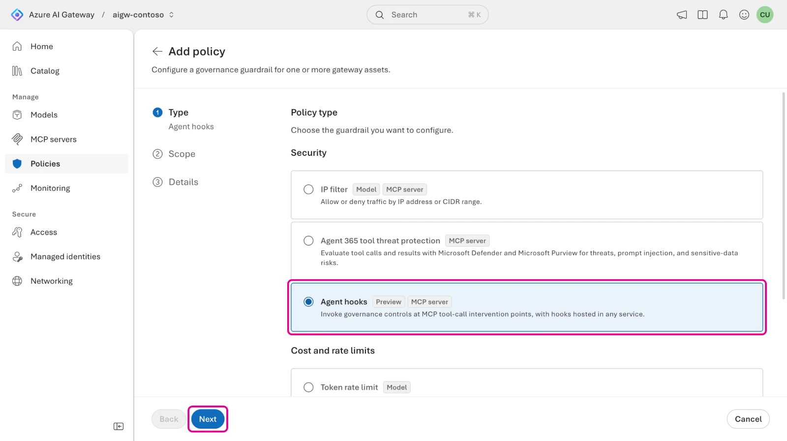
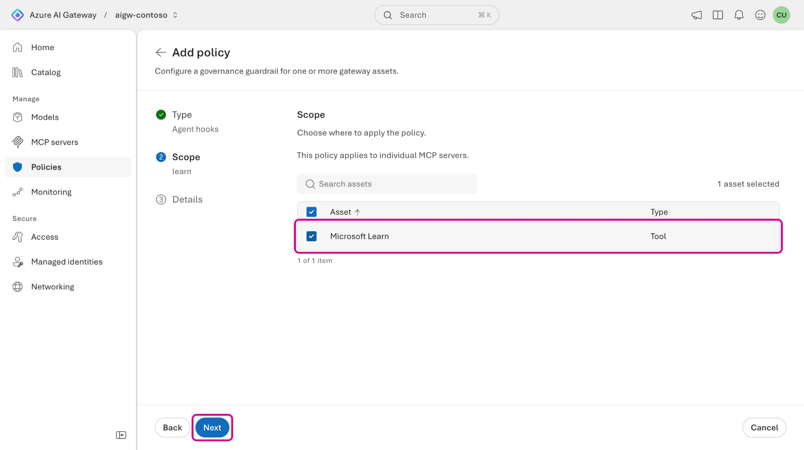
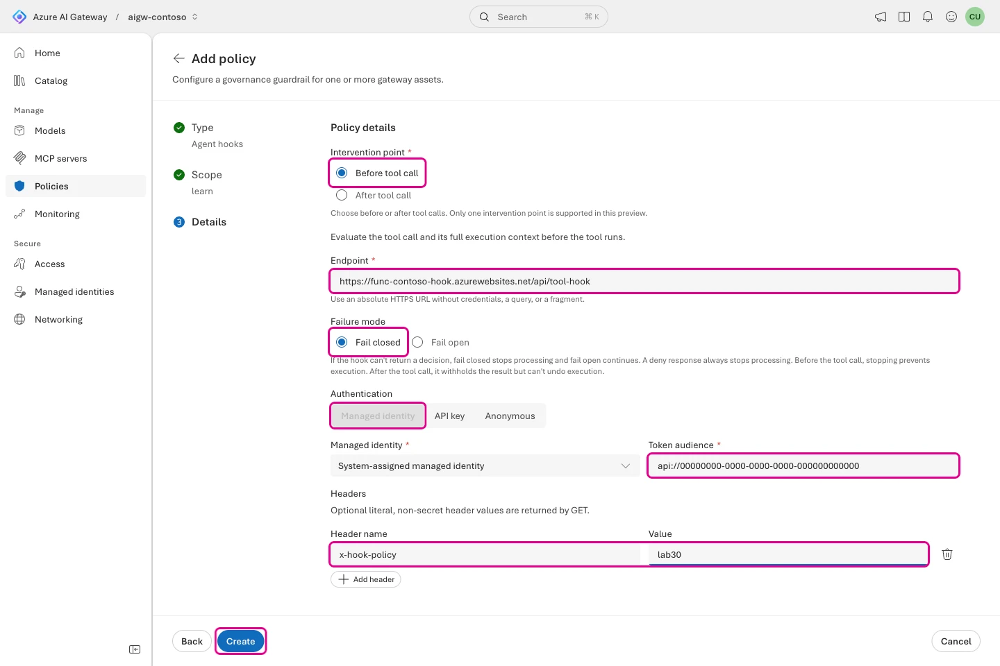
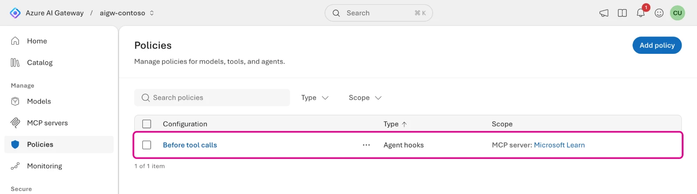
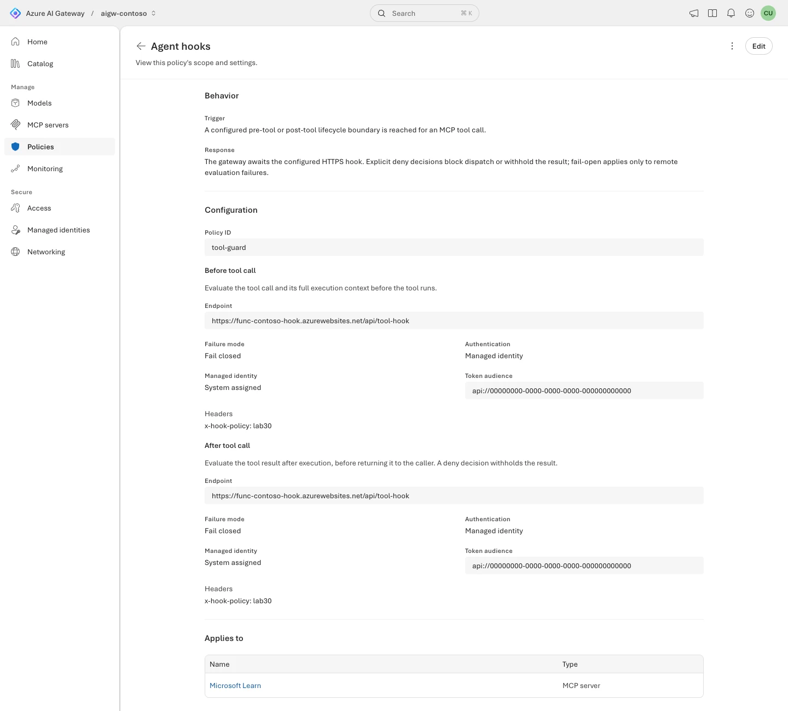
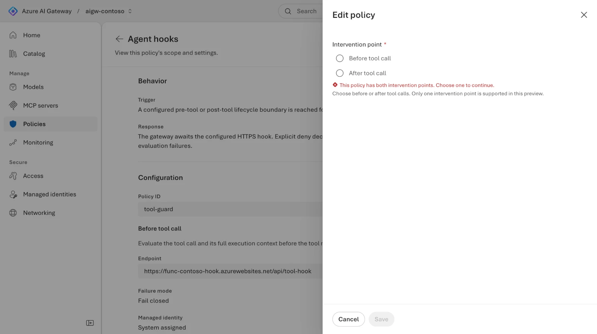

<!--
title: Govern MCP tool calls with agent hooks
summary: Run your own allow-or-deny rules on every MCP tool call. An agent hooks policy asks an Azure function before the tool runs and again before the result reaches the agent, authenticated with the gateway's managed identity.
category: tools
level: Advanced
duration: 40
tracks: [portal, cli, iac]
order: 30
status: emerging
illustration: diagrams/agent-hooks.svg
tags: [agent hooks, MCP, tools, Azure Functions, Flex Consumption, managed identity, App Service Authentication, Entra ID, failClosed, preToolCall, postToolCall]
objectives:
  - Explain when the gateway calls an agent hook, what it sends, and how an allow or deny verdict changes a tool call
  - Deploy a Python decision service on Azure Functions that only the gateway's managed identity can call
  - Attach an agent hooks policy to an MCP server in the AI Gateway portal, with the Azure CLI, or with Bicep and azd
  - Prove allowed, blocked, and withheld tool calls over MCP, and read the decision log
  - Choose between agent hooks, tool allow and block lists, and tool threat protection, and between fail closed and fail open
prereqs:
  - 04-federate-mcp-tools
-->
<!-- gh:begin nav: generated by "npm run sync" from the metadata, do not edit -->
[AI Gateway labs](../README.md) › [MCP & tools](../README.md#mcp--tools) › Lab 30
<!-- gh:end -->

# Govern MCP tool calls with agent hooks

<!-- gh:begin intro: generated by "npm run sync" from the metadata, do not edit -->
> Run your own allow-or-deny rules on every MCP tool call. An agent hooks policy asks an Azure function before the tool runs and again before the result reaches the agent, authenticated with the gateway's managed identity.

| ⏱️ Time | 📶 Level | 🧭 Tracks | ✅ Before you start |
| :-- | :-- | :-- | :-- |
| 40 min | Advanced | Portal · Azure CLI · Bicep + azd | [04 · Federate MCP tools](../04-federate-mcp-tools/README.md) |

**You'll learn to**

- Explain when the gateway calls an agent hook, what it sends, and how an allow or deny verdict changes a tool call
- Deploy a Python decision service on Azure Functions that only the gateway's managed identity can call
- Attach an agent hooks policy to an MCP server in the AI Gateway portal, with the Azure CLI, or with Bicep and azd
- Prove allowed, blocked, and withheld tool calls over MCP, and read the decision log
- Choose between agent hooks, tool allow and block lists, and tool threat protection, and between fail closed and fail open

**Follow along:** 🌐 [Interactive version](https://azure.github.io/aigateway/labs/30-agent-hooks/) with your own values filled in · 📁 [Lab files](infra/)

**On this page:** [Before you begin](#before-you-begin) · [How it works](#how-it-works) · [Review the decision service](#review-the-decision-service) · [Deploy the decision service](#deploy-the-decision-service) · [Attach the hook to the MCP server](#attach-the-hook-to-the-mcp-server) · [Call tools through the hook](#call-tools-through-the-hook) · [Understand verdicts and failures](#understand-verdicts-and-failures) · [Verify](#verify) · [Go further](#go-further) · [Clean up](#clean-up) · [Next steps](#next-steps)
<!-- gh:end -->

Allow and block lists decide which tools an agent can call, but not what it can do with them. Your rules are often
about the call itself: no customer email addresses in a search, no refund above a limit, no secret in a result that
goes back to the model. In this lab you write those rules in a small Azure function, and an **agent hooks** policy
on your MCP server asks it for a verdict before each tool runs and again before each result reaches the agent.

## Before you begin

<!-- setup: tools sign-in extension clone -->
<!-- gh:begin setup: generated by "npm run sync" from the metadata, do not edit -->
🧰 **One-time setup** from the [Setup guide](../SETUP.md), if you haven't done it yet:
[Choose where to run commands](../SETUP.md#choose-where-to-run-commands) ·
[Sign in to Azure](../SETUP.md#sign-in-to-azure) ·
[Install the `aigateway` extension](../SETUP.md#install-the-aigateway-extension) ·
[Clone the labs repo](../SETUP.md#clone-the-labs-repo)
<!-- gh:end -->

> [!TIP]
> On the **Bicep + azd** track, `azd up` creates its own gateway, the `learn` MCP server, the decision service, the
> agent hooks policy, and a key, so you can skip this section. You need only the one-time setup above and
> permission to register applications in Microsoft Entra ID.

- Complete [Federate MCP tools behind one endpoint](../04-federate-mcp-tools/README.md). This lab governs the
  `learn` MCP server from that lab. Any MCP server in your gateway works.
- Permission to manage policies on the gateway and to create resources, for example **Contributor** on a
  subscription or resource group.
- Permission to register applications in Microsoft Entra ID. The decision service trusts only tokens issued for
  its own app registration.
- A region with the Azure Functions Flex Consumption plan. The lab deploys the function app in the gateway's region;
  `az functionapp list-flexconsumption-locations --query "[].name" -o tsv` lists the regions that have it.
- Your gateway's system-assigned managed identity, which every gateway has. The hook uses it to authenticate.
- Run the scripts from the lab's folder, `~/aigateway/labs/30-agent-hooks`.

> [!NOTE]
> Agent hooks are an emerging capability of Azure AI Gateway. Labels and behavior can change; see the
> [release note](https://ai.gateway.azure.com/docs/releases#release-2026-11-06).

Set these variables once. The steps and the **Verify** section reuse them.

<details open><summary>Bash</summary> <!-- gh -->

```bash title="Bash"
# Set your resource group and gateway, and the MCP server that you govern
export RG="<resource-group>"
export GATEWAY="<gateway>"
export MCP_SERVER="learn"                    # the MCP server you govern in this lab
echo "📝 Gateway $GATEWAY in $RG, MCP server $MCP_SERVER"

# Read the gateway's resource ID and its runtime URL
export GATEWAY_ID="$(az aigateway show -g "$RG" -n "$GATEWAY" --query id -o tsv)"
export AI_GATEWAY_URL="https://$(az aigateway show -g "$RG" -n "$GATEWAY" --query properties.frontend.defaultHostname -o tsv)"
echo "🆔 Gateway ID: $GATEWAY_ID"
echo "🌐 Runtime URL: $AI_GATEWAY_URL"

# Paste a runtime key from Access › API keys without showing it: the test script calls tools with it
printf "AI Gateway API key: " && read -rs AI_GATEWAY_API_KEY && export AI_GATEWAY_API_KEY && echo
echo "🔑 Key: in AI_GATEWAY_API_KEY (${#AI_GATEWAY_API_KEY} characters, not shown)"
```
</details> <!-- gh -->

<details><summary>PowerShell</summary> <!-- gh -->

```powershell title="PowerShell"
# Set your resource group and gateway, and the MCP server that you govern
$RG         = "<resource-group>"
$GATEWAY    = "<gateway>"
$MCP_SERVER = "learn"                        # the MCP server you govern in this lab
Write-Host "📝 Gateway $GATEWAY in $RG, MCP server $MCP_SERVER"

# Read the gateway's resource ID and its runtime URL
$GATEWAY_ID         = az aigateway show -g $RG -n $GATEWAY --query id -o tsv
$env:AI_GATEWAY_URL = "https://$(az aigateway show -g $RG -n $GATEWAY --query properties.frontend.defaultHostname -o tsv)"
Write-Host "🆔 Gateway ID: $GATEWAY_ID"
Write-Host "🌐 Runtime URL: $env:AI_GATEWAY_URL"

# Paste a runtime key from Access › API keys without showing it: the test script calls tools with it
$env:AI_GATEWAY_API_KEY = Read-Host "AI Gateway API key" -MaskInput
Write-Host "🔑 Key: in AI_GATEWAY_API_KEY ($($env:AI_GATEWAY_API_KEY.Length) characters, not shown)"
```
</details> <!-- gh -->

## How it works

An **agent hooks** policy on an MCP server sends each `tools/call` to a decision service that you run, and enforces
its verdict. The gateway is the host of the [Agent Hooks control contract](https://responsibleai.github.io/agent-hooks/):
it posts an `AgentContext` JSON document to your HTTPS endpoint, and the service answers HTTP `200` with
`{"decision": "allow"}` or `{"decision": "deny", "reason": "…"}`. Discovery and session traffic, such as
`initialize` and `tools/list`, isn't sent.

The gateway authenticates to the service with its managed identity (a Microsoft Entra token for the audience that
you set), with an API key header, or anonymously, and adds the literal headers that you configure. The `mode`
decides what happens when the service fails or doesn't answer in time: `failClosed`, the default, blocks the call;
`failOpen` lets it through. Settings at the policy level apply to both hooks, and each hook can override them.

| Intervention point | Policy key | `interception_point` | The service gets | Effect of a deny |
|---|---|---|---|---|
| **Before tool call** | `preToolCall` | `pre_tool_call` | The tool name and arguments | The tool never runs |
| **After tool call** | `postToolCall` | `post_tool_call` | The tool name, arguments, and result | The result is withheld, but the tool already ran |


Verdicts can only allow or deny: transforms, warnings, and approvals aren't supported.

## Review the decision service

The decision service is one Python function, `tool-hook`, in [`infra/hook/function_app.py`](infra/hook/function_app.py).
It answers both intervention points:

| Point | Rule | Reason in the verdict |
|---|---|---|
| Before tool call | The tool name matches a pattern in the `BLOCKED_TOOLS` app setting, `*code_sample*` by default | `blocked_tool:<pattern>` |
| Before tool call | The arguments contain an email address | `personal_data:email_address` |
| Before tool call | The arguments contain a secret, such as a storage account key, a SAS signature, a private key, or a JWT | `secret_in_arguments:<kind>` |
| After tool call | The result contains a secret | `secret_in_result:<kind>` |
| Either | Nothing matches | `policy_satisfied`, with `allow` |

<!-- include: infra/hook/function_app.py -->
<!-- gh:begin include: generated by "npm run sync" from the metadata, do not edit -->
📄 [`infra/hook/function_app.py`](infra/hook/function_app.py)

<details><summary>Show all 95 lines</summary>

```py
"""Agent hooks decision service for Azure AI Gateway (lab 30).

The gateway posts an Agent Hooks AgentContext to /api/tool-hook before a tool runs (interception_point
pre_tool_call) and after the tool returns (post_tool_call). The function answers HTTP 200 with
{"decision": "allow" | "deny", "reason": "..."}.

App Service Authentication (Easy Auth) in front of the app rejects every request that doesn't carry a Microsoft Entra
token for this app from the gateway's managed identity, so the function itself allows anonymous calls.

Rules:
- BLOCKED_TOOLS (app setting): comma-separated tool name patterns that never run, for example *code_sample*
- Tool arguments that contain an email address or a secret-looking string are denied before the call.
- Tool results that contain a secret-looking string are withheld after the call.

The decision log has the tool name, the decision, the reason, and the gateway's request ID. It never has tool
arguments, results, or tokens.
"""
import fnmatch
import json
import logging
import os
import re

import azure.functions as func

app = func.FunctionApp(http_auth_level=func.AuthLevel.ANONYMOUS)

BLOCKED_TOOLS = [p.strip().lower() for p in os.environ.get("BLOCKED_TOOLS", "*code_sample*").split(",") if p.strip()]

EMAIL = re.compile(r"[A-Za-z0-9._%+-]+@[A-Za-z0-9.-]+\.[A-Za-z]{2,}")
SECRETS = {
    "storage_account_key": re.compile(r"AccountKey=[A-Za-z0-9+/]{40,}={0,2}"),
    "sas_signature": re.compile(r"[?&]sig=[A-Za-z0-9%+/]{30,}"),
    "private_key": re.compile(r"-----BEGIN [A-Z ]*PRIVATE KEY-----"),
    "openai_style_key": re.compile(r"\bsk-[A-Za-z0-9_-]{20,}"),
    "jwt": re.compile(r"\beyJ[A-Za-z0-9_-]{10,}\.eyJ[A-Za-z0-9_-]{10,}\.[A-Za-z0-9_-]{10,}"),
}


def find_secret(text: str) -> str | None:
    """Return the name of the first secret pattern that matches the text, or None."""
    return next((name for name, pattern in SECRETS.items() if pattern.search(text)), None)


def before_call(context: dict) -> tuple[str, str]:
    """Decide whether the tool may run, from its name and arguments."""
    tool_call = context["tool_call"]
    name = str(tool_call.get("name", "")).lower()
    for pattern in BLOCKED_TOOLS:
        if fnmatch.fnmatchcase(name, pattern):
            return "deny", f"blocked_tool:{pattern}"

    args = json.dumps(tool_call.get("args") or {})
    if EMAIL.search(args):
        return "deny", "personal_data:email_address"
    secret = find_secret(args)
    if secret:
        return "deny", f"secret_in_arguments:{secret}"
    return "allow", "policy_satisfied"


def after_call(context: dict) -> tuple[str, str]:
    """Decide whether the caller may see the tool result."""
    # The gateway sends the MCP tool result in target; the Agent Hooks spec also defines tool_result.
    result = json.dumps([context.get("target"), context.get("tool_result")])
    secret = find_secret(result)
    if secret:
        return "deny", f"secret_in_result:{secret}"
    return "allow", "policy_satisfied"


@app.route(route="tool-hook", methods=["POST"])
def tool_hook(req: func.HttpRequest) -> func.HttpResponse:
    try:
        context = req.get_json()
    except ValueError:
        context = None
    if not isinstance(context, dict) or not isinstance(context.get("tool_call"), dict):
        context = {}
        decision, reason = "deny", "invalid_context"
    elif context.get("interception_point") == "pre_tool_call":
        decision, reason = before_call(context)
    elif context.get("interception_point") == "post_tool_call":
        decision, reason = after_call(context)
    else:
        decision, reason = "deny", "unsupported_interception_point"

    logging.info(
        "agent-hook point=%s tool=%s decision=%s reason=%s request_id=%s caller=%s policy=%s",
        context.get("interception_point"), (context.get("tool_call") or {}).get("name"), decision, reason,
        context.get("request_id"), req.headers.get("x-ms-client-principal-id", "none"),
        req.headers.get("x-hook-policy", "none"),
    )
    return func.HttpResponse(json.dumps({"decision": decision, "reason": reason}),
                             status_code=200, mimetype="application/json")
```

</details>
<!-- gh:end -->

On GitHub, open [infra/hook/function_app.py](infra/hook/function_app.py).

Before a call, the gateway posts the tool call. This is a real request for the docs search tool, with the IDs
shortened:

```json
{
  "spec": "agent-hooks/0.1",
  "interception_point": "pre_tool_call",
  "timestamp": "2026-11-16T02:47:51.711Z",
  "sequence": 0,
  "agent": { "framework": "microsoft.azure.aigateway" },
  "tool_call": {
    "id": "2",
    "name": "learn_microsoft_docs_search",
    "args": { "query": "What is Azure Functions?" }
  },
  "target": { "query": "What is Azure Functions?" },
  "request_id": "7c73b7ce-…",
  "trace": { "trace_id": "524b7585…", "span_id": "ea417be7…" }
}
```

After the call, the request has `"interception_point": "post_tool_call"`, the same `tool_call` and `request_id`,
and the MCP tool result in `target`:

```json
"target": {
  "isError": false,
  "content": [ { "type": "text", "text": "{\"results\":[{\"title\":\"Azure Functions overview\", …}]}" } ]
}
```

The [policy reference](https://ai.gateway.azure.com/docs/policies/agent-hooks) also shows a `tool_result` object,
which the gateway doesn't send yet, so the function reads both. It treats any request it can't parse as a deny.

The function allows anonymous calls because **App Service Authentication** stands in front of it: the platform
rejects every request with HTTP `401` unless it carries a Microsoft Entra token issued for the hook's app
registration to the gateway's managed identity. Each request also carries the policy's custom headers, here
`x-hook-policy: lab30`, which the decision log records with the caller's object ID.

> [!IMPORTANT]
> Keep the decision service fast and available. The gateway waits about 30 seconds for a verdict, and every tool
> call waits for it. Don't log tool arguments, results, or tokens: this function logs only the tool name, the
> decision, the reason, and the request ID.

## Deploy the decision service

The AI Gateway portal doesn't create function apps or app registrations, so on the **Portal** track, follow the
**Azure CLI** steps here, then attach the hook in the portal.

<!-- track: cli | Azure CLI -->
<details open><summary><b>⌨️ Azure CLI</b></summary> <!-- gh -->

### Register an app for the hook

The gateway asks Microsoft Entra ID for a token whose audience is the hook's **application ID URI**. Register an app
with that URI and create its service principal, so that the gateway's managed identity can get tokens for it. The
function app name is `func-` plus the first part of your gateway's host name, which is unique.

<details open><summary>Bash</summary> <!-- gh -->

```bash title="Bash"
# Name the decision service's resource group and function app, in the gateway's region
export HOOK_RG="rg-aigw-lab30-hook"
export HOOK_APP="func-$(echo "$AI_GATEWAY_URL" | cut -d/ -f3 | cut -d. -f1)"
export LOCATION="$(az aigateway show -g "$RG" -n "$GATEWAY" --query location -o tsv)"
echo "📝 Function app $HOOK_APP in $HOOK_RG, in $LOCATION"

# Register an app for the decision service: the gateway asks Microsoft Entra ID for tokens issued to it
export HOOK_CLIENT_ID="$(az ad app create --display-name "$HOOK_APP" --sign-in-audience AzureADMyOrg --query appId -o tsv)"
echo "🆔 App registration $HOOK_APP: $HOOK_CLIENT_ID"

# Give it an application ID URI: the token audience that the policy asks for
export HOOK_AUDIENCE="api://$HOOK_CLIENT_ID"
az ad app update --id "$HOOK_CLIENT_ID" --identifier-uris "$HOOK_AUDIENCE" &&
  echo "👤 Token audience: $HOOK_AUDIENCE"

# Create its service principal, so that managed identities in your tenant can get tokens for it
az ad sp create --id "$HOOK_CLIENT_ID" -o none &&
  echo "👤 Service principal for $HOOK_APP is ready"
```
</details> <!-- gh -->

<details><summary>PowerShell</summary> <!-- gh -->

```powershell title="PowerShell"
# Name the decision service's resource group and function app, in the gateway's region
$HOOK_RG  = "rg-aigw-lab30-hook"
$HOOK_APP = "func-" + ([uri]$env:AI_GATEWAY_URL).Host.Split('.')[0]
$LOCATION = az aigateway show -g $RG -n $GATEWAY --query location -o tsv
Write-Host "📝 Function app $HOOK_APP in $HOOK_RG, in $LOCATION"

# Register an app for the decision service: the gateway asks Microsoft Entra ID for tokens issued to it
$HOOK_CLIENT_ID = az ad app create --display-name $HOOK_APP --sign-in-audience AzureADMyOrg --query appId -o tsv
Write-Host "🆔 App registration ${HOOK_APP}: $HOOK_CLIENT_ID"

# Give it an application ID URI: the token audience that the policy asks for
$HOOK_AUDIENCE = "api://$HOOK_CLIENT_ID"
az ad app update --id $HOOK_CLIENT_ID --identifier-uris $HOOK_AUDIENCE
if ($?) { Write-Host "👤 Token audience: $HOOK_AUDIENCE" }

# Create its service principal, so that managed identities in your tenant can get tokens for it
az ad sp create --id $HOOK_CLIENT_ID -o none
if ($?) { Write-Host "👤 Service principal for $HOOK_APP is ready" }
```
</details> <!-- gh -->

### Deploy the function app

[`infra/hook.bicep`](infra/hook.bicep) creates a Python function app on the Flex Consumption plan, with App Service
Authentication that lets in only the gateway's identity, a private storage account that the app reaches with its
managed identity, and Application Insights for the decision log. It takes three to five minutes.

<details open><summary>Bash</summary> <!-- gh -->

```bash title="Bash"
# Read the object ID of the gateway's managed identity: the only caller that the decision service lets in
export GATEWAY_PRINCIPAL_ID="$(az aigateway show -g "$RG" -n "$GATEWAY" --query identity.principalId -o tsv)"
echo "👤 Gateway identity: $GATEWAY_PRINCIPAL_ID"

# Create a resource group for the decision service
az group create -n "$HOOK_RG" -l "$LOCATION" -o none &&
  echo "📦 Resource group $HOOK_RG is ready in $LOCATION"

# Deploy the function app, its network, storage, and logs, without code yet
az deployment group create -g "$HOOK_RG" -n lab30-hook -f infra/hook.bicep -o none \
  -p appName="$HOOK_APP" hookClientId="$HOOK_CLIENT_ID" hookAudience="$HOOK_AUDIENCE" \
  gatewayPrincipalId="$GATEWAY_PRINCIPAL_ID" &&
  echo "🚀 Function app $HOOK_APP is deployed"

# Read the hook's URL and the Log Analytics workspace ID from the deployment's outputs
export HOOK_URL="$(az deployment group show -g "$HOOK_RG" -n lab30-hook --query properties.outputs.hookUrl.value -o tsv)"
export HOOK_LOG_WORKSPACE_ID="$(az deployment group show -g "$HOOK_RG" -n lab30-hook --query properties.outputs.logWorkspaceId.value -o tsv)"
echo "🌐 Hook URL: $HOOK_URL"
echo "🆔 Log Analytics workspace ID: $HOOK_LOG_WORKSPACE_ID"
```
</details> <!-- gh -->

<details><summary>PowerShell</summary> <!-- gh -->

```powershell title="PowerShell"
# Read the object ID of the gateway's managed identity: the only caller that the decision service lets in
$GATEWAY_PRINCIPAL_ID = az aigateway show -g $RG -n $GATEWAY --query identity.principalId -o tsv
Write-Host "👤 Gateway identity: $GATEWAY_PRINCIPAL_ID"

# Create a resource group for the decision service
az group create -n $HOOK_RG -l $LOCATION -o none
if ($?) { Write-Host "📦 Resource group $HOOK_RG is ready in $LOCATION" }

# Deploy the function app, its network, storage, and logs, without code yet
az deployment group create -g $HOOK_RG -n lab30-hook -f infra/hook.bicep -o none `
  -p appName=$HOOK_APP hookClientId=$HOOK_CLIENT_ID hookAudience=$HOOK_AUDIENCE `
  gatewayPrincipalId=$GATEWAY_PRINCIPAL_ID
if ($?) { Write-Host "🚀 Function app $HOOK_APP is deployed" }

# Read the hook's URL and the Log Analytics workspace ID from the deployment's outputs
$HOOK_URL              = az deployment group show -g $HOOK_RG -n lab30-hook --query properties.outputs.hookUrl.value -o tsv
$HOOK_LOG_WORKSPACE_ID = az deployment group show -g $HOOK_RG -n lab30-hook --query properties.outputs.logWorkspaceId.value -o tsv
Write-Host "🌐 Hook URL: $HOOK_URL"
Write-Host "🆔 Log Analytics workspace ID: $HOOK_LOG_WORKSPACE_ID"
```
</details> <!-- gh -->

### Deploy the code

Restart the new app once, so that it reaches its private storage, then zip the `infra/hook` folder and upload it.
Flex Consumption builds the app from `requirements.txt`.

<details open><summary>Bash</summary> <!-- gh -->

```bash title="Bash"
# Restart the new app once: its first upload can fail until it reaches its private storage
az functionapp restart -g "$HOOK_RG" -n "$HOOK_APP" &&
  echo "⏳ $HOOK_APP restarted"

# Zip the function's code from inside its folder
(cd infra/hook && zip -qr ../../hook.zip .) &&
  echo "📄 hook.zip is ready"

# Upload the code and build it remotely, then delete the zip file
az functionapp deployment source config-zip -g "$HOOK_RG" -n "$HOOK_APP" --src hook.zip --build-remote true -o none &&
  echo "🚀 The decision service is deployed to $HOOK_APP"
rm hook.zip

# Call the hook without a token: App Service Authentication answers 401 before the function runs
echo "🔐 Anonymous call to the hook: HTTP $(curl -s -o /dev/null -w '%{http_code}' -X POST "$HOOK_URL" -H 'Content-Type: application/json' -d '{}')"
```
</details> <!-- gh -->

<details><summary>PowerShell</summary> <!-- gh -->

```powershell title="PowerShell"
# Restart the new app once: its first upload can fail until it reaches its private storage
az functionapp restart -g $HOOK_RG -n $HOOK_APP
if ($?) { Write-Host "⏳ $HOOK_APP restarted" }

# Zip the function's code from inside its folder
Compress-Archive -Path infra/hook/* -DestinationPath hook.zip -Force
if ($?) { Write-Host "📄 hook.zip is ready" }

# Upload the code and build it remotely, then delete the zip file
az functionapp deployment source config-zip -g $HOOK_RG -n $HOOK_APP --src hook.zip --build-remote true -o none
if ($?) { Write-Host "🚀 The decision service is deployed to $HOOK_APP" }
Remove-Item hook.zip

# Call the hook without a token: App Service Authentication answers 401 before the function runs
$anonymous = Invoke-WebRequest -Method Post -Uri $HOOK_URL -ContentType 'application/json' -Body '{}' -SkipHttpErrorCheck
Write-Host "🔐 Anonymous call to the hook: HTTP $($anonymous.StatusCode)"
```
</details> <!-- gh -->

> **Checkpoint**
> The upload ends with `🚀 The decision service is deployed`, and the anonymous call prints
> `🔐 Anonymous call to the hook: HTTP 401`. Keep the values of `HOOK_URL` and `HOOK_AUDIENCE`: the portal asks for
> them.

</details> <!-- gh -->
<!-- track: iac | Bicep + azd -->
<details><summary><b>🏗️ Bicep + azd</b></summary> <!-- gh -->

**What you need:** only the one-time setup from **Before you begin**, and permission to register applications in
Microsoft Entra ID. This track doesn't use your gateway or `learn` server from lab 04: `azd up` creates a new gateway
with its own `learn` server, the decision service, and the policy, so it works on its own.

### Review the templates

`infra/main.bicep` creates the resource group `rg-<environment name>`, registers the hook's app in Microsoft Entra
ID with the Microsoft Graph Bicep extension, and calls lab 01's
[gateway.bicep](../01-provision-gateway/infra/gateway.bicep) for a gateway with no model. Then it deploys the
decision service and the governed MCP server. azd fills two parameters from environment values:

| Parameter | azd environment value | Default |
|---|---|---|
| `hookMode` | `HOOK_MODE` | `failClosed` |
| `blockedTools` | `HOOK_BLOCKED_TOOLS` | `*code_sample*` |

<!-- include: infra/main.bicep -->
<!-- gh:begin include: generated by "npm run sync" from the metadata, do not edit -->
📄 [`infra/main.bicep`](infra/main.bicep)

<details><summary>Show all 89 lines</summary>

```bicep
// Lab 30 with azd: "azd up" registers the decision service in Microsoft Entra ID, creates the resource group
// rg-<environment name>, a gateway with lab 01's template, the decision service (hook.bicep), then the learn MCP
// server with the agent hooks policy and the runtime API key app-first-call. azd then deploys the function code from
// infra/hook. The runtime API key is never an output.
targetScope = 'subscription'

@description('azd environment name. The resource group is rg-<environmentName>.')
@minLength(1)
@maxLength(60)
param environmentName string

@description('Region for every resource. Pick one where AI Gateway and Flex Consumption are available. List them with az provider show --namespace Microsoft.ApiManagement and az functionapp list-flexconsumption-locations.')
@metadata({ azd: { type: 'location' } })
param location string

@description('What the gateway does when the decision service can\'t answer. azd reads it from HOOK_MODE.')
@allowed([ 'failClosed', 'failOpen' ])
param hookMode string = 'failClosed'

@description('Comma-separated tool name patterns that the decision service denies. azd reads it from HOOK_BLOCKED_TOOLS.')
param blockedTools string = '*code_sample*'

var suffix = take(uniqueString(subscription().id, environmentName, location), 6)
var tags = { 'azd-env-name': environmentName }

resource rg 'Microsoft.Resources/resourceGroups@2024-03-01' = {
  name: 'rg-${environmentName}'
  location: location
  tags: tags
}

// Microsoft Graph objects don't belong to the resource group: the deployment only runs there.
module registration 'hook-registration.bicep' = {
  name: 'aigw-hook-registration'
  scope: rg
  params: {
    uniqueName: 'aigw-lab30-hook-${suffix}'
  }
}

// Lab 01's template: the gateway, with no model.
module gateway '../../01-provision-gateway/infra/gateway.bicep' = {
  name: 'aigw-gateway'
  scope: rg
  params: {
    gatewayName: 'aigw-${suffix}'
    location: location
    tags: tags
  }
}

module hook 'hook.bicep' = {
  name: 'aigw-hook'
  scope: rg
  params: {
    appName: 'func-aigw-hook-${suffix}'
    location: location
    hookClientId: registration.outputs.clientId
    hookAudience: registration.outputs.audience
    gatewayPrincipalId: gateway.outputs.principalId
    blockedTools: blockedTools
    tags: tags
  }
}

module toolServer 'guarded-tool-server.bicep' = {
  name: 'aigw-guarded-tool-server'
  scope: rg
  params: {
    gatewayName: gateway.outputs.gatewayName
    serverName: 'learn'
    hookUrl: hook.outputs.hookUrl
    hookAudience: registration.outputs.audience
    hookMode: hookMode
    apiKeyName: 'app-first-call'
  }
}

output AZURE_RESOURCE_GROUP string = rg.name
output AI_GATEWAY_NAME string = gateway.outputs.gatewayName
output AI_GATEWAY_ID string = gateway.outputs.gatewayId
output AI_GATEWAY_URL string = gateway.outputs.gatewayUrl
output MCP_SERVER string = 'learn'
output MCP_ENDPOINT string = toolServer.outputs.mcpEndpoint
output HOOK_APP_NAME string = hook.outputs.appName
output HOOK_URL string = hook.outputs.hookUrl
output HOOK_CLIENT_ID string = registration.outputs.clientId
output HOOK_AUDIENCE string = registration.outputs.audience
output HOOK_LOG_WORKSPACE_ID string = hook.outputs.logWorkspaceId
```

</details>
<!-- gh:end -->

`infra/hook-registration.bicep` registers the app and its service principal, with an application ID URI that
the policy uses as the token audience.

<!-- include: infra/hook-registration.bicep -->
<!-- gh:begin include: generated by "npm run sync" from the metadata, do not edit -->
📄 [`infra/hook-registration.bicep`](infra/hook-registration.bicep)

```bicep
// Registers the decision service in Microsoft Entra ID with the Microsoft Graph Bicep extension (bicepconfig.json):
// an application whose Application ID URI is the token audience that the gateway asks for, and its service principal,
// without which Microsoft Entra ID can't issue tokens for that audience. The registration has no secret: the gateway
// signs in with its managed identity, and App Service Authentication only validates the tokens.
// Microsoft Graph objects don't belong to a resource group: delete the application when you're done
// (az ad app delete --id <client ID>). The lab's azd template does it after "azd down".
extension microsoftGraphV1

@description('Unique name of the application in the tenant. A new name creates a new application.')
param uniqueName string

@description('Display name of the application.')
param displayName string = uniqueName

resource app 'Microsoft.Graph/applications@v1.0' = {
  uniqueName: uniqueName
  displayName: displayName
  signInAudience: 'AzureADMyOrg'
  // api://<tenant ID>/<name> passes the tenant's identifier URI policy without a verified domain.
  identifierUris: [ 'api://${tenant().tenantId}/${uniqueName}' ]
}

resource principal 'Microsoft.Graph/servicePrincipals@v1.0' = {
  appId: app.appId
}

output clientId string = app.appId
output audience string = app.identifierUris[0]
```
<!-- gh:end -->

`infra/hook.bicep` is the function app that the **Azure CLI** track deploys too: Flex Consumption, App Service
Authentication that lets in only the gateway's identity, a private storage account, and Application Insights.

<!-- include: infra/hook.bicep -->
<!-- gh:begin include: generated by "npm run sync" from the metadata, do not edit -->
📄 [`infra/hook.bicep`](infra/hook.bicep)

<details><summary>Show all 247 lines</summary>

```bicep
// Lab 30: the agent hooks decision service. A Python function app on the Flex Consumption plan, with:
// - App Service Authentication (Easy Auth), which accepts only Microsoft Entra tokens for the hook's app registration
//   from the gateway's managed identity, and answers 401 to every other request.
// - A private storage account (no public network access, no shared keys) that the app reaches through a virtual
//   network and a private endpoint, with its managed identity. That works in subscriptions that block public storage.
// - Application Insights with Microsoft Entra authentication, for the decision log.
// The code is deployed separately: az functionapp deployment source config-zip, or azd deploy.

@description('Name of the function app. It must be globally unique: the host name is <name>.azurewebsites.net.')
@minLength(2)
@maxLength(32)
param appName string

@description('Region of the function app. Pick one where Flex Consumption is available (az functionapp list-flexconsumption-locations).')
param location string = resourceGroup().location

@description('Application (client) ID of the hook\'s app registration. Easy Auth accepts tokens issued for it.')
param hookClientId string

@description('Application ID URI of the hook\'s app registration. The gateway asks for tokens with this audience.')
param hookAudience string

@description('Object (principal) ID of the gateway\'s system-assigned managed identity: the only caller Easy Auth lets in.')
param gatewayPrincipalId string

@description('Comma-separated tool name patterns that the hook always denies before the call.')
param blockedTools string = '*code_sample*'

@description('Tags for every resource.')
param tags object = {}

var suffix = uniqueString(resourceGroup().id, appName)
var storageName = take('sthook${suffix}', 24)
var deploymentContainer = 'app-package-${take(toLower(appName), 32)}'
var blobPrivateDnsZone = 'privatelink.blob.${environment().suffixes.storage}'

// Role definitions: Storage Blob Data Owner (host storage and deployment package) and Monitoring Metrics Publisher
// (Application Insights with Microsoft Entra authentication).
var blobDataOwnerRoleId = 'b7e6dc6d-f1e8-4753-8033-0f276bb0955b'
var metricsPublisherRoleId = '3913510d-42f4-4e42-8a64-420c390055eb'

resource vnet 'Microsoft.Network/virtualNetworks@2024-05-01' = {
  name: 'vnet-${appName}'
  location: location
  tags: tags
  properties: {
    addressSpace: { addressPrefixes: [ '10.30.0.0/16' ] }
    subnets: [
      {
        // Flex Consumption joins this subnet for outbound traffic, so the app reaches the private storage account.
        name: 'app'
        properties: {
          addressPrefix: '10.30.1.0/24'
          delegations: [ { name: 'flex', properties: { serviceName: 'Microsoft.App/environments' } } ]
        }
      }
      {
        name: 'private-endpoints'
        properties: {
          addressPrefix: '10.30.2.0/24'
          privateEndpointNetworkPolicies: 'Disabled'
        }
      }
    ]
  }
}

resource storage 'Microsoft.Storage/storageAccounts@2024-01-01' = {
  name: storageName
  location: location
  tags: tags
  kind: 'StorageV2'
  sku: { name: 'Standard_LRS' }
  properties: {
    allowBlobPublicAccess: false
    allowSharedKeyAccess: false
    publicNetworkAccess: 'Disabled'
    minimumTlsVersion: 'TLS1_2'
    networkAcls: { defaultAction: 'Deny', bypass: 'AzureServices' }
  }

  resource blobService 'blobServices' = {
    name: 'default'

    resource packages 'containers' = {
      name: deploymentContainer
    }
  }
}

resource dnsZone 'Microsoft.Network/privateDnsZones@2024-06-01' = {
  name: blobPrivateDnsZone
  location: 'global'
  tags: tags

  resource link 'virtualNetworkLinks' = {
    name: 'link-${vnet.name}'
    location: 'global'
    properties: {
      registrationEnabled: false
      virtualNetwork: { id: vnet.id }
    }
  }
}

resource blobEndpoint 'Microsoft.Network/privateEndpoints@2024-05-01' = {
  name: 'pe-${storage.name}-blob'
  location: location
  tags: tags
  properties: {
    subnet: { id: vnet.properties.subnets[1].id }
    privateLinkServiceConnections: [
      {
        name: 'blob'
        properties: { privateLinkServiceId: storage.id, groupIds: [ 'blob' ] }
      }
    ]
  }

  resource zoneGroup 'privateDnsZoneGroups' = {
    name: 'default'
    properties: {
      privateDnsZoneConfigs: [ { name: 'blob', properties: { privateDnsZoneId: dnsZone.id } } ]
    }
  }
}

resource logs 'Microsoft.OperationalInsights/workspaces@2023-09-01' = {
  name: 'log-${appName}'
  location: location
  tags: tags
  properties: {
    sku: { name: 'PerGB2018' }
    retentionInDays: 30
  }
}

resource appInsights 'Microsoft.Insights/components@2020-02-02' = {
  name: 'appi-${appName}'
  location: location
  tags: tags
  kind: 'web'
  properties: {
    Application_Type: 'web'
    WorkspaceResourceId: logs.id
    DisableLocalAuth: true
  }
}

resource plan 'Microsoft.Web/serverfarms@2024-04-01' = {
  name: 'plan-${appName}'
  location: location
  tags: tags
  kind: 'functionapp'
  sku: { tier: 'FlexConsumption', name: 'FC1' }
  properties: { reserved: true }
}

resource app 'Microsoft.Web/sites@2024-04-01' = {
  name: appName
  location: location
  // azd deploys the hook service's code to the app with this tag.
  tags: union(tags, { 'azd-service-name': 'hook' })
  kind: 'functionapp,linux'
  identity: { type: 'SystemAssigned' }
  properties: {
    serverFarmId: plan.id
    httpsOnly: true
    virtualNetworkSubnetId: vnet.properties.subnets[0].id
    siteConfig: { minTlsVersion: '1.2' }
    functionAppConfig: {
      deployment: {
        storage: {
          type: 'blobContainer'
          value: '${storage.properties.primaryEndpoints.blob}${deploymentContainer}'
          authentication: { type: 'SystemAssignedIdentity' }
        }
      }
      scaleAndConcurrency: { maximumInstanceCount: 40, instanceMemoryMB: 2048 }
      runtime: { name: 'python', version: '3.12' }
    }
  }
  dependsOn: [ blobEndpoint::zoneGroup, dnsZone::link ]

  resource settings 'config' = {
    name: 'appsettings'
    properties: {
      AzureWebJobsStorage__accountName: storage.name
      AzureWebJobsStorage__credential: 'managedidentity'
      APPLICATIONINSIGHTS_CONNECTION_STRING: appInsights.properties.ConnectionString
      APPLICATIONINSIGHTS_AUTHENTICATION_STRING: 'Authorization=AAD'
      BLOCKED_TOOLS: blockedTools
    }
  }

  // Easy Auth: validate the bearer token, its audience, and its caller before any function runs.
  resource auth 'config' = {
    name: 'authsettingsV2'
    properties: {
      platform: { enabled: true }
      globalValidation: { requireAuthentication: true, unauthenticatedClientAction: 'Return401' }
      identityProviders: {
        azureActiveDirectory: {
          enabled: true
          registration: {
            clientId: hookClientId
            openIdIssuer: 'https://sts.windows.net/${tenant().tenantId}/v2.0'
          }
          validation: {
            allowedAudiences: [ hookAudience, hookClientId ]
            defaultAuthorizationPolicy: {
              allowedPrincipals: { identities: [ gatewayPrincipalId ] }
            }
          }
        }
      }
      login: { tokenStore: { enabled: false } }
    }
  }
}

resource blobOwner 'Microsoft.Authorization/roleAssignments@2022-04-01' = {
  name: guid(storage.id, app.id, blobDataOwnerRoleId)
  scope: storage
  properties: {
    principalId: app.identity.principalId
    principalType: 'ServicePrincipal'
    roleDefinitionId: subscriptionResourceId('Microsoft.Authorization/roleDefinitions', blobDataOwnerRoleId)
  }
}

resource metricsPublisher 'Microsoft.Authorization/roleAssignments@2022-04-01' = {
  name: guid(appInsights.id, app.id, metricsPublisherRoleId)
  scope: appInsights
  properties: {
    principalId: app.identity.principalId
    principalType: 'ServicePrincipal'
    roleDefinitionId: subscriptionResourceId('Microsoft.Authorization/roleDefinitions', metricsPublisherRoleId)
  }
}

output appName string = app.name
output hookHost string = app.properties.defaultHostName
output hookUrl string = 'https://${app.properties.defaultHostName}/api/tool-hook'
output appInsightsName string = appInsights.name
output logWorkspaceName string = logs.name
output logWorkspaceId string = logs.properties.customerId
```

</details>
<!-- gh:end -->

`infra/guarded-tool-server.bicep` declares the `learn` server of lab 04 with an `agentHooks` policy that calls the
decision service before and after each tool call, and creates the `app-first-call` key.

<!-- include: infra/guarded-tool-server.bicep -->
<!-- gh:begin include: generated by "npm run sync" from the metadata, do not edit -->
📄 [`infra/guarded-tool-server.bicep`](infra/guarded-tool-server.bicep)

<details><summary>Show all 84 lines</summary>

```bicep
// Declares the learn MCP server of lab 04 with an agent hooks policy: before each tool call and after each tool
// result, the gateway sends the call to the decision service and follows its allow or deny decision. The gateway signs
// in to the decision service with its system-assigned managed identity. The template also creates a runtime API key,
// which is never an output.
// A deployment sends a PUT, which replaces the whole MCP server, so keep this template as its only source of truth.

@description('Name of the existing AI Gateway (Microsoft.ApiManagement/aigateways).')
param gatewayName string

@description('MCP server name. It becomes part of the endpoint URL and cannot be changed after creation.')
param serverName string = 'learn'

@description('HTTPS endpoint of the decision service. Both intervention points share it.')
param hookUrl string

@description('Token audience: the Application ID URI of the decision service\'s app registration.')
param hookAudience string

@description('What the gateway does when the decision service can\'t answer: failClosed blocks the call, failOpen lets it through.')
@allowed([ 'failClosed', 'failOpen' ])
param hookMode string = 'failClosed'

@description('Runtime API key to create for the test calls.')
param apiKeyName string = 'app-first-call'

#disable-next-line BCP081
resource gateway 'Microsoft.ApiManagement/aigateways@2026-11-01' existing = {
  name: gatewayName
}

#disable-next-line BCP081
resource workspace 'Microsoft.ApiManagement/aigateways/workspaces@2026-11-01' existing = {
  parent: gateway
  name: 'default'
}

#disable-next-line BCP081
resource toolServer 'Microsoft.ApiManagement/aigateways/workspaces/toolServers@2026-11-01' = {
  parent: workspace
  name: serverName
  properties: {
    toolServerType: 'mcp'
    displayName: 'Microsoft Learn'
    description: 'Search and fetch official Microsoft documentation and code samples.'
    endpoints: [
      {
        namespace: 'learn'
        kind: 'mcp'
        mode: 'failClosed'
        mcp: {
          endpoint: { url: 'https://learn.microsoft.com/api/mcp' }
          transport: 'streamableHttp'
        }
      }
    ]
    policies: [
      {
        id: 'tool-guard'
        type: 'agentHooks'
        scope: 'resource'
        mode: hookMode
        endpoint: { url: hookUrl }
        authentication: { managedIdentity: { resource: hookAudience } }
        // Literal, non-secret headers. The gateway sends them with every hook request, and GET returns them.
        headers: [ { name: 'x-hook-policy', value: 'lab30' } ]
        // Both points inherit the endpoint, mode, authentication, and headers above. A point can override them.
        hooks: {
          preToolCall: {}
          postToolCall: {}
        }
      }
    ]
  }
}

#disable-next-line BCP081
resource apiKey 'Microsoft.ApiManagement/aigateways/apiKeys@2026-11-01' = {
  parent: gateway
  name: apiKeyName
  properties: {}
}

output toolServerId string = toolServer.id
output mcpEndpoint string = 'https://${gateway.properties.frontend.defaultHostname}/default/toolservers/${serverName}/mcp'
```

</details>
<!-- gh:end -->

`azure.yaml` deploys the `infra/hook` folder to the function app. Its hooks restart the new app before the first
upload, and delete the app registration before `azd down` deletes the resource group, because the registration
lives in Microsoft Entra ID.

<!-- include: azure.yaml -->
<!-- gh:begin include: generated by "npm run sync" from the metadata, do not edit -->
📄 [`azure.yaml`](azure.yaml)

<details><summary>Show all 51 lines</summary>

```yaml
# yaml-language-server: $schema=https://raw.githubusercontent.com/Azure/azure-dev/main/schemas/v1.0/azure.yaml.json
# Lab 30: "azd up" registers the hook's Microsoft Entra application, creates a gateway, the decision service (a Python
# function app on Flex Consumption behind App Service Authentication), the learn MCP server with an agent hooks
# policy that calls the decision service before and after each tool call, and a runtime API key. Then it deploys the
# function code. The lab clones the repo's main branch from GitHub and runs azd up in this folder.
name: aigw-lab30
metadata:
  template: aigw-lab30@1.0.0
infra:
  provider: bicep
  path: infra
services:
  hook:
    project: ./infra/hook
    language: python
    host: function
hooks:
  # A new Flex Consumption app that reaches its storage through a private endpoint can fail the first code upload
  # with "BlobUploadFailedException ... Resource temporarily unavailable" until it restarts once. Restart it before
  # azd deploys the code.
  postprovision:
    posix:
      shell: sh
      run: az functionapp restart --resource-group "$AZURE_RESOURCE_GROUP" --name "$HOOK_APP_NAME"
    windows:
      shell: pwsh
      run: az functionapp restart --resource-group $env:AZURE_RESOURCE_GROUP --name $env:HOOK_APP_NAME
  # The app registration lives in Microsoft Entra ID, not in the resource group, so deleting the resource group
  # doesn't delete it. Before "azd down" deletes the resource group (and the outputs saved in the azd environment),
  # this hook deletes the registration with the client ID that the deployment saved, then removes it from the deleted
  # items so that the next "azd up" can register it again.
  predown:
    continueOnError: true
    posix:
      shell: sh
      run: >-
        if [ -n "$HOOK_CLIENT_ID" ]; then
        id=$(az ad app show --id "$HOOK_CLIENT_ID" --query id --output tsv) &&
        az ad app delete --id "$HOOK_CLIENT_ID" &&
        az rest --method delete --url "https://graph.microsoft.com/v1.0/directory/deletedItems/$id" &&
        echo "Deleted the app registration $HOOK_CLIENT_ID";
        fi
    windows:
      shell: pwsh
      run: >-
        if ($env:HOOK_CLIENT_ID) {
        $id = az ad app show --id $env:HOOK_CLIENT_ID --query id --output tsv;
        if ($id) {
        az ad app delete --id $env:HOOK_CLIENT_ID;
        az rest --method delete --url "https://graph.microsoft.com/v1.0/directory/deletedItems/$id";
        "Deleted the app registration $env:HOOK_CLIENT_ID" } }
```

</details>
<!-- gh:end -->

> [!WARNING]
> A Bicep deployment sends a `PUT`, which replaces the whole MCP server, including backends and policies that you
> added in the portal. Keep the template as the only source of truth for this server, and change it with
> `azd provision`.

### Deploy with azd up

Move into the lab's folder, create an azd environment named `aigw-lab30` in your current subscription, then provision
everything and deploy the function's code. It takes four to eight minutes.

<details open><summary>Bash</summary> <!-- gh -->

```bash title="Bash"
# Move into the lab's folder, which holds the azd project
cd ~/aigateway/labs/30-agent-hooks &&
  echo "📂 Lab folder: $(pwd)"

# Create an azd environment in your current subscription, so that azd doesn't prompt you
azd env new aigw-lab30 --location eastus2 --subscription "$(az account show --query id --output tsv)" &&
  echo "📝 azd environment aigw-lab30 deploys to eastus2"

# Provision the app registration, the gateway, the decision service, and the governed MCP server, then deploy the code
azd up &&
  echo "🚀 Gateway deployed: $(azd env get-value AI_GATEWAY_URL)"
```
</details> <!-- gh -->

<details><summary>PowerShell</summary> <!-- gh -->

```powershell title="PowerShell"
# Move into the lab's folder, which holds the azd project
Set-Location ~/aigateway/labs/30-agent-hooks
if ($?) { Write-Host "📂 Lab folder: $(Get-Location)" }

# Create an azd environment in your current subscription, so that azd doesn't prompt you
azd env new aigw-lab30 --location eastus2 --subscription (az account show --query id --output tsv)
if ($?) { Write-Host "📝 azd environment aigw-lab30 deploys to eastus2" }

# Provision the app registration, the gateway, the decision service, and the governed MCP server, then deploy the code
azd up
if ($?) { Write-Host "🚀 Gateway deployed: $(azd env get-value AI_GATEWAY_URL)" }
```
</details> <!-- gh -->

For another region, use one that has both AI Gateway and Flex Consumption, from [Find the available
regions](../SETUP.md#find-the-available-regions).

### Read the outputs and the key

Set the variables that the next steps, **Verify**, and **Clean up** use from azd's environment values, and read
the key from the gateway, so that it never shows on screen.

<details open><summary>Bash</summary> <!-- gh -->

```bash title="Bash"
# Read azd's outputs: the resource group, the gateway, the MCP server, and the gateway's ID and runtime URL
export RG="$(azd env get-value AZURE_RESOURCE_GROUP)"
export GATEWAY="$(azd env get-value AI_GATEWAY_NAME)"
export MCP_SERVER="$(azd env get-value MCP_SERVER)"
export GATEWAY_ID="$(azd env get-value AI_GATEWAY_ID)"
export AI_GATEWAY_URL="$(azd env get-value AI_GATEWAY_URL)"
echo "📝 Gateway $GATEWAY in $RG, MCP server $MCP_SERVER"
echo "🌐 Runtime URL: $AI_GATEWAY_URL"

# Read the decision service's outputs: the function app, its URL, its token audience, and its log workspace
export HOOK_RG="$RG"
export HOOK_APP="$(azd env get-value HOOK_APP_NAME)"
export HOOK_URL="$(azd env get-value HOOK_URL)"
export HOOK_AUDIENCE="$(azd env get-value HOOK_AUDIENCE)"
export HOOK_LOG_WORKSPACE_ID="$(azd env get-value HOOK_LOG_WORKSPACE_ID)"
echo "🌐 Hook URL: $HOOK_URL"
echo "👤 Token audience: $HOOK_AUDIENCE"

# Read the app-first-call key from the gateway, so that it never shows on screen
export AI_GATEWAY_API_KEY="$(az aigateway api-key list-secrets --ids "$GATEWAY_ID/apiKeys/app-first-call" \
  --query primaryKey --output tsv)"
echo "🔑 Key: in AI_GATEWAY_API_KEY (${#AI_GATEWAY_API_KEY} characters, not shown)"
```
</details> <!-- gh -->

<details><summary>PowerShell</summary> <!-- gh -->

```powershell title="PowerShell"
# Read azd's outputs: the resource group, the gateway, the MCP server, and the gateway's ID and runtime URL
$RG                 = azd env get-value AZURE_RESOURCE_GROUP
$GATEWAY            = azd env get-value AI_GATEWAY_NAME
$MCP_SERVER         = azd env get-value MCP_SERVER
$GATEWAY_ID         = azd env get-value AI_GATEWAY_ID
$env:AI_GATEWAY_URL = azd env get-value AI_GATEWAY_URL
Write-Host "📝 Gateway $GATEWAY in $RG, MCP server $MCP_SERVER"
Write-Host "🌐 Runtime URL: $env:AI_GATEWAY_URL"

# Read the decision service's outputs: the function app, its URL, its token audience, and its log workspace
$HOOK_RG               = $RG
$HOOK_APP              = azd env get-value HOOK_APP_NAME
$HOOK_URL              = azd env get-value HOOK_URL
$HOOK_AUDIENCE         = azd env get-value HOOK_AUDIENCE
$HOOK_LOG_WORKSPACE_ID = azd env get-value HOOK_LOG_WORKSPACE_ID
Write-Host "🌐 Hook URL: $HOOK_URL"
Write-Host "👤 Token audience: $HOOK_AUDIENCE"

# Read the app-first-call key from the gateway, so that it never shows on screen
$env:AI_GATEWAY_API_KEY = az aigateway api-key list-secrets --ids "$GATEWAY_ID/apiKeys/app-first-call" `
  --query primaryKey --output tsv
Write-Host "🔑 Key: in AI_GATEWAY_API_KEY ($($env:AI_GATEWAY_API_KEY.Length) characters, not shown)"
```
</details> <!-- gh -->

> **Checkpoint**
> `azd up` ended with `SUCCESS`, the hook URL ends with `/api/tool-hook`, and the token audience starts with
> `api://`.

</details> <!-- gh -->
<!-- /tracks -->

## Attach the hook to the MCP server

Add an agent hooks policy to the `learn` MCP server that calls your decision service as the gateway's managed
identity, and blocks the call when the service fails. The portal configures one intervention point per policy; the
Azure CLI and Bicep + azd tracks configure both.

<!-- track: portal | Portal -->
<details open><summary><b>🖥️ Portal</b></summary> <!-- gh -->

### Choose the policy type

Open the [AI Gateway portal](https://ai.gateway.azure.com) and select your gateway from the gateway switcher. Select
**Policies** › **Add policy**. On the **Type** step, under **Security**, select **Agent hooks**. Its card carries the
**Preview** and **MCP server** badges and reads "Invoke governance controls at MCP tool-call intervention points,
with hooks hosted in any service." Select **Next**.



### Select the MCP server

On the **Scope** step, the wizard notes that this policy applies to individual MCP servers. Check the `learn` server,
**Microsoft Learn** in lab 04, then select **Next**.



### Configure the hook

On the **Details** step, set:

| Field | Value |
|---|---|
| **Intervention point** | **Before tool call** |
| **Endpoint** | The value of `HOOK_URL`, such as `https://func-<name>.azurewebsites.net/api/tool-hook` |
| **Failure mode** | **Fail closed** |
| **Authentication** | **Managed identity** |
| **Managed identity** | **System-assigned managed identity** |
| **Token audience** | The value of `HOOK_AUDIENCE`, such as `api://<client-id>` |
| **Headers** | Select **Add header**, then enter `x-hook-policy` as **Header name** and `lab30` as **Value** |

Then select **Create**. The hint under **Intervention point** reads "Only one intervention point is supported in
this preview."



### Check the policy list

The **Policies** list shows **Before tool calls** under **Configuration**, **Agent hooks** under **Type**, and
**MCP server: Microsoft Learn** under **Scope**.



To add **After tool call** to the same policy, run the **Azure CLI** track's steps instead: they replace the
portal's policy with one that has both intervention points.

</details> <!-- gh -->
<!-- track: cli | Azure CLI -->
<details><summary><b>⌨️ Azure CLI</b></summary> <!-- gh -->

### Write the policy

The `aigateway` extension still writes the preview shape of agent hooks and replaces the whole policy array, so
this track calls the management API with `az rest`. Read the server's policies, keep the others, and add the hook.

<details open><summary>Bash</summary> <!-- gh -->

```bash title="Bash"
# Build the management URL of the workspace, with the API version
export WS="https://management.azure.com$GATEWAY_ID/workspaces/default"
export API="api-version=2026-11-01"
echo "🌐 MCP server: $WS/toolServers/$MCP_SERVER"

# Describe the hook: ask the decision service before and after each tool call, as the gateway's managed identity
HOOK_POLICY="$(jq -cn --arg url "$HOOK_URL" --arg aud "$HOOK_AUDIENCE" '{id:"tool-guard",type:"agentHooks",scope:"resource",mode:"failClosed",endpoint:{url:$url},authentication:{managedIdentity:{resource:$aud}},headers:[{name:"x-hook-policy",value:"lab30"}],hooks:{preToolCall:{},postToolCall:{}}}')"
echo "📝 Agent hooks policy tool-guard calls $HOOK_URL"

# Read the server's policies, keep every policy except agent hooks, and add the new one
POLICIES="$(az rest --method get --url "$WS/toolServers/$MCP_SERVER?$API" | jq -c --argjson hook "$HOOK_POLICY" '[(.properties.policies // [])[] | select(.type != "agentHooks")] + [$hook]')"
echo "📝 Policies to write: $(jq length <<< "$POLICIES"), including tool-guard"

# Replace the server's whole policies array with the merged one
az rest --method patch --url "$WS/toolServers/$MCP_SERVER?$API" --body "{\"properties\":{\"policies\":$POLICIES}}" -o none &&
  echo "🔐 Agent hooks policy tool-guard is on the $MCP_SERVER MCP server"
```
</details> <!-- gh -->

<details><summary>PowerShell</summary> <!-- gh -->

```powershell title="PowerShell"
# Build the management URL of the workspace, with the API version
$WS  = "https://management.azure.com$GATEWAY_ID/workspaces/default"
$API = "api-version=2026-11-01"
Write-Host "🌐 MCP server: $WS/toolServers/$MCP_SERVER"

# Describe the hook: ask the decision service before and after each tool call, as the gateway's managed identity
$hookPolicy = [pscustomobject]@{
  id             = 'tool-guard'; type = 'agentHooks'; scope = 'resource'; mode = 'failClosed'
  endpoint       = @{ url = $HOOK_URL }
  authentication = @{ managedIdentity = @{ resource = $HOOK_AUDIENCE } }
  headers        = @(@{ name = 'x-hook-policy'; value = 'lab30' })
  hooks          = @{ preToolCall = @{}; postToolCall = @{} }
}
Write-Host "📝 Agent hooks policy tool-guard calls $HOOK_URL"

# Read the server's policies, keep every policy except agent hooks, and add the new one
$current  = az rest --method get --url "$WS/toolServers/$MCP_SERVER`?$API" | ConvertFrom-Json
$policies = @($current.properties.policies | Where-Object { $_ -and $_.type -ne 'agentHooks' }) + $hookPolicy
Write-Host "📝 Policies to write: $($policies.Count), including tool-guard"

# Write the request body to a file, which --body reads with the @ prefix, then replace the whole policies array
@{ properties = @{ policies = $policies } } | ConvertTo-Json -Depth 10 -Compress | Set-Content -Path patch.json
az rest --method patch --url "$WS/toolServers/$MCP_SERVER`?$API" --body '@patch.json' -o none
if ($?) { Write-Host "🔐 Agent hooks policy tool-guard is on the $MCP_SERVER MCP server" }
Remove-Item patch.json
```
</details> <!-- gh -->

### Read the policy back

<details open><summary>Bash</summary> <!-- gh -->

```bash title="Bash"
# Read the agent hooks policy on the MCP server
echo "🔐 Agent hooks policy on the $MCP_SERVER MCP server:"
az rest --method get --url "$WS/toolServers/$MCP_SERVER?$API" --query "properties.policies[?type=='agentHooks']"
```
</details> <!-- gh -->

<details><summary>PowerShell</summary> <!-- gh -->

```powershell title="PowerShell"
# Read the agent hooks policy on the MCP server
Write-Host "🔐 Agent hooks policy on the $MCP_SERVER MCP server:"
az rest --method get --url "$WS/toolServers/$MCP_SERVER`?$API" --query "properties.policies[?type=='agentHooks']"
```
</details> <!-- gh -->

> **Checkpoint**
> The policy has `"type": "agentHooks"`, `"mode": "failClosed"`, your `endpoint.url`, `managedIdentity.resource`,
> and both `preToolCall` and `postToolCall` under `hooks`.

In the AI Gateway portal, **Policies** lists it as **Before and after tool calls**, of type **Agent hooks**. Select
it to see both intervention points with their settings.



</details> <!-- gh -->
<!-- track: iac | Bicep + azd -->
<details><summary><b>🏗️ Bicep + azd</b></summary> <!-- gh -->

### Read the policy that azd attached

`azd up` already attached the policy. Read it back with the management API, because the `aigateway` extension
shows the preview shape of agent hooks.

<details open><summary>Bash</summary> <!-- gh -->

```bash title="Bash"
# Build the management URL of the workspace, with the API version
export WS="https://management.azure.com$GATEWAY_ID/workspaces/default"
export API="api-version=2026-11-01"
echo "🌐 MCP server: $WS/toolServers/$MCP_SERVER"

# Read the agent hooks policy on the MCP server
echo "🔐 Agent hooks policy on the $MCP_SERVER MCP server:"
az rest --method get --url "$WS/toolServers/$MCP_SERVER?$API" --query "properties.policies[?type=='agentHooks']"
```
</details> <!-- gh -->

<details><summary>PowerShell</summary> <!-- gh -->

```powershell title="PowerShell"
# Build the management URL of the workspace, with the API version
$WS  = "https://management.azure.com$GATEWAY_ID/workspaces/default"
$API = "api-version=2026-11-01"
Write-Host "🌐 MCP server: $WS/toolServers/$MCP_SERVER"

# Read the agent hooks policy on the MCP server
Write-Host "🔐 Agent hooks policy on the $MCP_SERVER MCP server:"
az rest --method get --url "$WS/toolServers/$MCP_SERVER`?$API" --query "properties.policies[?type=='agentHooks']"
```
</details> <!-- gh -->

> **Checkpoint**
> The policy has `"id": "tool-guard"`, `"type": "agentHooks"`, `"mode": "failClosed"`, the hook URL, the token
> audience, and both `preToolCall` and `postToolCall` under `hooks`.

</details> <!-- gh -->
<!-- /tracks -->

> [!WARNING]
> Don't edit a policy with both intervention points in the portal. Its **Edit policy** panel reads "This policy has
> both intervention points. Choose one to continue.", and saving keeps only the point that you choose. Change such a
> policy with `az rest` or Bicep.



## Call tools through the hook

[`infra/call-tool.sh`](infra/call-tool.sh) runs the MCP handshake and calls one tool with your runtime key. It
prints `isError: false` with the start of the result, or `isError: true` with the gateway's message.

<!-- include: infra/call-tool.sh -->
<!-- gh:begin include: generated by "npm run sync" from the metadata, do not edit -->
📄 [`infra/call-tool.sh`](infra/call-tool.sh)

<details><summary>Show all 84 lines</summary>

```sh
#!/usr/bin/env bash
# Calls one tool on an AI Gateway MCP server with the MCP Streamable HTTP handshake
# (initialize -> notifications/initialized -> tools/call), and prints whether the result came back or the gateway's
# denial: the JSON-RPC error, or isError with the denial details in _meta.
#
# Usage:
#   export AI_GATEWAY_URL="<gateway-url>"
#   export AI_GATEWAY_API_KEY="<runtime key>"            # Access > API keys; never paste it into a file
#   ./call-tool.sh <tool-name> '<arguments as JSON>' [server-name]
#
# Example:
#   ./call-tool.sh learn_microsoft_docs_search '{"query": "What is Azure Functions?"}'
# Requires curl and jq.
set -euo pipefail

TOOL="${1:?Pass the tool name, for example learn_microsoft_docs_search}"
ARGS="${2:-}"
[ -n "$ARGS" ] || ARGS='{}'
SERVER="${3:-learn}"
: "${AI_GATEWAY_URL:?Set AI_GATEWAY_URL to the gateway runtime URL}"
: "${AI_GATEWAY_API_KEY:?Set AI_GATEWAY_API_KEY to a runtime key from Access > API keys}"
command -v jq >/dev/null || { echo "This script needs jq." >&2; exit 1; }
printf '%s' "$ARGS" | jq -e 'type == "object"' >/dev/null || { echo "The arguments must be a JSON object." >&2; exit 1; }
ENDPOINT="${AI_GATEWAY_URL%/}/default/toolservers/${SERVER}/mcp"
HEADERS=(-H "Authorization: Bearer $AI_GATEWAY_API_KEY" -H "Content-Type: application/json"
  -H "Accept: application/json, text/event-stream")
STATUS="" BODY="" SESSION_ID=""

# post <json>: sends one JSON-RPC message and sets STATUS and BODY (and SESSION_ID when the server returns one).
post() {
  local raw head sid
  raw="$(curl -sS --max-time 120 -D - "$ENDPOINT" "${HEADERS[@]}" --data "$1" | tr -d '\r')"
  if [[ "$raw" == *$'\n\n'* ]]; then head="${raw%%$'\n\n'*}"; BODY="${raw#*$'\n\n'}"; else head="$raw"; BODY=""; fi
  STATUS="$(printf '%s\n' "$head" | awk 'toupper($1) ~ /^HTTP/ {code=$2} END {print code}')"
  sid="$(printf '%s\n' "$head" | awk -F': ' 'tolower($1)=="mcp-session-id" {print $2}')"
  if [ -n "$sid" ]; then SESSION_ID="$sid"; fi
}

# response <id>: prints the JSON-RPC response with that id. The body can be JSON or server-sent events.
response() {
  if printf '%s\n' "$BODY" | grep -q '^data:'; then
    printf '%s\n' "$BODY" | sed -n 's/^data:[[:space:]]*//p'
  else
    printf '%s\n' "$BODY"
  fi | jq -c --argjson id "$1" 'select(type == "object" and .id == $id)' 2>/dev/null || true
}

# require_success <step>: stops with the gateway's answer when the HTTP status isn't 2xx.
require_success() {
  case "$STATUS" in
    2??) ;;
    *) echo "$1 failed with HTTP ${STATUS:-no response}:" >&2; printf '%s\n' "$BODY" >&2; exit 1 ;;
  esac
}

post '{"jsonrpc":"2.0","id":1,"method":"initialize","params":{"protocolVersion":"2025-06-18","capabilities":{},"clientInfo":{"name":"aigateway-labs","version":"1.0"}}}'
require_success "initialize"
PROTOCOL="$(response 1 | jq -r '.result.protocolVersion // empty')"
if [ -z "$PROTOCOL" ]; then echo "initialize returned no result:" >&2; printf '%s\n' "$BODY" >&2; exit 1; fi
HEADERS+=(-H "MCP-Protocol-Version: $PROTOCOL")
if [ -n "$SESSION_ID" ]; then HEADERS+=(-H "Mcp-Session-Id: $SESSION_ID"); fi

post '{"jsonrpc":"2.0","method":"notifications/initialized"}'
require_success "notifications/initialized"

echo "tools/call $TOOL $(printf '%s' "$ARGS" | jq -c .)"
post "$(jq -cn --arg name "$TOOL" --argjson args "$ARGS" \
  '{jsonrpc:"2.0",id:2,method:"tools/call",params:{name:$name,arguments:$args}}')"
require_success "tools/call"
CALL="$(response 2)"
if [ -z "$CALL" ]; then echo "tools/call returned no JSON-RPC response:" >&2; printf '%s\n' "$BODY" >&2; exit 1; fi

echo "HTTP status: $STATUS"
if [ "$(printf '%s' "$CALL" | jq 'has("error")')" = "true" ]; then
  echo "JSON-RPC error:"; printf '%s' "$CALL" | jq '.error'
elif [ "$(printf '%s' "$CALL" | jq '.result.isError == true')" = "true" ]; then
  echo "isError: true"
  printf '%s' "$CALL" | jq -r '[.result.content[]? | select(.type == "text") | .text] | join("\n")'
  printf '%s' "$CALL" | jq '.result._meta // empty'
else
  echo "isError: false (the result was returned)"
  printf '%s' "$CALL" | jq -r '[.result.content[]? | select(.type == "text") | .text] | join("\n") | .[0:300]'
  echo "..."
fi
```

</details>
<!-- gh:end -->

On GitHub, open [infra/call-tool.sh](infra/call-tool.sh) or [infra/call-tool.ps1](infra/call-tool.ps1).

<!-- steps -->

### Call an allowed tool

<details open><summary>Bash</summary> <!-- gh -->

```bash title="Bash"
# Make the test script executable, once
chmod +x infra/call-tool.sh &&
  echo "📄 infra/call-tool.sh is executable"

# Ask the docs search tool a harmless question: the hook allows the call and the result
echo "🔧 Allowed tool call:"
./infra/call-tool.sh learn_microsoft_docs_search '{"query":"What is Azure Functions Flex Consumption?"}' "$MCP_SERVER"
```
</details> <!-- gh -->

<details><summary>PowerShell</summary> <!-- gh -->

```powershell title="PowerShell"
# Ask the docs search tool a harmless question: the hook allows the call and the result
Write-Host "🔧 Allowed tool call:"
./infra/call-tool.ps1 learn_microsoft_docs_search '{"query":"What is Azure Functions Flex Consumption?"}' $MCP_SERVER
```
</details> <!-- gh -->

<details><summary>Expected output</summary> <!-- gh -->

```text title="Expected output"
🔧 Allowed tool call:
tools/call learn_microsoft_docs_search {"query":"What is Azure Functions Flex Consumption?"}
HTTP status: 200
isError: false (the result was returned)
{"results":[{"title":"Azure Functions Flex Consumption plan hosting", …
...
```
</details> <!-- gh -->

### Call a blocked tool

<details open><summary>Bash</summary> <!-- gh -->

```bash title="Bash"
# Call the code sample tool, which matches the BLOCKED_TOOLS pattern *code_sample*: the hook denies it before it runs
echo "🔧 Blocked tool call:"
./infra/call-tool.sh learn_microsoft_code_sample_search '{"query":"azure functions python http trigger"}' "$MCP_SERVER"
```
</details> <!-- gh -->

<details><summary>PowerShell</summary> <!-- gh -->

```powershell title="PowerShell"
# Call the code sample tool, which matches the BLOCKED_TOOLS pattern *code_sample*: the hook denies it before it runs
Write-Host "🔧 Blocked tool call:"
./infra/call-tool.ps1 learn_microsoft_code_sample_search '{"query":"azure functions python http trigger"}' $MCP_SERVER
```
</details> <!-- gh -->

<details><summary>Expected output</summary> <!-- gh -->

```text title="Expected output"
🔧 Blocked tool call:
tools/call learn_microsoft_code_sample_search {"query":"azure functions python http trigger"}
HTTP status: 200
isError: true
Tool call blocked by a policy before execution
```
</details> <!-- gh -->

### Send an email address to a tool

<details open><summary>Bash</summary> <!-- gh -->

```bash title="Bash"
# Put an email address in the arguments of an allowed tool: the hook denies the call before it runs
echo "🔧 Tool call with an email address:"
./infra/call-tool.sh learn_microsoft_docs_search '{"query":"Send the report to megan.bowen@contoso.com"}' "$MCP_SERVER"
```
</details> <!-- gh -->

<details><summary>PowerShell</summary> <!-- gh -->

```powershell title="PowerShell"
# Put an email address in the arguments of an allowed tool: the hook denies the call before it runs
Write-Host "🔧 Tool call with an email address:"
./infra/call-tool.ps1 learn_microsoft_docs_search '{"query":"Send the report to megan.bowen@contoso.com"}' $MCP_SERVER
```
</details> <!-- gh -->

<details><summary>Expected output</summary> <!-- gh -->

```text title="Expected output"
🔧 Tool call with an email address:
tools/call learn_microsoft_docs_search {"query":"Send the report to megan.bowen@contoso.com"}
HTTP status: 200
isError: true
Tool call blocked by a policy before execution
```
</details> <!-- gh -->

### Get a result that contains a secret

The Azurite storage emulator documents a well-known development account key, so a search for its connection string
returns text that looks like a storage account key. The tool runs, and the hook withholds its result. On the
**Portal** track, the policy has only **Before tool call**, so the result comes back.

<details open><summary>Bash</summary> <!-- gh -->

```bash title="Bash"
# Search for a connection string with an account key: the hook allows the call, then withholds the result
echo "🔧 Tool call whose result contains a key:"
./infra/call-tool.sh learn_microsoft_docs_search '{"query":"Azurite default connection string AccountKey"}' "$MCP_SERVER"
```
</details> <!-- gh -->

<details><summary>PowerShell</summary> <!-- gh -->

```powershell title="PowerShell"
# Search for a connection string with an account key: the hook allows the call, then withholds the result
Write-Host "🔧 Tool call whose result contains a key:"
./infra/call-tool.ps1 learn_microsoft_docs_search '{"query":"Azurite default connection string AccountKey"}' $MCP_SERVER
```
</details> <!-- gh -->

<details><summary>Expected output</summary> <!-- gh -->

```text title="Expected output"
🔧 Tool call whose result contains a key:
tools/call learn_microsoft_docs_search {"query":"Azurite default connection string AccountKey"}
HTTP status: 200
isError: true
Tool result blocked by a policy after execution
```
</details> <!-- gh -->

<!-- /steps -->

> **Checkpoint**
> The harmless search returns results, the code sample tool and the email address are blocked **before
> execution**, and the connection string search is blocked **after execution**. Search results can change; if the
> last call returns results, they don't contain a key.

## Understand verdicts and failures

The gateway answers a denied call the way MCP reports a failed tool: HTTP `200`, with `isError: true` in the
JSON-RPC result. Agents read it as a tool error, not a transport error.

| What happens | Before tool call | After tool call |
|---|---|---|
| The service answers `allow` | The tool runs | The caller gets the result |
| The service answers `deny` | "Tool call blocked by a policy before execution". The tool doesn't run | "Tool result blocked by a policy after execution". The tool already ran |
| The service fails: it's stopped, answers `401` or another error, or takes more than about 30 seconds | `failClosed`: the same as a deny. `failOpen`: the tool runs | `failClosed`: the same as a deny. `failOpen`: the caller gets the result |

The gateway doesn't pass the `reason` to the caller, and with `failClosed` a failure looks exactly like a deny. Read
the reason in the decision log, by the gateway's `request_id`, which is the same for both hooks of one call.

> [!CAUTION]
> A deny after the call withholds the result, but it can't undo what the tool did. For tools that write, send, or
> delete, decide **before** the call, and build agents that don't retry a call whose result was withheld.

Agent hooks complement the gateway's built-in tool controls:

| You need | Use | Lab |
|---|---|---|
| Hide or block tools by name, the same way for every caller | Tool allow and block lists | [Lab 05](../05-mcp-tool-controls/README.md) |
| Microsoft Defender and Microsoft Purview verdicts on prompt injection and sensitive data, for delegated user calls | Agent 365 tool threat protection | [Lab 19](../19-tool-threat-protection/README.md) |
| Your own rules on tool arguments and results, such as business limits, data that must not leave, or a custom detector | Agent hooks | This lab |

## Verify

<!-- steps -->

### Read the decision log

The function writes one line for each verdict to Application Insights, which stores it in Log Analytics. Lines
arrive two to five minutes after the calls.

<details open><summary>Bash</summary> <!-- gh -->

```bash title="Bash"
# Read the decision service's verdicts of the last hour: tool, decision, reason, request ID, caller, and header
echo "📊 Decisions of the last hour:"
az monitor log-analytics query -w "$HOOK_LOG_WORKSPACE_ID" -o tsv --analytics-query \
  "AppTraces | where TimeGenerated > ago(1h) and Message startswith 'agent-hook' | order by TimeGenerated asc | project Message"
```
</details> <!-- gh -->

<details><summary>PowerShell</summary> <!-- gh -->

```powershell title="PowerShell"
# Read the decision service's verdicts of the last hour: tool, decision, reason, request ID, caller, and header
Write-Host "📊 Decisions of the last hour:"
az monitor log-analytics query -w $HOOK_LOG_WORKSPACE_ID -o tsv --analytics-query `
  "AppTraces | where TimeGenerated > ago(1h) and Message startswith 'agent-hook' | order by TimeGenerated asc | project Message"
```
</details> <!-- gh -->

<details><summary>Expected output</summary> <!-- gh -->

```text title="Expected output"
📊 Decisions of the last hour:
agent-hook point=pre_tool_call tool=learn_microsoft_docs_search decision=allow reason=policy_satisfied request_id=d12fc93f-… caller=2db50daf-… policy=lab30	PrimaryResult
agent-hook point=post_tool_call tool=learn_microsoft_docs_search decision=allow reason=policy_satisfied request_id=d12fc93f-… caller=2db50daf-… policy=lab30	PrimaryResult
agent-hook point=pre_tool_call tool=learn_microsoft_code_sample_search decision=deny reason=blocked_tool:*code_sample* request_id=d8ec2ebf-… caller=2db50daf-… policy=lab30	PrimaryResult
agent-hook point=pre_tool_call tool=learn_microsoft_docs_search decision=deny reason=personal_data:email_address request_id=5760e4b2-… caller=2db50daf-… policy=lab30	PrimaryResult
agent-hook point=pre_tool_call tool=learn_microsoft_docs_search decision=allow reason=policy_satisfied request_id=99895621-… caller=2db50daf-… policy=lab30	PrimaryResult
agent-hook point=post_tool_call tool=learn_microsoft_docs_search decision=deny reason=secret_in_result:storage_account_key request_id=99895621-… caller=2db50daf-… policy=lab30	PrimaryResult
```
</details> <!-- gh -->

`caller` is the object ID of the gateway's managed identity, which App Service Authentication validated, and
`policy` is the header that the policy adds. The portal track has no `post_tool_call` lines.

### See the policy fail closed

Stop the decision service and call the harmless search again. The gateway can't get a verdict, so `failClosed`
blocks the call. Then start the service again.

<details open><summary>Bash</summary> <!-- gh -->

```bash title="Bash"
# Stop the decision service, so that the gateway can't get a verdict, and give the stop half a minute to apply
az functionapp stop -g "$HOOK_RG" -n "$HOOK_APP" &&
  echo "⏳ $HOOK_APP is stopping" && sleep 30

# Call the harmless search again: with failClosed, the gateway blocks it
echo "🔧 Allowed tool call while the hook is down:"
./infra/call-tool.sh learn_microsoft_docs_search '{"query":"What is Azure Functions Flex Consumption?"}' "$MCP_SERVER"

# Start the decision service again
az functionapp start -g "$HOOK_RG" -n "$HOOK_APP" &&
  echo "🚀 $HOOK_APP is running again"
```
</details> <!-- gh -->

<details><summary>PowerShell</summary> <!-- gh -->

```powershell title="PowerShell"
# Stop the decision service, so that the gateway can't get a verdict, and give the stop half a minute to apply
az functionapp stop -g $HOOK_RG -n $HOOK_APP
if ($?) { Write-Host "⏳ $HOOK_APP is stopping"; Start-Sleep -Seconds 30 }

# Call the harmless search again: with failClosed, the gateway blocks it
Write-Host "🔧 Allowed tool call while the hook is down:"
./infra/call-tool.ps1 learn_microsoft_docs_search '{"query":"What is Azure Functions Flex Consumption?"}' $MCP_SERVER

# Start the decision service again
az functionapp start -g $HOOK_RG -n $HOOK_APP
if ($?) { Write-Host "🚀 $HOOK_APP is running again" }
```
</details> <!-- gh -->

<details><summary>Expected output</summary> <!-- gh -->

```text title="Expected output"
⏳ <hook-app> is stopping
🔧 Allowed tool call while the hook is down:
tools/call learn_microsoft_docs_search {"query":"What is Azure Functions Flex Consumption?"}
HTTP status: 200
isError: true
Tool call blocked by a policy before execution
🚀 <hook-app> is running again
```
</details> <!-- gh -->

<!-- /steps -->

> **Checkpoint**
> The decision log has an `allow` or a `deny` with a reason for each call, and the harmless search is blocked while
> the decision service is stopped. The log has no line for that call, because the function never ran.

## Go further

- **Fail open for low-risk servers.** Set `mode` to `failOpen` so that tool calls continue when the service is
  down, or override it for one point, such as `"postToolCall": {"mode": "failOpen"}`. On the **Bicep + azd**
  track, run `azd env set HOOK_MODE failOpen` and `azd provision`, then repeat the stop test: the search returns
  results, and so does the code sample search that the service blocks. Fail open lets every call through while the
  service is down.
- **Change the rules without a deployment.** The blocked tool patterns are an app setting:
  `az functionapp config appsettings set -g "$HOOK_RG" -n "$HOOK_APP" --settings "BLOCKED_TOOLS=*code_sample*,*fetch*"`.
- **Use a key instead of an identity.** The product's
  [pre-tool call hook guide](https://ai.gateway.azure.com/docs/policies/create-pre-tool-call-hook) uses a
  function key in an `x-functions-key` header, with **API key** authentication. The policy stores the key, and the
  portal asks for it again whenever the server's policies change. A managed identity keeps secrets out of the policy.
- **Use another identity.** Set `managedIdentity.clientId` to the client ID of a user-assigned identity on the
  gateway, and allow that identity's object ID in App Service Authentication.
- **Call your own rules engine.** The service can call anything that decides quickly: a ticket system that checks
  for an approved change, a data loss prevention API, or a model that classifies the arguments.

## Clean up

<!-- track: portal | Portal -->
<details open><summary><b>🖥️ Portal</b></summary> <!-- gh -->

### Delete the policy

In the AI Gateway portal, select **Policies**. On the **Before tool calls** row of type **Agent hooks**, select
**More actions** (**⋯**) › **Delete**. In **Delete this policy?**, select **Delete**. Tool calls on the server no
longer wait for the hook.

### Delete the decision service

The **Azure CLI** steps of **Deploy the decision service** created a resource group and an app registration. Delete
them with the **Azure CLI** track's last two commands below.

</details> <!-- gh -->
<!-- track: cli | Azure CLI -->
<details><summary><b>⌨️ Azure CLI</b></summary> <!-- gh -->

### Remove the policy and the decision service

<details open><summary>Bash</summary> <!-- gh -->

```bash title="Bash"
# Remove the agent hooks policy from the MCP server, and keep its other policies
POLICIES="$(az rest --method get --url "$WS/toolServers/$MCP_SERVER?$API" | jq -c '[(.properties.policies // [])[] | select(.type != "agentHooks")]')"
az rest --method patch --url "$WS/toolServers/$MCP_SERVER?$API" --body "{\"properties\":{\"policies\":$POLICIES}}" -o none &&
  echo "🚮 The agent hooks policy is removed from the $MCP_SERVER MCP server"

# Delete the decision service's resource group: the function app, its network, storage, and logs
az group delete -n "$HOOK_RG" --yes --no-wait &&
  echo "⏳ Resource group $HOOK_RG is being deleted"

# Delete the hook's app registration
az ad app delete --id "$HOOK_CLIENT_ID" &&
  echo "🚮 App registration $HOOK_CLIENT_ID is deleted"
```
</details> <!-- gh -->

<details><summary>PowerShell</summary> <!-- gh -->

```powershell title="PowerShell"
# Remove the agent hooks policy from the MCP server, and keep its other policies
$current  = az rest --method get --url "$WS/toolServers/$MCP_SERVER`?$API" | ConvertFrom-Json
$policies = @($current.properties.policies | Where-Object { $_ -and $_.type -ne 'agentHooks' })
@{ properties = @{ policies = $policies } } | ConvertTo-Json -Depth 10 -Compress | Set-Content -Path patch.json
az rest --method patch --url "$WS/toolServers/$MCP_SERVER`?$API" --body '@patch.json' -o none
if ($?) { Write-Host "🚮 The agent hooks policy is removed from the $MCP_SERVER MCP server" }
Remove-Item patch.json

# Delete the decision service's resource group: the function app, its network, storage, and logs
az group delete -n $HOOK_RG --yes --no-wait
if ($?) { Write-Host "⏳ Resource group $HOOK_RG is being deleted" }

# Delete the hook's app registration
az ad app delete --id $HOOK_CLIENT_ID
if ($?) { Write-Host "🚮 App registration $HOOK_CLIENT_ID is deleted" }
```
</details> <!-- gh -->

</details> <!-- gh -->
<!-- track: iac | Bicep + azd -->
<details><summary><b>🏗️ Bicep + azd</b></summary> <!-- gh -->

### Delete everything azd created

In the `aigateway/labs/30-agent-hooks` folder, delete the resource group with the gateway, the `learn` MCP server,
the decision service, and the key. Before that, the `predown` hook deletes the app registration and purges it.
[`--purge`](../SETUP.md#delete-what-azd-created) also purges soft-deleted resources. It takes about ten minutes.

```bash
# Delete everything that azd up created, and purge the soft-deleted resources
azd down --purge --force &&
  echo "🚮 Everything that azd up created is deleted"
```

</details> <!-- gh -->
<!-- /tracks -->

Keep the gateway and the `learn` MCP server from lab 04: the next labs reuse them. `azd down` doesn't touch them,
because the Bicep + azd track created its own gateway.

## Next steps

- [Control which tools agents can call](../05-mcp-tool-controls/README.md)
- [Protect tool calls with Agent 365 threat protection](../19-tool-threat-protection/README.md)
- [Monitor usage, cost, and traces](../13-monitoring/README.md)
- [Agent hooks policy](https://ai.gateway.azure.com/docs/policies/agent-hooks) in the AI Gateway docs

<!-- gh:begin footer: generated by "npm run sync" from the metadata, do not edit -->

🛟 **Hit an error?** [Troubleshooting](../TROUBLESHOOTING.md#lab-30-agent-hooks) lists the errors of this lab, the steps where they happen, and their fixes.

---

| ⬅️ Previous | 🏠 | Next ➡️ |
| :-- | :-: | --: |
| [21 · Enterprise reference](../21-enterprise-reference/README.md) | [All labs](../README.md) |   |

<sub>Learning paths: [Security & compliance](../README.md#learning-paths) (7 of 8)</sub>
<!-- gh:end -->
