<!--
title: Publish Jev decision models for typed answers
summary: Publish TypeSafe's Jev decision model through the gateway with a Custom provider, triage support tickets with typed answers and confidences from curl, PowerShell, the TypeSafe Python SDK, and the portal playground, and cap decision requests per caller with a request rate limit.
category: models
level: Intermediate
duration: 25
tracks: [portal, cli, iac, code]
order: 3.9
status: new
illustration: diagrams/jev-decisions.svg
tags: [Jev, TypeSafe, System One, decision models, typesafe/v1/systemone, Custom provider, noul, choice, score, requestRateLimit, rate limit]
objectives:
  - Explain when a decision model fits better than a chat model
  - Publish Jev through a Custom provider, a backend model with the typesafe/v1/systemone endpoint, and an alias
  - Call the alias with curl, PowerShell, and the TypeSafe Python SDK, and read the typed answers
  - Limit decision requests per caller and read the 429 response with its Retry-After header
prereqs:
  - 01-provision-gateway
-->
<!-- gh:begin nav: generated by "npm run sync" from the metadata, do not edit -->
[AI Gateway labs](../README.md) › [Models & routing](../README.md#models--routing) › Lab 31
<!-- gh:end -->

# Publish Jev decision models for typed answers

<!-- gh:begin intro: generated by "npm run sync" from the metadata, do not edit -->
> Publish TypeSafe's Jev decision model through the gateway with a Custom provider, triage support tickets with typed answers and confidences from curl, PowerShell, the TypeSafe Python SDK, and the portal playground, and cap decision requests per caller with a request rate limit.

| ⏱️ Time | 📶 Level | 🧭 Tracks | ✅ Before you start |
| :-- | :-- | :-- | :-- |
| 25 min | Intermediate | Portal · Azure CLI · Bicep + azd · Code · Notebook | [01 · Provision a gateway](../01-provision-gateway/README.md) |

**You'll learn to**

- Explain when a decision model fits better than a chat model
- Publish Jev through a Custom provider, a backend model with the typesafe/v1/systemone endpoint, and an alias
- Call the alias with curl, PowerShell, and the TypeSafe Python SDK, and read the typed answers
- Limit decision requests per caller and read the 429 response with its Retry-After header

**Follow along:** 🌐 [Interactive version](https://azure.github.io/aigateway/labs/31-jev-decisions/) with your own values filled in · 📓 [Jupyter notebook](31-jev-decisions.ipynb) · 📁 [Lab files](infra/)

**On this page:** [Before you begin](#before-you-begin) · [How it works](#how-it-works) · [Publish Jev behind an alias](#publish-jev-behind-an-alias) · [Send a decision request](#send-a-decision-request) · [Limit decision requests per caller](#limit-decision-requests-per-caller) · [Verify](#verify) · [Go further](#go-further) · [Clean up](#clean-up) · [Next steps](#next-steps)
<!-- gh:end -->

Your support desk receives hundreds of tickets an hour, and each one must be routed: is it urgent, which team owns
it, and how upset is the customer? Today a chat model reads every ticket and writes JSON that the triage app parses,
which takes seconds per ticket, costs chat tokens, and sometimes returns text that the app can't parse. TypeSafe's
**Jev** is a decision model: you send the ticket and typed questions, and it returns typed answers with probabilities
in about half a second. In this lab you publish Jev through AI Gateway with a Custom provider, so that the triage app
calls it with a gateway key instead of the TypeSafe key, triage tickets with curl, PowerShell, the TypeSafe SDK, and
the portal, and cap the decision requests of each caller.


## Before you begin

<!-- setup: tools sign-in extension clone -->
<!-- gh:begin setup: generated by "npm run sync" from the metadata, do not edit -->
🧰 **One-time setup** from the [Setup guide](../SETUP.md), if you haven't done it yet:
[Choose where to run commands](../SETUP.md#choose-where-to-run-commands) ·
[Sign in to Azure](../SETUP.md#sign-in-to-azure) ·
[Install the `aigateway` extension](../SETUP.md#install-the-aigateway-extension) ·
[Clone the labs repo](../SETUP.md#clone-the-labs-repo)
<!-- gh:end -->

> [!TIP]
> On the **Bicep + azd** track, `azd up` creates its own gateway, the TypeSafe provider, the Jev model, the alias
> with its rate limit, and a key, so you can skip this section. Run that track in
> [Publish Jev behind an alias](#publish-jev-behind-an-alias) first: it sets the variables that the next sections
> and **Verify** use. You need only the one-time setup above, a TypeSafe API key, and Python 3.10 or later.

- A gateway from [Provision your AI Gateway](../01-provision-gateway/README.md). This lab doesn't need a Foundry
  account. [Publish a Foundry model and make your first call](../02-first-model-call/README.md) explains aliases and
  runtime keys, if they're new to you.
- A **TypeSafe API key**. Sign in to the [TypeSafe console](https://console.typesafe.ai/keys) and create one. TypeSafe
  bills the Jev calls that you make in this lab to your TypeSafe account, at the prices on its
  [Models](https://docs.typesafe.ai/models) page.
- Permission to change the gateway, for example **Contributor** on its resource group.
- Python 3.10 or later for the code track and **Verify**, PowerShell 7.4 or later for the PowerShell steps, and `jq`
  for the Bash steps.
- Run the scripts and samples from the lab's folder, `~/aigateway/labs/31-jev-decisions`.

Set these variables once. Every track and the **Verify** section reuse them.

<details open><summary>Bash</summary> <!-- gh -->

```bash title="Bash"
# Name your gateway from lab 01 and the alias that apps send in "model"
export RG="<resource-group>"
export GATEWAY="<gateway>"
export AI_GATEWAY_MODEL="ticket-triage"
echo "📝 Alias $AI_GATEWAY_MODEL will publish Jev on gateway $GATEWAY in $RG"

# Read the gateway's resource ID and runtime URL, and build the URL of its System One endpoint
export GATEWAY_ID="$(az aigateway show -g "$RG" -n "$GATEWAY" --query id -o tsv)"
export AI_GATEWAY_URL="https://$(az aigateway show -g "$RG" -n "$GATEWAY" --query properties.frontend.defaultHostname -o tsv)"
export JEV_URL="$AI_GATEWAY_URL/default/models/typesafe/v1/systemone"
echo "🆔 Gateway: $GATEWAY_ID"
echo "🌐 Decisions URL: $JEV_URL"
```
</details> <!-- gh -->

<details><summary>PowerShell</summary> <!-- gh -->

```powershell title="PowerShell"
# Name your gateway from lab 01 and the alias that apps send in "model"
$RG                   = "<resource-group>"
$GATEWAY              = "<gateway>"
$env:AI_GATEWAY_MODEL = "ticket-triage"
Write-Host "📝 Alias $env:AI_GATEWAY_MODEL will publish Jev on gateway $GATEWAY in $RG"

# Read the gateway's resource ID and runtime URL, and build the URL of its System One endpoint
$GATEWAY_ID         = az aigateway show -g $RG -n $GATEWAY --query id -o tsv
$env:AI_GATEWAY_URL = "https://$(az aigateway show -g $RG -n $GATEWAY --query properties.frontend.defaultHostname -o tsv)"
$JEV_URL            = "$env:AI_GATEWAY_URL/default/models/typesafe/v1/systemone"
Write-Host "🆔 Gateway: $GATEWAY_ID"
Write-Host "🌐 Decisions URL: $JEV_URL"
```
</details> <!-- gh -->

## How it works

A chat model writes text. A decision model answers questions. Jev, TypeSafe's first **System One** model, reads a
*state*, such as a support ticket as text or JSON, and answers every question in the request with a typed value and
probabilities. Your code branches on `answers.team.choice` instead of parsing prose. Use a decision model for
classification, routing, scoring, and yes-or-no checks that run on every request, where a chat model costs more and
takes longer. Keep a chat model for writing replies and for reasoning.

| Question type | What it asks | What it returns |
|---|---|---|
| `noul` | Is this statement true? | `noul`: the probability of yes, from 0 to 1 |
| `choice` | Which option fits? `criteria` names and describes the options | `choice`, its `confidence`, and the `probabilities` of every option |
| `score` | Where does it sit on a rubric? `criteria` lists the levels from low to high | `score`, which can fall between levels, `confidence`, a `legend`, and `probabilities` |

The gateway publishes Jev like any other provider's model, with three resources:

| Resource | What it holds |
|---|---|
| Model provider `typesafe` | Type `Custom`, the base URL `https://api.typesafe.ai`, and exactly one authentication header, `Authorization: Bearer <TypeSafe key>`. The gateway stores the key and never returns it |
| Backend model `jev-latest` | The supported endpoint `typesafe/v1/systemone`, without a leading slash, and the model that TypeSafe runs. The portal shows the API format **Decisions** |
| Alias `ticket-triage` | The name that apps send in `model`, and the alias's policies, such as a request rate limit |

| Runtime detail | Value |
|---|---|
| Decisions URL | `POST $AI_GATEWAY_URL/default/models/typesafe/v1/systemone` |
| TypeSafe SDK `base_url` | `$AI_GATEWAY_URL/default/models/typesafe`, with `compression=False`. The SDK adds `/v1/systemone` |
| Credentials | A gateway API key, in `Authorization: Bearer` or in `api-key`, or a Microsoft Entra token. Never the TypeSafe key |
| Body | Uncompressed JSON with the alias in `model`, the `state`, and the `questions`. A compressed body gets `415` with `SystemOneEncodingUnsupported` |
| `usage` | `input_tokens` and `output_tokens`, which token limits count |

An alias can route across several Jev models by priority and weight, but it can't mix them with chat or embedding
models, because they share no endpoint. In this lab, a ticket with three questions used about 490 input and 70 output
tokens, and a call took about half a second once the model was warm. The first call can take several seconds.

## Publish Jev behind an alias

Add TypeSafe as a Custom provider with your TypeSafe key, publish `jev-latest` under the alias `ticket-triage`, and
create a runtime key for the triage app.

<!-- track: portal | Portal -->
<details open><summary><b>🖥️ Portal</b></summary> <!-- gh -->

### Add the TypeSafe provider

1. Open the [AI Gateway portal](https://ai.gateway.azure.com) and select your gateway in the top bar.
2. Select **Models** › **Add** › **Models from TypeSafe (Jev)**.

   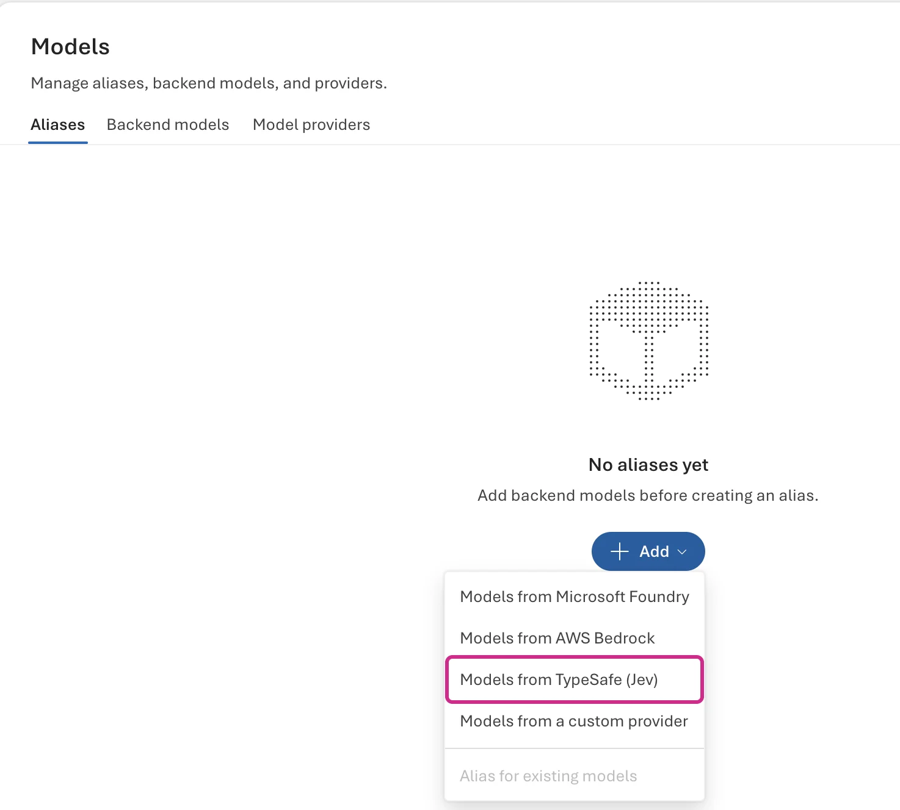

3. On **Provider**, keep **Create new provider**. Set **Display name** to `TypeSafe`, **Provider name** to `typesafe`,
   and **Description** to `TypeSafe Jev decision models.` Select **Next**.

   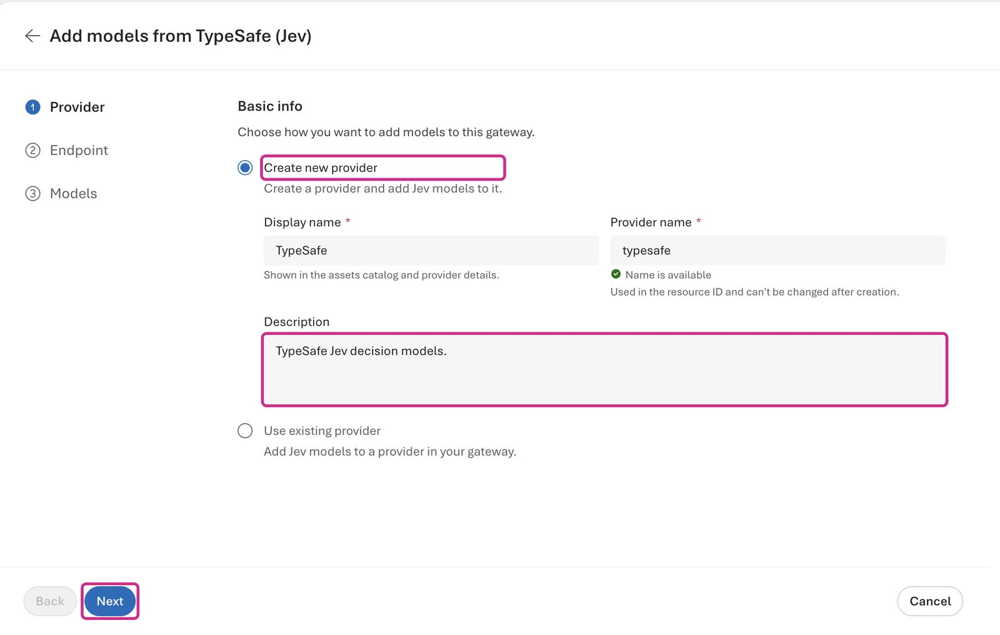

4. On **Endpoint**, keep `https://api.typesafe.ai` as the **Base endpoint URL**, and paste your TypeSafe key in
   **API key**. The gateway sends it to TypeSafe as `Authorization: Bearer <key>`. Select **Next**.

   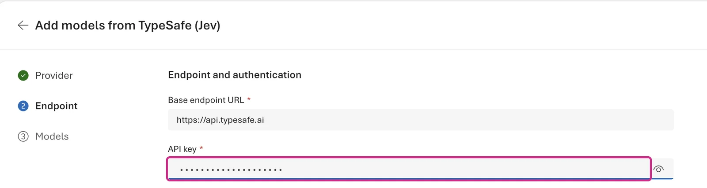

### Choose the Jev model and its alias

1. On **Models**, the wizard includes `jev-latest` and `jev-preview`, each with an alias named
   `typesafe/<model>`. In the `jev-preview` row, select **…** › **Delete**.
2. In the `jev-latest` row, select **…** › **Edit**. Keep **Create an alias** selected, set **Alias** to
   `ticket-triage`, and select **Save**.

   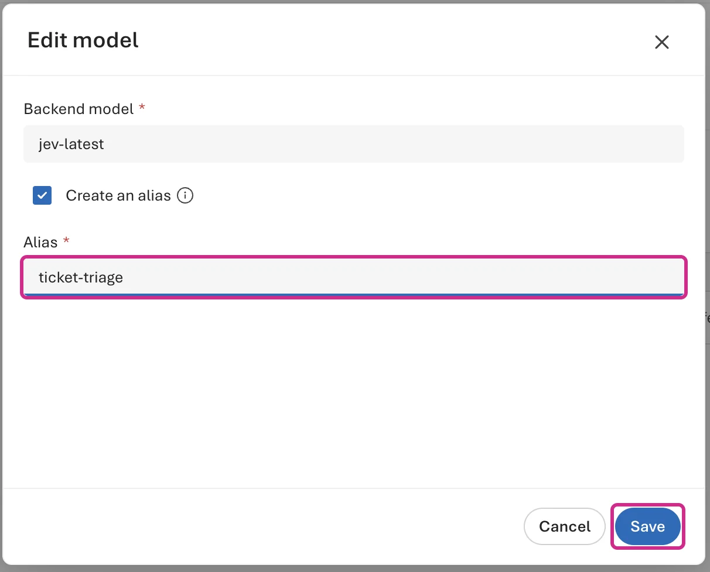

3. Select **Add models**.

   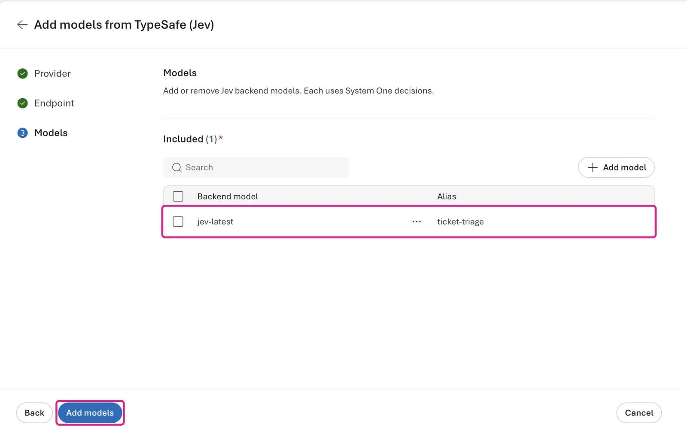

Select **Models** › **Backend models**. `jev-latest` shows the alias `ticket-triage`, the API format **Decisions**,
and the provider **TypeSafe**.

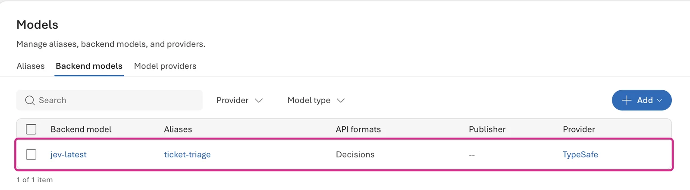

Select `ticket-triage`. On its **Overview**, **Endpoints** › **Decisions** shows the **Base URL** for the TypeSafe
SDK and the full **Endpoint URL**.

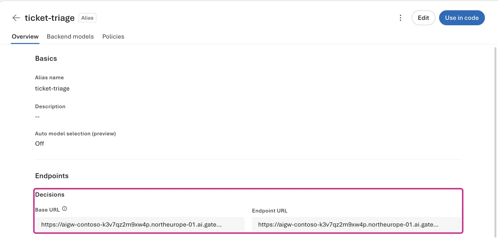

### Create a runtime key

1. Select **Access** › **API keys** › **Create API key**.
2. Set **Key name** to `app-ticket-triage`, and select **Create**.

   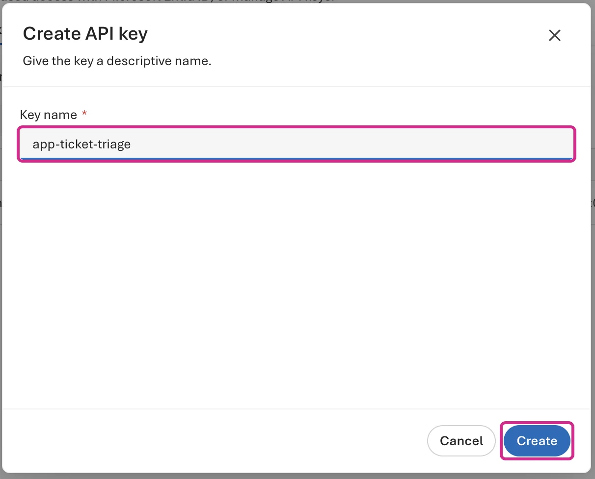

3. **API key created** shows the key once. Select **Copy & done**.

   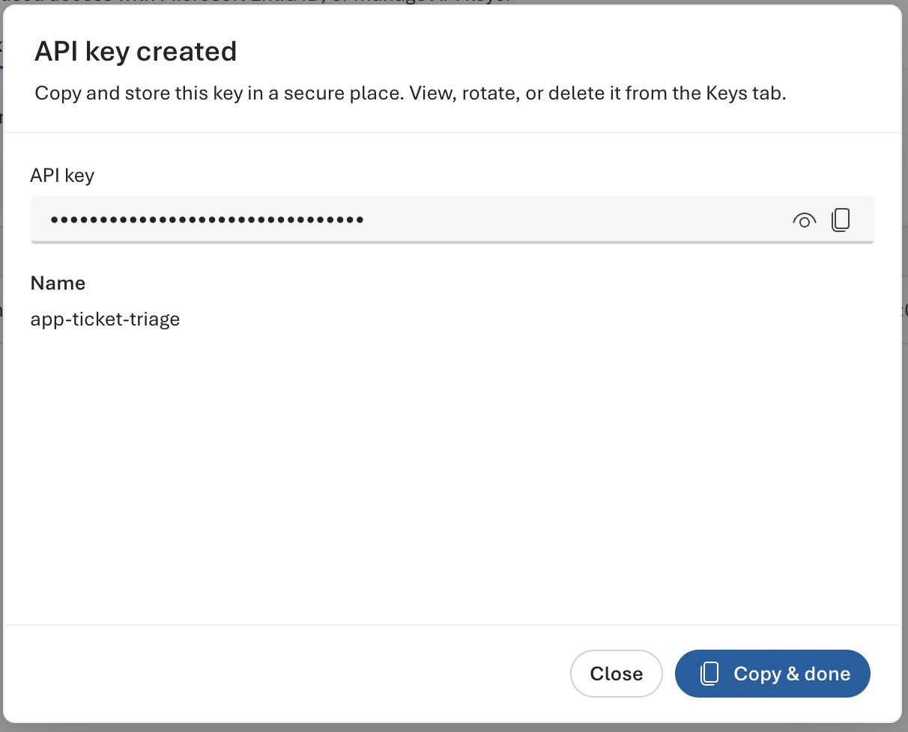

4. Paste the key into your shell without showing it:

<details open><summary>Bash</summary> <!-- gh -->

```bash title="Bash"
# Paste the app-ticket-triage key without showing it, and don't commit it or write it to a file
printf "AI Gateway API key: " && read -rs AI_GATEWAY_API_KEY && export AI_GATEWAY_API_KEY && echo
echo "🔑 Key: in AI_GATEWAY_API_KEY (${#AI_GATEWAY_API_KEY} characters, not shown)"
```
</details> <!-- gh -->

<details><summary>PowerShell</summary> <!-- gh -->

```powershell title="PowerShell"
# Paste the app-ticket-triage key without showing it, and don't commit it or write it to a file
$env:AI_GATEWAY_API_KEY = Read-Host "AI Gateway API key" -MaskInput
Write-Host "🔑 Key: in AI_GATEWAY_API_KEY ($($env:AI_GATEWAY_API_KEY.Length) characters, not shown)"
```
</details> <!-- gh -->

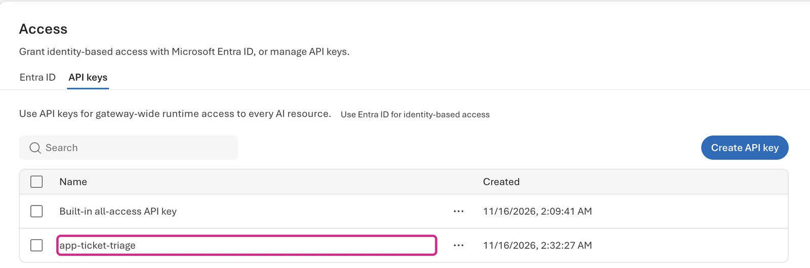

> **Checkpoint**
> **Models** › **Aliases** lists `ticket-triage`, its **Decisions** endpoint ends with
> `/default/models/typesafe/v1/systemone`, and the shell says that the key has 32 characters.

</details> <!-- gh -->
<!-- track: cli | Azure CLI -->
<details><summary><b>⌨️ Azure CLI</b></summary> <!-- gh -->

### Add the TypeSafe provider

The command reads your TypeSafe key from a hidden prompt, so it never lands in your shell history. The gateway stores
the key, and the command output, like `az aigateway model-provider show`, never includes it.

<details open><summary>Bash</summary> <!-- gh -->

```bash title="Bash"
# Paste your TypeSafe key without showing it, so that it never lands in your shell history
printf "TypeSafe API key: " && read -rs JEV_API_KEY && echo
echo "🔑 TypeSafe key: in JEV_API_KEY (${#JEV_API_KEY} characters, not shown)"

# Add TypeSafe as a Custom provider: the gateway stores the key and sends it as a bearer token to TypeSafe
az aigateway model-provider create -g "$RG" --gateway-name "$GATEWAY" -n typesafe \
  --kind Custom --display-name "TypeSafe" --description "TypeSafe Jev decision models." \
  --custom "$(jq -cn --arg key "$JEV_API_KEY" '{
      endpoint: "https://api.typesafe.ai",
      authentication: {kind: "ApiKey", apiKey: {headerName: "Authorization", value: ("Bearer " + $key)}}}')" \
  --query "{name:name,kind:properties.kind,endpoint:properties.custom.endpoint}" &&
  echo "🔌 Model provider typesafe is ready, and the TypeSafe key stays in the gateway"

# Clear the key from your shell, now that the gateway stores it
unset JEV_API_KEY &&
  echo "🚮 JEV_API_KEY is cleared from this shell"
```
</details> <!-- gh -->

<details><summary>PowerShell</summary> <!-- gh -->

```powershell title="PowerShell"
# Paste your TypeSafe key without showing it, so that it never lands in your shell history
$key = Read-Host "TypeSafe API key" -MaskInput
Write-Host "🔑 TypeSafe key: in the key variable ($($key.Length) characters, not shown)"

# Write the provider settings to a file: the endpoint, and the bearer token that the gateway sends to TypeSafe
@{
  endpoint       = 'https://api.typesafe.ai'
  authentication = @{ kind = 'ApiKey'; apiKey = @{ headerName = 'Authorization'; value = "Bearer $key" } }
} | ConvertTo-Json -Depth 10 -Compress | Set-Content -Path custom.json

# Add TypeSafe as a Custom provider: the gateway stores the key, and apps never receive it
az aigateway model-provider create -g $RG --gateway-name $GATEWAY -n typesafe `
  --kind Custom --display-name "TypeSafe" --description "TypeSafe Jev decision models." --custom '@custom.json' `
  --query "{name:name,kind:properties.kind,endpoint:properties.custom.endpoint}"
if ($?) { Write-Host "🔌 Model provider typesafe is ready, and the TypeSafe key stays in the gateway" }

# Delete the file and the variable right away, because they held the key
Remove-Item custom.json; Remove-Variable key
if ($?) { Write-Host "🚮 custom.json and the key variable are deleted" }
```
</details> <!-- gh -->

Expected output:

```text
{
  "endpoint": "https://api.typesafe.ai",
  "kind": "Custom",
  "name": "typesafe"
}
🔌 Model provider typesafe is ready, and the TypeSafe key stays in the gateway
```

The provider accepts exactly one authentication header. A second one fails with `Model-provider authentication
requires exactly one API-key header.`

### Publish the Jev model

Register `jev-latest` under the provider with the System One endpoint. Write `typesafe/v1/systemone` without a
leading slash: with one, the command fails with `The reserved System One endpoint must be typesafe/v1/systemone
without a leading '/'.`

<details open><summary>Bash</summary> <!-- gh -->

```bash title="Bash"
# Register jev-latest as a backend model that supports only the System One decisions endpoint
az aigateway model create -g "$RG" --gateway-name "$GATEWAY" --provider-name typesafe -n jev-latest \
  --display-name jev-latest --supported-endpoints typesafe/v1/systemone --deployment-config "{modelName:jev-latest}" \
  --query "{name:name, endpoints:properties.supportedEndpoints, modelName:properties.deployment.modelName}" &&
  echo "✨ Backend model jev-latest is published through typesafe"
```
</details> <!-- gh -->

<details><summary>PowerShell</summary> <!-- gh -->

```powershell title="PowerShell"
# Register jev-latest as a backend model that supports only the System One decisions endpoint
az aigateway model create -g $RG --gateway-name $GATEWAY --provider-name typesafe -n jev-latest `
  --display-name jev-latest --supported-endpoints typesafe/v1/systemone --deployment-config "{modelName:jev-latest}" `
  --query "{name:name, endpoints:properties.supportedEndpoints, modelName:properties.deployment.modelName}"
if ($?) { Write-Host "✨ Backend model jev-latest is published through typesafe" }
```
</details> <!-- gh -->

Expected output:

```text
{
  "endpoints": [
    "typesafe/v1/systemone"
  ],
  "modelName": "jev-latest",
  "name": "jev-latest"
}
✨ Backend model jev-latest is published through typesafe
```

`modelName` is the model that TypeSafe runs. To pin a version from TypeSafe's [Models](https://docs.typesafe.ai/models)
page, set it there and keep the alias name.

### Create the alias

<details open><summary>Bash</summary> <!-- gh -->

```bash title="Bash"
# Publish the backend model under the alias that the triage app sends in "model"
az aigateway model-alias set -g "$RG" --gateway-name "$GATEWAY" -n "$AI_GATEWAY_MODEL" \
  --backend-model resource-id="$GATEWAY_ID/workspaces/default/modelProviders/typesafe/models/jev-latest" \
  --only-show-errors --query "{name:name, backend:properties.backendModels[0].resourceId}" -o json |
  jq -r '"🔖 Alias \(.name) routes to \(.backend | split("/") | last)"'
```
</details> <!-- gh -->

<details><summary>PowerShell</summary> <!-- gh -->

```powershell title="PowerShell"
# Publish the backend model under the alias that the triage app sends in "model"
az aigateway model-alias set -g $RG --gateway-name $GATEWAY -n $env:AI_GATEWAY_MODEL `
  --backend-model resource-id="$GATEWAY_ID/workspaces/default/modelProviders/typesafe/models/jev-latest" `
  --only-show-errors --query "{name:name, backend:properties.backendModels[0].resourceId}" -o json |
  ConvertFrom-Json | ForEach-Object { Write-Host "🔖 Alias $($_.name) routes to $(($_.backend -split '/')[-1])" }
```
</details> <!-- gh -->

### Create a runtime key

Give the triage app its own key, so that its requests have their own rate-limit counter, then read the key from the
gateway so that it never shows on screen.

<details open><summary>Bash</summary> <!-- gh -->

```bash title="Bash"
# Create a runtime key for the triage app
az aigateway api-key create -g "$RG" --gateway-name "$GATEWAY" -n app-ticket-triage -o none &&
  echo "🔑 Runtime key app-ticket-triage is created"

# Read the key from the gateway, so that it never shows on screen or lands in a file
export AI_GATEWAY_API_KEY="$(az aigateway api-key list-secrets --ids "$GATEWAY_ID/apiKeys/app-ticket-triage" \
  --query primaryKey --output tsv)"
echo "🔑 Key: in AI_GATEWAY_API_KEY (${#AI_GATEWAY_API_KEY} characters, not shown)"
```
</details> <!-- gh -->

<details><summary>PowerShell</summary> <!-- gh -->

```powershell title="PowerShell"
# Create a runtime key for the triage app
az aigateway api-key create -g $RG --gateway-name $GATEWAY -n app-ticket-triage -o none
if ($?) { Write-Host "🔑 Runtime key app-ticket-triage is created" }

# Read the key from the gateway, so that it never shows on screen or lands in a file
$env:AI_GATEWAY_API_KEY = az aigateway api-key list-secrets --ids "$GATEWAY_ID/apiKeys/app-ticket-triage" `
  --query primaryKey --output tsv
Write-Host "🔑 Key: in AI_GATEWAY_API_KEY ($($env:AI_GATEWAY_API_KEY.Length) characters, not shown)"
```
</details> <!-- gh -->

> **Checkpoint**
> The output ends with `🔖 Alias ticket-triage routes to jev-latest`, `🔑 Runtime key app-ticket-triage is created`,
> and a key of 32 characters.

</details> <!-- gh -->
<!-- track: iac | Bicep + azd -->
<details><summary><b>🏗️ Bicep + azd</b></summary> <!-- gh -->

**What you need:** only the one-time setup from **Before you begin** and your TypeSafe key. This track doesn't use
your gateway from lab 01: `azd up` creates a new one, so it works on its own.

### Choose what to declare

`azd up` reads three values from the azd environment, through `infra/main.parameters.json`:

| azd environment value | Default | What it sets |
|---|---|---|
| `JEV_API_KEY` | None, required | Your TypeSafe key, passed to a `@secure()` parameter. The gateway stores it, and it's never a deployment output |
| `JEV_MODEL` | `jev-latest` | The Jev model that the backend model calls, such as a pinned version |
| `DECISIONS_PER_MINUTE` | `5` | The alias's request rate limit for each caller identity. `0` removes it |

### Review the templates

`infra/main.bicep` creates the resource group `rg-<environment name>`, calls lab 01's
[gateway.bicep](../01-provision-gateway/infra/gateway.bicep) for the gateway, and publishes Jev on it:

<!-- include: infra/main.bicep -->
<!-- gh:begin include: generated by "npm run sync" from the metadata, do not edit -->
📄 [`infra/main.bicep`](infra/main.bicep)

<details><summary>Show all 68 lines</summary>

```bicep
// Lab 31 with azd: "azd up" creates the resource group rg-<environment name> and a gateway with lab 01's template,
// then publishes TypeSafe's Jev decision model with jev-decisions.bicep: a Custom provider, the jev-latest model, the
// ticket-triage alias with a request rate limit, and the app-ticket-triage key. No Foundry account is needed. The
// TypeSafe key comes from JEV_API_KEY in the azd environment and is never an output.
targetScope = 'subscription'

@description('azd environment name. The resource group is rg-<environmentName>.')
@minLength(1)
@maxLength(60)
param environmentName string

@description('Region for every resource. Pick one where AI Gateway is available. List them with az provider show --namespace Microsoft.ApiManagement (Setup guide, Find the available regions).')
@metadata({ azd: { type: 'location' } })
param location string

@secure()
@description('Your TypeSafe API key. azd reads it from JEV_API_KEY.')
param jevApiKey string

@description('A Jev model name that your TypeSafe account can call. azd reads it from JEV_MODEL.')
param jevModel string = 'jev-latest'

@description('Decision requests per minute for each caller on the ticket-triage alias, or 0 for no limit. azd reads it from DECISIONS_PER_MINUTE.')
@minValue(0)
param decisionsPerMinute int = 5

var suffix = take(uniqueString(subscription().id, environmentName, location), 6)
var tags = { 'azd-env-name': environmentName }

resource rg 'Microsoft.Resources/resourceGroups@2024-03-01' = {
  name: 'rg-${environmentName}'
  location: location
  tags: tags
}

// Lab 01's template: a gateway with a system-assigned managed identity.
module gateway '../../01-provision-gateway/infra/gateway.bicep' = {
  name: 'aigw-gateway'
  scope: rg
  params: {
    gatewayName: 'aigw-${suffix}'
    location: location
    tags: tags
  }
}

// This lab's template: the TypeSafe provider, the Jev model, the ticket-triage alias, and the runtime key.
module jev 'jev-decisions.bicep' = {
  name: 'aigw-jev-decisions'
  scope: rg
  params: {
    gatewayName: gateway.outputs.gatewayName
    jevApiKey: jevApiKey
    modelName: jevModel
    requestsPerMinute: decisionsPerMinute
  }
}

output AZURE_RESOURCE_GROUP string = rg.name
output AI_GATEWAY_NAME string = gateway.outputs.gatewayName
output AI_GATEWAY_ID string = gateway.outputs.gatewayId
output AI_GATEWAY_URL string = gateway.outputs.gatewayUrl
output AI_GATEWAY_PROVIDER string = jev.outputs.providerName
output AI_GATEWAY_BACKEND_MODEL string = jev.outputs.modelName
output AI_GATEWAY_MODEL string = jev.outputs.aliasName
output AI_GATEWAY_API_KEY_NAME string = jev.outputs.apiKeyName
output JEV_SDK_BASE_URL string = jev.outputs.sdkBaseUrl
output JEV_DECISIONS_URL string = jev.outputs.decisionsUrl
```

</details>
<!-- gh:end -->

`infra/jev-decisions.bicep` creates the provider, the model, the alias with its rate limit, and the key, in that
order. You can also deploy it on its own to the gateway from lab 01:

<!-- include: infra/jev-decisions.bicep -->
<!-- gh:begin include: generated by "npm run sync" from the metadata, do not edit -->
📄 [`infra/jev-decisions.bicep`](infra/jev-decisions.bicep)

<details><summary>Show all 130 lines</summary>

```bicep
// Publishes TypeSafe's Jev decision model on an existing gateway: a Custom model provider that calls the TypeSafe API
// with your TypeSafe key, the jev-latest model with the System One endpoint, the ticket-triage alias with a request
// rate limit for each caller, and a runtime API key for the triage app. The TypeSafe key is a secure parameter: the
// gateway stores it and never returns it, and it's never an output. Read the runtime key with
// az aigateway api-key list-secrets.
targetScope = 'resourceGroup'

@description('Name of an existing AI Gateway in this resource group.')
param gatewayName string

@secure()
@description('Your TypeSafe API key. The gateway sends it to TypeSafe as Authorization: Bearer <key>.')
param jevApiKey string

@description('Model provider name. It is part of the backend model\'s resource ID.')
param providerName string = 'typesafe'

@description('Base URL of the TypeSafe API, or of another System One-compatible host, including any path prefix.')
param endpointUrl string = 'https://api.typesafe.ai'

@description('A Jev model name that your TypeSafe account can call, such as jev-latest or a pinned version.')
param modelName string = 'jev-latest'

@description('The alias that apps send in the request\'s model field.')
param aliasName string = 'ticket-triage'

@description('Decision requests per minute for each caller identity on the alias. 0 removes the limit.')
@minValue(0)
param requestsPerMinute int = 5

@description('Name of the runtime API key for the triage app.')
param apiKeyName string = 'app-ticket-triage'

#disable-next-line BCP081
resource gateway 'Microsoft.ApiManagement/aigateways@2026-11-01' existing = {
  name: gatewayName
}

#disable-next-line BCP081
resource workspace 'Microsoft.ApiManagement/aigateways/workspaces@2026-11-01' existing = {
  parent: gateway
  name: 'default'
}

// 1. A Custom provider for the TypeSafe API. Its one header carries the TypeSafe key on every call to TypeSafe.
#disable-next-line BCP081
resource provider 'Microsoft.ApiManagement/aigateways/workspaces/modelProviders@2026-11-01' = {
  parent: workspace
  name: providerName
  properties: {
    modelProviderType: 'Custom'
    displayName: 'TypeSafe'
    description: 'TypeSafe Jev decision models.'
    custom: {
      endpoint: {
        url: endpointUrl
      }
    }
    authentication: {
      headers: [
        {
          name: 'Authorization'
          value: 'Bearer ${jevApiKey}'
        }
      ]
    }
  }
}

// 2. The Jev model. typesafe/v1/systemone is the System One decisions endpoint, written without a leading slash.
#disable-next-line BCP081
resource model 'Microsoft.ApiManagement/aigateways/workspaces/modelProviders/models@2026-11-01' = {
  parent: provider
  name: modelName
  properties: {
    displayName: modelName
    description: 'TypeSafe Jev decision model.'
    supportedEndpoints: [
      'typesafe/v1/systemone'
    ]
    deployment: {
      modelName: modelName
    }
  }
}

// 3. The alias that apps call, with a limit on decision requests per minute for each caller identity.
#disable-next-line BCP081
resource alias 'Microsoft.ApiManagement/aigateways/workspaces/aliases@2026-11-01' = {
  parent: workspace
  name: aliasName
  properties: {
    aliasName: aliasName
    description: 'Decision alias for support ticket triage.'
    backendModels: [
      {
        resourceId: model.id
      }
    ]
    policies: requestsPerMinute > 0
      ? [
          {
            type: 'requestRateLimit'
            count: requestsPerMinute
            period: 'minute'
            counterKey: [
              'identity'
            ]
          }
        ]
      : []
  }
}

// 4. A runtime API key for the triage app. Its value is never an output.
#disable-next-line BCP081
resource apiKey 'Microsoft.ApiManagement/aigateways/apiKeys@2026-11-01' = {
  parent: gateway
  name: apiKeyName
  properties: {
    displayName: apiKeyName
  }
}

output providerName string = provider.name
output modelName string = model.name
output aliasName string = alias.name
output apiKeyName string = apiKey.name
output sdkBaseUrl string = 'https://${gateway.properties.frontend.defaultHostname}/default/models/typesafe'
output decisionsUrl string = 'https://${gateway.properties.frontend.defaultHostname}/default/models/typesafe/v1/systemone'
```

</details>
<!-- gh:end -->

### Deploy with azd up

Move into the lab's folder, create an azd environment named `aigw-lab31` in your current subscription, and give it
your TypeSafe key from a hidden prompt. Then provision everything. It takes about two minutes.

<details open><summary>Bash</summary> <!-- gh -->

```bash title="Bash"
# Move into the lab's folder, which holds the azd project
cd ~/aigateway/labs/31-jev-decisions &&
  echo "📂 Lab folder: $(pwd)"

# Create an azd environment named aigw-lab31 in your current subscription, so that azd doesn't prompt you
azd env new aigw-lab31 --location eastus2 --subscription "$(az account show --query id --output tsv)" &&
  echo "📝 azd environment aigw-lab31 deploys to eastus2"

# Paste your TypeSafe key without showing it, so that it never lands in your shell history
printf "TypeSafe API key: " && read -rs JEV_API_KEY && echo
echo "🔑 TypeSafe key: in JEV_API_KEY (${#JEV_API_KEY} characters, not shown)"

# Store the key in the azd environment, which passes it to the template's secure parameter
azd env set JEV_API_KEY "$JEV_API_KEY" &&
  echo "📝 JEV_API_KEY is set in the azd environment"

# Clear the key from your shell, now that the azd environment holds it
unset JEV_API_KEY &&
  echo "🚮 JEV_API_KEY is cleared from this shell"

# Provision the gateway, the TypeSafe provider, the Jev model, the alias with its rate limit, and the key
azd up &&
  echo "🚀 Gateway deployed: $(azd env get-value AI_GATEWAY_URL)"
```
</details> <!-- gh -->

<details><summary>PowerShell</summary> <!-- gh -->

```powershell title="PowerShell"
# Move into the lab's folder, which holds the azd project
Set-Location ~/aigateway/labs/31-jev-decisions
if ($?) { Write-Host "📂 Lab folder: $(Get-Location)" }

# Create an azd environment named aigw-lab31 in your current subscription, so that azd doesn't prompt you
azd env new aigw-lab31 --location eastus2 --subscription (az account show --query id --output tsv)
if ($?) { Write-Host "📝 azd environment aigw-lab31 deploys to eastus2" }

# Paste your TypeSafe key without showing it, so that it never lands in your shell history
$key = Read-Host "TypeSafe API key" -MaskInput
Write-Host "🔑 TypeSafe key: in the key variable ($($key.Length) characters, not shown)"

# Store the key in the azd environment, which passes it to the template's secure parameter
azd env set JEV_API_KEY $key
if ($?) { Write-Host "📝 JEV_API_KEY is set in the azd environment" }

# Clear the key from your shell, now that the azd environment holds it
Remove-Variable key
if ($?) { Write-Host "🚮 The key variable is cleared from this shell" }

# Provision the gateway, the TypeSafe provider, the Jev model, the alias with its rate limit, and the key
azd up
if ($?) { Write-Host "🚀 Gateway deployed: $(azd env get-value AI_GATEWAY_URL)" }
```
</details> <!-- gh -->

Expected output (your names differ):

```text
  (✓) Done: Resource group: rg-aigw-lab31

SUCCESS: Your application was provisioned and deployed to Azure in 2 minutes 2 seconds.
```

For another region, pick one where AI Gateway is available, as in
[Find the available regions](../SETUP.md#find-the-available-regions). azd keeps the TypeSafe key in
`.azure/aigw-lab31/.env`, which `.azure/.gitignore` keeps out of Git. **Clean up** removes it.

### Read the outputs and the key

Set the variables that the next sections and **Verify** use from azd's environment values, then read the runtime key
from the gateway so that it never shows on screen.

<details open><summary>Bash</summary> <!-- gh -->

```bash title="Bash"
# Read azd's outputs into the variables that the next sections use
export RG="$(azd env get-value AZURE_RESOURCE_GROUP)"
export GATEWAY="$(azd env get-value AI_GATEWAY_NAME)"
export GATEWAY_ID="$(azd env get-value AI_GATEWAY_ID)"
export AI_GATEWAY_URL="$(azd env get-value AI_GATEWAY_URL)"
export AI_GATEWAY_MODEL="$(azd env get-value AI_GATEWAY_MODEL)"
export JEV_URL="$(azd env get-value JEV_DECISIONS_URL)"
echo "📝 Alias $AI_GATEWAY_MODEL on gateway $GATEWAY in $RG"
echo "🌐 Decisions URL: $JEV_URL"

# Read the app-ticket-triage key from the gateway, so that it never shows on screen or lands in a file
export AI_GATEWAY_API_KEY="$(az aigateway api-key list-secrets \
  --ids "$GATEWAY_ID/apiKeys/$(azd env get-value AI_GATEWAY_API_KEY_NAME)" --query primaryKey --output tsv)"
echo "🔑 Key: in AI_GATEWAY_API_KEY (${#AI_GATEWAY_API_KEY} characters, not shown)"
```
</details> <!-- gh -->

<details><summary>PowerShell</summary> <!-- gh -->

```powershell title="PowerShell"
# Read azd's outputs into the variables that the next sections use
$RG                   = azd env get-value AZURE_RESOURCE_GROUP
$GATEWAY              = azd env get-value AI_GATEWAY_NAME
$GATEWAY_ID           = azd env get-value AI_GATEWAY_ID
$env:AI_GATEWAY_URL   = azd env get-value AI_GATEWAY_URL
$env:AI_GATEWAY_MODEL = azd env get-value AI_GATEWAY_MODEL
$JEV_URL              = azd env get-value JEV_DECISIONS_URL
Write-Host "📝 Alias $env:AI_GATEWAY_MODEL on gateway $GATEWAY in $RG"
Write-Host "🌐 Decisions URL: $JEV_URL"

# Read the app-ticket-triage key from the gateway, so that it never shows on screen or lands in a file
$env:AI_GATEWAY_API_KEY = az aigateway api-key list-secrets `
  --ids "$GATEWAY_ID/apiKeys/$(azd env get-value AI_GATEWAY_API_KEY_NAME)" --query primaryKey --output tsv
Write-Host "🔑 Key: in AI_GATEWAY_API_KEY ($($env:AI_GATEWAY_API_KEY.Length) characters, not shown)"
```
</details> <!-- gh -->

> **Checkpoint**
> `azd up` ended with `SUCCESS`, the Decisions URL ends with `/default/models/typesafe/v1/systemone`, and the key has
> 32 characters.

</details> <!-- gh -->
<!-- /tracks -->

## Send a decision request

Send the first ticket from [infra/ticket.json](infra/ticket.json) with three questions: is it urgent (`noul`), which
team owns it (`choice`), and how frustrated the customer is (`score`). Two things differ from a direct call to
TypeSafe: the URL is the gateway's, and the credential is your gateway key. `model` is the alias. New resources
reach the runtime within a minute. If the first call returns `404` with `Resource not found` or `model_not_found`,
wait a few seconds and try again.

<!-- track: portal | Portal -->
<details open><summary><b>🖥️ Portal</b></summary> <!-- gh -->

### Run decisions in the playground

1. Select **Catalog**, and open `ticket-triage`. The playground shows **Run decisions**. On the left, **Endpoints** ›
   **API format** is **Decisions**. **Authentication** › **Method** is **API key** with the
   **Built-in all-access API key**, or **Microsoft Entra ID** if you have a data role on the gateway, such as
   **AI Gateway Models User**.
2. In **State**, paste the ticket:

   ```text
   Subject: Charged twice for invoice INV-2291
   Message: I was billed twice this month for the same invoice. Please refund the duplicate charge today, our finance team closes the books tomorrow.
   Plan: Business
   Channel: email
   ```

3. Under **Questions**, set **Question 1**: **Question ID** `urgent`, **Answer type** **Noul**, and
   **Instructions** `Does the customer need an answer today?`

   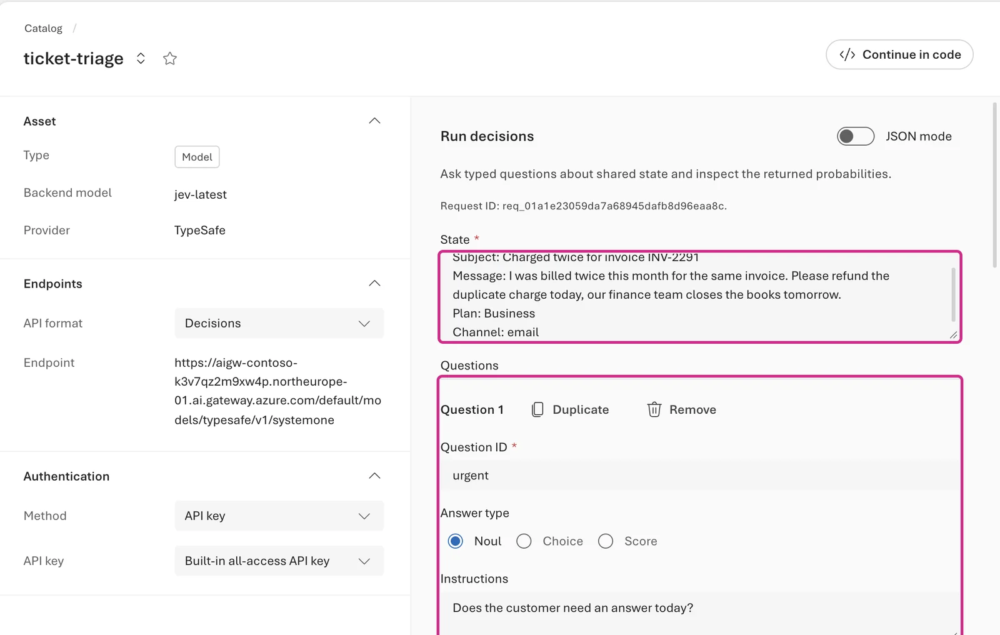

4. Select **Add question**, and set **Question 2**: **Question ID** `team`, **Answer type** **Choice**, and
   **Instructions** `Which support team should own this ticket?` Add three options, `billing`, `technical`, and
   `account`, with **Add option**.
5. Select **Run decisions**.

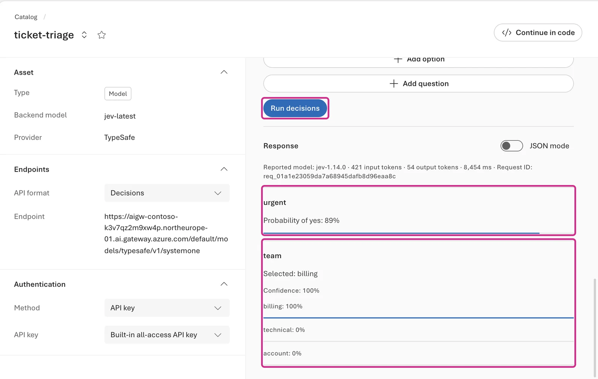

To send the lab's ticket with all three questions, turn on **JSON mode** next to **Run decisions**, replace the
request with the contents of [infra/ticket.json](infra/ticket.json), and select **Run decisions**. The response adds
**frustration** with **Score: 1**.

> **Checkpoint**
> The **Response** shows `Reported model: jev-1.14.0`, the input and output tokens, **urgent** with a high
> **Probability of yes**, and **team** with **Selected: billing**. The first call to a new model can take several
> seconds.

</details> <!-- gh -->
<!-- track: cli | curl and PowerShell -->
<details><summary><b>⌨️ curl and PowerShell</b></summary> <!-- gh -->

### Triage a ticket

<details open><summary>Bash</summary> <!-- gh -->

```bash title="Bash"
# Send the ticket and its three questions to the alias, with the gateway runtime key as a bearer token
RESULT="$(jq -c --arg model "$AI_GATEWAY_MODEL" '. + {model: $model}' infra/ticket.json |
  curl -sS "$JEV_URL" -H "Authorization: Bearer $AI_GATEWAY_API_KEY" -H "Content-Type: application/json" --data @-)"
jq . <<< "$RESULT"
```
</details> <!-- gh -->

<details><summary>PowerShell</summary> <!-- gh -->

```powershell title="PowerShell"
# Read the ticket and its three questions, and put the alias in model
$request = Get-Content infra/ticket.json -Raw | ConvertFrom-Json
$request | Add-Member -NotePropertyName model -NotePropertyValue $env:AI_GATEWAY_MODEL

# Send it to the alias, with the gateway runtime key as a bearer token
$result = Invoke-RestMethod -Method Post -Uri $JEV_URL -Headers @{ Authorization = "Bearer $env:AI_GATEWAY_API_KEY" } `
  -ContentType "application/json" -Body ($request | ConvertTo-Json -Depth 10)
$result | ConvertTo-Json -Depth 10
```
</details> <!-- gh -->

Expected output (your probabilities can differ slightly):

```json
{
  "model": "jev-1.14.0",
  "answers": {
    "urgent": {
      "type": "noul",
      "noul": 0.92
    },
    "team": {
      "type": "choice",
      "choice": "billing",
      "confidence": 1.0,
      "probabilities": {
        "billing": 1.0,
        "technical": 0.0,
        "account": 0.0
      }
    },
    "frustration": {
      "type": "score",
      "score": 1.0,
      "confidence": 1.0,
      "legend": {
        "0": "Calm, just stating facts",
        "1": "Frustrated but civil",
        "2": "Very angry, strong language"
      },
      "probabilities": {
        "0": 0.0,
        "1": 1.0,
        "2": 0.0
      }
    }
  },
  "usage": {
    "input_tokens": 499,
    "output_tokens": 70
  }
}
```

`model` is the Jev version that answered, not the alias. The gateway also accepts the key in an `api-key` header,
but not in both headers at once.

### Read the typed answers

Every answer has a fixed type, so the triage app reads fields instead of parsing text:

<details open><summary>Bash</summary> <!-- gh -->

```bash title="Bash"
# Print each typed answer on one line: a probability, a choice with its confidence, and a score with its label
jq -r '"🤖 Model: \(.model)",
  (.answers | "📊 urgent: \(.urgent.noul) probability of yes",
    "📊 team: \(.team.choice), confidence \(.team.confidence)",
    "📊 frustration: \(.frustration.score), \(.frustration.legend[.frustration.score | round | tostring])"),
  "📊 Tokens: \(.usage.input_tokens) in, \(.usage.output_tokens) out"' <<< "$RESULT"
```
</details> <!-- gh -->

<details><summary>PowerShell</summary> <!-- gh -->

```powershell title="PowerShell"
# Print each typed answer on one line: a probability, a choice with its confidence, and a score with its label
$answers = $result.answers
Write-Host "🤖 Model: $($result.model)"
Write-Host "📊 urgent: $($answers.urgent.noul) probability of yes"
Write-Host "📊 team: $($answers.team.choice), confidence $($answers.team.confidence)"
Write-Host "📊 frustration: $($answers.frustration.score), $($answers.frustration.legend.([string][math]::Round($answers.frustration.score)))"
Write-Host "📊 Tokens: $($result.usage.input_tokens) in, $($result.usage.output_tokens) out"
```
</details> <!-- gh -->

> **Checkpoint**
> Bash prints `📊 urgent: 0.91 probability of yes` or close to it, `📊 team: billing, confidence 1.0`, and
> `📊 frustration: 1.0, Frustrated but civil`. PowerShell prints the whole numbers as `1`.

</details> <!-- gh -->
<!-- track: code | Code -->
<details><summary><b>🧑‍💻 Code</b></summary> <!-- gh -->

### Install the SDK

The sample reads `AI_GATEWAY_URL`, `AI_GATEWAY_API_KEY`, and `AI_GATEWAY_MODEL` from the environment. Run the
commands from the lab folder.

```bash title="Python"
# Install the sample's requirements: the TypeSafe SDK
pip install -r infra/requirements.txt &&
  echo "📦 The TypeSafe SDK is installed"
```

### Point the TypeSafe SDK at the gateway

Give the client the gateway's System One base URL, your gateway key, and the alias. Turn request compression off:
the gateway accepts only uncompressed JSON. By default, the SDK compresses request bodies of 1 KB or more with zstd
on Python 3.14 or later, or with the `typesafe-sdk[zstd]` extra, and the gateway answers them with `415`.

```python title="Python"
import os

from typesafe_sdk import Noul, TypeSafeClient

client = TypeSafeClient(
    api_key=os.environ["AI_GATEWAY_API_KEY"],                                 # the gateway key, not the TypeSafe key
    base_url=os.environ["AI_GATEWAY_URL"] + "/default/models/typesafe",       # the SDK adds /v1/systemone
    model=os.environ["AI_GATEWAY_MODEL"],                                     # the alias, ticket-triage
    compression=False,
)

result = client.system_one(
    state={"ticket": "Charged twice for invoice INV-2291. Please refund the duplicate today."},
    questions={"urgent": Noul(instructions="Does the customer need an answer today?")},
)
print(f"urgent: {result.nouls['urgent'].noul:.2f}, answered by {result.model}")
```

The sample triages three tickets with the same three questions, and prints one row per ticket:

<!-- include: infra/triage.py -->
<!-- gh:begin include: generated by "npm run sync" from the metadata, do not edit -->
📄 [`infra/triage.py`](infra/triage.py)

<details><summary>Show all 103 lines</summary>

```py
"""Triage support tickets with a Jev decision model through AI Gateway.

Reads AI_GATEWAY_URL, AI_GATEWAY_API_KEY, and AI_GATEWAY_MODEL (the alias, ticket-triage by default). Each ticket
gets three typed answers: is it urgent (noul), which team owns it (choice), and how frustrated the customer is (score).

    python infra/triage.py             # triage three sample tickets
    python infra/triage.py --burst 8   # send 8 decisions in a row to see the alias's request rate limit
"""

import argparse
import os
import time

from typesafe_sdk import Choice, Noul, RetryPolicy, Score, TypeSafeAPIError, TypeSafeClient

TICKETS = [
    {
        "subject": "Charged twice for invoice INV-2291",
        "message": "Hi, my card was charged twice for invoice INV-2291 this morning. Please refund the duplicate "
        "today: I need that money for rent tomorrow. This is the second time it has happened!",
        "plan": "Pro",
    },
    {
        "subject": "Webhook calls fail with 500 since the last release",
        "message": "Since yesterday's release every webhook delivery to our endpoint fails with a 500 and our "
        "orders are stuck. Nothing changed on our side. Production is down, please escalate.",
        "plan": "Enterprise",
    },
    {
        "subject": "Add a second admin",
        "message": "Hello, when you get a chance, could you tell me how to give my colleague admin rights on our "
        "workspace? No rush, thanks!",
        "plan": "Free",
    },
]

# The same questions for every ticket. Jev answers each one with a typed value and a probability.
QUESTIONS = {
    "urgent": Noul(instructions="Does the customer need an answer today?"),
    "team": Choice(
        instructions="Which support team should own this ticket?",
        criteria={
            "billing": "Payments, invoices, refunds, or subscription changes",
            "technical": "Bugs, errors, outages, or integration problems",
            "account": "Sign-in, users, permissions, or account settings",
        },
    ),
    "frustration": Score(
        instructions="How frustrated is the customer?",
        criteria=["Calm, just stating facts", "Frustrated but civil", "Very angry, strong language"],
    ),
}


ALIAS = os.environ.get("AI_GATEWAY_MODEL", "ticket-triage")


def make_client() -> TypeSafeClient:
    # The SDK's base URL is the gateway's System One base: it adds /v1/systemone to it. The gateway takes only
    # uncompressed JSON, so turn compression off. No retries, so that a 429 from the gateway shows up right away.
    return TypeSafeClient(
        api_key=os.environ["AI_GATEWAY_API_KEY"],
        base_url=os.environ["AI_GATEWAY_URL"].rstrip("/") + "/default/models/typesafe",
        model=ALIAS,
        compression=False,
        retry=RetryPolicy(max_retries=0),
    )


def triage(client: TypeSafeClient) -> None:
    print(f"{'Ticket':<36} {'Urgent':>6}  {'Team':<16}  {'Frustration':<28} {'ms':>5}  Tokens")
    for ticket in TICKETS:
        start = time.perf_counter()
        result = client.system_one(state={"ticket": ticket}, questions=QUESTIONS)
        ms = (time.perf_counter() - start) * 1000
        urgent = result.nouls["urgent"].noul
        team = result.choices["team"]
        frustration = result.scores["frustration"]
        level = frustration.legend[round(frustration.score)]
        print(
            f"{ticket['subject'][:36]:<36} {urgent:>6.2f}  {team.choice:<9} ({team.confidence:.2f})  "
            f"{frustration.score:.1f} {level:<24} {ms:>5.0f}  "
            f"{result.usage.input_tokens} in, {result.usage.output_tokens} out"
        )
    print(f"✅ {len(TICKETS)} tickets triaged by {result.model} through the alias {ALIAS}")


def burst(client: TypeSafeClient, count: int) -> None:
    ticket = TICKETS[0]
    for i in range(1, count + 1):
        try:
            result = client.system_one(state={"ticket": ticket}, questions={"urgent": QUESTIONS["urgent"]})
            print(f"#{i}: 200, urgent = {result.nouls['urgent'].noul:.2f}")
        except TypeSafeAPIError as err:
            print(f"#{i}: {err.status}, Retry-After {err.headers.get('retry-after')} s: {err.body}")


if __name__ == "__main__":
    parser = argparse.ArgumentParser(description=__doc__.splitlines()[0])
    parser.add_argument("--burst", type=int, metavar="N", help="send N decision requests in a row")
    args = parser.parse_args()
    with make_client() as jev:
        burst(jev, args.burst) if args.burst else triage(jev)
```

</details>
<!-- gh:end -->

### Run the sample

```bash title="Python"
# Triage three sample tickets through the alias
echo "📊 Ticket triage through the gateway:"
python infra/triage.py
```

Expected output (your probabilities and times differ slightly):

```text
📊 Ticket triage through the gateway:
Ticket                               Urgent  Team              Frustration                     ms  Tokens
Charged twice for invoice INV-2291     0.91  billing   (1.00)  1.0 Frustrated but civil      1029  491 in, 70 out
Webhook calls fail with 500 since th   0.93  technical (1.00)  1.1 Frustrated but civil       482  489 in, 70 out
Add a second admin                     0.08  account   (1.00)  0.0 Calm, just stating facts   472  471 in, 70 out
✅ 3 tickets triaged by jev-1.14.0 through the alias ticket-triage
```

> **Checkpoint**
> The two urgent tickets score above 0.9 and go to `billing` and `technical`, and the request for a second admin
> scores below 0.1 and goes to `account`. A warm call takes about half a second.

</details> <!-- gh -->
<!-- /tracks -->

## Limit decision requests per caller

Every decision costs money at TypeSafe, and a triage job stuck in a loop can send thousands. Give the alias a
**request rate limit**: 5 decision requests per minute for each caller identity, low enough to watch it work. Each
API key or Entra identity gets its own counter. In production, size it from your ticket volume.

<!-- track: portal | Portal -->
<details open><summary><b>🖥️ Portal</b></summary> <!-- gh -->

### Add the request rate limit

1. On the alias's page, select **Policies** › **Add policy**.
2. On **Type**, under **Cost and rate limits**, select **Request rate limit**. Select **Next**.

   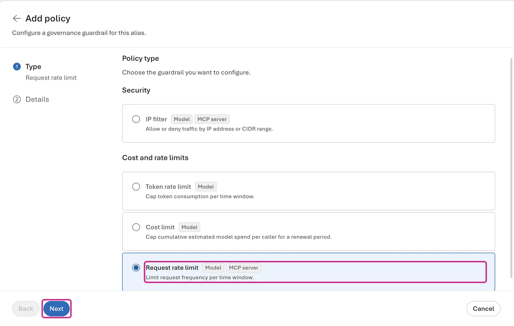

3. On **Policy details**, set **Calls** to `5`, keep **60 seconds** as the **Renewal period**, and keep **Identity** in
   **Counter dimensions**. Select **Create**.

   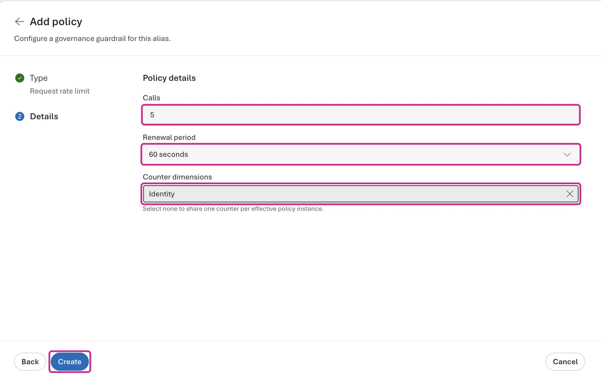

> **Checkpoint**
> **Policies** lists `5 requests / 60 seconds per caller identity`, of type **Request rate limit**, with the scope
> **This alias**.
>
> 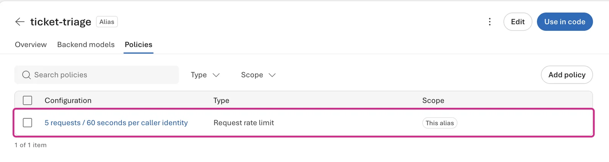

</details> <!-- gh -->
<!-- track: cli | Azure CLI -->
<details><summary><b>⌨️ Azure CLI</b></summary> <!-- gh -->

### Set the request rate limit

The `az aigateway` extension has no command for an alias's request rate limit, so `az rest` writes it with the
`2026-11-01` API. Policies live inline in the alias's `properties.policies` array, and a `PATCH` replaces the whole
array. The new alias has no other policies.

<details open><summary>Bash</summary> <!-- gh -->

```bash title="Bash"
# Set the alias's policies to one request rate limit: 5 calls per minute, with its own counter for each caller identity
az rest --method patch \
  --url "https://management.azure.com$GATEWAY_ID/workspaces/default/aliases/$AI_GATEWAY_MODEL?api-version=2026-11-01" \
  --body '{"properties":{"policies":[{"type":"requestRateLimit","count":5,"period":"minute","counterKey":["identity"]}]}}' \
  --query properties.policies &&
  echo "🚦 $AI_GATEWAY_MODEL allows 5 decision requests per minute for each caller"
```
</details> <!-- gh -->

<details><summary>PowerShell</summary> <!-- gh -->

```powershell title="PowerShell"
# Write the request body to a file, which --body reads with the @ prefix, so that its quotes reach az intact
@{ properties = @{ policies = @(@{ type = 'requestRateLimit'; count = 5; period = 'minute'; counterKey = @('identity') }) } } |
  ConvertTo-Json -Depth 10 -Compress | Set-Content -Path patch.json

# Set the alias's policies to one request rate limit: 5 calls per minute, with its own counter for each caller identity
az rest --method patch `
  --url "https://management.azure.com$GATEWAY_ID/workspaces/default/aliases/$($env:AI_GATEWAY_MODEL)?api-version=2026-11-01" `
  --body '@patch.json' --query properties.policies
if ($?) { Write-Host "🚦 $env:AI_GATEWAY_MODEL allows 5 decision requests per minute for each caller" }
Remove-Item patch.json
```
</details> <!-- gh -->

Expected output:

```text
[
  {
    "count": 5,
    "counterKey": [
      "identity"
    ],
    "period": "minute",
    "scope": "resource",
    "type": "requestRateLimit"
  }
]
🚦 ticket-triage allows 5 decision requests per minute for each caller
```

The service adds `"scope": "resource"`. The `--policies` parameter of `az aigateway model-alias update` doesn't take
this shape yet: it fails with `requestRateLimit.callsPerPeriod must be greater than 0.`

</details> <!-- gh -->
<!-- track: iac | Bicep + azd -->
<details><summary><b>🏗️ Bicep + azd</b></summary> <!-- gh -->

### Check the request rate limit

`jev-decisions.bicep` already put the rate limit in the alias's `policies`, with `DECISIONS_PER_MINUTE` calls per
minute. Print it:

<details open><summary>Bash</summary> <!-- gh -->

```bash title="Bash"
# Print the policies of the alias that azd deployed
echo "🚦 Policies on $AI_GATEWAY_MODEL:"
az aigateway model-alias show -g "$RG" --gateway-name "$GATEWAY" -n "$AI_GATEWAY_MODEL" \
  --query properties.policies -o json
```
</details> <!-- gh -->

<details><summary>PowerShell</summary> <!-- gh -->

```powershell title="PowerShell"
# Print the policies of the alias that azd deployed
Write-Host "🚦 Policies on $($env:AI_GATEWAY_MODEL):"
az aigateway model-alias show -g $RG --gateway-name $GATEWAY -n $env:AI_GATEWAY_MODEL `
  --query properties.policies -o json
```
</details> <!-- gh -->

> **Checkpoint**
> The output has one `requestRateLimit` with `count` `5`, `period` `minute`, and `counterKey` `["identity"]`.

To change the limit later, run `azd env set DECISIONS_PER_MINUTE 10` and `azd provision`. It takes about a minute.
Keep `5` for **Verify**.

</details> <!-- gh -->
<!-- /tracks -->

## Verify

<!-- steps -->

### Call the alias the wrong way

The alias serves only the System One endpoint, and apps must send the alias, not the backend model's name:

<details open><summary>Bash</summary> <!-- gh -->

```bash title="Bash"
# Send a Chat Completions request to the decision alias, which serves only the System One endpoint
curl -sS "$AI_GATEWAY_URL/default/models/openai/v1/chat/completions" \
  -H "Authorization: Bearer $AI_GATEWAY_API_KEY" -H "Content-Type: application/json" \
  -d "{\"model\":\"$AI_GATEWAY_MODEL\",\"messages\":[{\"role\":\"user\",\"content\":\"Is this ticket urgent?\"}]}" |
  jq -r '"🚦 \(.error.code // .statusCode): \(.error.message // .message)"'

# Send the decision request with the backend model's name instead of the alias
jq -c '. + {model: "jev-latest"}' infra/ticket.json |
  curl -sS "$JEV_URL" -H "Authorization: Bearer $AI_GATEWAY_API_KEY" -H "Content-Type: application/json" --data @- |
  jq -r '"🚦 \(.error.code // .statusCode): \(.error.message // .message)"'
```
</details> <!-- gh -->

<details><summary>PowerShell</summary> <!-- gh -->

```powershell title="PowerShell"
# Send a Chat Completions request to the decision alias, which serves only the System One endpoint
$body = @{ model = $env:AI_GATEWAY_MODEL; messages = @(@{ role = "user"; content = "Is this ticket urgent?" }) } | ConvertTo-Json -Depth 5
$reply = Invoke-WebRequest -Method Post -Uri "$env:AI_GATEWAY_URL/default/models/openai/v1/chat/completions" `
  -Headers @{ Authorization = "Bearer $env:AI_GATEWAY_API_KEY" } -ContentType "application/json" -Body $body -SkipHttpErrorCheck
$error1 = ($reply.Content | ConvertFrom-Json).error
Write-Host "🚦 $($error1.code): $($error1.message)"

# Send the decision request with the backend model's name instead of the alias
$request = Get-Content infra/ticket.json -Raw | ConvertFrom-Json
$request | Add-Member -NotePropertyName model -NotePropertyValue "jev-latest"
$reply = Invoke-WebRequest -Method Post -Uri $JEV_URL -Headers @{ Authorization = "Bearer $env:AI_GATEWAY_API_KEY" } `
  -ContentType "application/json" -Body ($request | ConvertTo-Json -Depth 10) -SkipHttpErrorCheck
$error2 = ($reply.Content | ConvertFrom-Json).error
Write-Host "🚦 $($error2.code): $($error2.message)"
```
</details> <!-- gh -->

Expected output:

```text
🚦 SystemOneRequestNotAdmitted: System One requires the native typesafe/v1/systemone endpoint.
🚦 model_not_found: 'jev-latest' is not a known model alias.
```

### Send a burst of decisions

Wait a minute, so that your earlier calls don't count, then send eight small decisions in a row with the same key.
The Bash loop reads the `Retry-After` header with curl 7.84 or later.

<details open><summary>Bash</summary> <!-- gh -->

```bash title="Bash"
# Wait a minute, so that the earlier calls don't count against this burst
echo "⏳ Waiting 60 seconds for a fresh rate-limit window" && sleep 60

# Build one small request: the same ticket, with only the urgent question
BODY="$(jq -c --arg model "$AI_GATEWAY_MODEL" '{model: $model, state: .state, questions: {urgent: .questions.urgent}}' infra/ticket.json)"

# Send eight decision requests in a row, and print each status, with the Retry-After header of a 429
for i in $(seq 1 8); do
  read -r CODE WAIT <<< "$(curl -sS -o /dev/null -w '%{http_code} %header{retry-after}' "$JEV_URL" \
    -H "Authorization: Bearer $AI_GATEWAY_API_KEY" -H "Content-Type: application/json" -d "$BODY")"
  [ "$CODE" = 429 ] && echo "🚦 #$i: 429, retry after $WAIT s" || echo "✅ #$i: $CODE"
done
```
</details> <!-- gh -->

<details><summary>PowerShell</summary> <!-- gh -->

```powershell title="PowerShell"
# Wait a minute, so that the earlier calls don't count against this burst
Write-Host "⏳ Waiting 60 seconds for a fresh rate-limit window"; Start-Sleep -Seconds 60

# Build one small request: the same ticket, with only the urgent question
$ticket = Get-Content infra/ticket.json -Raw | ConvertFrom-Json
$body = @{ model = $env:AI_GATEWAY_MODEL; state = $ticket.state; questions = @{ urgent = $ticket.questions.urgent } } |
  ConvertTo-Json -Depth 10

# Send eight decision requests in a row, and print each status, with the Retry-After header of a 429
foreach ($i in 1..8) {
  $reply = Invoke-WebRequest -Method Post -Uri $JEV_URL -Headers @{ Authorization = "Bearer $env:AI_GATEWAY_API_KEY" } `
    -ContentType "application/json" -Body $body -SkipHttpErrorCheck
  if ($reply.StatusCode -eq 429) { Write-Host "🚦 #${i}: 429, retry after $($reply.Headers['Retry-After']) s" }
  else { Write-Host "✅ #${i}: $($reply.StatusCode)" }
}
```
</details> <!-- gh -->

On the code track, the sample sends the same burst with the TypeSafe SDK, with its retries off:

```bash title="Python"
# Wait a minute, then send eight decision requests in a row with the TypeSafe SDK
sleep 60 && python infra/triage.py --burst 8
```

Expected output of the Bash loop (your Retry-After values differ):

```text
⏳ Waiting 60 seconds for a fresh rate-limit window
✅ #1: 200
✅ #2: 200
✅ #3: 200
✅ #4: 200
✅ #5: 200
✅ #6: 200
🚦 #7: 429, retry after 6 s
🚦 #8: 429, retry after 5 s
```

The gateway answers the requests over the limit itself, with `429` and the body `Rate limit is exceeded. Try again in
6 seconds.`, so they never reach TypeSafe. In this lab's runs, a sixth request passed before the first `429`. The
SDK prints the same statuses, and with its default retries it waits for `Retry-After` and sends the request again.

<!-- /steps -->

> **Checkpoint**
> The Chat Completions request got `SystemOneRequestNotAdmitted`, the backend model's name got `model_not_found`, and
> the burst got `429` with a `Retry-After` header after five or six decisions.

The gateway records each decision request, with its tokens, for **Monitoring** once it sends telemetry to Application
Insights, as in [Monitor usage, cost, and traces](../13-monitoring/README.md).

## Go further

- **Limit tokens instead of calls.** A `tokenLimit` on the alias counts Jev's input and output tokens, as for chat.
  With 1,000 tokens per minute, two full triage requests of about 570 tokens passed, and the third got `429` with
  `Token limit is exceeded.` See [Throttle tokens per caller with token limits](../06-token-limits/README.md).
- **Go keyless.** Apps can call the alias with a Microsoft Entra token for the scope
  `https://ai.gateway.azure.com/Data.All` instead of a key, with the **AI Gateway Models User** role. See
  [Go keyless with Microsoft Entra ID and RBAC](../11-entra-rbac/README.md).
- **Pin and switch Jev versions.** Publish a pinned Jev version as a second backend model, and route the alias across
  both by priority and weight, or move the alias when you're ready. Apps keep sending `ticket-triage`. See
  [Route an alias across models by priority and weight](../22-model-routing/README.md).
- **Escalate low-confidence answers.** Send a ticket to a person or to a chat model when `confidence` is low, and act
  on the rest automatically. TypeSafe's [confidence guide](https://docs.typesafe.ai/confidence) explains the values.
- **Use a compatible host.** Point the provider's base URL at another System One-compatible host, including any path
  prefix, and give it that host's credential.

## Clean up

Delete the alias, the backend model, the provider, and the runtime key. The provider takes your TypeSafe key with it.

<!-- track: portal | Portal -->
<details open><summary><b>🖥️ Portal</b></summary> <!-- gh -->

### Delete the alias, the model, the provider, and the key

1. Select **Models** › **Aliases**. In the `ticket-triage` row, select **More actions** › **Delete**, and confirm
   with **Delete alias**.
2. Select **Backend models** › `jev-latest`, then **More actions** › **Delete**, and confirm with **Delete**.
3. Select **Model providers** › **TypeSafe**, then **More actions** › **Delete**, and confirm.
4. Select **Access** › **API keys**, select `app-ticket-triage`, then **Delete selected items**, and confirm with
   **Delete**.

</details> <!-- gh -->
<!-- track: cli | Azure CLI -->
<details><summary><b>⌨️ Azure CLI</b></summary> <!-- gh -->

### Delete the alias, the model, the provider, and the key

<details open><summary>Bash</summary> <!-- gh -->

```bash title="Bash"
# Delete the alias first, then the backend model that it routes to, then the provider with the TypeSafe key
az aigateway model-alias delete -g "$RG" --gateway-name "$GATEWAY" -n "$AI_GATEWAY_MODEL" --yes &&
  echo "🚮 Alias $AI_GATEWAY_MODEL is deleted"
az aigateway model delete -g "$RG" --gateway-name "$GATEWAY" --provider-name typesafe -n jev-latest --yes &&
  echo "🚮 Backend model jev-latest is deleted"
az aigateway model-provider delete -g "$RG" --gateway-name "$GATEWAY" -n typesafe --yes &&
  echo "🚮 Model provider typesafe is deleted"

# Delete the triage app's runtime key
az aigateway api-key delete -g "$RG" --gateway-name "$GATEWAY" -n app-ticket-triage --yes &&
  echo "🚮 Runtime key app-ticket-triage is deleted"
```
</details> <!-- gh -->

<details><summary>PowerShell</summary> <!-- gh -->

```powershell title="PowerShell"
# Delete the alias first, then the backend model that it routes to, then the provider with the TypeSafe key
az aigateway model-alias delete -g $RG --gateway-name $GATEWAY -n $env:AI_GATEWAY_MODEL --yes
if ($?) { Write-Host "🚮 Alias $env:AI_GATEWAY_MODEL is deleted" }
az aigateway model delete -g $RG --gateway-name $GATEWAY --provider-name typesafe -n jev-latest --yes
if ($?) { Write-Host "🚮 Backend model jev-latest is deleted" }
az aigateway model-provider delete -g $RG --gateway-name $GATEWAY -n typesafe --yes
if ($?) { Write-Host "🚮 Model provider typesafe is deleted" }

# Delete the triage app's runtime key
az aigateway api-key delete -g $RG --gateway-name $GATEWAY -n app-ticket-triage --yes
if ($?) { Write-Host "🚮 Runtime key app-ticket-triage is deleted" }
```
</details> <!-- gh -->

</details> <!-- gh -->
<!-- track: iac | Bicep + azd -->
<details><summary><b>🏗️ Bicep + azd</b></summary> <!-- gh -->

### Delete everything azd created

In the `aigateway/labs/31-jev-decisions` folder, delete the resource group with the gateway and everything on it,
then remove the azd environment, so that your TypeSafe key doesn't stay in `.azure/aigw-lab31/.env`.

```bash title="Bash or PowerShell"
# Delete the resource group with everything that azd up created
azd down --purge --force &&
  echo "🚮 Everything that azd up created is deleted"

# Remove the azd environment, with the TypeSafe key in its .env file
azd env remove aigw-lab31 --force &&
  echo "🚮 azd environment aigw-lab31 is removed"
```

</details> <!-- gh -->
<!-- /tracks -->

Deleting the provider doesn't revoke your TypeSafe key. If you created it for this lab, delete it in the
[TypeSafe console](https://console.typesafe.ai/keys). Keep the gateway from lab 01: the next labs reuse it.

## Next steps

- [Publish models from any provider behind stable aliases](../03-multi-provider-aliases/README.md): add Anthropic and
  other Custom providers next to Jev.
- [Throttle tokens per caller with token limits](../06-token-limits/README.md): give every caller a token allowance.
- [Monitor usage, cost, and traces](../13-monitoring/README.md): see decision requests and their tokens per caller.
- Product docs: [use Jev decision models](https://ai.gateway.azure.com/docs/models/use-jev),
  [API formats and providers](https://ai.gateway.azure.com/docs/models/api-formats-and-providers), and
  [model aliases](https://ai.gateway.azure.com/docs/models/aliases).
- [November 9 release: Jev decision models](https://ai.gateway.azure.com/docs/releases#release-2026-11-09)

<!-- gh:begin footer: generated by "npm run sync" from the metadata, do not edit -->

🛟 **Hit an error?** [Troubleshooting](../TROUBLESHOOTING.md#lab-31-jev-decisions) lists the errors of this lab, the steps where they happen, and their fixes.

---

| ⬅️ Previous | 🏠 | Next ➡️ |
| :-- | :-: | --: |
| [26 · Embeddings](../26-embeddings/README.md) | [All labs](../README.md) | [04 · Federate MCP tools](../04-federate-mcp-tools/README.md) |

<sub>Learning paths: [App & agent developer](../README.md#learning-paths) (7 of 13)</sub>
<!-- gh:end -->
