<!--
title: Use gateway models in Microsoft Foundry projects
summary: Connect a Microsoft Foundry project to Azure AI Gateway, so that the project's playground, agents, and code call the platform team's models with the project's managed identity, with no model deployments or keys in the project. Then cap the project's tokens with a gateway policy and manage the connection.
category: agents
level: Intermediate
duration: 35
tracks: [portal, cli, iac, code]
order: 16.5
status: emerging
illustration: diagrams/foundry-connection.svg
tags: [Microsoft Foundry, Foundry projects, gateway connection, hub and spoke, playground, Foundry Agent Service, prompt agents, managed identity, Responses API, token limits, Python]
objectives:
  - Explain the hub-and-spoke model, where Foundry projects consume models from a shared gateway
  - Give a Foundry project's managed identity the AI Gateway Models User role on the gateway
  - Add a gateway connection to a Foundry project in the Foundry portal, with the Azure CLI, or with Bicep and azd
  - Call the gateway's models from the Foundry playground, a Foundry agent, curl, PowerShell, and the Python SDK
  - Cap a project's tokens with a gateway policy and read the 429 that Foundry returns
prereqs:
  - 02-first-model-call
-->
<!-- gh:begin nav: generated by "npm run sync" from the metadata, do not edit -->
[AI Gateway labs](../README.md) › [Agents](../README.md#agents) › Lab 32
<!-- gh:end -->

# Use gateway models in Microsoft Foundry projects

<!-- gh:begin intro: generated by "npm run sync" from the metadata, do not edit -->
> Connect a Microsoft Foundry project to Azure AI Gateway, so that the project's playground, agents, and code call the platform team's models with the project's managed identity, with no model deployments or keys in the project. Then cap the project's tokens with a gateway policy and manage the connection.

| ⏱️ Time | 📶 Level | 🧭 Tracks | ✅ Before you start |
| :-- | :-- | :-- | :-- |
| 35 min | Intermediate | Portal · Azure CLI · Bicep + azd · Code · Notebook | [02 · First model call](../02-first-model-call/README.md) |

**You'll learn to**

- Explain the hub-and-spoke model, where Foundry projects consume models from a shared gateway
- Give a Foundry project's managed identity the AI Gateway Models User role on the gateway
- Add a gateway connection to a Foundry project in the Foundry portal, with the Azure CLI, or with Bicep and azd
- Call the gateway's models from the Foundry playground, a Foundry agent, curl, PowerShell, and the Python SDK
- Cap a project's tokens with a gateway policy and read the 429 that Foundry returns

**Follow along:** 🌐 [Interactive version](https://azure.github.io/aigateway/labs/32-foundry-gateway-connection/) with your own values filled in · 📓 [Jupyter notebook](32-foundry-gateway-connection.ipynb) · 📁 [Lab files](infra/)

**On this page:** [Before you begin](#before-you-begin) · [How it works](#how-it-works) · [Connect a Foundry project to the gateway](#connect-a-foundry-project-to-the-gateway) · [Call gateway models from Foundry](#call-gateway-models-from-foundry) · [Govern Foundry traffic with a token limit](#govern-foundry-traffic-with-a-token-limit) · [Verify](#verify) · [Go further](#go-further) · [Clean up](#clean-up) · [Next steps](#next-steps)
<!-- gh:end -->

Your platform team runs one Azure AI Gateway for the company. It publishes the approved models behind aliases and
governs every call with token limits, budgets, and logs. App teams build agents in their own Microsoft Foundry
projects, and they shouldn't need model deployments, quota, or keys to get started. In this lab you connect an app
team's Foundry project to the gateway, so that the project's playground, its agents, and its code call the gateway's
aliases with the project's managed identity. Then you cap the project's tokens with a gateway policy and see how
Foundry reports the limit.


## Before you begin

<!-- setup: tools sign-in extension clone -->
<!-- gh:begin setup: generated by "npm run sync" from the metadata, do not edit -->
🧰 **One-time setup** from the [Setup guide](../SETUP.md), if you haven't done it yet:
[Choose where to run commands](../SETUP.md#choose-where-to-run-commands) ·
[Sign in to Azure](../SETUP.md#sign-in-to-azure) ·
[Install the `aigateway` extension](../SETUP.md#install-the-aigateway-extension) ·
[Clone the labs repo](../SETUP.md#clone-the-labs-repo)
<!-- gh:end -->

> [!TIP]
> On the **Bicep + azd** track, `azd up` creates its own gateway and model, the app team's Foundry project, the
> connection, and the roles, so you can skip this section. Run that track in
> [Connect a Foundry project to the gateway](#connect-a-foundry-project-to-the-gateway) first: it sets the variables
> that the next sections and **Verify** use. You need only the one-time setup above, Python 3.10 or later, and `jq`.

> [!NOTE]
> Gateway connections in Microsoft Foundry are an emerging capability of Azure AI Gateway. Labels and behavior can
> change; see [Connect Microsoft Foundry to AI Gateway](https://ai.gateway.azure.com/docs/foundry#foundry-topology-hub-spoke)
> and [Connect Microsoft Foundry agents to AI Gateway](https://learn.microsoft.com/azure/foundry/agents/how-to/ai-gateway).
> The portal track opens the Foundry portal with
> [this link](https://eastus2euap.ai.azure.com/nextgen?flight=add_model_menu_option,ai_gateway_bundle), which turns
> on the **AI Gateway tier** connection type.

- A gateway with a model alias from
  [Publish a Foundry model and make your first call](../02-first-model-call/README.md). This lab calls it from a new
  Foundry project. The project doesn't deploy models of its own.
- Permission to create a resource group and a Foundry resource in your subscription, and to assign roles on them and
  on the gateway, for example **Owner**, or **Contributor** with **User Access Administrator**.
- Python 3.10 or later for the code track, PowerShell 7.4 or later for the PowerShell steps, and `jq` and curl 7.84 or
  later for the Bash steps.
- Run the scripts and the sample from the lab's folder, `~/aigateway/labs/32-foundry-gateway-connection`.

Set these variables once. Every track and the **Verify** section reuse them.

<details open><summary>Bash</summary> <!-- gh -->

```bash title="Bash"
# Name your gateway from lab 01 and the alias from lab 02 that the app team's project calls
export RG="<resource-group>"
export GATEWAY="<gateway>"
export AI_GATEWAY_MODEL="<model-name>"
echo "📝 The app team's project will call alias $AI_GATEWAY_MODEL on gateway $GATEWAY in $RG"

# Read the gateway's resource ID, runtime URL, and region, and the backend model behind the alias
export GATEWAY_ID="$(az aigateway show -g "$RG" -n "$GATEWAY" --query id -o tsv)"
export AI_GATEWAY_URL="https://$(az aigateway show -g "$RG" -n "$GATEWAY" --query properties.frontend.defaultHostname -o tsv)"
export LOCATION="$(az aigateway show -g "$RG" -n "$GATEWAY" --query location -o tsv)"
export MODEL_ID="$(az aigateway model-alias show -g "$RG" --gateway-name "$GATEWAY" -n "$AI_GATEWAY_MODEL" \
  --query "properties.backendModels[0].resourceId" -o tsv)"
echo "🆔 Gateway: $GATEWAY_ID"
echo "🌐 Gateway URL: $AI_GATEWAY_URL"
echo "🤖 $AI_GATEWAY_MODEL routes to ${MODEL_ID##*/modelProviders/}"

# Name the app team's resource group, Foundry resource, and project. The Foundry resource's name is also its
# subdomain, so it must be globally unique
export APP_RG="rg-aigw-app-team"
export APP_FOUNDRY="$GATEWAY-apps"
export PROJECT="app-team"
echo "📝 Project $PROJECT on Foundry resource $APP_FOUNDRY in $APP_RG ($LOCATION)"

# Foundry names the connection after the gateway and shows the model as <connection>/<alias>
export FOUNDRY_PROJECT_ENDPOINT="https://$APP_FOUNDRY.services.ai.azure.com/api/projects/$PROJECT"
export FOUNDRY_MODEL="$GATEWAY/$AI_GATEWAY_MODEL"
echo "🌐 Project endpoint: $FOUNDRY_PROJECT_ENDPOINT"
echo "🤖 Model in Foundry: $FOUNDRY_MODEL"
```
</details> <!-- gh -->

<details><summary>PowerShell</summary> <!-- gh -->

```powershell title="PowerShell"
# Name your gateway from lab 01 and the alias from lab 02 that the app team's project calls
$RG               = "<resource-group>"
$GATEWAY          = "<gateway>"
$AI_GATEWAY_MODEL = "<model-name>"
Write-Host "📝 The app team's project will call alias $AI_GATEWAY_MODEL on gateway $GATEWAY in $RG"

# Read the gateway's resource ID, runtime URL, and region, and the backend model behind the alias
$GATEWAY_ID     = az aigateway show -g $RG -n $GATEWAY --query id -o tsv
$AI_GATEWAY_URL = "https://$(az aigateway show -g $RG -n $GATEWAY --query properties.frontend.defaultHostname -o tsv)"
$LOCATION       = az aigateway show -g $RG -n $GATEWAY --query location -o tsv
$MODEL_ID       = az aigateway model-alias show -g $RG --gateway-name $GATEWAY -n $AI_GATEWAY_MODEL `
  --query "properties.backendModels[0].resourceId" -o tsv
Write-Host "🆔 Gateway: $GATEWAY_ID"
Write-Host "🌐 Gateway URL: $AI_GATEWAY_URL"
Write-Host "🤖 $AI_GATEWAY_MODEL routes to $($MODEL_ID -replace '.*/modelProviders/','')"

# Name the app team's resource group, Foundry resource, and project. The Foundry resource's name is also its
# subdomain, so it must be globally unique
$APP_RG      = "rg-aigw-app-team"
$APP_FOUNDRY = "$GATEWAY-apps"
$PROJECT     = "app-team"
Write-Host "📝 Project $PROJECT on Foundry resource $APP_FOUNDRY in $APP_RG ($LOCATION)"

# Foundry names the connection after the gateway and shows the model as <connection>/<alias>
$env:FOUNDRY_PROJECT_ENDPOINT = "https://$APP_FOUNDRY.services.ai.azure.com/api/projects/$PROJECT"
$env:FOUNDRY_MODEL            = "$GATEWAY/$AI_GATEWAY_MODEL"
Write-Host "🌐 Project endpoint: $env:FOUNDRY_PROJECT_ENDPOINT"
Write-Host "🤖 Model in Foundry: $env:FOUNDRY_MODEL"
```
</details> <!-- gh -->

## How it works

The gateway is the hub and each Foundry project is a spoke. A **gateway connection** in the project points at the
gateway's OpenAI-compatible endpoint and lists the aliases that the project may use. Foundry shows each alias as a
*connected model deployment* named `<connection>/<alias>`, next to the project's own deployments. Nothing is deployed
in the project: when the playground, an agent, or your code asks for that model, Foundry calls the gateway with a
token of the **project's managed identity**. The gateway checks the identity's role, applies the alias's policies,
such as a token limit, and routes the call to the backend model that the platform team publishes.

| Connection setting | Value in this lab |
|---|---|
| Name | The gateway's name. The Foundry portal sets it, and you can't change it |
| Connection type | **AI Gateway tier** in the wizard. Foundry stores the category `ApiManagement` and lists the connection as **API Management** |
| Base URL | `<gateway URL>/default/models/openai/v1`, the gateway's OpenAI v1 endpoint |
| Upstream API | The Responses API: Foundry adds `/responses`, with no `api-version` and no deployment in the path |
| Authentication | **Managed identity**, stored as `ProjectManagedIdentity`, with the audience `https://azure-api.net/aigateway` |
| Models | The aliases that you pick, each with its model name and version. Foundry calls them `<connection>/<alias>` |

Two identities need a role, and neither gets a key:

| Identity | Role | Scope | Why |
|---|---|---|---|
| The project's managed identity | **AI Gateway Models User** | The gateway's default workspace, **All assets** | Foundry calls the gateway as the project. The Foundry portal doesn't assign this role: the platform team does, in the AI Gateway portal |
| You, or your app's identity | **Foundry User** | The app team's Foundry resource | To use the project's playground and agents, and to call the project from code |

| Caller | How it names the model |
|---|---|
| Playground and agents in the Foundry portal | They pick `<connection>/<alias>` from the model list |
| Code | `POST <project endpoint>/openai/v1/responses` with a Microsoft Entra token for `https://ai.azure.com`, and `"model": "<connection>/<alias>"` |
| Agents in code | `PromptAgentDefinition(model="<connection>/<alias>")` in the `azure-ai-projects` SDK |

Each project calls with its own identity, so a token limit counted per **Identity** gives every project its own
allowance on the same alias.

## Connect a Foundry project to the gateway

Create the app team's Foundry project, give its managed identity access to the gateway's models, and add the gateway
connection.

<!-- track: portal | Portal -->
<details open><summary><b>🖥️ Portal</b></summary> <!-- gh -->

### Create the app team's resource group

The Foundry portal's **Create a project** dialog lists only resource groups that exist, so create the app team's
resource group first, in the gateway's region:

<details open><summary>Bash</summary> <!-- gh -->

```bash title="Bash"
# Create the app team's resource group, in the gateway's region
az group create -n "$APP_RG" -l "$LOCATION" -o none &&
  echo "📦 Resource group $APP_RG is ready"
```
</details> <!-- gh -->

<details><summary>PowerShell</summary> <!-- gh -->

```powershell title="PowerShell"
# Create the app team's resource group, in the gateway's region
az group create -n $APP_RG -l $LOCATION -o none
if ($?) { Write-Host "📦 Resource group $APP_RG is ready" }
```
</details> <!-- gh -->

### Create a Foundry project

1. Open the Foundry portal with
   [the link that turns on gateway connections](https://eastus2euap.ai.azure.com/nextgen?flight=add_model_menu_option,ai_gateway_bundle),
   and sign in. If it shows **No access**, select your avatar › **Switch**, and pick the directory of your
   subscription.
2. Select the project name ⌄ in the top bar › **Create new project**.
3. Enter `app-team` in **Project name**, and open **Advanced options**:

   | Field | Value |
   |---|---|
   | **Foundry resource** | The `APP_FOUNDRY` value, such as `aigw-contoso-apps`. The portal suggests `<project>-resource` |
   | **Region** | The gateway's region, the `LOCATION` value |
   | **Subscription** | Your subscription |
   | **Resource group** | `rg-aigw-app-team` |

4. Select **Create**. After about three minutes, the portal shows **All set. Let's build your agents.** Select
   **Let's go**.

### Read the project's identity

Read the project's managed identity, which the gateway authorizes, and give yourself **Foundry User** on the new
Foundry resource, to use its playground and agents and to call it from code:

<details open><summary>Bash</summary> <!-- gh -->

```bash title="Bash"
# Read the Foundry resource's ID and the project's identity
export APP_FOUNDRY_ID="$(az cognitiveservices account show -g "$APP_RG" -n "$APP_FOUNDRY" --query id -o tsv)"
export PROJECT_PRINCIPAL_ID="$(az cognitiveservices account project show -g "$APP_RG" -n "$APP_FOUNDRY" \
  --project-name "$PROJECT" --query identity.principalId -o tsv)"
echo "🆔 Project identity: $PROJECT_PRINCIPAL_ID"

# Give yourself Foundry User on the Foundry resource, to use the project's playground and agents and call it from code
az role assignment create --assignee-object-id "$(az ad signed-in-user show --query id -o tsv)" \
  --assignee-principal-type User --role "53ca6127-db72-4b80-b1b0-d745d6d5456d" --scope "$APP_FOUNDRY_ID" -o none &&
  echo "🔐 You have the Foundry User role on $APP_FOUNDRY"
```
</details> <!-- gh -->

<details><summary>PowerShell</summary> <!-- gh -->

```powershell title="PowerShell"
# Read the Foundry resource's ID and the project's identity
$APP_FOUNDRY_ID       = az cognitiveservices account show -g $APP_RG -n $APP_FOUNDRY --query id -o tsv
$PROJECT_PRINCIPAL_ID = az cognitiveservices account project show -g $APP_RG -n $APP_FOUNDRY `
  --project-name $PROJECT --query identity.principalId -o tsv
Write-Host "🆔 Project identity: $PROJECT_PRINCIPAL_ID"

# Give yourself Foundry User on the Foundry resource, to use the project's playground and agents and call it from code
az role assignment create --assignee-object-id (az ad signed-in-user show --query id -o tsv) `
  --assignee-principal-type User --role "53ca6127-db72-4b80-b1b0-d745d6d5456d" --scope $APP_FOUNDRY_ID -o none
if ($?) { Write-Host "🔐 You have the Foundry User role on $APP_FOUNDRY" }
```
</details> <!-- gh -->

### Give the project access to the gateway's models

The platform team grants this role in the [AI Gateway portal](https://ai.gateway.azure.com). Select your gateway,
then **Access** › **Entra ID** › **Add role assignment**:

1. On **Select identities**, open the **Managed identities** tab. Filter **Resource type** to
   **Microsoft Foundry project**, search for `app-team`, check `<Foundry resource>/app-team`, and select **Next**.
2. On **Choose access**, select **Invoke gateway assets only**, then **Next**.
3. On **Choose scope**, select **All models**, then **Next**.
4. On **Review**, select **Assign**.

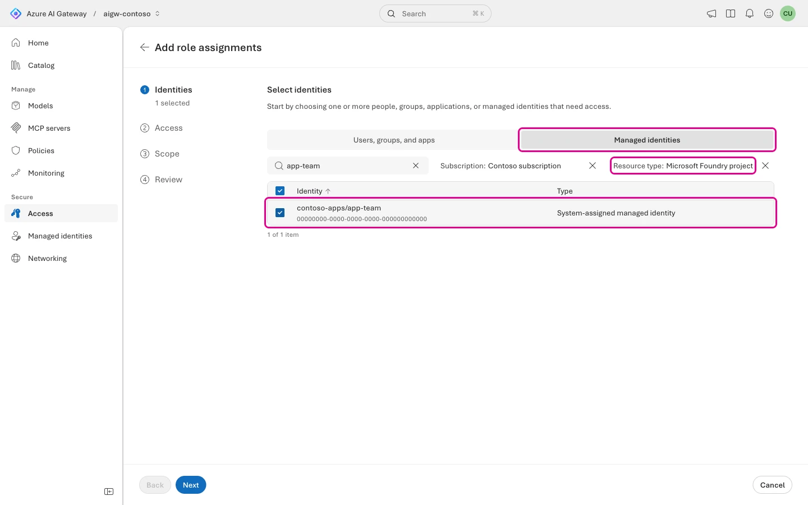

> **Checkpoint**
> **Access** › **Entra ID** lists the project with the **AI Gateway Models User** role on **All assets**. The role
> reaches the runtime within about a minute.

### Start the connection wizard

Back in the Foundry portal, in the `app-team` project, select **Build** › **Models**. On the **Deployments** tab,
select **Connections** › **Connect to a model**. In **Add a connection**, select **Gateway**, then **Continue**.

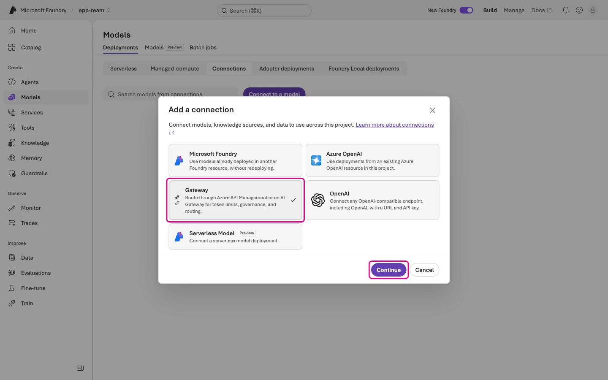

### Select the gateway

In **Connection type**, select **AI Gateway tier**: the wizard starts on **Azure API Management (v1 & v2 tiers)**.
Select your gateway in **Select AI Gateway**, then **Select**.

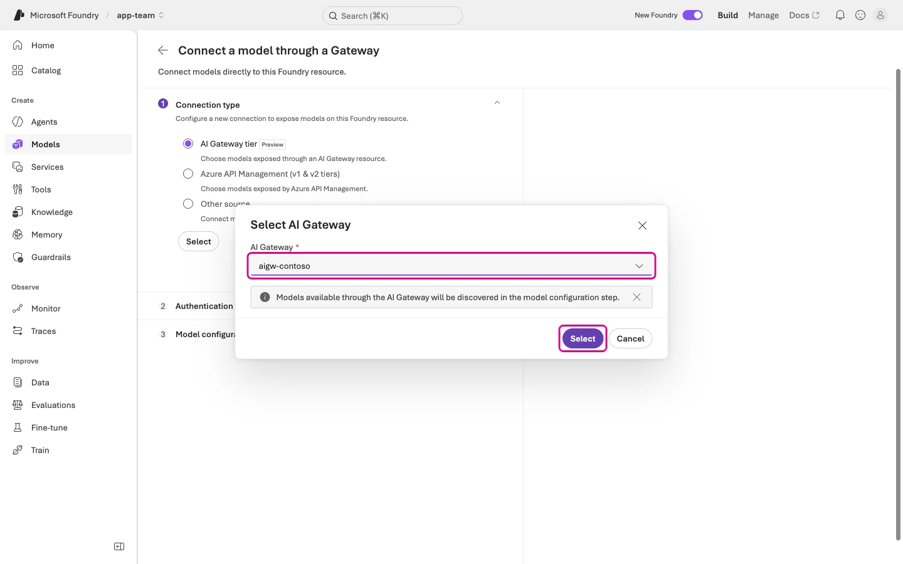

### Set the endpoint

The wizard fills **Base URL** with the gateway's OpenAI v1 endpoint, `…/default/models/openai/v1`. Check
**Use the Responses API for upstream requests**: **Request URL** then ends with `/responses`. Select **Next**.

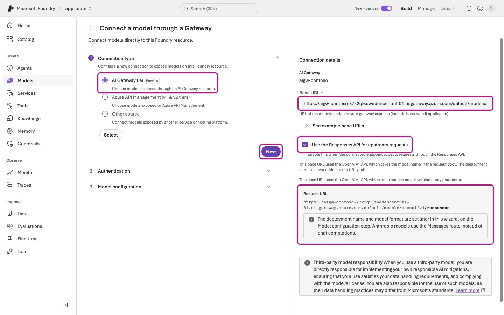

### Choose managed identity

On **Authentication**, select **Managed identity**: the wizard starts on **API key**. **Audience** shows
`https://azure-api.net/aigateway`, the audience of the gateway's tokens. Select **Next**.

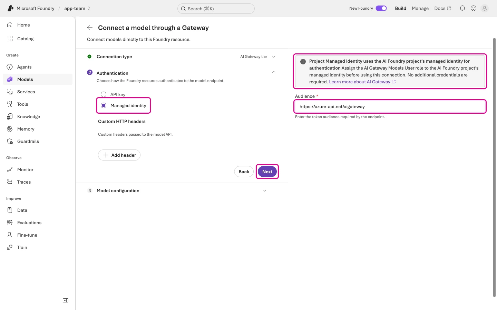

### Pick the models

On **Model configuration**, select **Configure model**, check your alias, and select **Select**. **Models to be
connected** lists it with its model and version. Select **Connect**.

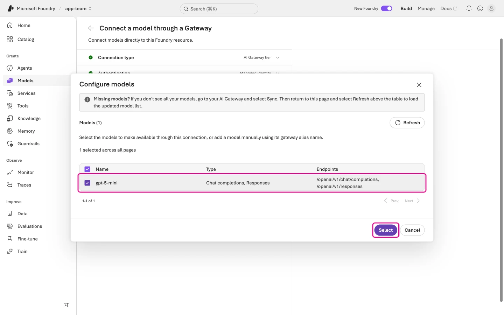

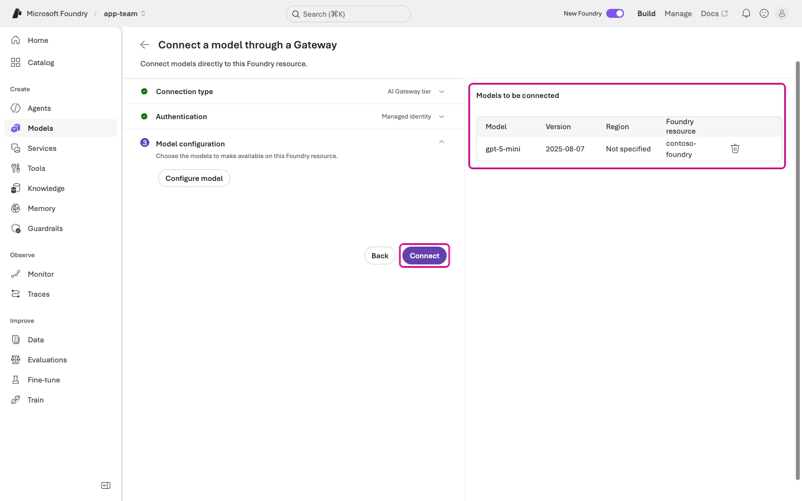

> **Checkpoint**
> The **Connections** tab lists your alias with the **Connection name** of your gateway, the **Connection type**
> **API Management**, the **Authentication** **Project Managed Identity**, and your gateway's host name under
> **Connected to**.

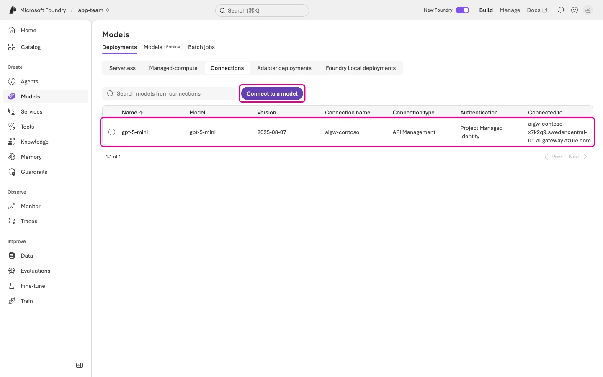

</details> <!-- gh -->
<!-- track: cli | Azure CLI -->
<details><summary><b>⌨️ Azure CLI</b></summary> <!-- gh -->

### Create the app team's project

Create the app team's resource group, a Foundry resource with projects turned on and no model deployments, and the
`app-team` project. Then read the project's managed identity, and give yourself **Foundry User** on the Foundry
resource.

<details open><summary>Bash</summary> <!-- gh -->

```bash title="Bash"
# Create the app team's resource group, in the gateway's region
az group create -n "$APP_RG" -l "$LOCATION" -o none &&
  echo "📦 Resource group $APP_RG is ready"

# Create the app team's Foundry resource, with projects turned on and no model deployments
az cognitiveservices account create -g "$APP_RG" -n "$APP_FOUNDRY" -l "$LOCATION" --kind AIServices --sku S0 \
  --custom-domain "$APP_FOUNDRY" --allow-project-management --assign-identity --yes -o none &&
  echo "🏭 Foundry resource $APP_FOUNDRY is ready"

# Create the project, with its own managed identity
az cognitiveservices account project create -g "$APP_RG" -n "$APP_FOUNDRY" --project-name "$PROJECT" -l "$LOCATION" -o none &&
  echo "📂 Project $PROJECT is ready"

# Read the Foundry resource's ID and the project's identity
export APP_FOUNDRY_ID="$(az cognitiveservices account show -g "$APP_RG" -n "$APP_FOUNDRY" --query id -o tsv)"
export PROJECT_PRINCIPAL_ID="$(az cognitiveservices account project show -g "$APP_RG" -n "$APP_FOUNDRY" \
  --project-name "$PROJECT" --query identity.principalId -o tsv)"
echo "🆔 Project identity: $PROJECT_PRINCIPAL_ID"

# Give yourself Foundry User on the Foundry resource, to use the project's playground and agents and call it from code
az role assignment create --assignee-object-id "$(az ad signed-in-user show --query id -o tsv)" \
  --assignee-principal-type User --role "53ca6127-db72-4b80-b1b0-d745d6d5456d" --scope "$APP_FOUNDRY_ID" -o none &&
  echo "🔐 You have the Foundry User role on $APP_FOUNDRY"
```
</details> <!-- gh -->

<details><summary>PowerShell</summary> <!-- gh -->

```powershell title="PowerShell"
# Create the app team's resource group, in the gateway's region
az group create -n $APP_RG -l $LOCATION -o none
if ($?) { Write-Host "📦 Resource group $APP_RG is ready" }

# Create the app team's Foundry resource, with projects turned on and no model deployments
az cognitiveservices account create -g $APP_RG -n $APP_FOUNDRY -l $LOCATION --kind AIServices --sku S0 `
  --custom-domain $APP_FOUNDRY --allow-project-management --assign-identity --yes -o none
if ($?) { Write-Host "🏭 Foundry resource $APP_FOUNDRY is ready" }

# Create the project, with its own managed identity
az cognitiveservices account project create -g $APP_RG -n $APP_FOUNDRY --project-name $PROJECT -l $LOCATION -o none
if ($?) { Write-Host "📂 Project $PROJECT is ready" }

# Read the Foundry resource's ID and the project's identity
$APP_FOUNDRY_ID       = az cognitiveservices account show -g $APP_RG -n $APP_FOUNDRY --query id -o tsv
$PROJECT_PRINCIPAL_ID = az cognitiveservices account project show -g $APP_RG -n $APP_FOUNDRY `
  --project-name $PROJECT --query identity.principalId -o tsv
Write-Host "🆔 Project identity: $PROJECT_PRINCIPAL_ID"

# Give yourself Foundry User on the Foundry resource, to use the project's playground and agents and call it from code
az role assignment create --assignee-object-id (az ad signed-in-user show --query id -o tsv) `
  --assignee-principal-type User --role "53ca6127-db72-4b80-b1b0-d745d6d5456d" --scope $APP_FOUNDRY_ID -o none
if ($?) { Write-Host "🔐 You have the Foundry User role on $APP_FOUNDRY" }
```
</details> <!-- gh -->

### Give the project access to the gateway's models

Assign **AI Gateway Models User** to the project's managed identity on the gateway's default workspace, which holds
all its assets:

<details open><summary>Bash</summary> <!-- gh -->

```bash title="Bash"
# Give the project's identity the AI Gateway Models User role on the gateway's default workspace
az role assignment create --assignee-object-id "$PROJECT_PRINCIPAL_ID" --assignee-principal-type ServicePrincipal \
  --role "a6b68e3d-a1f0-4c60-8678-237c050cf4ea" --scope "$GATEWAY_ID/workspaces/default" -o none &&
  echo "🔐 Project $PROJECT can call the gateway's models"
```
</details> <!-- gh -->

<details><summary>PowerShell</summary> <!-- gh -->

```powershell title="PowerShell"
# Give the project's identity the AI Gateway Models User role on the gateway's default workspace
az role assignment create --assignee-object-id $PROJECT_PRINCIPAL_ID --assignee-principal-type ServicePrincipal `
  --role "a6b68e3d-a1f0-4c60-8678-237c050cf4ea" --scope "$GATEWAY_ID/workspaces/default" -o none
if ($?) { Write-Host "🔐 Project $PROJECT can call the gateway's models" }
```
</details> <!-- gh -->

### Describe the connection

`az cognitiveservices account project connection create` doesn't create gateway connections yet, so write the
connection as JSON and put it with the Azure Resource Manager API. The metadata describes the gateway and the models
that the connection exposes, as the Foundry portal writes them:

<details open><summary>Bash</summary> <!-- gh -->

```bash title="Bash"
# Read the model name and version behind the alias, as the gateway registered them
MODEL_NAME="$(az aigateway model show --ids "$MODEL_ID" --query properties.deployment.modelName -o tsv)"
MODEL_VERSION="$(az aigateway model show --ids "$MODEL_ID" --query properties.deployment.modelVersion -o tsv)"
echo "🤖 $AI_GATEWAY_MODEL runs $MODEL_NAME version $MODEL_VERSION"

# Describe the gateway and the models that the connection exposes. Foundry stores both as JSON strings
GATEWAY_JSON="$(jq -nc --arg id "$GATEWAY_ID" --arg name "$GATEWAY" --arg url "$AI_GATEWAY_URL" --arg location "$LOCATION" \
  --arg sub "$(az account show --query id -o tsv)" --arg rg "$RG" \
  '{id: $id, name: $name, gatewayUrl: $url, location: $location, subscriptionId: $sub, resourceGroup: $rg}')"
MODELS_JSON="$(jq -nc --arg alias "$AI_GATEWAY_MODEL" --arg model "$MODEL_NAME" --arg version "$MODEL_VERSION" \
  '[{name: $alias, properties: {model: {name: $model, version: $version, format: "OpenAI"}}}]')"

# Write the connection: an AI Gateway connection that authenticates with the project's managed identity
jq -n --arg target "$AI_GATEWAY_URL/default/models/openai/v1" --arg gateway "$GATEWAY_JSON" --arg models "$MODELS_JSON" '{
  properties: {
    category: "ApiManagement",
    target: $target,
    authType: "ProjectManagedIdentity",
    audience: "https://azure-api.net/aigateway",
    isSharedToAll: false,
    metadata: {
      apimResourceKind: "AiGateway",
      apimResource: $gateway,
      deploymentInPath: "false",
      inferenceAPIVersion: "",
      upstreamSurface: "responses",
      models: $models
    }
  }
}' > connection.json && echo "📄 Wrote connection.json"
```
</details> <!-- gh -->

<details><summary>PowerShell</summary> <!-- gh -->

```powershell title="PowerShell"
# Read the model name and version behind the alias, as the gateway registered them
$MODEL_NAME    = az aigateway model show --ids $MODEL_ID --query properties.deployment.modelName -o tsv
$MODEL_VERSION = az aigateway model show --ids $MODEL_ID --query properties.deployment.modelVersion -o tsv
Write-Host "🤖 $AI_GATEWAY_MODEL runs $MODEL_NAME version $MODEL_VERSION"

# Describe the gateway and the models that the connection exposes. Foundry stores both as JSON strings
$GATEWAY_JSON = @{
  id = $GATEWAY_ID; name = $GATEWAY; gatewayUrl = $AI_GATEWAY_URL; location = $LOCATION
  subscriptionId = (az account show --query id -o tsv); resourceGroup = $RG
} | ConvertTo-Json -Compress
$MODELS_JSON = ConvertTo-Json -Compress -Depth 5 -InputObject @(
  @{ name = $AI_GATEWAY_MODEL; properties = @{ model = @{ name = $MODEL_NAME; version = $MODEL_VERSION; format = "OpenAI" } } }
)

# Write the connection: an AI Gateway connection that authenticates with the project's managed identity
@{
  properties = @{
    category      = "ApiManagement"
    target        = "$AI_GATEWAY_URL/default/models/openai/v1"
    authType      = "ProjectManagedIdentity"
    audience      = "https://azure-api.net/aigateway"
    isSharedToAll = $false
    metadata      = @{
      apimResourceKind    = "AiGateway"
      apimResource        = $GATEWAY_JSON
      deploymentInPath    = "false"
      inferenceAPIVersion = ""
      upstreamSurface     = "responses"
      models              = $MODELS_JSON
    }
  }
} | ConvertTo-Json -Depth 5 | Set-Content connection.json
Write-Host "📄 Wrote connection.json"
```
</details> <!-- gh -->

`upstreamSurface: responses` is the portal's **Use the Responses API for upstream requests**. `isSharedToAll: false`
keeps the connection to this project's users.

### Create the connection

Name the connection after the gateway, as the Foundry portal does, so that the model's Foundry name is
`<gateway>/<alias>`:

<details open><summary>Bash</summary> <!-- gh -->

```bash title="Bash"
# Create the connection, named after the gateway as the Foundry portal names it
az rest -m put -o none --body @connection.json \
  -u "https://management.azure.com$APP_FOUNDRY_ID/projects/$PROJECT/connections/$GATEWAY?api-version=2025-06-01" &&
  echo "🔌 Connection $GATEWAY is ready in project $PROJECT"

# Show the connection
az cognitiveservices account project connection show -g "$APP_RG" -n "$APP_FOUNDRY" --project-name "$PROJECT" \
  --connection-name "$GATEWAY" --query "{name: name, category: properties.category, authType: properties.authType, target: properties.target}" -o json
```
</details> <!-- gh -->

<details><summary>PowerShell</summary> <!-- gh -->

```powershell title="PowerShell"
# Create the connection, named after the gateway as the Foundry portal names it
az rest -m put -o none --body "@connection.json" `
  -u "https://management.azure.com$APP_FOUNDRY_ID/projects/$PROJECT/connections/${GATEWAY}?api-version=2025-06-01"
if ($?) { Write-Host "🔌 Connection $GATEWAY is ready in project $PROJECT" }

# Show the connection
az cognitiveservices account project connection show -g $APP_RG -n $APP_FOUNDRY --project-name $PROJECT `
  --connection-name $GATEWAY --query "{name: name, category: properties.category, authType: properties.authType, target: properties.target}" -o json
```
</details> <!-- gh -->

Expected output (your names differ):

```text
🔌 Connection aigw-guximp is ready in project app-team
{
  "authType": "ProjectManagedIdentity",
  "category": "ApiManagement",
  "name": "aigw-guximp",
  "target": "https://aigw-guxim-jokx32zcn3ol2.eastus2-01.ai.gateway.azure.com/default/models/openai/v1"
}
```

> **Checkpoint**
> The connection has the category `ApiManagement`, the authentication type `ProjectManagedIdentity`, and a target
> that ends with `/default/models/openai/v1`. The Foundry portal lists it on the project's **Connections** tab.

</details> <!-- gh -->
<!-- track: iac | Bicep + azd -->
<details><summary><b>🏗️ Bicep + azd</b></summary> <!-- gh -->

**What you need:** only the one-time setup from **Before you begin**. This track doesn't use your gateway from lab
01: `azd up` creates the platform team's gateway and model, and the app team's project, in one resource group, so it
works on its own.

### Choose what to declare

`azd up` reads these values from the azd environment, through `infra/main.parameters.json`:

| azd environment value | Default | What it sets |
|---|---|---|
| `FOUNDRY_PROJECT_NAME` | `app-team` | The app team's Foundry project |
| `FOUNDRY_USE_RESPONSES_API` | `true` | Sends the project's requests to the gateway's Responses API, the portal's **Use the Responses API for upstream requests** |
| `AZURE_PRINCIPAL_ID` | Set by azd | Your object ID, which gets **Foundry User** on the app team's Foundry resource |

### Review the templates

`infra/main.bicep` creates the resource group `rg-<environment name>`, calls the quick start's
[resources.bicep](../quickstart/infra/resources.bicep) for the gateway, a Foundry model, and its alias, and then
`foundry-project.bicep` for the app team:

<!-- include: infra/main.bicep -->
<!-- gh:begin include: generated by "npm run sync" from the metadata, do not edit -->
📄 [`infra/main.bicep`](infra/main.bicep)

<details><summary>Show all 80 lines</summary>

```bicep
// Lab 32 with azd: "azd up" creates the resource group rg-<environment name>, the quick start's gateway, Foundry
// model, and default alias (the platform team's hub), then the app team's Foundry resource and project (the spoke),
// the project's connection to the gateway, AI Gateway Models User for the project's identity, and Foundry User for
// you on the app team's Foundry resource.
targetScope = 'subscription'

@description('azd environment name. The resource group is rg-<environmentName>.')
@minLength(1)
@maxLength(60)
param environmentName string

@description('Region for every resource. Pick one where AI Gateway, Foundry Agent Service, and the lab\'s Foundry models are available. List them with az provider show --namespace Microsoft.ApiManagement (Setup guide, Find the available regions).')
@metadata({ azd: { type: 'location' } })
param location string

@description('Object ID of the identity that uses the Foundry project. azd sets AZURE_PRINCIPAL_ID to the signed-in user or service principal.')
param principalId string

@description('Type of that identity. azd reads it from AZURE_PRINCIPAL_TYPE, User by default.')
@allowed([ 'User', 'Group', 'ServicePrincipal' ])
param principalType string = 'User'

@description('Name of the app team\'s Foundry project. azd reads it from FOUNDRY_PROJECT_NAME.')
param projectName string = 'app-team'

@description('Send the project\'s requests to the gateway\'s Responses API. azd reads it from FOUNDRY_USE_RESPONSES_API.')
param useResponsesApi bool = true

var suffix = take(uniqueString(subscription().id, environmentName, location), 6)
var tags = { 'azd-env-name': environmentName }

resource rg 'Microsoft.Resources/resourceGroups@2024-03-01' = {
  name: 'rg-${environmentName}'
  location: location
  tags: tags
}

// The quick start's template: a gateway, a Foundry model behind the default alias, and the app-first-call key.
module base '../../quickstart/infra/resources.bicep' = {
  name: 'aigw-base'
  scope: rg
  params: {
    location: location
    tags: tags
    gatewayName: 'aigw-${suffix}'
    foundryName: 'aigw${suffix}'
  }
}

// The app team's Foundry resource and project, the connection, and the roles.
module app 'foundry-project.bicep' = {
  name: 'aigw-foundry-project'
  scope: rg
  params: {
    location: location
    tags: tags
    gatewayName: base.outputs.gatewayName
    aliasName: base.outputs.aliasName
    modelName: base.outputs.modelName
    accountName: 'aigw${suffix}-apps'
    projectName: projectName
    useResponsesApi: useResponsesApi
    principalId: principalId
    principalType: principalType
  }
}

output AZURE_RESOURCE_GROUP string = rg.name
output AI_GATEWAY_NAME string = base.outputs.gatewayName
output AI_GATEWAY_ID string = base.outputs.gatewayId
output AI_GATEWAY_URL string = base.outputs.gatewayUrl
output AI_GATEWAY_PROVIDER string = base.outputs.providerName
output AI_GATEWAY_BACKEND_MODEL string = base.outputs.modelName
output AI_GATEWAY_MODEL string = base.outputs.aliasName
output FOUNDRY_ACCOUNT_NAME string = base.outputs.foundryName
output FOUNDRY_APP_ACCOUNT_NAME string = app.outputs.accountName
output FOUNDRY_PROJECT_NAME string = app.outputs.projectName
output FOUNDRY_PROJECT_ENDPOINT string = app.outputs.projectEndpoint
output FOUNDRY_CONNECTION_NAME string = app.outputs.connectionName
output FOUNDRY_MODEL string = app.outputs.foundryModel
```

</details>
<!-- gh:end -->

`infra/foundry-project.bicep` creates the app team's Foundry resource and project, the connection, and both roles.
Bicep doesn't know the `ProjectManagedIdentity` authentication type yet, so a `#disable-next-line BCP036` comment
silences its warning:

<!-- include: infra/foundry-project.bicep -->
<!-- gh:begin include: generated by "npm run sync" from the metadata, do not edit -->
📄 [`infra/foundry-project.bicep`](infra/foundry-project.bicep)

<details><summary>Show all 165 lines</summary>

```bicep
// The app team's side of the hub and spoke: a Foundry resource and project, each with a system-assigned managed
// identity, and the project's connection to an AI Gateway, the same connection that the Foundry portal's Gateway
// option creates. The project's identity gets AI Gateway Models User on all of the gateway's assets, so the gateway
// accepts the project's calls, and the identity that uses the project gets Foundry User on the Foundry resource.
// Foundry shows the connected model as <connection name>/<alias>.
targetScope = 'resourceGroup'

@description('Name of the existing AI Gateway (Microsoft.ApiManagement/aigateways).')
param gatewayName string

@description('Resource group of the gateway, when it isn\'t this one.')
param gatewayResourceGroup string = resourceGroup().name

@description('Alias that the project calls. Agents and apps send <connection name>/<alias> as the model.')
param aliasName string = 'gpt-5-mini'

@description('Model and version behind the alias. Foundry lists them with the connected model.')
param modelName string = 'gpt-5-mini'
param modelVersion string = '2025-08-07'

@description('The app team\'s Foundry resource. It\'s also its custom subdomain, so it must be globally unique.')
@minLength(2)
@maxLength(64)
param accountName string

@description('The app team\'s Foundry project.')
param projectName string = 'app-team'

param location string = resourceGroup().location
param tags object = {}

@description('Connection name. The Foundry portal names the connection after the gateway, and so does this template.')
param connectionName string = gatewayName

@description('Send the project\'s requests to the gateway\'s Responses API, like Use the Responses API for upstream requests in the portal. When false, the gateway receives Chat Completions requests.')
param useResponsesApi bool = true

@description('Object ID of the identity that uses the project in the portal and from code. It gets Foundry User on the Foundry resource. Leave it empty to skip the assignment.')
param principalId string = ''

@description('Type of that identity.')
@allowed([ 'User', 'Group', 'ServicePrincipal' ])
param principalType string = 'User'

var foundryUserRoleId = '53ca6127-db72-4b80-b1b0-d745d6d5456d'

#disable-next-line BCP081
resource gateway 'Microsoft.ApiManagement/aigateways@2026-11-01' existing = {
  name: gatewayName
  scope: resourceGroup(gatewayResourceGroup)
}

// 1. The app team's Foundry resource. allowProjectManagement turns on projects, and local auth is off.
resource account 'Microsoft.CognitiveServices/accounts@2025-06-01' = {
  name: accountName
  location: location
  tags: tags
  kind: 'AIServices'
  sku: {
    name: 'S0'
  }
  identity: {
    type: 'SystemAssigned'
  }
  properties: {
    customSubDomainName: accountName
    allowProjectManagement: true
    disableLocalAuth: true
    publicNetworkAccess: 'Enabled'
  }
}

// 2. The project, with its own identity. The connection signs in to the gateway with it.
resource project 'Microsoft.CognitiveServices/accounts/projects@2025-06-01' = {
  parent: account
  name: projectName
  location: location
  tags: tags
  identity: {
    type: 'SystemAssigned'
  }
  properties: {
    displayName: projectName
    description: 'App team project that uses models published by the ${gatewayName} AI Gateway.'
  }
}

// 3. The connection. Its metadata values are strings, and apimResource and models are JSON documents.
var gatewayUrl = 'https://${gateway.properties.frontend.defaultHostname}'
var gatewayResource = {
  id: gateway.id
  name: gatewayName
  gatewayUrl: gatewayUrl
  location: gateway.location
  subscriptionId: subscription().subscriptionId
  resourceGroup: gatewayResourceGroup
}
var models = [
  {
    name: aliasName
    properties: {
      model: {
        name: modelName
        version: modelVersion
        format: 'OpenAI'
      }
    }
  }
]

resource connection 'Microsoft.CognitiveServices/accounts/projects/connections@2025-06-01' = {
  parent: project
  name: connectionName
  properties: {
    category: 'ApiManagement'
    target: '${gatewayUrl}/default/models/openai/v1'
    // The connection signs in with the project's identity. Bicep's type definitions don't list this value yet.
    #disable-next-line BCP036
    authType: 'ProjectManagedIdentity'
    audience: 'https://azure-api.net/aigateway'
    isSharedToAll: false
    metadata: union(
      {
        apimResourceKind: 'AiGateway'
        apimResource: string(gatewayResource)
        deploymentInPath: 'false'
        inferenceAPIVersion: ''
        models: string(models)
      },
      useResponsesApi ? { upstreamSurface: 'responses' } : {}
    )
  }
}

// 4. AI Gateway Models User for the project's identity on all of the gateway's assets (lab 11's module).
module gatewayRole '../../11-entra-rbac/infra/role-assignment.bicep' = {
  name: 'aigw-project-models-user'
  scope: resourceGroup(gatewayResourceGroup)
  params: {
    gatewayName: gatewayName
    principalId: project.identity.principalId
    principalType: 'ServicePrincipal'
    role: 'models'
    scope: 'workspace'
  }
}

// 5. Foundry User for you, so that you can use the project's playground and agents and call it from code.
resource foundryUser 'Microsoft.Authorization/roleAssignments@2022-04-01' = if (!empty(principalId)) {
  scope: account
  name: guid(account.id, principalId, foundryUserRoleId)
  properties: {
    principalId: principalId
    principalType: principalType
    roleDefinitionId: subscriptionResourceId('Microsoft.Authorization/roleDefinitions', foundryUserRoleId)
  }
}

output accountName string = account.name
output projectName string = project.name
output projectEndpoint string = 'https://${accountName}.services.ai.azure.com/api/projects/${projectName}'
output projectPrincipalId string = project.identity.principalId
output connectionName string = connection.name
output foundryModel string = '${connection.name}/${aliasName}'
output roleAssignmentId string = gatewayRole.outputs.roleAssignmentId
```

</details>
<!-- gh:end -->

### Deploy with azd up

Move into the lab's folder, create an azd environment named `aigw-lab32` in your current subscription, and provision
everything. It takes about four minutes.

<details open><summary>Bash</summary> <!-- gh -->

```bash title="Bash"
# Move into the lab's folder, which holds the azd project
cd ~/aigateway/labs/32-foundry-gateway-connection &&
  echo "📂 Lab folder: $(pwd)"

# Create an azd environment named aigw-lab32 in your current subscription, so that azd doesn't prompt you
azd env new aigw-lab32 --location eastus2 --subscription "$(az account show --query id --output tsv)" &&
  echo "📝 azd environment aigw-lab32 deploys to eastus2"

# Provision the gateway and its model, the app team's project, the connection, and the roles
azd up &&
  echo "🚀 Project connected: $(azd env get-value FOUNDRY_MODEL)"
```
</details> <!-- gh -->

<details><summary>PowerShell</summary> <!-- gh -->

```powershell title="PowerShell"
# Move into the lab's folder, which holds the azd project
Set-Location ~/aigateway/labs/32-foundry-gateway-connection
if ($?) { Write-Host "📂 Lab folder: $(Get-Location)" }

# Create an azd environment named aigw-lab32 in your current subscription, so that azd doesn't prompt you
azd env new aigw-lab32 --location eastus2 --subscription (az account show --query id --output tsv)
if ($?) { Write-Host "📝 azd environment aigw-lab32 deploys to eastus2" }

# Provision the gateway and its model, the app team's project, the connection, and the roles
azd up
if ($?) { Write-Host "🚀 Project connected: $(azd env get-value FOUNDRY_MODEL)" }
```
</details> <!-- gh -->

Expected output (your names differ):

```text
  (✓) Done: Resource group: rg-aigw-lab32

SUCCESS: Your application was provisioned and deployed to Azure in 4 minutes 6 seconds.
🚀 Project connected: aigw-guximp/gpt-5-mini
```

For another region, pick one where AI Gateway, Foundry Agent Service, and the quick start's model are available, as
in [Find the available regions](../SETUP.md#find-the-available-regions).

### Read the outputs

Set the variables that the next sections and **Verify** use from azd's environment values. The platform team's
gateway and the app team's project share the resource group here:

<details open><summary>Bash</summary> <!-- gh -->

```bash title="Bash"
# Read azd's outputs into the variables that the next sections use
export RG="$(azd env get-value AZURE_RESOURCE_GROUP)"
export GATEWAY="$(azd env get-value AI_GATEWAY_NAME)"
export GATEWAY_ID="$(azd env get-value AI_GATEWAY_ID)"
export AI_GATEWAY_URL="$(azd env get-value AI_GATEWAY_URL)"
export AI_GATEWAY_MODEL="$(azd env get-value AI_GATEWAY_MODEL)"
export LOCATION="$(azd env get-value AZURE_LOCATION)"
export APP_RG="$RG"
export APP_FOUNDRY="$(azd env get-value FOUNDRY_APP_ACCOUNT_NAME)"
export PROJECT="$(azd env get-value FOUNDRY_PROJECT_NAME)"
export FOUNDRY_PROJECT_ENDPOINT="$(azd env get-value FOUNDRY_PROJECT_ENDPOINT)"
export FOUNDRY_MODEL="$(azd env get-value FOUNDRY_MODEL)"
echo "🌐 Project endpoint: $FOUNDRY_PROJECT_ENDPOINT"
echo "🤖 Model in Foundry: $FOUNDRY_MODEL"

# Read the backend model behind the alias, the Foundry resource's ID, and the project's identity
export MODEL_ID="$(az aigateway model-alias show -g "$RG" --gateway-name "$GATEWAY" -n "$AI_GATEWAY_MODEL" \
  --query "properties.backendModels[0].resourceId" -o tsv)"
export APP_FOUNDRY_ID="$(az cognitiveservices account show -g "$APP_RG" -n "$APP_FOUNDRY" --query id -o tsv)"
export PROJECT_PRINCIPAL_ID="$(az cognitiveservices account project show -g "$APP_RG" -n "$APP_FOUNDRY" \
  --project-name "$PROJECT" --query identity.principalId -o tsv)"
echo "🆔 Project identity: $PROJECT_PRINCIPAL_ID"
```
</details> <!-- gh -->

<details><summary>PowerShell</summary> <!-- gh -->

```powershell title="PowerShell"
# Read azd's outputs into the variables that the next sections use
$RG                           = azd env get-value AZURE_RESOURCE_GROUP
$GATEWAY                      = azd env get-value AI_GATEWAY_NAME
$GATEWAY_ID                   = azd env get-value AI_GATEWAY_ID
$AI_GATEWAY_URL               = azd env get-value AI_GATEWAY_URL
$AI_GATEWAY_MODEL             = azd env get-value AI_GATEWAY_MODEL
$LOCATION                     = azd env get-value AZURE_LOCATION
$APP_RG                       = $RG
$APP_FOUNDRY                  = azd env get-value FOUNDRY_APP_ACCOUNT_NAME
$PROJECT                      = azd env get-value FOUNDRY_PROJECT_NAME
$env:FOUNDRY_PROJECT_ENDPOINT = azd env get-value FOUNDRY_PROJECT_ENDPOINT
$env:FOUNDRY_MODEL            = azd env get-value FOUNDRY_MODEL
Write-Host "🌐 Project endpoint: $env:FOUNDRY_PROJECT_ENDPOINT"
Write-Host "🤖 Model in Foundry: $env:FOUNDRY_MODEL"

# Read the backend model behind the alias, the Foundry resource's ID, and the project's identity
$MODEL_ID             = az aigateway model-alias show -g $RG --gateway-name $GATEWAY -n $AI_GATEWAY_MODEL `
  --query "properties.backendModels[0].resourceId" -o tsv
$APP_FOUNDRY_ID       = az cognitiveservices account show -g $APP_RG -n $APP_FOUNDRY --query id -o tsv
$PROJECT_PRINCIPAL_ID = az cognitiveservices account project show -g $APP_RG -n $APP_FOUNDRY `
  --project-name $PROJECT --query identity.principalId -o tsv
Write-Host "🆔 Project identity: $PROJECT_PRINCIPAL_ID"
```
</details> <!-- gh -->

> **Checkpoint**
> `azd up` ended with `SUCCESS`, and the model's Foundry name is `<gateway>/<alias>`, such as
> `aigw-guximp/gpt-5-mini`.

</details> <!-- gh -->
<!-- /tracks -->

## Call gateway models from Foundry

Call the alias through the project: from the playground, from a Foundry agent, and from code. Foundry calls the
gateway with the project's managed identity, and the gateway routes the alias to its backend model. New roles reach
the gateway within about a minute: if the first call returns `403` with **Access to model is denied**, wait a minute
and try again.

<!-- track: portal | Portal -->
<details open><summary><b>🖥️ Portal</b></summary> <!-- gh -->

### Chat in the playground

In the Foundry portal, select **Build** › **Models** › **Deployments** › **Connections**. Select your alias's row,
then **Open in playground**. The playground's title is the model's Foundry name, such as `aigw-contoso/gpt-5-mini`,
with a **Connections** tag. Ask `In one sentence, what does an AI gateway do for an app team?`

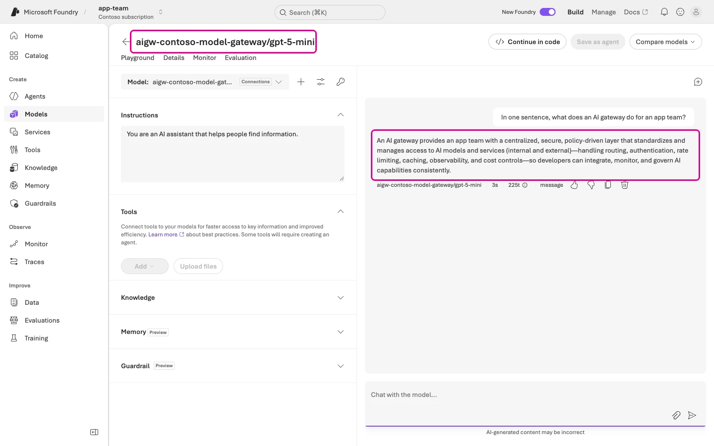

**Save as agent** is turned off for connected models. Create the agent from **Agents** instead.

### Build an agent on the gateway model

1. Select **Agents** › **New agent** › **Build an agent**.
2. In **Create an agent**, enter `gateway-helper` in **Agent name**, and select
   **Create agent and open playground**. It takes about 20 seconds.
3. The agent's model is already your connected model, `<gateway>/<alias>`. The agent starts with the **Web search**
   tool, so ask it `Without searching the web, why route an agent's model calls through a gateway?`

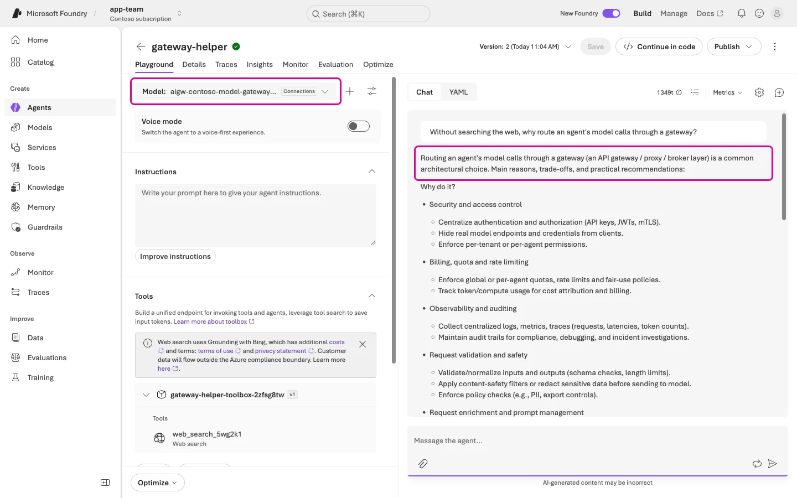

> **Checkpoint**
> The playground and the agent answer, and the model picker shows `<gateway>/<alias>`. The project has no model
> deployments of its own.

</details> <!-- gh -->
<!-- track: cli | curl and PowerShell -->
<details><summary><b>⌨️ curl and PowerShell</b></summary> <!-- gh -->

### Call the model through the project

The project's endpoint serves the OpenAI Responses API at `/openai/v1/responses`. Sign in with a Microsoft Entra token
for Foundry, and send the model's Foundry name in `model`:

<details open><summary>Bash</summary> <!-- gh -->

```bash title="Bash"
# Get a Microsoft Entra token for Foundry
TOKEN="$(az account get-access-token --resource https://ai.azure.com --query accessToken -o tsv)"

# Call the gateway model through the project's Responses API, by its Foundry name <connection>/<alias>
curl -s "$FOUNDRY_PROJECT_ENDPOINT/openai/v1/responses" \
  -H "Authorization: Bearer $TOKEN" -H "Content-Type: application/json" \
  -d "{\"model\": \"$FOUNDRY_MODEL\", \"input\": \"In one sentence, what does an AI gateway do?\"}" |
  jq -r '.error.message // (.output[] | select(.type == "message") | .content[0].text)'
```
</details> <!-- gh -->

<details><summary>PowerShell</summary> <!-- gh -->

```powershell title="PowerShell"
# Get a Microsoft Entra token for Foundry
$TOKEN = az account get-access-token --resource https://ai.azure.com --query accessToken -o tsv

# Call the gateway model through the project's Responses API, by its Foundry name <connection>/<alias>
$response = Invoke-RestMethod -Method Post -Uri "$env:FOUNDRY_PROJECT_ENDPOINT/openai/v1/responses" `
  -Headers @{ Authorization = "Bearer $TOKEN" } -ContentType "application/json" `
  -Body (@{ model = $env:FOUNDRY_MODEL; input = "In one sentence, what does an AI gateway do?" } | ConvertTo-Json)
($response.output | Where-Object type -eq "message").content[0].text
```
</details> <!-- gh -->

Expected output (your answer differs):

```text
An AI gateway is an intermediary that manages, secures, and optimizes access to AI models and services by routing requests, translating protocols, enforcing policies (auth, rate limits), and providing observability, caching, and orchestration.
```

Your token is for Foundry, not for the gateway: Foundry checks your **Foundry User** role, then calls the gateway
with the project's own identity.

> **Checkpoint**
> The model answers in one sentence. If you get `Access to model is denied`, the project's role hasn't reached the
> gateway yet: wait a minute and try again.

</details> <!-- gh -->
<!-- track: code | Code -->
<details><summary><b>🧑‍💻 Code</b></summary> <!-- gh -->

### Install the SDK

The sample reads `FOUNDRY_PROJECT_ENDPOINT` and `FOUNDRY_MODEL` from the environment and signs in with your Azure CLI
credentials. Run the commands from the lab's folder.

```bash title="Python"
# Install the sample's requirements: the Foundry projects SDK, Azure Identity, and OpenAI
pip install -r infra/requirements.txt &&
  echo "📦 The Foundry projects SDK is installed"
```

### Call the model and an agent

The project's OpenAI client calls the connected model by its Foundry name, and a prompt agent uses the same name as
its model:

```python title="Python"
import os

from azure.ai.projects import AIProjectClient
from azure.ai.projects.models import PromptAgentDefinition
from azure.identity import DefaultAzureCredential

project = AIProjectClient(endpoint=os.environ["FOUNDRY_PROJECT_ENDPOINT"], credential=DefaultAzureCredential())
openai = project.get_openai_client()
model = os.environ["FOUNDRY_MODEL"]                                           # <connection>/<alias>

print(openai.responses.create(model=model, input="What does an AI gateway do?").output_text)

agent = project.agents.create_version(
    agent_name="gateway-helper-sdk",
    definition=PromptAgentDefinition(model=model, instructions="You answer in one short sentence."),
)
```

Run the sample. It asks the model, then creates a prompt agent on it, asks the agent, and deletes the agent:

```bash title="Python"
# Ask the connected model, then create, ask, and delete a Foundry agent that uses it
python infra/call_model.py
```

Expected output (your answers differ):

```text
🤖 aigw-guximp/gpt-5-mini: An AI gateway centralizes and secures access to AI models and APIs for an app team—handling routing, authentication, rate limiting, data transformation, caching, observability, and policy enforcement—so developers can integrate and govern AI functionality easily.
🤖 gateway-helper-sdk (version 1): To centralize security, policy enforcement, observability, rate limiting, caching, and cost/usage control for reliable, auditable model access.
🚮 Deleted agent gateway-helper-sdk version 1
```

<!-- include: infra/call_model.py -->
<!-- gh:begin include: generated by "npm run sync" from the metadata, do not edit -->
📄 [`infra/call_model.py`](infra/call_model.py)

<details><summary>Show all 98 lines</summary>

```py
"""Call an AI Gateway model through a Foundry project's gateway connection, directly and from a Foundry agent.

Reads FOUNDRY_PROJECT_ENDPOINT (https://<foundry resource>.services.ai.azure.com/api/projects/<project>) and
FOUNDRY_MODEL (<connection name>/<alias>). Signs in with DefaultAzureCredential, so `az login` or `azd auth login`
is enough: Foundry calls the gateway with the project's managed identity, and no key leaves the gateway.

    python infra/call_model.py             # ask the model, then create, ask, and delete a Foundry agent
    python infra/call_model.py --burst 6   # send 6 requests in a row to see the gateway's token limit
"""

import argparse
import os
import sys

from azure.ai.projects import AIProjectClient
from azure.ai.projects.models import PromptAgentDefinition
from azure.identity import DefaultAzureCredential
from openai import APIStatusError

QUESTION = "In one sentence, what does an AI gateway do for an app team?"
AGENT_QUESTION = "Why route an agent's model calls through a gateway?"
AGENT_NAME = "gateway-helper-sdk"
INSTRUCTIONS = "You answer in one short sentence."


def settings() -> tuple[str, str]:
    missing = [name for name in ("FOUNDRY_PROJECT_ENDPOINT", "FOUNDRY_MODEL") if not os.environ.get(name)]
    if missing:
        sys.exit(f"Set {', '.join(missing)} in your shell. See the lab's Call the model section.")
    return os.environ["FOUNDRY_PROJECT_ENDPOINT"], os.environ["FOUNDRY_MODEL"]


def make_project(endpoint: str) -> AIProjectClient:
    return AIProjectClient(endpoint=endpoint, credential=DefaultAzureCredential())


def ask(openai, model: str, question: str = QUESTION):
    # The project's OpenAI client serves the Responses API. The model is <connection name>/<alias>.
    return openai.responses.create(model=model, input=question)


def create_agent(project: AIProjectClient, model: str, name: str = AGENT_NAME):
    return project.agents.create_version(
        agent_name=name,
        definition=PromptAgentDefinition(model=model, instructions=INSTRUCTIONS),
    )


def ask_agent(openai, agent, question: str = AGENT_QUESTION):
    return openai.responses.create(
        input=question,
        extra_body={"agent_reference": {"name": agent.name, "type": "agent_reference"}},
    )


def burst(openai, model: str, count: int) -> list[tuple[int, int | None, str]]:
    """Send count requests in a row and return (status, total tokens, error message) for each."""
    # The OpenAI client retries a 429 twice by default. Turn that off, so that each 429 shows up right away.
    openai = openai.with_options(max_retries=0)
    results = []
    for _ in range(count):
        try:
            response = ask(openai, model)
            results.append((200, response.usage.total_tokens, ""))
        except APIStatusError as error:
            # Keep Foundry's message and the gateway's, and drop the request ID and the quota link after them
            results.append((error.status_code, None, str(error.message).split(" Request ID")[0]))
    return results


def main() -> None:
    parser = argparse.ArgumentParser(description=__doc__.splitlines()[0])
    parser.add_argument("--burst", type=int, metavar="N", help="send N requests in a row and print each status")
    args = parser.parse_args()

    endpoint, model = settings()
    project = make_project(endpoint)
    openai = project.get_openai_client()

    if args.burst:
        for number, (status, tokens, message) in enumerate(burst(openai, model, args.burst), start=1):
            print(f"{number}: {status} {f'{tokens} tokens' if tokens else message}")
        return

    response = ask(openai, model)
    print(f"🤖 {response.model}: {response.output_text}")

    agent = create_agent(project, model)
    try:
        reply = ask_agent(openai, agent)
        print(f"🤖 {agent.name} (version {agent.version}): {reply.output_text}")
    finally:
        project.agents.delete_version(agent_name=agent.name, agent_version=agent.version)
        print(f"🚮 Deleted agent {agent.name} version {agent.version}")


if __name__ == "__main__":
    main()
```

</details>
<!-- gh:end -->

> **Checkpoint**
> The sample prints the model's answer and the agent's answer, then deletes the agent.

</details> <!-- gh -->
<!-- /tracks -->

## Govern Foundry traffic with a token limit

The platform team governs the project's calls at the gateway, without touching the project. Add a token limit of
**300 tokens per minute for each caller identity** to the backend model behind the alias. Each project calls with its
own managed identity, so each project gets its own 300 tokens. The limit is deliberately low, so that two or three
requests reach it.

<!-- track: portal | Portal -->
<details open><summary><b>🖥️ Portal</b></summary> <!-- gh -->

### Add the token limit

In the [AI Gateway portal](https://ai.gateway.azure.com), select your gateway, then **Policies** › **Add policy**:

1. On **Type**, under **Cost and rate limits**, select **Token rate limit**, then **Next**.
2. On **Scope**, select **Individual assets**, select the row of type **Model** for the backend model behind your
   alias, then **Next**.
3. On **Details**, set **Time period** to **Per minute**, **Allowed tokens** to `300`, and **Counter dimensions** to
   **Identity**. Select **Create**. The portal confirms **Policy created**.

The limit reaches the runtime in up to a minute.

### Reach the limit in the playground

Wait a minute, then open the playground of your connected model, as in
[Call gateway models from Foundry](#call-gateway-models-from-foundry), and ask
`Write a short paragraph about token limits.` three times in a row. The answer that crosses the limit still arrives.
The next one shows an error:

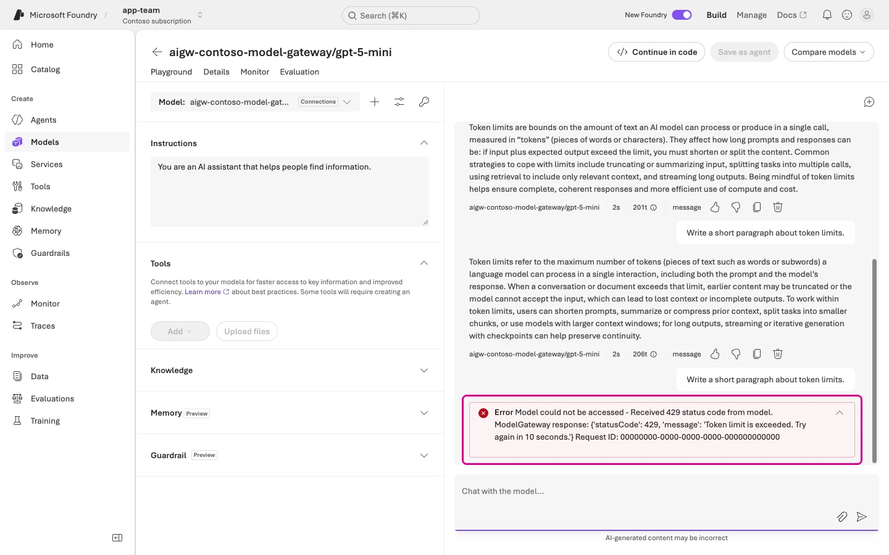

> **Checkpoint**
> The playground shows `Model could not be accessed - Received 429 status code from model`, with the gateway's
> message `Token limit is exceeded. Try again in N seconds.`

</details> <!-- gh -->
<!-- track: cli | Azure CLI -->
<details><summary><b>⌨️ Azure CLI</b></summary> <!-- gh -->

### Add the token limit

<details open><summary>Bash</summary> <!-- gh -->

```bash title="Bash"
# Allow 300 tokens a minute per caller identity. This replaces any token limit that the model has
az aigateway model policy set-token-limit --ids "$MODEL_ID" --token-limit 300 --token-period minute \
  --token-counter-key Identity -o none &&
  echo "🚦 Token limit: 300 tokens a minute per identity"
```
</details> <!-- gh -->

<details><summary>PowerShell</summary> <!-- gh -->

```powershell title="PowerShell"
# Allow 300 tokens a minute per caller identity. This replaces any token limit that the model has
az aigateway model policy set-token-limit --ids $MODEL_ID --token-limit 300 --token-period minute `
  --token-counter-key Identity -o none
if ($?) { Write-Host "🚦 Token limit: 300 tokens a minute per identity" }
```
</details> <!-- gh -->

### Reach the limit through the project

Wait a minute, so that the limit reaches the runtime and earlier calls don't count. Then send four requests in a row
through the project:

<details open><summary>Bash</summary> <!-- gh -->

```bash title="Bash"
# Wait a minute, so that the limit is active and the earlier calls don't count
echo "⏳ Waiting 60 seconds for a fresh token window" && sleep 60

# Get a Microsoft Entra token for Foundry, and build one request that uses about 150 to 300 tokens
TOKEN="$(az account get-access-token --resource https://ai.azure.com --query accessToken -o tsv)"
BODY="$(jq -nc --arg model "$FOUNDRY_MODEL" '{model: $model, input: "Write a short paragraph about token limits."}')"

# Send four requests in a row, and print each status, with the Retry-After header of a 429
for i in 1 2 3 4; do
  read -r CODE WAIT <<< "$(curl -sS -o /dev/null -w '%{http_code} %header{retry-after}' \
    "$FOUNDRY_PROJECT_ENDPOINT/openai/v1/responses" \
    -H "Authorization: Bearer $TOKEN" -H "Content-Type: application/json" -d "$BODY")"
  [ "$CODE" = 429 ] && echo "🚦 #$i: 429, retry after $WAIT s" || echo "✅ #$i: $CODE"
done
```
</details> <!-- gh -->

<details><summary>PowerShell</summary> <!-- gh -->

```powershell title="PowerShell"
# Wait a minute, so that the limit is active and the earlier calls don't count
Write-Host "⏳ Waiting 60 seconds for a fresh token window"; Start-Sleep -Seconds 60

# Get a Microsoft Entra token for Foundry, and build one request that uses about 150 to 300 tokens
$TOKEN = az account get-access-token --resource https://ai.azure.com --query accessToken -o tsv
$body = @{ model = $env:FOUNDRY_MODEL; input = "Write a short paragraph about token limits." } | ConvertTo-Json

# Send four requests in a row, and print each status, with the Retry-After header of a 429
foreach ($i in 1..4) {
  $reply = Invoke-WebRequest -Method Post -Uri "$env:FOUNDRY_PROJECT_ENDPOINT/openai/v1/responses" `
    -Headers @{ Authorization = "Bearer $TOKEN" } -ContentType "application/json" -Body $body -SkipHttpErrorCheck
  if ($reply.StatusCode -eq 429) { Write-Host "🚦 #${i}: 429, retry after $($reply.Headers['Retry-After']) s" }
  else { Write-Host "✅ #${i}: $($reply.StatusCode)" }
}
```
</details> <!-- gh -->

Expected output (your Retry-After values differ):

```text
⏳ Waiting 60 seconds for a fresh token window
✅ #1: 200
✅ #2: 200
🚦 #3: 429, retry after 41 s
🚦 #4: 429, retry after 35 s
```

> **Checkpoint**
> One or two requests pass, and the next ones get `429` with a `Retry-After` header.

</details> <!-- gh -->
<!-- /tracks -->

The gateway counts the tokens of each response, so the request that crosses the limit still passes, and the next ones
get `429` until the minute ends. Foundry passes the gateway's `429` and its `Retry-After` header on, and wraps the
gateway's message in its own error, with the code `rate_limit_exceeded`:

```text
Rate limit exceeded. Model could not be accessed - Received 429 status code from model. ModelGateway response:
{'statusCode': 429, 'message': 'Token limit is exceeded. Try again in 35 seconds.'} Request ID: <gateway request ID>
```

The request ID is the gateway's, so the platform team can find the call in the gateway's logs. The error ends with a
link to Azure OpenAI quotas, but the limit is the gateway's policy, not a Foundry quota.

## Verify

<!-- steps -->

### Check the project's role on the gateway

<details open><summary>Bash</summary> <!-- gh -->

```bash title="Bash"
# List the roles of the project's identity on the gateway's default workspace
az role assignment list --assignee "$PROJECT_PRINCIPAL_ID" --scope "$GATEWAY_ID/workspaces/default" \
  --query "[].{role: roleDefinitionName, scope: scope}" -o json
```
</details> <!-- gh -->

<details><summary>PowerShell</summary> <!-- gh -->

```powershell title="PowerShell"
# List the roles of the project's identity on the gateway's default workspace
az role assignment list --assignee $PROJECT_PRINCIPAL_ID --scope "$GATEWAY_ID/workspaces/default" `
  --query "[].{role: roleDefinitionName, scope: scope}" -o json
```
</details> <!-- gh -->

Expected output (your names differ):

```text
[
  {
    "role": "AI Gateway Models User",
    "scope": "/subscriptions/<subscription-id>/resourceGroups/rg-aigw-lab32t/providers/Microsoft.ApiManagement/aigateways/aigw-guximp/workspaces/default"
  }
]
```

### Call Chat Completions through the project

Foundry serves connected models through the Responses API. The project's Chat Completions endpoint doesn't find them:

<details open><summary>Bash</summary> <!-- gh -->

```bash title="Bash"
# Get a Microsoft Entra token for Foundry
TOKEN="$(az account get-access-token --resource https://ai.azure.com --query accessToken -o tsv)"

# Send a Chat Completions request for the connected model through the project
curl -sS "$FOUNDRY_PROJECT_ENDPOINT/openai/v1/chat/completions" \
  -H "Authorization: Bearer $TOKEN" -H "Content-Type: application/json" \
  -d "{\"model\": \"$FOUNDRY_MODEL\", \"messages\": [{\"role\": \"user\", \"content\": \"Hi\"}]}" |
  jq -r '"🚦 \(.error.code): \(.error.message)"'
```
</details> <!-- gh -->

<details><summary>PowerShell</summary> <!-- gh -->

```powershell title="PowerShell"
# Get a Microsoft Entra token for Foundry
$TOKEN = az account get-access-token --resource https://ai.azure.com --query accessToken -o tsv

# Send a Chat Completions request for the connected model through the project
$body = @{ model = $env:FOUNDRY_MODEL; messages = @(@{ role = "user"; content = "Hi" }) } | ConvertTo-Json -Depth 5
$reply = Invoke-RestMethod -Method Post -Uri "$env:FOUNDRY_PROJECT_ENDPOINT/openai/v1/chat/completions" `
  -Headers @{ Authorization = "Bearer $TOKEN" } -ContentType "application/json" -Body $body -SkipHttpErrorCheck
Write-Host "🚦 $($reply.error.code): $($reply.error.message)"
```
</details> <!-- gh -->

Expected output:

```text
🚦 DeploymentNotFound: The API deployment for this resource does not exist. If you created the deployment within the last 5 minutes, please wait a moment and try again.
```

The message is Foundry's generic one: the model is a connection, not a deployment, so waiting doesn't help.

### Read a 429 through the project

With the token limit from [Govern Foundry traffic with a token limit](#govern-foundry-traffic-with-a-token-limit) in
place, send requests until the gateway answers `429`, and read Foundry's error:

<details open><summary>Bash</summary> <!-- gh -->

```bash title="Bash"
# Get a Microsoft Entra token for Foundry, and build one request that uses about 150 to 300 tokens
TOKEN="$(az account get-access-token --resource https://ai.azure.com --query accessToken -o tsv)"
BODY="$(jq -nc --arg model "$FOUNDRY_MODEL" '{model: $model, input: "Write a short paragraph about token limits."}')"

# Send up to six requests, and stop at the first 429
for i in 1 2 3 4 5 6; do
  REPLY="$(curl -sS -w '\n%{http_code} %header{retry-after}' "$FOUNDRY_PROJECT_ENDPOINT/openai/v1/responses" \
    -H "Authorization: Bearer $TOKEN" -H "Content-Type: application/json" -d "$BODY")"
  read -r CODE WAIT <<< "$(tail -n 1 <<< "$REPLY")"
  [ "$CODE" = 429 ] && break
done

# Print the status, the Retry-After header, and Foundry's error code
echo "🚦 #$i: $CODE, retry after $WAIT s"
sed '$d' <<< "$REPLY" | jq -r '"🚨 \(.error.code): \(.error.message | split(" Request ID")[0])"'
```
</details> <!-- gh -->

<details><summary>PowerShell</summary> <!-- gh -->

```powershell title="PowerShell"
# Get a Microsoft Entra token for Foundry, and build one request that uses about 150 to 300 tokens
$TOKEN = az account get-access-token --resource https://ai.azure.com --query accessToken -o tsv
$body = @{ model = $env:FOUNDRY_MODEL; input = "Write a short paragraph about token limits." } | ConvertTo-Json

# Send up to six requests, and stop at the first 429
foreach ($i in 1..6) {
  $reply = Invoke-WebRequest -Method Post -Uri "$env:FOUNDRY_PROJECT_ENDPOINT/openai/v1/responses" `
    -Headers @{ Authorization = "Bearer $TOKEN" } -ContentType "application/json" -Body $body -SkipHttpErrorCheck
  if ($reply.StatusCode -eq 429) { break }
}

# Print the status, the Retry-After header, and Foundry's error code
Write-Host "🚦 #${i}: $($reply.StatusCode), retry after $($reply.Headers['Retry-After']) s"
$failure = ($reply.Content | ConvertFrom-Json).error
Write-Host "🚨 $($failure.code): $(($failure.message -split ' Request ID')[0])"
```
</details> <!-- gh -->

On the code track, the sample sends a burst with the SDK's retries off. By default, the OpenAI client retries a
`429` twice before it raises the error:

```bash title="Python"
# Send four requests in a row with the SDK, and print each status
python infra/call_model.py --burst 4
```

Expected output of the Bash loop (your values differ):

```text
🚦 #3: 429, retry after 35 s
🚨 rate_limit_exceeded: Rate limit exceeded. Model could not be accessed - Received 429 status code from model. ModelGateway response: {'statusCode': 429, 'message': 'Token limit is exceeded. Try again in 35 seconds.'}
```

Expected output of the Python burst (your values differ):

```text
1: 200 290 tokens
2: 429 Error code: 429 - Rate limit exceeded. Model could not be accessed - Received 429 status code from model. ModelGateway response: {'statusCode': 429, 'message': 'Token limit is exceeded. Try again in 23 seconds.'}
3: 429 Error code: 429 - Rate limit exceeded. Model could not be accessed - Received 429 status code from model. ModelGateway response: {'statusCode': 429, 'message': 'Token limit is exceeded. Try again in 19 seconds.'}
4: 429 Error code: 429 - Rate limit exceeded. Model could not be accessed - Received 429 status code from model. ModelGateway response: {'statusCode': 429, 'message': 'Token limit is exceeded. Try again in 16 seconds.'}
```

<!-- /steps -->

> **Checkpoint**
> The project's identity holds **AI Gateway Models User** on the gateway's default workspace, Chat Completions gets
> `DeploymentNotFound`, and the token limit returns `rate_limit_exceeded` with the gateway's
> `Token limit is exceeded` message.

## Go further

- **Connect more projects.** Each app team's project needs its own connection and its own role on the gateway. In
  the Foundry portal, **Manage** › **Gateways** shows the gateways that the Foundry resource uses, with their
  **Provider**, **Models**, and **MCP servers**, an **Add consuming project** button, and **Open AI Gateway portal**.
  With the **Identity** counter, a second project still had its full allowance while the first one got `429`.

  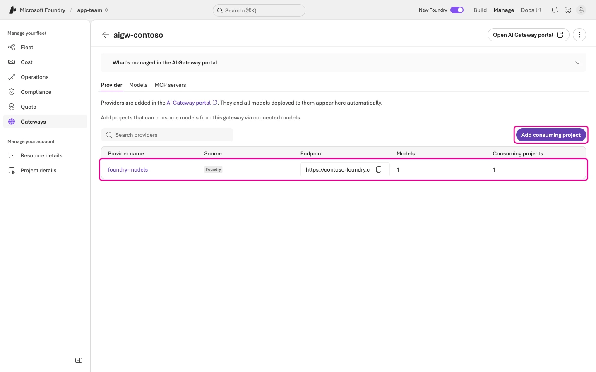

- **Manage the connection.** **Manage** › **Project details** › **Connections** lists the gateway connection with the
  category **ApiManagement**, the authentication **Project Managed Identity**, and **No key available**. Use
  **Edit connection** to add aliases, or **Delete connection** to remove the gateway's models from the project.

  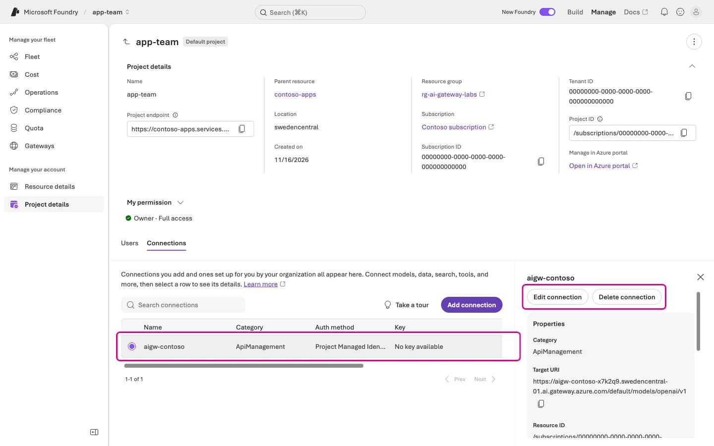

- **Use an API key where managed identity isn't an option.** The wizard's **Authentication** step also offers
  **API key**: paste a gateway key from **Access** › **API keys**, as in
  [Publish a Foundry model and make your first call](../02-first-model-call/README.md). Foundry stores the key in the
  connection, and every caller of the project shares it.
- **Make the gateway the only path.** Assign Azure Policy on the spoke projects to block direct model deployments,
  and let only the gateway's managed identity call the backend models, as in
  [How Foundry and gateway controls work together](https://ai.gateway.azure.com/docs/foundry#foundry-flow).
- **Know the limits.** Connected models work with prompt agents in Foundry Agent Service, but not with the Microsoft
  Copilot harness, Foundry IQ, agent optimization, agent memory, guardrails, real-time audio, or vision. For private
  networking, see [Configure private AI gateway networking](https://learn.microsoft.com/azure/foundry/agents/how-to/ai-gateway#configure-private-ai-gateway-networking).
- **Run your own agent code instead.** A hosted agent can call the gateway directly with its own identity, as in
  [Deploy a Foundry hosted agent behind AI Gateway](../16-foundry-hosted-agent/README.md).

## Clean up

Remove the token limit and the project's role on the gateway, then delete the app team's project and Foundry resource.
Remove the role first, while the project's identity still exists.

If the model had a token limit before this lab, such as the 10,000 tokens a minute per identity that lab 02's Bicep
track adds, set it back instead of removing it. In the portal, delete the limit, then add it again as in
[Govern Foundry traffic with a token limit](#govern-foundry-traffic-with-a-token-limit), with **Allowed tokens** set to
`10000`. In the Azure CLI, run `set-token-limit` again with `--token-limit 10000` instead of `policy remove`.

<!-- track: portal | Portal -->
<details open><summary><b>🖥️ Portal</b></summary> <!-- gh -->

### Remove the token limit and the role

In the [AI Gateway portal](https://ai.gateway.azure.com), select your gateway:

1. Select **Policies**. In the **Token rate limit** row, select **More actions** › **Delete**, and confirm.
2. Select **Access** › **Entra ID**. In the project's row, select **More actions** › **Remove role assignment**, and
   confirm with **Remove**.

### Delete the app team's project

Delete the project with its connection, then the Foundry resource, purge it to free its name, and delete the
resource group:

<details open><summary>Bash</summary> <!-- gh -->

```bash title="Bash"
# Delete the project with its connection, then the app team's Foundry resource
az cognitiveservices account project delete -g "$APP_RG" -n "$APP_FOUNDRY" --project-name "$PROJECT" &&
  echo "🚮 Deleted project $PROJECT and its connection"
az cognitiveservices account delete -g "$APP_RG" -n "$APP_FOUNDRY" &&
  echo "🚮 Deleted Foundry resource $APP_FOUNDRY"

# Purge the deleted Foundry resource to free its name, then delete the app team's resource group
az cognitiveservices account purge -g "$APP_RG" -n "$APP_FOUNDRY" -l "$LOCATION" &&
  echo "🚮 Purged $APP_FOUNDRY"
az group delete -n "$APP_RG" --yes &&
  echo "🚮 Deleted resource group $APP_RG"
```
</details> <!-- gh -->

<details><summary>PowerShell</summary> <!-- gh -->

```powershell title="PowerShell"
# Delete the project with its connection, then the app team's Foundry resource
az cognitiveservices account project delete -g $APP_RG -n $APP_FOUNDRY --project-name $PROJECT
if ($?) { Write-Host "🚮 Deleted project $PROJECT and its connection" }
az cognitiveservices account delete -g $APP_RG -n $APP_FOUNDRY
if ($?) { Write-Host "🚮 Deleted Foundry resource $APP_FOUNDRY" }

# Purge the deleted Foundry resource to free its name, then delete the app team's resource group
az cognitiveservices account purge -g $APP_RG -n $APP_FOUNDRY -l $LOCATION
if ($?) { Write-Host "🚮 Purged $APP_FOUNDRY" }
az group delete -n $APP_RG --yes
if ($?) { Write-Host "🚮 Deleted resource group $APP_RG" }
```
</details> <!-- gh -->

</details> <!-- gh -->
<!-- track: cli | Azure CLI -->
<details><summary><b>⌨️ Azure CLI</b></summary> <!-- gh -->

### Remove the token limit and the role

<details open><summary>Bash</summary> <!-- gh -->

```bash title="Bash"
# Remove the token limit from the backend model behind the alias
az aigateway model policy remove --ids "$MODEL_ID" --remove-token-limit true -o none &&
  echo "🚦 Removed the token limit from $AI_GATEWAY_MODEL"

# Remove the project's role on the gateway
az role assignment delete --assignee "$PROJECT_PRINCIPAL_ID" --role "a6b68e3d-a1f0-4c60-8678-237c050cf4ea" \
  --scope "$GATEWAY_ID/workspaces/default" &&
  echo "🚮 Removed project $PROJECT's role on the gateway"
```
</details> <!-- gh -->

<details><summary>PowerShell</summary> <!-- gh -->

```powershell title="PowerShell"
# Remove the token limit from the backend model behind the alias
az aigateway model policy remove --ids $MODEL_ID --remove-token-limit true -o none
if ($?) { Write-Host "🚦 Removed the token limit from $AI_GATEWAY_MODEL" }

# Remove the project's role on the gateway
az role assignment delete --assignee $PROJECT_PRINCIPAL_ID --role "a6b68e3d-a1f0-4c60-8678-237c050cf4ea" `
  --scope "$GATEWAY_ID/workspaces/default"
if ($?) { Write-Host "🚮 Removed project $PROJECT's role on the gateway" }
```
</details> <!-- gh -->

### Delete the app team's project

<details open><summary>Bash</summary> <!-- gh -->

```bash title="Bash"
# Delete the project with its connection, then the app team's Foundry resource
az cognitiveservices account project delete -g "$APP_RG" -n "$APP_FOUNDRY" --project-name "$PROJECT" &&
  echo "🚮 Deleted project $PROJECT and its connection"
az cognitiveservices account delete -g "$APP_RG" -n "$APP_FOUNDRY" &&
  echo "🚮 Deleted Foundry resource $APP_FOUNDRY"

# Purge the deleted Foundry resource to free its name, then delete the app team's resource group
az cognitiveservices account purge -g "$APP_RG" -n "$APP_FOUNDRY" -l "$LOCATION" &&
  echo "🚮 Purged $APP_FOUNDRY"
az group delete -n "$APP_RG" --yes &&
  echo "🚮 Deleted resource group $APP_RG"

# Remove the connection file
rm -f connection.json && echo "🚮 Removed connection.json"
```
</details> <!-- gh -->

<details><summary>PowerShell</summary> <!-- gh -->

```powershell title="PowerShell"
# Delete the project with its connection, then the app team's Foundry resource
az cognitiveservices account project delete -g $APP_RG -n $APP_FOUNDRY --project-name $PROJECT
if ($?) { Write-Host "🚮 Deleted project $PROJECT and its connection" }
az cognitiveservices account delete -g $APP_RG -n $APP_FOUNDRY
if ($?) { Write-Host "🚮 Deleted Foundry resource $APP_FOUNDRY" }

# Purge the deleted Foundry resource to free its name, then delete the app team's resource group
az cognitiveservices account purge -g $APP_RG -n $APP_FOUNDRY -l $LOCATION
if ($?) { Write-Host "🚮 Purged $APP_FOUNDRY" }
az group delete -n $APP_RG --yes
if ($?) { Write-Host "🚮 Deleted resource group $APP_RG" }

# Remove the connection file
Remove-Item connection.json -ErrorAction SilentlyContinue
Write-Host "🚮 Removed connection.json"
```
</details> <!-- gh -->

</details> <!-- gh -->
<!-- track: iac | Bicep + azd -->
<details><summary><b>🏗️ Bicep + azd</b></summary> <!-- gh -->

### Delete everything azd created

In the `aigateway/labs/32-foundry-gateway-connection` folder, delete the resource group with the gateway, both
Foundry resources, and the project, purge the Foundry resources, and remove the azd environment. If you added the
token limit, it goes with the gateway.

```bash title="Bash or PowerShell"
# Delete the resource group with everything that azd up created, and purge the Foundry resources
azd down --purge --force &&
  echo "🚮 Everything that azd up created is deleted"

# Remove the azd environment
azd env remove aigw-lab32 --force &&
  echo "🚮 azd environment aigw-lab32 is removed"
```

</details> <!-- gh -->
<!-- /tracks -->

If you built the `gateway-helper` agent in the portal, it goes with the project. Keep the gateway from lab 01: the
next labs reuse it.

## Next steps

- [Deploy a Foundry hosted agent behind AI Gateway](../16-foundry-hosted-agent/README.md): run your own agent code in
  Foundry, with the gateway's models and MCP tools.
- [Throttle tokens per caller with token limits](../06-token-limits/README.md): set token limits at the gateway scope,
  per hour or day, and per IP address.
- [Go keyless with Microsoft Entra ID and RBAC](../11-entra-rbac/README.md): scope a project's role to one alias.
- [Monitor usage, cost, and traces](../13-monitoring/README.md): see each project's tokens and requests at the
  gateway.
- Product docs: [Connect Microsoft Foundry to AI Gateway](https://ai.gateway.azure.com/docs/foundry). Foundry docs:
  [Connect Microsoft Foundry agents to AI Gateway](https://learn.microsoft.com/azure/foundry/agents/how-to/ai-gateway)
  and [Create a project](https://learn.microsoft.com/azure/foundry/how-to/create-projects).

<!-- gh:begin footer: generated by "npm run sync" from the metadata, do not edit -->

🛟 **Hit an error?** [Troubleshooting](../TROUBLESHOOTING.md#lab-32-foundry-gateway-connection) lists the errors of this lab, the steps where they happen, and their fixes.

---

| ⬅️ Previous | 🏠 | Next ➡️ |
| :-- | :-: | --: |
| [16 · Foundry hosted agent](../16-foundry-hosted-agent/README.md) | [All labs](../README.md) | [17 · Coding-agent plugin](../17-coding-agent-plugin/README.md) |

<sub>Learning paths: [App & agent developer](../README.md#learning-paths) (11 of 14)</sub>
<!-- gh:end -->
