<!--
title: Connect Microsoft 365 Copilot to MCP tools as the signed-in user
summary: Let Microsoft 365 Copilot and Copilot Cowork call your MCP tools through Azure AI Gateway as the signed-in user. The gateway checks the user's role, then exchanges the user's token with Microsoft Entra ID on-behalf-of, so the backend sees the user and no secret leaves the gateway.
category: tools
level: Advanced
duration: 60
tracks: [portal, cli, iac, terraform]
order: 30.5
status: emerging
illustration: diagrams/copilot-obo.svg
tags: [on-behalf-of, OBO, MCP, Microsoft 365 Copilot, Copilot Cowork, Entra ID, Azure Container Apps, token exchange, federated credential, managed identity]
objectives:
  - Explain each token and app registration of the on-behalf-of chain from Microsoft 365 Copilot to an MCP backend
  - Deploy an Entra-protected MCP server on Azure Container Apps that accepts only tokens exchanged by the gateway
  - Register an MCP server with an on-behalf-of backend in the Azure CLI, with Bicep and azd, or with Terraform, and validate it in the AI Gateway portal
  - Prove that the backend sees the signed-in user, and that a token for the gateway doesn't work on the backend
  - Connect the MCP server to Microsoft 365 Copilot and call its tools as yourself in Copilot Cowork
prereqs:
  - 04-federate-mcp-tools
  - 11-entra-rbac
-->
<!-- gh:begin nav: generated by "npm run sync" from the metadata, do not edit -->
[AI Gateway labs](../README.md) › [MCP & tools](../README.md#mcp--tools) › Lab 33
<!-- gh:end -->

# Connect Microsoft 365 Copilot to MCP tools as the signed-in user

<!-- gh:begin intro: generated by "npm run sync" from the metadata, do not edit -->
> Let Microsoft 365 Copilot and Copilot Cowork call your MCP tools through Azure AI Gateway as the signed-in user. The gateway checks the user's role, then exchanges the user's token with Microsoft Entra ID on-behalf-of, so the backend sees the user and no secret leaves the gateway.

| ⏱️ Time | 📶 Level | 🧭 Tracks | ✅ Before you start |
| :-- | :-- | :-- | :-- |
| 60 min | Advanced | Portal · Azure CLI · Bicep + azd · Terraform | [04 · Federate MCP tools](../04-federate-mcp-tools/README.md)<br>[11 · Entra ID & RBAC](../11-entra-rbac/README.md) |

**You'll learn to**

- Explain each token and app registration of the on-behalf-of chain from Microsoft 365 Copilot to an MCP backend
- Deploy an Entra-protected MCP server on Azure Container Apps that accepts only tokens exchanged by the gateway
- Register an MCP server with an on-behalf-of backend in the Azure CLI, with Bicep and azd, or with Terraform, and validate it in the AI Gateway portal
- Prove that the backend sees the signed-in user, and that a token for the gateway doesn't work on the backend
- Connect the MCP server to Microsoft 365 Copilot and call its tools as yourself in Copilot Cowork

**Follow along:** 🌐 [Interactive version](https://azure.github.io/aigateway/labs/33-copilot-obo-mcp/) with your own values filled in · 📁 [Lab files](infra/)

**On this page:** [Before you begin](#before-you-begin) · [How it works](#how-it-works) · [Review the MCP server](#review-the-mcp-server) · [Deploy the backend and register the MCP server](#deploy-the-backend-and-register-the-mcp-server) · [Check the on-behalf-of settings](#check-the-on-behalf-of-settings) · [Call the tools as yourself](#call-the-tools-as-yourself) · [Connect Microsoft 365 Copilot](#connect-microsoft-365-copilot) · [Use the tools in Copilot Cowork](#use-the-tools-in-copilot-cowork) · [Verify](#verify) · [Go further](#go-further) · [Clean up](#clean-up) · [Next steps](#next-steps)
<!-- gh:end -->

An agent that acts for a person should reach your systems as that person, not as a shared service account. Your
API then applies its own permissions to each user, and its logs show who asked. In this lab, Microsoft 365 Copilot
and Copilot Cowork call MCP tools through Azure AI Gateway as the signed-in user. The gateway checks the user's
role on the MCP server, then exchanges the user's token with Microsoft Entra ID **on behalf of** the user for a
token that only your backend accepts. The gateway signs in with a managed identity, so no secret leaves it.

> [!NOTE]
> This lab adapts [ai-gateway-end-to-end](https://github.com/kostapetan/ai-gateway-end-to-end) by Kosta Petan. His
> repository has the Bicep templates, a Terraform branch, an architecture walkthrough with diagrams of each token, and
> the `dummy-mcp` server that this lab's MCP server is based on. Thanks, Kosta!

## Before you begin

<!-- setup: tools sign-in extension providers clone -->
<!-- gh:begin setup: generated by "npm run sync" from the metadata, do not edit -->
🧰 **One-time setup** from the [Setup guide](../SETUP.md), if you haven't done it yet:
[Choose where to run commands](../SETUP.md#choose-where-to-run-commands) ·
[Sign in to Azure](../SETUP.md#sign-in-to-azure) ·
[Install the `aigateway` extension](../SETUP.md#install-the-aigateway-extension) ·
[Register the resource providers](../SETUP.md#register-the-resource-providers) ·
[Clone the labs repo](../SETUP.md#clone-the-labs-repo)
<!-- gh:end -->

> [!TIP]
> On the **Bicep + azd** and **Terraform** tracks, `azd up` or `terraform apply` creates its own gateway, the
> backend, the app registrations, and the MCP server, so you can skip the variables below. You still need the
> permissions in this list.

- Complete [Federate MCP tools behind one endpoint](../04-federate-mcp-tools/README.md) and
  [Go keyless with Microsoft Entra ID and RBAC](../11-entra-rbac/README.md). This lab adds an MCP server to your
  gateway and calls it with a Microsoft Entra token.
- Permission to register applications in Microsoft Entra ID, and to grant tenant-wide consent to them, for example
  the **Cloud Application Administrator** role. The lab registers three apps and consents to their delegated scopes
  for everyone in the tenant.
- **Owner** or **User Access Administrator** on the subscription. The lab assigns roles on the container registry
  and on the MCP server.
- Permission to read, update, and retrieve the secrets of MCP servers on the gateway, for example **Contributor**
  on it. The first on-behalf-of setup retrieves secrets even when the backend stores none.
- For the portal's **Validate** button, admin consent for the AI Gateway portal to read app registrations with the
  Microsoft Graph `Application.Read.All` permission. The portal asks for it with **Authorize directory access**.
- A recent Bicep CLI, which `az bicep upgrade` installs. The templates register the apps with the Microsoft Graph
  Bicep extension.
- `jq`, for the Bash commands.
- For the Microsoft 365 steps, an admin who can add connectors in the Microsoft 365 admin center, and a user with a
  Microsoft 365 Copilot license and access to Copilot Cowork. Both must be in the Microsoft Entra tenant of your
  gateway's subscription.
- Run the scripts from the lab's folder, `~/aigateway/labs/33-copilot-obo-mcp`.

> [!NOTE]
> On-behalf-of backends are an emerging capability of Azure AI Gateway. Labels and behavior can change; see the
> [release note](https://ai.gateway.azure.com/docs/releases#release-2026-11-06).

Set these variables once. The steps and the **Verify** section reuse them.

<details open><summary>Bash</summary> <!-- gh -->

```bash title="Bash"
# Set your resource group and gateway, and the MCP server that you create in this lab
export RG="<resource-group>"
export GATEWAY="<gateway>"
export MCP_SERVER="obo-demo"                 # the MCP server you create in this lab
echo "📝 Gateway $GATEWAY in $RG, MCP server $MCP_SERVER"

# Read the gateway's resource ID and its runtime URL
export GATEWAY_ID="$(az aigateway show -g "$RG" -n "$GATEWAY" --query id -o tsv)"
export AI_GATEWAY_URL="https://$(az aigateway show -g "$RG" -n "$GATEWAY" --query properties.frontend.defaultHostname -o tsv)"
echo "🆔 Gateway ID: $GATEWAY_ID"
echo "🌐 Runtime URL: $AI_GATEWAY_URL"
```
</details> <!-- gh -->

<details><summary>PowerShell</summary> <!-- gh -->

```powershell title="PowerShell"
# Set your resource group and gateway, and the MCP server that you create in this lab
$RG         = "<resource-group>"
$GATEWAY    = "<gateway>"
$MCP_SERVER = "obo-demo"                     # the MCP server you create in this lab
Write-Host "📝 Gateway $GATEWAY in $RG, MCP server $MCP_SERVER"

# Read the gateway's resource ID and its runtime URL
$GATEWAY_ID         = az aigateway show -g $RG -n $GATEWAY --query id -o tsv
$env:AI_GATEWAY_URL = "https://$(az aigateway show -g $RG -n $GATEWAY --query properties.frontend.defaultHostname -o tsv)"
Write-Host "🆔 Gateway ID: $GATEWAY_ID"
Write-Host "🌐 Runtime URL: $env:AI_GATEWAY_URL"
```
</details> <!-- gh -->

This lab uses no API key: every call carries a Microsoft Entra token for the signed-in user.

## How it works

An MCP backend with **on-behalf-of** authentication receives a token for the user who called the gateway, not for
the gateway. The chain has three app registrations and one managed identity, which the lab names after a base name
such as `aigw-lab33-k3v7qz`:

| Piece | What it is | Its job |
|---|---|---|
| Connector app, `<base>-copilot-connector` | An app registration with a client secret | Microsoft 365 Copilot signs the user in with it and gets a token for AI Gateway with the `Data.All` scope |
| Token exchange app, `<base>-token-exchange` | An app registration with no secret, whose federated credential trusts the gateway identity | The gateway signs in as this app to exchange the user's token |
| Backend app, `<base>-mcp-backend` | An app registration that exposes the `user_impersonation` scope | The audience of the token that the MCP server accepts |
| Gateway identity, `id-<base>-gateway` | A user-assigned managed identity on the gateway | Proves to Microsoft Entra ID that the gateway is the token exchange app |
| MCP server, `ca-<base>-mcp` | A Python MCP server on Azure Container Apps, behind Container Apps authentication | Runs the tools for the user in the token |

A tool call goes through four tokens. You never handle any of them after the first:

| # | Token | Audience | Scope | Checked by |
|---|---|---|---|---|
| 1 | The user's token, which Microsoft 365 Copilot gets with the connector app | AI Gateway | `Data.All` | AI Gateway, then the **AI Gateway Tools User** role on the MCP server |
| 2 | A federation token, which AI Gateway gets on behalf of the user | The token exchange app | `FederationApp.Access` | Microsoft Entra ID: the token exchange app pre-authorizes AI Gateway for this scope |
| 3 | An assertion from the gateway identity | `api://AzureADTokenExchange` | | Microsoft Entra ID: the federated credential on the token exchange app |
| 4 | The backend token, which the token exchange app gets on behalf of the user, with the assertion as its credential | The backend app's client ID | `user_impersonation` | Container Apps authentication, then the MCP server |


Each token keeps the user's object ID (`oid`), so the backend sees the same person that signed in to Copilot. The
gateway grants nothing by itself: the user needs the **AI Gateway Tools User** role on the MCP server, and the
tenant-wide consent of the token exchange app to the backend's scope. **Owner** and **Contributor** don't include
the Tools User role.

## Review the MCP server

The MCP server is one Python file, [`infra/mcp-server/server.py`](infra/mcp-server/server.py), built with FastMCP. Its
three read-only tools show who called them:

| Tool | Returns |
|---|---|
| `whoami` | The claims of the token that the backend received: the user's name and object ID, the audience, the calling app, the scopes, and the token version |
| `echo` | `<your name> said: <message>` |
| `get_server_time` | The server's time in UTC |

The token passes two checks before a tool runs:

| Check | Rule | Result when it fails |
|---|---|---|
| Container Apps authentication | A valid Microsoft Entra v2.0 token for the backend app, requested by the token exchange app. Only `/healthz` is open | HTTP `401` before the container sees the call |
| `server.py` | The same issuer, audience, and signature; the `user_impersonation` scope; and the calling app (`azp`) in `ALLOWED_CLIENT_IDS` | HTTP `401`, and a warning in the log |

<!-- include: infra/mcp-server/server.py -->
<!-- gh:begin include: generated by "npm run sync" from the metadata, do not edit -->
📄 [`infra/mcp-server/server.py`](infra/mcp-server/server.py)

<details><summary>Show all 112 lines</summary>

```py
"""Demo MCP server that only answers calls made through Azure AI Gateway as the signed-in user.

Adapted for the Azure AI Gateway labs from https://github.com/kostapetan/ai-gateway-end-to-end by Kosta Petan.

The server accepts a Microsoft Entra ID v2 access token only when:
  * the tenant issued it (iss),
  * it was issued for this backend's app registration (aud is the backend's client ID),
  * it carries the backend's delegated scope (scp), and
  * the token exchange app requested it (azp), which is what the gateway uses for the on-behalf-of exchange.

So the tools are reachable only along one path: MCP client -> Azure AI Gateway -> on-behalf-of exchange -> here.
"""

from __future__ import annotations

import logging
import os
from datetime import datetime, timezone
from typing import Any

import uvicorn
from fastmcp import FastMCP
from fastmcp.server.auth.providers.jwt import JWTVerifier
from fastmcp.server.dependencies import get_access_token
from starlette.requests import Request
from starlette.responses import JSONResponse

logging.basicConfig(level=os.getenv("LOG_LEVEL", "INFO"))
log = logging.getLogger("obo-demo")

TENANT_ID = os.environ["AZURE_TENANT_ID"]
BACKEND_CLIENT_ID = os.environ["BACKEND_CLIENT_ID"]
REQUIRED_SCOPE = os.getenv("REQUIRED_SCOPE", "user_impersonation")
ALLOWED_CLIENT_IDS = {c.strip().lower() for c in os.getenv("ALLOWED_CLIENT_IDS", "").split(",") if c.strip()}
AUTHORITY = f"https://login.microsoftonline.com/{TENANT_ID}"


class OnBehalfOfVerifier(JWTVerifier):
    """Validates the token's signature, issuer, audience, and scope, then checks which app requested it."""

    async def verify_token(self, token: str):  # type: ignore[override]
        access_token = await super().verify_token(token)
        if access_token is None:
            return None
        claims = access_token.claims
        client_app = str(claims.get("azp", "")).lower()
        if ALLOWED_CLIENT_IDS and client_app not in ALLOWED_CLIENT_IDS:
            log.warning("Rejected a token that app %s requested: only the token exchange app may call", client_app)
            return None
        log.info("Call from user %s through app %s with scope %s", claims.get("oid"), client_app, claims.get("scp"))
        return access_token


mcp = FastMCP(
    name="obo-demo",
    instructions="Demo tools behind Azure AI Gateway. Call whoami to see the user that the gateway signed in as.",
    auth=OnBehalfOfVerifier(
        jwks_uri=f"{AUTHORITY}/discovery/v2.0/keys",
        issuer=f"{AUTHORITY}/v2.0",
        # A v2 access token's audience is the backend's client ID, not its api:// URI.
        audience=BACKEND_CLIENT_ID,
        required_scopes=[REQUIRED_SCOPE],
    ),
)

READ_ONLY = {"readOnlyHint": True, "openWorldHint": False}


@mcp.tool(annotations=READ_ONLY)
def whoami() -> dict[str, Any]:
    """Return who the backend sees as the caller, read from the access token that the gateway sent."""
    token = get_access_token()
    claims = token.claims if token else {}
    expires = claims.get("exp")
    return {
        "name": claims.get("name"),
        "username": claims.get("preferred_username") or claims.get("upn"),
        "object_id": claims.get("oid"),
        "tenant_id": claims.get("tid"),
        "audience": claims.get("aud"),
        "client_app_id": claims.get("azp"),
        "scopes": claims.get("scp"),
        "issuer": claims.get("iss"),
        "token_version": claims.get("ver"),
        "expires_utc": datetime.fromtimestamp(int(expires), tz=timezone.utc).isoformat() if expires else None,
    }


@mcp.tool(annotations=READ_ONLY)
def echo(message: str) -> str:
    """Return the message, prefixed with the caller's display name."""
    token = get_access_token()
    name = (token.claims.get("name") if token else None) or "Someone"
    return f"{name} said: {message}"


@mcp.tool(annotations=READ_ONLY)
def get_server_time() -> str:
    """Return the backend's current time in UTC (ISO 8601)."""
    return datetime.now(timezone.utc).isoformat()


@mcp.custom_route("/healthz", methods=["GET"])
async def healthz(_: Request) -> JSONResponse:
    return JSONResponse({"status": "ok"})


# Stateless JSON responses: no session affinity behind the gateway, and the app can scale out.
app = mcp.http_app(path="/mcp", stateless_http=True, json_response=True)

if __name__ == "__main__":
    uvicorn.run(app, host="0.0.0.0", port=int(os.getenv("PORT", "8000")), proxy_headers=True, forwarded_allow_ips="*")
```

</details>
<!-- gh:end -->

On GitHub, open [infra/mcp-server/server.py](infra/mcp-server/server.py).

A v2.0 access token's audience is the backend app's client ID, not its `api://` URI, so the server compares `aud`
with `BACKEND_CLIENT_ID`. Each call logs `Call from user <object ID> through app <client ID> with scope
user_impersonation`, which **Verify** reads.

## Deploy the backend and register the MCP server

The AI Gateway portal doesn't create app registrations or container apps, so on the **Portal** track, follow the
**Azure CLI** steps here, then check the on-behalf-of settings in the portal.

<!-- track: cli | Azure CLI -->
<details open><summary><b>⌨️ Azure CLI</b></summary> <!-- gh -->

### Deploy the backend

[`infra/backend.bicep`](infra/backend.bicep) creates the two managed identities, the three app registrations, and
the MCP server on Azure Container Apps. An ACR Tasks run builds the server's image from this repository on GitHub, so
you don't need Docker. It takes about four minutes.

<details open><summary>Bash</summary> <!-- gh -->

```bash title="Bash"
# Move into the lab's folder, which holds the templates and the scripts
cd ~/aigateway/labs/33-copilot-obo-mcp &&
  echo "📂 Lab folder: $(pwd)"

# Name the backend's resource group, in the gateway's region
export BACKEND_RG="rg-aigw-lab33-backend"
export LOCATION="$(az aigateway show -g "$RG" -n "$GATEWAY" --query location -o tsv)"
echo "📝 Backend in $BACKEND_RG, in $LOCATION"

# Create the resource group
az group create -n "$BACKEND_RG" -l "$LOCATION" -o none &&
  echo "📦 Resource group $BACKEND_RG is ready in $LOCATION"

# Deploy the identities, the app registrations, and the MCP server
az deployment group create -g "$BACKEND_RG" -n lab33-backend -f infra/backend.bicep -o none &&
  echo "🚀 The backend is deployed to $BACKEND_RG"
```
</details> <!-- gh -->

<details><summary>PowerShell</summary> <!-- gh -->

```powershell title="PowerShell"
# Move into the lab's folder, which holds the templates and the scripts
Set-Location ~/aigateway/labs/33-copilot-obo-mcp
if ($?) { Write-Host "📂 Lab folder: $(Get-Location)" }

# Name the backend's resource group, in the gateway's region
$BACKEND_RG = "rg-aigw-lab33-backend"
$LOCATION   = az aigateway show -g $RG -n $GATEWAY --query location -o tsv
Write-Host "📝 Backend in $BACKEND_RG, in $LOCATION"

# Create the resource group
az group create -n $BACKEND_RG -l $LOCATION -o none
if ($?) { Write-Host "📦 Resource group $BACKEND_RG is ready in $LOCATION" }

# Deploy the identities, the app registrations, and the MCP server
az deployment group create -g $BACKEND_RG -n lab33-backend -f infra/backend.bicep -o none
if ($?) { Write-Host "🚀 The backend is deployed to $BACKEND_RG" }
```
</details> <!-- gh -->

### Read the outputs

Read the IDs that the next steps need from the deployment's outputs, then call the backend without a token.

<details open><summary>Bash</summary> <!-- gh -->

```bash title="Bash"
# Read the deployment's outputs
OUTPUTS="$(az deployment group show -g "$BACKEND_RG" -n lab33-backend --query properties.outputs -o json)"
export IDENTITY_ID="$(echo "$OUTPUTS" | jq -r .gatewayIdentityId.value)"
export IDENTITY_CLIENT_ID="$(echo "$OUTPUTS" | jq -r .gatewayIdentityClientId.value)"
export BACKEND_APP_ID="$(echo "$OUTPUTS" | jq -r .backendAppId.value)"
export BACKEND_SCOPE="$(echo "$OUTPUTS" | jq -r .backendScope.value)"
export TOKEN_EXCHANGE_APP_ID="$(echo "$OUTPUTS" | jq -r .tokenExchangeAppId.value)"
export CONNECTOR_APP_ID="$(echo "$OUTPUTS" | jq -r .connectorAppId.value)"
export BACKEND_URL="$(echo "$OUTPUTS" | jq -r .backendUrl.value)"
echo "🔐 Backend scope: $BACKEND_SCOPE"
echo "🌐 Backend URL: $BACKEND_URL"

# Call the backend without a token: Container Apps authentication answers 401 before the server runs
echo "🔐 Anonymous call to the backend: HTTP $(curl -s -o /dev/null -w '%{http_code}' -X POST "$BACKEND_URL" -H 'Content-Type: application/json' -d '{}')"

# Call the health probe, the only path open without a token
echo "✅ Health probe: HTTP $(curl -s -o /dev/null -w '%{http_code}' "${BACKEND_URL%/mcp}/healthz")"
```
</details> <!-- gh -->

<details><summary>PowerShell</summary> <!-- gh -->

```powershell title="PowerShell"
# Read the deployment's outputs
$OUTPUTS = az deployment group show -g $BACKEND_RG -n lab33-backend --query properties.outputs -o json | ConvertFrom-Json
$IDENTITY_ID           = $OUTPUTS.gatewayIdentityId.value
$IDENTITY_CLIENT_ID    = $OUTPUTS.gatewayIdentityClientId.value
$BACKEND_APP_ID        = $OUTPUTS.backendAppId.value
$BACKEND_SCOPE         = $OUTPUTS.backendScope.value
$TOKEN_EXCHANGE_APP_ID = $OUTPUTS.tokenExchangeAppId.value
$CONNECTOR_APP_ID      = $OUTPUTS.connectorAppId.value
$env:BACKEND_URL       = $OUTPUTS.backendUrl.value
Write-Host "🔐 Backend scope: $BACKEND_SCOPE"
Write-Host "🌐 Backend URL: $env:BACKEND_URL"

# Call the backend without a token: Container Apps authentication answers 401 before the server runs
$anonymous = Invoke-WebRequest -Method Post -Uri $env:BACKEND_URL -ContentType 'application/json' -Body '{}' -SkipHttpErrorCheck
Write-Host "🔐 Anonymous call to the backend: HTTP $($anonymous.StatusCode)"

# Call the health probe, the only path open without a token
$health = Invoke-WebRequest -Uri ($env:BACKEND_URL -replace '/mcp$', '/healthz') -SkipHttpErrorCheck
Write-Host "✅ Health probe: HTTP $($health.StatusCode)"
```
</details> <!-- gh -->

> **Checkpoint**
> The backend scope looks like `api://<backend app ID>/user_impersonation`, the backend URL ends with
> `.azurecontainerapps.io/mcp`, the anonymous call prints `HTTP 401`, and the health probe prints `HTTP 200`.

### Attach the gateway identity

The gateway signs in as the token exchange app with the user-assigned identity, so attach it to the gateway. The
gateway keeps its system-assigned identity.

<details open><summary>Bash</summary> <!-- gh -->

```bash title="Bash"
# Attach the user-assigned identity to the gateway
az aigateway identity assign -g "$RG" -n "$GATEWAY" --user-assigned "$IDENTITY_ID" -o none &&
  echo "👤 The gateway identity is attached to $GATEWAY"
```
</details> <!-- gh -->

<details><summary>PowerShell</summary> <!-- gh -->

```powershell title="PowerShell"
# Attach the user-assigned identity to the gateway
az aigateway identity assign -g $RG -n $GATEWAY --user-assigned $IDENTITY_ID -o none
if ($?) { Write-Host "👤 The gateway identity is attached to $GATEWAY" }
```
</details> <!-- gh -->

### Register the MCP server

Create the `obo-demo` MCP server with one backend. Its `oauth2` authentication uses the `tokenExchange` grant with
the `entraOnBehalfOf` profile: the gateway signs in as the token exchange app with the identity's **client** ID, and
asks for the backend's scope. The `az aigateway mcp create` command has no dedicated flags for these settings, so pass
the whole backend as JSON with `--endpoints`.

<details open><summary>Bash</summary> <!-- gh -->

```bash title="Bash"
# Describe the backend: the MCP server's URL, and the on-behalf-of token exchange that calls it as the user
ENDPOINTS="$(jq -nc --arg url "$BACKEND_URL" --arg app "$TOKEN_EXCHANGE_APP_ID" \
  --arg identity "$IDENTITY_CLIENT_ID" --arg scope "$BACKEND_SCOPE" '[{
    kind: "mcp", namespace: "demo", required: true,
    mcp: {url: $url, transport: "streamableHttp"},
    authentication: {oauth2: {grantType: "tokenExchange", tokenExchange: {
      profile: "entraOnBehalfOf",
      federatedClientApplication: {applicationId: $app,
        appCredential: {type: "userAssignedManagedIdentity", clientId: $identity}},
      scopes: [$scope]}}}}]')"

# Register the MCP server with the MCP versions that the backend supports
az aigateway mcp create -g "$RG" --gateway-name "$GATEWAY" -n "$MCP_SERVER" --display-name "OBO demo" \
  --description "Demo MCP server on Azure Container Apps, called as the signed-in user with Microsoft Entra ID on-behalf-of." \
  --versions 2025-11-25 2025-06-18 2025-03-26 --endpoints "$ENDPOINTS" \
  --query "{name:name,mcpEndpoint:properties.gatewayEndpoints[0].url}" &&
  echo "🔌 MCP server $MCP_SERVER is ready"
```
</details> <!-- gh -->

<details><summary>PowerShell</summary> <!-- gh -->

```powershell title="PowerShell"
# Describe the backend: the MCP server's URL, and the on-behalf-of token exchange that calls it as the user
$endpoints = @(@{
  kind           = "mcp"; namespace = "demo"; required = $true
  mcp            = @{ url = $env:BACKEND_URL; transport = "streamableHttp" }
  authentication = @{ oauth2 = @{ grantType = "tokenExchange"; tokenExchange = @{
    profile                    = "entraOnBehalfOf"
    federatedClientApplication = @{
      applicationId = $TOKEN_EXCHANGE_APP_ID
      appCredential = @{ type = "userAssignedManagedIdentity"; clientId = $IDENTITY_CLIENT_ID }
    }
    scopes                     = @($BACKEND_SCOPE)
  } } }
})
ConvertTo-Json -InputObject $endpoints -Depth 10 -Compress | Set-Content endpoints.json

# Register the MCP server with the MCP versions that the backend supports
az aigateway mcp create -g $RG --gateway-name $GATEWAY -n $MCP_SERVER --display-name "OBO demo" `
  --description "Demo MCP server on Azure Container Apps, called as the signed-in user with Microsoft Entra ID on-behalf-of." `
  --versions 2025-11-25 2025-06-18 2025-03-26 --endpoints "@endpoints.json" `
  --query "{name:name,mcpEndpoint:properties.gatewayEndpoints[0].url}"
if ($?) { Write-Host "🔌 MCP server $MCP_SERVER is ready" }
Remove-Item endpoints.json
```
</details> <!-- gh -->

The display name must be unique on the gateway: a second server named `OBO demo` fails with a `502`.

### Grant yourself the Tools User role

The gateway lets a user call the server's tools only with the **AI Gateway Tools User** role on it. Assign it to
yourself. It can take several minutes to apply.

<details open><summary>Bash</summary> <!-- gh -->

```bash title="Bash"
# Assign AI Gateway Tools User (dce03f8d-…) on the MCP server to yourself
az role assignment create --assignee-object-id "$(az ad signed-in-user show --query id -o tsv)" \
  --assignee-principal-type User --role "dce03f8d-857f-4e40-a90d-67770fa6ecd2" \
  --scope "$GATEWAY_ID/workspaces/default/toolServers/$MCP_SERVER" --output none &&
  echo "🔐 You have the AI Gateway Tools User role on the $MCP_SERVER MCP server"
```
</details> <!-- gh -->

<details><summary>PowerShell</summary> <!-- gh -->

```powershell title="PowerShell"
# Assign AI Gateway Tools User (dce03f8d-…) on the MCP server to yourself
az role assignment create --assignee-object-id (az ad signed-in-user show --query id -o tsv) `
  --assignee-principal-type User --role "dce03f8d-857f-4e40-a90d-67770fa6ecd2" `
  --scope "$GATEWAY_ID/workspaces/default/toolServers/$MCP_SERVER" --output none
if ($?) { Write-Host "🔐 You have the AI Gateway Tools User role on the $MCP_SERVER MCP server" }
```
</details> <!-- gh -->

> **Checkpoint**
> `az aigateway mcp create` printed the server's name and an `mcpEndpoint` that ends with
> `/default/toolservers/obo-demo/mcp`, and the role assignment printed its `🔐` line.

</details> <!-- gh -->
<!-- track: iac | Bicep + azd -->
<details><summary><b>🏗️ Bicep + azd</b></summary> <!-- gh -->

**What you need:** only the one-time setup from **Before you begin**, and the permissions in its list. This track
doesn't use your gateway from lab 04: `azd up` creates a new gateway with the backend, the app registrations, and
the `obo-demo` MCP server, so it works on its own.

### Review the templates

`infra/main.bicep` creates the resource group `rg-<environment name>` and calls lab 01's
[gateway.bicep](../01-provision-gateway/infra/gateway.bicep) for a gateway with no model. Then it deploys the backend,
attaches the gateway identity with lab 12's
[gateway-identity.bicep](../12-backend-identity/infra/gateway-identity.bicep), and registers the MCP server. azd fills
two parameters from environment values:

| Parameter | azd environment value | Default |
|---|---|---|
| `principalId` | `AZURE_PRINCIPAL_ID` | You, the signed-in user, who gets the Tools User role |
| `mcpServerSource` | `MCP_SERVER_SOURCE` | The `infra/mcp-server` folder of this repository's `main` branch |

<!-- include: infra/main.bicep -->
<!-- gh:begin include: generated by "npm run sync" from the metadata, do not edit -->
📄 [`infra/main.bicep`](infra/main.bicep)

<details><summary>Show all 92 lines</summary>

```bicep
// Lab 33 with azd: "azd up" creates the resource group rg-<environment name>, a gateway with lab 01's template, the
// protected MCP backend (backend.bicep: the identities, the three app registrations, and the demo MCP server on Azure
// Container Apps), attaches the gateway identity with lab 12's template, then registers the obo-demo MCP server with
// an on-behalf-of endpoint and assigns AI Gateway Tools User on it to you.
targetScope = 'subscription'

@description('azd environment name. The resource group is rg-<environmentName>.')
@minLength(1)
@maxLength(60)
param environmentName string

@description('Region for every resource. Pick one where AI Gateway and Azure Container Apps are available. List them with az provider show --namespace Microsoft.ApiManagement.')
@metadata({ azd: { type: 'location' } })
param location string

@description('Object ID of the user who calls the tools. azd sets AZURE_PRINCIPAL_ID to the signed-in user.')
param principalId string = ''

@description('Git build context of the MCP server image. azd reads it from MCP_SERVER_SOURCE.')
param mcpServerSource string = 'https://github.com/Azure/aigateway.git#main:labs/33-copilot-obo-mcp/infra/mcp-server'

var suffix = take(uniqueString(subscription().id, environmentName, location), 6)
var tags = { 'azd-env-name': environmentName }

resource rg 'Microsoft.Resources/resourceGroups@2024-03-01' = {
  name: 'rg-${environmentName}'
  location: location
  tags: tags
}

// Lab 01's template: the gateway, with no model.
module gateway '../../01-provision-gateway/infra/gateway.bicep' = {
  name: 'aigw-gateway'
  scope: rg
  params: {
    gatewayName: 'aigw-${suffix}'
    location: location
    tags: tags
  }
}

module backend 'backend.bicep' = {
  name: 'aigw-obo-backend'
  scope: rg
  params: {
    baseName: 'aigw-lab33-${suffix}'
    location: location
    tags: tags
    mcpServerSource: mcpServerSource
  }
}

// Lab 12's template: attaches the gateway identity and keeps the system-assigned identity.
module gatewayIdentity '../../12-backend-identity/infra/gateway-identity.bicep' = {
  name: 'aigw-gateway-identity'
  scope: rg
  params: {
    gatewayName: gateway.outputs.gatewayName
    location: location
    tags: tags
    identityId: backend.outputs.gatewayIdentityId
  }
}

module toolServer 'obo-tool-server.bicep' = {
  name: 'aigw-obo-tool-server'
  scope: rg
  params: {
    gatewayName: gatewayIdentity.outputs.gatewayName
    serverName: 'obo-demo'
    namespace: 'demo'
    backendUrl: backend.outputs.backendUrl
    tokenExchangeAppId: backend.outputs.tokenExchangeAppId
    gatewayIdentityClientId: backend.outputs.gatewayIdentityClientId
    backendScope: backend.outputs.backendScope
    principalId: principalId
  }
}

output AZURE_RESOURCE_GROUP string = rg.name
output AI_GATEWAY_NAME string = gateway.outputs.gatewayName
output AI_GATEWAY_ID string = gateway.outputs.gatewayId
output AI_GATEWAY_URL string = gateway.outputs.gatewayUrl
output MCP_SERVER string = 'obo-demo'
output MCP_ENDPOINT string = toolServer.outputs.mcpEndpoint
output BACKEND_URL string = backend.outputs.backendUrl
output BACKEND_APP_ID string = backend.outputs.backendAppId
output BACKEND_SCOPE string = backend.outputs.backendScope
output TOKEN_EXCHANGE_APP_ID string = backend.outputs.tokenExchangeAppId
output CONNECTOR_APP_ID string = backend.outputs.connectorAppId
output GATEWAY_IDENTITY_CLIENT_ID string = backend.outputs.gatewayIdentityClientId
output CONTAINER_APP_NAME string = backend.outputs.containerAppName
```

</details>
<!-- gh:end -->

`infra/backend.bicep` is the template that the **Azure CLI** track deploys: the two managed identities, the app
registrations, and the MCP server on Azure Container Apps.

<!-- include: infra/backend.bicep -->
<!-- gh:begin include: generated by "npm run sync" from the metadata, do not edit -->
📄 [`infra/backend.bicep`](infra/backend.bicep)

<details><summary>Show all 70 lines</summary>

```bicep
// The protected MCP backend of lab 33, in one resource group: two user-assigned managed identities, the three
// Microsoft Entra ID app registrations of the on-behalf-of chain (entra.bicep), and the demo MCP server on Azure
// Container Apps (mcp-server.bicep). It doesn't touch the gateway: you attach the gateway identity and register the
// MCP server yourself, or main.bicep does it for you with azd. Deploy it on its own with:
//   az deployment group create --resource-group <resource group> --template-file infra/backend.bicep
targetScope = 'resourceGroup'

@description('Prefix of every resource and app registration name. The default is unique to the resource group.')
@minLength(3)
@maxLength(20)
param baseName string = 'aigw-lab33-${take(uniqueString(resourceGroup().id), 6)}'

@description('Region of the resources.')
param location string = resourceGroup().location

@description('Tags of the Azure resources.')
param tags object = {}

@description('Git build context of the MCP server image: <repository>.git#<branch>:<folder>.')
param mcpServerSource string = 'https://github.com/Azure/aigateway.git#main:labs/33-copilot-obo-mcp/infra/mcp-server'

@description('Image tag. The default builds the image again on every deployment.')
param imageTag string = utcNow('yyyyMMddHHmmss')

// The gateway signs in as the token exchange app with this identity.
resource gatewayIdentity 'Microsoft.ManagedIdentity/userAssignedIdentities@2023-01-31' = {
  name: 'id-${baseName}-gateway'
  location: location
  tags: tags
}

// The container app pulls its image with this identity.
resource mcpIdentity 'Microsoft.ManagedIdentity/userAssignedIdentities@2023-01-31' = {
  name: 'id-${baseName}-mcp'
  location: location
  tags: tags
}

module entra 'entra.bicep' = {
  name: 'aigw-obo-entra'
  params: {
    baseName: baseName
    gatewayIdentityPrincipalId: gatewayIdentity.properties.principalId
  }
}

module mcpServer 'mcp-server.bicep' = {
  name: 'aigw-obo-mcp-server'
  params: {
    baseName: baseName
    location: location
    tags: tags
    identityId: mcpIdentity.id
    identityPrincipalId: mcpIdentity.properties.principalId
    backendAppId: entra.outputs.backendAppId
    tokenExchangeAppId: entra.outputs.tokenExchangeAppId
    sourceLocation: mcpServerSource
    imageTag: imageTag
  }
}

output baseName string = baseName
output gatewayIdentityId string = gatewayIdentity.id
output gatewayIdentityClientId string = gatewayIdentity.properties.clientId
output backendAppId string = entra.outputs.backendAppId
output backendScope string = entra.outputs.backendScope
output tokenExchangeAppId string = entra.outputs.tokenExchangeAppId
output connectorAppId string = entra.outputs.connectorAppId
output backendUrl string = mcpServer.outputs.mcpUrl
output containerAppName string = mcpServer.outputs.containerAppName
```

</details>
<!-- gh:end -->

`infra/entra.bicep` registers the three apps with the Microsoft Graph Bicep extension. It creates or updates each app
by its unique name, and grants the tenant-wide consents. The extension can't create client secrets, so the connector's
secret comes later, from the Azure CLI.

<!-- include: infra/entra.bicep -->
<!-- gh:begin include: generated by "npm run sync" from the metadata, do not edit -->
📄 [`infra/entra.bicep`](infra/entra.bicep)

<details><summary>Show all 208 lines</summary>

```bicep
// Registers the three Microsoft Entra ID applications of the on-behalf-of chain with the Microsoft Graph Bicep
// extension (bicepconfig.json):
//   - <baseName>-mcp-backend: the MCP backend's API. It exposes the delegated scope user_impersonation and is the
//     audience of the tokens that the backend accepts.
//   - <baseName>-token-exchange: the app that the gateway signs in as to exchange the user's token. It exposes
//     FederationApp.Access, pre-authorized for Azure AI Gateway, holds tenant-wide consent for user_impersonation, and
//     trusts the gateway's user-assigned managed identity through a federated credential, so it needs no secret.
//   - <baseName>-copilot-connector: the client that Microsoft 365 Copilot signs users in with. It holds tenant-wide
//     consent for AI Gateway's Data.All scope, and for openid and offline_access, so users get no consent prompt.
// The extension creates or updates each application by its uniqueName and never deletes one: the lab's Clean up does.
// It can't create client secrets, so you add the connector's secret when you connect Microsoft 365 Copilot.
extension microsoftGraphV1

@description('Prefix of the application names.')
param baseName string

@description('Principal (object) ID of the gateway\'s user-assigned managed identity, the subject of the federated credential.')
param gatewayIdentityPrincipalId string

@description('Object ID of the owner of the applications. The default is the user or service principal that deploys.')
param ownerObjectId string = deployer().objectId

var tenantId = tenant().tenantId
var aiGatewayAppId = '18550318-e177-4205-a743-6816d6fcdc3f'
var graphAppId = '00000003-0000-0000-c000-000000000000'
var backendScopeName = 'user_impersonation'
var owners = { relationships: [ ownerObjectId ] }

var backendName = '${baseName}-mcp-backend'
var tokenExchangeName = '${baseName}-token-exchange'
var connectorName = '${baseName}-copilot-connector'
var backendScopeId = guid(tenantId, backendName, backendScopeName)
var federationScopeId = guid(tenantId, tokenExchangeName, 'FederationApp.Access')

// Azure AI Gateway's service principal in your tenant: created when it's missing, left as it is otherwise.
resource aiGatewaySp 'Microsoft.Graph/servicePrincipals@v1.0' = {
  appId: aiGatewayAppId
}

resource graphSp 'Microsoft.Graph/servicePrincipals@v1.0' existing = {
  appId: graphAppId
}

resource backendApp 'Microsoft.Graph/applications@v1.0' = {
  uniqueName: backendName
  displayName: backendName
  signInAudience: 'AzureADMyOrg'
  owners: owners
  api: {
    // v2 tokens: the audience is the client ID, and the issuer is login.microsoftonline.com/<tenant>/v2.0.
    requestedAccessTokenVersion: 2
    oauth2PermissionScopes: [
      {
        id: backendScopeId
        value: backendScopeName
        type: 'User'
        isEnabled: true
        adminConsentDisplayName: 'Call the MCP backend as the signed-in user'
        adminConsentDescription: 'Allows the AI Gateway token exchange app to call the MCP backend on behalf of the signed-in user.'
        userConsentDisplayName: 'Call the MCP backend as you'
        userConsentDescription: 'Allows the app to call the MCP backend on your behalf.'
      }
    ]
  }
}

resource backendSp 'Microsoft.Graph/servicePrincipals@v1.0' = {
  appId: backendApp.appId
  owners: owners
}

resource tokenExchangeApp 'Microsoft.Graph/applications@v1.0' = {
  uniqueName: tokenExchangeName
  displayName: tokenExchangeName
  signInAudience: 'AzureADMyOrg'
  owners: owners
  api: {
    requestedAccessTokenVersion: 2
    oauth2PermissionScopes: [
      {
        id: federationScopeId
        value: 'FederationApp.Access'
        type: 'User'
        isEnabled: true
        adminConsentDisplayName: 'Exchange user tokens through Azure AI Gateway'
        adminConsentDescription: 'Allows Azure AI Gateway to exchange the signed-in user\'s token through this app.'
        userConsentDisplayName: 'Let Azure AI Gateway act on your behalf'
        userConsentDescription: 'Allows Azure AI Gateway to call backend tools on your behalf.'
      }
    ]
    // Azure AI Gateway can request FederationApp.Access without a consent prompt.
    preAuthorizedApplications: [
      {
        appId: aiGatewaySp.appId
        delegatedPermissionIds: [ federationScopeId ]
      }
    ]
  }
  requiredResourceAccess: [
    {
      resourceAppId: backendApp.appId
      resourceAccess: [
        {
          id: backendScopeId
          type: 'Scope'
        }
      ]
    }
  ]

  // The gateway's user-assigned identity signs in as this app. The subject is the identity's principal ID.
  resource gatewayCredential 'federatedIdentityCredentials@v1.0' = {
    name: '${tokenExchangeApp.uniqueName}/ai-gateway'
    description: 'Azure AI Gateway user-assigned managed identity'
    audiences: [ 'api://AzureADTokenExchange' ]
    issuer: '${environment().authentication.loginEndpoint}${tenantId}/v2.0'
    subject: gatewayIdentityPrincipalId
  }
}

resource tokenExchangeSp 'Microsoft.Graph/servicePrincipals@v1.0' = {
  appId: tokenExchangeApp.appId
  owners: owners
}

// The gateway addresses the token exchange app as api://<client ID>. With another URI, tool calls fail with 502.
module backendUri 'app-identifier-uri.bicep' = {
  name: 'aigw-backend-uri'
  params: {
    uniqueName: backendApp.uniqueName
    displayName: backendApp.displayName
    appId: backendApp.appId
  }
}

module tokenExchangeUri 'app-identifier-uri.bicep' = {
  name: 'aigw-token-exchange-uri'
  params: {
    uniqueName: tokenExchangeApp.uniqueName
    displayName: tokenExchangeApp.displayName
    appId: tokenExchangeApp.appId
  }
}

// Tenant-wide admin consent for the exchange: the token exchange app may call the backend as any user.
resource tokenExchangeConsent 'Microsoft.Graph/oauth2PermissionGrants@v1.0' = {
  clientId: tokenExchangeSp.id
  resourceId: backendSp.id
  consentType: 'AllPrincipals'
  scope: backendScopeName
}

var dataAllScopeId = filter(aiGatewaySp.oauth2PermissionScopes, s => s.value == 'Data.All')[0].id
var signInScopes = map(
  filter(graphSp.oauth2PermissionScopes, s => contains([ 'openid', 'offline_access' ], s.value)),
  s => { id: s.id, type: 'Scope' }
)

resource connectorApp 'Microsoft.Graph/applications@v1.0' = {
  uniqueName: connectorName
  displayName: connectorName
  signInAudience: 'AzureADMyOrg'
  owners: owners
  web: {
    // The redirect URI of OAuth 2.0 connectors in Microsoft 365 Copilot.
    redirectUris: [ 'https://teams.microsoft.com/api/platform/v1.0/oAuthRedirect' ]
  }
  requiredResourceAccess: [
    {
      resourceAppId: aiGatewayAppId
      resourceAccess: [
        {
          id: dataAllScopeId
          type: 'Scope'
        }
      ]
    }
    {
      // openid and offline_access let Microsoft 365 Copilot sign the user in and refresh the token.
      resourceAppId: graphAppId
      resourceAccess: signInScopes
    }
  ]
}

resource connectorSp 'Microsoft.Graph/servicePrincipals@v1.0' = {
  appId: connectorApp.appId
  owners: owners
}

resource connectorGatewayConsent 'Microsoft.Graph/oauth2PermissionGrants@v1.0' = {
  clientId: connectorSp.id
  resourceId: aiGatewaySp.id
  consentType: 'AllPrincipals'
  scope: 'Data.All'
}

resource connectorSignInConsent 'Microsoft.Graph/oauth2PermissionGrants@v1.0' = {
  clientId: connectorSp.id
  resourceId: graphSp.id
  consentType: 'AllPrincipals'
  scope: 'openid offline_access'
}

output backendAppId string = backendUri.outputs.appId
output backendScope string = '${backendUri.outputs.identifierUri}/${backendScopeName}'
output tokenExchangeAppId string = tokenExchangeUri.outputs.appId
output connectorAppId string = connectorApp.appId
```

</details>
<!-- gh:end -->

An app's application ID URI contains its client ID, which exists only after the app does, so
`infra/app-identifier-uri.bicep` sets `api://<client ID>` in a second step. The token exchange fails with a `502`
without it.

<!-- include: infra/app-identifier-uri.bicep -->
<!-- gh:begin include: generated by "npm run sync" from the metadata, do not edit -->
📄 [`infra/app-identifier-uri.bicep`](infra/app-identifier-uri.bicep)

```bicep
// Sets an application's Application ID URI to api://<client ID>. An application can't reference its own client ID
// when you declare it, so entra.bicep declares it first, then this module declares it again with the same uniqueName
// once its client ID exists. The Microsoft Graph Bicep extension updates the application in place, so the properties
// that this declaration leaves out keep their values.
extension microsoftGraphV1

@description('Unique name of the existing application.')
param uniqueName string

@description('Display name of the application.')
param displayName string

@description('Client ID of the application.')
param appId string

resource application 'Microsoft.Graph/applications@v1.0' = {
  uniqueName: uniqueName
  displayName: displayName
  identifierUris: [ 'api://${appId}' ]
}

output appId string = application.appId
output identifierUri string = 'api://${appId}'
```
<!-- gh:end -->

`infra/mcp-server.bicep` builds the image with an ACR Tasks run, so the deployment waits for the build, then runs it on
Azure Container Apps with one replica always on. Container Apps authentication validates every token before the
container sees the call.

<!-- include: infra/mcp-server.bicep -->
<!-- gh:begin include: generated by "npm run sync" from the metadata, do not edit -->
📄 [`infra/mcp-server.bicep`](infra/mcp-server.bicep)

<details><summary>Show all 198 lines</summary>

```bicep
// The demo MCP backend on Azure Container Apps. An ACR Tasks run builds its image from a Git build context, so you
// don't need Docker, and the deployment waits for the build to finish. Container Apps built-in authentication (Easy Auth)
// rejects every request that doesn't carry a token for the backend's app registration, requested by the token exchange
// app, before it reaches the container. server.py checks the token again and reads the user's claims for the tools.
@minLength(3)
param baseName string
param location string = resourceGroup().location
param tags object = {}

@description('Resource ID of the user-assigned managed identity that pulls the image from the registry.')
param identityId string

@description('Principal ID of the same identity.')
param identityPrincipalId string

@description('Client ID of the MCP backend app registration: the audience of the tokens that the backend accepts.')
param backendAppId string

@description('Client ID of the token exchange app registration: the only app that may request those tokens.')
param tokenExchangeAppId string

@description('Git build context of the image: <repository>.git#<branch>:<folder>.')
param sourceLocation string

@description('Image tag. A new tag builds the image again.')
param imageTag string

var tenantId = tenant().tenantId
var acrPullRoleId = '7f951dda-4ed3-4680-a7ca-43fe172d538d'
var imageName = 'obo-mcp-server:${imageTag}'

resource logs 'Microsoft.OperationalInsights/workspaces@2023-09-01' = {
  name: 'log-${baseName}'
  location: location
  tags: tags
  properties: {
    sku: { name: 'PerGB2018' }
    retentionInDays: 30
  }
}

resource registry 'Microsoft.ContainerRegistry/registries@2023-07-01' = {
  #disable-next-line BCP334 // baseName has at least 3 characters, so the name has at least 6.
  name: take(replace('acr${baseName}', '-', ''), 50)
  location: location
  tags: tags
  sku: { name: 'Basic' }
  properties: { adminUserEnabled: false }
}

resource acrPull 'Microsoft.Authorization/roleAssignments@2022-04-01' = {
  name: guid(registry.id, identityPrincipalId, acrPullRoleId)
  scope: registry
  properties: {
    roleDefinitionId: subscriptionResourceId('Microsoft.Authorization/roleDefinitions', acrPullRoleId)
    principalId: identityPrincipalId
    principalType: 'ServicePrincipal'
  }
}

resource image 'Microsoft.ContainerRegistry/registries/taskRuns@2019-06-01-preview' = {
  parent: registry
  name: 'build-obo-mcp-server'
  location: location
  properties: {
    forceUpdateTag: imageTag
    runRequest: {
      type: 'DockerBuildRequest'
      sourceLocation: sourceLocation
      dockerFilePath: 'Dockerfile'
      imageNames: [ imageName ]
      isPushEnabled: true
      platform: {
        os: 'Linux'
        architecture: 'amd64'
      }
    }
  }
}

resource containerEnv 'Microsoft.App/managedEnvironments@2025-07-01' = {
  name: 'cae-${baseName}'
  location: location
  tags: tags
  properties: {
    appLogsConfiguration: {
      destination: 'log-analytics'
      logAnalyticsConfiguration: {
        customerId: logs.properties.customerId
        sharedKey: logs.listKeys().primarySharedKey
      }
    }
    // Declare the Consumption profile: an environment without workload profiles rejects workloadProfileName.
    workloadProfiles: [
      {
        name: 'Consumption'
        workloadProfileType: 'Consumption'
      }
    ]
  }
}

resource app 'Microsoft.App/containerApps@2025-07-01' = {
  name: 'ca-${baseName}-mcp'
  location: location
  tags: tags
  identity: {
    type: 'UserAssigned'
    userAssignedIdentities: { '${identityId}': {} }
  }
  properties: {
    environmentId: containerEnv.id
    workloadProfileName: 'Consumption'
    configuration: {
      activeRevisionsMode: 'Single'
      ingress: {
        external: true
        targetPort: 8000
        transport: 'auto'
      }
      registries: [
        {
          server: registry.properties.loginServer
          identity: identityId
        }
      ]
    }
    template: {
      containers: [
        {
          name: 'mcp-server'
          image: '${registry.properties.loginServer}/${imageName}'
          resources: {
            cpu: json('0.25')
            memory: '0.5Gi'
          }
          env: [
            { name: 'AZURE_TENANT_ID', value: tenantId }
            { name: 'BACKEND_CLIENT_ID', value: backendAppId }
            { name: 'REQUIRED_SCOPE', value: 'user_impersonation' }
            { name: 'ALLOWED_CLIENT_IDS', value: tokenExchangeAppId }
          ]
          probes: [
            {
              type: 'Liveness'
              httpGet: { path: '/healthz', port: 8000 }
            }
            {
              type: 'Readiness'
              httpGet: { path: '/healthz', port: 8000 }
            }
          ]
        }
      ]
      // One replica avoids a cold start while Microsoft 365 Copilot discovers the tools.
      scale: {
        minReplicas: 1
        maxReplicas: 3
      }
    }
  }
  dependsOn: [
    image
    acrPull
  ]
}

resource auth 'Microsoft.App/containerApps/authConfigs@2025-07-01' = {
  parent: app
  name: 'current'
  properties: {
    platform: { enabled: true }
    globalValidation: {
      unauthenticatedClientAction: 'Return401'
      excludedPaths: [ '/healthz' ]
    }
    httpSettings: { requireHttps: true }
    identityProviders: {
      azureActiveDirectory: {
        enabled: true
        registration: {
          clientId: backendAppId
          openIdIssuer: '${environment().authentication.loginEndpoint}${tenantId}/v2.0'
        }
        validation: {
          allowedAudiences: [ backendAppId ]
          defaultAuthorizationPolicy: {
            allowedApplications: [ tokenExchangeAppId ]
          }
        }
      }
    }
  }
}

output mcpUrl string = 'https://${app.properties.configuration.ingress.fqdn}/mcp'
output containerAppName string = app.name
output registryName string = registry.name
```

</details>
<!-- gh:end -->

`infra/obo-tool-server.bicep` registers the MCP server with the on-behalf-of backend, and assigns the Tools User role
on it.

<!-- include: infra/obo-tool-server.bicep -->
<!-- gh:begin include: generated by "npm run sync" from the metadata, do not edit -->
📄 [`infra/obo-tool-server.bicep`](infra/obo-tool-server.bicep)

<details><summary>Show all 106 lines</summary>

```bicep
// Registers the demo MCP backend as the obo-demo MCP server of an existing AI Gateway. Its endpoint signs in with
// Microsoft Entra ID on-behalf-of (OBO): for each call, the gateway exchanges the caller's token for a token to the
// backend's API, issued to the same user. It signs in as the token exchange app with the gateway's user-assigned
// managed identity, which the gateway must already have. The template also assigns AI Gateway Tools User on the
// server to a user, so that user can call the tools.
// A deployment sends a PUT, which replaces the whole MCP server, so keep this template as its only source of truth.

@description('Name of the existing AI Gateway (Microsoft.ApiManagement/aigateways).')
param gatewayName string

@description('MCP server name. It becomes part of the endpoint URL and cannot be changed after creation.')
param serverName string = 'obo-demo'

@description('Namespace of the backend. Its tools are published as <namespace>_<tool>.')
param namespace string = 'demo'

@description('URL of the MCP backend (Streamable HTTP).')
param backendUrl string

@description('Client ID of the token exchange app registration that the gateway signs in as.')
param tokenExchangeAppId string

@description('Client ID (not principal ID) of the gateway\'s user-assigned managed identity that signs in as that app.')
param gatewayIdentityClientId string

@description('Scope of the backend\'s API that the gateway requests: api://<backend client ID>/user_impersonation.')
param backendScope string

@description('MCP protocol versions the server supports. Microsoft 365 Copilot proposes 2025-11-25.')
param versions array = [
  '2025-11-25'
  '2025-06-18'
  '2025-03-26'
]

@description('Object ID of the user who gets AI Gateway Tools User on the MCP server. Empty skips the role assignment.')
param principalId string = ''

// AI Gateway Tools User: call the tools of an MCP server with a Microsoft Entra ID token.
var toolsUserRoleId = 'dce03f8d-857f-4e40-a90d-67770fa6ecd2'

#disable-next-line BCP081
resource gateway 'Microsoft.ApiManagement/aigateways@2026-11-01' existing = {
  name: gatewayName
}

#disable-next-line BCP081
resource workspace 'Microsoft.ApiManagement/aigateways/workspaces@2026-11-01' existing = {
  parent: gateway
  name: 'default'
}

#disable-next-line BCP081
resource toolServer 'Microsoft.ApiManagement/aigateways/workspaces/toolServers@2026-11-01' = {
  parent: workspace
  name: serverName
  properties: {
    displayName: 'OBO demo'
    description: 'Demo MCP server on Azure Container Apps, called as the signed-in user with Microsoft Entra ID on-behalf-of.'
    toolServerType: 'mcp'
    accessState: 'active'
    versions: versions
    allowList: [ '*' ]
    endpoints: [
      {
        namespace: namespace
        kind: 'mcp'
        mode: 'failClosed'
        mcp: {
          endpoint: { url: backendUrl }
          transport: 'streamableHttp'
        }
        authentication: {
          oauth2: {
            grantType: 'tokenExchange'
            tokenExchange: {
              profile: 'entraOnBehalfOf'
              federatedClientApplication: {
                applicationId: tokenExchangeAppId
                appCredential: {
                  type: 'userAssignedManagedIdentity'
                  clientId: gatewayIdentityClientId
                }
              }
              // A scope of the backend's API. The gateway rejects /.default.
              scopes: [ backendScope ]
            }
          }
        }
      }
    ]
  }
}

resource toolsUser 'Microsoft.Authorization/roleAssignments@2022-04-01' = if (!empty(principalId)) {
  name: guid(toolServer.id, principalId, toolsUserRoleId)
  scope: toolServer
  properties: {
    principalId: principalId
    principalType: 'User'
    roleDefinitionId: subscriptionResourceId('Microsoft.Authorization/roleDefinitions', toolsUserRoleId)
  }
}

output toolServerId string = toolServer.id
output mcpEndpoint string = 'https://${gateway.properties.frontend.defaultHostname}/default/toolservers/${serverName}/mcp'
```

</details>
<!-- gh:end -->

`azure.yaml` has no service to deploy: the image builds during provisioning. Its `predown` hook deletes and purges the
app registrations before `azd down` deletes the resource group, because they live in Microsoft Entra ID.

<!-- include: azure.yaml -->
<!-- gh:begin include: generated by "npm run sync" from the metadata, do not edit -->
📄 [`azure.yaml`](azure.yaml)

<details><summary>Show all 39 lines</summary>

```yaml
# yaml-language-server: $schema=https://raw.githubusercontent.com/Azure/azure-dev/main/schemas/v1.0/azure.yaml.json
# Lab 33: "azd up" creates a gateway, two managed identities, the three Microsoft Entra ID app registrations of the
# on-behalf-of chain, and the demo MCP server on Azure Container Apps, which an ACR Tasks run builds from GitHub. Then it
# attaches the gateway identity and registers the obo-demo MCP server with an on-behalf-of endpoint. The lab clones the
# repo's main branch from GitHub and runs azd up in this folder.
name: aigw-lab33
metadata:
  template: aigw-lab33@1.0.0
infra:
  provider: bicep
  path: infra
hooks:
  # The app registrations live in Microsoft Entra ID, not in the resource group, so deleting the resource group doesn't
  # delete them. Before "azd down" deletes the resource group (and the outputs saved in the azd environment), this hook
  # deletes each registration with the client ID that the deployment saved, then removes it from the deleted items so
  # that the next "azd up" can register it again.
  predown:
    continueOnError: true
    posix:
      shell: sh
      run: >-
        for app in "$CONNECTOR_APP_ID" "$TOKEN_EXCHANGE_APP_ID" "$BACKEND_APP_ID"; do
        if [ -n "$app" ]; then
        id=$(az ad app show --id "$app" --query id --output tsv) &&
        az ad app delete --id "$app" &&
        az rest --method delete --url "https://graph.microsoft.com/v1.0/directory/deletedItems/$id" &&
        echo "Deleted the app registration $app";
        fi;
        done
    windows:
      shell: pwsh
      run: >-
        foreach ($app in @($env:CONNECTOR_APP_ID, $env:TOKEN_EXCHANGE_APP_ID, $env:BACKEND_APP_ID)) {
        if ($app) {
        $id = az ad app show --id $app --query id --output tsv;
        if ($id) {
        az ad app delete --id $app;
        az rest --method delete --url "https://graph.microsoft.com/v1.0/directory/deletedItems/$id";
        "Deleted the app registration $app" } } }
```

</details>
<!-- gh:end -->

> [!WARNING]
> A Bicep deployment sends a `PUT`, which replaces the whole MCP server, including backends and policies that you
> added in the portal. Keep the template as the only source of truth for this server, and change it with
> `azd provision`.

### Deploy with azd up

Move into the lab's folder, create an azd environment named `aigw-lab33` in your current subscription, then provision
everything. It takes about seven minutes.

<details open><summary>Bash</summary> <!-- gh -->

```bash title="Bash"
# Move into the lab's folder, which holds the azd project
cd ~/aigateway/labs/33-copilot-obo-mcp &&
  echo "📂 Lab folder: $(pwd)"

# Create an azd environment in your current subscription, so that azd doesn't prompt you
azd env new aigw-lab33 --location eastus2 --subscription "$(az account show --query id --output tsv)" &&
  echo "📝 azd environment aigw-lab33 deploys to eastus2"

# Provision the gateway, the backend, the app registrations, and the MCP server
azd up &&
  echo "🚀 Gateway deployed: $(azd env get-value AI_GATEWAY_URL)"
```
</details> <!-- gh -->

<details><summary>PowerShell</summary> <!-- gh -->

```powershell title="PowerShell"
# Move into the lab's folder, which holds the azd project
Set-Location ~/aigateway/labs/33-copilot-obo-mcp
if ($?) { Write-Host "📂 Lab folder: $(Get-Location)" }

# Create an azd environment in your current subscription, so that azd doesn't prompt you
azd env new aigw-lab33 --location eastus2 --subscription (az account show --query id --output tsv)
if ($?) { Write-Host "📝 azd environment aigw-lab33 deploys to eastus2" }

# Provision the gateway, the backend, the app registrations, and the MCP server
azd up
if ($?) { Write-Host "🚀 Gateway deployed: $(azd env get-value AI_GATEWAY_URL)" }
```
</details> <!-- gh -->

For another region, use one that has both AI Gateway and Azure Container Apps, from [Find the available
regions](../SETUP.md#find-the-available-regions).

### Read the outputs

Set the variables that the next steps, **Verify**, and **Clean up** use from azd's environment values, then call the
backend without a token.

<details open><summary>Bash</summary> <!-- gh -->

```bash title="Bash"
# Read azd's outputs: the resource group, the gateway, the MCP server, and the gateway's ID and runtime URL
export RG="$(azd env get-value AZURE_RESOURCE_GROUP)"
export GATEWAY="$(azd env get-value AI_GATEWAY_NAME)"
export MCP_SERVER="$(azd env get-value MCP_SERVER)"
export GATEWAY_ID="$(azd env get-value AI_GATEWAY_ID)"
export AI_GATEWAY_URL="$(azd env get-value AI_GATEWAY_URL)"
echo "📝 Gateway $GATEWAY in $RG, MCP server $MCP_SERVER"
echo "🌐 Runtime URL: $AI_GATEWAY_URL"

# Read the backend's outputs: its URL, its scope, and the connector app
export BACKEND_RG="$RG"
export BACKEND_URL="$(azd env get-value BACKEND_URL)"
export BACKEND_SCOPE="$(azd env get-value BACKEND_SCOPE)"
export CONNECTOR_APP_ID="$(azd env get-value CONNECTOR_APP_ID)"
echo "🔐 Backend scope: $BACKEND_SCOPE"
echo "🌐 Backend URL: $BACKEND_URL"

# Call the backend without a token: Container Apps authentication answers 401 before the server runs
echo "🔐 Anonymous call to the backend: HTTP $(curl -s -o /dev/null -w '%{http_code}' -X POST "$BACKEND_URL" -H 'Content-Type: application/json' -d '{}')"
```
</details> <!-- gh -->

<details><summary>PowerShell</summary> <!-- gh -->

```powershell title="PowerShell"
# Read azd's outputs: the resource group, the gateway, the MCP server, and the gateway's ID and runtime URL
$RG                 = azd env get-value AZURE_RESOURCE_GROUP
$GATEWAY            = azd env get-value AI_GATEWAY_NAME
$MCP_SERVER         = azd env get-value MCP_SERVER
$GATEWAY_ID         = azd env get-value AI_GATEWAY_ID
$env:AI_GATEWAY_URL = azd env get-value AI_GATEWAY_URL
Write-Host "📝 Gateway $GATEWAY in $RG, MCP server $MCP_SERVER"
Write-Host "🌐 Runtime URL: $env:AI_GATEWAY_URL"

# Read the backend's outputs: its URL, its scope, and the connector app
$BACKEND_RG       = $RG
$env:BACKEND_URL  = azd env get-value BACKEND_URL
$BACKEND_SCOPE    = azd env get-value BACKEND_SCOPE
$CONNECTOR_APP_ID = azd env get-value CONNECTOR_APP_ID
Write-Host "🔐 Backend scope: $BACKEND_SCOPE"
Write-Host "🌐 Backend URL: $env:BACKEND_URL"

# Call the backend without a token: Container Apps authentication answers 401 before the server runs
$anonymous = Invoke-WebRequest -Method Post -Uri $env:BACKEND_URL -ContentType 'application/json' -Body '{}' -SkipHttpErrorCheck
Write-Host "🔐 Anonymous call to the backend: HTTP $($anonymous.StatusCode)"
```
</details> <!-- gh -->

> **Checkpoint**
> `azd up` ended with `SUCCESS`, the backend scope looks like `api://<backend app ID>/user_impersonation`, and the
> anonymous call prints `HTTP 401`.

</details> <!-- gh -->
<!-- track: terraform | Terraform -->
<details><summary><b>🌍 Terraform</b></summary> <!-- gh -->

**What you need:** only the one-time setup from **Before you begin**, plus Terraform 1.9 or later, as in
[Deploy a lab with Terraform](../SETUP.md#deploy-a-lab-with-terraform), and the permissions in the list. This track
doesn't use your gateway from lab 04: `terraform apply` creates a new gateway with the backend, the app
registrations, and the `obo-demo` MCP server, so it works on its own.

### Review the configuration

The configuration deploys the same resources as the Bicep templates. `terraform/main.tf` creates the resource group
`rg-<environment_name>` and the gateway with both of its identities. `terraform/variables.tf` declares the two
settings of the Bicep track, with the same defaults:

| Variable | Bicep parameter | Default |
|---|---|---|
| `principal_id` | `principalId` | You, the signed-in user of the Azure CLI, who gets the Tools User role |
| `mcp_server_source` | `mcpServerSource` | The `infra/mcp-server` folder of this repository's `main` branch |

<!-- include: terraform/main.tf -->
<!-- gh:begin include: generated by "npm run sync" from the metadata, do not edit -->
📄 [`terraform/main.tf`](terraform/main.tf)

<details><summary>Show all 63 lines</summary>

```tf
# Lab 33 with Terraform: creates the resource group rg-<environment_name>, two user-assigned managed identities, a
# gateway that lists both of its identities, the three Microsoft Entra ID applications of the on-behalf-of chain
# (entra.tf), the demo MCP server on Azure Container Apps (mcp-server.tf), then the obo-demo MCP server with an
# on-behalf-of endpoint and AI Gateway Tools User on it for you (tool-server.tf).
#
# Lab 01's module declares the gateway with only its system-assigned identity, and the gateway keeps only the
# identities that its identity block lists. So, like lab 12, this lab declares the gateway itself.
data "azapi_client_config" "current" {}

locals {
  suffix    = substr(sha1("${data.azapi_client_config.current.subscription_id}/${var.environment_name}/${var.location}"), 0, 6)
  tags      = { "environment-name" = var.environment_name }
  base_name = "aigw-lab33-${local.suffix}"
  tenant_id = data.azapi_client_config.current.tenant_id
}

resource "azurerm_resource_group" "rg" {
  name     = "rg-${var.environment_name}"
  location = var.location
  tags     = local.tags
}

# The gateway signs in as the token exchange app with this identity.
resource "azurerm_user_assigned_identity" "gateway" {
  name                = "id-${local.base_name}-gateway"
  resource_group_name = azurerm_resource_group.rg.name
  location            = var.location
  tags                = local.tags
}

# The container app pulls its image with this identity.
resource "azurerm_user_assigned_identity" "mcp" {
  name                = "id-${local.base_name}-mcp"
  resource_group_name = azurerm_resource_group.rg.name
  location            = var.location
  tags                = local.tags
}

# The gateway, with its system-assigned identity and the gateway identity. It omits sku, so it gets the default SKU.
resource "azapi_resource" "gateway" {
  type      = "Microsoft.ApiManagement/aigateways@2026-11-01"
  name      = "aigw-${local.suffix}"
  parent_id = azurerm_resource_group.rg.id
  location  = var.location
  tags      = local.tags

  identity {
    type         = "SystemAssigned, UserAssigned"
    identity_ids = [azurerm_user_assigned_identity.gateway.id]
  }

  body = {
    properties = {}
  }

  schema_validation_enabled = false
  response_export_values    = ["properties.frontend.defaultHostname"]

  # Activation can take longer than azapi's default 30 minutes in some regions.
  timeouts {
    create = "60m"
  }
}
```

</details>
<!-- gh:end -->

`terraform/entra.tf` registers the three apps with the `azuread` provider, which signs in to Microsoft Entra ID with
your Azure CLI session, and grants the tenant-wide consents. `terraform destroy` deletes the apps. The connector's
secret comes later, from the Azure CLI, so it never lands in the Terraform state.

<!-- include: terraform/entra.tf -->
<!-- gh:begin include: generated by "npm run sync" from the metadata, do not edit -->
📄 [`terraform/entra.tf`](terraform/entra.tf)

<details><summary>Show all 206 lines</summary>

```tf
# Registers the three Microsoft Entra ID applications of the on-behalf-of chain:
#   - <base>-mcp-backend: the MCP backend's API. It exposes the delegated scope user_impersonation and is the audience
#     of the tokens that the backend accepts.
#   - <base>-token-exchange: the app that the gateway signs in as to exchange the user's token. It exposes
#     FederationApp.Access, pre-authorized for Azure AI Gateway, holds tenant-wide consent for user_impersonation, and
#     trusts the gateway identity through a federated credential, so it needs no secret.
#   - <base>-copilot-connector: the client that Microsoft 365 Copilot signs users in with. It holds tenant-wide consent
#     for AI Gateway's Data.All scope, and for openid and offline_access, so users get no consent prompt.
# terraform destroy deletes the applications, which then stay in the tenant's deleted items for 30 days: the lab's
# Clean up purges them. You add the connector's client secret when you connect Microsoft 365 Copilot, so it never
# lands in the Terraform state.
data "azuread_client_config" "current" {}

locals {
  ai_gateway_app_id = "18550318-e177-4205-a743-6816d6fcdc3f"
  graph_app_id      = "00000003-0000-0000-c000-000000000000"
  owners            = [data.azuread_client_config.current.object_id]
  backend_scope_id  = uuidv5("url", "${local.tenant_id}/${local.base_name}-mcp-backend/user_impersonation")
  exchange_scope_id = uuidv5("url", "${local.tenant_id}/${local.base_name}-token-exchange/FederationApp.Access")
  backend_scope     = "api://${azuread_application.backend.client_id}/user_impersonation"
}

# Azure AI Gateway's service principal. The lab's Terraform track creates it with the Azure CLI when it's missing:
# Terraform only reads it, so terraform destroy never deletes it.
data "azuread_service_principal" "ai_gateway" {
  client_id = local.ai_gateway_app_id
}

data "azuread_service_principal" "graph" {
  client_id = local.graph_app_id
}

resource "azuread_application" "backend" {
  display_name     = "${local.base_name}-mcp-backend"
  sign_in_audience = "AzureADMyOrg"
  owners           = local.owners

  api {
    # v2 tokens: the audience is the client ID, and the issuer is login.microsoftonline.com/<tenant>/v2.0.
    requested_access_token_version = 2

    oauth2_permission_scope {
      id                         = local.backend_scope_id
      value                      = "user_impersonation"
      type                       = "User"
      enabled                    = true
      admin_consent_display_name = "Call the MCP backend as the signed-in user"
      admin_consent_description  = "Allows the AI Gateway token exchange app to call the MCP backend on behalf of the signed-in user."
      user_consent_display_name  = "Call the MCP backend as you"
      user_consent_description   = "Allows the app to call the MCP backend on your behalf."
    }
  }

  # azuread_application_identifier_uri manages the URI, which needs the client ID.
  lifecycle {
    ignore_changes = [identifier_uris]
  }
}

resource "azuread_application_identifier_uri" "backend" {
  application_id = azuread_application.backend.id
  identifier_uri = "api://${azuread_application.backend.client_id}"
}

resource "azuread_service_principal" "backend" {
  client_id = azuread_application.backend.client_id
  owners    = local.owners
}

resource "azuread_application" "token_exchange" {
  display_name     = "${local.base_name}-token-exchange"
  sign_in_audience = "AzureADMyOrg"
  owners           = local.owners

  api {
    requested_access_token_version = 2

    oauth2_permission_scope {
      id                         = local.exchange_scope_id
      value                      = "FederationApp.Access"
      type                       = "User"
      enabled                    = true
      admin_consent_display_name = "Exchange user tokens through Azure AI Gateway"
      admin_consent_description  = "Allows Azure AI Gateway to exchange the signed-in user's token through this app."
      user_consent_display_name  = "Let Azure AI Gateway act on your behalf"
      user_consent_description   = "Allows Azure AI Gateway to call backend tools on your behalf."
    }
  }

  required_resource_access {
    resource_app_id = azuread_application.backend.client_id

    resource_access {
      id   = local.backend_scope_id
      type = "Scope"
    }
  }

  lifecycle {
    ignore_changes = [identifier_uris]
  }
}

# The gateway addresses the token exchange app as api://<client ID>. With another URI, tool calls fail with 502.
resource "azuread_application_identifier_uri" "token_exchange" {
  application_id = azuread_application.token_exchange.id
  identifier_uri = "api://${azuread_application.token_exchange.client_id}"
}

resource "azuread_service_principal" "token_exchange" {
  client_id = azuread_application.token_exchange.client_id
  owners    = local.owners
}

# The gateway identity signs in as the token exchange app. The subject is the identity's principal ID.
resource "azuread_application_federated_identity_credential" "gateway" {
  application_id = azuread_application.token_exchange.id
  display_name   = "ai-gateway"
  description    = "Azure AI Gateway user-assigned managed identity"
  audiences      = ["api://AzureADTokenExchange"]
  issuer         = "https://login.microsoftonline.com/${local.tenant_id}/v2.0"
  subject        = azurerm_user_assigned_identity.gateway.principal_id
}

# Directory writes replicate eventually: give the new service principals time before the grants reference them.
resource "time_sleep" "entra_replication" {
  create_duration = "30s"

  depends_on = [
    azuread_service_principal.backend,
    azuread_service_principal.token_exchange,
    azuread_service_principal.connector,
  ]
}

# Azure AI Gateway can request FederationApp.Access without a consent prompt.
resource "azuread_application_pre_authorized" "ai_gateway" {
  application_id       = azuread_application.token_exchange.id
  authorized_client_id = data.azuread_service_principal.ai_gateway.client_id
  permission_ids       = [local.exchange_scope_id]
}

# Tenant-wide admin consent for the exchange: the token exchange app may call the backend as any user.
resource "azuread_service_principal_delegated_permission_grant" "token_exchange" {
  service_principal_object_id          = azuread_service_principal.token_exchange.object_id
  resource_service_principal_object_id = azuread_service_principal.backend.object_id
  claim_values                         = ["user_impersonation"]

  depends_on = [time_sleep.entra_replication]
}

resource "azuread_application" "connector" {
  display_name     = "${local.base_name}-copilot-connector"
  sign_in_audience = "AzureADMyOrg"
  owners           = local.owners

  web {
    # The redirect URI of OAuth 2.0 connectors in Microsoft 365 Copilot.
    redirect_uris = ["https://teams.microsoft.com/api/platform/v1.0/oAuthRedirect"]
  }

  required_resource_access {
    resource_app_id = local.ai_gateway_app_id

    resource_access {
      id   = data.azuread_service_principal.ai_gateway.oauth2_permission_scope_ids["Data.All"]
      type = "Scope"
    }
  }

  # openid and offline_access let Microsoft 365 Copilot sign the user in and refresh the token.
  required_resource_access {
    resource_app_id = local.graph_app_id

    resource_access {
      id   = data.azuread_service_principal.graph.oauth2_permission_scope_ids["openid"]
      type = "Scope"
    }

    resource_access {
      id   = data.azuread_service_principal.graph.oauth2_permission_scope_ids["offline_access"]
      type = "Scope"
    }
  }
}

resource "azuread_service_principal" "connector" {
  client_id = azuread_application.connector.client_id
  owners    = local.owners
}

resource "azuread_service_principal_delegated_permission_grant" "connector_gateway" {
  service_principal_object_id          = azuread_service_principal.connector.object_id
  resource_service_principal_object_id = data.azuread_service_principal.ai_gateway.object_id
  claim_values                         = ["Data.All"]

  depends_on = [time_sleep.entra_replication]
}

resource "azuread_service_principal_delegated_permission_grant" "connector_sign_in" {
  service_principal_object_id          = azuread_service_principal.connector.object_id
  resource_service_principal_object_id = data.azuread_service_principal.graph.object_id
  claim_values                         = ["openid", "offline_access"]

  depends_on = [time_sleep.entra_replication]
}
```

</details>
<!-- gh:end -->

`terraform/mcp-server.tf` builds the image with an ACR Tasks run and runs it on Azure Container Apps behind Container
Apps authentication, like `infra/mcp-server.bicep`. The image tag is a hash of the server's files, so Terraform
builds again only when they change.

<!-- include: terraform/mcp-server.tf -->
<!-- gh:begin include: generated by "npm run sync" from the metadata, do not edit -->
📄 [`terraform/mcp-server.tf`](terraform/mcp-server.tf)

<details><summary>Show all 210 lines</summary>

```tf
# The demo MCP backend on Azure Container Apps. An ACR Tasks run builds its image from the Git build context in
# mcp_server_source, so you don't need Docker, and terraform apply waits for the build to finish. The image tag is a
# hash of the server's files in this clone: when they change, the next apply builds the image again. Container Apps
# built-in authentication (Easy Auth) rejects every request that doesn't carry a token for the backend's application,
# requested by the token exchange app, before it reaches the container.
locals {
  mcp_server_dir = "${path.module}/../infra/mcp-server"
  image_hash     = sha1(join(",", [for f in ["Dockerfile", "requirements.txt", "server.py"] : filesha1("${local.mcp_server_dir}/${f}")]))
  image_name     = "obo-mcp-server:${substr(local.image_hash, 0, 12)}"
  acr_pull_role  = "7f951dda-4ed3-4680-a7ca-43fe172d538d"
  backend_url    = "https://${azurerm_container_app.mcp.ingress[0].fqdn}/mcp"
}

resource "azurerm_log_analytics_workspace" "mcp" {
  name                = "log-${local.base_name}"
  resource_group_name = azurerm_resource_group.rg.name
  location            = var.location
  sku                 = "PerGB2018"
  retention_in_days   = 30
  tags                = local.tags
}

resource "azurerm_container_registry" "mcp" {
  name                = substr(replace("acr${local.base_name}", "-", ""), 0, 50)
  resource_group_name = azurerm_resource_group.rg.name
  location            = var.location
  sku                 = "Basic"
  admin_enabled       = false
  tags                = local.tags
}

resource "azurerm_role_assignment" "acr_pull" {
  name                             = uuidv5("url", "${azurerm_container_registry.mcp.id}/${azurerm_user_assigned_identity.mcp.principal_id}/${local.acr_pull_role}")
  scope                            = azurerm_container_registry.mcp.id
  role_definition_id               = "/subscriptions/${data.azapi_client_config.current.subscription_id}/providers/Microsoft.Authorization/roleDefinitions/${local.acr_pull_role}"
  principal_id                     = azurerm_user_assigned_identity.mcp.principal_id
  principal_type                   = "ServicePrincipal"
  skip_service_principal_aad_check = true
}

resource "time_sleep" "acr_pull" {
  create_duration = "30s"
  depends_on      = [azurerm_role_assignment.acr_pull]
}

# The build. A run's details don't come back as they were sent, so Terraform ignores them, and a new image tag or
# build context replaces the run instead.
resource "azapi_resource" "image" {
  type      = "Microsoft.ContainerRegistry/registries/taskRuns@2019-06-01-preview"
  name      = "build-obo-mcp-server"
  parent_id = azurerm_container_registry.mcp.id
  location  = var.location

  body = {
    properties = {
      forceUpdateTag = local.image_name
      runRequest = {
        type           = "DockerBuildRequest"
        sourceLocation = var.mcp_server_source
        dockerFilePath = "Dockerfile"
        imageNames     = [local.image_name]
        isPushEnabled  = true
        platform = {
          os           = "Linux"
          architecture = "amd64"
        }
      }
    }
  }

  schema_validation_enabled        = false
  replace_triggers_external_values = [local.image_name, var.mcp_server_source]

  lifecycle {
    ignore_changes = [body]
  }
}

resource "azurerm_container_app_environment" "mcp" {
  name                       = "cae-${local.base_name}"
  resource_group_name        = azurerm_resource_group.rg.name
  location                   = var.location
  logs_destination           = "log-analytics"
  log_analytics_workspace_id = azurerm_log_analytics_workspace.mcp.id
  tags                       = local.tags

  # Declare the Consumption profile: Azure adds it anyway, and declaring it avoids a perpetual diff.
  workload_profile {
    name                  = "Consumption"
    workload_profile_type = "Consumption"
  }
}

resource "azurerm_container_app" "mcp" {
  name                         = "ca-${local.base_name}-mcp"
  resource_group_name          = azurerm_resource_group.rg.name
  container_app_environment_id = azurerm_container_app_environment.mcp.id
  workload_profile_name        = "Consumption"
  revision_mode                = "Single"
  tags                         = local.tags

  identity {
    type         = "UserAssigned"
    identity_ids = [azurerm_user_assigned_identity.mcp.id]
  }

  registry {
    server   = azurerm_container_registry.mcp.login_server
    identity = azurerm_user_assigned_identity.mcp.id
  }

  ingress {
    external_enabled = true
    target_port      = 8000
    transport        = "auto"

    traffic_weight {
      latest_revision = true
      percentage      = 100
    }
  }

  template {
    # One replica avoids a cold start while Microsoft 365 Copilot discovers the tools.
    min_replicas = 1
    max_replicas = 3

    container {
      name   = "mcp-server"
      image  = "${azurerm_container_registry.mcp.login_server}/${local.image_name}"
      cpu    = 0.25
      memory = "0.5Gi"

      env {
        name  = "AZURE_TENANT_ID"
        value = local.tenant_id
      }

      env {
        name  = "BACKEND_CLIENT_ID"
        value = azuread_application.backend.client_id
      }

      env {
        name  = "REQUIRED_SCOPE"
        value = "user_impersonation"
      }

      env {
        name  = "ALLOWED_CLIENT_IDS"
        value = azuread_application.token_exchange.client_id
      }

      liveness_probe {
        transport = "HTTP"
        port      = 8000
        path      = "/healthz"
      }

      readiness_probe {
        transport = "HTTP"
        port      = 8000
        path      = "/healthz"
      }
    }
  }

  depends_on = [
    azapi_resource.image,
    time_sleep.acr_pull,
  ]
}

resource "azapi_resource" "mcp_auth" {
  type      = "Microsoft.App/containerApps/authConfigs@2025-07-01"
  name      = "current"
  parent_id = azurerm_container_app.mcp.id

  body = {
    properties = {
      platform = {
        enabled = true
      }
      globalValidation = {
        unauthenticatedClientAction = "Return401"
        excludedPaths               = ["/healthz"]
      }
      httpSettings = {
        requireHttps = true
      }
      identityProviders = {
        azureActiveDirectory = {
          enabled = true
          registration = {
            clientId     = azuread_application.backend.client_id
            openIdIssuer = "https://login.microsoftonline.com/${local.tenant_id}/v2.0"
          }
          validation = {
            allowedAudiences = [azuread_application.backend.client_id]
            defaultAuthorizationPolicy = {
              allowedApplications = [azuread_application.token_exchange.client_id]
            }
          }
        }
      }
    }
  }

  schema_validation_enabled = false
}
```

</details>
<!-- gh:end -->

`terraform/tool-server.tf` registers the MCP server with the on-behalf-of backend, and assigns the Tools User role on
it. [`terraform/providers.tf`](terraform/providers.tf) adds the `azuread` and `time` providers to the quick start's.

<!-- include: terraform/tool-server.tf -->
<!-- gh:begin include: generated by "npm run sync" from the metadata, do not edit -->
📄 [`terraform/tool-server.tf`](terraform/tool-server.tf)

<details><summary>Show all 72 lines</summary>

```tf
# Registers the demo MCP backend as the obo-demo MCP server. Its endpoint signs in with Microsoft Entra ID
# on-behalf-of: for each call, the gateway exchanges the caller's token for a token to the backend's API, issued to
# the same user. It signs in as the token exchange app with the gateway identity. Then it assigns AI Gateway Tools
# User on the server to you, so you can call the tools.
locals {
  tools_user_role_id = "dce03f8d-857f-4e40-a90d-67770fa6ecd2"
  principal_id       = var.principal_id != "" ? var.principal_id : data.azapi_client_config.current.object_id
  gateway_url        = "https://${azapi_resource.gateway.output.properties.frontend.defaultHostname}"
}

resource "azapi_resource" "tool_server" {
  type      = "Microsoft.ApiManagement/aigateways/workspaces/toolServers@2026-11-01"
  name      = "obo-demo"
  parent_id = "${azapi_resource.gateway.id}/workspaces/default"

  body = {
    properties = {
      displayName    = "OBO demo"
      description    = "Demo MCP server on Azure Container Apps, called as the signed-in user with Microsoft Entra ID on-behalf-of."
      toolServerType = "mcp"
      accessState    = "active"
      # Microsoft 365 Copilot proposes 2025-11-25.
      versions  = ["2025-11-25", "2025-06-18", "2025-03-26"]
      allowList = ["*"]
      endpoints = [
        {
          namespace = "demo"
          kind      = "mcp"
          mode      = "failClosed"
          mcp = {
            endpoint  = { url = local.backend_url }
            transport = "streamableHttp"
          }
          authentication = {
            oauth2 = {
              grantType = "tokenExchange"
              tokenExchange = {
                profile = "entraOnBehalfOf"
                federatedClientApplication = {
                  applicationId = azuread_application.token_exchange.client_id
                  appCredential = {
                    type = "userAssignedManagedIdentity"
                    # The client ID, not the principal ID.
                    clientId = azurerm_user_assigned_identity.gateway.client_id
                  }
                }
                # A scope of the backend's API. The gateway rejects /.default.
                scopes = [local.backend_scope]
              }
            }
          }
        },
      ]
    }
  }

  schema_validation_enabled = false

  depends_on = [
    azuread_application_identifier_uri.token_exchange,
    azuread_application_federated_identity_credential.gateway,
    azapi_resource.mcp_auth,
  ]
}

resource "azurerm_role_assignment" "tools_user" {
  name               = uuidv5("url", "${azapi_resource.tool_server.id}/${local.principal_id}/${local.tools_user_role_id}")
  scope              = azapi_resource.tool_server.id
  role_definition_id = "/subscriptions/${data.azapi_client_config.current.subscription_id}/providers/Microsoft.Authorization/roleDefinitions/${local.tools_user_role_id}"
  principal_id       = local.principal_id
  principal_type     = "User"
}
```

</details>
<!-- gh:end -->

> [!WARNING]
> Terraform sends a `PUT`, which replaces the whole MCP server, including backends and policies that you added in
> the portal. Keep the configuration as the only source of truth for this server, and change it with
> `terraform apply`.

### Deploy with terraform apply

Move into the lab's Terraform folder, select your current subscription, then plan and apply the configuration. The
configuration reads Azure AI Gateway's service principal in your tenant, so create it first if your tenant doesn't
have it yet. It takes about eight minutes.

<details open><summary>Bash</summary> <!-- gh -->

```bash title="Bash"
# Move into the lab's Terraform folder
cd ~/aigateway/labs/33-copilot-obo-mcp/terraform &&
  echo "📂 Terraform folder: $(pwd)"

# Deploy to the Azure CLI's current subscription
export ARM_SUBSCRIPTION_ID="$(az account show --query id --output tsv)" &&
  echo "📍 Subscription: $ARM_SUBSCRIPTION_ID"

# Create Azure AI Gateway's service principal in your tenant, unless it's there already
{ az ad sp show --id 18550318-e177-4205-a743-6816d6fcdc3f -o none 2>/dev/null ||
  az ad sp create --id 18550318-e177-4205-a743-6816d6fcdc3f -o none; } &&
  echo "🤖 Azure AI Gateway's service principal is in your tenant"

# Download the providers, then plan and apply the gateway, the backend, the app registrations, and the MCP server
terraform init &&
  terraform plan -out tfplan &&
  terraform apply tfplan &&
  echo "🚀 Gateway deployed: $(terraform output -raw ai_gateway_url)"
```
</details> <!-- gh -->

<details><summary>PowerShell</summary> <!-- gh -->

```powershell title="PowerShell"
# Move into the lab's Terraform folder
Set-Location ~/aigateway/labs/33-copilot-obo-mcp/terraform
if ($?) { Write-Host "📂 Terraform folder: $(Get-Location)" }

# Deploy to the Azure CLI's current subscription
$env:ARM_SUBSCRIPTION_ID = az account show --query id --output tsv
if ($?) { Write-Host "📍 Subscription: $env:ARM_SUBSCRIPTION_ID" }

# Create Azure AI Gateway's service principal in your tenant, unless it's there already
az ad sp show --id 18550318-e177-4205-a743-6816d6fcdc3f -o none 2>$null
if (-not $?) { az ad sp create --id 18550318-e177-4205-a743-6816d6fcdc3f -o none }
if ($?) { Write-Host "🤖 Azure AI Gateway's service principal is in your tenant" }

# Download the providers, then plan and apply the gateway, the backend, the app registrations, and the MCP server
terraform init
if ($?) { terraform plan -out tfplan }
if ($?) { terraform apply tfplan }
if ($?) { Write-Host "🚀 Gateway deployed: $(terraform output -raw ai_gateway_url)" }
```
</details> <!-- gh -->

Terraform only reads the service principal, so `terraform destroy` never deletes it. The configuration deploys to
`eastus2`. For another region that has both AI Gateway and Azure Container Apps, from [Find the available
regions](../SETUP.md#find-the-available-regions), run `export TF_VAR_location=<region>` (PowerShell:
`$env:TF_VAR_location = "<region>"`) before `terraform plan`.

### Read the outputs

Set the variables that the next steps, **Verify**, and **Clean up** use from the Terraform outputs, call the backend
without a token, then move back to the lab's folder, which holds the scripts.

<details open><summary>Bash</summary> <!-- gh -->

```bash title="Bash"
# Read the configuration's outputs: the resource group, the gateway, the MCP server, and the gateway's ID and
# runtime URL
export RG="$(terraform output -raw azure_resource_group)"
export GATEWAY="$(terraform output -raw ai_gateway_name)"
export MCP_SERVER="$(terraform output -raw mcp_server)"
export GATEWAY_ID="$(terraform output -raw ai_gateway_id)"
export AI_GATEWAY_URL="$(terraform output -raw ai_gateway_url)"
echo "📝 Gateway $GATEWAY in $RG, MCP server $MCP_SERVER"
echo "🌐 Runtime URL: $AI_GATEWAY_URL"

# Read the backend's outputs: its URL, its scope, and the connector app
export BACKEND_RG="$RG"
export BACKEND_URL="$(terraform output -raw backend_url)"
export BACKEND_SCOPE="$(terraform output -raw backend_scope)"
export CONNECTOR_APP_ID="$(terraform output -raw connector_app_id)"
echo "🔐 Backend scope: $BACKEND_SCOPE"
echo "🌐 Backend URL: $BACKEND_URL"

# Call the backend without a token: Container Apps authentication answers 401 before the server runs
echo "🔐 Anonymous call to the backend: HTTP $(curl -s -o /dev/null -w '%{http_code}' -X POST "$BACKEND_URL" -H 'Content-Type: application/json' -d '{}')"

# Move back to the lab's folder, which holds the scripts
cd .. &&
  echo "📂 Lab folder: $(pwd)"
```
</details> <!-- gh -->

<details><summary>PowerShell</summary> <!-- gh -->

```powershell title="PowerShell"
# Read the configuration's outputs: the resource group, the gateway, the MCP server, and the gateway's ID and
# runtime URL
$RG                 = terraform output -raw azure_resource_group
$GATEWAY            = terraform output -raw ai_gateway_name
$MCP_SERVER         = terraform output -raw mcp_server
$GATEWAY_ID         = terraform output -raw ai_gateway_id
$env:AI_GATEWAY_URL = terraform output -raw ai_gateway_url
Write-Host "📝 Gateway $GATEWAY in $RG, MCP server $MCP_SERVER"
Write-Host "🌐 Runtime URL: $env:AI_GATEWAY_URL"

# Read the backend's outputs: its URL, its scope, and the connector app
$BACKEND_RG       = $RG
$env:BACKEND_URL  = terraform output -raw backend_url
$BACKEND_SCOPE    = terraform output -raw backend_scope
$CONNECTOR_APP_ID = terraform output -raw connector_app_id
Write-Host "🔐 Backend scope: $BACKEND_SCOPE"
Write-Host "🌐 Backend URL: $env:BACKEND_URL"

# Call the backend without a token: Container Apps authentication answers 401 before the server runs
$anonymous = Invoke-WebRequest -Method Post -Uri $env:BACKEND_URL -ContentType 'application/json' -Body '{}' -SkipHttpErrorCheck
Write-Host "🔐 Anonymous call to the backend: HTTP $($anonymous.StatusCode)"

# Move back to the lab's folder, which holds the scripts
Set-Location ..
if ($?) { Write-Host "📂 Lab folder: $(Get-Location)" }
```
</details> <!-- gh -->

> **Checkpoint**
> `terraform apply` ended with `Apply complete! Resources: 28 added, 0 changed, 0 destroyed.`, the backend scope looks
> like `api://<backend app ID>/user_impersonation`, and the anonymous call prints `HTTP 401`.

</details> <!-- gh -->
<!-- /tracks -->

## Check the on-behalf-of settings

Check that the gateway has both identities, and that the backend of the MCP server exchanges the user's token.

<!-- track: portal | Portal -->
<details open><summary><b>🖥️ Portal</b></summary> <!-- gh -->

### Open the MCP server

Open the [AI Gateway portal](https://ai.gateway.azure.com) and select your gateway from the gateway switcher. Select
**MCP servers** › **OBO demo**. The **Overview** tab lists the supported MCP versions `2025-11-25, 2025-06-18,
2025-03-26`, and one backend of type **MCP** with the authentication **OAuth 2.0 (on behalf of)** and the namespace
`demo`.

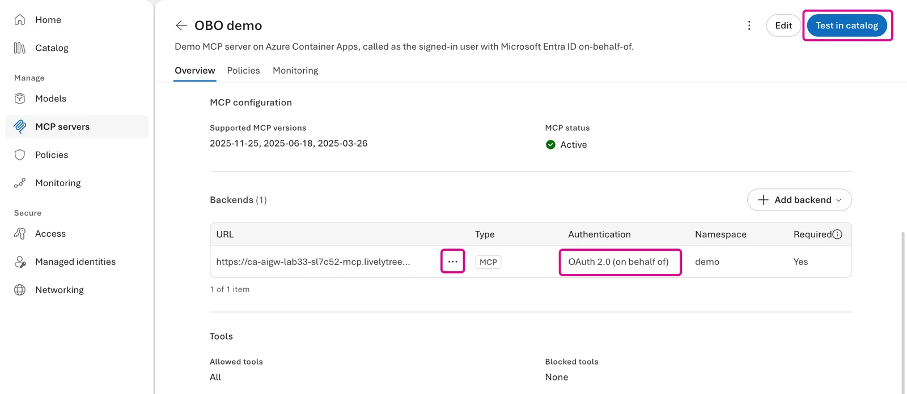

### Validate the backend

1. In the **Backends** table, on the backend's row, select **More actions** (**⋯**) › **Edit**. The **Edit MCP
   backend** panel shows **Authentication** **OAuth 2.0** with the OAuth profile **On behalf of**, and the values
   that you deployed:

   | Field | Value |
   |---|---|
   | **Token exchange application (client) ID** | The token exchange app's client ID |
   | **Managed identity for token exchange** | `id-<base>-gateway` |
   | **Backend API scope to request** | `api://<backend app ID>/user_impersonation` |
   | **Namespace** | `demo` |

2. Select **Validate**. If the portal asks, approve **Authorize directory access**, which lets it read your app
   registrations. The portal checks the token exchange app, its federated credential, and its consent to the
   backend's scope, then shows **Directory checks successful. Runtime verification pending.**

   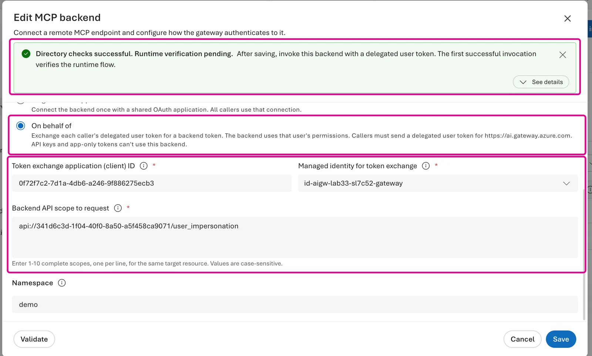

3. Select **Cancel**, so that you don't change the server.

The portal asks for full scopes, such as `api://<backend app ID>/user_impersonation`: one to ten scopes for the same
resource, one per line. It rejects `.default`.

</details> <!-- gh -->
<!-- track: cli | Azure CLI -->
<details><summary><b>⌨️ Azure CLI</b></summary> <!-- gh -->

### Read the settings back

<details open><summary>Bash</summary> <!-- gh -->

```bash title="Bash"
# Read the gateway's identities: the system-assigned one, and the user-assigned one that signs in as the token
# exchange app
echo "👤 Gateway identities: $(az aigateway show -g "$RG" -n "$GATEWAY" --query identity.type -o tsv)"

# Read the MCP server's backend: its URL, and how the gateway gets a token for it
echo "🔐 Backend of the $MCP_SERVER MCP server:"
az aigateway mcp show -g "$RG" --gateway-name "$GATEWAY" -n "$MCP_SERVER" \
  --query "properties.endpoints[].{namespace:namespace,mode:mode,url:mcp.endpoint.url,oauth2:authentication.oauth2}"
```
</details> <!-- gh -->

<details><summary>PowerShell</summary> <!-- gh -->

```powershell title="PowerShell"
# Read the gateway's identities: the system-assigned one, and the user-assigned one that signs in as the token
# exchange app
Write-Host "👤 Gateway identities: $(az aigateway show -g $RG -n $GATEWAY --query identity.type -o tsv)"

# Read the MCP server's backend: its URL, and how the gateway gets a token for it
Write-Host "🔐 Backend of the $MCP_SERVER MCP server:"
az aigateway mcp show -g $RG --gateway-name $GATEWAY -n $MCP_SERVER `
  --query "properties.endpoints[].{namespace:namespace,mode:mode,url:mcp.endpoint.url,oauth2:authentication.oauth2}"
```
</details> <!-- gh -->

<details><summary>Expected output</summary> <!-- gh -->

```text title="Expected output"
👤 Gateway identities: SystemAssigned, UserAssigned
🔐 Backend of the obo-demo MCP server:
[
  {
    "mode": "failClosed",
    "namespace": "demo",
    "oauth2": {
      "grantType": "tokenExchange",
      "tokenExchange": {
        "federatedClientApplication": {
          "appCredential": {
            "clientId": "<gateway identity client ID>",
            "type": "userAssignedManagedIdentity"
          },
          "applicationId": "<token exchange app ID>"
        },
        "profile": "entraOnBehalfOf",
        "scopes": [
          "api://<backend app ID>/user_impersonation"
        ]
      }
    },
    "url": "https://ca-<base>-mcp.<environment>.<region>.azurecontainerapps.io/mcp"
  }
]
```
</details> <!-- gh -->

> **Checkpoint**
> The gateway has both identities, and the backend uses the `entraOnBehalfOf` profile with the
> `userAssignedManagedIdentity` credential and your backend scope.

</details> <!-- gh -->
<!-- track: iac | Bicep + azd -->
<details><summary><b>🏗️ Bicep + azd</b></summary> <!-- gh -->

### Read the settings that azd deployed

`azd up` already attached the identity and registered the MCP server. Read them back.

<details open><summary>Bash</summary> <!-- gh -->

```bash title="Bash"
# Read the gateway's identities: the system-assigned one, and the user-assigned one that signs in as the token
# exchange app
echo "👤 Gateway identities: $(az aigateway show -g "$RG" -n "$GATEWAY" --query identity.type -o tsv)"

# Read the MCP server's backend: its URL, and how the gateway gets a token for it
echo "🔐 Backend of the $MCP_SERVER MCP server:"
az aigateway mcp show -g "$RG" --gateway-name "$GATEWAY" -n "$MCP_SERVER" \
  --query "properties.endpoints[].{namespace:namespace,mode:mode,url:mcp.endpoint.url,oauth2:authentication.oauth2}"
```
</details> <!-- gh -->

<details><summary>PowerShell</summary> <!-- gh -->

```powershell title="PowerShell"
# Read the gateway's identities: the system-assigned one, and the user-assigned one that signs in as the token
# exchange app
Write-Host "👤 Gateway identities: $(az aigateway show -g $RG -n $GATEWAY --query identity.type -o tsv)"

# Read the MCP server's backend: its URL, and how the gateway gets a token for it
Write-Host "🔐 Backend of the $MCP_SERVER MCP server:"
az aigateway mcp show -g $RG --gateway-name $GATEWAY -n $MCP_SERVER `
  --query "properties.endpoints[].{namespace:namespace,mode:mode,url:mcp.endpoint.url,oauth2:authentication.oauth2}"
```
</details> <!-- gh -->

> **Checkpoint**
> The gateway identities are `SystemAssigned, UserAssigned`, and the backend uses the `entraOnBehalfOf` profile with
> the `userAssignedManagedIdentity` credential and your backend scope.

</details> <!-- gh -->
<!-- track: terraform | Terraform -->
<details><summary><b>🌍 Terraform</b></summary> <!-- gh -->

### Read the settings that Terraform deployed

`terraform apply` already attached the identity and registered the MCP server. Read them back.

<details open><summary>Bash</summary> <!-- gh -->

```bash title="Bash"
# Read the gateway's identities: the system-assigned one, and the user-assigned one that signs in as the token
# exchange app
echo "👤 Gateway identities: $(az aigateway show -g "$RG" -n "$GATEWAY" --query identity.type -o tsv)"

# Read the MCP server's backend: its URL, and how the gateway gets a token for it
echo "🔐 Backend of the $MCP_SERVER MCP server:"
az aigateway mcp show -g "$RG" --gateway-name "$GATEWAY" -n "$MCP_SERVER" \
  --query "properties.endpoints[].{namespace:namespace,mode:mode,url:mcp.endpoint.url,oauth2:authentication.oauth2}"
```
</details> <!-- gh -->

<details><summary>PowerShell</summary> <!-- gh -->

```powershell title="PowerShell"
# Read the gateway's identities: the system-assigned one, and the user-assigned one that signs in as the token
# exchange app
Write-Host "👤 Gateway identities: $(az aigateway show -g $RG -n $GATEWAY --query identity.type -o tsv)"

# Read the MCP server's backend: its URL, and how the gateway gets a token for it
Write-Host "🔐 Backend of the $MCP_SERVER MCP server:"
az aigateway mcp show -g $RG --gateway-name $GATEWAY -n $MCP_SERVER `
  --query "properties.endpoints[].{namespace:namespace,mode:mode,url:mcp.endpoint.url,oauth2:authentication.oauth2}"
```
</details> <!-- gh -->

> **Checkpoint**
> The gateway identities are `SystemAssigned, UserAssigned`, and the backend uses the `entraOnBehalfOf` profile with
> the `userAssignedManagedIdentity` credential and your backend scope.

</details> <!-- gh -->
<!-- /tracks -->

## Call the tools as yourself

Before you connect Copilot, call the tools as yourself, first in the portal's catalog, then with a script that checks
each link of the chain. If a call fails with `403`, wait a few minutes for your role assignment to apply.

<!-- steps -->

### Test in the catalog

1. In the AI Gateway portal, on the **OBO demo** server's **Overview** tab, select **Test in catalog**.
2. Keep the method **Microsoft Entra ID** and the MCP version `2025-11-25`, then select **Connect**. The panel lists
   the tools **Echo**, **Get server time**, and **Whoami**.
3. Select **Whoami** › **Run**. The **Output** shows **Success** with your name and username, the scope
   `user_impersonation`, and the token version `2.0`.

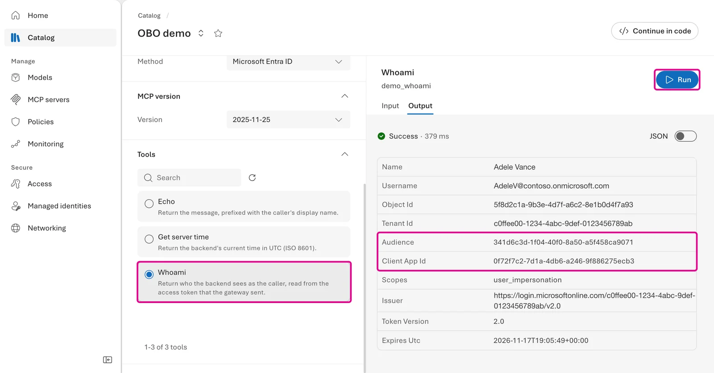

### Run the test script

[`infra/call-obo-tool.sh`](infra/call-obo-tool.sh) (PowerShell 7:
[`infra/call-obo-tool.ps1`](infra/call-obo-tool.ps1)) calls the MCP server as the signed-in Azure CLI user. It
gets a token for AI Gateway with `az account get-access-token --scope https://ai.gateway.azure.com/Data.All`, calls
`demo_whoami`, and compares the user and audience that the backend saw with your token. Then it sends your token for
the gateway straight to the backend. It never prints a token.

<details open><summary>Bash</summary> <!-- gh -->

```bash title="Bash"
# Make the test script executable
chmod +x infra/call-obo-tool.sh &&
  echo "📄 infra/call-obo-tool.sh is executable"

# Call the MCP server as yourself, and check each link of the on-behalf-of chain
./infra/call-obo-tool.sh "$MCP_SERVER"
```
</details> <!-- gh -->

<details><summary>PowerShell</summary> <!-- gh -->

```powershell title="PowerShell"
# Call the MCP server as yourself, and check each link of the on-behalf-of chain
./infra/call-obo-tool.ps1 -Server $MCP_SERVER
```
</details> <!-- gh -->

<details><summary>Expected output</summary> <!-- gh -->

```text title="Expected output"
MCP endpoint: https://<gateway-host>/default/toolservers/obo-demo/mcp
1. Without a token: HTTP 401, as expected
   Your token for the gateway: aud <guid> scp Data.All oid <your object ID>
2. Handshake: MCP version 2025-06-18, tools: demo_echo, demo_get_server_time, demo_whoami
3. demo_whoami: the backend received this token:
{ "name": "Adele Vance", "username": "AdeleV@contoso.onmicrosoft.com", "object_id": "<your object ID>", "audience": "<backend app ID>", "client_app_id": "<token exchange app ID>", "scopes": "user_impersonation" }
   Same user as your token for the gateway, different audience: the gateway exchanged it on your behalf
4. Your gateway token sent straight to the backend: HTTP 401, as expected
```
</details> <!-- gh -->

<!-- /steps -->

> **Checkpoint**
> `demo_whoami` returns your object ID, the backend app as the audience, and the token exchange app as the calling
> app. Your token for the gateway gets `401` on the backend.

## Connect Microsoft 365 Copilot

Microsoft 365 Copilot reaches MCP servers through **connectors**. The connector signs each user in with OAuth 2.0
and the connector app, gets a token for AI Gateway, and sends it to the MCP endpoint. Register the OAuth client in
the Teams Developer Portal, then add the connector in the Microsoft 365 admin center.

<!-- steps -->

### Create the connector's client secret

The connector app needs a client secret, which neither Bicep nor this lab's Terraform configuration creates, so that
it never lands in a template or a state file. Create one that expires in seven days, and print the other values
that the registration asks for.

<details open><summary>Bash</summary> <!-- gh -->

```bash title="Bash"
# Read your tenant ID: the connector's sign-in endpoints use it
export TENANT_ID="$(az account show --query tenantId -o tsv)"
echo "🆔 Tenant ID: $TENANT_ID"

# Give the connector app a client secret that expires in 7 days, and keep it only in this shell
CONNECTOR_SECRET="$(az ad app credential reset --id "$CONNECTOR_APP_ID" --append --display-name "Microsoft 365 Copilot connector" --only-show-errors \
  --end-date "$(date -u -d '+7 days' +%F 2>/dev/null || date -u -v+7d +%F)" --query password -o tsv)"
echo "🔑 Client secret: in CONNECTOR_SECRET (${#CONNECTOR_SECRET} characters, not shown), expires in 7 days"

# Print the values of the OAuth client registration
echo "🔌 Base URL: $AI_GATEWAY_URL/default/toolservers/$MCP_SERVER/mcp"
echo "🆔 Client ID: $CONNECTOR_APP_ID"
echo "🌐 Authorization endpoint: https://login.microsoftonline.com/$TENANT_ID/oauth2/v2.0/authorize"
echo "🌐 Token and refresh endpoint: https://login.microsoftonline.com/$TENANT_ID/oauth2/v2.0/token"
```
</details> <!-- gh -->

<details><summary>PowerShell</summary> <!-- gh -->

```powershell title="PowerShell"
# Read your tenant ID: the connector's sign-in endpoints use it
$TENANT_ID = az account show --query tenantId -o tsv
Write-Host "🆔 Tenant ID: $TENANT_ID"

# Give the connector app a client secret that expires in 7 days, and keep it only in this session
$CONNECTOR_SECRET = az ad app credential reset --id $CONNECTOR_APP_ID --append --display-name "Microsoft 365 Copilot connector" --only-show-errors `
  --end-date (Get-Date).ToUniversalTime().AddDays(7).ToString("yyyy-MM-dd") --query password -o tsv
Write-Host "🔑 Client secret: in CONNECTOR_SECRET ($($CONNECTOR_SECRET.Length) characters, not shown), expires in 7 days"

# Print the values of the OAuth client registration
Write-Host "🔌 Base URL: $env:AI_GATEWAY_URL/default/toolservers/$MCP_SERVER/mcp"
Write-Host "🆔 Client ID: $CONNECTOR_APP_ID"
Write-Host "🌐 Authorization endpoint: https://login.microsoftonline.com/$TENANT_ID/oauth2/v2.0/authorize"
Write-Host "🌐 Token and refresh endpoint: https://login.microsoftonline.com/$TENANT_ID/oauth2/v2.0/token"
```
</details> <!-- gh -->

### Register the OAuth client

1. Open the [Teams Developer Portal](https://dev.teams.microsoft.com) and sign in as an admin of your tenant.
2. Select **Tools** › **OAuth client registration** › **Register client**, and fill in the form:

   | Field | Value |
   |---|---|
   | **Registration name** | `AI Gateway OBO demo` |
   | **Base URL** | The `🔌 Base URL` that the previous step printed: your MCP endpoint |
   | **Restrict usage by organization** | **My organization only** |
   | **Restrict usage by Teams app** | **Any Teams app (for testing and store validation only)** |
   | **Client ID** | The `🆔 Client ID` |
   | **Client secret** | Your client secret. To copy it without printing it, run `printf %s "$CONNECTOR_SECRET" \| pbcopy` on macOS, or `Set-Clipboard $CONNECTOR_SECRET` in PowerShell |
   | **Authorization endpoint** | The `🌐 Authorization endpoint` |
   | **Token endpoint** and **Refresh endpoint** | The `🌐 Token and refresh endpoint` |
   | **Scope** | `https://ai.gateway.azure.com/Data.All offline_access` |

   Turn on **Enable PKCE**.

   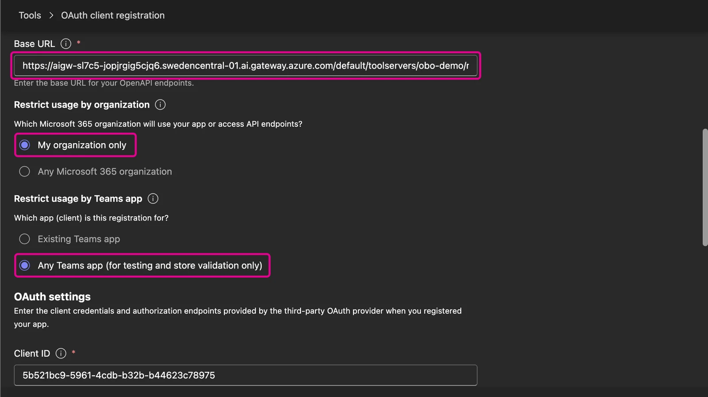

3. Select **Save**. The portal shows **OAuth configuration "AI Gateway OBO demo" created successfully**. Copy the
   **OAuth client registration ID**: the connector asks for it.

The scope asks Microsoft Entra ID for a token for AI Gateway, and `offline_access` for a refresh token, so users sign
in once. The connector app already has tenant-wide consent to both, so users get no consent prompt.

### Add the connector

1. Open the [Microsoft 365 admin center](https://admin.cloud.microsoft) and allow pop-ups for it: the sign-in in
   step 3 opens one.
2. Select **Copilot** › **Connectors** › **Gallery** › **Created by your org**. On **Create a new connector**,
   select **Add**, then **Connect to MCP server** › **Add**.
3. Fill in the five steps of the form:
   1. **Display name**: `AI Gateway OBO demo`.
   2. **Description**: `Demo MCP tools behind Azure AI Gateway. The gateway calls the backend as the signed-in
      user with Microsoft Entra ID on-behalf-of. Use it to ask who you are, echo a message, or get the server
      time.` Copilot reads the description to decide when to use the tools.
   3. **MCP endpoint URL**: your MCP endpoint, the `🔌 Base URL`.
   4. The developer details: **Developer name** `Contoso`, **Website URL** `https://github.com/Azure/aigateway`,
      **Privacy policy URL** `https://privacy.microsoft.com/privacystatement`, and **Terms of use URL**
      `https://www.microsoft.com/legal/terms-of-use`.
   5. **Authentication type**: **OAuth 2.0**. Paste the **Reference ID**, the OAuth client registration ID, then
      select **Authorize** and sign in. The button changes to **Edit**.

   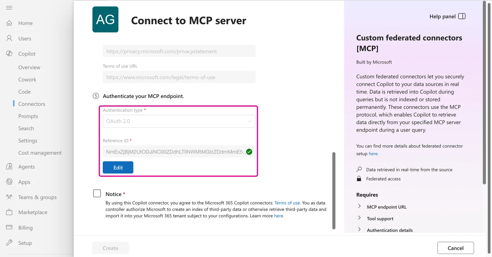

4. Check the **Notice**, then select **Create**. The **Success** page shows **Created connection** and **Linking data
   source**. Select **Done**.

   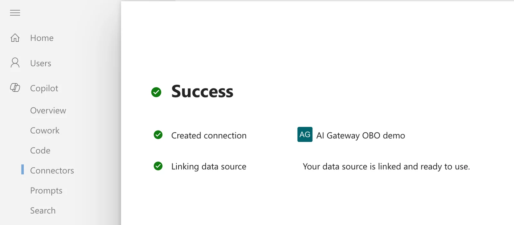

### Check the connection and its tools

1. Select **Your Connections**. Within 30 minutes, the **AI Gateway OBO demo** row shows the state **Ready**.

   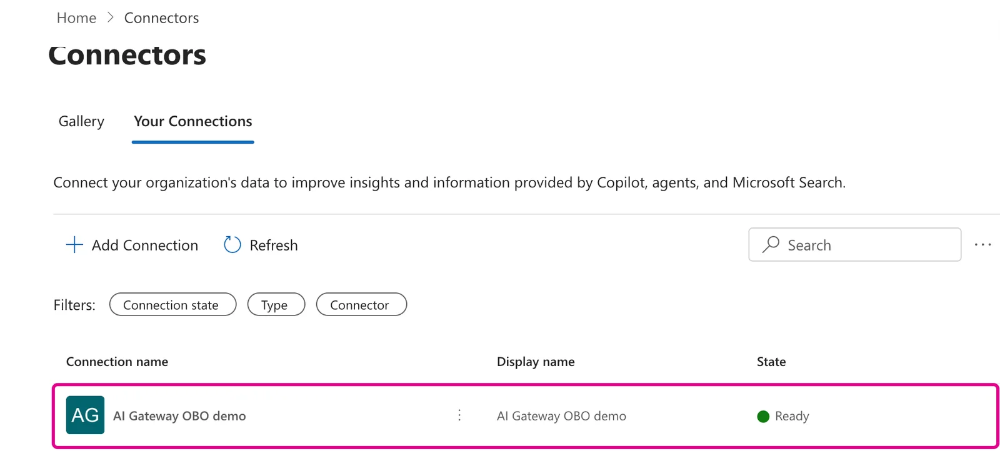

2. Select the connection, then **Tools** › **Sign in**. The sign-in completes without a prompt and shows **Sign in
   successful**. Select **View tools**: the connector lists the three tools.

   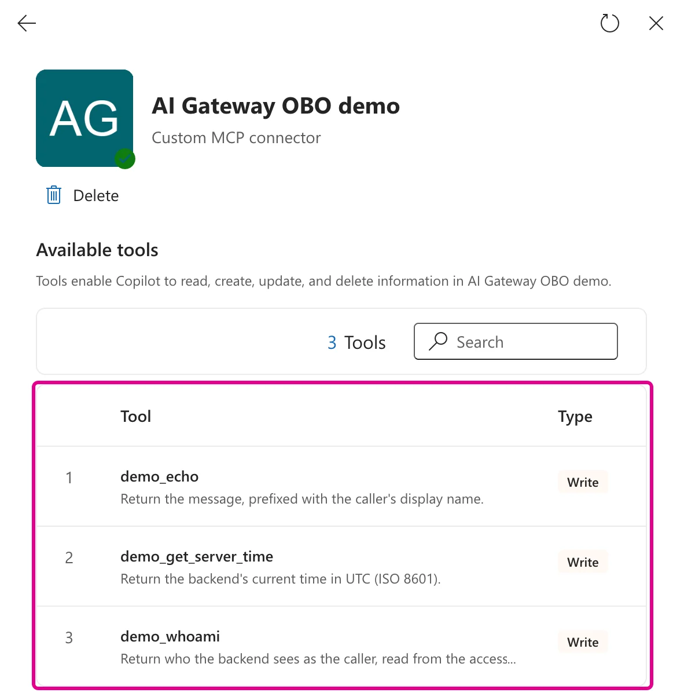

<!-- /steps -->

> **Checkpoint**
> The connection **AI Gateway OBO demo** is **Ready**, and **View tools** lists three tools.

The gateway doesn't pass the tools' `readOnlyHint` annotations on to the connector yet, so Copilot treats them as
**Write** tools and asks the user to approve each call.

## Use the tools in Copilot Cowork

Copilot Cowork runs the connector's tools as the signed-in user. Sign in to Microsoft 365 Copilot as the user that
has the Tools User role, you on this lab.

<!-- steps -->

### Install and connect the plugin

1. Open [Microsoft 365 Copilot](https://copilot.cloud.microsoft) and select **Plugins**. On the **Cowork** tab,
   search for `OBO`, then on **AI Gateway OBO demo**, select **Install**. Copilot shows **Plugin installed. Connect
   your account below to get started.**

   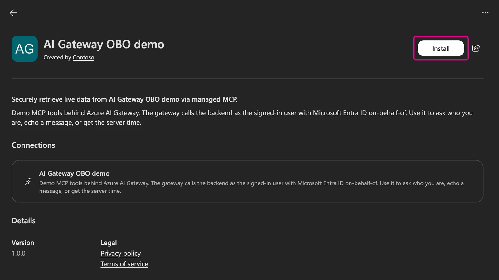

2. Turn on the plugin and select **Connect**. The connection shows **Connected.**

   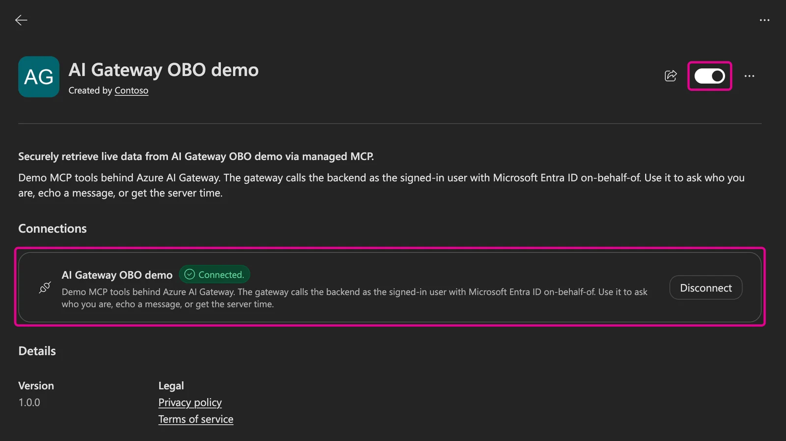

### Ask who the backend sees

1. Select **New**, choose **Cowork**, and send this prompt:

   ```text
   Using the AI Gateway OBO demo connector, call the whoami tool and tell me who the backend sees as the caller: name, object ID, token audience, and calling app.
   ```

2. Cowork shows a **Demo_whoami** card with **No parameters**. Select **Approve**.

   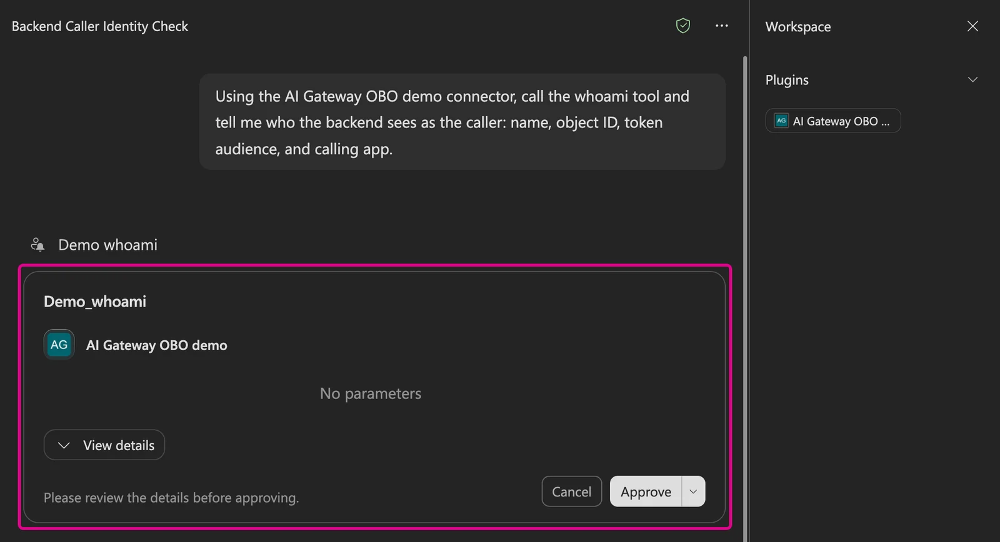

3. Cowork answers with your name and object ID, the backend app as the token audience, and the token exchange app as
   the calling app.

   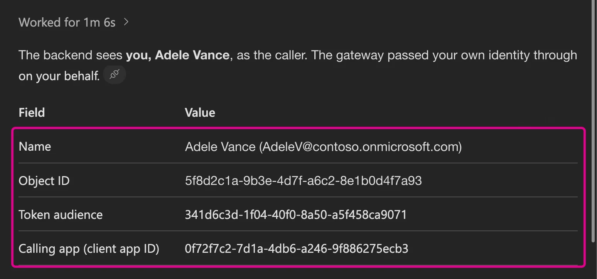

<!-- /steps -->

> **Checkpoint**
> Cowork's answer shows your name and object ID, the same as `demo_whoami` returned to the test script.

Use **Cowork** for this lab. In Copilot **Chat** mode, the call waits for an approval that the chat doesn't show.

## Verify

<!-- steps -->

### Read the backend's log

The MCP server logs one line for each call, with the user's object ID, the calling app, and the scope. The lines
reach Log Analytics a few minutes after the calls.

<details open><summary>Bash</summary> <!-- gh -->

```bash title="Bash"
# Find the Log Analytics workspace of the container app
WS="$(az monitor log-analytics workspace list -g "$BACKEND_RG" --query "[0].customerId" -o tsv)"

# Read the calls of the last hour: the user, the calling app, and the scope
echo "📊 Calls of the last hour:"
az monitor log-analytics query -w "$WS" -o tsv --analytics-query \
  "ContainerAppConsoleLogs_CL | where TimeGenerated > ago(1h) and Log_s has 'Call from user' | order by TimeGenerated asc | project Log_s"
```
</details> <!-- gh -->

<details><summary>PowerShell</summary> <!-- gh -->

```powershell title="PowerShell"
# Find the Log Analytics workspace of the container app
$WS = az monitor log-analytics workspace list -g $BACKEND_RG --query "[0].customerId" -o tsv

# Read the calls of the last hour: the user, the calling app, and the scope
Write-Host "📊 Calls of the last hour:"
az monitor log-analytics query -w $WS -o tsv --analytics-query `
  "ContainerAppConsoleLogs_CL | where TimeGenerated > ago(1h) and Log_s has 'Call from user' | order by TimeGenerated asc | project Log_s"
```
</details> <!-- gh -->

<details><summary>Expected output</summary> <!-- gh -->

```text title="Expected output"
📊 Calls of the last hour:
INFO:obo-demo:Call from user <your object ID> through app <token exchange app ID> with scope user_impersonation	PrimaryResult
```
</details> <!-- gh -->

The catalog, the test script, and Cowork each add lines with your object ID. The calling app is always the token
exchange app: nothing else gets a token that the backend accepts.

### Call the gateway with a token for another API

The gateway accepts only tokens for AI Gateway with the `Data.All` scope. Send it a token for Azure Resource Manager
instead.

<details open><summary>Bash</summary> <!-- gh -->

```bash title="Bash"
# Read the MCP endpoint of the server
MCP_ENDPOINT="$(az aigateway mcp show -g "$RG" --gateway-name "$GATEWAY" -n "$MCP_SERVER" --query "properties.gatewayEndpoints[0].url" -o tsv)"

# Call it with a token for Azure Resource Manager, then forget the token
ARM_TOKEN="$(az account get-access-token --query accessToken -o tsv)"
curl -s -w "\nHTTP %{http_code}\n" -X POST "$MCP_ENDPOINT" -H "Authorization: Bearer $ARM_TOKEN" \
  -H 'Content-Type: application/json' -H 'Accept: application/json, text/event-stream' \
  -d '{"jsonrpc":"2.0","id":1,"method":"tools/list"}'
unset ARM_TOKEN
```
</details> <!-- gh -->

<details><summary>PowerShell</summary> <!-- gh -->

```powershell title="PowerShell"
# Read the MCP endpoint of the server
$MCP_ENDPOINT = az aigateway mcp show -g $RG --gateway-name $GATEWAY -n $MCP_SERVER --query "properties.gatewayEndpoints[0].url" -o tsv

# Call it with a token for Azure Resource Manager, then forget the token
$armToken = az account get-access-token --query accessToken -o tsv
$response = Invoke-WebRequest -Method Post -Uri $MCP_ENDPOINT -ContentType 'application/json' `
  -Headers @{ Authorization = "Bearer $armToken"; Accept = 'application/json, text/event-stream' } `
  -Body '{"jsonrpc":"2.0","id":1,"method":"tools/list"}' -SkipHttpErrorCheck
Write-Host "$($response.Content)`nHTTP $($response.StatusCode)"
Remove-Variable armToken
```
</details> <!-- gh -->

<details><summary>Expected output</summary> <!-- gh -->

```text title="Expected output"
{ "statusCode": 401, "message": "Unauthorized. Missing or invalid Entra ID token, or missing Data.All scope." }
HTTP 401
```
</details> <!-- gh -->

<!-- /steps -->

> **Checkpoint**
> The log shows your object ID with the token exchange app and the `user_impersonation` scope, and the token for
> Azure Resource Manager gets `401`.

## Go further

- **Call your own API.** Replace the demo server with an API that already accepts Microsoft Entra tokens for its own
  scope. Grant the token exchange app consent to that scope, and put the scope in the backend's `scopes`. The API
  then applies its own permissions to each user.
- **Grant the role to a group.** Assign **AI Gateway Tools User** on the MCP server to a Microsoft Entra group
  instead of single users, so that the group decides who can call the tools from Copilot.
- **Add controls to the calls.** The user's identity also works with the gateway's tool controls: hide tools with
  [allow and block lists](../05-mcp-tool-controls/README.md), or check each call with
  [agent hooks](../30-agent-hooks/README.md).
- **Deploy your own server.** Fork the repository and point the image build at your branch: run
  `azd env set MCP_SERVER_SOURCE "https://github.com/<you>/aigateway.git#<branch>:labs/33-copilot-obo-mcp/infra/mcp-server"`
  and `azd provision`, or `terraform plan -var mcp_server_source=<the same value> -out tfplan` and
  `terraform apply tfplan` in the `terraform` folder.
- **Use the server from other MCP clients.** Any client that sends a Microsoft Entra token for AI Gateway works, such
  as one that you configure with the token from
  `az account get-access-token --scope https://ai.gateway.azure.com/Data.All`. The gateway doesn't publish OAuth
  protected resource metadata yet, so clients that discover the sign-in from the server can't sign in on their own.
- **Rotate the connector's secret.** It expires in seven days. Create a new one with the same command, update the
  **Client secret** of the OAuth client registration, and delete the old one with `az ad app credential delete`.

## Clean up

Remove the connector from Microsoft 365 first, then the Azure resources.

<!-- steps -->

### Remove the connector from Microsoft 365

1. In Microsoft 365 Copilot, select **Plugins**, open **AI Gateway OBO demo**, and select **Disconnect**, then turn
   off the plugin.
2. In the Microsoft 365 admin center, select **Copilot** › **Connectors** › **Your Connections**, select **AI Gateway
   OBO demo**, and delete it.
3. In the Teams Developer Portal, select **Tools** › **OAuth client registration**, and delete **AI Gateway OBO
   demo**.

<!-- /steps -->

<!-- track: portal | Portal -->
<details open><summary><b>🖥️ Portal</b></summary> <!-- gh -->

### Delete the MCP server and the backend

In the AI Gateway portal, select **MCP servers**. On the **OBO demo** row, select **More actions** (**⋯**) ›
**Delete**, and confirm. Then delete the rest with the **Azure CLI** track's commands below, from the gateway
identity on: the **Azure CLI** steps of **Deploy the backend and register the MCP server** created them.

</details> <!-- gh -->
<!-- track: cli | Azure CLI -->
<details><summary><b>⌨️ Azure CLI</b></summary> <!-- gh -->

### Remove the MCP server and the backend

<details open><summary>Bash</summary> <!-- gh -->

```bash title="Bash"
# Delete your AI Gateway Tools User role assignment on the MCP server
az role assignment delete --assignee "$(az ad signed-in-user show --query id -o tsv)" \
  --role "dce03f8d-857f-4e40-a90d-67770fa6ecd2" --scope "$GATEWAY_ID/workspaces/default/toolServers/$MCP_SERVER" &&
  echo "🚮 Your AI Gateway Tools User role assignment on $MCP_SERVER is deleted"

# Delete the MCP server from the gateway
az aigateway mcp delete -g "$RG" --gateway-name "$GATEWAY" -n "$MCP_SERVER" --yes &&
  echo "🚮 MCP server $MCP_SERVER is deleted"

# Detach the user-assigned identity from the gateway, and keep the system-assigned one
az aigateway identity remove -g "$RG" -n "$GATEWAY" --user-assigned "$IDENTITY_ID" -o none &&
  echo "👤 The gateway identity is detached from $GATEWAY"

# Delete the backend's resource group: the identities, the container app, its registry, and its logs
az group delete -n "$BACKEND_RG" --yes --no-wait &&
  echo "⏳ Resource group $BACKEND_RG is being deleted"

# Delete the three app registrations, then purge them from the deleted items
for app in "$CONNECTOR_APP_ID" "$TOKEN_EXCHANGE_APP_ID" "$BACKEND_APP_ID"; do
  id="$(az ad app show --id "$app" --query id -o tsv)" &&
    az ad app delete --id "$app" &&
    az rest --method delete --url "https://graph.microsoft.com/v1.0/directory/deletedItems/$id" &&
    echo "🚮 App registration $app is deleted and purged"
done
```
</details> <!-- gh -->

<details><summary>PowerShell</summary> <!-- gh -->

```powershell title="PowerShell"
# Delete your AI Gateway Tools User role assignment on the MCP server
az role assignment delete --assignee (az ad signed-in-user show --query id -o tsv) `
  --role "dce03f8d-857f-4e40-a90d-67770fa6ecd2" --scope "$GATEWAY_ID/workspaces/default/toolServers/$MCP_SERVER"
if ($?) { Write-Host "🚮 Your AI Gateway Tools User role assignment on $MCP_SERVER is deleted" }

# Delete the MCP server from the gateway
az aigateway mcp delete -g $RG --gateway-name $GATEWAY -n $MCP_SERVER --yes
if ($?) { Write-Host "🚮 MCP server $MCP_SERVER is deleted" }

# Detach the user-assigned identity from the gateway, and keep the system-assigned one
az aigateway identity remove -g $RG -n $GATEWAY --user-assigned $IDENTITY_ID -o none
if ($?) { Write-Host "👤 The gateway identity is detached from $GATEWAY" }

# Delete the backend's resource group: the identities, the container app, its registry, and its logs
az group delete -n $BACKEND_RG --yes --no-wait
if ($?) { Write-Host "⏳ Resource group $BACKEND_RG is being deleted" }

# Delete the three app registrations, then purge them from the deleted items
foreach ($app in @($CONNECTOR_APP_ID, $TOKEN_EXCHANGE_APP_ID, $BACKEND_APP_ID)) {
  $id = az ad app show --id $app --query id -o tsv
  az ad app delete --id $app
  if ($?) { az rest --method delete --url "https://graph.microsoft.com/v1.0/directory/deletedItems/$id" }
  if ($?) { Write-Host "🚮 App registration $app is deleted and purged" }
}
```
</details> <!-- gh -->

</details> <!-- gh -->
<!-- track: iac | Bicep + azd -->
<details><summary><b>🏗️ Bicep + azd</b></summary> <!-- gh -->

### Delete everything azd created

In the `aigateway/labs/33-copilot-obo-mcp` folder, delete the resource group with the gateway, the backend, and the
MCP server. Before that, the `predown` hook deletes the app registrations and purges them.
[`--purge`](../SETUP.md#delete-what-azd-created) also purges soft-deleted resources. It takes about ten minutes.

```bash
# Delete everything that azd up created, and purge the soft-deleted resources
azd down --purge --force &&
  echo "🚮 Everything that azd up created is deleted"
```

</details> <!-- gh -->
<!-- track: terraform | Terraform -->
<details><summary><b>🌍 Terraform</b></summary> <!-- gh -->

### Delete everything Terraform created

In the lab's Terraform folder, delete the app registrations and the resource group with the gateway, the backend, and
the MCP server. Microsoft Entra ID keeps deleted app registrations in its deleted items for 30 days, so purge them
too, like `azd down` does. Read their object IDs first, because `terraform destroy` removes the outputs. It takes
about 25 minutes, most of it to delete the Container Apps environment.

<details open><summary>Bash</summary> <!-- gh -->

```bash title="Bash"
# Move into the lab's Terraform folder
cd ~/aigateway/labs/33-copilot-obo-mcp/terraform &&
  echo "📂 Terraform folder: $(pwd)"

# Read the app registrations' object IDs, which the purge needs after terraform destroy
CONNECTOR_OBJECT_ID="$(az ad app show --id "$(terraform output -raw connector_app_id)" --query id -o tsv)"
TOKEN_EXCHANGE_OBJECT_ID="$(az ad app show --id "$(terraform output -raw token_exchange_app_id)" --query id -o tsv)"
BACKEND_OBJECT_ID="$(az ad app show --id "$(terraform output -raw backend_app_id)" --query id -o tsv)"
echo "🆔 App registrations: $CONNECTOR_OBJECT_ID $TOKEN_EXCHANGE_OBJECT_ID $BACKEND_OBJECT_ID"

# Delete everything that terraform apply created, including the app registrations
terraform destroy -auto-approve &&
  echo "🚮 Everything that terraform apply created is deleted"

# Purge the app registrations from the deleted items
for id in "$CONNECTOR_OBJECT_ID" "$TOKEN_EXCHANGE_OBJECT_ID" "$BACKEND_OBJECT_ID"; do
  az rest --method delete --url "https://graph.microsoft.com/v1.0/directory/deletedItems/$id" &&
    echo "🚮 App registration $id is purged"
done
```
</details> <!-- gh -->

<details><summary>PowerShell</summary> <!-- gh -->

```powershell title="PowerShell"
# Move into the lab's Terraform folder
Set-Location ~/aigateway/labs/33-copilot-obo-mcp/terraform
if ($?) { Write-Host "📂 Terraform folder: $(Get-Location)" }

# Read the app registrations' object IDs, which the purge needs after terraform destroy
$CONNECTOR_OBJECT_ID      = az ad app show --id (terraform output -raw connector_app_id) --query id -o tsv
$TOKEN_EXCHANGE_OBJECT_ID = az ad app show --id (terraform output -raw token_exchange_app_id) --query id -o tsv
$BACKEND_OBJECT_ID        = az ad app show --id (terraform output -raw backend_app_id) --query id -o tsv
Write-Host "🆔 App registrations: $CONNECTOR_OBJECT_ID $TOKEN_EXCHANGE_OBJECT_ID $BACKEND_OBJECT_ID"

# Delete everything that terraform apply created, including the app registrations
terraform destroy -auto-approve
if ($?) { Write-Host "🚮 Everything that terraform apply created is deleted" }

# Purge the app registrations from the deleted items
foreach ($id in @($CONNECTOR_OBJECT_ID, $TOKEN_EXCHANGE_OBJECT_ID, $BACKEND_OBJECT_ID)) {
  az rest --method delete --url "https://graph.microsoft.com/v1.0/directory/deletedItems/$id"
  if ($?) { Write-Host "🚮 App registration $id is purged" }
}
```
</details> <!-- gh -->

</details> <!-- gh -->
<!-- /tracks -->

Keep the gateway and the `learn` MCP server from lab 04: the next labs reuse them. `azd down` and
`terraform destroy` don't touch them, because the Bicep + azd and Terraform tracks created their own gateways.

## Next steps

- [Call backends with managed identities](../12-backend-identity/README.md)
- [Control which tools agents can call](../05-mcp-tool-controls/README.md)
- [Govern MCP tool calls with agent hooks](../30-agent-hooks/README.md)
- [Protect tool calls with Agent 365 threat protection](../19-tool-threat-protection/README.md)
- [Access MCP server backends with user credentials](https://ai.gateway.azure.com/docs/toolservers/access-backends-with-user-credentials) in the AI Gateway docs

<!-- gh:begin footer: generated by "npm run sync" from the metadata, do not edit -->

🛟 **Hit an error?** [Troubleshooting](../TROUBLESHOOTING.md#lab-33-copilot-on-behalf-of) lists the errors of this lab, the steps where they happen, and their fixes.

---

| ⬅️ Previous | 🏠 | Next ➡️ |
| :-- | :-: | --: |
| [30 · Agent hooks](../30-agent-hooks/README.md) | [All labs](../README.md) |   |

<sub>Learning paths: [App & agent developer](../README.md#learning-paths) (12 of 15) · [Security & compliance](../README.md#learning-paths) (8 of 9)</sub>
<!-- gh:end -->
