<!--
title: Your first model call in 5 minutes
summary: Learn the building blocks of Azure AI Gateway, create a gateway with a Microsoft Foundry model in the portal, the Azure CLI, Bicep with azd, or Terraform, and make your first model call, all in about five minutes.
category: foundations
level: Beginner
duration: 5
tracks: [portal, cli, iac, terraform]
order: -1
status: new
illustration: diagrams/quickstart.svg
tags: [quick start, getting started, first call, gateway, model provider, alias, API key, portal, Azure CLI, Cloud Shell, azd, Bicep, Terraform, infrastructure as code]
objectives:
  - Name the building blocks that every AI Gateway call goes through
  - Create a gateway, publish a Foundry model behind an alias, and create a runtime API key in the portal, the Azure CLI, Bicep with azd, or Terraform
  - Make your first model call through the gateway the way an app does, with an alias and a runtime API key
prereqs: []
-->
<!-- gh:begin nav: generated by "npm run sync" from the metadata, do not edit -->
[AI Gateway labs](../README.md) › [Foundations](../README.md#foundations) › Quick start
<!-- gh:end -->

# Your first model call in 5 minutes

<!-- gh:begin intro: generated by "npm run sync" from the metadata, do not edit -->
> Learn the building blocks of Azure AI Gateway, create a gateway with a Microsoft Foundry model in the portal, the Azure CLI, Bicep with azd, or Terraform, and make your first model call, all in about five minutes.

| ⏱️ Time | 📶 Level | 🧭 Tracks | ✅ Before you start |
| :-- | :-- | :-- | :-- |
| 5 min | Beginner | Portal · Azure CLI · Bicep + azd · Terraform | Nothing, start here |

**You'll learn to**

- Name the building blocks that every AI Gateway call goes through
- Create a gateway, publish a Foundry model behind an alias, and create a runtime API key in the portal, the Azure CLI, Bicep with azd, or Terraform
- Make your first model call through the gateway the way an app does, with an alias and a runtime API key

**Follow along:** 🌐 [Interactive version](https://azure.github.io/aigateway/labs/quickstart/) with your own values filled in · 📁 [Lab files](infra/)

**On this page:** [Before you begin](#before-you-begin) · [How it works](#how-it-works) · [Create a gateway and make your first call](#create-a-gateway-and-make-your-first-call) · [Next steps](#next-steps)
<!-- gh:end -->

Azure AI Gateway gives your apps and agents one governed endpoint for models and tools. In five minutes you create a
gateway, put a Microsoft Foundry model behind it, and call that model the way an app does: with the gateway's URL, an
alias in the `model` field, and a runtime API key. Click through the AI Gateway portal, paste a few Azure CLI
commands into Azure Cloud Shell, or clone a Bicep template or a Terraform configuration and deploy it with one
`azd up` or `terraform apply`.


## Before you begin

<!-- setup: permissions tools sign-in extension providers regions clone -->
<!-- gh:begin setup: generated by "npm run sync" from the metadata, do not edit -->
🧰 **One-time setup** from the [Setup guide](../SETUP.md), if you haven't done it yet:
[Check your subscription and permissions](../SETUP.md#check-your-subscription-and-permissions) ·
[Choose where to run commands](../SETUP.md#choose-where-to-run-commands) ·
[Sign in to Azure](../SETUP.md#sign-in-to-azure) ·
[Install the `aigateway` extension](../SETUP.md#install-the-aigateway-extension) ·
[Register the resource providers](../SETUP.md#register-the-resource-providers) ·
[Find the available regions](../SETUP.md#find-the-available-regions) ·
[Clone the labs repo](../SETUP.md#clone-the-labs-repo)
<!-- gh:end -->

Every later lab reuses this one-time setup. On the portal track, you need only
**Check your subscription and permissions**.

- Permissions to create resources and role assignments, for example **Owner**, or **Contributor** plus
  **Role Based Access Control Administrator**. The gateway gets a role on your Foundry account, so that it can call
  the model with its own identity.
- A region where `gpt-5-mini` is available too, because the Azure CLI, Bicep + azd, and Terraform tracks create the
  Foundry account in the gateway's region. The examples use `eastus2`.

## How it works

Every call that goes through AI Gateway uses the same building blocks. In this quick start you create one of each.

| Building block | What it does | In this quick start |
| :-- | :-- | :-- |
| **Gateway** | The Azure resource (`Microsoft.ApiManagement/aigateways`) that gives your apps one runtime URL for models and tools | Your gateway, at `<gateway-url>` |
| **Model provider** | A connection to a backend. The gateway signs in to it with its own managed identity, so your apps never hold a backend key | Your Foundry account. The Azure CLI and Bicep tracks name the provider `foundry-models` |
| **Model** | A backend deployment that the gateway can route to | The Foundry deployment `gpt-5-mini` |
| **Alias** | The name that apps send in the `model` field. The gateway routes the alias to one or more models | `<foundry-account-name>/gpt-5-mini` in the portal, `gpt-5-mini` in the Azure CLI and Bicep tracks |
| **Runtime API key** | Identifies the app that calls the gateway, for limits, cost, and monitoring. Azure RBAC with Microsoft Entra ID tokens is the keyless alternative | `app-first-call` |

Your app calls the OpenAI-compatible base URL `<gateway URL>/default/models/openai/v1`, so any OpenAI SDK works with
a different base URL and the runtime key. For the full tour, watch the 3-minute video in
[How Azure AI Gateway works](../00-how-ai-gateway-works/README.md).

## Create a gateway and make your first call

Pick one track. Each one creates the same building blocks, makes your first call through the gateway, and ends with
how to clean up.

<!-- track: portal | Portal -->
<details open><summary><b>🖥️ Portal</b></summary> <!-- gh -->

**What you need:** a browser, and a model deployment in a Microsoft Foundry account, for example `gpt-5-mini`.

<details>
<summary>No Foundry deployment yet? Create one in Cloud Shell.</summary>

Open [Azure Cloud Shell](https://shell.azure.com) in Bash and paste these commands. They create a Foundry account with
a `gpt-5-mini` deployment in a new resource group, in a minute or two. Then create the gateway in the same resource
group, so that you can clean up with one command. Model inference is billed per use.

```bash title="Bash"
# Name the resource group, and give the Foundry account a random, globally unique name
RG="rg-aigw-quickstart"; FOUNDRY="aigw$(openssl rand -hex 3)"

# Create the resource group that holds the Foundry account and, later, the gateway
az group create --name "$RG" --location eastus2 --output none &&
  echo "📦 Resource group $RG is ready in eastus2"

# Create the Foundry account, with a custom subdomain so that the gateway can sign in with Microsoft Entra ID
az cognitiveservices account create --resource-group "$RG" --name "$FOUNDRY" --location eastus2 \
  --kind AIServices --sku S0 --custom-domain "$FOUNDRY" --yes --output none &&
  echo "🏭 Foundry account $FOUNDRY is ready"

# Deploy gpt-5-mini with 10,000 tokens per minute of Global Standard capacity
az cognitiveservices account deployment create --resource-group "$RG" --name "$FOUNDRY" \
  --deployment-name gpt-5-mini --model-name gpt-5-mini --model-version 2025-08-07 --model-format OpenAI \
  --sku-name GlobalStandard --sku-capacity 10 --output none &&
  echo "✨ Model deployment gpt-5-mini is ready"
echo "✅ Create the gateway in $RG, and import gpt-5-mini from $FOUNDRY"
```

</details>

### Create the gateway

1. Open the [AI Gateway portal](https://ai.gateway.azure.com) and sign in. For your first gateway, the portal opens
   **Create AI gateway** right away. Otherwise, open the gateway switcher in the top bar and select
   **Create new gateway**.

   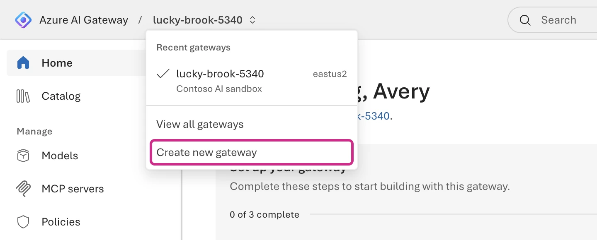

2. Enter a **Name**, or select **Generate a new name**. Then choose your **Subscription**, a **Resource group**, and
   a **Region**. For the resource group, select **New**, or select **Existing** and pick the resource group of your
   Foundry account, so that you can clean up both with one command.

   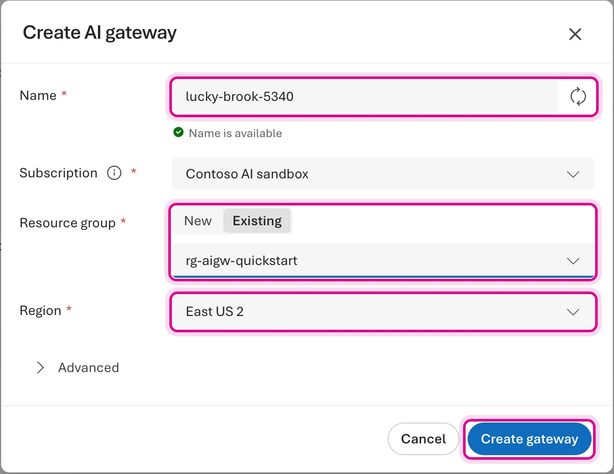

3. Keep the **Advanced** defaults and select **Create gateway**. **All gateways** opens and shows the
   **Provisioning** status, such as **Created** or **InProgress**, which moves to **Succeeded** in a few minutes.
   Then select your gateway's name to open it.

   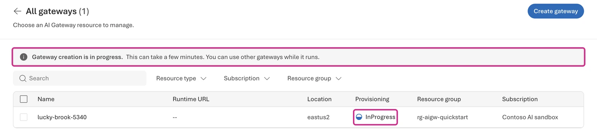

### Import the model from Foundry

1. **Home** opens with the **Set up your gateway** guide. Under **Add a model**, select
   **Add from Microsoft Foundry**.

   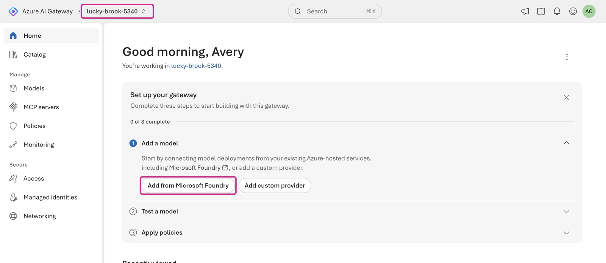

   You can also start from **Models** › **Add** › **Models from Microsoft Foundry**.

   , or a custom provider, or creates an alias for models that you already added.")

2. **Add models from Microsoft Foundry** opens. It discovers the model deployments in your subscriptions and
   selects all of them. In **Resource groups**, select only the resource group of your Foundry account. Then check
   that **Models** shows **1 selected**: your Foundry account with `gpt-5-mini`.
3. Keep **Managed identity** as the **Authentication method**, with the system-assigned managed identity, and keep
   **Create an alias for each model** selected. Then select **Add models**.

   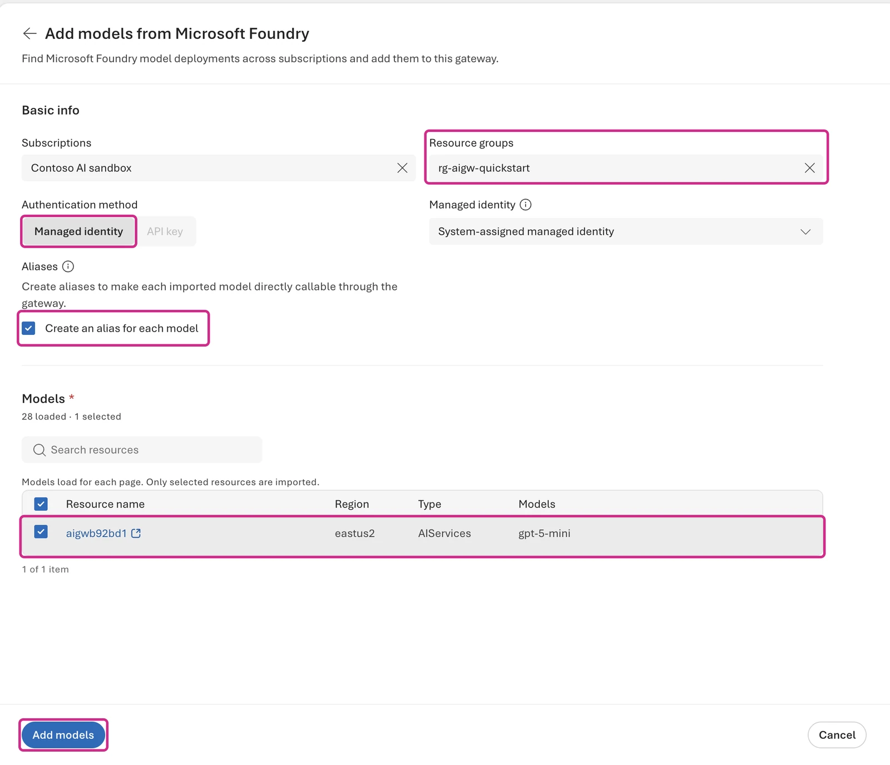

4. A banner confirms **Models and aliases imported**. Select **Close**: **Models** opens on the **Backend models**
   tab, which lists `gpt-5-mini`. The **Aliases** tab shows the alias that apps call:
   `<foundry-account-name>/gpt-5-mini`. Note the alias.

   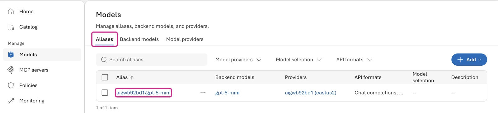

### Create a runtime API key

A key is the quickest way to start. Azure RBAC is the keyless alternative: grant the app the
**AI Gateway Models User** role in **Access** › **Entra ID**, and it sends a Microsoft Entra ID token instead of a
key. [Go keyless with Microsoft Entra ID and RBAC](../11-entra-rbac/README.md) shows how.

1. Select **Access**, then the **API keys** tab, then **Create API key**.

   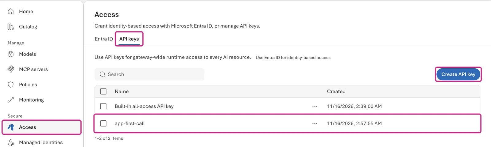

2. Enter `app-first-call` as the **Key name**, then select **Create**.

   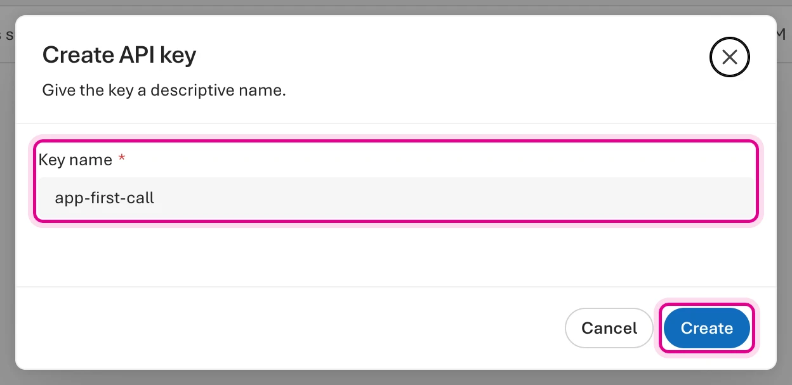

3. In **API key created**, select **Copy & done** to copy the key. Keep it somewhere safe: you paste it in the next
   steps. You can view, rotate, or delete it later in **Access** › **API keys**.

   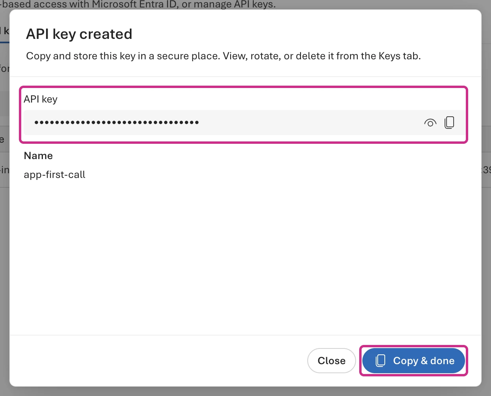

### Make your first call

Call the model through the gateway in the playground, with your new key, the way an app does.

1. Select **Catalog**, then select your model.

   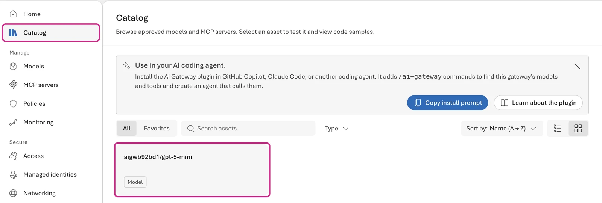

2. Under **Authentication**, check that **Method** is **API key**. Then change the **API key** from
   **Built-in all-access API key** to `app-first-call`, so that the playground calls the gateway with your new key.
   Send a prompt, for example `In one sentence, what does an AI gateway do?`.

   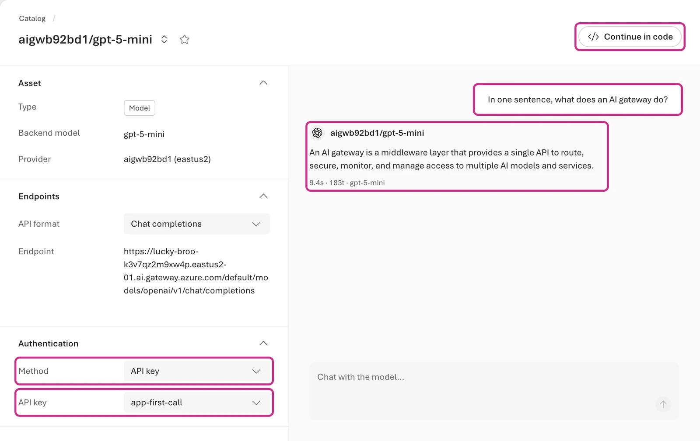

3. Optional: to make the same call from code, select **Continue in code**, then **cURL**. It shows the endpoint
   URL, your key masked, and snippets for cURL, the OpenAI SDK, LangChain, Vercel AI, the GitHub Copilot SDK, and
   Microsoft Agent Framework, plus a **Coding agent** prompt that installs the AI Gateway plugin.

   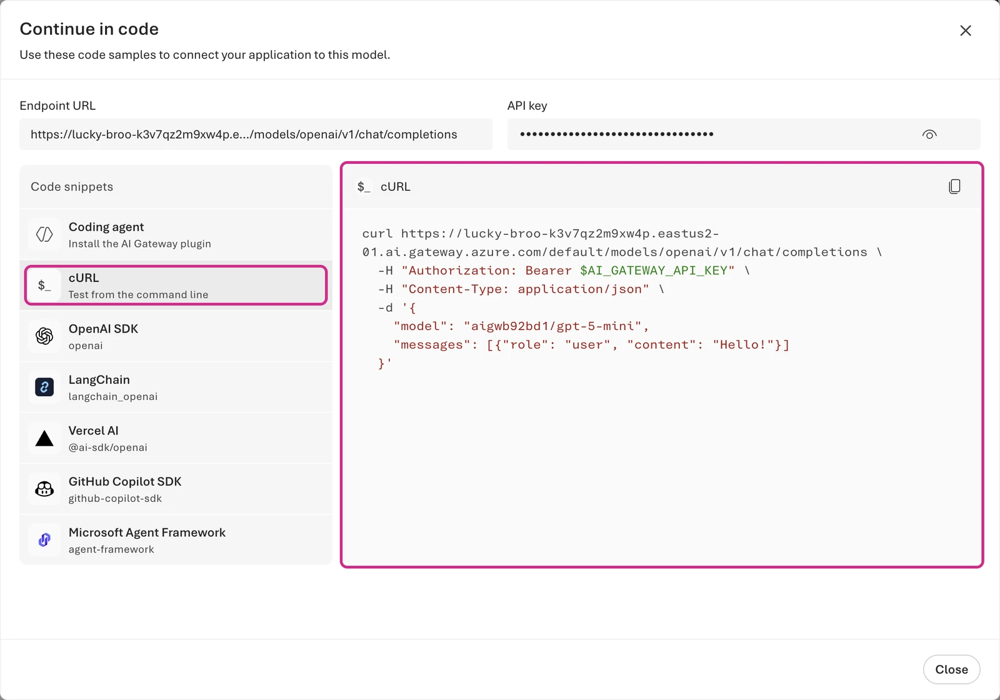

To run the cURL snippet, open [Azure Cloud Shell](https://shell.azure.com) in Bash, paste your key at this prompt so
that it never shows on screen, and then paste the snippet:

```bash title="Bash"
# Read the key without showing it, and export it for the snippet
printf "AI Gateway API key: " && read -rs AI_GATEWAY_API_KEY && export AI_GATEWAY_API_KEY && echo
echo "🔑 Key: in AI_GATEWAY_API_KEY (${#AI_GATEWAY_API_KEY} characters, not shown)"
```

> **Checkpoint:** the playground answered with the key `app-first-call`. Your gateway is live, and your app never
> needs a Foundry key: only the gateway's managed identity calls Foundry.

### Clean up

To keep exploring, skip this step: [lab 03](../03-multi-provider-aliases/README.md) and the labs after it work on this
gateway. On the labs site, save the resource group and the gateway name in **Your values**. Otherwise, delete the
gateway.

1. Open the gateway switcher in the top bar and select **View all gateways**.

2. On your gateway's row, select **More actions** (**…**), and then select **Delete**.

   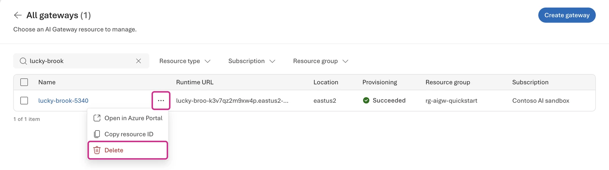

3. To confirm, select **Delete** in the dialog. The row shows **Deleting** until Azure removes the gateway, in about
   five minutes.

   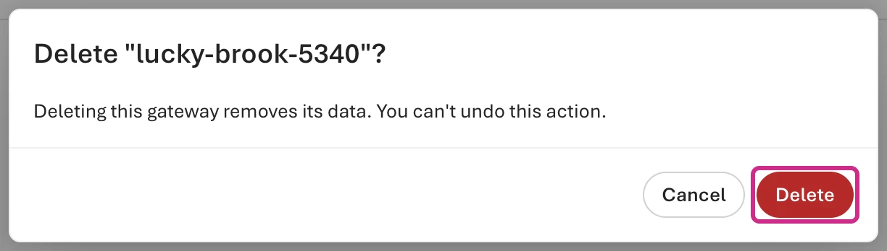

Deleting the gateway keeps its resource group and your Foundry account. If you created them in Cloud Shell for this
quick start, delete the resource group and purge the Foundry account there too: deleted Foundry accounts stay
soft-deleted for 48 hours and keep counting against your quota until you purge them.

```bash title="Bash"
# Find the Foundry account in the resource group, so that you can purge it after the delete
FOUNDRY="$(az cognitiveservices account list --resource-group rg-aigw-quickstart --query "[0].name" --output tsv)"
echo "🏭 Foundry account: $FOUNDRY"

# Delete the resource group, with everything in it
az group delete --name rg-aigw-quickstart --yes &&
  echo "🚮 Resource group rg-aigw-quickstart is deleted"

# Purge the deleted Foundry account, so that it stops counting against your quota
az cognitiveservices account purge --name "$FOUNDRY" --resource-group rg-aigw-quickstart --location eastus2 &&
  echo "🚮 Foundry account $FOUNDRY is purged"
```

> **Checkpoint:** after you refresh the page, **All gateways** no longer lists your gateway.

</details> <!-- gh -->
<!-- track: cli | Azure CLI -->
<details><summary><b>⌨️ Azure CLI</b></summary> <!-- gh -->

**What you need:** only the one-time setup from **Before you begin**. The track creates the Foundry deployment for
you.

### Set your variables

Paste the block for your shell. It sets the names, and a random suffix keeps the gateway and Foundry account names
globally unique.

<details open><summary>Bash</summary> <!-- gh -->

```bash title="Bash"
# Name the resources: the random suffix keeps the gateway and Foundry account names globally unique
export RG="rg-aigw-quickstart"
export LOCATION="eastus2"                     # or another region from Find the available regions
SUFFIX="$(openssl rand -hex 3)"
export GATEWAY="aigw-$SUFFIX"                 # part of the runtime URL
export FOUNDRY="aigw$SUFFIX"                  # the Foundry account and its subdomain
export DEPLOYMENT="gpt-5-mini"
export PROVIDER="foundry-models"

# Read your subscription ID, and build the gateway's resource ID that later commands use
export SUBSCRIPTION_ID="$(az account show --query id --output tsv)"
export GATEWAY_ID="/subscriptions/$SUBSCRIPTION_ID/resourceGroups/$RG/providers/Microsoft.ApiManagement/aigateways/$GATEWAY"
echo "📝 Gateway $GATEWAY and Foundry account $FOUNDRY, in $RG ($LOCATION)"
echo "🆔 Subscription: $SUBSCRIPTION_ID"
```
</details> <!-- gh -->

<details><summary>PowerShell</summary> <!-- gh -->

```powershell title="PowerShell"
# Name the resources: the random suffix keeps the gateway and Foundry account names globally unique
$RG         = "rg-aigw-quickstart"
$LOCATION   = "eastus2"                       # or another region from Find the available regions
$SUFFIX     = [guid]::NewGuid().ToString("N").Substring(0, 6)
$GATEWAY    = "aigw-$SUFFIX"                  # part of the runtime URL
$FOUNDRY    = "aigw$SUFFIX"                   # the Foundry account and its subdomain
$DEPLOYMENT = "gpt-5-mini"
$PROVIDER   = "foundry-models"

# Read your subscription ID, and build the gateway's resource ID that later commands use
$SUBSCRIPTION_ID = az account show --query id --output tsv
$GATEWAY_ID      = "/subscriptions/$SUBSCRIPTION_ID/resourceGroups/$RG/providers/Microsoft.ApiManagement/aigateways/$GATEWAY"
Write-Host "📝 Gateway $GATEWAY and Foundry account $FOUNDRY, in $RG ($LOCATION)"
Write-Host "🆔 Subscription: $SUBSCRIPTION_ID"
```
</details> <!-- gh -->

### Start creating the gateway

Create a resource group, and start creating the gateway. With `--no-wait`, Azure keeps provisioning the gateway in the
background, so you can move on right away.

<details open><summary>Bash</summary> <!-- gh -->

```bash title="Bash"
# Create the resource group that holds the gateway and the Foundry account
az group create --name "$RG" --location "$LOCATION" --output none &&
  echo "📦 Resource group $RG is ready in $LOCATION"

# Start creating the gateway, with a system-assigned managed identity; --no-wait returns right away
az aigateway create --resource-group "$RG" --name "$GATEWAY" --location "$LOCATION" --system-assigned true --no-wait &&
  echo "⏳ Gateway $GATEWAY is provisioning in the background"
```
</details> <!-- gh -->

<details><summary>PowerShell</summary> <!-- gh -->

```powershell title="PowerShell"
# Create the resource group that holds the gateway and the Foundry account
az group create --name $RG --location $LOCATION --output none
if ($?) { Write-Host "📦 Resource group $RG is ready in $LOCATION" }

# Start creating the gateway, with a system-assigned managed identity; --no-wait returns right away
az aigateway create --resource-group $RG --name $GATEWAY --location $LOCATION --system-assigned true --no-wait
if ($?) { Write-Host "⏳ Gateway $GATEWAY is provisioning in the background" }
```
</details> <!-- gh -->

### Deploy the model in Foundry

While the gateway provisions, create a Foundry account with a `gpt-5-mini` deployment.

<details open><summary>Bash</summary> <!-- gh -->

```bash title="Bash"
# Create the Foundry account, with a custom subdomain so that the gateway can sign in with Microsoft Entra ID,
# and keep its resource ID for the import in the next step
export FOUNDRY_ID="$(az cognitiveservices account create --resource-group "$RG" --name "$FOUNDRY" --location "$LOCATION" \
  --kind AIServices --sku S0 --custom-domain "$FOUNDRY" --yes --query id --output tsv)" &&
  echo "🏭 Foundry account $FOUNDRY is ready"

# Deploy gpt-5-mini with 10,000 tokens per minute of Global Standard capacity
az cognitiveservices account deployment create --resource-group "$RG" --name "$FOUNDRY" \
  --deployment-name "$DEPLOYMENT" --model-name gpt-5-mini --model-version 2025-08-07 --model-format OpenAI \
  --sku-name GlobalStandard --sku-capacity 10 --output none &&
  echo "✨ Model deployment $DEPLOYMENT is ready"
```
</details> <!-- gh -->

<details><summary>PowerShell</summary> <!-- gh -->

```powershell title="PowerShell"
# Create the Foundry account, with a custom subdomain so that the gateway can sign in with Microsoft Entra ID,
# and keep its resource ID for the import in the next step
$FOUNDRY_ID = az cognitiveservices account create --resource-group $RG --name $FOUNDRY --location $LOCATION `
  --kind AIServices --sku S0 --custom-domain $FOUNDRY --yes --query id --output tsv
if ($?) { Write-Host "🏭 Foundry account $FOUNDRY is ready" }

# Deploy gpt-5-mini with 10,000 tokens per minute of Global Standard capacity
az cognitiveservices account deployment create --resource-group $RG --name $FOUNDRY `
  --deployment-name $DEPLOYMENT --model-name gpt-5-mini --model-version 2025-08-07 --model-format OpenAI `
  --sku-name GlobalStandard --sku-capacity 10 --output none
if ($?) { Write-Host "✨ Model deployment $DEPLOYMENT is ready" }
```
</details> <!-- gh -->

### Publish the model

Wait for the gateway, then publish the deployment with two commands:

- `az aigateway model-provider import --foundry-resource-id` imports the Foundry account. It gives the gateway's
  managed identity the **Foundry User** role on the account, adds a model provider that signs in with that identity,
  and adds a model for each deployment. The gateway calls the model with this identity, so your apps never hold a
  Foundry key.
- `az aigateway model-alias set` adds the alias that apps send in the `model` field, or updates it if it exists, so
  you can run the step again. The import doesn't add aliases.

<details open><summary>Bash</summary> <!-- gh -->

```bash title="Bash"
# Wait until the gateway finishes provisioning
az aigateway wait --resource-group "$RG" --name "$GATEWAY" --created &&
  echo "🚀 Gateway $GATEWAY is ready"

# Import the Foundry account: role for the gateway's identity, a model provider, and a model for each deployment
MODELS="$(az aigateway model-provider import --resource-group "$RG" --gateway-name "$GATEWAY" --name "$PROVIDER" \
  --foundry-resource-id "$FOUNDRY_ID" --query "join(', ', models[].name)" --output tsv)" &&
  echo "🔌 Model provider $PROVIDER imported $MODELS from $FOUNDRY"

# Add or update the alias that apps send in the model field
ALIAS="$(az aigateway model-alias set --resource-group "$RG" --gateway-name "$GATEWAY" --name "$DEPLOYMENT" --only-show-errors \
  --backend-model resource-id="$GATEWAY_ID/workspaces/default/modelProviders/$PROVIDER/models/$DEPLOYMENT" \
  --query properties.aliasName --output tsv)" &&
  echo "🔖 Alias $ALIAS is ready"
```
</details> <!-- gh -->

<details><summary>PowerShell</summary> <!-- gh -->

```powershell title="PowerShell"
# Wait until the gateway finishes provisioning
az aigateway wait --resource-group $RG --name $GATEWAY --created
if ($?) { Write-Host "🚀 Gateway $GATEWAY is ready" }

# Import the Foundry account: role for the gateway's identity, a model provider, and a model for each deployment
$MODELS = az aigateway model-provider import --resource-group $RG --gateway-name $GATEWAY --name $PROVIDER `
  --foundry-resource-id $FOUNDRY_ID --query "models[].name" --output tsv
if ($?) { Write-Host "🔌 Model provider $PROVIDER imported $($MODELS -join ', ') from $FOUNDRY" }

# Add or update the alias that apps send in the model field
$ALIAS = az aigateway model-alias set --resource-group $RG --gateway-name $GATEWAY --name $DEPLOYMENT --only-show-errors `
  --backend-model resource-id="$GATEWAY_ID/workspaces/default/modelProviders/$PROVIDER/models/$DEPLOYMENT" `
  --query properties.aliasName --output tsv
if ($?) { Write-Host "🔖 Alias $ALIAS is ready" }
```
</details> <!-- gh -->

### Create a runtime API key

Create a key for your app. Then read the key, the gateway URL, and the alias into environment variables, so that
the key never shows on screen. Azure RBAC is the keyless alternative: grant the app the **AI Gateway Models User**
role, and it sends a Microsoft Entra ID token instead of a key, as
[Go keyless with Microsoft Entra ID and RBAC](../11-entra-rbac/README.md) shows.

<details open><summary>Bash</summary> <!-- gh -->

```bash title="Bash"
# Create a runtime API key for your app
az aigateway api-key create --resource-group "$RG" --gateway-name "$GATEWAY" --name app-first-call --output none &&
  echo "🔑 API key app-first-call is ready"

# Read the key, the gateway's runtime URL, and the alias into environment variables
export AI_GATEWAY_API_KEY="$(az aigateway api-key list-secrets --resource-group "$RG" --gateway-name "$GATEWAY" \
  --name app-first-call --query primaryKey --output tsv)"
export AI_GATEWAY_URL="https://$(az aigateway show --resource-group "$RG" --name "$GATEWAY" --query properties.frontend.defaultHostname --output tsv)"
export AI_GATEWAY_MODEL="$DEPLOYMENT"
echo "🔑 Key: in AI_GATEWAY_API_KEY (${#AI_GATEWAY_API_KEY} characters, not shown)"
echo "🌐 Runtime URL: $AI_GATEWAY_URL"
echo "🔖 Model alias: $AI_GATEWAY_MODEL"
```
</details> <!-- gh -->

<details><summary>PowerShell</summary> <!-- gh -->

```powershell title="PowerShell"
# Create a runtime API key for your app
az aigateway api-key create --resource-group $RG --gateway-name $GATEWAY --name app-first-call --output none
if ($?) { Write-Host "🔑 API key app-first-call is ready" }

# Read the key, the gateway's runtime URL, and the alias into environment variables
$env:AI_GATEWAY_API_KEY = az aigateway api-key list-secrets --resource-group $RG --gateway-name $GATEWAY `
  --name app-first-call --query primaryKey --output tsv
$env:AI_GATEWAY_URL     = "https://" + (az aigateway show --resource-group $RG --name $GATEWAY --query properties.frontend.defaultHostname --output tsv)
$env:AI_GATEWAY_MODEL   = $DEPLOYMENT
Write-Host "🔑 Key: in AI_GATEWAY_API_KEY ($($env:AI_GATEWAY_API_KEY.Length) characters, not shown)"
Write-Host "🌐 Runtime URL: $env:AI_GATEWAY_URL"
Write-Host "🔖 Model alias: $env:AI_GATEWAY_MODEL"
```
</details> <!-- gh -->

> **Checkpoint:** the commands printed `🔖 Alias gpt-5-mini is ready` and your gateway's runtime URL, for example
> `🌐 Runtime URL: https://aigw-abc12-k3v7qz2m9xw4p.eastus2-01.ai.gateway.azure.com`.

### Make your first call

Send a Chat Completions request to the gateway's OpenAI-compatible base URL, the way an app does: the alias in the
`model` field and the key as a bearer token.

<details open><summary>Bash</summary> <!-- gh -->

```bash title="Bash"
# Call the model through the gateway, the way an app does: the alias in model, and the key as a bearer token
curl -sS "$AI_GATEWAY_URL/default/models/openai/v1/chat/completions" \
  -H "Authorization: Bearer $AI_GATEWAY_API_KEY" -H "Content-Type: application/json" \
  -d "{\"model\":\"$AI_GATEWAY_MODEL\",\"messages\":[{\"role\":\"user\",\"content\":\"In one sentence, what does an AI gateway do?\"}]}" \
  | jq -r 'if .choices then "🤖 \(.choices[0].message.content)" else "🚨 \(.error.message // .)" end'
```
</details> <!-- gh -->

<details><summary>PowerShell</summary> <!-- gh -->

```powershell title="PowerShell"
# Build the request: the alias in model, and one user message
$body = @{
  model    = $env:AI_GATEWAY_MODEL
  messages = @(@{ role = "user"; content = "In one sentence, what does an AI gateway do?" })
} | ConvertTo-Json -Depth 5

# Call the model through the gateway, the way an app does: with the key as a bearer token
$reply = Invoke-RestMethod -Method Post -Uri "$env:AI_GATEWAY_URL/default/models/openai/v1/chat/completions" `
  -Headers @{ Authorization = "Bearer $env:AI_GATEWAY_API_KEY" } -ContentType "application/json" -Body $body
if ($?) { Write-Host "🤖 $($reply.choices[0].message.content)" }
```
</details> <!-- gh -->

> **Checkpoint:** the model answers in one sentence. Your gateway is live, and your app never needed a Foundry key:
> only the gateway's managed identity calls Foundry. If you get `401`, `403`, or `404` in the first minute, the new
> key, alias, or role on the Foundry account is still taking effect. Wait a minute and run the call again.

To see what you created, open the [AI Gateway portal](https://ai.gateway.azure.com) and select your gateway in the top
bar: **Models**, **Access** › **API keys**, and the **Catalog** playground.

### Clean up

To keep exploring, skip this step: [lab 03](../03-multi-provider-aliases/README.md) and the labs after it work on this
gateway. On the labs site, save the resource group and the gateway name (`$RG` and `$GATEWAY`) in **Your values**.
Otherwise, delete the resource group, which holds the gateway and the Foundry account. Then purge the Foundry account:
deleted Foundry accounts stay soft-deleted for 48 hours and keep counting against your quota until you purge them.

<details open><summary>Bash</summary> <!-- gh -->

```bash title="Bash"
# Delete the resource group, with the gateway and the Foundry account in it
az group delete --name "$RG" --yes &&
  echo "🚮 Resource group $RG is deleted"

# Purge the deleted Foundry account, so that it stops counting against your quota
az cognitiveservices account purge --name "$FOUNDRY" --resource-group "$RG" --location "$LOCATION" &&
  echo "🚮 Foundry account $FOUNDRY is purged"
```
</details> <!-- gh -->

<details><summary>PowerShell</summary> <!-- gh -->

```powershell title="PowerShell"
# Delete the resource group, with the gateway and the Foundry account in it
az group delete --name $RG --yes
if ($?) { Write-Host "🚮 Resource group $RG is deleted" }

# Purge the deleted Foundry account, so that it stops counting against your quota
az cognitiveservices account purge --name $FOUNDRY --resource-group $RG --location $LOCATION
if ($?) { Write-Host "🚮 Foundry account $FOUNDRY is purged" }
```
</details> <!-- gh -->

If Cloud Shell timed out, set `RG`, `FOUNDRY`, and `LOCATION` again with the names that you used: the suffix in
**Set your variables** is random.

> **Checkpoint:** `az group exists --name $RG` prints `false`.

</details> <!-- gh -->
<!-- track: iac | Bicep + azd -->
<details><summary><b>🏗️ Bicep + azd</b></summary> <!-- gh -->

**What you need:** only the one-time setup from **Before you begin**. The template creates the Foundry deployment for
you.

### Review the template

The template is a small azd project in the
[`labs/quickstart`](https://github.com/Azure/aigateway/tree/main/labs/quickstart) folder of the repo: an `azure.yaml`
and a Bicep file for each scope. `infra/main.bicep` creates the resource group `rg-<environment name>` and passes
unique names to `infra/resources.bicep`, which creates the building blocks in the same order as the other tracks:

<!-- include: infra/resources.bicep -->
<!-- gh:begin include: generated by "npm run sync" from the metadata, do not edit -->
📄 [`infra/resources.bicep`](infra/resources.bicep)

<details><summary>Show all 173 lines</summary>

```bicep
// The building blocks of the quick start, the same ones that the portal and Azure CLI tracks create:
// a gateway, a Foundry model deployment, a model provider that signs in with the gateway's managed identity,
// an alias that apps send in the "model" field, and a runtime API key.
targetScope = 'resourceGroup'

param location string
param tags object = {}

@description('Gateway name. It becomes the first label of the runtime host name.')
@maxLength(24)
param gatewayName string

@description('Foundry account name, also its custom subdomain. It must be globally unique.')
param foundryName string

param modelName string = 'gpt-5-mini'
param modelVersion string = '2025-08-07'

@description('Deployment capacity in thousands of tokens per minute.')
param capacity int = 10

param providerName string = 'foundry-models'
param apiKeyName string = 'app-first-call'

var foundryUserRoleId = '53ca6127-db72-4b80-b1b0-d745d6d5456d'

// 1. The gateway, with a system-assigned managed identity. It omits sku, so it gets the default SKU.
#disable-next-line BCP081
resource gateway 'Microsoft.ApiManagement/aigateways@2026-11-01' = {
  name: gatewayName
  location: location
  tags: tags
  identity: {
    type: 'SystemAssigned'
  }
  properties: {}
}

#disable-next-line BCP081
resource workspace 'Microsoft.ApiManagement/aigateways/workspaces@2026-11-01' existing = {
  parent: gateway
  name: 'default'
}

// 2. A Foundry account with one model deployment. Local auth is off: only Entra identities can call it.
resource foundry 'Microsoft.CognitiveServices/accounts@2025-04-01-preview' = {
  name: foundryName
  location: location
  tags: tags
  kind: 'AIServices'
  sku: {
    name: 'S0'
  }
  properties: {
    customSubDomainName: foundryName
    disableLocalAuth: true
    publicNetworkAccess: 'Enabled'
  }
}

resource deployment 'Microsoft.CognitiveServices/accounts/deployments@2025-04-01-preview' = {
  parent: foundry
  name: modelName
  sku: {
    name: 'GlobalStandard'
    capacity: capacity
  }
  properties: {
    model: {
      format: 'OpenAI'
      name: modelName
      version: modelVersion
    }
  }
}

// The gateway calls Foundry with its own identity, so it needs the Foundry User role on the account.
resource foundryUser 'Microsoft.Authorization/roleAssignments@2022-04-01' = {
  scope: foundry
  name: guid(foundry.id, gateway.id, foundryUserRoleId)
  properties: {
    principalId: gateway.identity.principalId
    principalType: 'ServicePrincipal'
    roleDefinitionId: subscriptionResourceId('Microsoft.Authorization/roleDefinitions', foundryUserRoleId)
  }
}

// 3. A model provider that points at the Foundry account and signs in with the managed identity.
#disable-next-line BCP081
resource provider 'Microsoft.ApiManagement/aigateways/workspaces/modelProviders@2026-11-01' = {
  parent: workspace
  name: providerName
  dependsOn: [
    foundryUser
  ]
  properties: {
    modelProviderType: 'Foundry'
    displayName: 'Foundry models'
    foundry: {
      endpoint: {
        url: 'https://${foundryName}.cognitiveservices.azure.com/'
      }
      resourceIds: [
        foundry.id
      ]
    }
    authentication: {
      managedIdentity: {
        resource: 'https://cognitiveservices.azure.com/'
      }
    }
  }
}

// 4. The deployment as a backend model, and an alias that apps send in the "model" field.
#disable-next-line BCP081
resource model 'Microsoft.ApiManagement/aigateways/workspaces/modelProviders/models@2026-11-01' = {
  parent: provider
  name: modelName
  properties: {
    displayName: modelName
    supportedEndpoints: [
      '/openai/v1/chat/completions'
      '/openai/v1/responses'
    ]
    deployment: {
      resourceId: deployment.id
      modelName: modelName
      modelVersion: modelVersion
    }
  }
}

#disable-next-line BCP081
resource alias 'Microsoft.ApiManagement/aigateways/workspaces/aliases@2026-11-01' = {
  parent: workspace
  name: modelName
  properties: {
    aliasName: modelName
    backendModels: [
      {
        resourceId: model.id
      }
    ]
  }
}

// 5. A runtime API key for your first app. Read its value with az aigateway api-key list-secrets; it's never a
//    deployment output.
#disable-next-line BCP081
resource apiKey 'Microsoft.ApiManagement/aigateways/apiKeys@2026-11-01' = {
  parent: gateway
  name: apiKeyName
  properties: {
    displayName: apiKeyName
  }
}

output gatewayName string = gateway.name
output gatewayId string = gateway.id
output gatewayUrl string = 'https://${gateway.properties.frontend.defaultHostname}'
output aliasName string = alias.name
output foundryName string = foundry.name

// For the labs that build on this template: they call it as a module, then add their own resources.
output gatewayPrincipalId string = gateway.identity.principalId
output providerName string = provider.name
output modelName string = model.name
output modelId string = model.id
output modelVersion string = deployment.properties.model.version
output foundryId string = foundry.id
output foundryEndpoint string = foundry.properties.endpoint
output apiKeyName string = apiKey.name
```

</details>
<!-- gh:end -->

### Deploy with azd up

Move into the quick start's folder, create an azd environment named `aigw-quickstart` in your current subscription,
so that azd doesn't prompt you, then provision everything with one command. It takes about three minutes.

<details open><summary>Bash</summary> <!-- gh -->

```bash title="Bash"
# Move into the quick start's folder, which holds the azd project
cd ~/aigateway/labs/quickstart &&
  echo "📂 Template folder: $(pwd)"

# Create an azd environment in your current subscription, so that azd doesn't prompt you
azd env new aigw-quickstart --location eastus2 --subscription "$(az account show --query id --output tsv)" &&
  echo "📝 azd environment aigw-quickstart deploys to eastus2"

# Provision the gateway, the Foundry deployment, the provider, the model, the alias, and the key
azd up &&
  echo "🚀 Gateway deployed: $(azd env get-value AI_GATEWAY_URL)"
```
</details> <!-- gh -->

<details><summary>PowerShell</summary> <!-- gh -->

```powershell title="PowerShell"
# Move into the quick start's folder, which holds the azd project
Set-Location ~/aigateway/labs/quickstart
if ($?) { Write-Host "📂 Template folder: $(Get-Location)" }

# Create an azd environment in your current subscription, so that azd doesn't prompt you
azd env new aigw-quickstart --location eastus2 --subscription (az account show --query id --output tsv)
if ($?) { Write-Host "📝 azd environment aigw-quickstart deploys to eastus2" }

# Provision the gateway, the Foundry deployment, the provider, the model, the alias, and the key
azd up
if ($?) { Write-Host "🚀 Gateway deployed: $(azd env get-value AI_GATEWAY_URL)" }
```
</details> <!-- gh -->

For another region, use its name from [Find the available regions](../SETUP.md#find-the-available-regions).
azd saves the template's outputs, like the gateway URL and the alias, as environment values. The API key isn't an
output, so it never lands in a file or a deployment log.

### Read the URL, the alias, and the key

Read the outputs, and read the key from the gateway into an environment variable, so that it never shows on screen.
Azure RBAC is the keyless alternative to the key: grant the app the **AI Gateway Models User** role, and it sends a
Microsoft Entra ID token instead, as [Go keyless with Microsoft Entra ID and RBAC](../11-entra-rbac/README.md) shows.

<details open><summary>Bash</summary> <!-- gh -->

```bash title="Bash"
# Read the template's outputs: the gateway's runtime URL and the alias
export AI_GATEWAY_URL="$(azd env get-value AI_GATEWAY_URL)"
export AI_GATEWAY_MODEL="$(azd env get-value AI_GATEWAY_MODEL)"

# Read the key from the gateway, so that it never lands in a file or a deployment log
export AI_GATEWAY_API_KEY="$(az aigateway api-key list-secrets --ids "$(azd env get-value AI_GATEWAY_ID)/apiKeys/app-first-call" \
  --query primaryKey --output tsv)"
echo "🌐 Runtime URL: $AI_GATEWAY_URL"
echo "🔖 Model alias: $AI_GATEWAY_MODEL"
echo "🔑 Key: in AI_GATEWAY_API_KEY (${#AI_GATEWAY_API_KEY} characters, not shown)"
```
</details> <!-- gh -->

<details><summary>PowerShell</summary> <!-- gh -->

```powershell title="PowerShell"
# Read the template's outputs: the gateway's runtime URL, the alias, and the gateway's resource ID
$env:AI_GATEWAY_URL     = azd env get-value AI_GATEWAY_URL
$env:AI_GATEWAY_MODEL   = azd env get-value AI_GATEWAY_MODEL
$GATEWAY_ID             = azd env get-value AI_GATEWAY_ID

# Read the key from the gateway, so that it never lands in a file or a deployment log
$env:AI_GATEWAY_API_KEY = az aigateway api-key list-secrets --ids "$GATEWAY_ID/apiKeys/app-first-call" `
  --query primaryKey --output tsv
Write-Host "🌐 Runtime URL: $env:AI_GATEWAY_URL"
Write-Host "🔖 Model alias: $env:AI_GATEWAY_MODEL"
Write-Host "🔑 Key: in AI_GATEWAY_API_KEY ($($env:AI_GATEWAY_API_KEY.Length) characters, not shown)"
```
</details> <!-- gh -->

> **Checkpoint:** `azd up` ended with `SUCCESS`, and the last commands printed your gateway's runtime URL, for example
> `🌐 Runtime URL: https://aigw-abc12-k3v7qz2m9xw4p.eastus2-01.ai.gateway.azure.com`.

### Make your first call

Send a Chat Completions request to the gateway's OpenAI-compatible base URL, the way an app does: the alias in the
`model` field and the key as a bearer token.

<details open><summary>Bash</summary> <!-- gh -->

```bash title="Bash"
# Call the model through the gateway, the way an app does: the alias in model, and the key as a bearer token
curl -sS "$AI_GATEWAY_URL/default/models/openai/v1/chat/completions" \
  -H "Authorization: Bearer $AI_GATEWAY_API_KEY" -H "Content-Type: application/json" \
  -d "{\"model\":\"$AI_GATEWAY_MODEL\",\"messages\":[{\"role\":\"user\",\"content\":\"In one sentence, what does an AI gateway do?\"}]}" \
  | jq -r 'if .choices then "🤖 \(.choices[0].message.content)" else "🚨 \(.error.message // .)" end'
```
</details> <!-- gh -->

<details><summary>PowerShell</summary> <!-- gh -->

```powershell title="PowerShell"
# Build the request: the alias in model, and one user message
$body = @{
  model    = $env:AI_GATEWAY_MODEL
  messages = @(@{ role = "user"; content = "In one sentence, what does an AI gateway do?" })
} | ConvertTo-Json -Depth 5

# Call the model through the gateway, the way an app does: with the key as a bearer token
$reply = Invoke-RestMethod -Method Post -Uri "$env:AI_GATEWAY_URL/default/models/openai/v1/chat/completions" `
  -Headers @{ Authorization = "Bearer $env:AI_GATEWAY_API_KEY" } -ContentType "application/json" -Body $body
if ($?) { Write-Host "🤖 $($reply.choices[0].message.content)" }
```
</details> <!-- gh -->

> **Checkpoint:** the model answers in one sentence. Your gateway is live, and your app never needed a Foundry key:
> only the gateway's managed identity calls Foundry. If you get `401`, `403`, or `404` in the first minute, the new
> key, alias, or role on the Foundry account is still taking effect. Wait a minute and run the call again.

To see what you created, open the [AI Gateway portal](https://ai.gateway.azure.com) and select your gateway in the top
bar: **Models**, **Access** › **API keys**, and the **Catalog** playground.

### Clean up

To keep exploring, skip this step: [lab 03](../03-multi-provider-aliases/README.md) and the labs after it work on this
gateway. Otherwise, in the `aigateway/labs/quickstart` folder, delete everything that `azd up` created. `--purge` also purges
the Foundry account, which would otherwise stay soft-deleted for 48 hours and keep counting against your quota. It
takes about ten minutes.

<details open><summary>Bash</summary> <!-- gh -->

```bash title="Bash"
# Delete everything that azd up created, and purge the Foundry account
azd down --purge --force &&
  echo "🚮 Everything that azd up created is deleted"
```
</details> <!-- gh -->

<details><summary>PowerShell</summary> <!-- gh -->

```powershell title="PowerShell"
# Delete everything that azd up created, and purge the Foundry account
azd down --purge --force
if ($?) { Write-Host "🚮 Everything that azd up created is deleted" }
```
</details> <!-- gh -->

> **Checkpoint:** `azd down` ended with `SUCCESS`. The resource group `rg-aigw-quickstart` is gone, and you can delete
> the `aigateway` folder.

</details> <!-- gh -->
<!-- track: terraform | Terraform -->
<details><summary><b>🌍 Terraform</b></summary> <!-- gh -->

**What you need:** only the one-time setup from **Before you begin**, plus Terraform 1.9 or later, as in
[Deploy a lab with Terraform](../SETUP.md#deploy-a-lab-with-terraform). The configuration creates the Foundry
deployment for you.

### Review the configuration

The configuration is in the [`labs/quickstart/terraform`](https://github.com/Azure/aigateway/tree/main/labs/quickstart/terraform)
folder of the repo. `terraform/main.tf` creates the resource group `rg-<environment_name>` and passes unique names to
the `resources` module, which creates the building blocks in the same order as the other tracks. The AI Gateway
resources use the `azapi` provider, which sends their API version, `2026-11-01`, as is; the resource group, the
Foundry account, and the role assignment use `azurerm`:

<!-- include: terraform/resources/main.tf -->
<!-- gh:begin include: generated by "npm run sync" from the metadata, do not edit -->
📄 [`terraform/resources/main.tf`](terraform/resources/main.tf)

<details><summary>Show all 169 lines</summary>

```tf
# The building blocks of the quick start, the same ones that the portal, Azure CLI, and Bicep tracks create:
# a gateway, a Foundry model deployment, a model provider that signs in with the gateway's managed identity,
# an alias that apps send in the "model" field, and a runtime API key. The labs reuse this module.
terraform {
  required_providers {
    azapi = {
      source = "Azure/azapi"
    }
    azurerm = {
      source = "hashicorp/azurerm"
    }
  }
}

locals {
  foundry_user_role_id = "53ca6127-db72-4b80-b1b0-d745d6d5456d"
  workspace_id         = "${azapi_resource.gateway.id}/workspaces/default"
}

# 1. The gateway, with a system-assigned managed identity. It omits sku, so it gets the default SKU. AI Gateway
#    resources have no Terraform schema yet, so azapi sends the body as is.
resource "azapi_resource" "gateway" {
  type      = "Microsoft.ApiManagement/aigateways@2026-11-01"
  name      = var.gateway_name
  parent_id = var.resource_group_id
  location  = var.location
  tags      = var.tags

  identity {
    type = "SystemAssigned"
  }

  body = {
    properties = {}
  }

  schema_validation_enabled = false
  response_export_values    = ["properties.frontend.defaultHostname"]

  # Activation can take longer than azapi's default 30 minutes in some regions.
  timeouts {
    create = "60m"
  }
}

# 2. A Foundry account with one model deployment. Local auth is off: only Entra identities can call it.
resource "azurerm_cognitive_account" "foundry" {
  name                  = var.foundry_name
  resource_group_name   = var.resource_group_name
  location              = var.location
  tags                  = var.tags
  kind                  = "AIServices"
  sku_name              = "S0"
  custom_subdomain_name = var.foundry_name
  local_auth_enabled    = false
}

resource "azurerm_cognitive_deployment" "model" {
  name                 = var.model_name
  cognitive_account_id = azurerm_cognitive_account.foundry.id

  sku {
    name     = "GlobalStandard"
    capacity = var.capacity
  }

  model {
    format  = "OpenAI"
    name    = var.model_name
    version = var.model_version
  }
}

# The gateway calls Foundry with its own identity, so it needs the Foundry User role on the account.
resource "azurerm_role_assignment" "foundry_user" {
  name                             = uuidv5("url", "${azurerm_cognitive_account.foundry.id}/${azapi_resource.gateway.id}/${local.foundry_user_role_id}")
  scope                            = azurerm_cognitive_account.foundry.id
  role_definition_id               = "/subscriptions/${var.subscription_id}/providers/Microsoft.Authorization/roleDefinitions/${local.foundry_user_role_id}"
  principal_id                     = azapi_resource.gateway.identity[0].principal_id
  principal_type                   = "ServicePrincipal"
  skip_service_principal_aad_check = true
}

# 3. A model provider that points at the Foundry account and signs in with the managed identity.
resource "azapi_resource" "provider" {
  type      = "Microsoft.ApiManagement/aigateways/workspaces/modelProviders@2026-11-01"
  name      = var.provider_name
  parent_id = local.workspace_id

  body = {
    properties = {
      modelProviderType = "Foundry"
      displayName       = "Foundry models"
      foundry = {
        endpoint = {
          url = "https://${var.foundry_name}.cognitiveservices.azure.com/"
        }
        resourceIds = [azurerm_cognitive_account.foundry.id]
      }
      authentication = {
        managedIdentity = {
          resource = "https://cognitiveservices.azure.com/"
        }
      }
    }
  }

  schema_validation_enabled = false
  depends_on                = [azurerm_role_assignment.foundry_user]
}

# 4. The deployment as a backend model, and an alias that apps send in the "model" field.
resource "azapi_resource" "model" {
  type      = "Microsoft.ApiManagement/aigateways/workspaces/modelProviders/models@2026-11-01"
  name      = var.model_name
  parent_id = azapi_resource.provider.id

  body = {
    properties = {
      displayName = var.model_name
      supportedEndpoints = [
        "/openai/v1/chat/completions",
        "/openai/v1/responses",
      ]
      deployment = {
        resourceId   = azurerm_cognitive_deployment.model.id
        modelName    = var.model_name
        modelVersion = var.model_version
      }
    }
  }

  schema_validation_enabled = false
}

resource "azapi_resource" "alias" {
  type      = "Microsoft.ApiManagement/aigateways/workspaces/aliases@2026-11-01"
  name      = var.model_name
  parent_id = local.workspace_id

  body = {
    properties = {
      aliasName = var.model_name
      backendModels = [
        {
          resourceId = azapi_resource.model.id
        },
      ]
    }
  }

  schema_validation_enabled = false
}

# 5. A runtime API key for your first app. Read its value with az aigateway api-key list-secrets; it's never an
#    output, so it stays out of the Terraform state.
resource "azapi_resource" "api_key" {
  type      = "Microsoft.ApiManagement/aigateways/apiKeys@2026-11-01"
  name      = var.api_key_name
  parent_id = azapi_resource.gateway.id

  body = {
    properties = {
      displayName = var.api_key_name
    }
  }

  schema_validation_enabled = false
}
```

</details>
<!-- gh:end -->

### Deploy with terraform apply

Move into the quick start's Terraform folder, select your current subscription, then plan and apply the
configuration. It takes about five minutes, most of it while the new gateway activates.

<details open><summary>Bash</summary> <!-- gh -->

```bash title="Bash"
# Move into the quick start's Terraform folder
cd ~/aigateway/labs/quickstart/terraform &&
  echo "📂 Terraform folder: $(pwd)"

# Deploy to the Azure CLI's current subscription
export ARM_SUBSCRIPTION_ID="$(az account show --query id --output tsv)" &&
  echo "📍 Subscription: $ARM_SUBSCRIPTION_ID"

# Download the providers, then plan and apply the gateway, the Foundry deployment, the provider, the model, the
# alias, and the key
terraform init &&
  terraform plan -out tfplan &&
  terraform apply tfplan &&
  echo "🚀 Gateway deployed: $(terraform output -raw ai_gateway_url)"
```
</details> <!-- gh -->

<details><summary>PowerShell</summary> <!-- gh -->

```powershell title="PowerShell"
# Move into the quick start's Terraform folder
Set-Location ~/aigateway/labs/quickstart/terraform
if ($?) { Write-Host "📂 Terraform folder: $(Get-Location)" }

# Deploy to the Azure CLI's current subscription
$env:ARM_SUBSCRIPTION_ID = az account show --query id --output tsv
if ($?) { Write-Host "📍 Subscription: $env:ARM_SUBSCRIPTION_ID" }

# Download the providers, then plan and apply the gateway, the Foundry deployment, the provider, the model, the
# alias, and the key
terraform init
if ($?) { terraform plan -out tfplan }
if ($?) { terraform apply tfplan }
if ($?) { Write-Host "🚀 Gateway deployed: $(terraform output -raw ai_gateway_url)" }
```
</details> <!-- gh -->

The configuration deploys to `eastus2`. For another region, run `export TF_VAR_location=<region>` (PowerShell:
`$env:TF_VAR_location = "<region>"`) with its name from [Find the available regions](../SETUP.md#find-the-available-regions)
before `terraform plan`. The API key isn't an output, so it never lands in the Terraform state.

### Read the URL, the alias, and the key

Read the outputs, and read the key from the gateway into an environment variable, so that it never shows on screen.

<details open><summary>Bash</summary> <!-- gh -->

```bash title="Bash"
# Read the configuration's outputs: the gateway's runtime URL and the alias
export AI_GATEWAY_URL="$(terraform output -raw ai_gateway_url)"
export AI_GATEWAY_MODEL="$(terraform output -raw ai_gateway_model)"

# Read the key from the gateway, so that it never lands in a file or the Terraform state
export AI_GATEWAY_API_KEY="$(az aigateway api-key list-secrets --ids "$(terraform output -raw ai_gateway_id)/apiKeys/app-first-call" \
  --query primaryKey --output tsv)"
echo "🌐 Runtime URL: $AI_GATEWAY_URL"
echo "🔖 Model alias: $AI_GATEWAY_MODEL"
echo "🔑 Key: in AI_GATEWAY_API_KEY (${#AI_GATEWAY_API_KEY} characters, not shown)"
```
</details> <!-- gh -->

<details><summary>PowerShell</summary> <!-- gh -->

```powershell title="PowerShell"
# Read the configuration's outputs: the gateway's runtime URL, the alias, and the gateway's resource ID
$env:AI_GATEWAY_URL     = terraform output -raw ai_gateway_url
$env:AI_GATEWAY_MODEL   = terraform output -raw ai_gateway_model
$GATEWAY_ID             = terraform output -raw ai_gateway_id

# Read the key from the gateway, so that it never lands in a file or the Terraform state
$env:AI_GATEWAY_API_KEY = az aigateway api-key list-secrets --ids "$GATEWAY_ID/apiKeys/app-first-call" `
  --query primaryKey --output tsv
Write-Host "🌐 Runtime URL: $env:AI_GATEWAY_URL"
Write-Host "🔖 Model alias: $env:AI_GATEWAY_MODEL"
Write-Host "🔑 Key: in AI_GATEWAY_API_KEY ($($env:AI_GATEWAY_API_KEY.Length) characters, not shown)"
```
</details> <!-- gh -->

> **Checkpoint:** `terraform apply` ended with `Apply complete! Resources: 9 added, 0 changed, 0 destroyed.`, and
> the last commands printed your gateway's runtime URL, for example
> `🌐 Runtime URL: https://aigw-abc12-k3v7qz2m9xw4p.eastus2-01.ai.gateway.azure.com`.

### Make your first call

Send a Chat Completions request to the gateway's OpenAI-compatible base URL, the way an app does: the alias in the
`model` field and the key as a bearer token.

<details open><summary>Bash</summary> <!-- gh -->

```bash title="Bash"
# Call the model through the gateway, the way an app does: the alias in model, and the key as a bearer token
curl -sS "$AI_GATEWAY_URL/default/models/openai/v1/chat/completions" \
  -H "Authorization: Bearer $AI_GATEWAY_API_KEY" -H "Content-Type: application/json" \
  -d "{\"model\":\"$AI_GATEWAY_MODEL\",\"messages\":[{\"role\":\"user\",\"content\":\"In one sentence, what does an AI gateway do?\"}]}" \
  | jq -r 'if .choices then "🤖 \(.choices[0].message.content)" else "🚨 \(.error.message // .)" end'
```
</details> <!-- gh -->

<details><summary>PowerShell</summary> <!-- gh -->

```powershell title="PowerShell"
# Build the request: the alias in model, and one user message
$body = @{
  model    = $env:AI_GATEWAY_MODEL
  messages = @(@{ role = "user"; content = "In one sentence, what does an AI gateway do?" })
} | ConvertTo-Json -Depth 5

# Call the model through the gateway, the way an app does: with the key as a bearer token
$reply = Invoke-RestMethod -Method Post -Uri "$env:AI_GATEWAY_URL/default/models/openai/v1/chat/completions" `
  -Headers @{ Authorization = "Bearer $env:AI_GATEWAY_API_KEY" } -ContentType "application/json" -Body $body
if ($?) { Write-Host "🤖 $($reply.choices[0].message.content)" }
```
</details> <!-- gh -->

> **Checkpoint:** the model answers in one sentence. If you get `401`, `403`, or `404` in the first minute, the new
> key, alias, or role on the Foundry account is still taking effect. Wait a minute and run the call again.

### Clean up

To keep exploring, skip this step: [lab 03](../03-multi-provider-aliases/README.md) and the labs after it work on this
gateway. Otherwise, in the `aigateway/labs/quickstart/terraform` folder, delete everything that `terraform apply`
created. The `azurerm` provider also purges the Foundry account, which would otherwise stay soft-deleted for 48 hours
and keep counting against your quota. It takes a few minutes.

```bash title="Bash or PowerShell"
# Delete everything that terraform apply created, and purge the Foundry account
terraform destroy -auto-approve &&
  echo "🚮 Everything that terraform apply created is deleted"
```

> **Checkpoint:** `terraform destroy` ended with `Destroy complete! Resources: 9 destroyed.` The resource group
> `rg-aigw-quickstart-tf` is gone, and you can delete the `aigateway` folder.

</details> <!-- gh -->
<!-- /tracks -->

## Next steps

- [How Azure AI Gateway works](../00-how-ai-gateway-works/README.md): a 3-minute video and a guided tour of every building block.
- [Provision your AI Gateway](../01-provision-gateway/README.md) and [Publish a Foundry model and make your first call](../02-first-model-call/README.md): the same setup in depth, with Bicep, the Responses API, and more SDKs.
- [Publish models from any provider behind stable aliases](../03-multi-provider-aliases/README.md): put models from several providers behind names your apps keep.
- [Throttle tokens per caller with token limits](../06-token-limits/README.md): give every app its own allowance.
- [Go keyless with Microsoft Entra ID and RBAC](../11-entra-rbac/README.md): replace the API key with Entra ID tokens and Azure RBAC roles.

<!-- gh:begin footer: generated by "npm run sync" from the metadata, do not edit -->

🛟 **Hit an error?** [Troubleshooting](../TROUBLESHOOTING.md#quick-start) lists the errors of this lab, the steps where they happen, and their fixes.

---

| ⬅️ Previous | 🏠 | Next ➡️ |
| :-- | :-: | --: |
|   | [All labs](../README.md) | [00 · How AI Gateway works](../00-how-ai-gateway-works/README.md) |
<!-- gh:end -->
